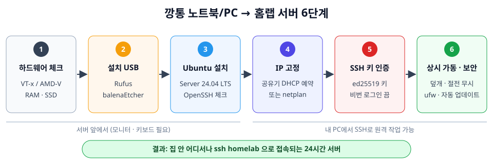
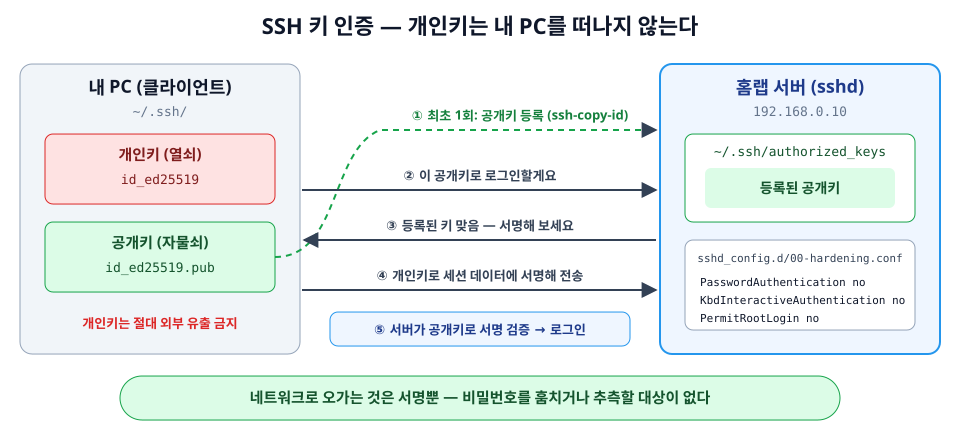
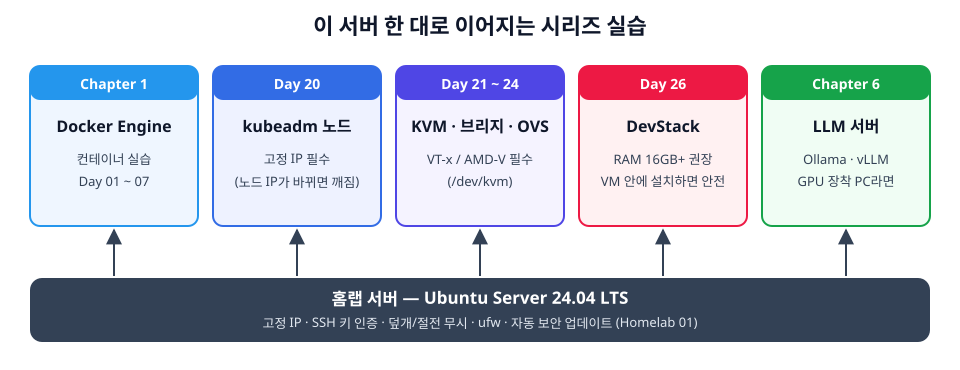

> **Chapter 0 · 홈랩** | 난이도 ★★☆☆☆ | 예상 소요 2 ~ 3시간 (설치 대기 시간 포함)

## 🎯 오늘의 목표

- 서랍 속 노트북/PC가 **실습용 서버로 쓸 만한지** 하드웨어를 점검할 수 있다
- USB 부팅 디스크로 **Ubuntu Server 24.04 LTS**를 설치하고 OpenSSH를 켤 수 있다
- 서버 IP를 **고정**(netplan 또는 공유기 DHCP 예약)하고 **SSH 키**로만 접속하게 만들 수 있다
- 노트북 덮개를 닫아도, 정전이 나도 **24시간 켜져 있는 서버**로 설정할 수 있다
- ufw 방화벽과 자동 보안 업데이트로 **최소한의 기본 보안**을 갖출 수 있다

---

## 1. 왜 홈랩인가?

본편은 Docker Desktop과 kind로 내 PC 안에서 대부분 실습할 수 있습니다. 하지만 시리즈 후반으로 갈수록 이야기가 달라집니다.

| 실습 | 내 PC(Docker Desktop)로 충분? | 이유 |
|---|---|---|
| Day 01 ~ 19 (Docker, K8s 기본) | ✅ 충분 | 컨테이너 몇 개, kind 클러스터 정도 |
| Day 20 kubeadm 멀티노드 | ⚠️ 빠듯함 | 실제 리눅스 노드(또는 VM) 여러 대가 필요 |
| Day 21 ~ 24 KVM, 리눅스 네트워킹 | ❌ 어려움 | **진짜 리눅스 + 하드웨어 가상화**가 필요 |
| Day 26 DevStack | ❌ 사실상 불가 | 호스트 네트워크를 크게 바꾸므로 전용 머신 권장 |

클라우드 VM을 빌리면 되지만, 매달 요금이 나가고 중첩 가상화(VM 안의 VM)가 막혀 있는 경우도 많습니다. 반면 **쓰지 않는 노트북 한 대**는 이미 CPU·RAM·SSD·배터리(=UPS!)까지 갖춘 훌륭한 서버입니다.

> 💡 노트북 서버의 숨은 장점: 배터리가 내장 UPS 역할을 하고, 화면·키보드가 붙어 있어 네트워크가 끊겼을 때 바로 콘솔 작업을 할 수 있습니다. 전력 소비도 데스크톱보다 훨씬 적습니다(유휴 시 10W 안팎인 경우가 많음).



---

## 2. 하드웨어 체크

### 2-1. 최소 / 권장 사양

| 항목 | 최소 | 권장 | 비고 |
|---|---|---|---|
| CPU | 64비트 2코어 | 4코어 이상 | **가상화(VT-x / AMD-V) 지원 필수** — KVM, DevStack에 필요 |
| RAM | 4GB | **16GB 이상** | kubeadm 노드는 2GB+, DevStack은 8GB 이상 필요 |
| 디스크 | 50GB | **SSD 256GB 이상** | HDD는 이미지 pull, DB, etcd가 체감될 만큼 느림 |
| 네트워크 | 유선 LAN | 유선 LAN | Wi-Fi도 되지만 서버는 **유선**이 압도적으로 안정적 |

> ⚠️ USB-C/Thunderbolt 동글형 LAN 어댑터는 설치 중 인식이 안 되는 경우가 있습니다. 가능하면 내장 LAN 포트가 있는 기기를 쓰세요.

### 2-2. 가상화 지원 확인

가상화 기능은 CPU가 지원하더라도 **BIOS/UEFI에서 꺼져 있는 경우**가 많습니다. 부팅 시 `F2` / `Del` / `F10` / `F12`(제조사마다 다름)로 BIOS에 들어가 다음 항목을 **Enabled**로 바꿉니다.

| CPU | BIOS 메뉴 이름(제조사마다 다를 수 있음) |
|---|---|
| Intel | Intel Virtualization Technology, **VT-x**, (가능하면 VT-d도) |
| AMD | **SVM Mode**, AMD-V, (가능하면 IOMMU도) |

Ubuntu 설치가 끝난 뒤에는 리눅스에서 확인할 수 있습니다.

```bash
lscpu | grep -i virtualization
# Virtualization:  VT-x        ← Intel
# Virtualization:  AMD-V       ← AMD

grep -cE '(vmx|svm)' /proc/cpuinfo    # 0보다 크면 CPU 지원 (0이면 BIOS에서 꺼짐 또는 미지원)

sudo apt install -y cpu-checker
kvm-ok
# INFO: /dev/kvm exists
# KVM acceleration can be used
```

---

## 3. 설치 USB 만들기

1. [ubuntu.com/download/server](https://ubuntu.com/download/server)에서 **Ubuntu Server 24.04.x LTS** ISO(`ubuntu-24.04.x-live-server-amd64.iso`)를 받습니다.
2. 8GB 이상 USB를 준비합니다. (**USB 안의 데이터는 전부 지워집니다**)
3. 굽기 도구를 고릅니다.

| 도구 | OS | 특징 |
|---|---|---|
| **Rufus** | Windows | 가볍고 빠름. 파티션 방식 **GPT**, 대상 시스템 **UEFI**를 고르면 최신 기기에 맞음 |
| **balenaEtcher** | Windows / macOS / Linux | ISO 선택 → USB 선택 → Flash! 세 단계로 끝. 옵션이 없어 실수할 여지가 적음 |

> 💡 Rufus가 "ISO 이미지 모드 / DD 이미지 모드"를 물어보면 기본값(ISO 모드)으로 진행해도 되고, 부팅이 안 되면 DD 모드로 다시 구워 보세요.

4. 대상 기기에 USB를 꽂고 부팅 메뉴(`F12`, `F11`, `Esc` 등 제조사마다 다름)에서 USB를 선택합니다. 부팅이 안 되면 BIOS에서 **Secure Boot**를 잠시 끄거나 부팅 순서를 확인합니다. (Ubuntu는 Secure Boot를 지원하므로 대부분 켠 채로도 됩니다)

---

## 4. Ubuntu Server 24.04 설치

설치 프로그램(Subiquity)은 텍스트 화면이지만 순서대로 따라가면 어렵지 않습니다.

| 단계 | 선택 | 포인트 |
|---|---|---|
| Language / Keyboard | English / Korean 또는 English(US) | 서버는 영어 로케일이 에러 메시지 검색에 유리 |
| Type of install | **Ubuntu Server** (minimized 아님) | minimized는 기본 도구가 너무 적음 |
| Network | 유선 LAN이 DHCP로 IP를 받는지 확인 | 여기서 받은 IP를 메모해 두기 |
| Proxy / Mirror | 기본값 | 미러 테스트가 통과하면 다음 |
| Storage | **Use an entire disk** + Set up this disk as an LVM group | ⚠️ 디스크의 기존 데이터는 모두 삭제됨 |
| Profile | 이름, 서버 이름(`homelab`), 사용자명(`devops`), 비밀번호 | 서버 이름과 사용자명은 이후 계속 씀 |
| Ubuntu Pro | Skip for now | 나중에 언제든 등록 가능 |
| **SSH Setup** | ✅ **Install OpenSSH server** | **반드시 체크!** GitHub 공개키 가져오기(Import SSH key)도 가능 |
| Featured Server Snaps | 아무것도 선택하지 않음 | Docker는 Day 01의 **공식 apt 저장소** 방식으로 설치할 것 |

설치가 끝나면 **Reboot Now** → USB를 뽑고 Enter.

> ⚠️ **LVM 기본 설정 함정**: 설치 프로그램이 디스크 전체가 아니라 일부(예: 100GB)만 루트 볼륨에 할당하는 경우가 있습니다. 첫 로그인 후 꼭 확인하세요.

```bash
df -h /                  # 루트 파일시스템 크기
sudo vgs                 # VFree 가 크게 남아 있다면 ↓ 로 전부 할당
sudo lvextend -r -l +100%FREE /dev/ubuntu-vg/ubuntu-lv   # -r: 파일시스템까지 함께 확장
df -h /
```

### 첫 로그인 후 기본 작업

```bash
sudo apt update && sudo apt full-upgrade -y
sudo timedatectl set-timezone Asia/Seoul
hostnamectl                  # Static hostname: homelab 확인
ip -br addr                  # 인터페이스 이름과 현재 IP 확인
```

```
lo               UNKNOWN        127.0.0.1/8 ::1/128
enp3s0           UP             192.168.0.23/24 fe80::.../64
```

여기서 **유선 인터페이스 이름**(`enp3s0`, `eno1`, `enp0s31f6` 등 기기마다 다름)과 **현재 IP**를 메모해 둡니다.

---

## 5. IP 고정하기 — 두 가지 방법

서버 IP가 재부팅할 때마다 바뀌면 SSH 접속 주소도, 나중에 설정할 포트포워딩도 매번 깨집니다. 방법은 두 가지입니다.

| 방법 | 설정 위치 | 장점 | 단점 |
|---|---|---|---|
| **공유기 DHCP 예약** (권장) | 공유기 관리 페이지 | 서버는 DHCP 그대로, 설정 실수로 접속 끊길 일 없음 | 공유기 메뉴가 기종마다 다름 |
| **netplan 고정 IP** | 서버 `/etc/netplan/*.yaml` | 공유기와 무관하게 동작 | IP 충돌·오타 시 원격 접속이 끊길 수 있음 |

### 5-1. 방법 A — 공유기 DHCP 예약 (권장)

공유기 관리 페이지에서 서버의 **MAC 주소**에 특정 IP를 묶어 두면, 서버는 DHCP로 받아도 항상 같은 IP를 받습니다. ipTIME 기준 메뉴 경로와 화면은 **Homelab 02**에서 자세히 다룹니다.

```bash
ip link show enp3s0     # link/ether 뒤가 MAC 주소 (예: 3c:52:82:aa:bb:cc)
```

### 5-2. 방법 B — netplan으로 고정 IP

Ubuntu Server는 **netplan** YAML로 네트워크를 설정합니다. 설치 직후에는 보통 `/etc/netplan/50-cloud-init.yaml`이 있습니다.

```bash
ls /etc/netplan/
ip route | grep default     # default via 192.168.0.1 dev enp3s0 ... ← 게이트웨이(공유기) 주소
```

설치 프로그램이 만든 파일은 cloud-init이 관리하므로, 다시 덮어쓰지 않도록 먼저 cloud-init의 네트워크 설정을 끕니다.

```bash
echo 'network: {config: disabled}' | sudo tee /etc/cloud/cloud.cfg.d/99-disable-network-config.cfg
sudo cp /etc/netplan/50-cloud-init.yaml ~/50-cloud-init.yaml.bak   # 백업
sudo nano /etc/netplan/50-cloud-init.yaml
```

```yaml
network:
  version: 2
  ethernets:
    enp3s0:                    # ← ip -br addr 에서 확인한 이름
      dhcp4: false
      addresses:
        - 192.168.0.10/24      # 고정할 IP / 서브넷
      routes:
        - to: default
          via: 192.168.0.1     # 게이트웨이(공유기)
      nameservers:
        addresses: [192.168.0.1, 1.1.1.1]
```

```bash
sudo chmod 600 /etc/netplan/50-cloud-init.yaml   # 권한이 넓으면 경고가 뜸
sudo netplan try      # 적용 후 120초 안에 Enter를 누르지 않으면 자동 원복
sudo netplan apply    # (try에서 Enter를 눌렀다면 이미 적용된 상태)
ip -br addr show enp3s0
```

> ⚠️ 고정 IP는 **공유기의 DHCP 할당 범위 밖** 주소로 고르세요. 범위 안의 주소를 쓰면 언젠가 다른 기기(휴대폰 등)가 같은 IP를 받아 충돌합니다.
> 💡 YAML은 **들여쓰기가 생명**입니다. 탭 문자 금지, 스페이스 2칸. `sudo netplan generate`로 문법만 먼저 검사할 수도 있습니다.
> 💡 `netplan try`는 원격(SSH)으로 설정을 바꿀 때 특히 유용합니다. 설정이 틀려 접속이 끊겨도 120초 뒤 원래대로 돌아오니까요.

---

## 6. SSH 키 인증 — 비밀번호 대신 열쇠로

### 6-1. 왜 키 인증인가?

비밀번호는 추측·무차별 대입(brute force) 공격 대상입니다. SSH를 인터넷에 열면(Homelab 02) 몇 분 안에 전 세계 봇이 로그인을 시도하기 시작합니다. **키 인증**은 개인키를 가진 기기만 접속할 수 있어 이 공격이 의미가 없어집니다.



| 파일 | 위치 | 성격 |
|---|---|---|
| 개인키 `id_ed25519` | **내 PC**(클라이언트) `~/.ssh/` | 절대 외부 유출 금지. 서버에도 복사하지 않음 |
| 공개키 `id_ed25519.pub` | 내 PC → 서버의 `~/.ssh/authorized_keys`에 등록 | 공개돼도 안전. 자물쇠 역할 |

### 6-2. 키 만들기 (내 PC에서)

Windows 10/11 PowerShell, macOS, Linux 모두 OpenSSH 클라이언트가 기본 포함되어 있습니다.

```bash
ssh-keygen -t ed25519 -C "my-laptop-to-homelab"
# Enter file in which to save the key (.../.ssh/id_ed25519): [Enter]
# Enter passphrase (empty for no passphrase): [키 자체를 보호할 암호 — 권장]
```

### 6-3. 공개키를 서버에 등록

**macOS / Linux** — `ssh-copy-id` 한 줄이면 끝입니다.

```bash
ssh-copy-id devops@192.168.0.10
```

**Windows PowerShell** — Windows에는 `ssh-copy-id`가 없으므로 파이프로 직접 넣습니다.

```powershell
type $env:USERPROFILE\.ssh\id_ed25519.pub | ssh devops@192.168.0.10 "mkdir -p ~/.ssh && chmod 700 ~/.ssh && cat >> ~/.ssh/authorized_keys && chmod 600 ~/.ssh/authorized_keys"
```

이제 비밀번호 없이(키 암호를 걸었다면 키 암호만) 접속되는지 확인합니다.

```bash
ssh devops@192.168.0.10
```

### 6-4. 접속 별칭 만들기 — `~/.ssh/config`

내 PC의 `~/.ssh/config`(Windows는 `C:\Users\<이름>\.ssh\config`)에 다음을 추가하면 `ssh homelab` 한 단어로 접속됩니다.

```
Host homelab
    HostName 192.168.0.10
    User devops
    IdentityFile ~/.ssh/id_ed25519
```

### 6-5. 비밀번호 로그인 끄기

Ubuntu 24.04의 `/etc/ssh/sshd_config`는 맨 위에서 `/etc/ssh/sshd_config.d/*.conf`를 먼저 읽고, **같은 옵션은 먼저 읽은 값이 이깁니다.** 설치 프로그램이 `50-cloud-init.conf`에 `PasswordAuthentication yes`를 넣어 두는 경우가 있으므로, 이름이 더 앞서는 파일을 만듭니다.

> ⚠️ **지금 접속한 SSH 세션은 닫지 마세요.** 설정이 잘못돼도 이 세션으로 되돌릴 수 있습니다. 확인은 **새 터미널**에서 합니다.

```bash
sudo tee /etc/ssh/sshd_config.d/00-hardening.conf > /dev/null <<'EOF'
PasswordAuthentication no
KbdInteractiveAuthentication no
PermitRootLogin no
EOF

sudo sshd -t                     # 문법 검사 — 아무 출력이 없으면 정상
sudo systemctl restart ssh
sudo sshd -T | grep -E '^(passwordauthentication|kbdinteractiveauthentication|permitrootlogin)'
```

```
permitrootlogin no
passwordauthentication no
kbdinteractiveauthentication no
```

새 터미널에서 일부러 비밀번호 방식으로 접속해 보면 거부되어야 합니다.

```bash
ssh -o PubkeyAuthentication=no devops@192.168.0.10
# devops@192.168.0.10: Permission denied (publickey).
```

---

## 7. 24시간 켜져 있는 서버 만들기

### 7-1. 덮개를 닫아도 꺼지지 않게

노트북은 기본적으로 덮개를 닫으면 절전(suspend)에 들어갑니다. `systemd-logind`의 설정을 바꿉니다.

```bash
sudo nano /etc/systemd/logind.conf
```

`[Login]` 섹션에서 다음 줄들의 주석(`#`)을 풀고 값을 `ignore`로 바꿉니다.

```ini
[Login]
HandleLidSwitch=ignore
HandleLidSwitchExternalPower=ignore
HandleLidSwitchDocked=ignore
```

| 항목 | 의미 |
|---|---|
| `HandleLidSwitch` | 배터리로 동작 중 덮개를 닫았을 때 |
| `HandleLidSwitchExternalPower` | 전원 어댑터 연결 중 덮개를 닫았을 때 (주석 상태면 `HandleLidSwitch` 값을 따름) |
| `HandleLidSwitchDocked` | 외부 모니터/도크 연결 중 덮개를 닫았을 때 |

```bash
sudo systemctl restart systemd-logind    # 또는 가장 확실하게 sudo reboot
```

> 💡 원본 파일을 건드리기 싫다면 `/etc/systemd/logind.conf.d/lid.conf`를 만들어 `[Login]`과 위 세 줄만 넣어도 똑같이 동작합니다(drop-in 방식).

### 7-2. 절전 기능 자체를 막기

덮개 말고도 유휴 타이머나 실수로 실행한 명령이 절전을 일으킬 수 있습니다. 절전 관련 target을 **mask**(실행 자체를 불가능하게 링크를 `/dev/null`로)합니다.

```bash
sudo systemctl mask sleep.target suspend.target hibernate.target hybrid-sleep.target
systemctl status sleep.target --no-pager
# ○ sleep.target
#      Loaded: masked (Reason: Unit sleep.target is masked.)
#      Active: inactive (dead)
```

되돌리려면 `sudo systemctl unmask ...`로 같은 목록을 다시 주면 됩니다.

### 7-3. 정전 후 자동 부팅

| 기기 | 방법 |
|---|---|
| 데스크톱 PC | BIOS의 **Restore on AC Power Loss** / **AC Power Recovery** / **After Power Failure** 항목을 **Power On**으로 (메뉴 이름은 메인보드마다 다를 수 있음) |
| 노트북 | 대부분 이 옵션이 없지만, **배터리가 UPS 역할**을 하므로 짧은 정전에는 꺼지지 않음. 일부 기종은 "Power On with AC Attach" 같은 옵션을 제공 |

> ⚠️ 노트북을 24시간 충전기에 꽂아 두면 배터리가 100%에 계속 머물러 부풀(스웰링) 위험이 커집니다. BIOS나 제조사 유틸리티에 **충전 상한(예: 60~80%)** 옵션이 있다면 꼭 켜세요(기종마다 다를 수 있음). 현재 배터리 잔량은 `cat /sys/class/power_supply/BAT*/capacity`로 볼 수 있습니다.

---

## 8. 기본 보안 — ufw 방화벽과 자동 업데이트

### 8-1. ufw

Ubuntu에는 iptables/nftables를 쉽게 다루는 **ufw**(Uncomplicated Firewall)가 기본 설치되어 있지만 꺼져 있습니다. **SSH를 먼저 허용한 뒤** 켜야 접속이 끊기지 않습니다.

```bash
sudo ufw default deny incoming     # 들어오는 연결은 기본 차단
sudo ufw default allow outgoing    # 나가는 연결은 허용
sudo ufw limit OpenSSH             # SSH 허용 + 30초 내 6회 이상 접속 시도 IP는 일시 차단
sudo ufw enable
sudo ufw status verbose
```

```
Status: active
Logging: on (low)
Default: deny (incoming), allow (outgoing), disabled (routed)
New profiles: skip

To                         Action      From
--                         ------      ----
22/tcp (OpenSSH)           LIMIT IN    Anywhere
22/tcp (OpenSSH (v6))      LIMIT IN    Anywhere (v6)
```

이후 서비스를 추가할 때마다 필요한 포트만 엽니다. 예: `sudo ufw allow 80,443/tcp`

> ⚠️ **Docker와 ufw의 함정**: `docker run -p 8080:80`으로 공개한 포트는 Docker가 iptables에 직접 규칙을 넣기 때문에 **ufw 규칙을 우회해 열립니다.** 외부에 노출하고 싶지 않은 컨테이너는 `-p 127.0.0.1:8080:80`처럼 루프백에만 바인딩하세요. (Homelab 03에서 리버스 프록시와 함께 다시 다룹니다)

### 8-2. unattended-upgrades — 보안 패치 자동 적용

Ubuntu Server에는 `unattended-upgrades`가 기본 설치·활성화되어 있어 **보안 업데이트를 매일 자동 설치**합니다. 켜져 있는지 확인하고, 필요하면 재부팅 정책을 정합니다.

```bash
sudo apt install -y unattended-upgrades          # 이미 있으면 그대로
sudo dpkg-reconfigure -plow unattended-upgrades  # "Yes" 선택 → 자동 업데이트 활성화
cat /etc/apt/apt.conf.d/20auto-upgrades
# APT::Periodic::Update-Package-Lists "1";
# APT::Periodic::Unattended-Upgrade "1";
```

커널 업데이트 등으로 재부팅이 필요할 때 새벽에 자동 재부팅하게 하려면 `/etc/apt/apt.conf.d/50unattended-upgrades`에서 다음 줄의 주석을 풀고 값을 바꿉니다.

```
Unattended-Upgrade::Automatic-Reboot "true";
Unattended-Upgrade::Automatic-Reboot-Time "04:00";
```

```bash
sudo unattended-upgrade --dry-run --debug   # 실제 설치 없이 동작 확인
cat /var/run/reboot-required 2>/dev/null    # 파일이 있으면 재부팅 필요 상태
```

> 💡 kubeadm 클러스터(Day 20)를 운영할 때는 자동 재부팅이 노드를 예고 없이 내릴 수 있습니다. 그때는 자동 재부팅을 끄고 직접 `drain` 후 재부팅하는 습관을 들이세요.

---

## 9. 이 서버로 앞으로 할 일

이제 이 노트북은 시리즈 전체의 **실습 장비**가 됩니다.



| 언제 | 이 서버에서 할 일 | 이 편에서 해 둔 것 중 필요한 것 |
|---|---|---|
| Chapter 1 (Day 01~07) | Docker Engine 설치, 컨테이너 실습 | SSH 접속, 디스크 확장 |
| Day 20 | kubeadm 노드로 사용 (control-plane 또는 worker) | 고정 IP (노드 IP가 바뀌면 클러스터가 깨짐), swap 끄기는 Day 20에서 |
| Day 21 ~ 24 | KVM/libvirt, 브리지, OVS 실습 | **가상화(VT-x/AMD-V)** 활성화 |
| Day 26 | DevStack 올인원 설치 | 16GB+ RAM, 고정 IP, 넉넉한 SSD |
| Homelab 02 ~ 03 | 외부에서 접속, 서비스 공개 | SSH 키 인증, ufw |

> 💡 DevStack은 호스트 네트워크와 패키지를 크게 바꿉니다. 여유가 있다면 Day 21에서 배울 KVM으로 **VM을 하나 만들어 그 안에 DevStack**을 설치하면, 실패해도 VM만 지우면 됩니다. 이것이 가상화 지원을 꼭 확인한 이유입니다.

---

## 10. 트러블슈팅

| 증상 | 원인 | 해결 |
|---|---|---|
| USB로 부팅이 안 됨 | 부팅 순서, Secure Boot, 굽기 방식 불일치 | 부팅 메뉴에서 USB 선택, Rufus에서 GPT/UEFI로 다시 굽기, 필요 시 Secure Boot 일시 해제 |
| 설치 중 Network 단계에서 유선이 안 보임 | 드라이버 미지원 동글/칩셋 | 다른 LAN 어댑터 사용, 또는 설치 후 업데이트로 드라이버 확보 |
| `netplan apply` 후 SSH가 끊김 | 인터페이스 이름 오타, 들여쓰기 오류, IP 충돌 | 콘솔에서 백업 파일 복원 후 `sudo netplan try`로 재시도 |
| `Permission denied (publickey)` | 공개키 미등록, 권한 문제 | 서버에서 `~/.ssh` 700, `authorized_keys` 600 확인, `ssh -v`로 어떤 키를 시도하는지 확인 |
| 비밀번호 로그인이 여전히 됨 | `sshd_config.d`의 다른 파일이 먼저 `yes`로 설정 | `sudo sshd -T \| grep passwordauthentication` 확인, `00-` 접두사 파일로 우선순위 확보 |
| 덮개를 닫으면 여전히 꺼짐 | logind 미재시작, ExternalPower 항목 누락 | 세 항목 모두 `ignore` 후 재부팅, 7-2의 mask도 적용 |
| 디스크가 100GB만 보임 | LVM 기본 할당이 일부만 사용 | `sudo lvextend -r -l +100%FREE /dev/ubuntu-vg/ubuntu-lv` |
| ufw로 막았는데 컨테이너 포트가 외부에서 열림 | Docker가 iptables에 직접 규칙 추가 | `-p 127.0.0.1:포트:포트`로 바인딩, 리버스 프록시만 외부 공개 |

---

## 11. 핵심 정리

- 남는 노트북은 배터리(UPS)·콘솔까지 갖춘 **저전력 실습 서버** — 가상화(VT-x/AMD-V)와 RAM이 핵심
- 설치 시 **OpenSSH server** 체크, Snap Docker는 건너뛰고 공식 apt 저장소로
- IP 고정은 **공유기 DHCP 예약**(권장) 또는 **netplan**(`netplan try`로 안전하게)
- SSH는 **ed25519 키 인증**만 허용 — `sshd_config.d/00-hardening.conf`로 비밀번호 로그인 끄기
- 상시 가동: `HandleLidSwitch=ignore` + `systemctl mask sleep.target ...` + BIOS AC Power Recovery
- 기본 보안: **ufw**(SSH만 허용) + **unattended-upgrades**(보안 패치 자동)

---

## 12. 셀프 체크

<details>
<summary>Q1. 노트북 서버에서 BIOS의 가상화(VT-x/AMD-V)를 켜야 하는 이유는?</summary>

KVM 같은 하드웨어 가상화(Day 21)와 그 위에서 VM을 만드는 DevStack(Day 26)이 CPU의 가상화 확장 기능을 필요로 하기 때문입니다. 꺼져 있으면 `/dev/kvm`이 생기지 않아 VM이 매우 느린 소프트웨어 에뮬레이션으로만 돌거나 아예 실행되지 않습니다.
</details>

<details>
<summary>Q2. 공유기 DHCP 예약과 netplan 고정 IP 중 무엇을 권장하며, 그 이유는?</summary>

DHCP 예약을 권장합니다. 서버 설정은 DHCP 그대로 두고 공유기가 항상 같은 IP를 주므로, 서버 쪽 설정 실수로 원격 접속이 끊길 위험이 없고 IP 충돌도 공유기가 관리해 줍니다.
</details>

<details>
<summary>Q3. <code>/etc/ssh/sshd_config</code>에서 <code>PasswordAuthentication no</code>로 바꿨는데도 비밀번호 로그인이 되는 이유는?</summary>

`sshd_config`는 맨 위에서 `sshd_config.d/*.conf`를 먼저 Include하고, 같은 옵션은 **먼저 읽은 값이 우선**합니다. `50-cloud-init.conf` 등에 `PasswordAuthentication yes`가 있으면 그 값이 이깁니다. `sudo sshd -T`로 최종값을 확인하고, `00-`처럼 앞서는 이름의 파일에 설정하세요.
</details>

<details>
<summary>Q4. SSH 키 인증에서 서버로 복사해야 하는 파일은 개인키와 공개키 중 무엇인가?</summary>

**공개키(`.pub`)**만 서버의 `~/.ssh/authorized_keys`에 등록합니다. 개인키는 내 PC를 절대 떠나지 않아야 합니다.
</details>

<details>
<summary>Q5. ufw로 들어오는 연결을 모두 막았는데 <code>docker run -p 8080:80 nginx</code>가 외부에서 접속되는 이유는?</summary>

Docker는 포트 공개 시 iptables의 nat/DOCKER 체인에 직접 규칙을 넣고, 이 트래픽은 ufw가 검사하는 INPUT 체인이 아니라 FORWARD 경로로 흐르기 때문에 ufw 규칙을 우회합니다. `-p 127.0.0.1:8080:80`처럼 루프백에만 바인딩해 해결합니다.
</details>

---

## ⏭️ 다음 예고 — Homelab 02. 공유기를 통해 외부에서 접속하기

집 안에서는 `ssh homelab`이 잘 되는데, 카페에서는 왜 안 될까요? **공인 IP와 사설 IP, NAT**, 공유기가 하는 일을 그림으로 이해하고, **포트포워딩**과 **DDNS**로 밖에서 집 서버에 접속해 봅니다. 그리고 이중 NAT·CGNAT처럼 "설정은 맞는데 안 되는" 상황을 진단하는 법도 다룹니다.
