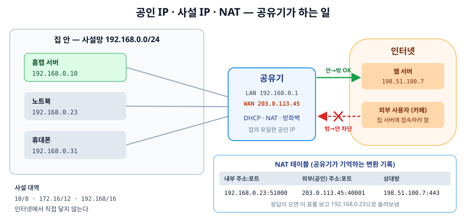
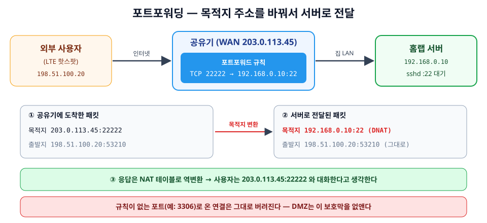
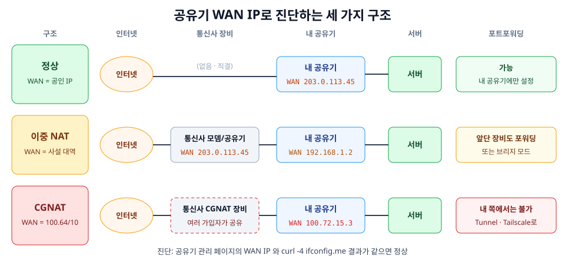

> **Chapter 0 · 홈랩** | 난이도 ★★☆☆☆ | 예상 소요 1.5 ~ 2시간

## 🎯 오늘의 목표

- **공인 IP / 사설 IP / NAT**의 관계와 공유기가 하는 일을 그림으로 설명할 수 있다
- 공유기에서 **DHCP 고정 할당**과 **포트포워딩**을 설정할 수 있다
- **DDNS**로 바뀌는 공인 IP를 도메인 이름 하나로 따라갈 수 있다
- **이중 NAT / CGNAT** 여부를 스스로 진단할 수 있다
- 외부에 SSH를 열 때 필요한 **보안 조치**(포트 변경, fail2ban, 체크리스트)를 적용할 수 있다

---

## 1. 집 안에선 되는데, 밖에선 왜 안 될까?

Homelab 01에서 만든 서버(`192.168.0.10`)는 집 Wi-Fi에 연결된 노트북에서는 `ssh homelab`으로 잘 접속됩니다. 그런데 카페에서 같은 주소로 접속하면 아무 반응이 없습니다. 이유는 **`192.168.0.10`이 사설 IP**이기 때문입니다.

### 1-1. 공인 IP와 사설 IP

| 구분 | 공인 IP (Public) | 사설 IP (Private) |
|---|---|---|
| 누가 주나 | 통신사(ISP) | 집 공유기 (DHCP) |
| 범위 | 인터넷 전체에서 **유일** | 집집마다 **중복 사용** |
| 대역 | 아래 사설 대역을 제외한 대부분 | `10.0.0.0/8`, `172.16.0.0/12`, `192.168.0.0/16` |
| 인터넷에서 직접 접근 | 가능 | **불가능** (라우터가 버림) |
| 예시 | `203.0.113.45` | `192.168.0.10` |

전 세계 수많은 집이 모두 `192.168.0.x`를 쓰고 있으니, 인터넷 입장에서 "192.168.0.10으로 가라"는 말은 의미가 없습니다. 집 전체가 인터넷에 내미는 주소는 **공유기가 가진 공인 IP 하나뿐**입니다.

### 1-2. NAT — 공유기의 핵심 역할



공유기는 사실 세 가지 일을 동시에 합니다.

| 역할 | 하는 일 |
|---|---|
| **DHCP 서버** | 집 안 기기에 사설 IP(`192.168.0.x`), 게이트웨이, DNS를 나눠줌 |
| **라우터 + NAT** | 집 안 기기가 밖으로 나갈 때 출발지 주소를 **공인 IP:임의포트**로 바꾸고, 그 매핑을 표(NAT 테이블)에 기억했다가 응답을 원래 기기로 돌려줌 |
| **스위치 / AP** | 유선 LAN 포트와 Wi-Fi로 기기들을 연결 |

핵심은 이것입니다.

> **NAT는 "안에서 먼저 나간 연결"의 응답만 돌려보낸다. 밖에서 먼저 들어온 연결은 누구에게 줄지 모르니 버린다.**

그래서 집 안에서 유튜브는 잘 보이지만(안 → 밖), 밖에서 집 서버로 SSH를 거는 것(밖 → 안)은 막힙니다. 이걸 뚫어 주는 설정이 **포트포워딩**입니다.

> 💡 Docker의 `-p 8080:80`(Day 01)도 같은 원리입니다. 호스트의 8080으로 들어온 패킷의 목적지를 컨테이너 IP:80으로 바꿔주는 **DNAT**이죠. 공유기 포트포워딩은 이것을 집 전체 규모로 하는 것입니다.

---

## 2. 공유기 관리 페이지 접속

공유기 관리 페이지 주소는 보통 **기본 게이트웨이 주소**와 같습니다.

```bash
ip route | grep default          # Linux:  default via 192.168.0.1 dev enp3s0 ...
```

```powershell
ipconfig | findstr "Gateway"     # Windows: Default Gateway . . . : 192.168.0.1
```

| 제조사 | 흔한 기본 주소 (기종마다 다를 수 있음) |
|---|---|
| ipTIME | `http://192.168.0.1` |
| 통신사 임대 공유기 | `192.168.0.1`, `192.168.1.1`, `172.30.1.254` 등 다양 — 공유기 뒷면 라벨 참고 |
| ASUS / TP-Link | `192.168.50.1`, `192.168.0.1` 등 또는 전용 도메인 |

> ⚠️ 관리자 비밀번호가 초기값(또는 빈 값)이라면 **지금 바로 바꾸세요.** 포트포워딩을 여는 순간 공유기 자체도 공격 대상이 됩니다. 원격 관리(외부에서 관리 페이지 접속) 기능은 **꺼 두는 것**이 안전합니다.

---

## 3. DHCP 고정 할당 (서버 IP 예약)

포트포워딩 규칙은 "외부 포트 → **내부 IP**:포트"이므로 서버 IP가 바뀌면 규칙이 엉뚱한 기기를 가리킵니다. Homelab 01에서 netplan으로 고정했다면 이 단계는 건너뛰어도 됩니다.

**ipTIME 예시** (펌웨어 버전·기종마다 메뉴 이름과 위치가 다를 수 있음)

1. 관리도구 → **고급 설정** → **네트워크 관리** → **내부 네트워크 설정**
2. "사용 중인 IP 주소" 목록에서 서버(호스트명 `homelab` 또는 MAC 주소로 확인)를 찾아 **등록**
3. 수동으로 넣는다면 MAC 주소(Homelab 01의 `ip link`로 확인)와 원하는 IP(`192.168.0.10`) 입력 → 추가 → 적용

```bash
# 서버에서 DHCP를 새로 받아 예약 IP가 적용됐는지 확인 (가장 확실한 방법은 재부팅)
sudo reboot
ip -br addr show enp3s0     # 192.168.0.10/24 인지 확인
```

> 💡 다른 공유기도 메뉴 이름만 다를 뿐 개념은 같습니다. "DHCP 예약", "고정 IP 할당", "Static Lease", "Address Reservation" 같은 이름을 찾으세요.

---

## 4. 포트포워딩 설정

### 4-1. 규칙의 구조



| 항목 | 예시 값 | 의미 |
|---|---|---|
| 규칙 이름 | `homelab-ssh` | 구분용 |
| 내부 IP | `192.168.0.10` | 패킷을 받을 서버 |
| 프로토콜 | TCP | SSH, HTTP(S)는 TCP |
| 외부 포트 | `22222` | 인터넷에서 접속할 때 쓰는 포트 |
| 내부 포트 | `22` | 서버에서 실제로 듣고 있는 포트 |

이 규칙의 의미는 "**공인IP:22222로 들어온 TCP 연결은 192.168.0.10:22로 보낸다**"입니다.

### 4-2. ipTIME 예시

(펌웨어 버전·기종마다 메뉴 이름과 위치가 다를 수 있음)

1. 관리도구 → **고급 설정** → **NAT/라우터 관리** → **포트포워드 설정**
2. 규칙 이름 `homelab-ssh`, 내부 IP `192.168.0.10`, 프로토콜 `TCP`
3. 외부 포트 `22222` ~ `22222`, 내부 포트 `22` ~ `22`
4. **추가** → **적용**

다른 공유기에서는 "Port Forwarding", "가상 서버(Virtual Server)", "NAT 설정" 같은 메뉴에 있습니다. **외부 포트 → 내부 IP:포트**라는 구조는 어느 공유기나 동일합니다.

> ⚠️ **DMZ**(모든 포트를 한 기기로 전달) 기능은 쓰지 마세요. 서버의 모든 포트가 인터넷에 그대로 노출됩니다. 필요한 포트만 하나씩 여는 것이 원칙입니다.

### 4-3. 외부 포트를 22가 아닌 번호로 하는 이유

| 방식 | 설정 | 장단점 |
|---|---|---|
| **공유기에서 포트 변환** (권장) | 외부 `22222` → 내부 `22` | 서버 설정은 그대로. 집 안에서는 22로, 밖에서는 22222로 접속 |
| 서버의 SSH 포트 자체를 변경 | 외부 `22222` → 내부 `22222` | 서버·ufw·fail2ban 설정을 모두 바꿔야 함 |

포트 변경은 **보안 대책이 아니라 소음 감소책**입니다. 22번을 무작위로 두드리는 봇 로그가 크게 줄어들 뿐, 포트 스캔을 하면 금방 찾습니다. 진짜 방어는 **키 인증 + fail2ban**입니다.

서버 쪽 포트를 꼭 바꾸고 싶다면, Ubuntu 24.04는 **ssh.socket(소켓 활성화)**을 쓰므로 sshd 설정 변경 후 소켓을 다시 만들어야 합니다.

```bash
echo 'Port 22222' | sudo tee -a /etc/ssh/sshd_config.d/00-hardening.conf
sudo ufw allow 22222/tcp
sudo systemctl daemon-reload            # sshd 설정의 Port를 읽어 ssh.socket을 다시 생성
sudo systemctl restart ssh.socket
sudo ss -tlnp | grep 22222              # LISTEN 확인 후, 새 터미널에서 접속 테스트
```

---

## 5. DDNS — 바뀌는 공인 IP를 이름으로 따라가기

가정용 회선의 공인 IP는 대부분 **유동 IP**라서 공유기 재부팅, 회선 점검 등으로 바뀔 수 있습니다. 매번 IP를 확인하는 대신, **DDNS**(Dynamic DNS)가 "내 도메인 → 현재 공인 IP"를 자동으로 갱신해 줍니다.

```bash
curl -4 ifconfig.me     # 지금 외부에서 보이는 내 공인 IP
```

| 방식 | 도메인 예시 | 갱신 주체 | 특징 |
|---|---|---|---|
| **ipTIME 기본 DDNS** | `myhome.iptime.org` | 공유기 | 무료, 설정 1분. 공유기가 IP 변경을 알아서 반영 |
| **DuckDNS** | `myhome.duckdns.org` | 서버(cron) | 무료, 공유기 종류와 무관. 토큰으로 갱신 |
| 내 도메인 + DNS API | `home.example.com` | 서버 스크립트 / 공유기 | 유료 도메인 필요, 가장 유연 (Homelab 03의 HTTPS에 유리) |

### 5-1. ipTIME DDNS

(펌웨어 버전·기종마다 메뉴 이름과 위치가 다를 수 있음)

1. 관리도구 → **고급 설정** → **특수기능** → **DDNS 설정**
2. 호스트 이름 `myhome`(→ `myhome.iptime.org`), 사용자 ID(이메일) 입력 → 추가
3. 상태가 "정상 등록"으로 바뀌면 완료

### 5-2. DuckDNS (공유기와 무관하게)

1. [duckdns.org](https://www.duckdns.org)에 로그인 → 서브도메인(`myhome`) 추가 → **token** 확인
2. 서버에서 갱신 요청이 동작하는지 확인합니다. `ip=`를 비워 두면 요청을 보낸 공인 IP로 등록됩니다.

```bash
curl -fsS "https://www.duckdns.org/update?domains=myhome&token=YOUR-TOKEN&ip="
# OK
```

3. 5분마다 자동 갱신되게 cron에 등록합니다.

```bash
mkdir -p ~/duckdns
cat > ~/duckdns/duck.sh <<'EOF'
#!/bin/sh
curl -fsS "https://www.duckdns.org/update?domains=myhome&token=YOUR-TOKEN&ip=" -o "$HOME/duckdns/duck.log"
EOF
chmod 700 ~/duckdns/duck.sh                     # 토큰이 들어 있으니 나만 읽게
( crontab -l 2>/dev/null; echo "*/5 * * * * $HOME/duckdns/duck.sh" ) | crontab -
crontab -l
```

```bash
getent hosts myhome.duckdns.org    # 공인 IP가 나오면 성공
```

---

## 6. 이중 NAT와 CGNAT — "설정은 맞는데 안 돼요"

포트포워딩을 정확히 했는데도 외부에서 접속이 안 된다면, 내 공유기가 **진짜 공인 IP를 받고 있지 않은 것**일 수 있습니다.



### 6-1. 진단법 — 두 IP를 비교한다

1. **공유기의 WAN(외부) IP**: 공유기 관리 페이지 첫 화면(ipTIME은 "인터넷 연결 상태" / "외부 IP 주소" 등, 기종마다 다를 수 있음)
2. **외부에서 본 내 IP**: `curl -4 ifconfig.me`

| 공유기 WAN IP | 외부에서 본 IP | 진단 | 포트포워딩 |
|---|---|---|---|
| `203.0.113.45` | `203.0.113.45` (같음) | ✅ 정상 — 공유기가 공인 IP를 직접 받음 | 공유기에만 설정하면 됨 |
| `192.168.x.x` / `10.x.x.x` / `172.16~31.x.x` | 다른 공인 IP | ⚠️ **이중 NAT** — 앞에 다른 공유기(통신사 모뎀/공유기)가 있음 | 앞단 장비에도 설정하거나 브리지 모드 |
| `100.64.0.0` ~ `100.127.255.255` | 다른 공인 IP | ❌ **CGNAT** — 통신사가 여러 가입자를 하나의 공인 IP로 묶음 | **내 쪽에서는 불가능** |

`100.64.0.0/10`은 RFC 6598이 통신사 NAT(Carrier-Grade NAT) 용도로 따로 정한 대역입니다. 공유기 WAN IP가 이 대역이라면 통신사 장비에서 한 번 더 NAT가 일어나고, 그 장비의 포트포워딩은 내가 설정할 수 없습니다.

```powershell
# (참고) Windows에서 경로를 보면 사설 IP 홉이 몇 개 지나가는지 감이 옵니다
tracert -d -h 4 8.8.8.8
```

### 6-2. 해결 방법

| 상황 | 해결 |
|---|---|
| 이중 NAT (통신사 모뎀/공유기 + 내 공유기) | ① 통신사 장비를 **브리지 모드**로 바꾸기(고객센터 요청이 필요한 경우가 많음) ② 통신사 장비에서 내 공유기 WAN IP로 **같은 포트를 한 번 더 포워딩** ③ 통신사 장비의 DMZ를 내 공유기로 지정(내 공유기가 방화벽 역할을 할 때만) |
| CGNAT | 통신사에 공인 IP 할당을 요청(상품에 따라 불가·유료일 수 있음), 또는 **포트를 열지 않는 방법**(Cloudflare Tunnel, Tailscale — **Homelab 03**) |

> 💡 국내 가정용 유선 인터넷은 대부분 공인 IP를 주지만, 일부 아파트 단지 랜, 기숙사·원룸 공용 회선, LTE/5G 라우터는 사설 IP나 CGNAT인 경우가 있습니다.

---

## 7. 통신사 포트 차단과 SSH 보안

### 7-1. 통신사 포트 차단

가정용 회선은 스팸·악성 서버 방지를 위해 일부 포트를 막기도 합니다. **25번(SMTP)**은 대부분 막혀 있고, **80번 등 다른 포트도 상품·통신사 정책에 따라 막힐 수 있습니다.** 특정 포트만 안 된다면 다른 외부 포트(예: 8080 → 내부 80)로 바꿔 시험해 보고, 정확한 정책은 통신사에 확인하세요. 80/443이 막혀 있으면 HTTPS 인증서 발급도 어려워지는데, 이 경우도 Homelab 03의 Tunnel 방식이 해법이 됩니다.

### 7-2. fail2ban — 무차별 대입 자동 차단

fail2ban은 로그를 감시하다가 로그인 실패가 반복되는 IP를 방화벽으로 일정 시간 차단합니다. 키 인증만 허용해도 봇의 시도는 계속되므로, 로그와 자원을 아끼는 의미가 있습니다.

```bash
sudo apt install -y fail2ban
sudo tee /etc/fail2ban/jail.local > /dev/null <<'EOF'
[sshd]
enabled  = true
port     = ssh
maxretry = 5
findtime = 10m
bantime  = 1h
EOF
sudo systemctl enable --now fail2ban
sudo systemctl restart fail2ban
sudo fail2ban-client status sshd
```

출력 예 (버전·설정에 따라 `File list` 대신 `Journal matches`로 보일 수 있음):

```
Status for the jail: sshd
|- Filter
|  |- Currently failed: 0
|  |- Total failed:     0
|  `- File list:        /var/log/auth.log
`- Actions
   |- Currently banned: 0
   |- Total banned:     0
   `- Banned IP list:
```

> 💡 4-3에서 서버의 SSH 포트를 22222로 바꿨다면 `port = 22222`로 맞춰야 차단이 실제로 적용됩니다. 실수로 내 IP가 차단됐다면 `sudo fail2ban-client set sshd unbanip <IP>`.

---

## 8. 외부망에서 테스트하기

### 8-1. LTE 핫스팟으로 진짜 "밖"에서 접속

집 Wi-Fi에 연결된 상태로 테스트하면 **집 안에서 집 공인 IP로 나갔다 들어오는** 특수한 경로가 되어 결과를 믿을 수 없습니다. 휴대폰의 **Wi-Fi를 끄고 LTE/5G 핫스팟**을 켠 뒤, 노트북을 핫스팟에 연결해서 시험합니다.

```powershell
# Windows — 포트가 열려 있는지 먼저 확인
Test-NetConnection myhome.iptime.org -Port 22222
# TcpTestSucceeded : True
```

```bash
# macOS / Linux
nc -vz myhome.iptime.org 22222
ssh -p 22222 devops@myhome.iptime.org
```

`~/.ssh/config`에 외부용 별칭을 추가해 두면 편합니다.

```
Host homelab-ext
    HostName myhome.iptime.org
    Port 22222
    User devops
    IdentityFile ~/.ssh/id_ed25519
```

### 8-2. 헤어핀 NAT (NAT Loopback)

집 안에서 `myhome.iptime.org:22222`(공인 주소)로 접속하면, 패킷이 공유기 밖으로 나갔다가 다시 공유기의 포트포워딩을 타고 들어와야 합니다. 이걸 지원하는 기능을 **헤어핀 NAT**(NAT loopback, NAT reflection)라고 합니다.

| 상황 | 결과 |
|---|---|
| 공유기가 헤어핀 NAT 지원 | 집 안에서도 공인 주소로 접속됨 (ipTIME 등 다수 지원) |
| 미지원 | 집 안에서는 실패, 밖에서는 성공 → "고장인가?" 오해의 원인 |

미지원이라면 집 안에서는 내부 주소(`ssh homelab`), 밖에서는 외부 주소(`ssh homelab-ext`)를 쓰면 됩니다. 이 역시 **외부 테스트는 반드시 LTE로** 해야 하는 이유입니다.

---

## 9. 보안 체크리스트

포트를 열기 전에 하나씩 확인하세요.

| # | 항목 | 확인 방법 |
|---|---|---|
| 1 | SSH **비밀번호 로그인 꺼짐** | `sudo sshd -T \| grep passwordauthentication` → `no` |
| 2 | **root 로그인 금지** | `sudo sshd -T \| grep permitrootlogin` → `no` |
| 3 | 공유기 **관리자 비밀번호 변경**, 원격 관리 꺼짐 | 공유기 관리 페이지 |
| 4 | **필요한 포트만** 포워딩 (DMZ 사용 금지) | 포트포워드 목록 |
| 5 | 서버 **ufw** 활성화, 허용 포트 최소화 | `sudo ufw status verbose` |
| 6 | **fail2ban** 동작 | `sudo fail2ban-client status sshd` |
| 7 | **자동 보안 업데이트** | `cat /etc/apt/apt.conf.d/20auto-upgrades` |
| 8 | 공유기 **펌웨어 최신화** | 공유기 관리 페이지의 펌웨어 업그레이드 메뉴 |
| 9 | DB·관리 UI(Grafana, Portainer 등)는 **절대 직접 포워딩하지 않기** | Homelab 03의 Tailscale/Tunnel로 |
| 10 | 접속 로그 주기적 확인 | `journalctl -u ssh --since today` |

> ⚠️ 특히 9번이 중요합니다. 인증이 약한 웹 관리 화면이나 DB 포트(3306, 5432, 6379, 27017)를 포워딩하는 것은 인터넷에 문을 열어 두는 것과 같습니다.

---

## 10. 트러블슈팅

| 증상 | 원인 | 해결 |
|---|---|---|
| 외부에서 `Connection timed out` | 포워딩 규칙의 내부 IP가 틀림 / 서버 IP 변경 / ufw 차단 | 내부 IP 재확인, DHCP 예약, `sudo ufw status` |
| 외부에서 `Connection refused` | 패킷은 도착했지만 내부 포트에서 듣는 프로세스가 없음 | 내부 포트 번호 확인, `sudo ss -tlnp` |
| 설정은 맞는데 외부 접속 불가 | 이중 NAT / CGNAT | 공유기 WAN IP와 `curl ifconfig.me` 비교 (6장) |
| 집 안에선 안 되고 LTE에선 됨 | 헤어핀 NAT 미지원 | 집 안에서는 내부 IP 사용 |
| 특정 포트(80 등)만 안 됨 | 통신사 포트 차단 | 다른 외부 포트로 변환하거나 Tunnel 방식 사용 |
| DDNS 주소가 옛 IP를 가리킴 | 갱신 실패, DNS 캐시 | DDNS 상태 확인, `curl` 갱신 수동 실행, 몇 분 대기 |
| 서버 포트를 바꿨는데 여전히 22에서만 응답 | Ubuntu 24.04 ssh.socket이 갱신 안 됨 | `sudo systemctl daemon-reload && sudo systemctl restart ssh.socket` |

---

## 11. 핵심 정리

- 사설 IP(`10/8`, `172.16/12`, `192.168/16`)는 인터넷에서 직접 닿지 않는다 → 집의 얼굴은 **공유기의 공인 IP 하나**
- NAT는 **안에서 시작된 연결**만 돌려보낸다 → 밖에서 들어오려면 **포트포워딩**(외부 포트 → 내부 IP:포트)
- 포트포워딩 전 **DHCP 고정 할당**, 유동 공인 IP는 **DDNS**(ipTIME DDNS, DuckDNS)로
- 공유기 WAN IP ≠ 외부에서 본 IP → **이중 NAT**(사설 대역) 또는 **CGNAT**(`100.64.0.0/10`)
- 포트 변경은 소음 감소일 뿐, 진짜 방어는 **키 인증 + fail2ban + 최소 포트**
- 외부 테스트는 **LTE 핫스팟**으로 — 헤어핀 NAT 때문에 집 안 테스트는 믿을 수 없다

---

## 12. 셀프 체크

<details>
<summary>Q1. 집 안의 서버가 인터넷에 접속(apt update)은 되는데, 외부에서 서버로는 접속이 안 되는 이유는?</summary>

NAT는 안에서 먼저 나간 연결의 응답만 NAT 테이블을 보고 돌려보냅니다. 밖에서 먼저 들어온 연결은 어느 내부 기기로 보내야 할지 정보가 없으므로 버립니다. 포트포워딩은 이 "어디로 보낼지"를 미리 정해 두는 정적 규칙입니다.
</details>

<details>
<summary>Q2. 포트포워딩 규칙 "외부 22222 → 192.168.0.10:22"에서 서버 IP가 DHCP로 192.168.0.15로 바뀌면 어떻게 되나?</summary>

규칙은 여전히 192.168.0.10을 가리키므로 접속이 실패하거나, 그 IP를 새로 받은 다른 기기로 연결이 넘어갑니다. 그래서 포트포워딩 전에 DHCP 고정 할당(또는 netplan 고정 IP)이 필수입니다.
</details>

<details>
<summary>Q3. 공유기 WAN IP가 100.72.15.3이고 <code>curl ifconfig.me</code>가 211.x.x.x를 보여준다면?</summary>

`100.64.0.0/10` 대역이므로 **CGNAT** 환경입니다. 통신사 장비에서 한 번 더 NAT가 일어나며 그 장비의 포트포워딩은 설정할 수 없으므로, 통신사에 공인 IP를 요청하거나 Cloudflare Tunnel·Tailscale처럼 포트를 열지 않는 방식을 써야 합니다.
</details>

<details>
<summary>Q4. 외부 접속 테스트를 집 Wi-Fi가 아니라 LTE 핫스팟으로 해야 하는 이유는?</summary>

집 안에서 공인 주소로 접속하면 헤어핀 NAT라는 특수 경로를 타므로, 공유기가 이를 지원하지 않으면 정상 설정인데도 실패하고, 반대로 내부 경로 덕분에 성공해 보일 수도 있습니다. 진짜 외부 경로를 검증하려면 다른 통신망(LTE)에서 시험해야 합니다.
</details>

<details>
<summary>Q5. SSH 외부 포트를 22에서 22222로 바꾸는 것은 충분한 보안 대책인가?</summary>

아닙니다. 무작위 22번 스캔 봇을 줄이는 **소음 감소** 효과뿐이며, 포트 스캔으로 금방 찾을 수 있습니다. 키 인증 전용, root 로그인 금지, fail2ban, 최소 포트 개방이 실제 방어책입니다.
</details>

---

## ⏭️ 다음 예고 — Homelab 03. 포트를 열지 않고 안전하게 공개하기 + HTTPS

포트포워딩은 동작하지만, 서비스가 늘어날수록 열린 포트도 늘어나고 CGNAT에서는 아예 불가능합니다. 다음 편에서는 **리버스 프록시**(Caddy/Nginx)로 여러 서비스를 도메인 하나로 묶고 **Let's Encrypt HTTPS**를 붙인 뒤, **Cloudflare Tunnel**과 **Tailscale**로 **포트를 하나도 열지 않고** 집 서버를 공개·관리하는 방법을 비교합니다.
