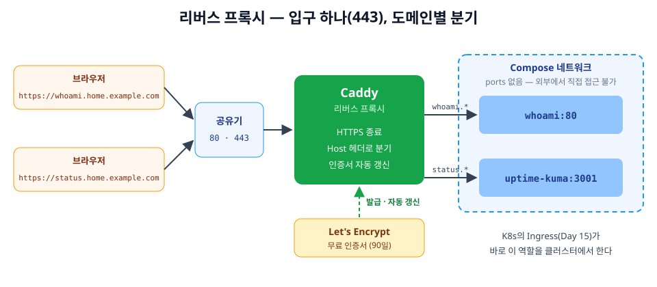
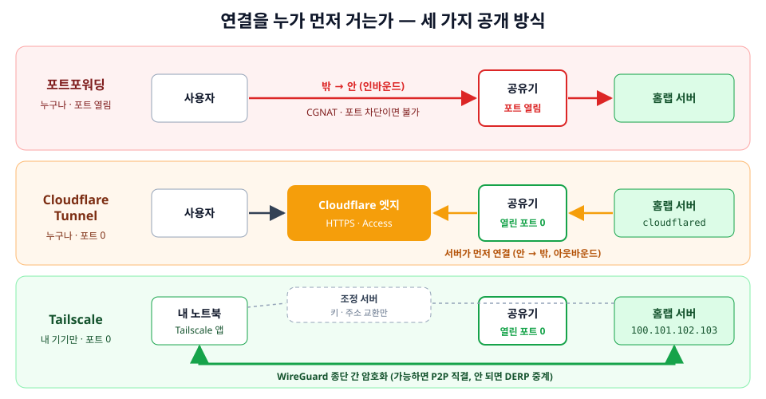
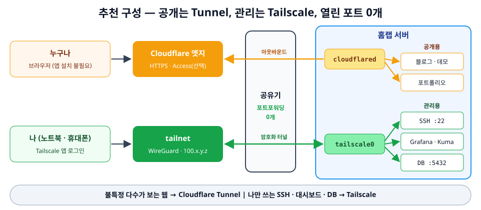

> **Chapter 0 · 홈랩** | 난이도 ★★★☆☆ | 예상 소요 2 ~ 3시간

## 🎯 오늘의 목표

- **리버스 프록시**(Caddy / Nginx)로 여러 서비스를 도메인·경로별로 나눠 하나의 입구로 묶을 수 있다
- **Let's Encrypt** 인증서로 HTTPS를 적용할 수 있다 (Caddy 자동 발급 / certbot)
- **Cloudflare Tunnel**로 포트포워딩 없이, CGNAT 환경에서도 웹 서비스를 공개할 수 있다
- **Tailscale**로 나만 접속하는 관리용 사설망을 만들고 SSH 포트를 닫을 수 있다
- 포트포워딩 / Cloudflare Tunnel / Tailscale을 **상황에 맞게 고를 수** 있다

---

## 1. 포트포워딩의 한계

Homelab 02에서 포트포워딩으로 외부 접속에 성공했습니다. 하지만 서비스가 늘어나면 문제가 보이기 시작합니다.

| 문제 | 예시 |
|---|---|
| 서비스마다 포트가 늘어남 | `:8080`은 블로그, `:3001`은 모니터링, `:9000`은… 외우기도, 관리하기도 어렵다 |
| HTTPS가 없음 | 로그인 비밀번호가 평문으로 오간다. 브라우저는 "주의 요함" 경고 |
| 서버가 인터넷에 직접 노출 | 열린 포트 하나하나가 공격 지점 |
| CGNAT / 포트 차단 | 아예 포트포워딩 자체가 불가능 (Homelab 02의 6~7장) |

이 편에서는 세 가지 도구로 이 문제를 하나씩 해결합니다.

| 도구 | 해결하는 문제 |
|---|---|
| **리버스 프록시 + Let's Encrypt** | 입구를 443 하나로 통일, 도메인별 분기, HTTPS |
| **Cloudflare Tunnel** | 포트를 하나도 열지 않고 **전 세계에 공개** (CGNAT에서도) |
| **Tailscale** | 포트를 하나도 열지 않고 **나만 접속** (SSH, 관리 UI) |

---

## 2. 리버스 프록시 — 하나의 입구, 여러 서비스

### 2-1. 개념



**리버스 프록시**는 서버 앞에 서서 모든 요청을 먼저 받고, 요청의 **도메인(Host 헤더)**이나 **경로**를 보고 알맞은 내부 서비스로 전달합니다.

| 구분 | 포워드 프록시 | 리버스 프록시 |
|---|---|---|
| 누구를 대신하나 | **클라이언트** (회사 프록시, VPN 등) | **서버** |
| 사용자가 아는 주소 | 실제 목적지 | 프록시 주소만 (뒤의 서버는 숨겨짐) |
| 대표 도구 | Squid | **Nginx, Caddy**, Traefik, HAProxy |

> 💡 Day 15에서 배울 Kubernetes **Ingress**가 바로 클러스터용 리버스 프록시입니다. 오늘 Caddyfile로 하는 "도메인 → 서비스" 매핑을 K8s에서는 YAML로 선언하게 됩니다.

| 항목 | **Caddy** | **Nginx** |
|---|---|---|
| HTTPS | **자동** — 도메인만 쓰면 인증서 발급·갱신까지 | certbot 등 별도 도구 필요 |
| 설정 | Caddyfile, 매우 짧음 | `server {}` 블록, 유연하지만 길다 |
| 성능·생태계 | 홈랩 규모에서 충분 | 업계 표준, 자료가 가장 많음 |
| 추천 | 홈랩 입문 | 실무 감각을 익히고 싶을 때 |

### 2-2. 사전 준비

리버스 프록시가 **직접** Let's Encrypt 인증서를 받으려면(HTTP-01 / TLS-ALPN-01 검증), 인터넷에서 내 서버의 80·443 포트에 닿아야 합니다.

1. **도메인**: 구매한 도메인 `example.com`(여기서는 예시)의 DNS에 `*.home.example.com` → 집 공인 IP **A 레코드** 등록 (유동 IP라면 Homelab 02의 DDNS 개념 적용)
2. **포트포워딩**: 공유기에서 외부 80 → `192.168.0.10:80`, 외부 443 → `192.168.0.10:443` (TCP)
3. **Docker Engine** 설치 (Day 01의 공식 apt 저장소 방법)

> ⚠️ CGNAT이거나 통신사가 80/443을 막는다면 이 방식은 동작하지 않습니다. 바로 **4장 Cloudflare Tunnel**로 넘어가세요.

### 2-3. 실습 — Caddy + Docker Compose

예제 서비스 두 개(요청 정보를 보여주는 `whoami`, 모니터링 도구 `Uptime Kuma`)를 Caddy 뒤에 둡니다.

```bash
mkdir -p ~/homelab-proxy && cd ~/homelab-proxy
```

`compose.yaml`

```yaml
services:
  caddy:
    image: caddy:2
    restart: unless-stopped
    ports:
      - "80:80"
      - "443:443"
      - "443:443/udp"          # HTTP/3
    volumes:
      - ./Caddyfile:/etc/caddy/Caddyfile:ro
      - caddy_data:/data       # 발급받은 인증서 저장 — 지우면 재발급!
      - caddy_config:/config

  whoami:
    image: traefik/whoami
    restart: unless-stopped
    # ports 없음 → 외부에서 직접 접근 불가, Caddy를 통해서만 접근

  uptime-kuma:
    image: louislam/uptime-kuma:1
    restart: unless-stopped
    volumes:
      - kuma_data:/app/data

volumes:
  caddy_data:
  caddy_config:
  kuma_data:
```

`Caddyfile` — **도메인 기반 분기**

```
{
	email you@example.com
}

whoami.home.example.com {
	reverse_proxy whoami:80
}

status.home.example.com {
	reverse_proxy uptime-kuma:3001
}
```

```bash
docker compose up -d
docker compose logs -f caddy      # "certificate obtained successfully" 가 보이면 발급 완료
```

```bash
curl -I https://whoami.home.example.com
# HTTP/2 200
# ...
```

**도메인이 하나뿐일 때 — 경로 기반 분기** (예: DuckDNS 도메인 하나만 있는 경우)

```
myhome.duckdns.org {
	handle_path /whoami/* {
		reverse_proxy whoami:80
	}
	handle {
		reverse_proxy uptime-kuma:3001
	}
}
```

`handle_path`는 `/whoami` 접두어를 **떼고** 뒤 서비스에 전달합니다. 단, 모든 앱이 하위 경로에서 잘 동작하지는 않으므로(정적 파일 경로가 `/`로 고정된 앱 등) **가능하면 서브도메인 방식**을 권장합니다.

> 💡 Compose 네트워크 안에서는 `whoami`, `uptime-kuma` 같은 **서비스 이름이 곧 호스트명**입니다. 내부 서비스에 `ports:`를 주지 않으면 Homelab 01에서 본 "Docker가 ufw를 우회해 포트를 여는" 문제도 생기지 않습니다. 외부로 열리는 것은 Caddy의 80/443뿐입니다.
> ⚠️ 설정을 여러 번 바꿔 가며 시험하다 보면 Let's Encrypt **발급 횟수 제한(rate limit)**에 걸릴 수 있습니다. 시험 중에는 전역 옵션에 `acme_ca https://acme-staging-v02.api.letsencrypt.org/directory`를 넣어 **스테이징 서버**를 쓰고, 잘 되면 그 줄을 지우세요.

### 2-4. 참고 — Nginx + certbot

Nginx를 호스트에 직접 설치하는 경우의 흐름입니다. 뒤의 앱은 `127.0.0.1:8080`에서 돌고 있다고 가정합니다.

```bash
sudo apt install -y nginx certbot python3-certbot-nginx
sudo tee /etc/nginx/sites-available/app > /dev/null <<'EOF'
server {
    listen 80;
    server_name app.home.example.com;

    location / {
        proxy_pass http://127.0.0.1:8080;
        proxy_set_header Host $host;
        proxy_set_header X-Real-IP $remote_addr;
        proxy_set_header X-Forwarded-For $proxy_add_x_forwarded_for;
        proxy_set_header X-Forwarded-Proto $scheme;
    }
}
EOF
sudo ln -s /etc/nginx/sites-available/app /etc/nginx/sites-enabled/
sudo nginx -t && sudo systemctl reload nginx
sudo ufw allow 'Nginx Full'                     # 80, 443 허용

sudo certbot --nginx -d app.home.example.com    # 인증서 발급 + server 블록에 443 설정 자동 추가
sudo certbot renew --dry-run                    # 자동 갱신 시험
systemctl list-timers | grep certbot            # 갱신 타이머 등록 확인
```

---

## 3. 포트를 열지 않는 두 가지 방법

리버스 프록시까지 하면 입구는 깔끔해졌지만, 여전히 **공유기의 80/443이 열려 있고**, CGNAT에서는 쓸 수 없습니다. 여기서 발상을 뒤집습니다.

> **밖에서 안으로 들어오게 하지 말고, 안에서 밖으로 먼저 연결을 맺어 둔다.**

Homelab 02에서 배웠듯 NAT는 "안에서 먼저 나간 연결"의 응답은 잘 돌려보냅니다. 서버가 먼저 외부의 중계 지점에 연결을 맺어 두면, 그 연결을 거꾸로 타고 요청이 들어올 수 있습니다. **포트포워딩이 필요 없고 CGNAT도 문제가 되지 않습니다.**



| 방식 | 누가 접속하나 | 비유 |
|---|---|---|
| **Cloudflare Tunnel** | 전 세계 누구나 (웹 공개) | 집 대신 **Cloudflare 매장**에 손님을 받고, 집과 매장 사이엔 전용 통로 |
| **Tailscale** | **내 기기들만** (관리용) | 내 기기끼리만 아는 **비밀 통로망** |

---

## 4. Cloudflare Tunnel — 포트포워딩 없이 전 세계에 공개

서버의 `cloudflared`가 Cloudflare 엣지로 **아웃바운드 연결**(기본 QUIC/UDP 7844, 막히면 TCP)을 맺고, 사용자는 Cloudflare를 통해 들어옵니다. HTTPS 인증서도 Cloudflare가 처리합니다.

### 4-1. cloudflared 설치

```bash
curl -L -o cloudflared.deb \
  https://github.com/cloudflare/cloudflared/releases/latest/download/cloudflared-linux-amd64.deb
sudo dpkg -i cloudflared.deb
cloudflared --version
```

### 4-2. 1분 체험 — Quick Tunnel (계정·도메인 불필요)

```bash
# 시험용 서비스: 루프백에만 바인딩 → 외부에서 직접 접근 불가
docker run -d --name hello -p 127.0.0.1:8080:80 traefik/whoami

cloudflared tunnel --url http://localhost:8080
```

```
...
|  Your quick Tunnel has been created! Visit it at (it may take some time to be reachable):  |
|  https://random-words-here.trycloudflare.com                                              |
...
```

LTE 휴대폰으로 출력된 `https://….trycloudflare.com` 주소에 접속해 보세요. **공유기 설정을 하나도 건드리지 않았는데** HTTPS로 열립니다. `Ctrl+C`로 끄면 주소도 사라집니다. (Quick Tunnel은 시험·데모용이며 주소가 매번 바뀝니다)

### 4-3. 내 도메인으로 고정 공개 — Named Tunnel

**전제**: Cloudflare 계정(무료 플랜 가능)에 내 도메인을 추가하고, 도메인 등록업체에서 **네임서버를 Cloudflare로 변경**해 둔 상태.

```bash
cloudflared tunnel login                 # 출력된 URL을 브라우저로 열고 도메인 선택 → ~/.cloudflared/cert.pem 생성
cloudflared tunnel create homelab        # 터널 생성 → ~/.cloudflared/<UUID>.json (터널 자격 증명)
cloudflared tunnel list                  # 터널 ID(UUID) 확인

# 도메인 → 터널 연결 (Cloudflare DNS에 CNAME 자동 생성)
cloudflared tunnel route dns homelab app.example.com
cloudflared tunnel route dns homelab status.example.com
```

서비스로 띄우기 위해 설정을 `/etc/cloudflared/`에 둡니다.

```bash
sudo mkdir -p /etc/cloudflared
sudo cp ~/.cloudflared/<UUID>.json /etc/cloudflared/
sudo nano /etc/cloudflared/config.yml
```

```yaml
tunnel: <UUID>
credentials-file: /etc/cloudflared/<UUID>.json

ingress:
  - hostname: app.example.com
    service: http://localhost:8080
  - hostname: status.example.com
    service: http://localhost:3001
  - service: http_status:404      # 마지막 규칙은 반드시 hostname 없는 catch-all
```

```bash
cloudflared tunnel --config /etc/cloudflared/config.yml ingress validate   # OK 확인
sudo cloudflared service install          # systemd 서비스 등록 + 시작
systemctl status cloudflared --no-pager
```

> 💡 `ingress`는 리버스 프록시의 라우팅 표와 같습니다. 위에서부터 순서대로 hostname을 비교해 첫 번째로 맞는 규칙을 씁니다. Caddy를 함께 쓴다면 `service: http://localhost:80` 하나로 Caddy에 넘기고 분기는 Caddy에 맡겨도 됩니다.
> 💡 Cloudflare 대시보드(Zero Trust → Networks → Tunnels, 메뉴 위치는 바뀔 수 있음)에서 터널을 만들면 `sudo cloudflared service install <TOKEN>` 한 줄로 설치하고 라우팅도 웹에서 관리할 수 있습니다. 위의 설정 파일 방식과 결과는 같습니다.

이때 **서버의 ufw는 들어오는 포트를 하나도 열 필요가 없습니다.** 공유기의 80/443 포트포워딩도 지워도 됩니다.

### 4-4. 알아 둘 점

| 항목 | 내용 |
|---|---|
| 도메인 | Named Tunnel은 Cloudflare DNS를 쓰는 **내 도메인**이 필요 |
| 트래픽 가시성 | TLS를 Cloudflare 엣지에서 종료하므로 **Cloudflare는 트래픽 내용을 볼 수 있음** |
| 제약 | 무료 플랜은 요청 본문 크기 제한(100MB)이 있고, 대용량 동영상 스트리밍 등은 약관상 제한될 수 있음 |
| 접근 제어 | 공개하면 안 되는 페이지는 **Cloudflare Access**로 이메일 인증(OTP) 등을 앞에 붙일 수 있음 |

---

## 5. Tailscale — 나만 접속하는 사설망 (서버 관리용)

**Tailscale**은 **WireGuard** 기반 VPN입니다. 내 계정에 로그인한 기기들(노트북, 휴대폰, 홈랩 서버)이 하나의 사설망(**tailnet**)으로 묶이고, 각 기기는 `100.x.y.z` 주소를 받습니다. 기기들은 가능하면 NAT를 뚫어 **직접(P2P)** 연결하고, 안 되면 Tailscale 중계 서버(DERP)를 거칩니다. 어느 경우든 **종단 간 암호화**입니다.

> 💡 Tailscale이 주는 `100.x.y.z` 주소는 Homelab 02에서 본 **CGNAT 대역(`100.64.0.0/10`)**을 빌려 쓴 것입니다. 인터넷에서 라우팅되지 않는 대역이라 사설망 주소로 쓰기 좋기 때문입니다.

### 5-1. 설치와 로그인

서버에서:

```bash
curl -fsSL https://tailscale.com/install.sh | sh
sudo tailscale up            # 출력된 URL을 브라우저로 열어 로그인 (Google/GitHub/MS 계정 등)
tailscale ip -4              # 100.x.y.z
tailscale status
```

```
100.101.102.103  homelab      devops@  linux    -
100.88.12.34     my-laptop    devops@  windows  active; direct 203.0.113.45:41641
```

내 노트북·휴대폰에도 Tailscale 앱을 설치하고 **같은 계정**으로 로그인하면 끝입니다. MagicDNS(기본 활성화)가 켜져 있으면 IP 대신 기기 이름으로 접속할 수 있습니다.

```bash
ssh devops@homelab           # 카페에서도, LTE에서도, CGNAT 뒤에서도 동작
```

### 5-2. SSH 포트포워딩 닫기

Tailscale로 접속이 확인됐다면 Homelab 02에서 연 SSH 포트를 닫습니다. **새 규칙을 먼저 추가하고 기존 규칙을 지우는** 순서를 지키세요.

```bash
sudo ufw allow in on tailscale0 to any port 22 proto tcp          # tailnet에서 SSH 허용
sudo ufw allow from 192.168.0.0/24 to any port 22 proto tcp        # 집 LAN에서 SSH 허용
sudo ufw delete limit OpenSSH                                      # 전체 공개 규칙 삭제
sudo ufw status numbered
```

그리고 공유기의 `22222 → 22` 포트포워딩 규칙도 삭제합니다. 이제 **인터넷에서 SSH 포트는 보이지 않지만**, 내 기기에서는 어디서든 접속됩니다.

> ⚠️ Tailscale 기기 키는 기본적으로 **일정 기간(180일) 후 만료**되어 재로그인이 필요합니다. 서버처럼 무인으로 돌리는 기기는 관리 콘솔(login.tailscale.com)의 기기 메뉴에서 **Disable key expiry**를 설정하세요(메뉴 위치는 바뀔 수 있음).
> 💡 Grafana, Portainer, DB 같은 **관리용 화면은 Tailscale 안에서만** 접속하는 것이 정석입니다. 공개용은 Cloudflare Tunnel, 관리용은 Tailscale로 역할을 나누세요.
> 💡 직접 운영하고 싶다면 순수 **WireGuard**를 설정하거나(이 경우 UDP 포트 하나는 열어야 함), Tailscale 제어 서버의 오픈소스 구현인 **Headscale**을 쓸 수도 있습니다.

---

## 6. 방식 비교 — 무엇을 고를까?

| 항목 | 포트포워딩 (+ 리버스 프록시) | Cloudflare Tunnel | Tailscale |
|---|---|---|---|
| 접속 대상 | 전 세계 누구나 | 전 세계 누구나 (Access로 제한 가능) | **내 tailnet 기기만** |
| 비용 | 무료 (도메인은 선택) | 무료 플랜 + **내 도메인 비용** | 개인용 무료 플랜 |
| 난이도 | 중 — 공유기, DDNS, 인증서 | 중하 — 도메인 이전 필요 | **하** — 앱 설치·로그인 |
| 열린 포트 | 있음 (80/443 등) | **없음** | **없음** |
| CGNAT / 이중 NAT | ❌ (이중 NAT는 추가 설정 시 가능) | ✅ | ✅ |
| 통신사 포트 차단 영향 | 받음 | 없음 | 없음 |
| HTTPS | 직접 (Caddy / certbot) | Cloudflare가 자동 처리 | WireGuard로 암호화 (웹 HTTPS는 별도 기능) |
| 보안 | 서버가 인터넷에 직접 노출 | Cloudflare가 앞단 방패, 단 CF가 트래픽 열람 가능 | 종단 간 암호화, 외부 노출 없음 |
| 상대방 준비물 | 브라우저 | 브라우저 | **Tailscale 앱 설치** 필요 |
| 어울리는 용도 | 학습, 게임 서버, 비HTTP 프로토콜 | 블로그·데모·포트폴리오 공개 | SSH, 관리 UI, DB, 개인 서비스 |



**추천 조합**: 공유기 포트는 **하나도 열지 않는다** → 공개할 웹은 **Cloudflare Tunnel**, 나만 쓰는 SSH·관리 화면은 **Tailscale**. 포트포워딩은 동작 원리를 이해하는 학습용으로 충분합니다.

---

## 7. 트러블슈팅

| 증상 | 원인 | 해결 |
|---|---|---|
| Caddy 로그에 인증서 발급 실패 (`challenge failed`, timeout) | 80/443 포트포워딩 누락, DNS 미반영, CGNAT, 통신사 포트 차단 | `getent hosts 도메인`으로 IP 확인, LTE에서 80 접속 시험, 안 되면 Cloudflare Tunnel |
| `too many certificates` / rate limit 오류 | 반복 시험으로 발급 횟수 초과 | 스테이징(`acme_ca`)으로 시험, `caddy_data` 볼륨 지우지 않기 |
| 경로 분기한 앱의 CSS·이미지가 깨짐 | 앱이 하위 경로(`/app/`)를 모름 | 서브도메인 방식으로 변경 또는 앱의 base path 설정 |
| Tunnel 주소 접속 시 `502 Bad Gateway` | `service:` 주소의 앱이 꺼져 있거나 포트가 틀림 | 서버에서 `curl http://localhost:8080` 확인 |
| Tunnel 주소 접속 시 `1033` 오류 | cloudflared가 실행 중이 아님 | `systemctl status cloudflared`, `journalctl -u cloudflared` |
| `tailscale status`에 `relay`로 표시, 느림 | 직접 연결(P2P) 실패, 중계 서버 경유 | 대부분 동작엔 문제없음. 방화벽이 UDP를 막는지 확인 |
| 몇 달 뒤 갑자기 Tailscale로 서버 접속 불가 | 기기 키 만료 | 콘솔에서 재인증 후 **Disable key expiry** |

---

## 8. 핵심 정리

- **리버스 프록시**: 입구 하나(443)로 도메인·경로별 분기 — K8s Ingress(Day 15)의 원형
- **Caddy**는 도메인만 쓰면 Let's Encrypt HTTPS 자동, Nginx는 **certbot**과 함께
- 발상의 전환: **안에서 밖으로 먼저 연결**하면 포트포워딩도 CGNAT도 문제가 되지 않는다
- **Cloudflare Tunnel**: 공개용 웹 서비스, 내 도메인 필요, Cloudflare가 TLS 처리
- **Tailscale**: WireGuard 기반, 내 기기만 접속 — SSH·관리 UI용, 이후 SSH 포트포워딩은 닫기
- 추천: **포트 0개** + 공개는 Tunnel, 관리는 Tailscale

---

## 9. 셀프 체크

<details>
<summary>Q1. Compose 파일에서 whoami, uptime-kuma 서비스에 <code>ports:</code>를 주지 않은 이유는?</summary>

외부 접근은 리버스 프록시(Caddy)만 담당하게 하기 위해서입니다. 내부 서비스는 Compose 네트워크 안에서 서비스 이름으로 Caddy와만 통신하므로 외부에서 직접 접근할 수 없고, Docker가 ufw를 우회해 포트를 여는 문제도 생기지 않습니다.
</details>

<details>
<summary>Q2. Caddy가 Let's Encrypt 인증서를 자동 발급받기 위한 조건은?</summary>

도메인의 DNS가 서버의 공인 IP를 가리키고, 인터넷에서 그 IP의 80 또는 443 포트로 Caddy에 닿을 수 있어야 합니다(HTTP-01 / TLS-ALPN-01 검증). CGNAT이나 포트 차단 환경에서는 DNS-01 검증이나 Cloudflare Tunnel 같은 대안이 필요합니다.
</details>

<details>
<summary>Q3. Cloudflare Tunnel이 CGNAT 환경에서도 동작하는 이유는?</summary>

서버의 cloudflared가 Cloudflare로 **아웃바운드** 연결을 먼저 맺고, 사용자 요청은 그 연결을 거꾸로 타고 들어오기 때문입니다. NAT는 안에서 시작된 연결의 응답은 정상적으로 돌려보내므로, 인바운드 포트포워딩이 전혀 필요 없습니다.
</details>

<details>
<summary>Q4. 블로그 공개와 서버 SSH 접속에 각각 어떤 방식을 쓰는 것이 좋을까?</summary>

블로그처럼 불특정 다수가 브라우저로 보는 서비스는 **Cloudflare Tunnel**, SSH처럼 나만 쓰는 관리 경로는 **Tailscale**이 적합합니다. SSH를 Tunnel이나 포트포워딩으로 전 세계에 노출할 이유가 없습니다.
</details>

<details>
<summary>Q5. Tailscale 기기가 받는 100.x.y.z 주소는 어떤 대역이며, 왜 그 대역을 쓸까?</summary>

`100.64.0.0/10`, 원래 통신사 CGNAT용으로 예약된 대역입니다. 공인 인터넷에서 라우팅되지 않고, 집·회사의 흔한 사설 대역(192.168.x, 10.x)과도 겹치지 않아 오버레이 사설망 주소로 쓰기에 적합합니다.
</details>

---

## ⏭️ 다음 예고 — 본편 Chapter 1, 그리고 Chapter 6. AI 인프라

홈랩 준비가 끝났습니다. 이제 이 서버에서 **Day 01 컨테이너와 Docker 첫걸음**부터 본편을 진행하면 됩니다. Docker → Kubernetes(Day 20 kubeadm) → KVM·네트워크 → OpenStack(Day 26 DevStack)까지, 모든 실습을 이 장비에서 직접 돌려 볼 수 있습니다.

그리고 시리즈의 끝, **Chapter 6. AI 인프라**에서 오늘 배운 내용이 다시 등장합니다. GPU가 달린 PC에 **Ollama / vLLM**으로 LLM 서버를 띄우고, 채팅 UI는 **Cloudflare Tunnel + Access**로 외부에 공개하되, 인증이 없는 LLM API 포트는 **Tailscale** 안에서만 쓰는 구성 — "집에 있는 내 LLM을 밖에서 안전하게 쓰기"가 바로 이 편의 응용입니다.
