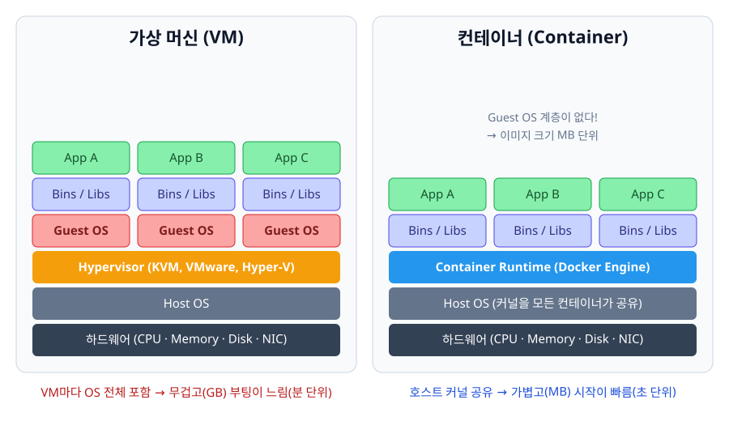
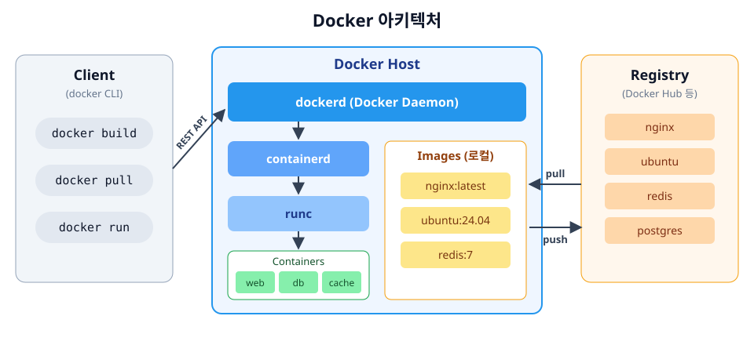
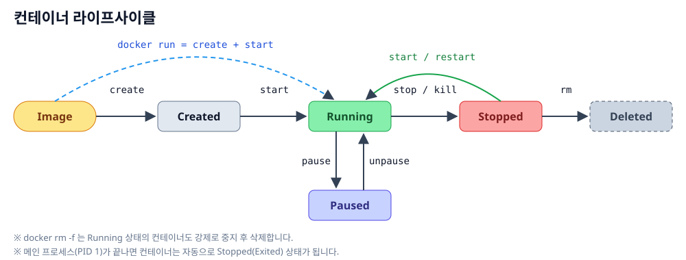

> **Chapter 1 · Docker** | 난이도 ★☆☆☆☆ | 예상 소요 1 ~ 1.5시간

## 🎯 오늘의 목표

- 컨테이너가 **왜** 등장했는지 설명할 수 있다
- VM과 컨테이너의 구조적 차이를 그림으로 설명할 수 있다
- Docker의 구성 요소(CLI, dockerd, containerd, runc, Registry)가 각각 무슨 일을 하는지 안다
- 컨테이너를 **실행 · 조회 · 접속 · 중지 · 삭제**할 수 있다

---

## 1. 왜 컨테이너인가?

> "제 PC에서는 잘 되는데요...?"

개발자 PC, 테스트 서버, 운영 서버는 OS 버전, 설치된 라이브러리, 런타임(Java/Python/Node) 버전, 환경 변수가 조금씩 다릅니다. 이 **환경 차이** 때문에 같은 코드가 어디서는 되고 어디서는 안 되는 일이 생깁니다.

컨테이너의 해법은 단순합니다.

> **애플리케이션 + 실행에 필요한 모든 것(라이브러리, 런타임, 설정)을 하나의 패키지(이미지)로 묶어서, 어디서든 똑같이 실행한다.**

| 방식 | 배포 단위 | 문제점 |
|---|---|---|
| 전통적 배포 | 서버에 직접 설치 | 서버마다 환경이 달라짐, 앱끼리 라이브러리 충돌 |
| 가상 머신(VM) | OS 전체를 포함한 VM 이미지 | 무겁고(GB) 느림(부팅 수십 초~분) |
| **컨테이너** | 앱 + 의존성만 담은 이미지 | 가볍고(MB) 빠름(시작 1초 내외) |

---

## 2. VM vs 컨테이너



| 구분 | 가상 머신 (VM) | 컨테이너 |
|---|---|---|
| 가상화 대상 | **하드웨어** | **OS (프로세스 실행 환경)** |
| 게스트 OS | VM마다 OS 전체가 필요 | 없음 — 호스트 커널을 공유 |
| 이미지 크기 | 수 GB | 수 MB ~ 수백 MB |
| 시작 시간 | 수십 초 ~ 수 분 | 1초 내외 |
| 격리 수준 | 강함 (커널까지 분리) | 상대적으로 약함 (커널 공유) |
| 한 서버당 밀도 | 수십 개 | 수백 ~ 수천 개 |

### 핵심 포인트: 컨테이너는 "작은 VM"이 아니다

컨테이너는 **격리된 리눅스 프로세스**입니다. 리눅스 커널의 두 가지 기능으로 "자기만의 작은 서버"인 것처럼 보이게 만들 뿐입니다.

- **namespace** — *무엇이 보이는가*를 격리 (프로세스 목록, 네트워크, 파일 시스템, 호스트명 등)
- **cgroup** — *얼마나 쓸 수 있는가*를 제한 (CPU, 메모리, I/O)

> 💡 그래서 Windows/macOS에서 Docker를 쓰면 내부적으로 작은 리눅스 VM(WSL2 등)이 하나 떠 있습니다. 리눅스 컨테이너에는 리눅스 커널이 필요하기 때문이죠.
> namespace와 cgroup은 **Day 07**에서 직접 만져보며 깊게 다룹니다.

---

## 3. Docker 아키텍처



| 구성 요소 | 역할 |
|---|---|
| **Docker Client** (`docker` CLI) | 사용자가 입력하는 명령어. 직접 일하지 않고 REST API로 데몬에게 요청만 보냄 |
| **dockerd** (Docker Daemon) | 요청을 받아 이미지·네트워크·볼륨을 관리하는 Docker의 본체 |
| **containerd** | 컨테이너의 생명주기(생성/시작/중지)를 관리하는 고수준 런타임. *Kubernetes도 이걸 직접 사용* |
| **runc** | 실제로 namespace·cgroup을 설정해 컨테이너 프로세스를 띄우는 저수준 런타임 |
| **Registry** | 이미지 저장소. 기본값은 Docker Hub. `pull`로 받아오고 `push`로 올림 |

### 이미지 vs 컨테이너

| 이미지 (Image) | 컨테이너 (Container) |
|---|---|
| 실행 환경을 담은 **읽기 전용 템플릿** | 이미지를 실행한 **인스턴스** |
| 클래스 (Class) | 객체 (Object) |
| 하나만 있으면 됨 | 같은 이미지로 여러 개 생성 가능 |

> `docker run nginx`를 3번 하면 → 이미지는 1개, 컨테이너는 3개.

---

## 4. 설치

### Windows / macOS

1. [Docker Desktop](https://www.docker.com/products/docker-desktop/) 설치
2. Windows는 설치 중 **WSL2 백엔드** 사용 옵션을 켭니다 (필요 시 `wsl --install` 먼저 실행)
3. Docker Desktop 실행 후 트레이 아이콘이 "Engine running"이 되면 완료

### Linux (Ubuntu) — 공식 apt 저장소

```bash
# 1) 저장소 등록에 필요한 패키지와 GPG 키
sudo apt-get update
sudo apt-get install -y ca-certificates curl
sudo install -m 0755 -d /etc/apt/keyrings
sudo curl -fsSL https://download.docker.com/linux/ubuntu/gpg -o /etc/apt/keyrings/docker.asc
sudo chmod a+r /etc/apt/keyrings/docker.asc

# 2) Docker 공식 저장소 추가
echo "deb [arch=$(dpkg --print-architecture) signed-by=/etc/apt/keyrings/docker.asc] \
https://download.docker.com/linux/ubuntu $(. /etc/os-release && echo "$VERSION_CODENAME") stable" \
| sudo tee /etc/apt/sources.list.d/docker.list > /dev/null

# 3) 설치
sudo apt-get update
sudo apt-get install -y docker-ce docker-ce-cli containerd.io docker-buildx-plugin docker-compose-plugin

# 4) sudo 없이 docker 쓰기 (적용하려면 로그아웃 후 재로그인)
sudo usermod -aG docker $USER
```

### 설치 확인

```bash
docker version   # Client 와 Server 정보가 둘 다 나와야 정상
docker info      # 컨테이너/이미지 개수, 스토리지 드라이버 등
```

> ⚠️ `docker version`에서 **Server** 부분이 에러라면 → 데몬(dockerd)이 꺼져 있거나 권한이 없는 것입니다. (6장 트러블슈팅 참고)

---

## 5. 실습

### 5-1. Hello World

```bash
docker run hello-world
```

출력 메시지를 읽어보면 방금 무슨 일이 일어났는지 4단계로 설명해 줍니다.

1. Client가 dockerd에게 요청
2. dockerd가 로컬에 이미지가 없어서 **Docker Hub에서 pull**
3. 그 이미지로 **컨테이너를 생성하고 실행**
4. 컨테이너의 출력을 Client 터미널로 전달

→ 위 아키텍처 그림의 흐름 그대로입니다.

### 5-2. 웹 서버 띄우기 (nginx)

```bash
docker run -d --name web -p 8080:80 nginx
```

| 옵션 | 의미 |
|---|---|
| `-d` | detached — 백그라운드로 실행 |
| `--name web` | 컨테이너 이름 지정 (안 주면 랜덤 이름) |
| `-p 8080:80` | **호스트 8080 포트 → 컨테이너 80 포트**로 연결 |
| `--rm` | 컨테이너가 종료되면 자동 삭제 |
| `-it` | 터미널을 붙여서 대화형으로 실행 |
| `-e KEY=VALUE` | 환경 변수 전달 |

브라우저에서 http://localhost:8080 접속, 또는:

```bash
curl http://localhost:8080
```

"Welcome to nginx!" 페이지가 나오면 성공입니다.

### 5-3. 상태 확인

```bash
docker ps              # 실행 중인 컨테이너
docker ps -a           # 종료된 것까지 전부
docker logs web        # 컨테이너 로그 (-f 를 붙이면 실시간)
docker inspect web     # 상세 정보(JSON) - IP, 마운트, 환경 변수 등
docker stats           # 실시간 CPU/메모리 사용량 (Ctrl+C로 종료)
```

> 💡 `curl`을 몇 번 날린 뒤 `docker logs web`을 보면 접속 기록(access log)이 찍혀 있습니다.

### 5-4. 컨테이너 안으로 들어가기

```bash
docker exec -it web bash
```

컨테이너 내부 셸에서 nginx 기본 페이지를 바꿔봅시다.

```bash
echo "<h1>Hello from container!</h1>" > /usr/share/nginx/html/index.html
exit
```

```bash
curl http://localhost:8080
# <h1>Hello from container!</h1>
```

### 5-5. "격리된 프로세스" 직접 확인하기

```bash
docker run --rm alpine ps aux
```

```
PID   USER     TIME  COMMAND
    1 root      0:00 ps aux
```

컨테이너 안에서는 **자기 자신이 PID 1**이고, 호스트의 수많은 프로세스가 하나도 보이지 않습니다. 이것이 **PID namespace**의 효과입니다.

```bash
docker run --rm alpine hostname     # 랜덤한 컨테이너 ID가 호스트명
hostname                            # 내 PC의 호스트명 — 서로 다름 (UTS namespace)
```

> Linux 호스트라면 `ps aux | grep nginx`를 해보세요. 컨테이너 안의 nginx가 **호스트에서도 그냥 프로세스로 보입니다.** 컨테이너 = 프로세스라는 증거입니다.

### 5-6. 라이프사이클 다루기



```bash
docker stop web        # 정상 종료 (SIGTERM → 10초 후 SIGKILL)
docker ps -a           # STATUS가 Exited 로 바뀜
docker start web       # 다시 시작 — 5-4에서 수정한 페이지가 그대로 남아 있음!
docker pause web       # 프로세스 일시 정지 (cgroup freezer)
docker unpause web
docker restart web
docker rm -f web       # 실행 중이어도 강제 삭제
```

> `stop` 후 `start`하면 수정 내용이 유지되지만, **`rm`으로 삭제하면 컨테이너 안에서 바꾼 내용은 전부 사라집니다.** 데이터를 지키는 방법은 Day 04(볼륨)에서 다룹니다.

### 5-7. 정리

```bash
docker container prune   # 중지된 컨테이너 일괄 삭제
docker images            # 받아온 이미지 목록
docker rmi hello-world   # 이미지 삭제
docker system df         # Docker가 쓰는 디스크 용량 확인
```

---

## 6. 트러블슈팅

| 증상 | 원인 | 해결 |
|---|---|---|
| `permission denied while trying to connect to the Docker daemon socket at unix:///var/run/docker.sock` | 현재 사용자가 `docker` 그룹에 없음 | `sudo usermod -aG docker $USER` 후 **재로그인** (또는 `newgrp docker`) |
| `Cannot connect to the Docker daemon` | dockerd가 꺼져 있음 | Linux: `sudo systemctl start docker` / Windows·Mac: Docker Desktop 실행 |
| `Bind for 0.0.0.0:8080 failed: port is already allocated` | 호스트 포트를 이미 다른 프로세스/컨테이너가 사용 중 | 다른 포트 사용(`-p 8081:80`) 또는 기존 컨테이너 정리 |
| `docker run ubuntu` 했는데 바로 `Exited (0)` | 컨테이너의 메인 프로세스(bash)가 할 일이 없어 바로 종료 | 컨테이너는 **메인 프로세스가 살아 있는 동안만** 실행됨. 대화형이면 `-it`, 서비스면 포그라운드로 계속 도는 프로세스 필요 |
| 컨테이너 삭제 후 데이터가 사라짐 | 컨테이너 쓰기 계층은 컨테이너와 함께 삭제됨 | Day 04 볼륨에서 해결 |

---

## 7. 핵심 정리

- 컨테이너 = **앱 + 의존성**을 묶은 이미지를 **격리된 프로세스**로 실행하는 기술
- VM은 하드웨어를, 컨테이너는 OS를 가상화한다 → 컨테이너는 **호스트 커널을 공유**해서 가볍고 빠르다
- 격리는 **namespace**(보이는 범위), 제한은 **cgroup**(사용량)
- `docker` CLI → **dockerd** → **containerd** → **runc** → 컨테이너
- 이미지는 클래스, 컨테이너는 인스턴스
- 필수 명령어: `run`, `ps`, `logs`, `exec`, `stop`, `start`, `rm`, `images`, `rmi`

---

## 8. 셀프 체크

<details>
<summary>Q1. 컨테이너가 VM보다 빠르게 시작되는 근본적인 이유는?</summary>

Guest OS를 부팅할 필요 없이 **호스트 커널을 공유**하고, 단지 격리된 프로세스 하나를 띄우는 것이기 때문입니다.
</details>

<details>
<summary>Q2. <code>-p 8080:80</code> 에서 8080과 80은 각각 무엇인가?</summary>

`호스트포트:컨테이너포트`. 호스트의 8080으로 들어온 요청을 컨테이너의 80번 포트로 전달합니다.
</details>

<details>
<summary>Q3. <code>docker run -d ubuntu</code> 를 하면 컨테이너가 바로 종료되는 이유는?</summary>

ubuntu 이미지의 기본 명령은 `bash`인데, 터미널(`-it`)이 연결되지 않으면 bash는 입력이 없어 바로 종료됩니다. 메인 프로세스(PID 1)가 끝나면 컨테이너도 종료됩니다.
</details>

<details>
<summary>Q4. Kubernetes가 컨테이너를 실행할 때 Docker 대신 직접 사용하는 런타임은?</summary>

**containerd** (또는 CRI-O). Kubernetes는 CRI 인터페이스로 containerd와 직접 통신하며, dockerd를 거치지 않습니다. (Chapter 2에서 다시 등장!)
</details>

<details>
<summary>Q5. <code>docker stop</code> 과 <code>docker kill</code> 의 차이는?</summary>

`stop`은 SIGTERM을 보내 정상 종료할 기회를 주고, 기본 10초 후에도 안 끝나면 SIGKILL. `kill`은 즉시 SIGKILL(기본값)을 보냅니다.
</details>

---

## ⏭️ 다음 예고 — Day 02. 이미지와 레이어 구조

`docker pull nginx`를 하면 왜 여러 줄이 동시에 내려받아질까요? 이미지가 **레이어**로 쌓여 있는 구조, Union File System, 태그와 다이제스트, 그리고 레지스트리를 파헤쳐 봅니다.
