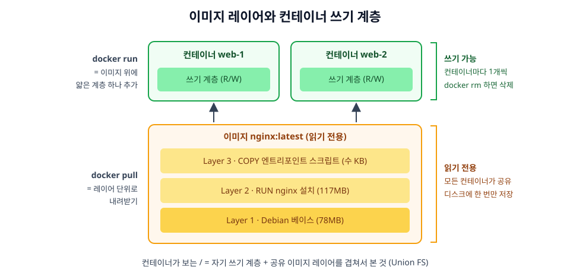
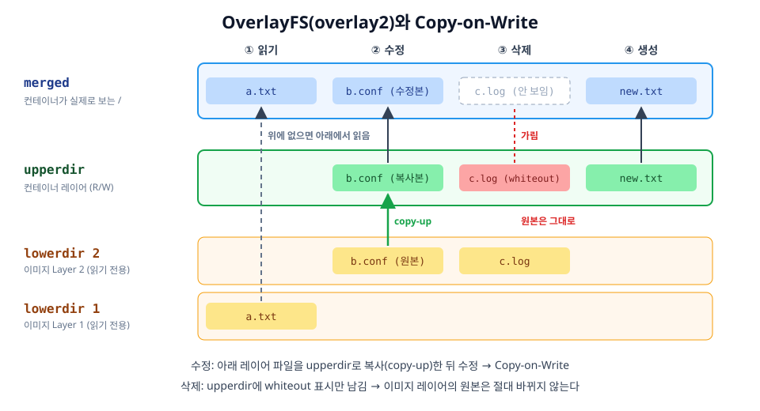
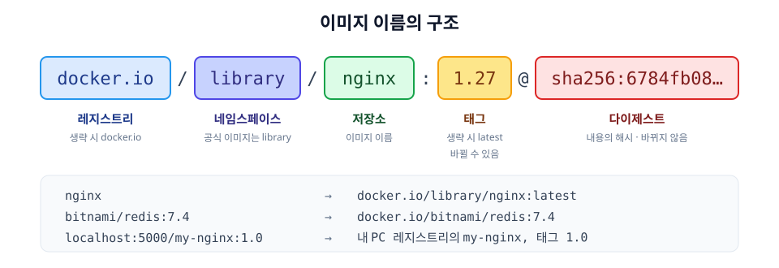

> **Chapter 1 · Docker** | 난이도 ★★☆☆☆ | 예상 소요 1.5 ~ 2시간

## 🎯 오늘의 목표

- 이미지가 **읽기 전용 레이어의 묶음**이라는 것을 설명할 수 있다
- Union File System(overlay2)과 **Copy-on-Write**가 어떻게 동작하는지 그림으로 설명할 수 있다
- 이미지 이름의 구성(`레지스트리/네임스페이스/저장소:태그@다이제스트`)을 읽고 쓸 수 있다
- 태그와 다이제스트의 차이를 알고, 운영에서 무엇을 써야 하는지 판단할 수 있다
- 로컬 레지스트리를 띄워 이미지를 `tag` → `push` → `pull` 해본다

---

## 1. 왜 레이어인가?

Day 01에서 `docker run hello-world`를 하면 Docker Hub에서 이미지를 받아왔습니다. 이번엔 조금 큰 이미지를 받아 봅시다.

```bash
docker pull nginx
```

```
Using default tag: latest
latest: Pulling from library/nginx
a2318d6c47ec: Pull complete
095d327c79ae: Pull complete
bbfaa25db775: Pull complete
7bb6fb0cfb2b: Pull complete
0723edc10c17: Pull complete
24b3fdc4d1e3: Pull complete
3122471704d5: Pull complete
Digest: sha256:...
Status: Downloaded newer image for nginx:latest
docker.io/library/nginx:latest
```

> 해시 값과 줄 수는 받는 시점의 nginx 버전에 따라 다릅니다.

한 줄 한 줄이 **레이어(layer)** 입니다. 이미지는 하나의 거대한 파일이 아니라, **파일 시스템 변경분(diff)을 차곡차곡 쌓은 묶음**입니다.

레이어로 나누면 무엇이 좋을까요?

| 장점 | 설명 |
|---|---|
| **저장 공간 절약** | `nginx`와 `my-web`이 같은 `debian` 베이스 레이어를 쓴다면 디스크에는 한 번만 저장 |
| **전송량 절약** | `pull`/`push` 시 이미 가진 레이어는 건너뜀 (`Already exists`) |
| **빌드 속도** | 바뀌지 않은 레이어는 캐시를 재사용 (Day 03에서 자세히) |
| **빠른 컨테이너 생성** | 컨테이너를 만들 때 이미지를 복사하지 않고 **얇은 쓰기 계층 하나만** 추가 |

> 💡 다른 이미지를 하나 더 받아보세요. 같은 베이스를 공유하는 레이어가 있으면 `Already exists`가 찍히고 그 레이어는 내려받지 않습니다.

---

## 2. 이미지 = 읽기 전용 레이어 + 메타데이터



이미지는 두 부분으로 이루어집니다.

1. **레이어들** — 각각 "이전 상태에서 무엇이 추가/변경/삭제되었는가"를 담은 tar 아카이브. 모두 **읽기 전용**
2. **설정(config)** — 기본 실행 명령(`CMD`), 환경 변수(`ENV`), 노출 포트(`EXPOSE`), 작업 디렉터리 등 메타데이터

컨테이너를 실행하면 Docker는 이미지 레이어 위에 **얇은 쓰기 가능 계층(container layer)** 을 하나 얹습니다.

| 구분 | 이미지 레이어 | 컨테이너 레이어 |
|---|---|---|
| 쓰기 | 불가 (읽기 전용) | 가능 |
| 공유 | 같은 이미지를 쓰는 **모든 컨테이너가 공유** | 컨테이너마다 **하나씩 따로** |
| 수명 | 이미지를 지울 때까지 | **컨테이너를 `rm` 하면 함께 삭제** |

> Day 01에서 nginx 페이지를 수정한 내용이 `docker rm` 후에 사라졌던 이유가 바로 이것입니다. 수정분은 컨테이너 레이어에만 있었으니까요.

### 레이어 직접 확인하기

```bash
docker image history nginx
```

```
IMAGE          CREATED       CREATED BY                                      SIZE      COMMENT
1e5f3c5b981a   2 weeks ago   CMD ["nginx" "-g" "daemon off;"]                0B        buildkit.dockerfile.v0
<missing>      2 weeks ago   STOPSIGNAL SIGQUIT                              0B        buildkit.dockerfile.v0
<missing>      2 weeks ago   EXPOSE map[80/tcp:{}]                           0B        buildkit.dockerfile.v0
<missing>      2 weeks ago   ENTRYPOINT ["/docker-entrypoint.sh"]            0B        buildkit.dockerfile.v0
<missing>      2 weeks ago   COPY 30-tune-worker-processes.sh /docker-ent…   4.62kB    buildkit.dockerfile.v0
...
<missing>      2 weeks ago   RUN /bin/sh -c set -x     && groupadd --syst…   117MB     buildkit.dockerfile.v0
<missing>      2 weeks ago   # debian.sh --arch 'amd64' out/ 'trixie' '@1…   78.6MB    debuerreotype 0.16
```

- 아래에서 위로 쌓이는 순서입니다. 맨 아래가 베이스(Debian), 맨 위가 마지막 명령.
- `SIZE`가 `0B`인 줄은 **파일을 바꾸지 않고 메타데이터만 바꾼 명령**(`CMD`, `EXPOSE`, `ENV` 등)입니다.
- `<missing>`은 오류가 아닙니다. 다른 곳에서 빌드되어 받아온 이미지라 중간 단계의 이미지 ID가 로컬에 없다는 뜻입니다.

실제 파일 시스템 레이어의 해시(diff ID)는 `inspect`로 볼 수 있습니다.

```bash
docker image inspect nginx --format '{{json .RootFS.Layers}}'
```

```
["sha256:7cc7fe68...","sha256:5f9a2ce1...","sha256:c3b2a1d0...", ...]
```

> `docker image history`의 줄 수와 `RootFS.Layers`의 개수가 다른 것은 정상입니다. `0B`짜리 메타데이터 단계는 파일 시스템 레이어를 만들지 않기 때문입니다.

---

## 3. Union File System과 Copy-on-Write

여러 개의 레이어를 어떻게 **하나의 디렉터리처럼** 보이게 할까요? 리눅스의 **Union File System**, 그중에서도 Docker의 기본 스토리지 드라이버인 **overlay2(OverlayFS)** 가 그 역할을 합니다.



| OverlayFS 용어 | Docker에서의 의미 |
|---|---|
| **lowerdir** | 이미지 레이어들 (읽기 전용, 여러 개를 겹침) |
| **upperdir** | 컨테이너 레이어 (쓰기 가능) |
| **merged** | 위 둘을 합쳐서 컨테이너가 실제로 보는 `/` |
| **workdir** | OverlayFS 내부 작업용 디렉터리 |

### 파일 작업별 동작

| 컨테이너 안에서의 작업 | 실제로 일어나는 일 |
|---|---|
| **읽기** | 위 레이어부터 찾아 내려가며 처음 발견된 파일을 보여줌 |
| **새 파일 생성** | upperdir에만 생성 |
| **기존 파일 수정** | 하위 레이어 파일을 upperdir로 **복사한 뒤(copy-up)** 수정 → **Copy-on-Write** |
| **파일 삭제** | 하위 레이어는 그대로 두고 upperdir에 **whiteout**(가림 표시) 파일을 만들어 안 보이게 함 |

> ⚠️ **삭제해도 이미지는 작아지지 않는다.** Dockerfile에서 `RUN` 한 줄로 파일을 받고, 다음 `RUN`에서 지우면 앞 레이어에는 파일이 그대로 남습니다. 위에서 "가려질" 뿐입니다. 그래서 설치와 정리는 **같은 `RUN` 안에서** 해야 합니다 (Day 03).

> ⚠️ 큰 파일(예: 수 GB 로그, DB 파일)을 컨테이너 레이어에서 수정하면 copy-up 비용이 크고, 컨테이너를 지우면 사라집니다. 이런 데이터는 **볼륨**에 둡니다 (Day 04).

### 스토리지 드라이버 확인

```bash
docker info --format '{{.Driver}}'
```

```
overlay2
```

> 💡 최근 Docker Engine/Docker Desktop은 이미지 저장을 containerd에 맡기는 **containerd image store**를 쓰기도 합니다. 이 경우 `overlayfs`(snapshotter)로 표시되고 `/var/lib/docker/overlay2` 대신 containerd 디렉터리를 사용합니다. 이름과 경로만 다를 뿐 **"읽기 전용 레이어 + 쓰기 계층"이라는 원리는 똑같습니다.** 이후 실습의 `GraphDriver` 경로는 overlay2 드라이버 기준입니다.

---

## 4. 이미지 이름 읽는 법 — 태그와 다이제스트



우리가 `nginx`라고만 쳐도 Docker는 생략된 부분을 자동으로 채웁니다.

| 입력 | 실제 의미 |
|---|---|
| `nginx` | `docker.io/library/nginx:latest` |
| `nginx:1.27` | `docker.io/library/nginx:1.27` |
| `bitnami/redis` | `docker.io/bitnami/redis:latest` |
| `ghcr.io/owner/app:v1` | GitHub Container Registry의 `owner/app`, 태그 `v1` |
| `localhost:5000/my-nginx:1.0` | 내 PC에서 띄운 레지스트리 |

- **레지스트리** — 생략하면 `docker.io`(Docker Hub)
- **네임스페이스** — Docker Hub 공식 이미지는 `library`
- **태그** — 생략하면 `latest`

### 태그 vs 다이제스트

| 구분 | 태그 (`:1.27`) | 다이제스트 (`@sha256:...`) |
|---|---|---|
| 정체 | 사람이 붙인 **이름표** | 이미지 내용으로 계산한 **해시** |
| 변경 가능 | ✅ 같은 태그를 다른 이미지로 다시 push 가능 | ❌ 내용이 바뀌면 다이제스트도 바뀜 |
| 용도 | 사람이 읽고 고르기 쉬움 | **정확히 같은 이미지**를 보장 (재현성·보안) |

> ⚠️ `latest`는 "가장 최신"이라는 보장이 아닙니다. **태그를 생략했을 때 붙는 기본 이름**일 뿐입니다. 오늘 받은 `nginx:latest`와 다음 달의 `nginx:latest`는 다른 이미지일 수 있습니다. 운영 환경에서는 최소한 버전 태그(`nginx:1.27`)를, 엄격하게는 다이제스트를 고정하세요.

### 멀티 아키텍처 이미지

같은 `nginx:latest`를 Intel PC와 Apple Silicon Mac에서 받아도 각자에 맞는 이미지가 내려옵니다. 태그가 **매니페스트 리스트(이미지 인덱스)** 를 가리키고, 그 안에 플랫폼별 이미지가 들어 있기 때문입니다.

```bash
docker buildx imagetools inspect nginx:latest
```

```
Name:      docker.io/library/nginx:latest
MediaType: application/vnd.oci.image.index.v1+json
Digest:    sha256:...

Manifests:
  Name:        docker.io/library/nginx:latest@sha256:...
  MediaType:   application/vnd.oci.image.manifest.v1+json
  Platform:    linux/amd64

  Name:        docker.io/library/nginx:latest@sha256:...
  MediaType:   application/vnd.oci.image.manifest.v1+json
  Platform:    linux/arm64/v8
  ...
```

---

## 5. 실습

> 실습 환경: Docker Desktop(Windows/macOS) 또는 Ubuntu 24.04 + Docker Engine. 명령은 bash 기준이며, Windows는 WSL2 터미널이나 Git Bash에서 그대로 실행할 수 있습니다.

### 5-1. 레이어 공유 확인

```bash
docker pull nginx:latest
docker pull nginx:alpine      # 베이스가 다른 이미지 → 레이어를 새로 받음
docker images nginx
```

```
REPOSITORY   TAG       IMAGE ID       CREATED       SIZE
nginx        alpine    6769dc3a703c   2 weeks ago   48.3MB
nginx        latest    1e5f3c5b981a   2 weeks ago   192MB
```

```bash
docker system df -v | head -20
```

`SHARED SIZE` 열은 다른 이미지와 공유하는 레이어 크기, `UNIQUE SIZE`는 그 이미지만 가진 크기입니다. `docker images`의 `SIZE`를 단순히 더한 값이 실제 디스크 사용량이 아닌 이유입니다.

### 5-2. Copy-on-Write 눈으로 보기 — `docker diff`

```bash
docker run -d --name cow nginx
docker exec cow sh -c 'echo hello > /tmp/hello.txt'
docker exec cow rm /usr/share/nginx/html/50x.html
docker diff cow
```

```
C /tmp
A /tmp/hello.txt
C /usr
C /usr/share
C /usr/share/nginx
C /usr/share/nginx/html
D /usr/share/nginx/html/50x.html
C /run
A /run/nginx.pid
...
```

| 기호 | 의미 |
|---|---|
| `A` | Added — 컨테이너 레이어에 새로 생긴 파일 |
| `C` | Changed — 변경됨 (copy-up 발생) |
| `D` | Deleted — whiteout으로 가려짐 |

> 💡 `/run/nginx.pid` 같은 항목은 우리가 만든 게 아니라 nginx가 시작하면서 쓴 파일입니다. 컨테이너 안의 **모든 쓰기**가 컨테이너 레이어에 기록된다는 증거입니다.

Linux(overlay2 드라이버) 호스트라면 실제 디렉터리도 볼 수 있습니다.

```bash
docker inspect cow --format '{{json .GraphDriver.Data}}' | python3 -m json.tool
```

```json
{
    "LowerDir": "/var/lib/docker/overlay2/3f1c...-init/diff:/var/lib/docker/overlay2/9ab2.../diff:...",
    "MergedDir": "/var/lib/docker/overlay2/3f1c.../merged",
    "UpperDir": "/var/lib/docker/overlay2/3f1c.../diff",
    "WorkDir": "/var/lib/docker/overlay2/3f1c.../work"
}
```

```bash
sudo ls /var/lib/docker/overlay2/<UpperDir의 ID>/diff/tmp
# hello.txt   ← 컨테이너에서 만든 파일이 호스트의 upperdir에 그대로 있음
```

같은 이미지로 컨테이너를 하나 더 띄워 보세요. `/tmp/hello.txt`가 **없습니다.** 이미지 레이어는 공유하지만 쓰기 계층은 각자이기 때문입니다.

```bash
docker run --rm nginx ls /tmp
# (아무것도 없음)
docker rm -f cow
```

### 5-3. 태그와 다이제스트 다루기

```bash
docker images --digests nginx
```

```
REPOSITORY   TAG       DIGEST                    IMAGE ID       CREATED       SIZE
nginx        latest    sha256:6784fb0834aa...    1e5f3c5b981a   2 weeks ago   192MB
```

```bash
# 다이제스트 문자열만 뽑기
docker image inspect nginx:latest --format '{{index .RepoDigests 0}}'
# docker.io/library/nginx@sha256:6784fb0834aa...

# 다이제스트로 받기 — 언제 실행해도 정확히 같은 이미지
docker pull nginx@sha256:<위에서 확인한 값>
```

`docker tag`는 이미지를 복사하지 않고 **이름표만 하나 더** 붙입니다.

```bash
docker tag nginx:latest my-nginx:v1
docker images | grep -E 'nginx'
```

```
my-nginx     v1        1e5f3c5b981a   2 weeks ago   192MB
nginx        latest    1e5f3c5b981a   2 weeks ago   192MB
```

`IMAGE ID`가 같습니다. 같은 이미지에 이름이 두 개 붙은 것뿐입니다. `docker rmi my-nginx:v1`을 해도 이름표만 떨어지고 (`Untagged: my-nginx:v1`) 이미지는 남습니다.

### 5-4. 로컬 레지스트리에 push / pull

Docker Hub 계정 없이도 레지스트리를 직접 띄워볼 수 있습니다. 레지스트리 자체도 컨테이너입니다.

```bash
docker run -d --name registry -p 5000:5000 registry:2
```

```bash
# 1) 레지스트리 주소를 이름에 포함해서 태그
docker tag nginx:latest localhost:5000/my-nginx:1.0

# 2) push
docker push localhost:5000/my-nginx:1.0
```

```
The push refers to repository [localhost:5000/my-nginx]
5f70bf18a086: Pushed
...
1.0: digest: sha256:... size: 1778
```

```bash
# 3) 레지스트리 API로 확인
curl http://localhost:5000/v2/_catalog
# {"repositories":["my-nginx"]}

curl http://localhost:5000/v2/my-nginx/tags/list
# {"name":"my-nginx","tags":["1.0"]}
```

```bash
# 4) 로컬 이미지를 지우고 레지스트리에서 다시 받기
docker rmi localhost:5000/my-nginx:1.0
docker pull localhost:5000/my-nginx:1.0
```

> 💡 같은 이미지를 두 번째로 push하면 모든 레이어가 `Layer already exists`로 건너뜁니다. 레지스트리도 레이어 단위로 저장하기 때문입니다.

> ⚠️ `localhost`가 아닌 주소(예: `192.168.0.10:5000`)의 HTTP 레지스트리는 Docker가 기본적으로 거부합니다(HTTPS 필수). 테스트용이라면 `daemon.json`의 `insecure-registries`에 등록해야 하고, 운영이라면 TLS 인증서를 붙여야 합니다.

### 5-5. 이미지를 파일로 옮기기 — `save` / `load`

인터넷이 막힌 서버(폐쇄망)에 이미지를 옮길 때 씁니다.

```bash
docker save -o nginx.tar nginx:latest
ls -lh nginx.tar

docker rmi nginx:latest
docker load -i nginx.tar
# Loaded image: nginx:latest
```

> `save`/`load`는 **이미지**(레이어 + 메타데이터, 태그 유지)를, `export`/`import`는 **컨테이너 파일 시스템을 하나로 납작하게** 만든 tar를 다룹니다. 레이어와 `CMD` 같은 설정이 사라지므로 이미지 이동에는 `save`/`load`를 씁니다.

### 5-6. 정리

```bash
docker rm -f registry
docker rmi my-nginx:v1 localhost:5000/my-nginx:1.0 nginx:alpine
rm -f nginx.tar
docker image prune     # 이름 없는(dangling, <none>) 이미지 삭제
```

---

## 6. 트러블슈팅

| 증상 | 원인 | 해결 |
|---|---|---|
| `manifest unknown` / `not found` | 존재하지 않는 태그 (오타, 이미 삭제된 태그) | Docker Hub 페이지나 `docker buildx imagetools inspect`로 태그 확인 |
| `no matching manifest for linux/arm64/v8 in the manifest list entries` | 그 이미지가 내 CPU 아키텍처용으로 빌드되지 않음 | 다른 태그/이미지 사용, 또는 `--platform linux/amd64`로 에뮬레이션 실행(느림) |
| `toomanyrequests: You have reached your pull rate limit` | Docker Hub 익명 pull 횟수 제한 | `docker login` 후 사용, 사내 레지스트리 미러 사용 |
| `http: server gave HTTP response to HTTPS client` | HTTP 레지스트리에 원격 주소로 접근 | TLS 적용 또는 `insecure-registries` 등록 (테스트 환경만) |
| `conflict: unable to remove repository reference ... container ... is using its referenced image` | 그 이미지로 만든 컨테이너(중지된 것 포함)가 남아 있음 | `docker ps -a`로 확인 후 컨테이너 먼저 삭제 |
| macOS에서 `-p 5000:5000` 바인딩 실패 | macOS의 AirPlay 수신기가 5000번 포트 사용 | `-p 5001:5000`처럼 다른 호스트 포트 사용 |
| 파일을 지웠는데 이미지 크기가 그대로 | 이전 레이어에 파일이 남아 있음 (whiteout) | 설치·정리를 같은 `RUN`에서 수행, 멀티 스테이지 빌드 (Day 03) |

---

## 7. 핵심 정리

- 이미지 = **읽기 전용 레이어들 + 설정(config)**. 레이어는 파일 시스템 변경분(diff)
- 컨테이너 = 이미지 레이어 위에 **쓰기 가능한 컨테이너 레이어** 하나를 얹은 것. `rm` 하면 함께 사라짐
- overlay2는 lowerdir(이미지) + upperdir(컨테이너)를 merged로 합쳐 보여주고, 수정 시 **Copy-on-Write**, 삭제 시 **whiteout**
- 이미지 이름 = `레지스트리/네임스페이스/저장소:태그@다이제스트`, 생략 시 `docker.io/library/…:latest`
- **태그는 움직이는 이름표, 다이제스트는 고정된 내용 해시** → 재현성이 필요하면 다이제스트
- 필수 명령어: `pull`, `push`, `tag`, `image history`, `image inspect`, `diff`, `save`/`load`, `image prune`

---

## 8. 셀프 체크

<details>
<summary>Q1. 같은 nginx 이미지로 컨테이너 10개를 띄우면 디스크를 이미지 크기의 10배만큼 쓰는가?</summary>

아닙니다. 이미지 레이어는 읽기 전용이라 10개 컨테이너가 **공유**합니다. 컨테이너마다 추가되는 것은 각자 쓴 내용만 담기는 얇은 컨테이너 레이어뿐입니다.
</details>

<details>
<summary>Q2. 컨테이너 안에서 이미지에 들어 있던 <code>/etc/nginx/nginx.conf</code>를 수정하면 내부적으로 무슨 일이 일어나는가?</summary>

하위(이미지) 레이어의 파일이 컨테이너 레이어(upperdir)로 **복사(copy-up)** 된 뒤 그 복사본이 수정됩니다. 이미지 레이어의 원본은 바뀌지 않습니다. 이것이 Copy-on-Write입니다.
</details>

<details>
<summary>Q3. <code>nginx</code>라고만 입력했을 때 Docker가 해석하는 전체 이름은?</summary>

`docker.io/library/nginx:latest` — 레지스트리는 Docker Hub, 공식 이미지 네임스페이스는 `library`, 태그는 `latest`.
</details>

<details>
<summary>Q4. 운영 배포에서 <code>myapp:latest</code> 대신 다이제스트를 쓰라고 권하는 이유는?</summary>

태그는 같은 이름으로 다른 이미지를 다시 push할 수 있어서, 같은 배포 설정이라도 시점에 따라 다른 이미지가 실행될 수 있습니다. 다이제스트는 이미지 내용의 해시라서 **항상 정확히 같은 이미지**를 보장합니다(재현성, 공급망 보안).
</details>

<details>
<summary>Q5. <code>docker tag nginx my-nginx:v1</code> 후 <code>docker rmi my-nginx:v1</code>을 하면 nginx 이미지도 지워지는가?</summary>

아닙니다. `tag`는 같은 이미지 ID에 이름을 하나 더 붙일 뿐이고, `rmi`는 그 이름표를 떼어냅니다(`Untagged`). 이미지를 가리키는 이름이 하나라도 남아 있으면 이미지 자체는 삭제되지 않습니다.
</details>

---

## ⏭️ 다음 예고 — Day 03. Dockerfile 작성과 멀티 스테이지 빌드

오늘은 남이 만든 이미지를 받아서 뜯어봤습니다. 내일은 **직접 이미지를 만듭니다.** Dockerfile의 각 명령이 레이어가 되는 과정, 빌드 캐시를 살리는 작성 순서, `CMD`와 `ENTRYPOINT`의 차이, 그리고 수백 MB짜리 이미지를 수 MB로 줄이는 **멀티 스테이지 빌드**까지 다룹니다.
