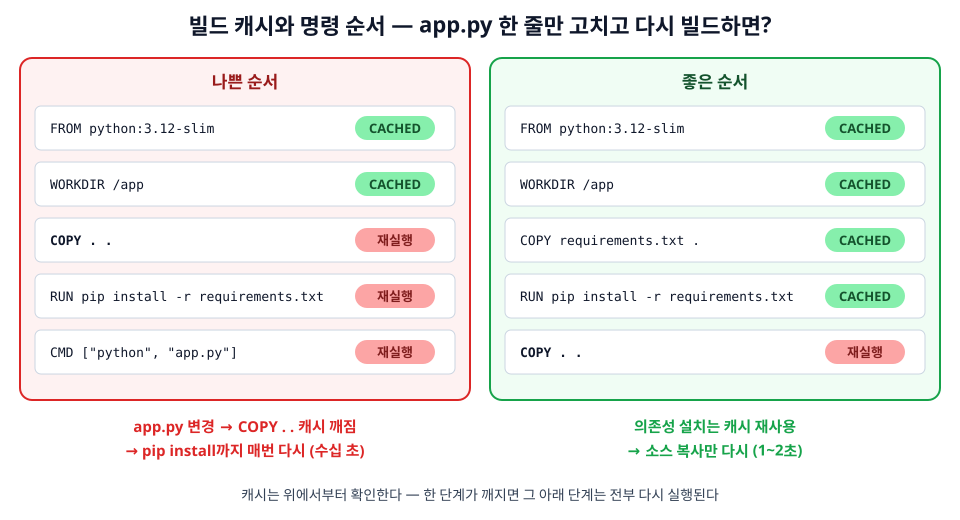
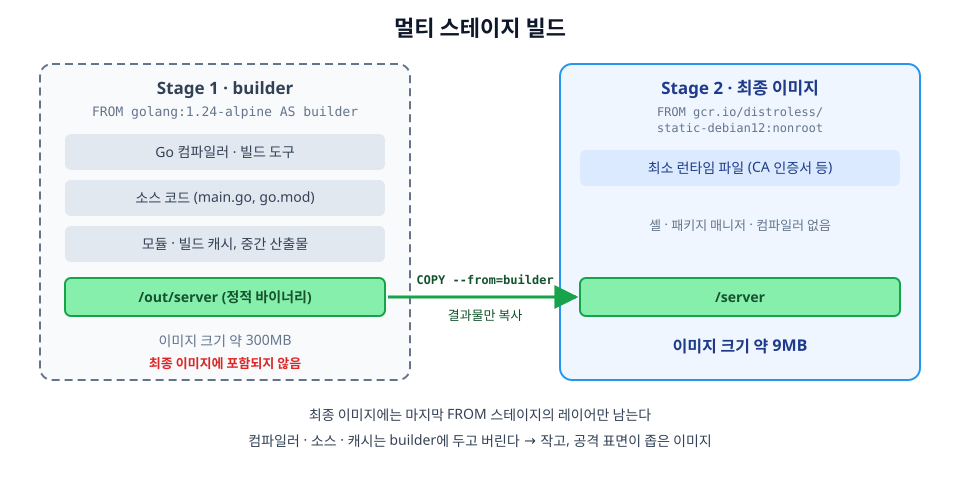

> **Chapter 1 · Docker** | 난이도 ★★☆☆☆ | 예상 소요 2 ~ 2.5시간

## 🎯 오늘의 목표

- Dockerfile의 주요 명령(`FROM`, `RUN`, `COPY`, `WORKDIR`, `ENV`, `ARG`, `EXPOSE`, `USER`, `CMD`, `ENTRYPOINT`)을 쓸 수 있다
- 각 명령이 **레이어/메타데이터**가 되는 과정과 **빌드 캐시**의 동작 원리를 설명할 수 있다
- `CMD`와 `ENTRYPOINT`, **shell form**과 **exec form**의 차이를 안다
- **멀티 스테이지 빌드**로 이미지 크기를 수백 MB에서 수 MB로 줄여본다
- `.dockerignore`, non-root 사용자 등 기본적인 모범 사례를 적용할 수 있다

---

## 1. 왜 Dockerfile인가?

Day 02에서 컨테이너 안에서 파일을 바꾸면 컨테이너 레이어에 기록된다는 것을 봤습니다. 그렇다면 컨테이너 안에서 이것저것 설치한 뒤 `docker commit`으로 이미지를 만들면 되지 않을까요?

| 방법 | 문제점 / 장점 |
|---|---|
| `docker commit` | 무엇을 어떻게 설치했는지 **기록이 남지 않음**. 재현 불가, 리뷰 불가, 쓰레기 파일까지 포함 |
| **Dockerfile** | 이미지를 만드는 과정을 **코드로** 기록. Git으로 관리, 리뷰 가능, 언제 어디서나 같은 결과 |

> **Dockerfile = 이미지를 만드는 레시피.** `docker build`는 이 레시피를 위에서부터 한 줄씩 실행해 Day 02에서 본 레이어들을 쌓아 올립니다.

---

## 2. Dockerfile 기본 명령

| 명령 | 역할 | 레이어 생성 |
|---|---|---|
| `FROM` | 베이스 이미지 지정. 모든 Dockerfile의 시작 | 베이스 레이어를 가져옴 |
| `RUN` | 빌드 중 명령 실행 (패키지 설치 등) | ✅ |
| `COPY` | 빌드 컨텍스트의 파일을 이미지로 복사 | ✅ |
| `ADD` | `COPY` + 원격 URL 다운로드 · 로컬 tar 자동 압축 해제 | ✅ |
| `WORKDIR` | 이후 명령의 작업 디렉터리 (없으면 생성) | 메타데이터 |
| `ENV` | 환경 변수 (빌드 중 + 컨테이너 실행 시) | 메타데이터 |
| `ARG` | **빌드 시에만** 쓰는 변수 (`--build-arg`로 주입) | 메타데이터 |
| `EXPOSE` | 컨테이너가 쓰는 포트를 **문서화** (실제로 열지는 않음) | 메타데이터 |
| `USER` | 이후 명령과 컨테이너 실행 사용자 | 메타데이터 |
| `LABEL` | 이미지에 key=value 정보 추가 (작성자, 버전 등) | 메타데이터 |
| `HEALTHCHECK` | 컨테이너가 정상인지 주기적으로 검사할 명령 | 메타데이터 |
| `CMD` | 컨테이너 시작 시 **기본 명령/인자** | 메타데이터 |
| `ENTRYPOINT` | 컨테이너 시작 시 **항상 실행할 명령** | 메타데이터 |

> 💡 `COPY`와 `ADD`가 헷갈리면 **항상 `COPY`** 를 쓰세요. `ADD`의 자동 압축 해제·URL 다운로드는 의도치 않은 동작을 만들기 쉽습니다.

> ⚠️ `EXPOSE 80`만으로는 호스트에서 접근할 수 없습니다. 실제 포트 연결은 Day 01에서 본 `-p 8080:80`이 합니다.

### 빌드 컨텍스트

```bash
docker build -t myapp:1.0 .
#                          ^ 빌드 컨텍스트 = 현재 디렉터리
```

마지막 `.`은 "Dockerfile 위치"가 아니라 **빌드 컨텍스트**, 즉 빌더에게 보낼 파일 묶음입니다. `COPY`는 이 컨텍스트 안의 파일만 복사할 수 있습니다. 그래서 `.git`, `node_modules`, 비밀 파일처럼 이미지에 넣으면 안 되거나 불필요한 파일은 `.dockerignore`로 제외합니다.

---

## 3. 빌드 캐시 — 순서가 속도를 결정한다



Docker(BuildKit)는 각 명령을 실행하기 전에 **"이전에 같은 조건으로 만든 레이어가 있는가?"** 를 확인합니다.

- `RUN` → 명령 문자열이 같고, 앞 단계가 모두 캐시면 재사용
- `COPY`/`ADD` → 복사할 **파일 내용(체크섬)** 이 같으면 재사용
- **한 단계라도 캐시가 깨지면, 그 아래 단계는 전부 다시 실행**

그래서 원칙은 하나입니다.

> **자주 바뀌지 않는 것은 위로, 자주 바뀌는 것은 아래로.**

| ❌ 나쁜 순서 | ✅ 좋은 순서 |
|---|---|
| `COPY . .` (소스 전체) | `COPY requirements.txt .` (의존성 목록만) |
| `RUN pip install -r requirements.txt` | `RUN pip install -r requirements.txt` |
| | `COPY . .` (소스 전체) |
| 코드 한 줄만 바꿔도 **의존성 설치부터 다시** | 코드를 바꿔도 의존성 설치는 **캐시 재사용** |

### RUN 한 줄에 설치와 정리를

Day 02에서 본 것처럼, 다음 레이어에서 파일을 지워도 앞 레이어의 크기는 줄지 않습니다.

```dockerfile
# ❌ 캐시 파일이 2번째 레이어에 그대로 남음
RUN apt-get update && apt-get install -y curl
RUN rm -rf /var/lib/apt/lists/*

# ✅ 같은 RUN 안에서 설치 + 정리
RUN apt-get update \
 && apt-get install -y --no-install-recommends curl \
 && rm -rf /var/lib/apt/lists/*
```

> 💡 `apt-get update`와 `apt-get install`은 반드시 같은 `RUN`에 두세요. 따로 두면 `update` 단계가 캐시된 채로 남아, 나중에 패키지를 추가할 때 오래된 목록으로 설치하려다 실패할 수 있습니다.

---

## 4. CMD vs ENTRYPOINT, shell form vs exec form

### 두 가지 작성 형식

| 형식 | 예 | 실행 방식 |
|---|---|---|
| **exec form** (권장) | `CMD ["python", "app.py"]` | 프로그램을 **직접** 실행 → 앱이 PID 1 |
| shell form | `CMD python app.py` | `/bin/sh -c "python app.py"`로 실행 → 셸이 PID 1이 될 수 있음 |

셸이 PID 1이 되면 `docker stop`이 보내는 SIGTERM이 앱까지 전달되지 않아, 정상 종료하지 못하고 10초 뒤 SIGKILL로 강제 종료될 수 있습니다(Day 01의 `stop` 동작 참고). **`CMD`와 `ENTRYPOINT`는 exec form(JSON 배열)으로 쓰는 것**이 기본입니다. 환경 변수 치환 같은 셸 기능이 필요할 때만 shell form을 씁니다.

### 역할 분담

| 구분 | `CMD` | `ENTRYPOINT` |
|---|---|---|
| 의미 | 기본 명령 또는 기본 **인자** | 항상 실행할 **명령** |
| `docker run 이미지 <인자>` | `<인자>`로 **통째로 교체됨** | `<인자>`가 **뒤에 덧붙음** |
| 바꾸려면 | `docker run` 뒤에 다른 명령 입력 | `docker run --entrypoint` |

둘을 같이 쓰면 `ENTRYPOINT` = 실행 파일, `CMD` = 기본 인자 가 됩니다. 실습 5-3에서 직접 확인합니다.

---

## 5. 실습

> 실습 환경: Docker Desktop(Windows/macOS) 또는 Ubuntu 24.04 + Docker Engine. Docker 23.0 이상은 `docker build`가 기본으로 **BuildKit**을 사용합니다. 명령은 bash 기준(Windows는 WSL2 터미널 권장)입니다.

### 5-1. Python 웹 앱 이미지 만들기

```bash
mkdir -p ~/docker-lab/hello-py && cd ~/docker-lab/hello-py
```

`app.py`

```python
import socket

from flask import Flask

app = Flask(__name__)


@app.route("/")
def hello():
    return f"Hello from {socket.gethostname()}!\n"


if __name__ == "__main__":
    app.run(host="0.0.0.0", port=5000)
```

`requirements.txt`

```
flask==3.1.0
```

`.dockerignore`

```
.git
__pycache__/
*.pyc
.venv/
.env
Dockerfile
.dockerignore
```

`Dockerfile`

```dockerfile
# syntax=docker/dockerfile:1
FROM python:3.12-slim

# 파이썬 로그가 버퍼링 없이 바로 docker logs에 찍히도록
ENV PYTHONDONTWRITEBYTECODE=1 \
    PYTHONUNBUFFERED=1

WORKDIR /app

# root가 아닌 전용 사용자 생성 (자주 안 바뀌므로 위쪽에)
RUN useradd --create-home --uid 10001 appuser

# 1) 의존성 목록만 먼저 복사 → 설치 (캐시 활용)
COPY requirements.txt .
RUN pip install --no-cache-dir -r requirements.txt

# 2) 소스 코드는 마지막에 복사
COPY . .

USER appuser
EXPOSE 5000
CMD ["python", "app.py"]
```

> `app.run(host="0.0.0.0")`이 중요합니다. 기본값 `127.0.0.1`로 띄우면 컨테이너 내부 루프백에서만 받기 때문에 `-p`로 포트를 연결해도 접속이 안 됩니다.

빌드하고 실행합니다.

```bash
docker build -t hello-py:1.0 .
docker run -d --name hello -p 8000:5000 hello-py:1.0
curl http://localhost:8000
# Hello from 3f9c1d2a7b4e!
```

> 💡 호스트 포트를 5000이 아닌 8000으로 쓴 이유: macOS는 AirPlay 수신기가 5000번 포트를 쓰는 경우가 많습니다.

```bash
docker exec hello whoami
# appuser          ← USER 지시어 덕분에 root가 아님
docker image history hello-py:1.0
```

`history`를 보면 Dockerfile의 각 줄이 위에서 아래로 쌓인 것을 확인할 수 있습니다. Day 02에서 본 nginx의 `history`와 같은 구조입니다.

### 5-2. 빌드 캐시 체험

`app.py`의 메시지를 조금 바꾼 뒤 다시 빌드합니다.

```bash
sed -i 's/Hello from/Hi from/' app.py      # macOS는 sed -i '' 's/Hello from/Hi from/' app.py
docker build -t hello-py:1.1 .
```

```
 => [1/6] FROM docker.io/library/python:3.12-slim@sha256:...
 => CACHED [2/6] WORKDIR /app
 => CACHED [3/6] RUN useradd --create-home --uid 10001 appuser
 => CACHED [4/6] COPY requirements.txt .
 => CACHED [5/6] RUN pip install --no-cache-dir -r requirements.txt
 => [6/6] COPY . .
```

`pip install`이 `CACHED`로 건너뛰어져서 빌드가 1~2초 만에 끝납니다. 이번엔 `requirements.txt`에 패키지를 하나 추가해 보세요(예: `requests==2.32.3`). `[4/6]`부터 아래가 전부 다시 실행됩니다.

> 💡 캐시를 완전히 무시하고 처음부터 빌드하려면 `docker build --no-cache -t hello-py:1.1 .`

### 5-3. CMD와 ENTRYPOINT 직접 비교

같은 디렉터리에 `Dockerfile.ping`을 만듭니다.

```dockerfile
FROM alpine:3.20
ENTRYPOINT ["ping", "-c", "3"]
CMD ["localhost"]
```

```bash
docker build -t pinger -f Dockerfile.ping .

docker run --rm pinger              # ping -c 3 localhost   (CMD 기본 인자 사용)
docker run --rm pinger 8.8.8.8      # ping -c 3 8.8.8.8     (CMD만 교체됨)
docker run --rm --entrypoint echo pinger hi   # echo hi  (ENTRYPOINT 교체)
```

`-f`로 Dockerfile 이름을 지정할 수 있습니다. `ENTRYPOINT`는 고정, `CMD`는 "갈아 끼울 수 있는 기본값"이라는 것이 보이죠.

### 5-4. 멀티 스테이지 빌드 — Go 웹 서버



컴파일 언어(Go, Java, Rust)나 프런트엔드 빌드(Node)는 **빌드할 때만** 컴파일러와 도구가 필요합니다. 그런데 이것들을 최종 이미지에 그대로 두면 크기가 커지고, 공격에 쓰일 수 있는 도구도 함께 배포됩니다.

**멀티 스테이지 빌드**는 하나의 Dockerfile에 `FROM`을 여러 번 써서, **빌드용 스테이지에서 만든 결과물만 실행용 스테이지로 복사**합니다.

```bash
mkdir -p ~/docker-lab/hello-go && cd ~/docker-lab/hello-go
```

`main.go`

```go
package main

import (
	"fmt"
	"log"
	"net/http"
	"os"
)

func main() {
	http.HandleFunc("/", func(w http.ResponseWriter, r *http.Request) {
		host, _ := os.Hostname()
		fmt.Fprintf(w, "Hello from Go! (%s)\n", host)
	})
	log.Println("listening on :8080")
	log.Fatal(http.ListenAndServe(":8080", nil))
}
```

`go.mod`

```
module example.com/hello-go

go 1.24
```

먼저 비교용으로 **단일 스테이지** 버전을 만들어 봅니다. `Dockerfile.single`

```dockerfile
FROM golang:1.24
WORKDIR /src
COPY . .
RUN go build -o /server .
EXPOSE 8080
CMD ["/server"]
```

이제 **멀티 스테이지** 버전입니다. `Dockerfile`

```dockerfile
# syntax=docker/dockerfile:1
ARG GO_VERSION=1.24

# ---------- 1단계: 빌드 ----------
FROM golang:${GO_VERSION}-alpine AS builder
WORKDIR /src
COPY go.mod ./
RUN go mod download
COPY . .
# CGO를 끄면 C 라이브러리에 의존하지 않는 정적 바이너리가 만들어짐
RUN CGO_ENABLED=0 go build -ldflags="-s -w" -o /out/server .

# ---------- 2단계: 실행 ----------
# distroless: 셸·패키지 매니저도 없는 최소 이미지, :nonroot 태그는 UID 65532로 실행
FROM gcr.io/distroless/static-debian12:nonroot
COPY --from=builder /out/server /server
EXPOSE 8080
ENTRYPOINT ["/server"]
```

> 💡 `go.mod`만 먼저 복사하고 `go mod download`를 하는 것은 5-2의 `requirements.txt` 패턴과 같습니다. 지금은 외부 의존성이 없어 내려받을 것이 없지만, 의존성이 생기면 캐시 효과가 납니다.

두 이미지를 빌드해서 크기를 비교합니다.

```bash
docker build -t hello-go:single -f Dockerfile.single .
docker build -t hello-go:multi .
docker images hello-go --format 'table {{.Repository}}\t{{.Tag}}\t{{.Size}}'
```

```
REPOSITORY   TAG       SIZE
hello-go     multi     8.9MB
hello-go     single    880MB
```

> 크기는 Go 버전과 아키텍처에 따라 조금씩 다르지만, **약 100배 차이**가 나는 것은 같습니다.

```bash
docker run -d --name go-web -p 8081:8080 hello-go:multi
curl http://localhost:8081
# Hello from Go! (a1b2c3d4e5f6)
```

#### 특정 스테이지까지만 빌드하기

```bash
docker build --target builder -t hello-go:builder .
docker run --rm hello-go:builder ls -l /out
```

빌드 결과물을 디버깅하거나, 테스트 전용 스테이지를 따로 둘 때 유용합니다.

#### 빌드 인자로 버전 바꾸기

```bash
docker build --build-arg GO_VERSION=1.25 -t hello-go:go125 .
```

> 💡 `FROM` 앞에 선언한 `ARG`는 `FROM` 줄에서만 쓸 수 있습니다. 스테이지 안에서도 쓰려면 그 스테이지 안에서 `ARG GO_VERSION`을 한 번 더 선언해야 합니다.

### 5-5. 한 단계 더 — 캐시 마운트

BuildKit의 `RUN --mount=type=cache`를 쓰면 Go 모듈/빌드 캐시를 **레이어가 아닌 빌더의 캐시 저장소**에 보관해, 소스가 바뀌어도 재컴파일이 빨라집니다. 이미지 크기에는 영향을 주지 않습니다.

```dockerfile
RUN --mount=type=cache,target=/go/pkg/mod \
    --mount=type=cache,target=/root/.cache/go-build \
    CGO_ENABLED=0 go build -ldflags="-s -w" -o /out/server .
```

> pip(`/root/.cache/pip`), npm(`/root/.npm`) 등도 같은 방식으로 쓸 수 있습니다.

### 5-6. 정리

```bash
docker rm -f hello go-web
docker rmi hello-py:1.0 hello-py:1.1 pinger hello-go:single hello-go:multi hello-go:builder
docker builder prune      # 빌드 캐시 정리 (확인 프롬프트가 나옴)
```

`hello-go:go125`를 만들었다면 함께 지워 주세요.

---

## 6. 트러블슈팅

| 증상 | 원인 | 해결 |
|---|---|---|
| `COPY failed: ... not found` / `"/app.py": not found` | 파일이 빌드 컨텍스트 밖에 있거나 `.dockerignore`로 제외됨 | 빌드 컨텍스트(`docker build ... .`의 `.`) 위치와 `.dockerignore` 확인 |
| 코드 한 줄 바꿨는데 의존성 설치부터 다시 실행 | `COPY . .`가 의존성 설치보다 앞에 있음 | 의존성 파일만 먼저 `COPY` → 설치 → 소스 `COPY` |
| `docker stop`이 항상 10초씩 걸림 | shell form으로 실행돼 SIGTERM이 앱에 전달되지 않음 | `CMD`/`ENTRYPOINT`를 exec form(`["..."]`)으로 |
| 컨테이너 실행 직후 `exec /server: no such file or directory` | CGO가 켜진 바이너리가 없는 C 라이브러리(glibc/musl)를 찾음 | `CGO_ENABLED=0`으로 정적 빌드하거나 런타임 이미지를 맞춤 |
| `docker exec -it go-web sh` → `executable file not found` | distroless/scratch 이미지에는 셸이 없음 | 정상. 디버깅은 `--target builder` 이미지나 `:debug` 태그 distroless 사용 |
| `curl` 접속 시 `Empty reply from server` 또는 `Connection reset by peer` | 앱이 `127.0.0.1`에만 바인딩됨 | 앱을 `0.0.0.0`으로 listen |
| `apt-get install` 중 `Unable to locate package` | `apt-get update`가 별도 `RUN`에서 오래된 캐시로 남음 | `update`와 `install`을 같은 `RUN`에서 실행 |
| Windows에서 만든 셸 스크립트가 `exec format error` 또는 `not found` | 줄바꿈이 CRLF | 에디터에서 LF로 저장, `.gitattributes`에 `*.sh text eol=lf` |

---

## 7. 핵심 정리

- Dockerfile은 이미지를 만드는 **코드화된 레시피**. `RUN`/`COPY`/`ADD`는 레이어를, 나머지는 주로 메타데이터를 만든다
- 빌드 캐시는 위에서부터 확인하며, **한 번 깨지면 아래는 전부 재실행** → 잘 안 바뀌는 것을 위에
- 설치와 정리는 **같은 `RUN`** 에서, 불필요한 파일은 **`.dockerignore`** 로
- `CMD`는 교체 가능한 기본값, `ENTRYPOINT`는 고정 실행 파일. 둘 다 **exec form** 으로
- **멀티 스테이지 빌드**: 빌드 도구는 builder 스테이지에만, 최종 이미지에는 결과물만 (`COPY --from=builder`)
- 보안 기본기: 버전 태그 고정, **non-root `USER`**, 최소 베이스 이미지(slim / alpine / distroless)

---

## 8. 셀프 체크

<details>
<summary>Q1. <code>COPY . .</code> 다음에 <code>RUN pip install</code>을 두면 왜 빌드가 느려지는가?</summary>

소스 파일이 하나만 바뀌어도 `COPY . .` 단계의 체크섬이 달라져 캐시가 깨지고, 그 아래의 `pip install`까지 매번 다시 실행되기 때문입니다. 의존성 목록만 먼저 복사해 설치하고 소스는 나중에 복사해야 합니다.
</details>

<details>
<summary>Q2. <code>ENTRYPOINT ["ping", "-c", "3"]</code>, <code>CMD ["localhost"]</code>인 이미지를 <code>docker run img 1.1.1.1</code>로 실행하면 어떤 명령이 실행되는가?</summary>

`ping -c 3 1.1.1.1`. `docker run` 뒤의 인자는 `CMD`를 교체하고, `ENTRYPOINT` 뒤에 덧붙습니다.
</details>

<details>
<summary>Q3. 멀티 스테이지 빌드에서 최종 이미지 크기가 작아지는 이유는?</summary>

최종 이미지는 **마지막 `FROM` 스테이지의 레이어만** 포함합니다. 컴파일러·소스·중간 산출물이 있는 builder 스테이지는 결과물을 `COPY --from`으로 넘겨준 뒤 최종 이미지에 들어가지 않습니다.
</details>

<details>
<summary>Q4. <code>EXPOSE 8080</code>을 썼는데 호스트에서 접속이 안 된다. 왜인가?</summary>

`EXPOSE`는 "이 컨테이너는 8080을 쓴다"는 **문서화(메타데이터)** 일 뿐 포트를 열지 않습니다. 호스트에서 접근하려면 `docker run -p 호스트포트:8080`으로 포트를 연결해야 합니다.
</details>

<details>
<summary>Q5. <code>ARG</code>와 <code>ENV</code>의 차이는?</summary>

`ARG`는 **빌드 중에만** 존재하는 변수로 `--build-arg`로 바꿀 수 있고, 실행 중인 컨테이너에는 남지 않습니다. `ENV`는 빌드 중에도 쓰이고 **컨테이너 실행 시에도 환경 변수로 남습니다.** 단, 둘 다 이미지 히스토리에 값이 드러날 수 있으므로 비밀번호·토큰을 넣으면 안 됩니다.
</details>

---

## ⏭️ 다음 예고 — Day 04. 데이터 영속성 — Volume / Bind Mount / tmpfs

Day 01부터 계속 "컨테이너를 지우면 데이터가 사라진다"는 문제를 미뤄 왔습니다. 내일은 드디어 해결합니다. 컨테이너 레이어 밖에 데이터를 두는 세 가지 방법 — **Volume, Bind Mount, tmpfs** — 을 비교하고, PostgreSQL 데이터를 컨테이너 재생성 후에도 살려 보고, 볼륨을 백업·복원해 봅니다.
