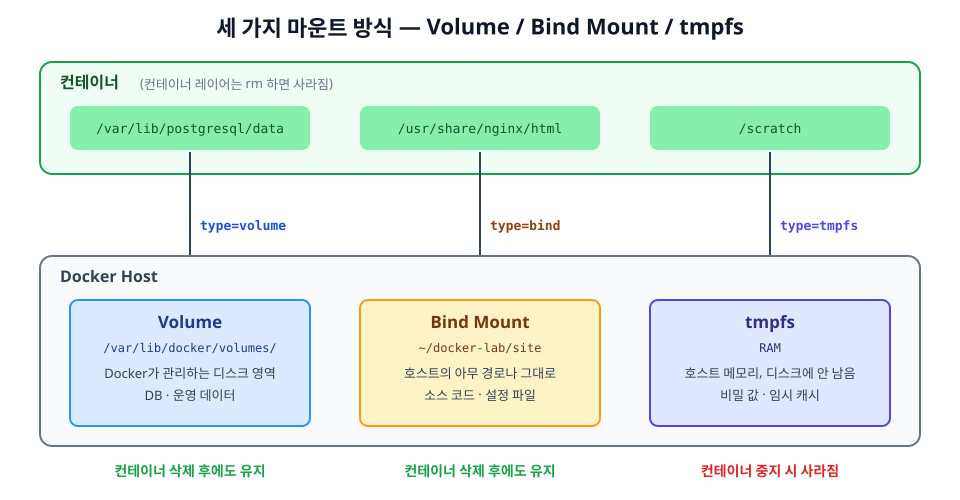
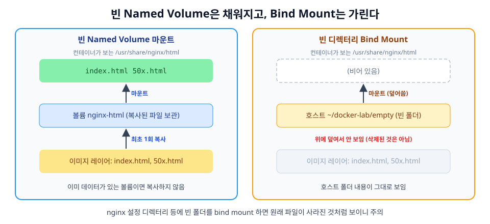
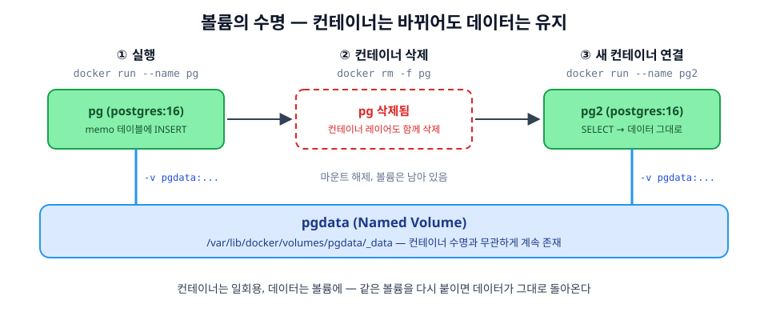

> **Chapter 1 · Docker** | 난이도 ★★☆☆☆ | 예상 소요 1.5 ~ 2시간

## 🎯 오늘의 목표

- 컨테이너를 지우면 데이터가 사라지는 이유를 레이어 구조로 설명할 수 있다
- **Volume / Bind Mount / tmpfs** 의 차이와 각각의 사용처를 구분할 수 있다
- `-v`와 `--mount` 문법을 모두 읽고 쓸 수 있다
- PostgreSQL 데이터를 볼륨에 저장해 **컨테이너를 다시 만들어도 데이터가 살아 있게** 할 수 있다
- 볼륨을 tar로 **백업 · 복원** 할 수 있다

---

## 1. 왜 데이터 영속성이 필요한가?

Day 01에서 nginx 페이지를 고친 뒤 `docker rm`을 하자 수정 내용이 사라졌고, Day 02에서 그 이유가 **컨테이너 레이어(쓰기 계층)는 컨테이너와 수명을 같이 한다**는 것임을 확인했습니다.

컨테이너 레이어에 데이터를 두면 생기는 문제는 세 가지입니다.

| 문제 | 설명 |
|---|---|
| **수명** | 컨테이너를 지우면(이미지 업데이트로 재생성할 때 포함) 데이터도 함께 삭제 |
| **성능** | 쓰기마다 OverlayFS를 거치고, 큰 파일 수정 시 copy-up 비용 발생 (Day 02) |
| **공유** | 다른 컨테이너나 호스트에서 그 데이터에 접근하기 어려움 |

> **컨테이너는 언제든 버리고 새로 만들 수 있는 일회용(stateless)으로, 데이터는 컨테이너 밖에.** 이것이 컨테이너 운영의 기본 원칙입니다. 이미지 버전을 올릴 때도 컨테이너를 "업그레이드"하지 않고 **지우고 새로 띄웁니다.**

Docker는 컨테이너 레이어 밖의 저장 공간을 컨테이너 안의 경로에 연결(마운트)하는 세 가지 방법을 제공합니다.

---

## 2. 세 가지 마운트 방식 비교



| 구분 | **Volume** | **Bind Mount** | **tmpfs** |
|---|---|---|---|
| 데이터 위치 | Docker 관리 영역 (`/var/lib/docker/volumes/`) | 호스트의 **아무 경로**나 | 호스트 **메모리** |
| 관리 주체 | Docker (`docker volume` 명령) | 사용자 | 없음 (컨테이너와 함께 생성·삭제) |
| 컨테이너 삭제 후 | ✅ 유지 | ✅ 유지 (호스트 파일이니까) | ❌ 사라짐 |
| 호스트 OS 의존성 | 낮음 (경로를 몰라도 됨) | 높음 (호스트 디렉터리 구조에 의존) | Linux 컨테이너 전용 |
| 빈 상태로 마운트 시 | 이미지의 기존 파일을 **복사해 채움** | 이미지의 기존 파일을 **가림** | 비어 있음 |
| 주 용도 | **DB 데이터, 운영 데이터** | 개발 중 소스 코드 실시간 반영, 설정 파일 주입 | 비밀 값, 임시 캐시처럼 디스크에 남기면 안 되는 것 |

> 💡 고민되면 **Volume**을 쓰세요. Docker 공식 문서도 영속 데이터에는 볼륨을 권장합니다. Bind Mount는 "호스트의 특정 파일을 컨테이너가 꼭 봐야 할 때" 쓰는 도구입니다.

> 💡 Windows/macOS의 Docker Desktop에서는 `/var/lib/docker/volumes/`가 내 PC가 아니라 **Docker Desktop의 리눅스 VM 안**에 있습니다. 탐색기/Finder에서 찾으려 하지 마세요. (Day 01의 "내부에 작은 리눅스 VM이 떠 있다"를 기억하세요.)

### `-v` vs `--mount` 문법

같은 마운트를 두 가지 문법으로 쓸 수 있습니다.

| 방식 | `-v` (짧은 문법) | `--mount` (명시적 문법) |
|---|---|---|
| Volume | `-v pgdata:/var/lib/postgresql/data` | `--mount type=volume,source=pgdata,target=/var/lib/postgresql/data` |
| Bind | `-v "$(pwd)/site":/usr/share/nginx/html:ro` | `--mount type=bind,source="$(pwd)/site",target=/usr/share/nginx/html,readonly` |
| tmpfs | `--tmpfs /scratch:size=64m` | `--mount type=tmpfs,target=/scratch,tmpfs-size=67108864` |

- `-v`는 콜론 앞이 **이름**이면 Volume, **`/`나 `./`로 시작하는 경로**면 Bind Mount로 해석합니다.
- `-v`는 호스트 경로가 없으면 **빈 디렉터리를 만들어 버리고**, `--mount`는 **에러를 냅니다.** 오타를 잡기에는 `--mount`가 안전합니다.
- 실무 스크립트에서는 의도가 분명한 `--mount`, 손으로 칠 때는 짧은 `-v`를 많이 씁니다. Day 06의 Compose 파일에서도 두 형식이 모두 등장합니다.

---

## 3. 볼륨 자세히 보기

### Named Volume vs Anonymous Volume

| 구분 | Named Volume | Anonymous Volume |
|---|---|---|
| 생성 | `-v pgdata:/data`, `docker volume create pgdata` | `-v /data` (이름 없이), Dockerfile의 `VOLUME` 지시어 |
| 이름 | 내가 지은 이름 | 64자리 랜덤 해시 |
| 재사용 | 이름으로 쉽게 다시 연결 | 사실상 어려움 |
| 삭제 | `docker volume rm` | `docker run --rm` 또는 `docker rm -v`면 컨테이너와 함께 삭제 |

> ⚠️ `postgres`, `mysql`, `redis` 같은 공식 이미지는 Dockerfile에 `VOLUME`이 선언되어 있어서, `-v`를 안 줘도 **익명 볼륨이 자동으로 생깁니다.** 이 상태로 `docker rm -f`를 반복하면 이름 없는 볼륨이 계속 쌓입니다(실습 5-6).

### 빈 볼륨은 이미지 내용으로 채워진다



빈 Named Volume을 이미지에 **이미 파일이 있는 경로**에 마운트하면, Docker가 이미지의 파일을 볼륨으로 **최초 1회 복사**합니다. 반면 Bind Mount는 호스트 디렉터리로 그 경로를 **덮어서 가립니다.** 이미지 안의 원래 파일이 지워지는 것이 아니라 보이지 않게 될 뿐입니다.

> 이 차이를 모르면 "nginx 설정 디렉터리에 빈 폴더를 bind mount 했더니 nginx가 안 뜬다" 같은 일을 겪게 됩니다.

---

## 4. 볼륨 명령어 한눈에 보기

| 명령 | 설명 |
|---|---|
| `docker volume create <이름>` | 볼륨 생성 (`-v`로 처음 쓸 때 자동 생성되기도 함) |
| `docker volume ls` | 볼륨 목록 |
| `docker volume inspect <이름>` | 실제 저장 경로(Mountpoint), 드라이버 등 |
| `docker volume rm <이름>` | 삭제 (사용 중인 컨테이너가 있으면 실패) |
| `docker volume prune` | 어떤 컨테이너도 쓰지 않는 **익명** 볼륨 삭제 |
| `docker volume prune -a` | 쓰지 않는 **모든** 볼륨 삭제 (Named 포함 — 주의!) |

> ⚠️ Docker Engine 23.0부터 `docker volume prune`은 기본적으로 **익명 볼륨만** 지웁니다. Named Volume까지 지우려면 `-a`가 필요합니다. `-a`는 DB 데이터를 통째로 날릴 수 있으니 목록을 확인한 뒤 쓰세요.

---

## 5. 실습

> 실습 환경: Docker Desktop(Windows/macOS) 또는 Ubuntu 24.04 + Docker Engine. 명령은 bash 기준입니다. Windows는 **WSL2 터미널**(Ubuntu)에서 실습하는 것을 권장합니다. PowerShell에서는 `$(pwd)` 대신 `${PWD}`를 쓰세요.

### 5-1. Named Volume으로 PostgreSQL 데이터 지키기



```bash
docker volume create pgdata
docker volume inspect pgdata
```

```json
[
    {
        "CreatedAt": "2026-11-15T10:00:00Z",
        "Driver": "local",
        "Labels": null,
        "Mountpoint": "/var/lib/docker/volumes/pgdata/_data",
        "Name": "pgdata",
        "Options": null,
        "Scope": "local"
    }
]
```

볼륨을 붙여 PostgreSQL을 띄웁니다.

```bash
docker run -d --name pg \
  -e POSTGRES_PASSWORD=secret \
  -v pgdata:/var/lib/postgresql/data \
  postgres:16
```

> 💡 `postgres:16`처럼 메이저 버전을 고정했습니다. PostgreSQL은 메이저 버전이 바뀌면 데이터 디렉터리 형식이 달라져서, 같은 볼륨을 다른 메이저 버전 이미지에 그대로 붙이면 기동에 실패합니다. 업그레이드는 `pg_dump`/`pg_upgrade` 같은 별도 절차가 필요합니다.

초기화가 끝날 때까지 몇 초 기다린 뒤(`docker logs pg`에 `database system is ready to accept connections`가 보이면 준비 완료) 데이터를 넣습니다.

```bash
docker exec pg psql -U postgres -c "CREATE TABLE memo (id serial PRIMARY KEY, body text);"
docker exec pg psql -U postgres -c "INSERT INTO memo (body) VALUES ('volume test');"
```

이제 **컨테이너를 완전히 삭제**합니다.

```bash
docker rm -f pg
docker volume ls
# DRIVER    VOLUME NAME
# local     pgdata          ← 볼륨은 그대로
```

같은 볼륨으로 **새 컨테이너**를 만들어 조회합니다.

```bash
docker run -d --name pg2 \
  -e POSTGRES_PASSWORD=secret \
  -v pgdata:/var/lib/postgresql/data \
  postgres:16

# 몇 초 후
docker exec pg2 psql -U postgres -c "SELECT * FROM memo;"
```

```
 id |    body
----+-------------
  1 | volume test
(1 row)
```

데이터가 살아 있습니다. `docker logs pg2`를 보면 `PostgreSQL Database directory appears to contain a database; Skipping initialization` 메시지가 있습니다. 이미 데이터가 있는 볼륨이라 초기화를 건너뛴 것입니다.

> Linux 호스트라면 `sudo ls /var/lib/docker/volumes/pgdata/_data`로 PostgreSQL 데이터 파일(`PG_VERSION`, `base/` 등)을 직접 볼 수 있습니다.

### 5-2. 빈 볼륨 채우기 vs Bind Mount 가리기

```bash
# (1) 빈 Named Volume → 이미지의 기존 파일이 복사됨
docker run --rm -v nginx-html:/usr/share/nginx/html nginx ls /usr/share/nginx/html
```

```
50x.html
index.html
```

```bash
# (2) 빈 디렉터리를 Bind Mount → 기존 파일이 가려짐
mkdir -p ~/docker-lab/empty
docker run --rm -v ~/docker-lab/empty:/usr/share/nginx/html nginx ls /usr/share/nginx/html
```

```
(아무것도 출력되지 않음)
```

```bash
docker volume rm nginx-html
```

### 5-3. Bind Mount로 개발 환경 만들기

호스트에서 파일을 고치면 **컨테이너에 즉시 반영**되는 것이 Bind Mount의 핵심 용도입니다.

```bash
mkdir -p ~/docker-lab/site && cd ~/docker-lab/site
echo '<h1>v1 from host</h1>' > index.html

docker run -d --name site -p 8080:80 \
  -v "$(pwd)":/usr/share/nginx/html:ro \
  nginx

curl http://localhost:8080
# <h1>v1 from host</h1>
```

호스트에서 파일을 수정합니다. 이미지를 다시 빌드하거나 컨테이너를 재시작할 필요가 없습니다.

```bash
echo '<h1>v2 edited on host</h1>' > index.html
curl http://localhost:8080
# <h1>v2 edited on host</h1>
```

`:ro`(읽기 전용)로 마운트했기 때문에 컨테이너는 이 디렉터리에 쓸 수 없습니다.

```bash
docker exec site sh -c 'echo hacked > /usr/share/nginx/html/index.html'
# sh: 1: cannot create /usr/share/nginx/html/index.html: Read-only file system
```

> 💡 **컨테이너가 쓸 필요가 없는 마운트는 `:ro`가 기본**이라고 생각하세요. 컨테이너가 침해되더라도 호스트 파일을 바꿀 수 없습니다.

> ⚠️ 디렉터리가 아니라 **파일 하나**를 bind mount 하면(`-v ./nginx.conf:/etc/nginx/nginx.conf`), 일부 에디터처럼 "새 파일로 저장 후 교체"하는 방식으로 수정할 때 컨테이너에는 변경이 보이지 않을 수 있습니다. 마운트가 원래 파일(inode)에 묶여 있기 때문입니다. 자주 고치는 파일은 디렉터리째 마운트하세요.

```bash
docker rm -f site
```

### 5-4. tmpfs — 메모리에만 두기

```bash
docker run --rm --tmpfs /scratch:size=64m alpine \
  sh -c 'df -h /scratch && echo secret > /scratch/token && ls -l /scratch'
```

```
Filesystem                Size      Used Available Use% Mounted on
tmpfs                    64.0M         0     64.0M   0% /scratch
total 4
-rw-r--r--    1 root     root             7 Nov 15 10:00 token
```

`/scratch`는 디스크가 아닌 메모리에 있으며, 컨테이너가 멈추면 내용이 사라집니다. `size`를 주지 않으면 호스트 메모리를 제한 없이 쓸 수 있으므로 크기를 지정하는 습관을 들이세요.

> 💡 읽기 전용 컨테이너(`--read-only`)와 tmpfs를 조합하면, 루트 파일 시스템은 전부 읽기 전용으로 두고 꼭 써야 하는 경로만 메모리에 열어줄 수 있습니다. 보안 강화 기법으로 Day 07에서 다시 봅니다.
>
> ```bash
> docker run --rm --read-only --tmpfs /tmp alpine sh -c 'touch /tmp/ok && echo ok; touch /etc/x'
> # ok
> # touch: /etc/x: Read-only file system
> ```

### 5-5. 볼륨 백업과 복원

볼륨은 Docker가 관리하는 영역에 있어 직접 복사하기 어렵습니다. 대신 **볼륨과 호스트 디렉터리를 동시에 마운트한 임시 컨테이너**로 tar를 만듭니다.

```bash
cd ~/docker-lab

# 정합성을 위해 DB를 먼저 멈춤
docker stop pg2

# 백업: pgdata(읽기 전용) → 현재 디렉터리의 tar.gz
docker run --rm \
  -v pgdata:/data:ro \
  -v "$(pwd)":/backup \
  alpine tar czf /backup/pgdata-backup.tgz -C /data .

ls -lh pgdata-backup.tgz
```

새 볼륨에 복원하고, 그 볼륨으로 PostgreSQL을 띄워 확인합니다.

```bash
docker volume create pgdata-restore
docker run --rm \
  -v pgdata-restore:/data \
  -v "$(pwd)":/backup \
  alpine tar xzf /backup/pgdata-backup.tgz -C /data

docker run -d --name pg3 \
  -e POSTGRES_PASSWORD=secret \
  -v pgdata-restore:/var/lib/postgresql/data \
  postgres:16

# 몇 초 후
docker exec pg3 psql -U postgres -c "SELECT * FROM memo;"
#  id |    body
# ----+-------------
#   1 | volume test
```

> 💡 실행 중인 DB의 파일을 그대로 tar로 묶으면 깨진 백업이 될 수 있습니다. 운영에서는 DB를 멈추거나, `docker exec pg2 pg_dump -U postgres postgres > dump.sql`처럼 **DB 자체의 백업 도구**를 쓰는 것이 원칙입니다.

### 5-6. 익명 볼륨의 함정

```bash
docker run -d --name tmp-pg -e POSTGRES_PASSWORD=x postgres:16
docker volume ls
```

```
DRIVER    VOLUME NAME
local     3c9a1f0e7d5b8a2c...    ← -v를 안 줬는데 생긴 익명 볼륨
local     pgdata
local     pgdata-restore
```

```bash
docker rm -f tmp-pg     # 컨테이너만 삭제 → 익명 볼륨은 고아로 남음
docker volume ls        # 해시 이름 볼륨이 여전히 있음
docker volume prune     # 사용되지 않는 익명 볼륨 정리 (확인 프롬프트에 y)
```

> 💡 `docker rm -fv tmp-pg`처럼 `-v`를 붙이면 컨테이너와 함께 **익명** 볼륨도 삭제됩니다(Named Volume은 지워지지 않음). `docker run --rm`으로 띄운 컨테이너도 종료 시 익명 볼륨을 함께 정리합니다.

### 5-7. 정리

```bash
docker rm -f pg2 pg3
docker volume rm pgdata pgdata-restore
rm -f ~/docker-lab/pgdata-backup.tgz
```

---

## 6. 트러블슈팅

| 증상 | 원인 | 해결 |
|---|---|---|
| 컨테이너를 다시 만들었더니 DB가 비어 있음 | `-v` 없이 실행(익명 볼륨)했거나 볼륨 이름 오타 | `docker volume ls`로 확인, Named Volume을 명시적으로 지정 |
| 볼륨을 붙였는데 `POSTGRES_PASSWORD`를 바꿔도 반영 안 됨 | 환경 변수는 **볼륨이 비어 있을 때 최초 초기화**에만 쓰임 | 기존 DB에서 `ALTER USER`로 변경, 또는 볼륨을 새로 만들어 초기화 |
| `volume is in use` 로 `docker volume rm` 실패 | 그 볼륨을 쓰는 컨테이너(중지된 것 포함)가 있음 | `docker ps -a --filter volume=<이름>`으로 찾아 먼저 삭제 |
| Bind Mount 했더니 컨테이너 안 디렉터리가 비어 있음 | Bind Mount는 이미지의 기존 내용을 가림 | 필요한 파일을 호스트 디렉터리에 두거나 Named Volume 사용 |
| `bind source path does not exist` | `--mount type=bind`의 호스트 경로가 없음 | 경로 확인 후 디렉터리 생성 (`-v`는 자동 생성하지만 오타도 만들어 버림) |
| 컨테이너 앱이 Bind Mount 경로에 `Permission denied` | 컨테이너 프로세스 UID와 호스트 디렉터리 소유자가 다름 | 디렉터리 권한 조정, 또는 `--user "$(id -u):$(id -g)"`로 실행 |
| Windows에서 Bind Mount한 프로젝트가 매우 느림 / 파일 변경 감지(hot reload)가 안 됨 | `C:\` 드라이브 파일을 VM 경계 너머로 공유 | 프로젝트를 WSL2 파일 시스템(`~/...`)에 두고 WSL 터미널에서 실행 |
| `docker volume prune` 했는데 Named Volume이 안 지워짐 | Engine 23.0+는 기본적으로 익명 볼륨만 정리 | 정말 지우려면 `docker volume prune -a` (주의) 또는 `docker volume rm` |

---

## 7. 핵심 정리

- 컨테이너 레이어는 컨테이너와 함께 사라진다 → **데이터는 컨테이너 밖(마운트)에**
- **Volume**: Docker가 관리, 영속 데이터(DB)의 기본 선택 / **Bind Mount**: 호스트 경로를 그대로, 개발·설정 주입 / **tmpfs**: 메모리, 디스크에 남기면 안 되는 임시 데이터
- 빈 Named Volume은 이미지 내용으로 **채워지고**, Bind Mount는 이미지 내용을 **가린다**
- `-v`는 짧고 편하지만 없는 경로를 만들어 버린다, `--mount`는 명시적이고 엄격하다
- 컨테이너가 쓸 필요 없는 마운트는 **`:ro`**
- 공식 DB 이미지는 `VOLUME`이 있어 익명 볼륨이 생긴다 → Named Volume을 명시하고, 고아 볼륨은 `prune`
- 백업은 "볼륨 + 호스트 디렉터리를 마운트한 임시 컨테이너로 tar", DB는 가능하면 DB 백업 도구로

---

## 8. 셀프 체크

<details>
<summary>Q1. <code>-v mydata:/data</code>와 <code>-v ./mydata:/data</code>는 어떻게 다르게 해석되는가?</summary>

콜론 앞이 이름(`mydata`)이면 **Named Volume**, 경로(`./mydata`, `/home/...`)면 **Bind Mount**입니다. 앞의 것은 Docker 관리 영역에 `mydata` 볼륨을 만들고, 뒤의 것은 현재 디렉터리의 `mydata` 폴더를 그대로 연결합니다.
</details>

<details>
<summary>Q2. 빈 Named Volume을 <code>/usr/share/nginx/html</code>에 마운트하면 nginx 기본 페이지가 보이는데, 빈 디렉터리를 Bind Mount하면 안 보이는 이유는?</summary>

Docker는 **빈 Named Volume**을 마운트할 때 이미지의 해당 경로 내용을 볼륨으로 최초 1회 복사합니다. Bind Mount는 복사 없이 호스트 디렉터리로 그 경로를 덮어서, 이미지의 원래 파일이 가려집니다.
</details>

<details>
<summary>Q3. 비밀번호 파일처럼 디스크에 절대 남기면 안 되는 임시 데이터에 적합한 마운트는?</summary>

**tmpfs**. 호스트 메모리에만 존재하고 컨테이너가 멈추면 사라지며, 컨테이너 레이어나 호스트 디스크에 기록되지 않습니다.
</details>

<details>
<summary>Q4. <code>docker run -d -e POSTGRES_PASSWORD=x postgres:16</code>을 여러 번 실행하고 <code>docker rm -f</code>로 지웠다. 디스크에 무엇이 쌓이는가?</summary>

postgres 이미지의 `VOLUME` 선언 때문에 실행할 때마다 **익명 볼륨**이 생기고, `rm -f`(`-v` 없이)로는 지워지지 않아 고아 볼륨이 쌓입니다. `docker volume prune`으로 정리하고, 처음부터 Named Volume을 지정하거나 `docker rm -v`를 쓰면 됩니다.
</details>

<details>
<summary>Q5. 실행 중인 DB 볼륨을 그대로 tar로 백업하면 왜 위험한가?</summary>

DB가 파일을 쓰는 도중에 복사하면 서로 다른 시점의 파일이 섞여 **일관성이 깨진 백업**이 될 수 있습니다. DB를 멈추고 백업하거나, `pg_dump` 같은 DB 자체 백업 도구로 논리 백업을 해야 합니다.
</details>

---

## ⏭️ 다음 예고 — Day 05. Docker 네트워크 — bridge / host / none / 사용자 정의 네트워크

지금까지 컨테이너에는 항상 `-p`로 호스트 포트를 연결해서 접속했습니다. 그런데 웹 컨테이너가 DB 컨테이너에 접속하려면 어떻게 해야 할까요? 컨테이너가 받는 IP는 어디서 오고, 왜 사용자 정의 네트워크에서는 **컨테이너 이름으로** 서로를 찾을 수 있을까요? Docker의 네트워크 드라이버와 포트 포워딩의 내부를 파헤쳐 봅니다.
