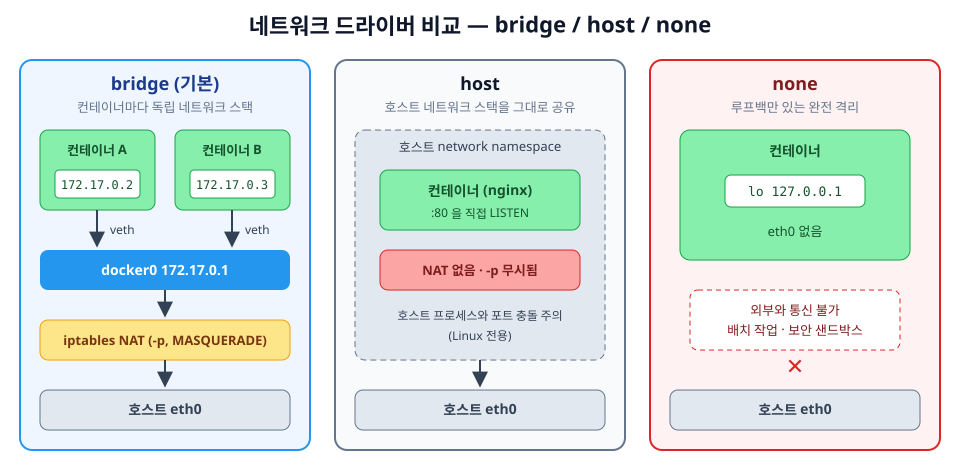
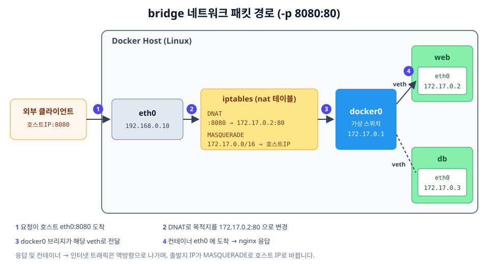
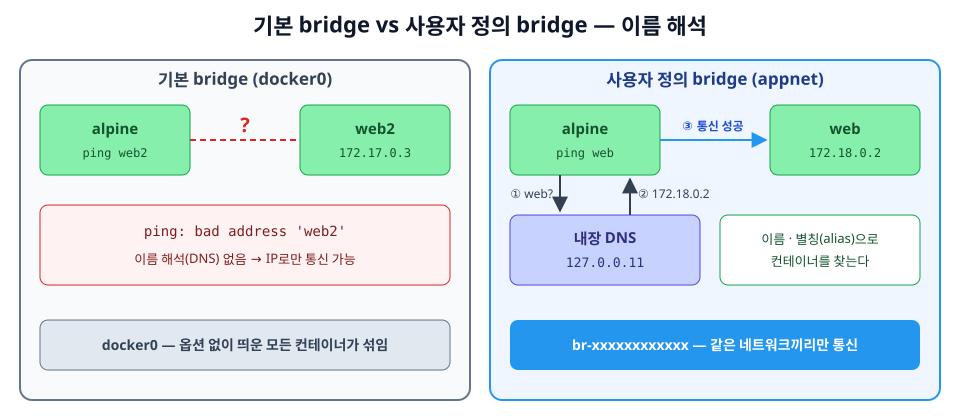

> **Chapter 1 · Docker** | 난이도 ★★☆☆☆ | 예상 소요 1.5 ~ 2시간

## 🎯 오늘의 목표

- 컨테이너가 **어떻게 IP를 받고 외부와 통신하는지** 그림으로 설명할 수 있다
- 네트워크 드라이버 `bridge` / `host` / `none` 의 차이와 쓰임새를 안다
- **기본 bridge**와 **사용자 정의 bridge**의 결정적 차이(DNS 이름 해석)를 직접 확인한다
- `-p` 포트 퍼블리싱이 내부적으로 **iptables NAT 규칙**으로 동작한다는 것을 이해한다
- 컨테이너끼리 이름으로 통신하는 2-tier 구성을 직접 만든다

---

## 1. 왜 컨테이너 네트워크를 알아야 하나?

Day 01에서 `-p 8080:80` 한 줄로 nginx를 띄웠고, Day 04에서는 데이터를 볼륨으로 지켰습니다. 그런데 실제 서비스는 컨테이너 **하나**로 끝나지 않습니다.

```
[브라우저] → [web 컨테이너] → [api 컨테이너] → [db 컨테이너]
```

이 구성을 만들려면 다음 질문에 답할 수 있어야 합니다.

| 질문 | 오늘 배울 답 |
|---|---|
| 컨테이너는 IP를 어디서 받나? | Docker가 만든 **가상 브리지 네트워크**의 IPAM이 할당 |
| 컨테이너끼리는 어떻게 찾나? | **사용자 정의 네트워크의 내장 DNS** (`127.0.0.11`) |
| 외부에서 컨테이너로는 어떻게 들어오나? | `-p` → 호스트의 **DNAT 규칙** |
| 컨테이너에서 인터넷으로는 어떻게 나가나? | 호스트의 **MASQUERADE(SNAT)** 규칙 |
| 아예 네트워크를 끊고 싶다면? | `none` 드라이버 |

> 💡 컨테이너 IP는 재시작하면 바뀔 수 있습니다. 그래서 **IP가 아니라 이름으로 통신**하는 것이 컨테이너 네트워크의 기본 원칙입니다. 이 원칙은 Kubernetes Service(Day 12)에서도 그대로 이어집니다.

---

## 2. 네트워크 드라이버 한눈에 보기



Docker를 설치하면 네트워크 3개가 기본으로 만들어져 있습니다.

```bash
docker network ls
```

```
NETWORK ID     NAME      DRIVER    SCOPE
3f1c2a9b7d10   bridge    bridge    local
8e2d4c6f1a22   host      host      local
b71a0e5d9c33   none      null      local
```

| 드라이버 | 격리 | 컨테이너 IP | 대표 용도 |
|---|---|---|---|
| **bridge** (기본) | 컨테이너마다 독립된 네트워크 스택 | 사설 대역(기본 `172.17.0.0/16`) | 단일 호스트의 일반적인 앱 |
| **host** | 없음 — 호스트 네트워크 스택을 그대로 사용 | 호스트 IP 그대로 | 포트가 많거나 NAT 오버헤드를 피하고 싶을 때 (Linux 전용) |
| **none** | 완전 격리 — `lo` 만 존재 | 없음 | 네트워크가 필요 없는 배치 작업, 보안 샌드박스 |
| overlay | 여러 호스트를 하나의 가상 네트워크로 | 오버레이 대역 | Docker Swarm 멀티 호스트 (Day 23 VXLAN에서 원리 학습) |
| macvlan / ipvlan | 컨테이너가 물리 네트워크에 직접 붙음 | 물리 LAN 대역 | 레거시 장비처럼 "진짜 IP"가 필요한 경우 |

> 오늘은 단일 호스트에서 쓰는 **bridge / host / none**에 집중합니다. overlay·macvlan은 이름과 용도만 기억해 두세요.

---

## 3. bridge 네트워크의 내부 구조



`docker run`으로 컨테이너를 만들면 Docker는 다음 일을 순서대로 합니다.

1. 컨테이너용 **network namespace**를 새로 만든다 (Day 07에서 직접 만져봄)
2. **veth pair**(가상 랜선 한 쌍)를 만들어 한쪽은 컨테이너 안 `eth0`, 다른 쪽은 호스트의 `vethXXXX`로 둔다
3. 호스트 쪽 veth를 리눅스 브리지 **`docker0`**(가상 스위치)에 꽂는다
4. IPAM이 `172.17.0.0/16`에서 IP를 하나 할당하고, 기본 게이트웨이를 `docker0`(`172.17.0.1`)로 설정한다

| 구성 요소 | 비유 | 확인 명령 |
|---|---|---|
| `docker0` | 가상 스위치(L2) + 게이트웨이 | `ip addr show docker0` |
| `veth` pair | 컨테이너와 스위치를 잇는 랜선 | `ip link show master docker0` |
| iptables `nat` 테이블 | 공유기의 포트포워딩 / NAT | `sudo iptables -t nat -nL` |
| 내장 DNS `127.0.0.11` | 사내 DNS 서버 (사용자 정의 네트워크만) | 컨테이너 안 `cat /etc/resolv.conf` |

### 들어오는 트래픽: `-p` 는 DNAT 규칙이다

`docker run -p 8080:80 nginx`를 하면 Docker가 호스트에 이런 규칙을 추가합니다.

```
호스트:8080 으로 들어온 패킷의 목적지를 → 172.17.0.2:80 으로 바꿔라 (DNAT)
```

### 나가는 트래픽: MASQUERADE

컨테이너가 `apt-get update`처럼 인터넷으로 나갈 때는 출발지 IP `172.17.0.2`가 호스트 IP로 바뀌어 나갑니다(SNAT/MASQUERADE). 집 공유기가 하는 일과 똑같습니다.

> ⚠️ **Docker는 iptables 규칙을 직접 관리**합니다. Ubuntu에서 `ufw`로 포트를 막았는데도 `-p`로 공개한 컨테이너 포트는 외부에서 접근되는 경우가 있습니다. Docker 규칙이 ufw 규칙보다 먼저 평가되기 때문입니다. 외부에 노출하면 안 되는 포트는 `-p 127.0.0.1:8080:80`처럼 **바인딩 주소를 지정**하세요.

---

## 4. 기본 bridge vs 사용자 정의 bridge



이름은 둘 다 bridge인데 동작이 꽤 다릅니다. **실무에서는 항상 사용자 정의 네트워크를 쓰세요.**

| 구분 | 기본 `bridge` (docker0) | 사용자 정의 bridge (`docker network create`) |
|---|---|---|
| 컨테이너 **이름으로 통신** | ❌ 안 됨 (IP로만 가능) | ✅ 내장 DNS가 이름 → IP 해석 |
| 격리 | 아무 옵션 없이 띄운 모든 컨테이너가 한 네트워크에 섞임 | 같은 네트워크에 붙인 컨테이너끼리만 통신 |
| 실행 중 연결/해제 | 불가 (재생성 필요) | `docker network connect / disconnect` 로 즉시 |
| 서브넷·게이트웨이 지정 | daemon 설정을 바꿔야 함 | `--subnet`, `--gateway` 로 네트워크마다 지정 |
| 별칭(alias) | 없음 | `--network-alias` 로 여러 이름 부여 가능 |

> 💡 다음 시간 배울 **Docker Compose**는 프로젝트마다 사용자 정의 네트워크(`<프로젝트>_default`)를 자동으로 만들어 줍니다. 그래서 Compose에서는 서비스 이름(`db`, `cache`)만으로 통신이 되는 것이죠.

---

## 5. 실습

> **실습 환경**: Ubuntu 24.04 LTS + Docker Engine (Day 01 설치 방법). Docker Desktop(Windows/macOS)에서도 5-1 ~ 5-4, 5-6은 동일하게 동작합니다. 5-5(호스트의 `docker0`·iptables 확인)와 `host` 네트워크 실습은 **Linux 호스트**에서 하세요.

### 5-1. 기본 bridge 네트워크 살펴보기

```bash
docker run -d --name web1 nginx
docker run -d --name web2 nginx

# 각 컨테이너의 IP 확인
docker inspect -f '{{.Name}} {{range .NetworkSettings.Networks}}{{.IPAddress}}{{end}}' web1 web2
```

```
/web1 172.17.0.2
/web2 172.17.0.3
```

```bash
docker network inspect bridge --format '{{(index .IPAM.Config 0).Subnet}}'
# 172.17.0.0/16
```

같은 네트워크이므로 **IP로는** 통신이 됩니다.

```bash
docker run --rm alpine ping -c 2 172.17.0.3
```

하지만 **이름으로는** 안 됩니다.

```bash
docker run --rm alpine ping -c 2 web2
```

```
ping: bad address 'web2'
```

이것이 기본 bridge의 한계입니다.

```bash
docker rm -f web1 web2
```

### 5-2. 사용자 정의 네트워크 만들기

```bash
docker network create appnet
docker network ls --filter name=appnet
```

```bash
docker run -d --name web --network appnet nginx
docker run --rm --network appnet alpine ping -c 2 web
```

```
PING web (172.18.0.2): 56 data bytes
64 bytes from 172.18.0.2: seq=0 ttl=64 time=0.091 ms
64 bytes from 172.18.0.2: seq=1 ttl=64 time=0.105 ms
```

이번에는 **이름으로 바로 통신**됩니다. 누가 이름을 해석해 줬는지 확인해 봅시다.

```bash
docker run --rm --network appnet alpine cat /etc/resolv.conf
```

```
nameserver 127.0.0.11
options ndots:0
```

`127.0.0.11`이 Docker 내장 DNS 서버입니다. HTTP 요청도 이름으로 보내 봅니다.

```bash
docker run --rm --network appnet alpine wget -qO- http://web | head -n 4
```

```
<!DOCTYPE html>
<html>
<head>
<title>Welcome to nginx!</title>
```

### 5-3. 서브넷 지정, 고정 IP, 별칭

```bash
docker network create \
  --subnet 10.10.0.0/24 \
  --gateway 10.10.0.1 \
  labnet

# 고정 IP (--ip 는 서브넷을 지정한 사용자 정의 네트워크에서만 가능)
docker run -d --name db-fixed --network labnet --ip 10.10.0.50 nginx

# 하나의 컨테이너에 여러 이름 부여
docker run -d --name api-v1 --network labnet --network-alias api nginx

docker run --rm --network labnet alpine sh -c "ping -c 1 db-fixed; ping -c 1 api"
```

```
PING db-fixed (10.10.0.50): 56 data bytes
...
PING api (10.10.0.2): 56 data bytes
...
```

> 💡 `--network-alias`는 같은 별칭을 여러 컨테이너에 줄 수도 있습니다. 이때 DNS는 여러 IP를 돌려주어 아주 단순한 로드 밸런싱처럼 동작합니다.

### 5-4. 네트워크 간 격리와 connect / disconnect

`appnet`의 `web`과 `labnet`의 컨테이너는 서로 다른 브리지에 있으므로 통신할 수 없습니다.

```bash
docker run --rm --network labnet alpine ping -c 1 -W 2 web
# ping: bad address 'web'
```

실행 중인 컨테이너를 다른 네트워크에 **추가로 연결**할 수 있습니다.

```bash
docker network connect labnet web
docker inspect -f '{{range $k, $v := .NetworkSettings.Networks}}{{$k}}={{$v.IPAddress}} {{end}}' web
# appnet=172.18.0.2 labnet=10.10.0.3

docker run --rm --network labnet alpine ping -c 1 web   # 이제 성공

docker network disconnect labnet web
```

> 컨테이너 하나가 네트워크 여러 개에 붙으면 `eth0`, `eth1`… 인터페이스가 여러 개 생깁니다. "프론트 네트워크와 백엔드 네트워크를 둘 다 아는 API 서버" 같은 구성을 이렇게 만듭니다.

### 5-5. (Linux) 호스트에서 내부 구조 확인하기

```bash
docker run -d --name pub -p 8080:80 nginx

ip addr show docker0
```

```
4: docker0: <BROADCAST,MULTICAST,UP,LOWER_UP> mtu 1500 ...
    inet 172.17.0.1/16 brd 172.17.255.255 scope global docker0
```

```bash
# docker0 브리지에 꽂혀 있는 veth 확인
ip link show master docker0
```

```
12: veth3a1b2c4@if11: <BROADCAST,MULTICAST,UP,LOWER_UP> mtu 1500 ... master docker0 ...
```

```bash
# -p 8080:80 이 만든 DNAT 규칙
sudo iptables -t nat -nL DOCKER
```

```
Chain DOCKER (2 references)
target     prot opt source               destination
DNAT       tcp  --  0.0.0.0/0            0.0.0.0/0            tcp dpt:8080 to:172.17.0.2:80
```

```bash
# 컨테이너 → 인터넷 으로 나갈 때의 SNAT 규칙
sudo iptables -t nat -nL POSTROUTING
```

```
MASQUERADE  all  --  172.17.0.0/16        0.0.0.0/0
```

> 💡 출력 형식은 Docker 버전에 따라 조금 다를 수 있지만 **DNAT(들어오기)·MASQUERADE(나가기)** 두 규칙이 핵심이라는 점은 같습니다. 사용자 정의 네트워크는 `docker0` 대신 `br-<네트워크ID 앞 12자리>` 라는 브리지를 따로 만듭니다(`ip link show type bridge`로 확인).

포트 관련 명령도 함께 익혀 둡니다.

```bash
docker port pub                          # 80/tcp -> 0.0.0.0:8080
docker run -d --name local-only -p 127.0.0.1:8081:80 nginx   # 로컬에서만 접근 가능
docker run -d --name random -P nginx     # EXPOSE 된 포트를 임의의 호스트 포트에 매핑
docker port random
```

### 5-6. host / none 네트워크

**none** — 루프백만 있는 완전 격리 컨테이너:

```bash
docker run --rm --network none alpine ip addr
```

```
1: lo: <LOOPBACK,UP,LOWER_UP> mtu 65536 qdisc noqueue state UNKNOWN qlen 1000
    link/loopback 00:00:00:00:00:00 brd 00:00:00:00:00:00
    inet 127.0.0.1/8 scope host lo
```

`eth0`이 아예 없습니다. 외부로 나가는 것도, 들어오는 것도 불가능합니다.

**host** — 호스트의 네트워크를 그대로 사용 (Linux):

```bash
docker run -d --name hostnginx --network host nginx
curl -s http://localhost:80 | head -n 4   # -p 없이 바로 80 포트로 접근
docker rm -f hostnginx
```

| | bridge + `-p` | host |
|---|---|---|
| 포트 매핑 | 필요 (`-p`) | 불필요 — `-p` 를 줘도 무시됨 |
| 포트 충돌 | 호스트 포트만 다르면 OK | 컨테이너 포트 = 호스트 포트, 충돌 시 컨테이너가 시작 실패 |
| 성능 | NAT 한 단계 거침 | NAT 없음 |
| 격리 | 있음 | 없음 |

> ⚠️ Docker Desktop(Windows/macOS)의 `host`는 "Docker가 돌아가는 리눅스 VM"의 네트워크를 뜻하므로 내 PC의 localhost와 다릅니다. 최신 Docker Desktop은 설정에서 host networking을 켤 수 있지만, 학습은 Linux에서 하는 것이 확실합니다.

### 5-7. 미니 실습 — 2-tier 앱 (API + Redis)

이름 기반 통신을 실제 앱 구성으로 확인해 봅니다. 백엔드 네트워크에는 외부 인터넷 연결도 막아 둡니다.

```bash
# --internal: 외부(인터넷)로 나가는 경로가 없는 네트워크
docker network create --internal backend
docker network create frontend

docker run -d --name redis --network backend redis:7-alpine

# 앱 컨테이너 역할: frontend + backend 둘 다 연결
docker run -d --name app --network frontend alpine sleep infinity
docker network connect backend app

# app 은 redis 를 이름으로 찾을 수 있다
docker exec app sh -c "apk add --no-cache redis >/dev/null && redis-cli -h redis ping"
# PONG
```

> `apk add`는 `app`이 `frontend`(인터넷 가능) 네트워크에도 붙어 있기 때문에 성공합니다. 반면 `redis`는 `backend`에만 있으므로 인터넷으로 나갈 수 없습니다.

```bash
docker exec redis ping -c 1 -W 2 8.8.8.8
# 실패 — Network unreachable 또는 100% packet loss (내부 전용 네트워크)
```

### 5-8. 정리

```bash
docker rm -f web db-fixed api-v1 pub local-only random redis app
docker network rm appnet labnet backend frontend
docker network prune      # 사용 중이 아닌 사용자 정의 네트워크 일괄 삭제
```

---

## 6. 트러블슈팅

| 증상 | 원인 | 해결 |
|---|---|---|
| `ping: bad address 'db'` | 기본 `bridge` 네트워크에서는 이름 해석이 안 됨, 또는 두 컨테이너가 다른 네트워크에 있음 | 사용자 정의 네트워크를 만들고 두 컨테이너를 같은 네트워크에 연결 |
| 컨테이너 안에서 `localhost:5432`로 DB 접속 실패 | 컨테이너의 `localhost`는 **자기 자신**. DB 컨테이너가 아님 | 호스트명을 DB 컨테이너 이름(`db`)으로 변경 |
| 컨테이너에서 호스트의 서비스에 접속하고 싶음 | 호스트는 컨테이너 입장에서 "다른 머신" | Docker Desktop: `host.docker.internal` / Linux: `--add-host=host.docker.internal:host-gateway` 추가 |
| `ufw`로 막았는데 컨테이너 포트가 외부에서 열려 있음 | Docker가 iptables에 직접 규칙을 넣어 ufw를 우회 | `-p 127.0.0.1:포트:포트`로 바인딩 제한, 또는 `DOCKER-USER` 체인에 차단 규칙 추가 |
| `network ... has active endpoints` 로 삭제 실패 | 네트워크에 연결된 컨테이너가 남아 있음 | `docker network inspect <net>`으로 확인 후 컨테이너 삭제 또는 `disconnect` |
| 회사 VPN 연결 후 특정 사내 IP 접근 불가 | Docker 서브넷(`172.17~` 등)이 사내망 대역과 겹침 | `/etc/docker/daemon.json`의 `"default-address-pools"` 또는 `--subnet`으로 겹치지 않는 대역 사용 |

---

## 7. 핵심 정리

- 기본 드라이버는 **bridge**. 컨테이너는 veth로 `docker0` 가상 스위치에 연결되고 사설 IP를 받는다
- `-p 호스트:컨테이너` = **DNAT** 규칙, 컨테이너 → 인터넷 = **MASQUERADE** 규칙
- **사용자 정의 bridge**를 써야 **컨테이너 이름으로 통신**(내장 DNS `127.0.0.11`)할 수 있다
- 서로 다른 네트워크는 기본적으로 격리. `docker network connect`로 다중 연결
- `host` = 격리 없이 호스트 네트워크 공유(Linux), `none` = `lo`만 있는 완전 격리
- IP가 아니라 **이름으로 통신**하라 — 이 원칙은 Compose(Day 06)와 K8s Service(Day 12)까지 이어진다

---

## 8. 셀프 체크

<details>
<summary>Q1. 기본 bridge 네트워크에서 <code>ping web2</code>가 실패하고, 사용자 정의 네트워크에서는 성공하는 이유는?</summary>

사용자 정의 네트워크에는 Docker **내장 DNS 서버(`127.0.0.11`)**가 컨테이너 이름(및 별칭)을 IP로 해석해 주지만, 기본 `bridge` 네트워크는 이 기능을 제공하지 않기 때문입니다.
</details>

<details>
<summary>Q2. <code>docker run -p 8080:80 nginx</code> 를 했을 때 호스트에서 실제로 추가되는 것은?</summary>

호스트 8080 포트로 들어오는 TCP 패킷의 목적지를 `컨테이너IP:80`으로 바꾸는 **iptables DNAT 규칙**(과 관련 FORWARD 허용 규칙)입니다.
</details>

<details>
<summary>Q3. 컨테이너 안의 앱이 DB 주소를 <code>localhost</code>로 설정해서 접속을 못 한다. 왜인가?</summary>

컨테이너마다 독립된 network namespace를 가지므로 컨테이너의 `localhost`는 **그 컨테이너 자신**입니다. 같은 네트워크의 DB 컨테이너 이름(`db` 등)을 써야 합니다.
</details>

<details>
<summary>Q4. <code>--network host</code> 로 띄운 컨테이너에 <code>-p 8080:80</code>을 주면 어떻게 되나?</summary>

host 모드에서는 포트 매핑이 의미가 없어 **무시**됩니다(경고 출력). 컨테이너가 리스닝하는 80 포트가 그대로 호스트의 80 포트가 됩니다.
</details>

<details>
<summary>Q5. DB 컨테이너가 인터넷으로 나가지 못하게 하면서 앱 컨테이너와는 통신하게 하려면?</summary>

`docker network create --internal backend`로 외부 경로가 없는 네트워크를 만들어 DB를 붙이고, 앱 컨테이너는 `backend`와 외부용 네트워크 둘 다에 연결합니다.
</details>

---

## ⏭️ 다음 예고 — Day 06. Docker Compose로 멀티 컨테이너 앱 구성

오늘 `docker network create`, `docker run --network ...`, `docker network connect`를 손으로 하나하나 입력했습니다. 컨테이너가 3개, 5개로 늘어나면 이걸 매번 칠 수는 없겠죠. 내일은 **YAML 파일 하나**로 Web + DB + Cache를 한 번에 띄우고 내리는 **Docker Compose**를 배웁니다.
