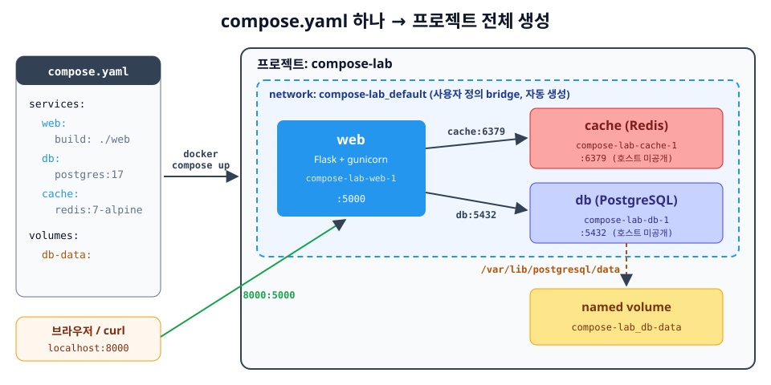
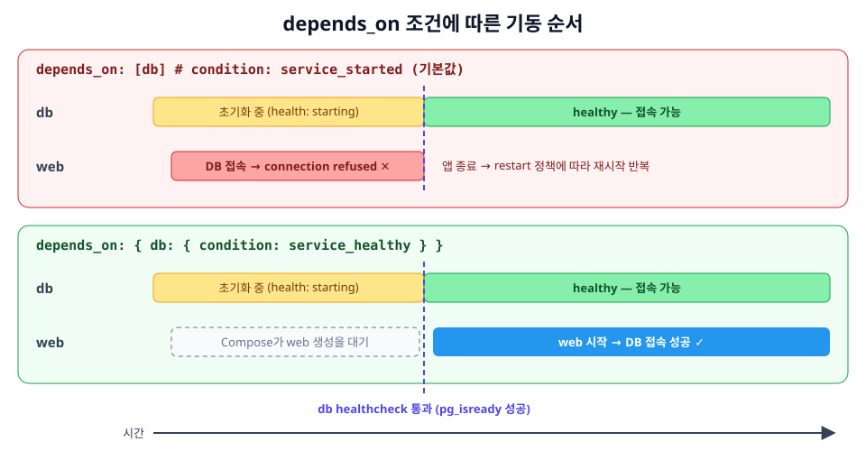

> **Chapter 1 · Docker** | 난이도 ★★☆☆☆ | 예상 소요 1.5 ~ 2시간

## 🎯 오늘의 목표

- `docker run`을 여러 번 치는 대신 **Compose 파일 하나로 앱 전체를 선언**하는 이유를 안다
- `compose.yaml`의 핵심 키(`services`, `build`, `ports`, `environment`, `volumes`, `depends_on`, `healthcheck`)를 읽고 쓸 수 있다
- **Web(Flask) + DB(PostgreSQL) + Cache(Redis)** 3-tier 앱을 직접 구성하고 실행한다
- `healthcheck` + `depends_on`으로 **기동 순서**를 제어한다
- `up` / `down` / `logs` / `exec` / `ps` 등 Compose 라이프사이클 명령을 다룰 수 있다

---

## 1. 왜 Compose인가?

Day 05 마지막 실습을 떠올려 봅시다. 컨테이너 2개를 연결하는 데도 이만큼 입력했습니다.

```bash
docker network create --internal backend
docker network create frontend
docker run -d --name redis --network backend redis:7-alpine
docker run -d --name app --network frontend alpine sleep infinity
docker network connect backend app
```

여기에 DB, 볼륨(Day 04), 환경 변수, 이미지 빌드(Day 03)까지 더해지면 명령어가 수십 줄이 되고, 팀원마다 조금씩 다르게 실행하게 됩니다.

| 방식 | 문제 / 장점 |
|---|---|
| `docker run` 여러 번 | 순서·옵션을 사람이 기억해야 함, 재현성 낮음, 문서와 실제가 어긋남 |
| 쉘 스크립트로 묶기 | 생성은 되지만 "이미 있으면 건너뛰기", 정리(삭제)까지 직접 구현해야 함 |
| **Docker Compose** | 원하는 **최종 상태**를 YAML로 선언 → `up` 한 번으로 생성/갱신, `down` 한 번으로 정리 |

> 💡 "어떻게 만들지(명령형)"가 아니라 "무엇이 있어야 하는지(선언형)"를 적는 방식은 **Kubernetes 매니페스트(Chapter 2)**와 **Terraform(Day 35)**까지 이어지는 인프라의 핵심 사고방식입니다. Compose는 그 첫 경험입니다.

### Compose V2 — `docker compose` (띄어쓰기)

| | Compose V1 (지원 종료) | Compose V2 (현재) |
|---|---|---|
| 명령 | `docker-compose` (하이픈) | `docker compose` (띄어쓰기, Docker CLI 플러그인) |
| 구현 | Python | Go |
| 기본 파일명 | `docker-compose.yml` | **`compose.yaml`** (구 이름도 인식) |

Day 01에서 `docker-compose-plugin`을 함께 설치했으므로 바로 쓸 수 있습니다.

```bash
docker compose version
# Docker Compose version v2.x.x
```

> ⚠️ 파일 맨 위의 `version: "3.8"` 같은 줄은 **더 이상 필요 없습니다(obsolete)**. 넣으면 경고만 출력됩니다.

---

## 2. Compose의 핵심 개념



| 개념 | 설명 | 실제로 만들어지는 이름 (프로젝트명 `compose-lab`) |
|---|---|---|
| **프로젝트** | Compose 파일 하나가 관리하는 리소스 묶음. 기본값은 **폴더 이름** | `compose-lab` |
| **서비스** | 같은 설정으로 실행되는 컨테이너의 정의 (`web`, `db`, `cache`) | — |
| **컨테이너** | 서비스의 실제 인스턴스. `<프로젝트>-<서비스>-<번호>` | `compose-lab-web-1` |
| **네트워크** | 프로젝트마다 사용자 정의 bridge 하나가 **자동 생성** | `compose-lab_default` |
| **볼륨** | 최상위 `volumes:`에 선언한 named volume | `compose-lab_db-data` |

Compose가 자동으로 만들어 주는 `compose-lab_default` 네트워크가 바로 Day 05에서 배운 **사용자 정의 bridge**입니다. 그래서 컨테이너끼리 **서비스 이름(`db`, `cache`)으로** 통신할 수 있습니다.

---

## 3. `compose.yaml` 해부

오늘 만들 파일의 전체 모습입니다. 키 하나하나를 표로 정리해 봅니다.

| 키 | 의미 | 대응하는 `docker run` 옵션 |
|---|---|---|
| `image` | 사용할 이미지 | `docker run <image>` |
| `build` | Dockerfile이 있는 경로 → 이미지를 빌드해서 사용 | `docker build` (Day 03) |
| `ports` | `"호스트:컨테이너"` 포트 공개 | `-p` |
| `environment` | 환경 변수 | `-e` |
| `env_file` | 환경 변수를 파일에서 읽기 | `--env-file` |
| `volumes` | 볼륨 / 바인드 마운트 | `-v`, `--mount` (Day 04) |
| `networks` | 붙을 네트워크 (생략 시 `default`) | `--network` |
| `restart` | 재시작 정책 (`no`, `always`, `on-failure`, `unless-stopped`) | `--restart` |
| `healthcheck` | 컨테이너 건강 상태 검사 명령 | `--health-cmd` 등 |
| `depends_on` | 다른 서비스에 대한 기동 순서·조건 | (대응 없음 — Compose 전용) |
| `profiles` | 특정 프로필을 켰을 때만 실행되는 서비스 | (Compose 전용) |

### `${변수}` 치환과 `.env`

Compose는 `compose.yaml`과 같은 폴더의 **`.env` 파일**을 자동으로 읽어 `${POSTGRES_PASSWORD}` 같은 자리를 채웁니다. 비밀번호를 YAML에 직접 쓰지 않고 `.env`는 `.gitignore`에 넣는 것이 기본 습관입니다.

> 💡 치환 결과가 어떻게 되는지 궁금하면 `docker compose config`를 실행하세요. 변수가 모두 채워지고 기본값이 붙은 **최종 설정**을 보여줍니다. Compose 디버깅의 1순위 명령입니다.

---

## 4. 기동 순서: `depends_on` + `healthcheck`



`depends_on: [db]`만 쓰면 Compose는 **db 컨테이너가 "시작"되기만 하면** web을 띄웁니다. 그런데 PostgreSQL은 컨테이너가 시작된 뒤에도 초기화에 몇 초가 걸립니다. 그 사이 web이 접속하면 `Connection refused`로 죽습니다.

| `condition` | web이 시작되는 시점 |
|---|---|
| `service_started` (기본값) | db 컨테이너가 시작되자마자 |
| `service_healthy` | db의 **healthcheck가 healthy**가 된 뒤 |
| `service_completed_successfully` | db가 **종료 코드 0으로 끝난** 뒤 (마이그레이션 같은 일회성 작업용) |

```yaml
depends_on:
  db:
    condition: service_healthy
```

> ⚠️ `depends_on`은 **처음 기동 순서**만 보장합니다. 실행 중에 DB가 재시작되는 상황까지 막아 주지는 않으므로, 앱 자체도 재접속 로직이나 `restart` 정책을 갖추는 것이 좋습니다. (Kubernetes에서는 이 역할을 readiness/liveness probe가 맡습니다 — Day 10)

---

## 5. 실습 — 방문자 카운터 앱 (Flask + PostgreSQL + Redis)

> **실습 환경**: Ubuntu 24.04 LTS + Docker Engine(Compose 플러그인 포함) 또는 Docker Desktop. 모든 명령은 동일하게 동작합니다.

요청이 오면 **Redis**의 카운터를 1 올리고, **PostgreSQL**의 `visits` 테이블에 한 줄을 추가한 뒤 두 값을 돌려주는 앱입니다.

### 5-1. 프로젝트 구조

```bash
mkdir -p ~/compose-lab/web && cd ~/compose-lab
```

```
compose-lab/
├── .env
├── compose.yaml
└── web/
    ├── Dockerfile
    ├── app.py
    └── requirements.txt
```

### 5-2. 앱 코드 — `web/app.py`

```python
import os

import psycopg
import redis
from flask import Flask

app = Flask(__name__)

DB_DSN = os.environ["DATABASE_URL"]
cache = redis.Redis(host=os.environ.get("REDIS_HOST", "cache"), port=6379, decode_responses=True)


def init_db():
    with psycopg.connect(DB_DSN) as conn:
        conn.execute(
            "CREATE TABLE IF NOT EXISTS visits ("
            " id SERIAL PRIMARY KEY,"
            " visited_at TIMESTAMPTZ NOT NULL DEFAULT now())"
        )


@app.route("/")
def index():
    hits = cache.incr("hits")
    with psycopg.connect(DB_DSN) as conn:
        conn.execute("INSERT INTO visits DEFAULT VALUES")
        rows = conn.execute("SELECT count(*) FROM visits").fetchone()[0]
    return f"Hello Compose! cache hits={hits}, db rows={rows}\n"


@app.route("/health")
def health():
    return "ok\n"


init_db()
```

> `with psycopg.connect(...) as conn:` 블록은 정상 종료 시 자동으로 **commit**합니다(psycopg 3).

### 5-3. `web/requirements.txt`

```
flask==3.0.3
gunicorn==23.0.0
redis==5.0.8
psycopg[binary]==3.2.3
```

### 5-4. `web/Dockerfile`

Day 03에서 배운 대로 **의존성 설치를 소스 복사보다 먼저** 두어 레이어 캐시를 살립니다.

```dockerfile
FROM python:3.12-slim

WORKDIR /app

COPY requirements.txt .
RUN pip install --no-cache-dir -r requirements.txt

COPY app.py .

EXPOSE 5000
CMD ["gunicorn", "--bind", "0.0.0.0:5000", "app:app"]
```

### 5-5. `.env`

```bash
cat > .env <<'EOF'
POSTGRES_PASSWORD=devpass123
EOF
```

### 5-6. `compose.yaml`

```yaml
services:
  web:
    build: ./web
    ports:
      - "8000:5000"
    environment:
      DATABASE_URL: postgresql://app:${POSTGRES_PASSWORD}@db:5432/appdb
      REDIS_HOST: cache
    depends_on:
      db:
        condition: service_healthy
      cache:
        condition: service_started
    restart: unless-stopped
    healthcheck:
      test: ["CMD", "python", "-c", "import urllib.request; urllib.request.urlopen('http://localhost:5000/health')"]
      interval: 10s
      timeout: 3s
      retries: 3

  db:
    image: postgres:17
    environment:
      POSTGRES_USER: app
      POSTGRES_PASSWORD: ${POSTGRES_PASSWORD}
      POSTGRES_DB: appdb
    volumes:
      - db-data:/var/lib/postgresql/data
    healthcheck:
      test: ["CMD-SHELL", "pg_isready -h 127.0.0.1 -U app -d appdb"]
      interval: 5s
      timeout: 3s
      retries: 10

  cache:
    image: redis:7-alpine

volumes:
  db-data:
```

포인트를 짚어 봅니다.

- `db`와 `cache`에는 `ports`가 **없습니다.** 같은 프로젝트 네트워크 안의 `web`만 접근하면 되므로 호스트에 공개할 이유가 없습니다(Day 05의 "필요한 것만 노출" 원칙).
- `DATABASE_URL`의 호스트가 `db`, `REDIS_HOST`가 `cache` — **서비스 이름 = DNS 이름**입니다.
- `pg_isready`에 `-h 127.0.0.1`을 준 이유: postgres 이미지는 최초 초기화 중에 임시 서버를 **유닉스 소켓으로만** 띄웁니다. TCP로 검사해야 초기화가 끝난 "진짜" 서버가 떴을 때 healthy가 됩니다.
- `python:3.12-slim`에는 `curl`이 없어서 web의 healthcheck는 파이썬 표준 라이브러리로 작성했습니다.

> ⚠️ `postgres:18` 이후 이미지는 데이터 디렉터리 경로 규칙이 바뀌었습니다(`/var/lib/postgresql` 아래 버전별 디렉터리). 이 실습은 **`postgres:17`** 기준이며, 18 이상을 쓰려면 이미지 문서의 PGDATA 안내를 확인하고 마운트 경로를 맞추세요.

### 5-7. 실행

```bash
docker compose config --quiet && echo "문법 OK"   # 문법 검사만
docker compose up -d --build
```

```
[+] Running 6/6
 ✔ Network compose-lab_default      Created
 ✔ Volume "compose-lab_db-data"     Created
 ✔ Container compose-lab-cache-1    Started
 ✔ Container compose-lab-db-1       Healthy
 ✔ Container compose-lab-web-1      Started
```

`db`가 **Healthy**가 된 다음에야 `web`이 Started 되는 것을 볼 수 있습니다.

```bash
docker compose ps
```

```
NAME                  IMAGE             SERVICE   STATUS                    PORTS
compose-lab-cache-1   redis:7-alpine    cache     Up 20 seconds             6379/tcp
compose-lab-db-1      postgres:17       db        Up 20 seconds (healthy)   5432/tcp
compose-lab-web-1     compose-lab-web   web       Up 8 seconds (healthy)    0.0.0.0:8000->5000/tcp
```

(실제 출력에는 COMMAND, CREATED 열도 함께 나옵니다.)

```bash
for i in 1 2 3; do curl -s http://localhost:8000; done
```

```
Hello Compose! cache hits=1, db rows=1
Hello Compose! cache hits=2, db rows=2
Hello Compose! cache hits=3, db rows=3
```

### 5-8. 들여다보기 — logs / exec / top

```bash
docker compose logs web             # web 서비스 로그
docker compose logs -f --tail 20    # 전체 서비스 로그를 실시간으로 (Ctrl+C로 종료)

docker compose exec db psql -U app -d appdb -c "SELECT count(*) FROM visits;"
docker compose exec cache redis-cli GET hits

docker compose top                  # 서비스별 프로세스 목록
```

자동 생성된 네트워크와 볼륨도 확인해 봅니다.

```bash
docker network ls --filter name=compose-lab
docker volume ls --filter name=compose-lab
docker compose exec web python -c "import socket; print(socket.gethostbyname('db'))"
# 172.19.0.x  ← 서비스 이름이 IP로 해석됨
```

### 5-9. 코드 수정과 재배포

`app.py`의 응답 문구를 `Hello Compose v2!`로 바꾸고 다시 `up`합니다.

```bash
docker compose up -d --build
```

Compose는 **설정이나 이미지가 바뀐 서비스만** 다시 만듭니다. `db`, `cache`는 `Running`으로 그대로 두고 `web`만 `Recreated` 됩니다.

> 💡 Compose 2.22 이상에서는 `develop.watch`를 설정하고 `docker compose watch`를 실행하면, 파일 저장 시 자동으로 재빌드/동기화하는 개발 모드도 쓸 수 있습니다.

### 5-10. 데이터는 어디에 남는가 — `down` vs `down -v`

```bash
docker compose down        # 컨테이너 + 네트워크 삭제, named volume은 유지
docker compose up -d
curl -s http://localhost:8000
```

```
Hello Compose v2! cache hits=1, db rows=4
```

- **db rows=4** — PostgreSQL 데이터는 named volume `db-data`에 남아 있어 이어서 증가 (Day 04 복습)
- **cache hits=1** — Redis는 볼륨을 선언하지 않았으므로 컨테이너와 함께 데이터가 사라짐

| 명령 | 컨테이너 | 네트워크 | named volume | 빌드한 이미지 |
|---|---|---|---|---|
| `docker compose stop` | 중지(유지) | 유지 | 유지 | 유지 |
| `docker compose down` | 삭제 | 삭제 | **유지** | 유지 |
| `docker compose down -v` | 삭제 | 삭제 | **삭제** | 유지 |
| `docker compose down --rmi local` | 삭제 | 삭제 | 유지 | 삭제 |

### 5-11. profiles — 필요할 때만 켜는 서비스

DB를 웹 화면으로 보고 싶을 때만 띄우는 관리 도구를 추가해 봅니다. `compose.yaml`의 `services:` 아래에 추가합니다.

```yaml
  adminer:
    image: adminer
    ports:
      - "8080:8080"
    profiles: ["debug"]
```

```bash
docker compose up -d                    # adminer는 뜨지 않음
docker compose --profile debug up -d    # adminer까지 실행
```

http://localhost:8080 에서 시스템 `PostgreSQL`, 서버 `db`, 사용자 `app`, 비밀번호는 `.env`의 값으로 접속할 수 있습니다.

### 5-12. 정리

```bash
docker compose --profile debug down -v --rmi local
```

---

## 6. 알아두면 좋은 운영 팁

| 주제 | 내용 |
|---|---|
| override 파일 | `compose.yaml` 옆에 `compose.override.yaml`이 있으면 **자동으로 병합**됩니다. 개발용 바인드 마운트·디버그 포트를 override에 넣어 두면 기본 파일을 깔끔하게 유지할 수 있습니다 |
| 파일 여러 개 지정 | `docker compose -f compose.yaml -f compose.prod.yaml up -d` — 뒤에 오는 파일이 앞의 값을 덮어씀 |
| 프로젝트 이름 | `-p myproj` 또는 최상위 `name: myproj` 키로 폴더명 대신 지정 |
| 환경 변수 우선순위 | 셸에서 export한 값 > `.env` 파일. 같은 compose.yaml로 환경마다 값을 바꿀 수 있음 |
| 리소스 제한 | 서비스에 `mem_limit`, `cpus` 등을 지정 가능 — 원리(cgroup)는 Day 07에서 |

> ⚠️ Compose는 **단일 호스트**용 도구입니다. 서버가 여러 대이거나 컨테이너가 죽었을 때 다른 서버로 옮겨 다시 띄우는 일은 할 수 없습니다. 그 문제를 푸는 것이 Chapter 2의 **Kubernetes**입니다.

---

## 7. 트러블슈팅

| 증상 | 원인 | 해결 |
|---|---|---|
| web 로그에 `connection refused` / `could not translate host name "db"` | DB가 준비되기 전에 web이 접속, 또는 서비스 이름 오타 | `depends_on` + `condition: service_healthy` 사용, `docker compose config`로 이름 확인 |
| `.env`의 값이 반영되지 않음 (`variable is not set` 경고) | `.env`가 compose.yaml과 다른 폴더에 있거나 변수명 오타 | `.env`를 프로젝트 폴더에 두고 `docker compose config`로 치환 결과 확인 |
| `POSTGRES_PASSWORD`를 바꿨는데 로그인 실패 | `POSTGRES_*` 변수는 **볼륨이 비어 있을 때 최초 1회만** 적용됨 | 학습 환경이면 `docker compose down -v` 후 재기동, 운영이면 `ALTER USER`로 변경 |
| `--scale web=3` 시 `port is already allocated` | 3개 컨테이너가 모두 호스트 8000번을 쓰려 함 | `ports: ["8000-8002:5000"]`처럼 범위를 주거나, 앞단에 리버스 프록시를 두고 web은 포트 공개 안 함 |
| 코드를 고쳤는데 반영이 안 됨 | 이미지를 다시 빌드하지 않음 | `docker compose up -d --build` |
| `version is obsolete` 경고 | 최상위 `version:` 키 사용 | 해당 줄 삭제 |

---

## 8. 핵심 정리

- Compose = 멀티 컨테이너 앱을 **YAML 하나로 선언**하고 `up` / `down`으로 관리하는 도구 (V2: `docker compose`)
- 프로젝트마다 **사용자 정의 네트워크가 자동 생성** → 서비스 이름이 곧 DNS 이름
- `build`(Day 03) · `volumes`(Day 04) · 네트워크(Day 05)가 한 파일에 모인다
- 기동 순서는 `depends_on` + `condition: service_healthy` + `healthcheck`로 제어
- `down`은 named volume을 남기고, `down -v`는 볼륨까지 지운다
- `docker compose config`로 최종 설정을 확인하는 습관을 들이자
- Compose는 단일 호스트용 — 여러 서버 운영은 Kubernetes의 몫

---

## 9. 셀프 체크

<details>
<summary>Q1. web 컨테이너가 DB 주소로 <code>localhost</code>가 아닌 <code>db</code>를 쓰는 이유는?</summary>

컨테이너의 `localhost`는 자기 자신입니다. Compose가 만든 프로젝트 네트워크(사용자 정의 bridge)의 내장 DNS가 **서비스 이름 `db`를 DB 컨테이너 IP로 해석**해 주므로 `db`를 호스트명으로 씁니다.
</details>

<details>
<summary>Q2. <code>depends_on: [db]</code>만 썼을 때 web이 간헐적으로 DB 접속에 실패하는 이유는?</summary>

기본 조건은 `service_started`라서 db 컨테이너가 **시작만 하면** web이 뜹니다. PostgreSQL 초기화가 끝나기 전이라 접속이 거부됩니다. `healthcheck`를 정의하고 `condition: service_healthy`를 써야 합니다.
</details>

<details>
<summary>Q3. <code>docker compose down</code> 후 다시 <code>up</code> 했을 때 DB 데이터는 남고 Redis 카운터는 초기화된 이유는?</summary>

DB는 named volume `db-data`에 데이터를 저장하고, `down`은 named volume을 삭제하지 않습니다. Redis는 볼륨을 선언하지 않아 컨테이너와 함께 데이터가 사라졌습니다.
</details>

<details>
<summary>Q4. db 서비스에 <code>ports</code>를 지정하지 않았는데도 web이 접속할 수 있는 이유는?</summary>

`ports`는 **호스트에 공개**하는 설정일 뿐입니다. 같은 Docker 네트워크 안의 컨테이너끼리는 포트 공개 없이 컨테이너 포트(5432)로 바로 통신할 수 있습니다.
</details>

<details>
<summary>Q5. 개발 환경에서만 바인드 마운트와 디버그 포트를 쓰고 싶다. 어떻게 구성하면 좋을까?</summary>

기본 설정은 `compose.yaml`에, 개발용 설정은 `compose.override.yaml`에 둡니다. override 파일은 자동 병합되므로 개발 PC에서는 `docker compose up`만 하면 되고, 운영에서는 `-f compose.yaml -f compose.prod.yaml`처럼 명시적으로 파일을 지정합니다. (또는 `profiles` 활용)
</details>

---

## ⏭️ 다음 예고 — Day 07. 컨테이너 내부 원리 — namespace, cgroup, 그리고 보안 기초

지금까지 컨테이너를 "격리된 프로세스"라고 불러 왔습니다. 그런데 정확히 **무엇이** 격리되고, 메모리 제한은 **누가** 거는 걸까요? Chapter 1의 마지막 날, Docker 없이 `unshare`로 직접 컨테이너 비슷한 것을 만들어 보고 namespace·cgroup·capabilities까지 파헤칩니다.
