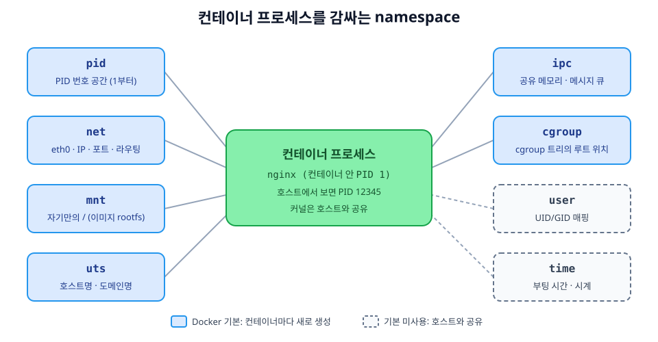
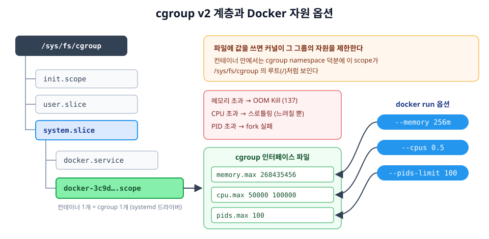
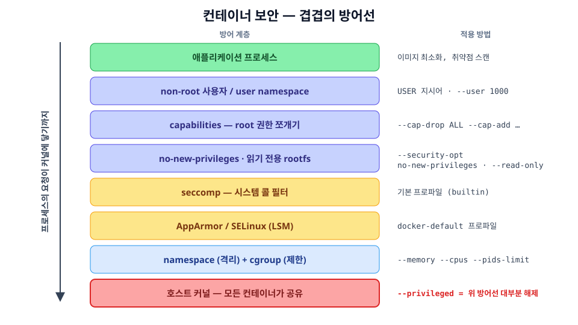

> **Chapter 1 · Docker** | 난이도 ★★★☆☆ | 예상 소요 2 ~ 2.5시간

## 🎯 오늘의 목표

- "컨테이너 = 격리된 프로세스"를 **namespace · cgroup · rootfs**라는 구체적인 커널 기능으로 설명할 수 있다
- Docker 없이 `unshare`로 **컨테이너 비슷한 것**을 직접 만들어 본다
- `--memory`, `--cpus`, `--pids-limit` 옵션이 **cgroup v2 파일**로 어떻게 바뀌는지 확인한다
- capabilities · seccomp · AppArmor · non-root 실행 등 **컨테이너 보안의 기본 장치**를 이해하고 적용한다
- Chapter 1 전체를 돌아보고 Kubernetes로 넘어갈 준비를 마친다

---

## 1. 컨테이너를 이루는 재료

Day 01에서 "컨테이너는 작은 VM이 아니라 격리된 리눅스 프로세스"라고 했습니다. 오늘은 그 말을 부품 단위로 분해합니다.

```
컨테이너 = 프로세스
         + namespace   (무엇이 보이는가)
         + cgroup      (얼마나 쓸 수 있는가)
         + rootfs      (어떤 파일 시스템 위에서 도는가 — Day 02의 이미지 레이어)
         + 보안 장치    (무엇을 할 수 있는가 — capabilities, seccomp, AppArmor)
```

| 재료 | 커널 기능 | 이번 챕터에서 본 곳 |
|---|---|---|
| 격리 | **namespace** | Day 01 `ps aux`에 PID 1만 보임, Day 05 컨테이너마다 독립된 `eth0` |
| 자원 제한 | **cgroup** | Day 01 `docker pause`(cgroup freezer), Day 06 `mem_limit` |
| 파일 시스템 | **overlayfs + mount namespace** | Day 02 레이어, Day 04 볼륨 마운트 |
| 권한 축소 | **capabilities, seccomp, LSM** | 오늘 처음 |

이 일을 실제로 하는 것은 Day 01 아키텍처 그림의 맨 아래, **runc**입니다. dockerd → containerd → runc가 이 재료들을 조립해 프로세스 하나를 띄우는 것이죠.

---

## 2. namespace — "무엇이 보이는가"



namespace는 커널 자원을 **프로세스 그룹별로 다르게 보이게** 하는 기능입니다. 같은 커널 위에 있지만 서로 다른 방에 있는 것처럼 보이게 만듭니다.

| namespace | 격리 대상 | 컨테이너에서 보이는 효과 | Docker 기본 |
|---|---|---|---|
| **pid** | 프로세스 ID 번호 공간 | 컨테이너 안 첫 프로세스가 PID 1 | ✅ 사용 |
| **net** | 네트워크 인터페이스, IP, 라우팅, 포트 | 자기만의 `eth0`, `lo`, 포트 공간 (Day 05) | ✅ 사용 |
| **mnt** | 마운트 포인트 | 자기만의 `/` (이미지 rootfs) | ✅ 사용 |
| **uts** | 호스트명, 도메인명 | 컨테이너 ID가 호스트명 | ✅ 사용 |
| **ipc** | System V IPC, POSIX 메시지 큐 | 다른 컨테이너의 공유 메모리 접근 불가 | ✅ 사용 |
| **cgroup** | cgroup 트리의 루트 위치 | 자기 cgroup이 `/`처럼 보임 | ✅ 사용 (cgroup v2) |
| **user** | UID/GID 매핑 | 컨테이너 root(0) → 호스트 일반 UID | ⚠️ 기본 **미사용** (`userns-remap` / rootless 모드에서 사용) |
| **time** | 부팅 시간 / monotonic 시계 | 컨테이너별 uptime | 기본 미사용 |

> 💡 **user namespace가 기본으로 꺼져 있다**는 사실이 중요합니다. 즉 일반적인 Docker 컨테이너의 root는 **호스트에서도 UID 0**입니다. 5장 보안 실습에서 이게 어떤 의미인지 직접 확인합니다.

### namespace는 "공유"도 할 수 있다

`--network container:<이름>`처럼 다른 컨테이너의 namespace에 **합류**할 수 있습니다. 두 컨테이너가 같은 net namespace를 쓰면 서로를 `localhost`로 부를 수 있습니다. 이것이 바로 **Kubernetes Pod**의 원리입니다(Day 10).

---

## 3. cgroup — "얼마나 쓸 수 있는가"



cgroup(control group)은 프로세스 그룹의 **자원 사용량을 제한·측정**합니다. 최신 배포판(Ubuntu 22.04 이상)은 **cgroup v2**(단일 계층, unified hierarchy)를 씁니다. cgroup은 `/sys/fs/cgroup` 아래의 **파일**로 다룹니다 — 값을 쓰면 제한이 걸립니다.

| Docker 옵션 | cgroup v2 파일 | 의미 |
|---|---|---|
| `--memory 256m` | `memory.max` | 메모리 상한. 넘으면 **OOM Kill** (종료 코드 137) |
| `--memory-swap` | `memory.swap.max` | `--memory`와 같은 값이면 swap 사용 안 함 |
| `--cpus 0.5` | `cpu.max` | `50000 100000` = 100ms마다 50ms만 CPU 사용 |
| `--cpu-shares` | `cpu.weight` | CPU 경쟁 시 상대적 가중치 |
| `--pids-limit 100` | `pids.max` | 만들 수 있는 프로세스/스레드 수 (fork bomb 방지) |
| `--device-read-bps` 등 | `io.max` | 블록 디바이스 I/O 대역폭 |

> ⚠️ **메모리와 CPU는 다르게 동작**합니다. CPU는 상한에 닿으면 **느려질 뿐**(throttling)이지만, 메모리는 상한을 넘으면 **프로세스가 죽습니다**. Kubernetes의 `resources.limits`(Day 18)도 정확히 같은 cgroup 위에서 동작하므로 이 차이를 꼭 기억하세요.

---

## 4. 보안 기초 — "무엇을 할 수 있는가"



컨테이너는 **호스트 커널을 공유**합니다(Day 01). 그래서 컨테이너 안의 프로세스가 커널에 위험한 요청을 하지 못하도록 여러 겹의 장치를 둡니다.

| 장치 | 하는 일 | Docker 기본값 |
|---|---|---|
| **capabilities** | root 권한을 약 40개 조각으로 나눠 필요한 것만 부여 | 14개 정도만 허용 (`CHOWN`, `NET_BIND_SERVICE`, `KILL`, `SETUID` 등). `SYS_ADMIN`, `SYS_TIME`, `NET_ADMIN` 등은 없음 |
| **seccomp** | 프로세스가 호출할 수 있는 **시스템 콜**을 필터링 | 기본 프로파일이 `reboot`, `kexec_load`, 커널 모듈 로드 등 위험한 syscall 차단 |
| **AppArmor / SELinux** (LSM) | 파일·마운트 등 접근을 정책으로 제한 | Ubuntu는 `docker-default` AppArmor 프로파일 적용 |
| **no-new-privileges** | setuid 바이너리 등으로 권한 상승 차단 | 꺼져 있음 → `--security-opt no-new-privileges`로 켬 |
| **non-root 실행** | 컨테이너 프로세스를 일반 UID로 실행 | 이미지 `USER`가 없으면 **root** |
| **user namespace** | 컨테이너 root를 호스트의 일반 UID로 매핑 | 꺼져 있음 (rootless 모드 / `userns-remap`) |

### 절대 가볍게 쓰면 안 되는 옵션

| 옵션 | 위험한 이유 |
|---|---|
| `--privileged` | 모든 capabilities + 모든 디바이스 접근 + seccomp/AppArmor 해제 → **사실상 호스트 root** |
| `-v /var/run/docker.sock:/var/run/docker.sock` | 컨테이너가 dockerd를 조종 가능 → 호스트 `/`를 마운트한 새 컨테이너를 만들 수 있음 |
| `-v /:/host` | 호스트 파일 시스템 전체를 root 권한으로 수정 가능 |
| `--pid host`, `--network host` | 해당 namespace 격리를 포기 |

> ⚠️ 같은 이유로 **`docker` 그룹에 속한 사용자는 사실상 root**입니다(Day 01에서 `usermod -aG docker` 한 그 그룹). 공용 서버에서 아무에게나 docker 그룹을 주면 안 됩니다. 이 문제를 근본적으로 줄이는 방법이 **rootless 모드**(dockerd 자체를 일반 사용자로 실행)입니다.

---

## 5. 실습

> **실습 환경**: **Ubuntu 24.04 LTS** + Docker Engine (VM, 클라우드 인스턴스, 또는 WSL2의 Ubuntu). `unshare`, `nsenter`, `lsns`는 Ubuntu 기본 패키지(util-linux)에 들어 있습니다. Docker Desktop만 있는 경우 5-1, 5-2의 호스트 측 명령은 진행이 어렵고, 5-3 이후의 `docker run` 실습은 그대로 가능합니다.

### 5-1. Docker 없이 namespace 만들어 보기 (`unshare`)

**UTS namespace** — 호스트명 격리:

```bash
hostname                       # 원래 호스트명 확인 (예: ubuntu-lab)
sudo unshare --uts bash
hostname container-lab         # 새 namespace 안에서 호스트명 변경
hostname                       # container-lab
exit
hostname                       # ubuntu-lab — 호스트는 그대로!
```

**PID namespace** — 프로세스 번호 격리:

```bash
sudo unshare --pid --fork --mount-proc bash
ps aux
```

```
USER         PID %CPU %MEM    VSZ   RSS TTY      STAT START   TIME COMMAND
root           1  0.0  0.0   9076  5248 pts/0    S    10:00   0:00 bash
root           8  0.0  0.0  10884  4352 pts/0    R+   10:00   0:00 ps aux
```

Day 01에서 `docker run --rm alpine ps aux`로 본 것과 똑같습니다. `--fork`는 새 PID namespace의 첫 프로세스(PID 1)를 만들기 위해, `--mount-proc`은 `ps`가 읽는 `/proc`을 새 namespace 기준으로 다시 마운트하기 위해 필요합니다.

```bash
exit
```

**NET namespace** — 네트워크 격리:

```bash
sudo unshare --net bash
ip addr
```

```
1: lo: <LOOPBACK> mtu 65536 qdisc noop state DOWN group default qlen 1000
    link/loopback 00:00:00:00:00:00 brd 00:00:00:00:00:00
```

`lo`만 있고 그마저 DOWN입니다. Day 05의 `--network none`과 같은 상태죠. Docker는 여기에 veth를 꽂고 IP를 붙여 준 것입니다(이 과정은 Day 22에서 손으로 직접 해 봅니다).

```bash
exit
```

### 5-2. 미니 컨테이너 — namespace + rootfs 조합

alpine 이미지의 파일 시스템을 꺼내 와서, 여러 namespace와 `chroot`를 조합해 봅니다.

```bash
mkdir -p ~/mini-rootfs
CID=$(docker create alpine:3.20)
docker export "$CID" | tar -x -C ~/mini-rootfs
docker rm "$CID"

ls ~/mini-rootfs           # bin dev etc home lib ... — 이미지의 rootfs
```

```bash
sudo unshare --uts --pid --net --mount --ipc --fork \
  chroot ~/mini-rootfs /bin/sh -c 'mount -t proc proc /proc && hostname mini && exec /bin/sh'
```

새로 뜬 셸 안에서:

```sh
ps                 # PID 1 = /bin/sh
hostname           # mini
cat /etc/os-release | head -n 2   # Alpine Linux — 호스트는 Ubuntu인데!
ip addr            # lo 만 존재
exit
```

> 💡 이것이 컨테이너의 본질입니다. **이미지(rootfs) + namespace + 프로세스**. 여기에 cgroup 제한, 네트워크 연결, 레이어 관리, 보안 프로파일을 자동으로 얹어 주는 것이 runc·containerd·Docker입니다.

```bash
sudo rm -rf ~/mini-rootfs
```

### 5-3. 실행 중인 Docker 컨테이너의 namespace 엿보기

```bash
docker run -d --name ns-demo nginx
PID=$(docker inspect -f '{{.State.Pid}}' ns-demo)
echo $PID                      # 호스트에서 본 nginx master 프로세스의 PID

sudo ls -l /proc/$PID/ns
```

```
lrwxrwxrwx 1 root root 0 ... cgroup -> 'cgroup:[4026532512]'
lrwxrwxrwx 1 root root 0 ... ipc -> 'ipc:[4026532450]'
lrwxrwxrwx 1 root root 0 ... mnt -> 'mnt:[4026532448]'
lrwxrwxrwx 1 root root 0 ... net -> 'net:[4026532453]'
lrwxrwxrwx 1 root root 0 ... pid -> 'pid:[4026532451]'
...
lrwxrwxrwx 1 root root 0 ... user -> 'user:[4026531837]'
lrwxrwxrwx 1 root root 0 ... uts -> 'uts:[4026532449]'
```

```bash
sudo readlink /proc/1/ns/user /proc/$PID/ns/user   # 두 값이 같다 → user ns 공유(=격리 안 됨)
sudo readlink /proc/1/ns/net  /proc/$PID/ns/net    # 두 값이 다르다 → net ns 격리
```

`nsenter`로 컨테이너의 namespace에 **호스트의 도구를 들고** 들어갈 수 있습니다. 이미지에 `ip` 명령이 없어도 디버깅이 가능하죠.

```bash
sudo nsenter -t $PID -u hostname       # 컨테이너 호스트명
sudo nsenter -t $PID -n ip addr        # 컨테이너의 eth0 (Day 05의 172.17.0.x)
```

namespace **공유**도 해 봅니다.

```bash
# ns-demo 의 network namespace 에 합류 → localhost 가 곧 nginx
docker run --rm --network container:ns-demo alpine wget -qO- http://localhost | head -n 4

# ns-demo 의 pid namespace 에 합류 → nginx 프로세스가 보임
docker run --rm --pid container:ns-demo alpine ps
```

```
PID   USER     TIME  COMMAND
    1 root      0:00 nginx: master process nginx -g daemon off;
   29 101       0:00 nginx: worker process
   ...
```

> 💡 "하나의 net namespace를 여러 컨테이너가 공유" — Kubernetes Pod가 정확히 이렇게 만들어집니다. Day 10에서 다시 만납니다.

```bash
docker rm -f ns-demo
```

### 5-4. cgroup으로 자원 제한하기

먼저 cgroup 버전과 드라이버를 확인합니다.

```bash
docker info --format '{{.CgroupVersion}} {{.CgroupDriver}}'
# 2 systemd
```

**메모리 / CPU / PID 제한**을 건 컨테이너:

```bash
docker run -d --name limited --memory 256m --cpus 0.5 --pids-limit 100 nginx

docker exec limited cat /sys/fs/cgroup/memory.max   # 268435456  (= 256 MiB)
docker exec limited cat /sys/fs/cgroup/cpu.max      # 50000 100000
docker exec limited cat /sys/fs/cgroup/pids.max     # 100
```

컨테이너 안의 `/sys/fs/cgroup`은 cgroup namespace 덕분에 **자기 cgroup이 루트처럼** 보입니다. 호스트에서는 같은 파일이 이 위치에 있습니다(systemd 드라이버 기준).

```bash
CID=$(docker inspect -f '{{.Id}}' limited)
cat /sys/fs/cgroup/system.slice/docker-$CID.scope/memory.max
# 268435456
```

`docker stats`에서도 상한이 보입니다.

```bash
docker stats --no-stream limited
```

```
CONTAINER ID   NAME      CPU %     MEM USAGE / LIMIT   MEM %   NET I/O   BLOCK I/O   PIDS
3c9d1e2f4a5b   limited   0.00%     9.1MiB / 256MiB     3.55%   ...       ...         5
```

**CPU 제한** — 무한 루프를 돌려도 50% 근처에서 멈춥니다.

```bash
docker run -d --name cpu-hog --cpus 0.5 alpine sh -c 'while :; do :; done'
docker stats --no-stream cpu-hog      # CPU % 가 약 50%
docker rm -f cpu-hog
```

**메모리 초과 → OOM Kill**:

```bash
docker run --name oom-test --memory 64m --memory-swap 64m \
  python:3.12-slim python -c "data = b'x' * (200 * 1024 * 1024)"

docker inspect -f 'OOMKilled={{.State.OOMKilled}} ExitCode={{.State.ExitCode}}' oom-test
# OOMKilled=true ExitCode=137
docker rm oom-test
```

> 종료 코드 **137 = 128 + 9(SIGKILL)**. 운영 중 컨테이너가 137로 죽어 있다면 가장 먼저 메모리 제한을 의심하세요. Kubernetes에서는 `OOMKilled` 상태로 보입니다.

**PID 제한 — fork bomb 방어**:

```bash
docker run --rm --pids-limit 20 alpine sh -c 'for i in $(seq 1 50); do sleep 30 & done; wait'
```

```
sh: can't fork: Resource temporarily unavailable
sh: can't fork: Resource temporarily unavailable
...
```

20개를 넘는 순간 더 이상 프로세스를 만들 수 없습니다(약 30초 뒤 종료).

```bash
docker rm -f limited
```

### 5-5. 보안 실습

**① 컨테이너의 root는 호스트의 root다**

```bash
docker run --rm -v /etc:/host-etc alpine touch /host-etc/created-by-container
ls -l /etc/created-by-container
# -rw-r--r-- 1 root root 0 ... /etc/created-by-container   ← 호스트 /etc 에 root 소유 파일이 생김
sudo rm /etc/created-by-container
```

sudo 없이 `docker` 명령만으로 호스트 `/etc`에 파일을 만들었습니다. **docker 그룹 = root 권한**이라는 말의 의미입니다.

**② capabilities 확인과 제거**

```bash
docker run --rm alpine grep CapEff /proc/self/status
# CapEff: 00000000a80425fb    ← Docker 기본 capability 집합

capsh --decode=00000000a80425fb    # 호스트에서 사람이 읽을 수 있게 변환 (libcap2-bin 패키지)
# 0x00000000a80425fb=cap_chown,cap_dac_override,cap_fowner,cap_fsetid,cap_kill,cap_setgid,cap_setuid,cap_setpcap,cap_net_bind_service,cap_net_raw,cap_sys_chroot,cap_mknod,cap_audit_write,cap_setfcap
```

root여도 기본 집합에 없는 권한은 쓸 수 없습니다.

```bash
docker run --rm alpine date -s "2030-01-01 00:00:00"
# date: can't set date: Operation not permitted     (CAP_SYS_TIME 없음)
```

기본 집합에 있는 권한도 뺄 수 있습니다.

```bash
docker run --rm alpine chown nobody /tmp                   # 성공
docker run --rm --cap-drop CHOWN alpine chown nobody /tmp
# chown: /tmp: Operation not permitted

docker run --rm --cap-drop ALL alpine grep CapEff /proc/self/status
# CapEff: 0000000000000000
```

> 💡 운영 원칙: **`--cap-drop ALL` 후 필요한 것만 `--cap-add`**. 예를 들어 1024 미만 포트를 root로 열어야 하면 `--cap-add NET_BIND_SERVICE`만 추가합니다.

**③ seccomp / AppArmor 적용 여부**

```bash
docker info --format '{{json .SecurityOptions}}'
# ["name=apparmor","name=seccomp,profile=builtin","name=cgroupns"]

docker inspect -f '{{.AppArmorProfile}}' $(docker run -d --rm alpine sleep 5)
# docker-default
```

**④ non-root 실행과 읽기 전용 파일 시스템**

```bash
docker run --rm --user 1000:1000 alpine id
# uid=1000 gid=1000 ...

docker run --rm --read-only alpine touch /test
# touch: /test: Read-only file system

docker run --rm --read-only --tmpfs /tmp alpine touch /tmp/ok && echo "tmpfs 는 쓰기 가능"
```

Day 03에서 Dockerfile에 `USER` 지시어를 넣어 non-root 이미지를 만드는 것이 가장 근본적인 방법입니다. `--read-only` + `--tmpfs`(Day 04)는 공격자가 컨테이너 안에 파일을 심는 것을 어렵게 만듭니다.

**⑤ 종합 — 단단하게 실행한 nginx**

non-root용으로 만들어진 공식 이미지 `nginxinc/nginx-unprivileged`(8080 포트, UID 101)를 사용합니다.

```bash
docker run -d --name hardened -p 8080:8080 \
  --read-only --tmpfs /tmp \
  --cap-drop ALL \
  --security-opt no-new-privileges \
  --memory 128m --cpus 0.5 --pids-limit 100 \
  nginxinc/nginx-unprivileged

curl -s http://localhost:8080 | head -n 4
docker exec hardened id
# uid=101(nginx) gid=101(nginx) groups=101(nginx)
docker rm -f hardened
```

| 적용한 옵션 | 막아 주는 것 |
|---|---|
| non-root 이미지 (UID 101) | 탈출 시에도 호스트 root가 아님 |
| `--read-only --tmpfs /tmp` | 악성 파일 설치·변조 |
| `--cap-drop ALL` | 커널 권한 남용 |
| `--security-opt no-new-privileges` | setuid 바이너리로 권한 상승 |
| `--memory --cpus --pids-limit` | 자원 고갈(DoS), fork bomb |

---

## 6. 트러블슈팅

| 증상 | 원인 | 해결 |
|---|---|---|
| 컨테이너가 `Exited (137)` | 메모리 제한 초과로 OOM Kill, 또는 `docker kill` / stop 타임아웃 | `docker inspect -f '{{.State.OOMKilled}}'` 확인 → 메모리 상한 상향 또는 앱 메모리 사용 최적화 |
| `unshare: unshare failed: Operation not permitted` | root 권한 없이 실행 | `sudo` 사용 (user namespace 실험이 목적이면 `unshare --user --map-root-user`) |
| `ps` 결과에 호스트 프로세스가 다 보임 | `--pid`만 주고 `--mount-proc`(또는 `/proc` 재마운트)을 빠뜨림 | `sudo unshare --pid --fork --mount-proc bash` |
| `/sys/fs/cgroup/memory/...` 경로가 없음 | cgroup v1 경로를 보고 있음 (v2는 단일 계층) | `docker info`로 `CgroupVersion` 확인, v2에서는 `memory.max` 등의 파일 사용 |
| `--cap-drop ALL` 후 앱이 `permission denied`로 시작 실패 | 앱이 root 전용 동작(80 포트 바인딩, chown 등)을 함 | 필요한 capability만 `--cap-add`, 또는 non-root 이미지·8080 같은 상위 포트 사용 |
| `--read-only` 후 `Read-only file system` 에러로 시작 실패 | 앱이 PID 파일·캐시를 쓰려는 경로가 읽기 전용 | 해당 경로에 `--tmpfs` 또는 볼륨 마운트 |

---

## 7. 핵심 정리

### 오늘 배운 것

- 컨테이너 = **프로세스 + namespace + cgroup + rootfs + 보안 장치** — 조립은 runc가 한다
- **namespace**(pid, net, mnt, uts, ipc, cgroup, user…)는 "무엇이 보이는가"를 격리. Docker는 기본적으로 **user namespace를 쓰지 않는다**
- **cgroup v2**는 `/sys/fs/cgroup`의 파일(`memory.max`, `cpu.max`, `pids.max`)로 자원을 제한. CPU는 느려지고, 메모리는 **죽는다(137)**
- namespace는 공유도 가능 — `--network container:X` = **Kubernetes Pod의 원리**
- 보안 기본기: **non-root**, `--cap-drop ALL`, `no-new-privileges`, `--read-only`, 자원 제한. `--privileged`와 `docker.sock` 마운트는 호스트 root를 내주는 것

### 🧭 Chapter 1 회고 — 컨테이너 하나를 제대로 다루기

| Day | 주제 | 한 줄 요약 |
|---|---|---|
| 01 | 컨테이너와 Docker 첫걸음 | 컨테이너는 커널을 공유하는 격리된 프로세스, CLI → dockerd → containerd → runc |
| 02 | 이미지와 레이어 | 읽기 전용 레이어를 쌓은 이미지 + 컨테이너 쓰기 계층, 태그와 레지스트리 |
| 03 | Dockerfile | 이미지를 코드로 정의, 캐시를 살리는 순서와 멀티 스테이지로 작게 |
| 04 | 볼륨 | 컨테이너는 일회용, 데이터는 Volume / Bind Mount / tmpfs로 분리 |
| 05 | 네트워크 | bridge + NAT, 사용자 정의 네트워크의 DNS로 **이름 기반 통신** |
| 06 | Compose | 멀티 컨테이너 앱을 YAML로 **선언**하고 한 번에 관리 |
| 07 | 내부 원리 | namespace(격리) + cgroup(제한) + 보안 장치 = 컨테이너의 실체 |

Chapter 1을 마치면 **서버 한 대 위에서** 컨테이너를 만들고, 연결하고, 데이터를 지키고, 안전하게 제한하는 것까지 할 수 있습니다. 하지만 아직 풀지 못한 질문이 남아 있습니다.

- 서버가 **여러 대**라면 컨테이너를 어디에 띄우지?
- 컨테이너가 죽으면 **누가 다시 살리지?** 서버 자체가 죽으면?
- 트래픽이 늘면 컨테이너를 **자동으로 늘릴** 수는 없을까?
- 새 버전을 **무중단으로** 배포하려면?

이 질문들의 답이 Chapter 2, **Kubernetes**입니다.

---

## 8. 셀프 체크

<details>
<summary>Q1. 컨테이너 안에서 <code>ps aux</code>를 하면 PID 1만 보이는데, 호스트에서는 같은 프로세스가 다른 PID로 보인다. 어떤 namespace 때문인가?</summary>

**PID namespace**입니다. 컨테이너는 새 PID 번호 공간을 가지므로 첫 프로세스가 1번이 되지만, 호스트(부모 namespace)에서는 일반적인 PID(예: 12345)로 보입니다. `docker inspect -f '{{.State.Pid}}'`가 호스트 기준 PID입니다.
</details>

<details>
<summary>Q2. <code>--cpus 0.5</code>로 제한한 컨테이너와 <code>--memory 64m</code>로 제한한 컨테이너가 각각 상한에 도달하면 어떻게 되나?</summary>

CPU는 cgroup `cpu.max`에 의해 **스로틀링**되어 느려질 뿐 계속 실행됩니다. 메모리는 `memory.max`를 넘으면 커널 OOM Killer가 프로세스를 **SIGKILL**하여 컨테이너가 종료 코드 137로 죽습니다.
</details>

<details>
<summary>Q3. 컨테이너 안에서 root인데도 <code>date -s</code>로 시간을 바꿀 수 없는 이유는?</summary>

Docker는 root의 권한을 capabilities 단위로 쪼개 기본 집합만 부여합니다. 시스템 시간 변경에 필요한 **`CAP_SYS_TIME`**은 기본 집합에 없기 때문에 `Operation not permitted`가 납니다. (시간은 커널 전역 자원이라 컨테이너 하나가 바꾸면 호스트 전체가 바뀌기 때문)
</details>

<details>
<summary>Q4. <code>-v /var/run/docker.sock:/var/run/docker.sock</code>을 마운트한 컨테이너가 위험한 이유는?</summary>

컨테이너가 호스트의 dockerd API를 직접 호출할 수 있게 됩니다. 그러면 `-v /:/host --privileged` 같은 새 컨테이너를 띄워 **호스트 전체를 root 권한으로 장악**할 수 있습니다. docker 그룹이 사실상 root인 것과 같은 이유입니다.
</details>

<details>
<summary>Q5. Kubernetes Pod 안의 여러 컨테이너가 서로를 <code>localhost</code>로 부를 수 있는 원리를 오늘 배운 내용으로 설명하면?</summary>

Pod 안의 컨테이너들이 **하나의 network namespace를 공유**하기 때문입니다. 오늘 실습한 `docker run --network container:ns-demo ...`와 같은 원리로, 같은 net namespace 안에서는 인터페이스·IP·포트 공간이 공유되어 `localhost`로 서로 통신합니다.
</details>

---

## ⏭️ 다음 예고 — Day 08. 왜 오케스트레이션인가 & K8s 아키텍처

드디어 Chapter 2, **Kubernetes**로 넘어갑니다. 서버 여러 대에 컨테이너 수백 개를 띄우고, 죽으면 살리고, 트래픽에 맞춰 늘리고 줄이는 일 — 사람이 `docker run`으로는 감당할 수 없는 이 일을 **오케스트레이션**이라고 부릅니다. Control Plane(API Server, etcd, Scheduler, Controller Manager)과 Worker Node(kubelet, kube-proxy, 그리고 오늘 본 containerd)가 어떻게 협력하는지 큰 그림부터 그려 봅니다.
