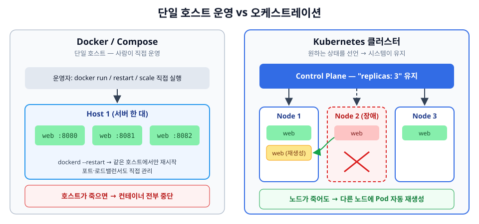
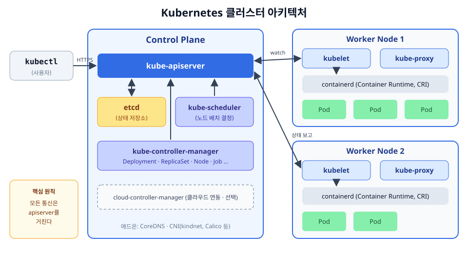
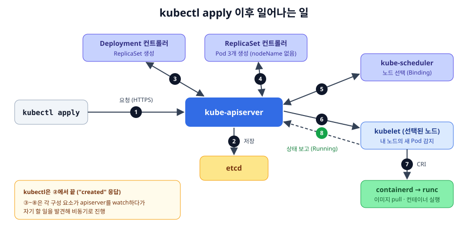

> **Chapter 2 · Kubernetes** | 난이도 ★★☆☆☆ | 예상 소요 1.5 ~ 2시간

## 🎯 오늘의 목표

- Docker / Docker Compose만으로는 **운영 환경에서 무엇이 부족한지** 설명할 수 있다
- **선언형(Declarative)** 관리와 **조정 루프(Reconciliation Loop)** 의 개념을 이해한다
- Kubernetes의 **Control Plane**과 **Worker Node** 구성 요소가 각각 무슨 일을 하는지 안다
- `kubectl apply` 한 번이 컨테이너 실행까지 이어지는 **전체 흐름**을 단계별로 말할 수 있다

---

## 1. 왜 오케스트레이션인가?

Chapter 1에서 우리는 컨테이너 하나를 제대로 다루는 법을 배웠고, Day 06에서는 Docker Compose로 Web + DB + Cache를 한 번에 띄웠습니다. 개발 PC나 서버 한 대라면 이걸로 충분합니다.

그런데 서비스가 커지면 질문이 달라집니다.

> "서버가 10대인데, 컨테이너 200개를 **어느 서버에** 띄우지?"
> "새벽 3시에 서버 한 대가 죽으면 **누가** 그 위의 컨테이너를 다른 서버로 옮기지?"
> "트래픽이 3배로 늘면 **누가** 컨테이너를 늘리고, 줄면 다시 줄이지?"
> "새 버전을 배포할 때 **서비스 중단 없이** 하나씩 바꿀 수 있을까?"

이 질문들에 답하는 소프트웨어가 **컨테이너 오케스트레이터(Container Orchestrator)** 이고, 사실상의 표준이 **Kubernetes(K8s)** 입니다.



| 운영 과제 | Docker / Compose (단일 호스트) | Kubernetes (클러스터) |
|---|---|---|
| 배치(Scheduling) | 내가 직접 서버를 골라서 실행 | 스케줄러가 리소스를 보고 **자동 배치** |
| 장애 복구(Self-healing) | `--restart` 정책은 **같은 호스트 안에서만** 재시작 | 노드가 죽어도 **다른 노드에 다시 생성** |
| 확장(Scaling) | `--scale`은 한 호스트 안에서만, 포트 충돌도 직접 해결 | `replicas: 10` 한 줄, 오토스케일링(HPA)까지 |
| 배포(Rollout) | 내렸다 올리기 → 순간 중단 | **롤링 업데이트 & 롤백** 기본 제공 |
| 서비스 디스커버리 | 같은 네트워크 내 컨테이너 이름(DNS) | Service + CoreDNS로 클러스터 전체에서 고정 이름/IP |
| 설정·비밀 관리 | `.env` 파일, 환경 변수 | ConfigMap / Secret 리소스 |
| 스토리지 | 호스트 볼륨 (그 호스트에 묶임) | PV/PVC로 스토리지를 추상화 |

> 💡 Kubernetes라는 이름은 그리스어로 **"조타수(배의 키를 잡는 사람)"** 라는 뜻입니다. 컨테이너(화물)를 싣고 가는 배를 조종한다는 의미죠. K와 s 사이에 글자가 8개라서 **K8s**라고 줄여 씁니다. Google 내부 시스템 Borg의 경험을 바탕으로 2014년 오픈소스로 공개됐고, 현재는 CNCF(Cloud Native Computing Foundation)가 관리합니다.

---

## 2. 핵심 사상: 선언형 관리와 조정 루프

Kubernetes를 이해하는 데 가장 중요한 한 가지를 꼽으라면 바로 이것입니다.

### 명령형(Imperative) vs 선언형(Declarative)

| 구분 | 명령형 | 선언형 |
|---|---|---|
| 표현 방식 | "**어떻게** 할지"를 순서대로 지시 | "**어떤 상태**여야 하는지"를 기술 |
| 예시 | `docker run nginx`를 3번 실행해라 | "nginx 컨테이너가 **항상 3개** 떠 있어야 한다" |
| 하나가 죽으면? | 내가 알아채고 다시 실행해야 함 | 시스템이 알아서 다시 3개로 맞춤 |
| 비유 | 택시 기사에게 "좌회전, 직진, 우회전…" | 택시 기사에게 "서울역이요" |

Kubernetes에서는 YAML로 **원하는 상태(Desired State)** 를 선언합니다.

```yaml
apiVersion: apps/v1
kind: Deployment
metadata:
  name: web
spec:
  replicas: 3            # ← "nginx Pod가 항상 3개 있어야 한다"
  selector:
    matchLabels:
      app: web
  template:
    metadata:
      labels:
        app: web
    spec:
      containers:
      - name: nginx
        image: nginx:1.27
        ports:
        - containerPort: 80
```

> 지금은 내용을 다 이해하지 않아도 됩니다. Pod는 **Day 10**, Deployment는 **Day 11**에서 한 줄씩 뜯어봅니다.

### 조정 루프 (Reconciliation Loop)

Kubernetes 안의 수많은 **컨트롤러**들은 아래 루프를 끝없이 반복합니다.

```
   ┌──────────────────────────────────────────────┐
   │  1. 관찰(Observe)  : 현재 상태는? (Pod 2개)    │
   │  2. 비교(Diff)     : 원하는 상태는? (Pod 3개)  │
   │  3. 조치(Act)      : 차이만큼 Pod 1개 생성     │
   └──────────────────────┬───────────────────────┘
                          └── 다시 1번으로 (무한 반복)
```

- 누군가 Pod를 실수로 지워도 → 현재 2개 ≠ 원하는 3개 → **자동으로 1개 생성**
- 노드가 죽어서 Pod 1개가 사라져도 → 같은 로직으로 **다른 노드에 1개 생성**
- 내가 `replicas: 5`로 바꾸면 → 현재 3개 ≠ 원하는 5개 → **2개 추가**

장애 복구, 스케일링, 배포가 전부 **"현재 상태를 원하는 상태로 맞춘다"** 는 하나의 원리로 동작합니다. 이것이 Kubernetes의 본질입니다.

> 💡 에어컨 온도 조절기를 떠올리면 쉽습니다. 우리는 "24도"라고 **선언**만 하고, 온도 조절기가 현재 온도를 계속 **관찰**하면서 냉방을 켜고 끄며 **조정**합니다.

---

## 3. Kubernetes 클러스터 아키텍처



클러스터는 크게 **두 가지 역할**로 나뉩니다.

- **Control Plane** — 클러스터의 **두뇌**. 원하는 상태를 저장하고, 결정을 내리고, 지시를 내린다
- **Worker Node** — 실제로 **컨테이너가 돌아가는** 일꾼 서버들

### 3-1. Control Plane 구성 요소

| 구성 요소 | 역할 | 한 줄 비유 |
|---|---|---|
| **kube-apiserver** | 클러스터의 **유일한 정문**. 모든 요청(kubectl, 컨트롤러, kubelet)은 REST API로 여기를 거친다. 인증·인가·검증 후 etcd에 저장 | 접수 창구 |
| **etcd** | 클러스터의 **모든 상태**를 저장하는 분산 Key-Value 저장소. apiserver만 직접 접근 | 장부 |
| **kube-scheduler** | 아직 노드가 정해지지 않은 Pod를 보고, 리소스·제약 조건을 따져 **어느 노드에 둘지 결정** | 배차 담당 |
| **kube-controller-manager** | Deployment, ReplicaSet, Node, Job 등 **각종 컨트롤러**를 실행. 조정 루프를 돌리는 주체 | 현장 관리자 |
| **cloud-controller-manager** | AWS/GCP/OpenStack 같은 클라우드 API와 연동 (LoadBalancer, 노드 정보 등). 로컬 클러스터엔 보통 없음 | 클라우드 연락 담당 |

> ⚠️ **중요한 원칙:** 구성 요소끼리 직접 대화하지 않습니다. scheduler도, controller도, kubelet도 **전부 apiserver를 통해서만** 상태를 읽고(watch) 씁니다. 이 "허브 앤 스포크" 구조 덕분에 각 구성 요소를 독립적으로 교체·확장할 수 있습니다.

### 3-2. Worker Node 구성 요소

| 구성 요소 | 역할 |
|---|---|
| **kubelet** | 각 노드의 **에이전트**. apiserver를 지켜보다가 "내 노드에 배정된 Pod"가 생기면 컨테이너 런타임에게 실행을 지시하고, 상태를 apiserver에 보고 |
| **Container Runtime** | 실제로 컨테이너를 실행. **containerd**(가장 흔함) 또는 CRI-O. kubelet과는 **CRI**(Container Runtime Interface)로 통신 |
| **kube-proxy** | Service의 가상 IP로 오는 트래픽을 실제 Pod로 전달하도록 노드의 iptables / IPVS / nftables 규칙을 관리 (Day 12에서 자세히) |

Day 01의 셀프 체크 Q4를 기억하나요? 여기서 다시 연결됩니다.

```
Docker:      docker CLI → dockerd → containerd → runc → 컨테이너
Kubernetes:  kubelet  ─────(CRI)─→ containerd → runc → 컨테이너
```

> 💡 Kubernetes v1.24부터 dockershim이 제거되어 **kubelet은 dockerd를 거치지 않고** containerd와 직접 대화합니다. 그래도 `docker build`로 만든 이미지는 표준(OCI) 이미지라서 Kubernetes에서 그대로 쓸 수 있습니다. "Docker를 못 쓴다"가 아니라 "런타임으로 dockerd가 필요 없다"는 뜻입니다.

### 3-3. 애드온 (Add-ons)

클러스터가 제대로 동작하려면 위 구성 요소 외에 몇 가지가 더 필요합니다.

| 애드온 | 역할 |
|---|---|
| **CNI 플러그인** (Calico, Cilium, Flannel, kindnet 등) | Pod에 IP를 주고, **노드가 달라도 Pod끼리 통신**되게 하는 네트워크 |
| **CoreDNS** | 클러스터 내부 DNS. `my-svc.default.svc.cluster.local` 같은 이름 해석 |
| **Metrics Server** | `kubectl top`, HPA를 위한 CPU/메모리 수집 (Day 18) |
| **Ingress Controller** | L7(HTTP) 라우팅 (Day 15) |

### 3-4. 표준 인터페이스: CRI · CNI · CSI

Kubernetes는 "직접 다 하지 않고, 인터페이스만 정의하고 구현은 플러그인에 맡기는" 설계입니다.

| 인터페이스 | 무엇을 표준화? | 대표 구현 |
|---|---|---|
| **CRI** (Container Runtime Interface) | 컨테이너 실행 | containerd, CRI-O |
| **CNI** (Container Network Interface) | Pod 네트워크 | Calico, Cilium, Flannel |
| **CSI** (Container Storage Interface) | 스토리지 연결 | AWS EBS, Ceph, **OpenStack Cinder** |

> 💡 Chapter 5에서 OpenStack 위에 K8s를 올릴 때, Cinder CSI 드라이버로 OpenStack 볼륨을 K8s PV로 쓰게 됩니다. 이 인터페이스 설계 덕분이죠.

---

## 4. `kubectl apply` 부터 컨테이너 실행까지

위 Deployment YAML을 `kubectl apply -f web.yaml`로 제출하면, 내부에서는 어떤 일이 일어날까요?



| 단계 | 누가 | 무엇을 |
|---|---|---|
| ① | **kubectl** | YAML을 JSON으로 바꿔 apiserver에 HTTP 요청 (kubeconfig의 인증서 사용) |
| ② | **apiserver** | 인증 → 인가(RBAC) → 검증(Admission) 후 Deployment 객체를 **etcd에 저장**. 여기서 kubectl은 "created" 응답을 받고 끝 |
| ③ | **Deployment 컨트롤러** | 새 Deployment를 감지(watch) → ReplicaSet 객체 생성 |
| ④ | **ReplicaSet 컨트롤러** | "Pod 3개 필요, 현재 0개" → Pod 객체 3개 생성 (이때 Pod의 `nodeName`은 **비어 있음**) |
| ⑤ | **scheduler** | 노드가 없는 Pod를 감지 → 노드별 여유 리소스를 따져 점수 계산 → `nodeName` 기록(Binding) |
| ⑥ | **kubelet** (해당 노드) | "내 노드에 Pod가 배정됐다" 감지 → CRI로 containerd에 실행 요청 |
| ⑦ | **containerd / runc** | 이미지 pull → namespace·cgroup 설정 → 컨테이너 시작 (Day 07에서 본 그 과정!) |
| ⑧ | **kubelet** | Pod 상태(`Running`, IP 등)를 apiserver에 보고 → etcd에 반영 |

여기서 눈여겨볼 점:

- **kubectl은 ②에서 이미 끝납니다.** "created"는 "컨테이너가 떴다"가 아니라 "**원하는 상태를 접수했다**"는 뜻입니다. 그래서 `kubectl get pods`로 실제 상태를 확인해야 합니다.
- ③~⑧은 누가 명령해서 일어나는 게 아니라, 각 컴포넌트가 **apiserver를 watch하다가 자기 할 일을 발견해서** 움직입니다. 그래서 일부가 잠시 죽어 있어도, 살아나면 밀린 일을 처리해 결국 원하는 상태에 도달합니다.

---

## 5. 실습 — 단일 호스트의 한계를 직접 느껴보기

> **실습 환경:** Docker Desktop(Windows/macOS) 또는 Ubuntu 24.04 + Docker Engine. 클러스터는 **Day 09**에서 kind로 만들기 때문에, 오늘은 Docker만으로 "오케스트레이터가 왜 필요한지"를 체감해 봅니다.

### 5-1. Docker의 재시작 정책 — 같은 호스트 안에서만

5초 뒤에 에러(exit 1)로 죽는 컨테이너를 `on-failure` 정책으로 띄웁니다.

```bash
docker run -d --name crashy --restart on-failure alpine sh -c "echo started; sleep 5; exit 1"
```

20초쯤 기다렸다가 재시작 횟수를 확인합니다.

```bash
docker inspect -f '{{.RestartCount}}' crashy
# 2   (기다린 시간에 따라 숫자는 다름)
docker logs crashy
# started
# started
# started
```

dockerd가 죽은 컨테이너를 다시 살려주긴 합니다. 하지만 **이 호스트 자체가 꺼지면?** 다른 서버로 옮겨 띄워줄 존재가 없습니다. Docker의 복구 범위는 "자기 호스트 안"까지입니다.

```bash
docker rm -f crashy
```

### 5-2. 수동 스케일링과 포트 충돌

nginx를 3개로 늘려 봅시다.

```bash
docker run -d --name web1 -p 8080:80 nginx
docker run -d --name web2 -p 8080:80 nginx
# docker: Error response from daemon: ... Bind for 0.0.0.0:8080 failed: port is already allocated.
```

한 호스트에서 같은 포트를 두 번 쓸 수 없으니, 포트를 바꿔야 합니다.

```bash
docker run -d --name web2 -p 8081:80 nginx
docker run -d --name web3 -p 8082:80 nginx
```

이제 클라이언트는 8080/8081/8082 중 **어디로 보내야 할지** 알아야 하고, 앞에 로드밸런서를 직접 세워야 합니다. 컨테이너가 죽거나 늘어날 때마다 로드밸런서 설정도 바꿔야 하죠.

> 💡 Kubernetes에서는 Pod마다 **고유 IP**가 있어 포트 충돌이 없고, **Service**가 살아 있는 Pod들 앞에서 자동으로 로드밸런싱합니다 (Day 12).

```bash
docker rm -f web1 web2 web3
```

### 5-3. "원하는 상태"를 흉내 내 보기

조정 루프가 얼마나 단순한 아이디어인지, 셸 스크립트로 흉내 내 봅시다. (Linux / macOS / Git Bash / WSL)

```bash
# reconcile.sh — "app=web 라벨이 붙은 nginx 컨테이너가 항상 3개" 를 유지하는 장난감 컨트롤러
DESIRED=3
while true; do
  CURRENT=$(docker ps -q --filter "label=app=web" | wc -l)
  if [ "$CURRENT" -lt "$DESIRED" ]; then
    echo "$(date +%T) 현재 $CURRENT개 / 원하는 $DESIRED개 → 1개 생성"
    docker run -d --name "web-$RANDOM" --label app=web nginx > /dev/null
  fi
  sleep 3
done
```

```bash
bash reconcile.sh
# 10:00:01 현재 0개 / 원하는 3개 → 1개 생성
# 10:00:04 현재 1개 / 원하는 3개 → 1개 생성
# 10:00:07 현재 2개 / 원하는 3개 → 1개 생성
```

**다른 터미널**에서 컨테이너 하나를 강제로 지워 보세요.

```bash
docker ps --filter "label=app=web" --format '{{.Names}}'
docker rm -f <위 목록 중 하나>
```

몇 초 뒤 스크립트가 "현재 2개 → 1개 생성"을 출력하며 다시 3개로 맞춥니다. **관찰 → 비교 → 조치**, 이것이 Kubernetes 컨트롤러가 하는 일의 핵심입니다. 실제 컨트롤러는 여기에 여러 노드, 리소스 계산, 롤링 업데이트, 상태 저장(etcd) 등을 더한 것이고요.

정리:

```bash
# Ctrl+C 로 스크립트 종료 후
docker rm -f $(docker ps -aq --filter "label=app=web")
```

> ⚠️ 이 스크립트는 개념 설명용 장난감입니다. 실제 운영에서 이렇게 쓰면 안 됩니다. 스크립트가 죽으면 조정도 멈추고, 여러 대의 서버를 다루지도 못하니까요. 그 모든 걸 제대로 해결한 것이 Kubernetes입니다.

---

## 6. 트러블슈팅

| 증상 | 원인 | 해결 |
|---|---|---|
| `port is already allocated` | 같은 호스트 포트를 다른 컨테이너가 사용 중 | 다른 호스트 포트 사용 또는 기존 컨테이너 삭제 |
| `docker inspect` 의 RestartCount가 계속 0 | 정상 종료(exit 0)는 `on-failure` 대상이 아님 / 정책 미지정 | 명령이 0이 아닌 코드로 끝나는지 확인, `--restart` 옵션 확인 |
| `reconcile.sh`에서 `wc: command not found` 등 | Windows PowerShell에서 bash 문법을 실행 | Git Bash 또는 WSL 터미널에서 실행 |
| 스크립트 종료 후에도 `web-` 컨테이너가 남아 있음 | 스크립트는 생성만 하고 정리하지 않음 | 5-3의 정리 명령 실행 |
| "kubectl apply 했는데 created인데 Pod가 안 떠요" (Day 09 이후) | `created`는 etcd 저장 완료일 뿐, 실제 실행은 비동기 | `kubectl get pods`, `kubectl describe pod`로 실제 상태 확인 |

---

## 7. 핵심 정리

- 오케스트레이터는 **여러 서버에 걸쳐** 컨테이너의 배치·복구·확장·배포를 자동화한다
- Kubernetes는 **선언형**: "어떻게"가 아니라 "어떤 상태여야 하는지"를 YAML로 선언한다
- 모든 자동화는 **조정 루프**(관찰 → 비교 → 조치)라는 하나의 원리로 동작한다
- **Control Plane** = apiserver(정문) + etcd(장부) + scheduler(배치) + controller-manager(조정)
- **Worker Node** = kubelet(에이전트) + container runtime(containerd) + kube-proxy(Service 트래픽)
- 모든 구성 요소는 **apiserver를 통해서만** 통신하고, etcd에 직접 접근하는 건 apiserver뿐
- kubelet은 **CRI**로 containerd와 직접 통신한다 (dockerd 불필요)

---

## 8. 셀프 체크

<details>
<summary>Q1. Docker의 <code>--restart always</code> 정책이 있는데도 오케스트레이터가 필요한 이유는?</summary>

재시작 정책은 **같은 호스트 안에서만** 동작합니다. 호스트 자체가 죽으면 다른 서버로 옮겨 띄울 수 없고, 여러 서버에 걸친 배치·스케일링·무중단 배포·서비스 디스커버리도 제공하지 않습니다.
</details>

<details>
<summary>Q2. etcd에 직접 읽고 쓰는 구성 요소는 무엇인가?</summary>

**kube-apiserver 하나뿐**입니다. scheduler, controller-manager, kubelet 등 나머지는 모두 apiserver의 API를 통해 상태를 읽고(watch) 씁니다.
</details>

<details>
<summary>Q3. 새로 만든 Pod의 <code>nodeName</code>을 채우는 구성 요소는? 그 Pod를 실제로 실행하는 구성 요소는?</summary>

`nodeName`을 결정하는 것은 **kube-scheduler**, 실제 실행은 해당 노드의 **kubelet**이 CRI를 통해 **containerd**에 요청해서 이루어집니다.
</details>

<details>
<summary>Q4. 누군가 Pod 하나를 실수로 지웠는데 곧바로 새 Pod가 생겼다. 어떤 원리인가?</summary>

ReplicaSet 컨트롤러의 **조정 루프**입니다. 원하는 상태(replicas: 3)와 현재 상태(2개)를 비교해 차이(1개)만큼 Pod를 새로 생성합니다.
</details>

<details>
<summary>Q5. <code>kubectl apply</code>가 "created"를 출력했다면 컨테이너는 이미 실행 중인가?</summary>

아닙니다. apiserver가 객체를 검증하고 **etcd에 저장했다**는 의미일 뿐입니다. 이후 컨트롤러 → 스케줄러 → kubelet 과정은 비동기로 진행되므로 `kubectl get pods`로 확인해야 합니다.
</details>

---

## ⏭️ 다음 예고 — Day 09. 로컬 클러스터 구축 (kind / minikube) & kubectl 기초

오늘 그림으로만 본 Control Plane과 Worker Node를 내 PC에 직접 띄웁니다. **kind**로 Docker 컨테이너를 노드 삼아 3노드 클러스터를 만들고, 앞으로 Chapter 2 내내 사용할 `kubectl` 명령어를 손에 익힙니다.
