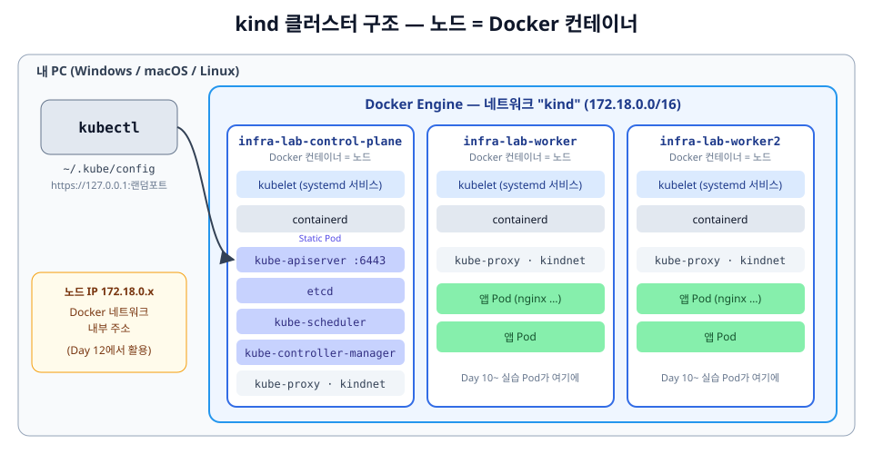
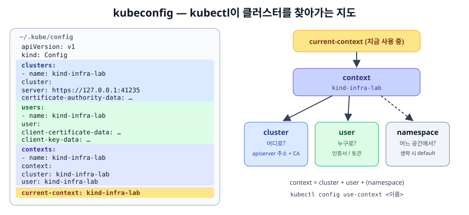
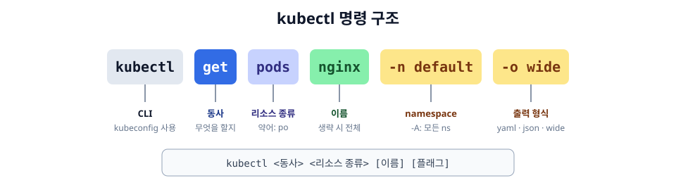

> **Chapter 2 · Kubernetes** | 난이도 ★★☆☆☆ | 예상 소요 1.5 ~ 2시간

## 🎯 오늘의 목표

- 로컬 Kubernetes 도구(kind, minikube, k3d, Docker Desktop)의 차이를 알고 고를 수 있다
- **kind**로 Control Plane 1 + Worker 2 구성의 실습 클러스터 `infra-lab`을 만든다
- **kubeconfig**와 **context**가 무엇이고, kubectl이 어떻게 클러스터를 찾아가는지 이해한다
- Day 08에서 그림으로 본 구성 요소(apiserver, etcd, kubelet…)를 **실제 클러스터에서 눈으로 확인**한다
- `kubectl`의 기본 문법과 자주 쓰는 명령(get / describe / logs / exec / apply / delete / explain)을 익힌다

---

## 1. 로컬에서 Kubernetes를 띄우는 방법들

운영용 클러스터는 서버 여러 대가 필요하지만, 학습용으로는 **내 PC 한 대**로 충분합니다.

| 도구 | 노드를 무엇으로 만드나 | 멀티노드 | 특징 |
|---|---|---|---|
| **kind** (Kubernetes IN Docker) | **Docker 컨테이너** 1개 = 노드 1개 | ✅ 설정 파일로 간단히 | 가볍고 빠름. K8s 자체 CI 테스트용으로 만들어짐. 생성/삭제 1분 내외 |
| **minikube** | Docker 컨테이너 또는 VM (Hyper-V, VirtualBox 등) | ✅ `--nodes` 옵션 | 애드온(dashboard, ingress 등)이 풍부. 입문자 친화적 |
| **k3d** | Docker 컨테이너 안의 **k3s** (경량 K8s 배포판) | ✅ | 매우 가벼움. k3s 기반이라 표준 K8s와 일부 구성이 다름 |
| **Docker Desktop** 내장 K8s | Docker Desktop 설정에서 체크 하나 | 버전에 따라 제한적 | 가장 간편하지만 내부를 들여다보거나 구성을 바꾸기 어려움 |

이 시리즈는 **kind를 기본**으로 사용합니다.

- **멀티노드**를 손쉽게 만들 수 있어 스케줄링, 노드 장애 같은 실습에 유리
- 노드가 그냥 Docker 컨테이너라서 Chapter 1에서 배운 `docker ps`, `docker exec`로 **노드 내부를 들여다볼 수 있음**
- 내부적으로 **kubeadm**으로 클러스터를 구성하므로, Day 20(kubeadm 멀티노드 구축)과 구조가 똑같음

> 💡 minikube를 쓰고 싶다면 9장의 대안 절차를 따르세요. Day 10 이후 실습은 노드 이름만 다를 뿐 kubectl 명령은 동일합니다.

---

## 2. kind는 어떻게 동작하나?



- kind는 `kindest/node` 이미지로 **Docker 컨테이너를 띄우고, 그 컨테이너를 "서버"처럼** 씁니다
- 각 노드 컨테이너 안에는 **systemd, kubelet, containerd**가 돌고 있고, Pod는 노드 컨테이너 안의 containerd가 실행합니다 → "컨테이너 안의 컨테이너"
- Control Plane 구성 요소(apiserver, etcd, scheduler, controller-manager)는 control-plane 노드 안에서 **Static Pod**로 실행됩니다
- 호스트의 `kubectl`은 Docker가 열어준 `127.0.0.1:<랜덤 포트>` → 노드 컨테이너의 `6443`(apiserver)으로 접속합니다
- Pod 네트워크는 kind 기본 CNI인 **kindnet**이 담당합니다

> ⚠️ 그래서 kind는 Docker가 반드시 실행 중이어야 합니다. Docker Desktop을 쓴다면 **Settings → Resources**에서 메모리를 **6GB 이상** 주는 것을 권장합니다 (노드 3개 + 이후 실습 앱).

---

## 3. 설치 — kubectl & kind

> **실습 환경:** Windows 10/11 + Docker Desktop(WSL2) / macOS + Docker Desktop / Ubuntu 24.04 + Docker Engine.
> 작성 기준 버전: **kind v0.30.0**, **Kubernetes v1.34** (kind 버전마다 기본 Kubernetes 버전이 정해져 있음). 더 새로운 버전이 나와 있다면 그걸 써도 실습 내용은 동일합니다.

### 3-1. kubectl

```bash
# Windows (PowerShell)
winget install -e --id Kubernetes.kubectl

# macOS
brew install kubectl

# Linux (amd64) — 최신 안정 버전 바이너리
curl -LO "https://dl.k8s.io/release/$(curl -L -s https://dl.k8s.io/release/stable.txt)/bin/linux/amd64/kubectl"
sudo install -o root -g root -m 0755 kubectl /usr/local/bin/kubectl
```

```bash
kubectl version --client
# Client Version: v1.34.x
# Kustomize Version: v5.x.x
```

> 💡 Docker Desktop에도 kubectl이 포함되어 있지만 버전이 오래됐을 수 있습니다. kubectl은 **클러스터 버전과 마이너 버전 ±1 이내**여야 공식 지원되니, 별도로 최신 버전을 설치하는 것이 좋습니다.

### 3-2. kind

```bash
# Windows (PowerShell)
winget install -e --id Kubernetes.kind

# macOS
brew install kind

# Linux (amd64)
curl -Lo ./kind https://kind.sigs.k8s.io/dl/v0.30.0/kind-linux-amd64
chmod +x ./kind
sudo mv ./kind /usr/local/bin/kind
```

```bash
kind version
# kind v0.30.0 go1.24.x linux/amd64
```

> ⚠️ Windows에서 winget으로 설치한 직후에는 PATH가 반영되지 않아 `kind: command not found`가 날 수 있습니다. **터미널을 새로 열면** 해결됩니다.

---

## 4. 첫 클러스터 — 1분 만에 띄우고 지우기

먼저 가장 단순한 단일 노드 클러스터로 감을 잡아 봅시다.

```bash
kind create cluster
```

```
Creating cluster "kind" ...
 ✓ Ensuring node image (kindest/node:v1.34.0) 🖼
 ✓ Preparing nodes 📦
 ✓ Writing configuration 📜
 ✓ Starting control-plane 🕹️
 ✓ Installing CNI 🔌
 ✓ Installing StorageClass 💾
Set kubectl context to "kind-kind"
You can now use your cluster with:

kubectl cluster-info --context kind-kind
```

```bash
kubectl get nodes
# NAME                 STATUS   ROLES           AGE   VERSION
# kind-control-plane   Ready    control-plane   40s   v1.34.0

docker ps --format 'table {{.Names}}\t{{.Image}}\t{{.Ports}}'
# NAMES                IMAGE                  PORTS
# kind-control-plane   kindest/node:v1.34.0   127.0.0.1:41235->6443/tcp
```

Kubernetes "노드"가 정말로 **Docker 컨테이너 하나**라는 게 보이죠? 확인했으면 지웁니다.

```bash
kind delete cluster
# Deleting cluster "kind" ...
```

---

## 5. 실습 클러스터 `infra-lab` 만들기 (Chapter 2 내내 사용)

이제 앞으로 계속 쓸 **3노드 클러스터**를 설정 파일로 만듭니다. 작업 폴더(예: `~/k8s-lab`)를 만들고 아래 파일을 저장하세요.

```yaml
# kind-infra-lab.yaml
kind: Cluster
apiVersion: kind.x-k8s.io/v1alpha4
name: infra-lab
nodes:
- role: control-plane
  extraPortMappings:
  - containerPort: 30080    # 노드 컨테이너의 30080 (NodePort)
    hostPort: 30080         # 내 PC의 localhost:30080
    protocol: TCP
- role: worker
- role: worker
```

| 항목 | 의미 |
|---|---|
| `name: infra-lab` | 클러스터 이름. 노드 컨테이너 이름과 context 이름(`kind-infra-lab`)에 쓰임 |
| `role: control-plane` | Control Plane 노드 1개 |
| `extraPortMappings` | 호스트 30080 → control-plane 노드 컨테이너 30080 연결 (= `docker run -p 30080:30080`) |
| `role: worker` × 2 | Worker 노드 2개 → 스케줄링 분산을 관찰할 수 있음 |

> 💡 `extraPortMappings`는 클러스터 **생성 시에만** 지정할 수 있어서 미리 열어 둡니다. Day 12(NodePort)에서 `localhost:30080`으로 서비스에 접속하고, Day 15(Ingress)에서는 같은 포트를 Traefik 진입점으로 씁니다.

```bash
kind create cluster --config kind-infra-lab.yaml
```

```
Creating cluster "infra-lab" ...
 ✓ Ensuring node image (kindest/node:v1.34.0) 🖼
 ✓ Preparing nodes 📦 📦 📦
 ✓ Writing configuration 📜
 ✓ Starting control-plane 🕹️
 ✓ Installing CNI 🔌
 ✓ Installing StorageClass 💾
 ✓ Joining worker nodes 🚜
Set kubectl context to "kind-infra-lab"
```

```bash
kind get clusters
# infra-lab

kubectl get nodes
# NAME                      STATUS   ROLES           AGE   VERSION
# infra-lab-control-plane   Ready    control-plane   75s   v1.34.0
# infra-lab-worker          Ready    <none>          55s   v1.34.0
# infra-lab-worker2         Ready    <none>          55s   v1.34.0
```

> 💡 노드가 `NotReady`로 보이면 CNI가 아직 설치 중인 것입니다. 30초쯤 기다렸다가 다시 확인하세요. `kubectl get nodes -w`로 실시간 관찰도 가능합니다 (Ctrl+C로 종료).

> ⚠️ **이 클러스터는 Day 10 이후 Chapter 2 실습의 기본 클러스터로 계속 사용합니다.** (일부 Day는 필요에 따라 별도 클러스터를 추가로 만듭니다.) 실습이 끝나도 지우지 마세요. (PC를 껐다 켜는 방법은 10장)

---

## 6. kubeconfig와 context — kubectl은 어떻게 클러스터를 찾아갈까?

`kind create cluster`가 끝날 때 "Set kubectl context to …"라는 메시지가 있었습니다. kind가 **kubeconfig 파일**에 접속 정보를 써 준 것입니다.



- 기본 위치: `~/.kube/config` (Windows: `%USERPROFILE%\.kube\config`)
- 환경 변수 `KUBECONFIG`로 다른 파일을 지정할 수 있음

| 섹션 | 담는 정보 |
|---|---|
| `clusters` | 클러스터 이름, **apiserver 주소**, CA 인증서 |
| `users` | 인증 정보 (클라이언트 인증서/키, 토큰 등) |
| `contexts` | **cluster + user + (기본 namespace)** 의 조합에 이름을 붙인 것 |
| `current-context` | 지금 kubectl이 사용할 context |

```bash
kubectl config get-contexts
# CURRENT   NAME             CLUSTER          AUTHINFO         NAMESPACE
# *         kind-infra-lab   kind-infra-lab   kind-infra-lab

kubectl config current-context
# kind-infra-lab

kubectl config view --minify      # 현재 context 정보만 (인증서는 DATA+OMITTED 로 가려짐)
kubectl cluster-info
# Kubernetes control plane is running at https://127.0.0.1:41235
# CoreDNS is running at https://127.0.0.1:41235/api/v1/namespaces/kube-system/services/kube-dns:dns/proxy
```

여러 클러스터를 다룰 때는 context를 바꿔 가며 씁니다.

```bash
kubectl config use-context kind-infra-lab                # context 전환
kubectl config set-context --current --namespace=default # 현재 context의 기본 namespace 변경
```

> ⚠️ 실무에서 가장 흔한 사고가 "**개발 클러스터인 줄 알고 운영 클러스터에 명령을 날리는 것**"입니다. 명령 전에 `kubectl config current-context`를 확인하는 습관을 들이세요.

---

## 7. 클러스터 들여다보기 — Day 08의 그림을 실물로

### 7-1. 노드 상세

```bash
kubectl get nodes -o wide
# NAME                      STATUS   ROLES           ...   INTERNAL-IP   ...   CONTAINER-RUNTIME
# infra-lab-control-plane   Ready    control-plane   ...   172.18.0.3    ...   containerd://2.x.x
# infra-lab-worker          Ready    <none>          ...   172.18.0.2    ...   containerd://2.x.x
# infra-lab-worker2         Ready    <none>          ...   172.18.0.4    ...   containerd://2.x.x
```

`CONTAINER-RUNTIME`이 **containerd**입니다. Day 08에서 말한 "kubelet → CRI → containerd"가 바로 이것입니다. (IP는 kind가 만든 Docker 네트워크 `kind`의 주소로, 환경마다 다를 수 있습니다.)

### 7-2. Control Plane 구성 요소 = kube-system의 Pod들

```bash
kubectl get pods -n kube-system -o wide
```

```
NAME                                              READY   STATUS    NODE
coredns-xxxxxxxxxx-xxxxx                          1/1     Running   infra-lab-control-plane
coredns-xxxxxxxxxx-xxxxx                          1/1     Running   infra-lab-control-plane
etcd-infra-lab-control-plane                      1/1     Running   infra-lab-control-plane
kindnet-xxxxx                                     1/1     Running   infra-lab-control-plane
kindnet-xxxxx                                     1/1     Running   infra-lab-worker
kindnet-xxxxx                                     1/1     Running   infra-lab-worker2
kube-apiserver-infra-lab-control-plane            1/1     Running   infra-lab-control-plane
kube-controller-manager-infra-lab-control-plane   1/1     Running   infra-lab-control-plane
kube-proxy-xxxxx                                  1/1     Running   infra-lab-control-plane
kube-proxy-xxxxx                                  1/1     Running   infra-lab-worker
kube-proxy-xxxxx                                  1/1     Running   infra-lab-worker2
kube-scheduler-infra-lab-control-plane            1/1     Running   infra-lab-control-plane
```

(출력은 일부 열을 생략했습니다.) Day 08 아키텍처 그림과 맞춰 보세요.

| 보이는 것 | Day 08의 구성 요소 | 어디에 몇 개? |
|---|---|---|
| `kube-apiserver-*`, `etcd-*`, `kube-scheduler-*`, `kube-controller-manager-*` | Control Plane | control-plane 노드에만 1개씩 |
| `kube-proxy-*` | Worker 구성 요소 | **모든 노드에 1개씩** |
| `kindnet-*` | CNI 애드온 | **모든 노드에 1개씩** |
| `coredns-*` | DNS 애드온 | 2개 (어느 노드든) |

> 💡 kubelet과 containerd는 목록에 없습니다. 이 둘은 Pod가 아니라 **노드의 시스템 서비스(systemd)** 로 돌기 때문입니다. Pod를 띄우는 주체가 Pod일 수는 없으니까요.

### 7-3. 노드 컨테이너 안으로 들어가 보기

노드가 Docker 컨테이너이니, Day 01에서 배운 `docker exec`로 "서버에 SSH 접속"하듯 들어갈 수 있습니다.

```bash
docker ps --format 'table {{.Names}}\t{{.Ports}}'
# NAMES                     PORTS
# infra-lab-control-plane   127.0.0.1:41235->6443/tcp
# infra-lab-worker
# infra-lab-worker2

# Control Plane 구성 요소의 정체: kubelet이 이 폴더의 YAML을 보고 직접 띄우는 Static Pod
docker exec infra-lab-control-plane ls /etc/kubernetes/manifests
# etcd.yaml
# kube-apiserver.yaml
# kube-controller-manager.yaml
# kube-scheduler.yaml

# kubelet은 systemd 서비스
docker exec infra-lab-control-plane systemctl is-active kubelet
# active

# containerd에게 직접 물어보기 (crictl = CRI 클라이언트, docker ps 와 비슷)
docker exec infra-lab-worker crictl ps
```

`crictl ps` 결과에서 worker 노드에는 `kube-proxy`, `kindnet-cni` 컨테이너가 보입니다. kubectl로 본 Pod가 실제로는 **노드 안 containerd의 컨테이너**라는 것을 확인한 셈입니다.

---

## 8. kubectl 기초

### 8-1. 명령 구조



```
kubectl  <동사>   <리소스 종류>  [이름]   [플래그]
kubectl  get      pods          nginx    -n default -o wide
```

| 자주 쓰는 동사 | 하는 일 |
|---|---|
| `get` | 목록/요약 조회 |
| `describe` | 상세 정보 + **Events** (문제 원인 찾을 때 1순위) |
| `apply -f` | YAML로 리소스 생성/수정 (선언형) |
| `create` / `run` | 명령형으로 바로 생성 |
| `delete` | 삭제 |
| `logs` | 컨테이너 로그 |
| `exec` | 컨테이너 안에서 명령 실행 |
| `port-forward` | 내 PC 포트 → Pod 포트 임시 연결 |
| `explain` | 리소스 필드 설명서 |

리소스 종류는 약어도 됩니다: `pods`=`po`, `services`=`svc`, `deployments`=`deploy`, `nodes`=`no`, `namespaces`=`ns`.

```bash
kubectl api-resources          # 전체 리소스 종류, 약어(SHORTNAMES), API 그룹 확인
```

### 8-2. Pod 하나 띄워서 기본 명령 익히기

Day 01의 `docker run -d --name web nginx`에 해당하는 명령입니다.

```bash
kubectl run nginx --image=nginx:1.27
# pod/nginx created

kubectl get pods
# NAME    READY   STATUS              RESTARTS   AGE
# nginx   0/1     ContainerCreating   0          3s

kubectl get pods -o wide
# NAME    READY   STATUS    RESTARTS   AGE   IP           NODE
# nginx   1/1     Running   0          20s   10.244.1.2   infra-lab-worker
```

`NODE` 열을 보세요. 우리가 노드를 지정하지 않았는데 **스케줄러가 worker 중 하나를 골라** 배치했습니다. (kind 멀티노드에서 control-plane 노드는 일반 Pod가 배치되지 않도록 taint가 걸려 있습니다 — taint는 이후에 다룹니다.)

| Docker 명령 | kubectl 명령 |
|---|---|
| `docker ps` | `kubectl get pods` |
| `docker inspect web` | `kubectl describe pod nginx` / `kubectl get pod nginx -o yaml` |
| `docker logs -f web` | `kubectl logs -f nginx` |
| `docker exec -it web bash` | `kubectl exec -it nginx -- bash` |
| `docker run -p 8080:80` | `kubectl port-forward pod/nginx 8080:80` (임시 연결) |
| `docker rm -f web` | `kubectl delete pod nginx` |

하나씩 해 봅시다.

```bash
kubectl describe pod nginx          # 맨 아래 Events: Scheduled → Pulling → Pulled → Created → Started
kubectl logs nginx                  # nginx 시작 로그
kubectl exec -it nginx -- bash      # 컨테이너 셸 (나올 때 exit)
kubectl exec nginx -- nginx -v      # 대화형이 아니면 -it 없이
# nginx version: nginx/1.27.x
```

> 💡 `--` 뒤부터가 컨테이너 안에서 실행할 명령입니다. `--`가 없으면 kubectl이 `-v` 같은 옵션을 자기 옵션으로 해석해 버립니다.

`describe`의 **Events**는 Day 08의 흐름 그대로입니다.

```
Events:
  Type    Reason     Age   From               Message
  ----    ------     ----  ----               -------
  Normal  Scheduled  60s   default-scheduler  Successfully assigned default/nginx to infra-lab-worker
  Normal  Pulling    59s   kubelet            Pulling image "nginx:1.27"
  Normal  Pulled     50s   kubelet            Successfully pulled image "nginx:1.27" in 9.1s ...
  Normal  Created    50s   kubelet            Created container: nginx
  Normal  Started    50s   kubelet            Started container nginx
```

`From` 열에서 **scheduler가 배치(⑤) → kubelet이 이미지 pull·실행(⑥⑦)** 한 것이 보입니다.

이제 브라우저로 접속해 봅시다. 새 터미널에서:

```bash
kubectl port-forward pod/nginx 8080:80
# Forwarding from 127.0.0.1:8080 -> 80
```

http://localhost:8080 에서 nginx 환영 페이지가 보이면 성공입니다. (Ctrl+C로 종료) `port-forward`는 디버깅용 임시 터널이고, 정식 노출 방법은 Day 12의 **Service**입니다.

### 8-3. 출력 형식

```bash
kubectl get pod nginx -o yaml                          # 전체 정의 + 상태 (status 포함)
kubectl get pod nginx -o json
kubectl get pod nginx -o jsonpath='{.status.podIP}'    # 원하는 필드만 (PowerShell은 바깥 따옴표를 " 로)
kubectl get pods -A                                    # 모든 namespace
kubectl get pods --show-labels                         # 라벨까지
kubectl get pods -w                                    # 변화 실시간 관찰 (watch)
```

### 8-4. 명령형 → 선언형으로 넘어가는 다리: `--dry-run`

YAML을 처음부터 외워 쓸 필요는 없습니다. kubectl에게 **뼈대를 만들어 달라고** 하면 됩니다.

```bash
kubectl run web --image=nginx:1.27 --dry-run=client -o yaml > web-pod.yaml
cat web-pod.yaml
```

```yaml
apiVersion: v1
kind: Pod
metadata:
  labels:
    run: web
  name: web
spec:
  containers:
  - image: nginx:1.27
    name: web
    resources: {}
  dnsPolicy: ClusterFirst
  restartPolicy: Always
status: {}
```

`--dry-run=client`는 서버에 보내지 않고 YAML만 출력합니다. 이 파일을 다듬어서 `apply`하는 것이 실무 패턴입니다.

```bash
kubectl apply -f web-pod.yaml
# pod/web created
kubectl apply -f web-pod.yaml       # 변경 없이 다시 apply
# pod/web unchanged
kubectl delete -f web-pod.yaml
```

필드 의미가 궁금하면 `explain`이 설명서입니다.

```bash
kubectl explain pod.spec.containers
kubectl explain pod.spec.containers.image
kubectl explain deployment.spec --recursive | head -40   # 하위 필드 트리
```

### 8-5. 맛보기: 자가 치유

Day 08의 조정 루프를 실물로 확인해 봅시다. (Deployment는 Day 11에서 자세히)

```bash
kubectl create deployment hello --image=nginx:1.27 --replicas=3
kubectl get pods -l app=hello -o wide
# 3개 Pod가 worker 두 대에 나뉘어 배치됨

kubectl delete pod -l app=hello --wait=false   # 3개 전부 삭제!
kubectl get pods -l app=hello
# 이전 Pod는 Terminating, 새 이름의 Pod 3개가 곧바로 ContainerCreating → Running
```

반면 8-2에서 `kubectl run`으로 만든 `nginx` Pod를 지우면? 아무도 다시 만들어 주지 않습니다. **Pod 단독으로는 자가 치유가 없다**는 것, Day 10~11의 핵심 복선입니다.

### 8-6. 정리 & 편의 설정

```bash
kubectl delete deployment hello
kubectl delete pod nginx
kubectl get all          # default namespace에 service/kubernetes 만 남으면 깨끗한 상태
```

자주 쓰니 별칭과 자동 완성을 설정해 두면 편합니다.

```bash
# bash (~/.bashrc 에 추가)
source <(kubectl completion bash)
alias k=kubectl
complete -o default -F __start_kubectl k
```

```powershell
# PowerShell ($PROFILE 에 추가)
kubectl completion powershell | Out-String | Invoke-Expression
Set-Alias -Name k -Value kubectl
```

---

## 9. 대안: minikube로 같은 실습하기

kind 대신 minikube를 쓰고 싶다면 다음과 같이 대응됩니다.

```bash
# 설치: Windows  winget install -e --id Kubernetes.minikube
#       macOS    brew install minikube
minikube start --driver=docker --nodes 3 -p infra-lab
kubectl get nodes
# NAME            STATUS   ROLES           AGE   VERSION
# infra-lab       Ready    control-plane   1m    v1.3x.x
# infra-lab-m02   Ready    <none>          40s   v1.3x.x
# infra-lab-m03   Ready    <none>          20s   v1.3x.x
```

| 작업 | kind | minikube |
|---|---|---|
| 생성 | `kind create cluster --config ...` | `minikube start -p infra-lab --nodes 3` |
| 노드 접속 | `docker exec -it infra-lab-worker bash` | `minikube ssh -p infra-lab -n infra-lab-m02` |
| 일시 중지 / 재개 | `docker stop/start <노드 컨테이너>` | `minikube stop -p infra-lab` / `minikube start -p infra-lab` |
| 삭제 | `kind delete cluster --name infra-lab` | `minikube delete -p infra-lab` |
| 로컬 이미지 넣기 | `kind load docker-image myapp:1.0 --name infra-lab` | `minikube image load myapp:1.0 -p infra-lab` |
| NodePort 접속 | 노드 IP(Docker 네트워크) 또는 `kubectl port-forward` (Day 12) | `minikube service <svc> -p infra-lab` |

> 💡 minikube에서는 control-plane 노드에도 일반 Pod가 배치될 수 있어서, 이후 Day의 `NODE` 열 결과가 조금 다르게 보일 수 있습니다. 개념은 같습니다.

---

## 10. 클러스터 관리 — 껐다 켜기 & 삭제

kind에는 `stop` 명령이 없습니다. 노드가 Docker 컨테이너이므로 Docker 명령으로 다룹니다.

```bash
# 잠시 멈추기 (CPU/메모리 반환)
docker stop infra-lab-control-plane infra-lab-worker infra-lab-worker2

# 다시 켜기 → 1분쯤 뒤 kubectl get nodes 가 Ready
docker start infra-lab-control-plane infra-lab-worker infra-lab-worker2
```

> 💡 Docker Desktop이나 PC를 재시작한 뒤 `kubectl`이 `connection refused`를 낸다면, `docker ps -a`로 노드 컨테이너가 꺼져 있는지 확인하고 위 `docker start`를 실행하세요.

완전히 지울 때(이 시리즈에서는 Day 20 이후):

```bash
kind delete cluster --name infra-lab
```

---

## 11. 트러블슈팅

| 증상 | 원인 | 해결 |
|---|---|---|
| `kind create cluster` 시 `Cannot connect to the Docker daemon` | Docker가 실행 중이 아님 | Docker Desktop 실행 / `sudo systemctl start docker` |
| `ERROR: failed to create cluster: node(s) already exist for a cluster with the name "infra-lab"` | 같은 이름의 클러스터가 이미 있음 | 기존 것 사용, 또는 `kind delete cluster --name infra-lab` 후 재생성 |
| `The connection to the server 127.0.0.1:xxxxx was refused` | 노드 컨테이너가 꺼져 있음 (PC/Docker 재시작 후) | `docker start infra-lab-control-plane infra-lab-worker infra-lab-worker2` |
| `kubectl get nodes`가 다른 클러스터를 보여 줌 | current-context가 다른 클러스터 | `kubectl config use-context kind-infra-lab` |
| 노드가 계속 `NotReady` | CNI 설치 중이거나 Docker 메모리 부족 | 잠시 대기, `kubectl describe node <이름>`의 Conditions 확인, Docker Desktop 메모리 증설 |
| `kubectl exec nginx -v` 가 이상하게 동작 | `--` 구분자를 빠뜨림 | `kubectl exec nginx -- nginx -v` |
| PowerShell에서 jsonpath 출력이 이상함 | 따옴표 처리 차이 | `-o jsonpath="{.status.podIP}"` 처럼 큰따옴표 사용 |

---

## 12. 핵심 정리

- kind는 **Docker 컨테이너 1개 = K8s 노드 1개**로 클러스터를 만든다 (노드 안에 kubelet + containerd)
- 실습 클러스터 `infra-lab` = control-plane 1 + worker 2, **Chapter 2 내내 재사용**
- kubectl은 **kubeconfig**(`~/.kube/config`)의 **current-context**로 접속할 클러스터를 정한다
- Control Plane 구성 요소는 `kube-system`의 **Static Pod**, kubelet·containerd는 노드의 **systemd 서비스**
- kubectl 기본형: `kubectl <동사> <리소스> [이름] [플래그]`
- 문제가 생기면 **`kubectl describe`의 Events**부터 본다
- YAML 뼈대는 `--dry-run=client -o yaml`로 만들고, 필드 의미는 `kubectl explain`으로 찾는다

---

## 13. 셀프 체크

<details>
<summary>Q1. kind 클러스터의 "노드"는 실제로 무엇인가? Pod는 어디서 실행되나?</summary>

노드는 `kindest/node` 이미지로 띄운 **Docker 컨테이너**입니다. Pod의 컨테이너는 그 노드 컨테이너 안에서 돌고 있는 **containerd**가 실행합니다 (컨테이너 안의 컨테이너).
</details>

<details>
<summary>Q2. <code>kubectl get pods -n kube-system</code>에 kubelet이 보이지 않는 이유는?</summary>

kubelet은 Pod가 아니라 각 노드에서 **systemd 서비스**로 실행되는 에이전트이기 때문입니다. 오히려 kubelet이 Static Pod로 apiserver, etcd 등을 띄웁니다.
</details>

<details>
<summary>Q3. kubeconfig의 context는 무엇의 조합인가?</summary>

**cluster(어디로) + user(누구로) + namespace(기본 작업 공간)** 의 조합에 이름을 붙인 것입니다. `current-context`가 지금 kubectl이 사용할 조합입니다.
</details>

<details>
<summary>Q4. <code>kubectl run</code>으로 만든 Pod와 <code>kubectl create deployment</code>로 만든 Pod를 각각 삭제하면 어떻게 되나?</summary>

`run`으로 만든 단독 Pod는 **그냥 사라집니다.** Deployment가 만든 Pod는 ReplicaSet 컨트롤러가 원하는 개수와 비교해 **새 Pod를 다시 만듭니다.**
</details>

<details>
<summary>Q5. YAML을 직접 쓰지 않고 Pod 매니페스트의 뼈대를 얻는 방법은?</summary>

`kubectl run web --image=nginx --dry-run=client -o yaml > web-pod.yaml`. 서버에 보내지 않고 YAML만 출력합니다. Deployment는 `kubectl create deployment ... --dry-run=client -o yaml`.
</details>

---

## ⏭️ 다음 예고 — Day 10. Pod — 가장 작은 배포 단위

오늘 `kubectl run`으로 가볍게 띄워 본 **Pod**를 YAML로 제대로 정의해 봅니다. 왜 컨테이너가 아니라 Pod가 단위인지, 한 Pod 안의 여러 컨테이너가 네트워크와 볼륨을 어떻게 공유하는지, 그리고 Pod의 생명주기·재시작 정책·헬스 체크(Probe)까지 `infra-lab` 클러스터에서 직접 확인합니다.
