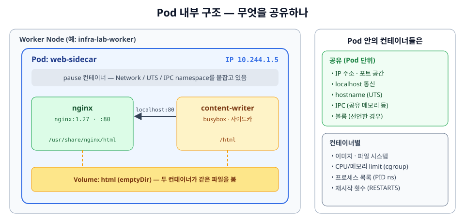
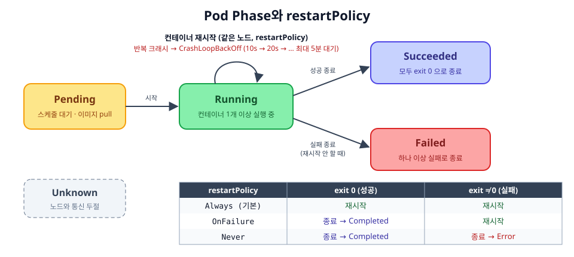
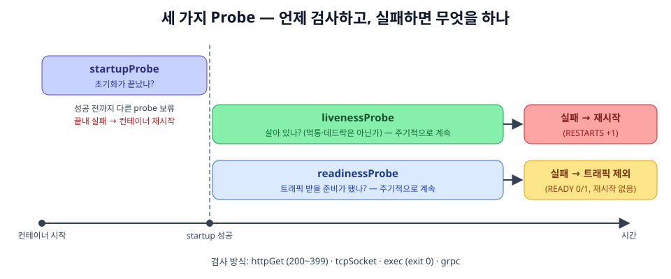

> **Chapter 2 · Kubernetes** | 난이도 ★★☆☆☆ | 예상 소요 2시간

## 🎯 오늘의 목표

- Kubernetes가 컨테이너가 아니라 **Pod**를 배포 단위로 삼는 이유를 설명할 수 있다
- Pod 매니페스트(`apiVersion` / `kind` / `metadata` / `spec`)를 직접 작성하고 다룰 수 있다
- **멀티 컨테이너 Pod**(사이드카, Init 컨테이너)가 네트워크와 볼륨을 어떻게 공유하는지 확인한다
- Pod의 **생명주기(Phase)**, **재시작 정책**, `CrashLoopBackOff`의 의미를 이해한다
- **Liveness / Readiness / Startup Probe**의 차이를 실습으로 확인한다

> **실습 환경:** Day 09에서 만든 kind 클러스터 `infra-lab` (control-plane 1 + worker 2). 시작 전에 `kubectl config current-context`가 `kind-infra-lab`인지 확인하세요. 실습 YAML은 작업 폴더(예: `~/k8s-lab/day10/`)에 저장합니다.

---

## 1. 왜 컨테이너가 아니라 Pod인가?

Chapter 1에서는 "컨테이너 하나 = 프로세스 하나"가 원칙이었습니다. 그런데 현실의 애플리케이션은 종종 **꼭 붙어 다녀야 하는 보조 프로세스**가 있습니다.

- 웹 서버 + 그 로그를 수집해서 보내는 로그 에이전트
- 앱 + 앱 앞에서 TLS·인증을 처리하는 프록시
- 앱 + 설정 파일을 주기적으로 받아오는 동기화 도구

이들은 **같은 서버에 있어야 하고, `localhost`로 통신하고, 파일을 공유**해야 합니다. 그렇다고 한 컨테이너에 다 넣으면 이미지가 비대해지고 "하나의 프로세스" 원칙이 깨지죠.

Kubernetes의 해답이 **Pod** — *함께 배치되고, 네트워크와 저장소를 공유하는 컨테이너들의 묶음*입니다.



| Pod 안의 컨테이너끼리 공유하는 것 | 결과 |
|---|---|
| **Network namespace** | Pod에 **IP가 하나**. 컨테이너끼리 `localhost:포트`로 통신. 포트는 서로 겹치면 안 됨 |
| **UTS namespace** | 같은 hostname (= Pod 이름) |
| **IPC namespace** | 공유 메모리, 세마포어 등 사용 가능 |
| **Volume** (선언한 경우) | 같은 볼륨을 각자 원하는 경로에 마운트해 파일 공유 |
| **스케줄링** | 항상 **같은 노드**에 함께 배치되고, 함께 생성·삭제됨 |

파일 시스템(이미지)과 cgroup 리소스 제한은 **컨테이너별**입니다.

> 💡 **pause 컨테이너:** Pod가 만들어지면 가장 먼저 아주 작은 `pause` 컨테이너가 떠서 network namespace를 "붙잡고" 있습니다. 앱 컨테이너들은 그 namespace에 합류합니다. 앱 컨테이너가 재시작돼도 Pod IP가 유지되는 이유입니다. Docker의 `docker run --network container:<이름>` 옵션(다른 컨테이너의 네트워크에 합류)과 같은 원리이고, namespace 자체는 Day 07에서 다뤘습니다.

### Pod는 "일회용"이다

- Pod에는 **고유 IP**가 있지만, Pod가 삭제되고 새로 만들어지면 **IP도 바뀝니다**
- Pod가 떠 있는 노드가 죽으면 Pod도 함께 사라지고, **Pod 스스로는 다른 노드로 옮겨가지 않습니다**
- 그래서 실무에서는 Pod를 직접 만들기보다 **Deployment(Day 11)** 같은 상위 리소스가 Pod를 만들고 관리하게 합니다

> 그래도 Pod를 먼저 제대로 알아야 합니다. Deployment, StatefulSet, Job… 모두 결국 **Pod 템플릿**을 품고 있기 때문입니다.

---

## 2. Pod 매니페스트 해부

```yaml
# web-pod.yaml
apiVersion: v1                # 이 리소스가 속한 API 그룹/버전 (Pod는 core 그룹 v1)
kind: Pod                     # 리소스 종류
metadata:                     # 식별 정보
  name: web
  labels:                     # 검색·선택용 key=value (Service, Deployment가 이걸로 Pod를 찾음)
    app: web
    tier: frontend
  annotations:                # 사람/도구를 위한 메모 (선택에는 쓰이지 않음)
    description: "Day 10 첫 Pod"
spec:                         # 원하는 상태(Desired State)
  containers:
  - name: nginx
    image: nginx:1.27
    ports:
    - containerPort: 80       # 문서화 목적 (실제 포트 개방과는 무관)
    resources:
      requests:               # 스케줄러가 노드를 고를 때 "최소 이만큼은 필요"
        cpu: 100m             # 0.1 vCPU
        memory: 64Mi
      limits:                 # 넘으면 제한 (CPU는 throttle, 메모리는 OOMKilled)
        cpu: 200m
        memory: 128Mi
```

모든 Kubernetes 리소스는 이 4개 최상위 필드 구조를 따릅니다. 그리고 `kubectl get -o yaml`로 보면 Kubernetes가 채워 넣은 **`status`** 가 하나 더 붙어 있습니다.

| 필드 | 누가 작성? | 내용 |
|---|---|---|
| `apiVersion`, `kind` | 사용자 | 무슨 리소스인지 |
| `metadata` | 사용자 (+ 시스템이 uid, creationTimestamp 등 추가) | 이름, namespace, labels, annotations |
| `spec` | 사용자 | **원하는 상태** |
| `status` | **Kubernetes** (kubelet 등) | **현재 상태** — phase, Pod IP, 컨테이너 상태 |

Day 08의 조정 루프는 결국 **`spec`과 `status`의 차이를 없애는 과정**입니다.

> 💡 `resources`의 requests/limits는 Day 07의 **cgroup**으로 구현됩니다. 오늘은 맛보기만 하고, QoS 클래스와 리소스 관리는 **Day 18**에서 깊게 다룹니다.

---

## 3. 실습 ① — 첫 Pod를 YAML로

```bash
kubectl apply -f web-pod.yaml
# pod/web created

kubectl get pods -o wide
# NAME   READY   STATUS    RESTARTS   AGE   IP           NODE
# web    1/1     Running   0          8s    10.244.2.3   infra-lab-worker2
```

| 열 | 의미 |
|---|---|
| `READY 1/1` | 준비된 컨테이너 수 / 전체 컨테이너 수 |
| `STATUS` | 사람이 보기 좋게 요약한 상태 (Phase 또는 이유) |
| `RESTARTS` | 컨테이너 재시작 횟수 — 0이 아니면 뭔가 있다는 신호 |
| `IP` | Pod IP (kind 기본 대역 `10.244.0.0/16`) |

라벨로 조회해 봅시다. Day 11의 ReplicaSet과 Day 12의 Service가 바로 이 방식으로 Pod를 찾습니다.

```bash
kubectl get pods --show-labels
kubectl get pods -l app=web                 # app=web 인 것만
kubectl get pods -l 'tier in (frontend)'    # 집합 기반 셀렉터
kubectl label pod web env=dev               # 라벨 추가
kubectl get pods -L app,env                 # 라벨을 열로 표시
```

상세 정보와 Kubernetes가 채운 `status`를 확인합니다.

```bash
kubectl describe pod web
kubectl get pod web -o jsonpath='{.status.phase}{"\n"}{.status.podIP}{"\n"}'
# Running
# 10.244.2.3
```

그리고 `spec.containers[].image`처럼 **변경 불가능한 필드**가 대부분이라는 점도 알아두세요.

```bash
kubectl set image pod/web nginx=nginx:1.28    # 이미지는 예외적으로 변경 가능
kubectl get pod web                           # RESTARTS 1 — 컨테이너만 재시작, Pod IP는 그대로
```

> ⚠️ `ports`, `resources`(대부분), `volumes` 등 다른 필드를 바꿔 `apply`하면 `Forbidden: pod updates may not change fields other than ...` 에러가 납니다. Pod는 "고치는" 게 아니라 **지우고 새로 만드는** 대상입니다. 이 불편함을 Deployment가 해결합니다.

```bash
kubectl delete -f web-pod.yaml
```

---

## 4. 멀티 컨테이너 Pod

### 4-1. 대표 패턴

| 패턴 | 역할 | 예 |
|---|---|---|
| **Sidecar** | 메인 컨테이너를 보조하며 **함께 계속 실행** | 로그 수집기(Fluent Bit), 서비스 메시 프록시(Envoy) |
| **Init Container** | 메인 컨테이너 **시작 전에** 순서대로 실행되고 끝나야 함 | DB 준비 대기, 설정 파일 생성, 마이그레이션 |
| **Adapter** | 메인 컨테이너의 출력을 표준 형식으로 변환 | 앱 메트릭 → Prometheus 형식 |
| **Ambassador** | 외부 통신을 대리하는 프록시 | 로컬 프록시가 DB 클러스터로 라우팅 |

### 4-2. 실습 ② — 사이드카: 볼륨과 localhost 공유

`content-writer` 사이드카가 5초마다 HTML을 만들고, `nginx`가 그 파일을 서비스합니다.

```yaml
# sidecar-pod.yaml
apiVersion: v1
kind: Pod
metadata:
  name: web-sidecar
spec:
  volumes:
  - name: html
    emptyDir: {}                      # Pod와 생명을 같이하는 임시 볼륨
  containers:
  - name: nginx
    image: nginx:1.27
    volumeMounts:
    - name: html
      mountPath: /usr/share/nginx/html
  - name: content-writer
    image: busybox:1.36
    command: ["sh", "-c"]
    args:
    - |
      while true; do
        echo "<h1>$(date) from $(hostname)</h1>" > /html/index.html
        sleep 5
      done
    volumeMounts:
    - name: html
      mountPath: /html                # 같은 볼륨을 다른 경로로 마운트
```

```bash
kubectl apply -f sidecar-pod.yaml
kubectl get pod web-sidecar
# NAME          READY   STATUS    RESTARTS   AGE
# web-sidecar   2/2     Running   0          10s     ← 컨테이너 2개
```

사이드카 컨테이너에서 **`localhost`로 nginx에 요청**해 봅니다.

```bash
kubectl exec web-sidecar -c content-writer -- wget -qO- http://localhost
# <h1>Sat Nov 15 10:00:05 UTC 2026 from web-sidecar</h1>
```

- 다른 컨테이너인데 `localhost`로 접근됨 → **network namespace 공유**
- hostname이 Pod 이름 → **UTS namespace 공유**
- 사이드카가 쓴 파일을 nginx가 서비스 → **볼륨 공유**

컨테이너가 여러 개면 `-c`로 대상을 지정합니다.

```bash
kubectl logs web-sidecar -c nginx
kubectl exec -it web-sidecar -c nginx -- ls /usr/share/nginx/html
```

### 4-3. pause 컨테이너 직접 보기

Pod가 떠 있는 노드 컨테이너로 들어가 containerd에게 물어봅시다.

```bash
NODE=$(kubectl get pod web-sidecar -o jsonpath='{.spec.nodeName}')
docker exec $NODE crictl pods --name web-sidecar
# POD ID          CREATED         STATE   NAME          NAMESPACE   ...
# 3f2a...         2 minutes ago   Ready   web-sidecar   default     ...

docker exec $NODE crictl images | grep pause
# registry.k8s.io/pause   3.10   ...
```

`crictl pods`에 보이는 **Pod Sandbox**가 바로 pause 컨테이너가 붙잡고 있는 namespace 묶음이고, `crictl ps`에 보이는 nginx·content-writer가 그 안에 합류한 앱 컨테이너입니다.

```bash
kubectl delete -f sidecar-pod.yaml
```

### 4-4. 실습 ③ — Init 컨테이너

```yaml
# init-pod.yaml
apiVersion: v1
kind: Pod
metadata:
  name: web-init
spec:
  volumes:
  - name: html
    emptyDir: {}
  initContainers:                     # containers 보다 먼저, 순서대로, 끝까지 실행
  - name: prepare
    image: busybox:1.36
    command: ["sh", "-c", "echo '<h1>prepared by init container</h1>' > /work/index.html; sleep 10"]
    volumeMounts:
    - name: html
      mountPath: /work
  containers:
  - name: nginx
    image: nginx:1.27
    volumeMounts:
    - name: html
      mountPath: /usr/share/nginx/html
```

```bash
kubectl apply -f init-pod.yaml
kubectl get pod web-init -w
# NAME       READY   STATUS            RESTARTS   AGE
# web-init   0/1     Init:0/1          0          2s
# web-init   0/1     PodInitializing   0          13s
# web-init   1/1     Running           0          14s
# (Ctrl+C)

kubectl exec web-init -c nginx -- cat /usr/share/nginx/html/index.html
# <h1>prepared by init container</h1>
```

Init 컨테이너가 10초 동안 끝나지 않자 nginx는 **시작조차 하지 않고 기다렸습니다.** Init 컨테이너가 실패하면 (restartPolicy에 따라) 재시도하며, 성공할 때까지 메인 컨테이너는 뜨지 않습니다.

```bash
kubectl delete -f init-pod.yaml
```

> 💡 **네이티브 사이드카 (v1.33 GA):** `initContainers` 항목에 `restartPolicy: Always`를 주면 "먼저 시작되고, 메인 컨테이너가 도는 동안 계속 함께 실행되는" 사이드카가 됩니다. 메인보다 먼저 떠야 하는 로그 수집기·프록시에 적합하고, Job처럼 메인이 끝나면 함께 정리됩니다.
>
> ```yaml
> initContainers:
> - name: log-shipper
>   image: busybox:1.36
>   restartPolicy: Always       # ← 이 한 줄이 네이티브 사이드카로 만든다
>   command: ["sh", "-c", "while true; do date; sleep 10; done"]
> ```

---

## 5. Pod 생명주기와 재시작 정책



### 5-1. Pod Phase

| Phase | 의미 |
|---|---|
| `Pending` | 생성은 접수됐지만 아직 실행 전 — 스케줄 대기, 이미지 다운로드 중 등 |
| `Running` | 노드에 배정되고 컨테이너가 하나 이상 실행 중 |
| `Succeeded` | 모든 컨테이너가 **성공(exit 0)으로 종료**, 재시작 안 함 |
| `Failed` | 모든 컨테이너가 종료됐고, 하나 이상이 **실패로 종료** |
| `Unknown` | 노드와 통신이 끊겨 상태를 알 수 없음 |

`kubectl get pods`의 `STATUS`는 Phase를 그대로 보여주기도 하지만, 더 구체적인 **이유(Reason)** 를 보여줄 때가 많습니다: `ContainerCreating`, `ImagePullBackOff`, `CrashLoopBackOff`, `Completed`, `Error`, `OOMKilled` 등.

컨테이너 단위로는 **Waiting / Running / Terminated** 세 상태가 있고, `kubectl describe pod`의 `State:` / `Last State:`에서 볼 수 있습니다.

### 5-2. restartPolicy

Pod 단위로 지정하며, 컨테이너가 종료됐을 때 **같은 노드에서** 다시 띄울지를 정합니다. (다른 노드로 옮기는 건 상위 컨트롤러의 일)

| restartPolicy | exit 0 (성공) | exit ≠ 0 (실패) | 주 사용처 |
|---|---|---|---|
| `Always` (기본값) | 재시작 | 재시작 | 웹 서버 등 계속 떠 있어야 하는 서비스 (Deployment) |
| `OnFailure` | 종료 → `Completed` | 재시작 | 배치 작업 (Job) |
| `Never` | 종료 → `Completed` | 종료 → `Error` | 한 번만 시도하는 작업, 디버깅 |

재시작은 **지수 백오프**로 간격이 늘어납니다 (10초 → 20초 → 40초 … 최대 5분). 이렇게 "재시작 대기 중"인 상태가 바로 악명 높은 **`CrashLoopBackOff`** 입니다. 에러 이름이 아니라 "계속 죽어서 재시작을 미루는 중"이라는 **상태**입니다.

### 5-3. 실습 ④ — 재시작 정책 비교

```yaml
# restart-policy.yaml
apiVersion: v1
kind: Pod
metadata:
  name: restart-always
spec:
  restartPolicy: Always
  containers:
  - name: app
    image: busybox:1.36
    command: ["sh", "-c", "echo 'starting...'; sleep 3; echo 'boom!'; exit 1"]
---
apiVersion: v1
kind: Pod
metadata:
  name: restart-never
spec:
  restartPolicy: Never
  containers:
  - name: app
    image: busybox:1.36
    command: ["sh", "-c", "echo 'starting...'; sleep 3; echo 'boom!'; exit 1"]
---
apiVersion: v1
kind: Pod
metadata:
  name: restart-onfailure-ok
spec:
  restartPolicy: OnFailure
  containers:
  - name: app
    image: busybox:1.36
    command: ["sh", "-c", "echo 'job done'; exit 0"]
```

```bash
kubectl apply -f restart-policy.yaml
kubectl get pods -w        # 1분 정도 관찰 후 Ctrl+C
```

```
NAME                   READY   STATUS             RESTARTS      AGE
restart-always         0/1     CrashLoopBackOff   3 (25s ago)   70s
restart-never          0/1     Error              0             70s
restart-onfailure-ok   0/1     Completed          0             70s
```

죽은 컨테이너의 로그는 `--previous`로 봅니다. 재시작 후에는 현재 컨테이너 로그만 보이기 때문입니다.

```bash
kubectl logs restart-always --previous
# starting...
# boom!

kubectl describe pod restart-always | grep -A 6 "Last State"
#     Last State:     Terminated
#       Reason:       Error
#       Exit Code:    1
#       ...
```

```bash
kubectl delete -f restart-policy.yaml
```

---

## 6. Probe — 컨테이너가 "정말" 건강한가?

프로세스가 살아 있다고 해서 앱이 정상인 것은 아닙니다. 데드락에 빠졌거나, 아직 초기화 중이거나, DB 연결이 끊겼을 수 있죠. kubelet은 **Probe**로 주기적으로 상태를 검사합니다.



| Probe | 질문 | 실패하면 |
|---|---|---|
| **startupProbe** | 시작(초기화)이 끝났나? | 성공할 때까지 나머지 probe를 **보류**. 끝내 실패하면 컨테이너 재시작 |
| **livenessProbe** | 살아 있나? (응답 불능 상태는 아닌가) | 컨테이너 **재시작** |
| **readinessProbe** | 트래픽 받을 준비가 됐나? | 재시작하지 않고 **Service 엔드포인트에서 제외** (READY 0/1) |

검사 방법은 4가지입니다: `httpGet`(200~399면 성공), `tcpSocket`(포트 연결되면 성공), `exec`(명령 exit 0이면 성공), `grpc`.

| 주요 파라미터 | 기본값 | 의미 |
|---|---|---|
| `initialDelaySeconds` | 0 | 컨테이너 시작 후 첫 검사까지 대기 |
| `periodSeconds` | 10 | 검사 주기 |
| `timeoutSeconds` | 1 | 응답 대기 시간 |
| `failureThreshold` | 3 | 연속 몇 번 실패하면 "실패"로 판정 |
| `successThreshold` | 1 | 실패 후 연속 몇 번 성공해야 "성공" (liveness/startup은 1 고정) |

### 6-1. 실습 ⑤ — livenessProbe: 응답 없으면 재시작

30초 동안만 건강하다가(`/tmp/healthy` 존재) 이후 "고장"나는 컨테이너입니다.

```yaml
# liveness-pod.yaml
apiVersion: v1
kind: Pod
metadata:
  name: liveness-exec
spec:
  containers:
  - name: app
    image: busybox:1.36
    args:
    - /bin/sh
    - -c
    - touch /tmp/healthy; sleep 30; rm -f /tmp/healthy; sleep 600
    livenessProbe:
      exec:
        command: ["cat", "/tmp/healthy"]
      initialDelaySeconds: 5
      periodSeconds: 5
```

```bash
kubectl apply -f liveness-pod.yaml
kubectl get pod liveness-exec -w
# NAME            READY   STATUS    RESTARTS     AGE
# liveness-exec   1/1     Running   0            10s
# liveness-exec   1/1     Running   1 (1s ago)   47s    ← 30초 + 실패 3회(5초 간격) 후 재시작
```

```bash
kubectl describe pod liveness-exec | tail -8
#   Warning  Unhealthy  ...  kubelet  Liveness probe failed: cat: can't open '/tmp/healthy': No such file or directory
#   Normal   Killing    ...  kubelet  Container app failed liveness probe, will be restarted
```

프로세스(`sleep 600`)는 멀쩡히 살아 있었지만, kubelet이 "건강하지 않다"고 판단해 재시작했습니다. Docker의 `--restart`는 **프로세스가 죽어야만** 동작했던 것과 비교해 보세요.

```bash
kubectl delete -f liveness-pod.yaml
```

### 6-2. 실습 ⑥ — readinessProbe: 재시작 없이 트래픽에서만 제외

```yaml
# readiness-pod.yaml
apiVersion: v1
kind: Pod
metadata:
  name: readiness-http
spec:
  containers:
  - name: nginx
    image: nginx:1.27
    readinessProbe:
      httpGet:
        path: /ready.html             # 처음엔 없는 파일 → 404 → 실패
        port: 80
      periodSeconds: 3
```

```bash
kubectl apply -f readiness-pod.yaml
kubectl get pod readiness-http
# NAME             READY   STATUS    RESTARTS   AGE
# readiness-http   0/1     Running   0          15s     ← Running 이지만 Ready 아님

# 준비 완료 신호를 만들어 줌
kubectl exec readiness-http -- sh -c 'echo ok > /usr/share/nginx/html/ready.html'
kubectl get pod readiness-http
# readiness-http   1/1     Running   0          30s

# 다시 "준비 안 됨"으로
kubectl exec readiness-http -- rm /usr/share/nginx/html/ready.html
kubectl get pod readiness-http
# readiness-http   0/1     Running   0          45s     ← RESTARTS 는 여전히 0
```

`READY`만 바뀌고 **재시작은 일어나지 않습니다.** Day 12에서 Service를 만들면, READY가 아닌 Pod로는 트래픽이 가지 않는 것을 직접 보게 됩니다. 그리고 Day 11의 롤링 업데이트도 "새 Pod가 Ready가 되어야 다음 단계로" 진행됩니다.

```bash
kubectl delete -f readiness-pod.yaml
```

> ⚠️ **liveness를 함부로 강하게 걸지 마세요.** DB가 잠깐 느려졌다고 liveness가 실패하면 모든 Pod가 동시에 재시작되어 장애가 커집니다. 외부 의존성 확인은 readiness에, liveness는 "프로세스 자체가 먹통인가"만 가볍게 검사하는 것이 원칙입니다. 시작이 느린 앱(JVM 등)은 startupProbe로 초기화 시간을 따로 보장해 주세요.

---

## 7. (선택) 실습 ⑦ — 메모리 limit 초과 = OOMKilled

Day 07에서 본 cgroup 메모리 제한이 Kubernetes에서 어떻게 보이는지 확인합니다.

```yaml
# oom-pod.yaml
apiVersion: v1
kind: Pod
metadata:
  name: memory-hog
spec:
  containers:
  - name: stress
    image: polinux/stress
    resources:
      requests:
        memory: 50Mi
      limits:
        memory: 100Mi                 # 100Mi 제한인데
    command: ["stress"]
    args: ["--vm", "1", "--vm-bytes", "250M", "--vm-hang", "1"]   # 250M 사용 시도
```

```bash
kubectl apply -f oom-pod.yaml
kubectl get pod memory-hog -w
# memory-hog   0/1   OOMKilled          0   5s
# memory-hog   0/1   CrashLoopBackOff   1   8s

kubectl describe pod memory-hog | grep -A 3 "Last State"
#     Last State:     Terminated
#       Reason:       OOMKilled
#       Exit Code:    137           ← 128 + 9(SIGKILL)

kubectl delete -f oom-pod.yaml
```

---

## 8. 트러블슈팅

| 증상 (STATUS) | 원인 | 해결 |
|---|---|---|
| `ErrImagePull` / `ImagePullBackOff` | 이미지 이름·태그 오타, private 레지스트리 인증 없음 | `kubectl describe pod`의 Events 확인 → 이미지 이름 수정, 필요 시 imagePullSecrets |
| `Pending`이 계속됨 | 리소스 부족(`Insufficient cpu/memory`) 또는 조건 맞는 노드 없음 | Events의 `FailedScheduling` 메시지 확인, `requests` 줄이기 |
| `CrashLoopBackOff` | 컨테이너가 시작 직후 계속 종료됨 (설정 오류, 명령 오류, liveness 실패) | `kubectl logs <pod> --previous`로 **죽기 직전 로그** 확인, `describe`의 Last State·Exit Code 확인 |
| `OOMKilled` (Exit Code 137) | 메모리 `limits` 초과 | limit 상향 또는 앱 메모리 사용량 조정 |
| `Running`인데 `READY 0/1` | readinessProbe 실패 | probe 경로·포트 확인, `describe`의 `Readiness probe failed` 메시지 확인 |
| `kubectl apply` 시 `Forbidden: pod updates may not change fields ...` | Pod spec의 대부분은 생성 후 변경 불가 | `kubectl delete -f` 후 다시 `apply` (또는 `kubectl replace --force -f`) |
| `kubectl logs`에 `a container name must be specified` | 멀티 컨테이너 Pod | `-c <컨테이너 이름>` 지정 |
| Init 컨테이너에서 멈춤 (`Init:0/1`, `Init:CrashLoopBackOff`) | Init 컨테이너가 끝나지 않거나 실패 | `kubectl logs <pod> -c <init 컨테이너 이름>` |

---

## 9. 핵심 정리

- **Pod** = 같은 노드에 함께 배치되고 **네트워크(IP)·볼륨을 공유**하는 컨테이너 묶음, K8s의 최소 배포 단위
- Pod 내부 컨테이너끼리는 `localhost`로 통신. 네트워크 namespace는 **pause 컨테이너**가 유지
- 모든 리소스는 `apiVersion / kind / metadata / spec` 구조, Kubernetes가 `status`를 채운다
- **labels**는 선택(selector)용, **annotations**는 메모용
- 멀티 컨테이너 패턴: **Sidecar**(함께 실행), **Init**(먼저 실행 후 종료), 네이티브 사이드카(`initContainers` + `restartPolicy: Always`)
- restartPolicy: `Always`(기본) / `OnFailure` / `Never` — **같은 노드에서의** 재시작만 담당
- `CrashLoopBackOff` = 반복 크래시로 재시작을 **지연 중**인 상태 → `logs --previous`부터
- Probe: **startup**(초기화 완료?) → **liveness**(실패 시 재시작) / **readiness**(실패 시 트래픽 제외)
- Pod는 일회용 — 자가 치유·스케일링·업데이트는 **Deployment**의 몫

---

## 10. 셀프 체크

<details>
<summary>Q1. 같은 Pod의 두 컨테이너가 각각 80번 포트를 열려고 하면 어떻게 되나?</summary>

같은 network namespace를 공유하므로 **포트 충돌**이 납니다. 나중에 뜬 컨테이너는 바인딩에 실패합니다. Pod 안의 컨테이너들은 서로 다른 포트를 써야 합니다.
</details>

<details>
<summary>Q2. 앱 컨테이너가 재시작돼도 Pod IP가 바뀌지 않는 이유는?</summary>

Pod의 network namespace를 **pause 컨테이너**가 유지하고 있고, 앱 컨테이너는 거기에 합류할 뿐이기 때문입니다. Pod 자체가 삭제·재생성될 때 IP가 바뀝니다.
</details>

<details>
<summary>Q3. livenessProbe와 readinessProbe가 실패했을 때 각각 어떤 일이 일어나나?</summary>

**liveness** 실패 → kubelet이 컨테이너를 **재시작**합니다 (RESTARTS 증가). **readiness** 실패 → 재시작 없이 `READY`가 false가 되어 **Service의 트래픽 대상에서 제외**됩니다.
</details>

<details>
<summary>Q4. <code>CrashLoopBackOff</code> 상태의 Pod에서 원인을 찾으려면 무엇부터 보나?</summary>

`kubectl logs <pod> --previous`로 **직전에 죽은 컨테이너의 로그**를 보고, `kubectl describe pod <pod>`에서 `Last State`의 Reason / Exit Code와 Events를 확인합니다. (Exit Code 137이면 OOMKilled 또는 SIGKILL 가능성)
</details>

<details>
<summary>Q5. restartPolicy가 <code>Always</code>인 단독 Pod가 떠 있던 노드가 죽으면 Pod는 다른 노드에서 다시 뜨나?</summary>

**아닙니다.** restartPolicy는 같은 노드의 kubelet이 컨테이너를 재시작하는 규칙일 뿐입니다. 다른 노드에 새 Pod를 만드는 것은 ReplicaSet/Deployment 같은 **컨트롤러**의 역할입니다.
</details>

---

## ⏭️ 다음 예고 — Day 11. ReplicaSet & Deployment — 롤링 업데이트와 롤백

Pod는 일회용이고, 스스로 복구되지도, 수정되지도 않았습니다. 이 한계를 해결하는 **ReplicaSet**(개수 유지)과 **Deployment**(버전 관리)를 다룹니다. Pod를 지워도 되살아나는 자가 치유, 무중단 **롤링 업데이트**, 문제가 생겼을 때의 **롤백**까지 `infra-lab`에서 직접 해 봅니다.
