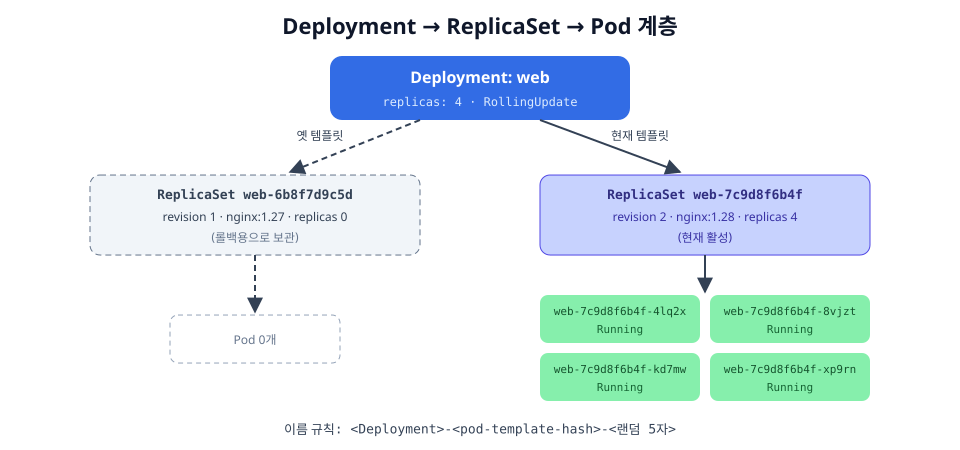
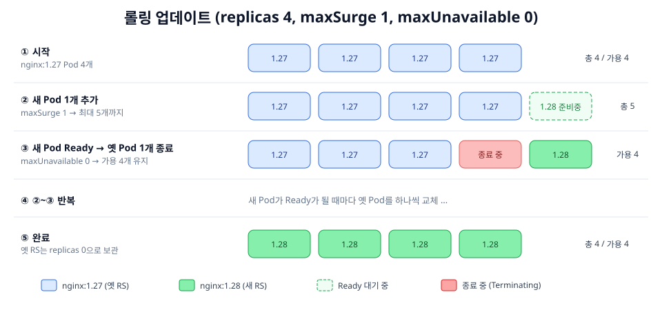
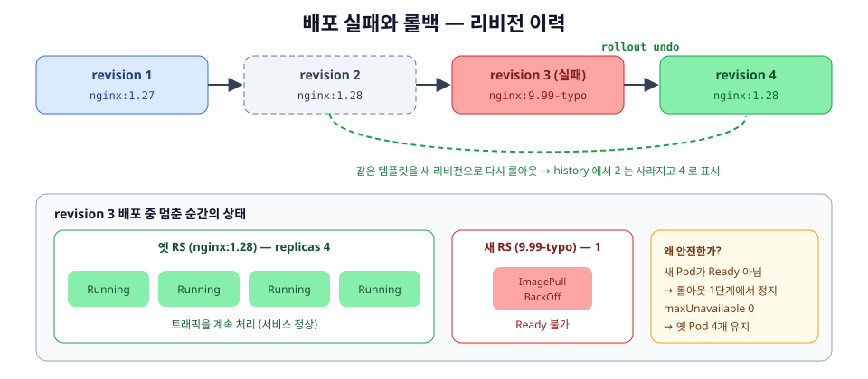

> **Chapter 2 · Kubernetes** | 난이도 ★★★☆☆ | 예상 소요 2시간

## 🎯 오늘의 목표

- **ReplicaSet**이 label selector로 Pod 개수를 유지하는 원리를 이해한다
- ReplicaSet만으로는 부족한 이유와 **Deployment → ReplicaSet → Pod** 계층 구조를 설명할 수 있다
- **롤링 업데이트**의 `maxSurge` / `maxUnavailable`이 배포 과정을 어떻게 바꾸는지 관찰한다
- 실패한 배포를 감지하고 **롤백**(`rollout undo`)할 수 있다
- 스케일링, 재시작, 노드 drain 시 Pod가 어떻게 다시 배치되는지 확인한다

> **실습 환경:** Day 09의 kind 클러스터 `infra-lab` (control-plane 1 + worker 2). `kubectl config current-context` → `kind-infra-lab` 확인. 실습 YAML은 `~/k8s-lab/day11/`에 저장합니다.

---

## 1. Pod만으로는 왜 부족한가?

Day 10에서 확인한 Pod의 한계를 다시 정리해 봅시다.

| Pod 단독의 한계 | 필요한 것 | 해결하는 리소스 |
|---|---|---|
| 지우거나 노드가 죽으면 **그대로 사라짐** | 개수를 항상 유지하는 감시자 | **ReplicaSet** |
| 여러 개 띄우려면 YAML을 복사해 이름만 바꿔야 함 | "템플릿 + 개수"로 찍어내기 | **ReplicaSet** |
| spec 대부분이 **수정 불가** — 지우고 다시 만들어야 함 | 새 버전으로 **점진 교체**, 이력 관리 | **Deployment** |
| 잘못 배포하면 이전 상태로 돌아갈 방법이 없음 | **롤백** | **Deployment** |



- **ReplicaSet**: "이 라벨을 가진 Pod가 **N개** 있어야 한다"를 유지하는 컨트롤러
- **Deployment**: ReplicaSet을 **버전별로 만들고 갈아끼우는** 상위 컨트롤러
- 실무에서는 ReplicaSet을 직접 만들지 않고 **항상 Deployment를 사용**합니다. 그래도 내부 동작을 알아야 롤링 업데이트와 롤백이 이해되므로 ReplicaSet부터 봅니다.

---

## 2. ReplicaSet — 개수를 지키는 컨트롤러

### 2-1. 구조: selector + replicas + template

```yaml
# web-rs.yaml
apiVersion: apps/v1
kind: ReplicaSet
metadata:
  name: web-rs
spec:
  replicas: 3                 # 원하는 개수
  selector:                   # "어떤 Pod를 내 것으로 셀까?"
    matchLabels:
      app: web-rs
  template:                   # 부족할 때 찍어낼 Pod 틀 (= Day 10의 Pod spec)
    metadata:
      labels:
        app: web-rs           # ⚠️ selector와 반드시 일치해야 함
    spec:
      containers:
      - name: nginx
        image: nginx:1.27
```

`template` 아래는 Day 10에서 쓴 Pod의 `metadata` + `spec` 그대로입니다. ReplicaSet은 **selector에 맞는 Pod의 수**를 세어 `replicas`와 비교합니다(Day 08의 조정 루프).

> ⚠️ `template.metadata.labels`가 `selector`와 맞지 않으면 `apply` 시점에 `selector does not match template labels` 에러로 거부됩니다. 만들자마자 자기가 만든 Pod를 못 세는 ReplicaSet이 되어 무한히 Pod를 찍어내는 사고를 막기 위해서입니다.

### 2-2. 실습 ① — 자가 치유와 스케일링

```bash
kubectl apply -f web-rs.yaml
kubectl get rs
# NAME     DESIRED   CURRENT   READY   AGE
# web-rs   3         3         3       15s

kubectl get pods -l app=web-rs -o wide
# NAME           READY   STATUS    ...   NODE
# web-rs-7xk2p   1/1     Running   ...   infra-lab-worker
# web-rs-b9mqz   1/1     Running   ...   infra-lab-worker2
# web-rs-tr4wd   1/1     Running   ...   infra-lab-worker
```

Pod 이름이 `<ReplicaSet 이름>-<랜덤 5자>`입니다. 하나를 지워 봅시다.

```bash
kubectl delete pod web-rs-7xk2p        # 이름은 본인 출력에 맞게
kubectl get pods -l app=web-rs
# 지운 Pod 대신 새 이름의 Pod가 곧바로 생성됨 → 다시 3개
```

개수 변경은 `scale` 또는 YAML의 `replicas`를 바꿔 `apply`합니다.

```bash
kubectl scale rs web-rs --replicas=5
kubectl get rs web-rs
# NAME     DESIRED   CURRENT   READY   AGE
# web-rs   5         5         5       2m

kubectl scale rs web-rs --replicas=3   # 줄이면 초과분이 삭제됨
```

### 2-3. 실습 ② — ReplicaSet은 "라벨"만 본다

Pod 하나의 라벨을 바꿔서 selector에서 빠지게 해 봅시다.

```bash
POD=$(kubectl get pods -l app=web-rs -o jsonpath='{.items[0].metadata.name}')
kubectl label pod $POD app=debug --overwrite

kubectl get pods -L app
# NAME           READY   STATUS    RESTARTS   AGE   APP
# web-rs-b9mqz   1/1     Running   0          3m    debug     ← 라벨이 바뀐 Pod (이제 고아)
# web-rs-tr4wd   1/1     Running   0          3m    web-rs
# web-rs-q8vln   1/1     Running   0          2m    web-rs
# web-rs-zz5kc   1/1     Running   0          5s    web-rs    ← 3개를 맞추려고 새로 생성
```

ReplicaSet 입장에서 `app=web-rs`인 Pod가 2개로 줄었으니 하나를 새로 만든 것입니다. 라벨을 바꾼 Pod는 ReplicaSet의 관리에서 벗어나(**ownerReferences** 제거) 그대로 남습니다. 장애 Pod를 서비스에서 빼고 **살려 둔 채 디버깅**할 때 실제로 쓰는 기법입니다.

```bash
kubectl get pod $POD -o jsonpath='{.metadata.ownerReferences}'   # 비어 있음 (고아)
kubectl get pods -l app=web-rs -o jsonpath='{.items[0].metadata.ownerReferences[0].name}'
# web-rs                                                          # 나머지는 web-rs 소유
```

### 2-4. 실습 ③ — ReplicaSet은 "업데이트"를 못 한다

템플릿의 이미지를 1.28로 바꿔 보면?

```bash
kubectl set image rs/web-rs nginx=nginx:1.28

kubectl get pods -l app=web-rs \
  -o jsonpath='{range .items[*]}{.metadata.name}{"\t"}{.spec.containers[0].image}{"\n"}{end}'
# web-rs-tr4wd   nginx:1.27
# web-rs-q8vln   nginx:1.27
# web-rs-zz5kc   nginx:1.27      ← 아무것도 안 바뀜!
```

ReplicaSet은 **개수만** 봅니다. 3개가 있으니 할 일이 없죠. 템플릿 변경은 **앞으로 새로 만들 Pod**에만 적용됩니다. 기존 Pod를 지워야 1.28로 바뀌는데, 이걸 손으로 하나씩 하는 건 위험하고 번거롭습니다. 이 일을 자동화하는 것이 **Deployment**입니다.

```bash
kubectl delete rs web-rs          # ReplicaSet과 소유 Pod 삭제
kubectl delete pod $POD           # 고아가 된 debug Pod는 따로 삭제
```

---

## 3. Deployment — 버전을 관리하는 컨트롤러

Deployment는 Pod 템플릿이 바뀔 때마다 **새 ReplicaSet**을 만들고, 새 RS는 늘리고 옛 RS는 줄이면서 교체합니다. 옛 RS는 `replicas: 0`으로 **남겨 두기 때문에** 롤백이 가능합니다.

```yaml
# web-deploy.yaml
apiVersion: apps/v1
kind: Deployment
metadata:
  name: web
  labels:
    app: web
spec:
  replicas: 4
  revisionHistoryLimit: 10        # 보관할 옛 ReplicaSet 수 (기본 10)
  minReadySeconds: 5              # Ready 후 5초 더 지나야 "사용 가능"으로 인정 (관찰용으로 느리게)
  strategy:
    type: RollingUpdate           # 기본값. 또는 Recreate
    rollingUpdate:
      maxSurge: 1                 # replicas보다 최대 1개 더 띄울 수 있음
      maxUnavailable: 0           # 사용 불가 Pod를 0개로 유지 → 용량이 줄지 않음
  selector:
    matchLabels:
      app: web
  template:
    metadata:
      labels:
        app: web
    spec:
      containers:
      - name: nginx
        image: nginx:1.27
        ports:
        - containerPort: 80
        readinessProbe:           # Day 10: Ready가 돼야 롤링 업데이트가 다음 단계로 진행
          httpGet:
            path: /
            port: 80
          periodSeconds: 2
        resources:
          requests:
            cpu: 50m
            memory: 32Mi
```

> 💡 이 YAML은 Day 08에서 미리 보여준 Deployment에 업데이트 전략과 probe를 더한 것입니다. `kubectl create deployment web --image=nginx:1.27 --replicas=4 --dry-run=client -o yaml`로 뼈대를 만든 뒤 다듬어도 됩니다.

### 3-1. 실습 ④ — 배포하고 계층 구조 확인

```bash
kubectl apply -f web-deploy.yaml
kubectl rollout status deployment/web
# Waiting for deployment "web" rollout to finish: 0 of 4 updated replicas are available...
# ...
# deployment "web" successfully rolled out

kubectl annotate deployment/web kubernetes.io/change-cause="nginx 1.27 최초 배포"
```

```bash
kubectl get deploy,rs,pods -l app=web
```

```
NAME                  READY   UP-TO-DATE   AVAILABLE   AGE
deployment.apps/web   4/4     4            4           40s

NAME                             DESIRED   CURRENT   READY   AGE
replicaset.apps/web-6b8f7d9c5d   4         4         4       40s

NAME                       READY   STATUS    RESTARTS   AGE
pod/web-6b8f7d9c5d-4lq2x   1/1     Running   0          40s
pod/web-6b8f7d9c5d-8vjzt   1/1     Running   0          40s
pod/web-6b8f7d9c5d-kd7mw   1/1     Running   0          40s
pod/web-6b8f7d9c5d-xp9rn   1/1     Running   0          40s
```

이름 규칙을 보세요: `web`(Deployment) → `web-6b8f7d9c5d`(ReplicaSet) → `web-6b8f7d9c5d-4lq2x`(Pod). 가운데 해시는 **pod-template-hash**로, Pod 템플릿 내용으로 계산됩니다. 템플릿이 바뀌면 해시가 바뀌고 → 새 ReplicaSet이 생깁니다.

```bash
kubectl get pods -l app=web --show-labels
# ... app=web,pod-template-hash=6b8f7d9c5d
```

| `kubectl get deploy` 열 | 의미 |
|---|---|
| `READY` | Ready인 Pod / 원하는 Pod 수 |
| `UP-TO-DATE` | **최신 템플릿**으로 만들어진 Pod 수 |
| `AVAILABLE` | Ready 상태로 `minReadySeconds` 이상 유지된 Pod 수 |

---

## 4. 롤링 업데이트



### 4-1. 실습 ⑤ — 1.27 → 1.28 업데이트 관찰

**터미널 A**에서 ReplicaSet 변화를 지켜봅니다.

```bash
kubectl get rs -l app=web -w
```

**터미널 B**에서 이미지를 바꿉니다.

```bash
kubectl set image deployment/web nginx=nginx:1.28
kubectl annotate deployment/web kubernetes.io/change-cause="nginx 1.28 로 업데이트"
kubectl rollout status deployment/web
```

터미널 A에는 대략 이런 흐름이 찍힙니다 (중간 줄 일부 생략).

```
NAME             DESIRED   CURRENT   READY   AGE
web-6b8f7d9c5d   4         4         4       3m      ← 옛 RS (1.27)
web-7c9d8f6b4f   1         1         0       0s      ← 새 RS (1.28) 1개 추가 (maxSurge 1)
web-7c9d8f6b4f   1         1         1       3s      ← 새 Pod Ready (+ minReadySeconds 5초 대기)
web-6b8f7d9c5d   3         4         4       3m      ← 그제서야 옛 Pod 1개 종료
web-7c9d8f6b4f   2         1         1       8s      ← 새 Pod 1개 더
...
web-7c9d8f6b4f   4         4         4       30s
web-6b8f7d9c5d   0         0         0       4m      ← 옛 RS는 0개로 "보관"
```

`maxSurge: 1, maxUnavailable: 0` 이므로 **새 Pod 1개가 준비돼야 옛 Pod 1개를 내리는** 과정이 반복됩니다. 전체 Pod 수는 4~5개 사이를 오가고, **사용 가능한 Pod는 항상 4개 이상**입니다 → 무중단.

```bash
kubectl get rs -l app=web
# NAME             DESIRED   CURRENT   READY   AGE
# web-6b8f7d9c5d   0         0         0       5m     ← 롤백용으로 남아 있음
# web-7c9d8f6b4f   4         4         4       2m

kubectl describe deployment web | tail -10     # Events: Scaled up ... / Scaled down ... 가 번갈아 기록
```

### 4-2. maxSurge / maxUnavailable

| 설정 (replicas: 4 기준) | 동작 | 특징 |
|---|---|---|
| `maxSurge: 25%`, `maxUnavailable: 25%` (**기본값**) | 최대 5개까지 늘고, 최소 3개는 사용 가능 | 속도와 안정성의 절충 |
| `maxSurge: 1`, `maxUnavailable: 0` | 하나 띄우고 → 하나 내리고 | 용량 감소 없음, 대신 여유 리소스가 1개분 필요 |
| `maxSurge: 0`, `maxUnavailable: 1` | 하나 내리고 → 하나 띄우고 | 추가 리소스 불필요, 대신 일시적으로 3개로 감소 |
| `maxSurge: 100%`, `maxUnavailable: 0` | 새 버전 4개를 한꺼번에 띄운 뒤 옛 것 제거 | 가장 빠르지만 순간 리소스 2배 |

> 💡 퍼센트 값은 `maxSurge`는 **올림**, `maxUnavailable`은 **내림**으로 계산합니다. replicas 4의 25%는 1이 되고, replicas 3의 25%(0.75)는 maxSurge 1 / maxUnavailable 0이 됩니다. 둘 다 0일 수는 없습니다.

### 4-3. RollingUpdate vs Recreate

| 전략 | 동작 | 언제 쓰나 |
|---|---|---|
| `RollingUpdate` (기본) | 새 버전과 옛 버전이 **잠시 공존**하며 점진 교체 | 대부분의 무상태(stateless) 웹/API 서비스 |
| `Recreate` | 옛 Pod를 **전부 내린 뒤** 새 Pod를 띄움 → 순간 중단 | 두 버전이 동시에 돌면 안 되는 경우 (DB 스키마 비호환, 단일 쓰기 볼륨 등) |

```yaml
strategy:
  type: Recreate          # rollingUpdate 블록은 함께 쓰면 안 됨
```

### 4-4. 선언형으로 업데이트하기 (권장)

`kubectl set image`는 빠르지만 YAML 파일과 클러스터 상태가 어긋나게 됩니다. 실무에서는 **YAML을 고치고 apply**하는 방식이 기본입니다(파일을 Git으로 관리 → GitOps의 출발점).

```bash
# web-deploy.yaml 의 image 를 nginx:1.28 로 수정한 뒤
kubectl diff -f web-deploy.yaml      # 클러스터와 무엇이 다른지 미리 보기 (지금은 이미 1.28이라 차이 없음)
kubectl apply -f web-deploy.yaml
```

> ⚠️ `set image`로 1.28을 올린 상태에서 **YAML에는 1.27이 남아 있는데** `apply`하면, 의도치 않게 1.27로 되돌아가는 롤링 업데이트가 일어납니다. 명령형과 선언형을 섞을 때 가장 흔한 실수입니다. 이 실습을 계속하기 전에 YAML의 이미지를 `nginx:1.28`로 맞춰 두세요.

---

## 5. 롤백



### 5-1. 실습 ⑥ — 잘못된 배포 만들기

존재하지 않는 태그로 업데이트해 봅시다. (실수로 오타를 낸 상황)

```bash
kubectl set image deployment/web nginx=nginx:9.99-typo
kubectl annotate deployment/web kubernetes.io/change-cause="nginx 9.99-typo (실수)"
kubectl rollout status deployment/web
# Waiting for deployment "web" rollout to finish: 1 out of 4 new replicas have been updated...
# (계속 대기 — Ctrl+C로 빠져나옴)
```

```bash
kubectl get pods -l app=web
# NAME                   READY   STATUS             RESTARTS   AGE
# web-5f6c7b8d9a-2xkqp   0/1     ImagePullBackOff   0          40s   ← 새 버전 1개: 이미지 없음
# web-7c9d8f6b4f-9rtzn   1/1     Running            0          6m    ← 옛 버전 4개는 그대로!
# web-7c9d8f6b4f-dl4m8   1/1     Running            0          6m
# web-7c9d8f6b4f-hq2vb   1/1     Running            0          6m
# web-7c9d8f6b4f-wz7ps   1/1     Running            0          6m
```

새 Pod가 Ready가 되지 못하니 롤링 업데이트가 **첫 단계에서 멈췄고**, `maxUnavailable: 0` 덕분에 기존 1.28 Pod 4개는 **계속 서비스 중**입니다. readinessProbe와 롤링 업데이트가 함께 만드는 안전장치입니다.

> 💡 Deployment는 `progressDeadlineSeconds`(기본 600초) 동안 진전이 없으면 상태를 `Progressing=False, Reason=ProgressDeadlineExceeded`로 표시하고, `kubectl rollout status`도 에러로 종료됩니다. CI/CD 파이프라인은 이 신호로 배포 실패를 감지합니다. **자동 롤백은 하지 않습니다.**

### 5-2. 실습 ⑦ — 이력 확인과 롤백

```bash
kubectl rollout history deployment/web
# deployment.apps/web
# REVISION  CHANGE-CAUSE
# 1         nginx 1.27 최초 배포
# 2         nginx 1.28 로 업데이트
# 3         nginx 9.99-typo (실수)

kubectl rollout history deployment/web --revision=2    # 특정 리비전의 Pod 템플릿 상세
```

직전 리비전으로 되돌립니다.

```bash
kubectl rollout undo deployment/web
# deployment.apps/web rolled back

kubectl rollout status deployment/web
# deployment "web" successfully rolled out

kubectl get pods -l app=web       # ImagePullBackOff Pod는 사라지고 1.28 Pod 4개
kubectl rollout history deployment/web
# REVISION  CHANGE-CAUSE
# 1         nginx 1.27 최초 배포
# 3         nginx 9.99-typo (실수)
# 4         nginx 1.28 로 업데이트       ← 리비전 2가 4번으로 "재사용"됨
```

롤백은 "과거로 돌아가는 것"이 아니라 **옛 템플릿으로 새 롤아웃을 하는 것**입니다. 그래서 리비전 2가 사라지고 4가 생깁니다. 특정 리비전을 지정할 수도 있습니다.

```bash
kubectl rollout undo deployment/web --to-revision=1    # 1.27 로
kubectl rollout status deployment/web
kubectl get deploy web -o jsonpath='{.spec.template.spec.containers[0].image}{"\n"}'
# nginx:1.27
```

> ⚠️ 롤백 후에는 **YAML 파일도 같은 이미지로 맞춰 두세요.** 그렇지 않으면 다음 `apply` 때 다시 문제의 버전이 배포될 수 있습니다. 운영에서는 롤백도 Git에 커밋하는 것이 원칙입니다.

---

## 6. 그 밖의 운영 명령

### 6-1. 스케일링

```bash
kubectl scale deployment/web --replicas=6
kubectl get rs -l app=web        # 현재 RS의 DESIRED만 6으로 바뀜 — 새 리비전은 생기지 않음
kubectl scale deployment/web --replicas=4
```

`replicas`는 Pod 템플릿의 일부가 아니므로 롤아웃(새 RS)을 일으키지 않습니다. 자동 스케일링(HPA)은 Day 18에서 다룹니다.

### 6-2. 재시작 / 일시 중지

```bash
# 이미지 변경 없이 Pod 전부를 롤링 방식으로 교체 (설정 재적용, 메모리 누수 임시 대응 등)
kubectl rollout restart deployment/web

# 여러 변경을 모아서 한 번의 롤아웃으로
kubectl rollout pause deployment/web
kubectl set image deployment/web nginx=nginx:1.28
kubectl set resources deployment/web -c nginx --limits=cpu=200m,memory=128Mi
kubectl rollout resume deployment/web        # 이 시점에 한 번만 롤아웃
kubectl rollout status deployment/web
```

`rollout restart`는 Pod 템플릿에 `kubectl.kubernetes.io/restartedAt` 어노테이션을 넣어 해시를 바꾸는 방식이라, 이것도 새 리비전으로 기록됩니다.

### 6-3. 실습 ⑧ — 노드를 비우면? (drain)

Day 08의 그림처럼 "노드가 사라지면 다른 노드에서 다시 생성"되는지 확인합니다. 노드 점검 상황을 `drain`으로 흉내 냅니다.

```bash
kubectl get pods -l app=web -o wide          # worker / worker2 에 나뉘어 있음

kubectl drain infra-lab-worker2 --ignore-daemonsets
# node/infra-lab-worker2 cordoned
# evicting pod default/web-...
# node/infra-lab-worker2 drained

kubectl get pods -l app=web -o wide          # 4개 모두 infra-lab-worker 로 이동(재생성)
kubectl get nodes
# infra-lab-worker2   Ready,SchedulingDisabled   ...
```

- `drain` = **cordon**(새 Pod 배치 금지) + 기존 Pod **eviction**
- `--ignore-daemonsets`: 노드마다 하나씩 도는 kube-proxy·kindnet(DaemonSet)은 옮길 수 없으니 건너뜀
- 쫓겨난 Pod는 ReplicaSet이 개수를 맞추려고 **다른 노드에 새로 생성**

점검이 끝났다고 가정하고 노드를 되돌립니다.

```bash
kubectl uncordon infra-lab-worker2
kubectl get pods -l app=web -o wide          # 그래도 Pod는 worker 에 그대로 몰려 있음
```

> 💡 uncordon해도 **이미 떠 있는 Pod는 자동으로 재배치되지 않습니다.** 스케줄러는 "새로 만들어지는 Pod"의 위치만 정하기 때문입니다. 다시 분산하려면 `kubectl rollout restart deployment/web`.

> ⚠️ 실제 노드 장애(`docker stop infra-lab-worker2`로 흉내 가능)에서는 노드가 `NotReady`가 된 뒤 기본 **약 5분**이 지나야 Pod가 다른 노드로 옮겨집니다. 일시적인 네트워크 단절에 과민 반응하지 않기 위한 기본값입니다. 직접 해 봤다면 `docker start infra-lab-worker2`로 꼭 복구하세요.

### 6-4. 정리

```bash
kubectl delete -f web-deploy.yaml      # Deployment → ReplicaSet → Pod 순으로 연쇄 삭제
kubectl get all
```

---

## 7. 트러블슈팅

| 증상 | 원인 | 해결 |
|---|---|---|
| `apply` 시 `selector does not match template labels` | `spec.selector`와 `template.metadata.labels` 불일치 | 두 라벨을 똑같이 맞춤 |
| `apply` 시 `field is immutable` (selector 관련) | Deployment의 `selector`는 생성 후 변경 불가 | Deployment 삭제 후 재생성 (selector는 처음에 신중하게) |
| `rollout status`가 끝나지 않음 | 새 Pod가 Ready가 되지 못함 (이미지 오류, probe 실패, 리소스 부족) | `kubectl get pods`로 새 Pod 상태 확인 → `describe`/`logs`로 원인 파악 → 수정 또는 `rollout undo` |
| `Pending`인 새 Pod 때문에 롤아웃 정지 | `maxSurge`로 늘어날 여유 리소스가 노드에 없음 | requests 축소, `maxSurge: 0, maxUnavailable: 1`로 전략 변경, 노드 추가 |
| `CHANGE-CAUSE`가 `<none>` | change-cause 어노테이션을 안 남김 (`--record`는 폐기됨) | 변경 후 `kubectl annotate deployment/<이름> kubernetes.io/change-cause="..."` |
| `apply`했더니 예전 이미지로 돌아감 | `set image`/`undo`로 바꾼 뒤 YAML은 그대로 둠 | YAML을 클러스터 상태와 맞추고, 변경은 YAML 중심으로 |
| ReplicaSet을 지웠는데 Pod가 하나 남음 | 라벨 변경 등으로 고아가 된 Pod | `kubectl get pods --show-labels`로 찾아 수동 삭제 |
| `drain`이 `cannot delete Pods not managed by ReplicationController, ReplicaSet, Job, DaemonSet or StatefulSet` 에러 | 컨트롤러 없는 단독 Pod가 있음 (지우면 다시 안 생김) | 해당 Pod를 정리하거나, 의도한 경우 `--force` 추가 |
| `drain`이 `cannot delete Pods with local storage` 에러 | emptyDir 볼륨을 쓰는 Pod가 있음 (eviction 시 데이터 삭제됨) | 데이터가 사라져도 되면 `--delete-emptydir-data` 추가 |

---

## 8. 핵심 정리

- **ReplicaSet** = selector(라벨)에 맞는 Pod 수를 `replicas`로 유지. 라벨이 바뀐 Pod는 관리에서 빠진다
- ReplicaSet은 템플릿이 바뀌어도 **기존 Pod를 교체하지 않는다** → 업데이트는 Deployment의 몫
- **Deployment → ReplicaSet(리비전별) → Pod**. 템플릿 해시(`pod-template-hash`)가 바뀌면 새 RS 생성
- **RollingUpdate**: `maxSurge`(초과 허용) / `maxUnavailable`(부족 허용)으로 속도·안정성 조절. 기본 25%/25%
- 새 Pod가 **Ready**가 되어야 다음 단계로 → readinessProbe가 안전한 배포의 핵심
- 실패 배포는 멈출 뿐 자동 롤백은 없다 → `kubectl rollout undo [--to-revision=N]`
- 롤백 = 옛 템플릿으로 하는 **새 롤아웃** (리비전 번호가 새로 붙음)
- `scale`은 리비전을 만들지 않고, `rollout restart`는 만든다
- 변경은 **YAML + apply** 중심으로, 명령형 변경 후에는 YAML도 맞춰 둔다

---

## 9. 셀프 체크

<details>
<summary>Q1. ReplicaSet의 이미지를 바꿨는데 기존 Pod가 그대로인 이유는?</summary>

ReplicaSet은 selector에 맞는 Pod의 **개수만** 비교합니다. 개수가 맞으니 할 일이 없고, 바뀐 템플릿은 이후 새로 생성되는 Pod에만 적용됩니다. 기존 Pod를 교체하는 것은 Deployment의 역할입니다.
</details>

<details>
<summary>Q2. replicas 4, <code>maxSurge: 1</code>, <code>maxUnavailable: 0</code>일 때 롤링 업데이트 중 Pod 수의 범위는?</summary>

전체 Pod는 **4~5개**, 사용 가능한 Pod는 **항상 4개 이상**입니다. 새 Pod 1개가 Ready가 된 뒤에야 옛 Pod 1개가 종료되는 과정을 반복합니다.
</details>

<details>
<summary>Q3. 존재하지 않는 이미지로 업데이트했는데 서비스가 계속 정상인 이유는?</summary>

새 Pod가 이미지를 받지 못해 Ready가 되지 않으므로 롤링 업데이트가 첫 단계에서 멈추고, `maxUnavailable` 범위 안에서만 옛 Pod를 줄이기 때문에(여기선 0) **옛 버전 Pod가 그대로 트래픽을 처리**합니다.
</details>

<details>
<summary>Q4. 리비전 3에서 <code>rollout undo</code>로 리비전 2로 돌아가면 history는 어떻게 보이나?</summary>

리비전 2가 목록에서 사라지고 **리비전 4**로 다시 나타납니다. 롤백은 리비전 2의 템플릿으로 새 롤아웃을 하는 것이기 때문입니다. (1, 3, 4가 남음)
</details>

<details>
<summary>Q5. <code>RollingUpdate</code> 대신 <code>Recreate</code>를 쓰는 경우는?</summary>

옛 버전과 새 버전이 **동시에 실행되면 안 되는 경우**입니다. 예를 들어 DB 스키마가 호환되지 않거나, 한 번에 하나의 Pod만 쓸 수 있는 볼륨을 쓰는 경우. 대신 교체 중 순간 중단을 감수해야 합니다.
</details>

---

## ⏭️ 다음 예고 — Day 12. Service — ClusterIP / NodePort / LoadBalancer

Deployment가 Pod를 계속 바꿔 끼우면 **Pod IP도 계속 바뀝니다.** 그럼 클라이언트는 어디로 접속해야 할까요? 바뀌는 Pod들 앞에 **고정된 이름과 IP**를 세워 주는 **Service**를 만들고, ClusterIP · NodePort · LoadBalancer가 각각 트래픽을 어떻게 Pod까지 전달하는지 `infra-lab`에서 직접 확인합니다.
