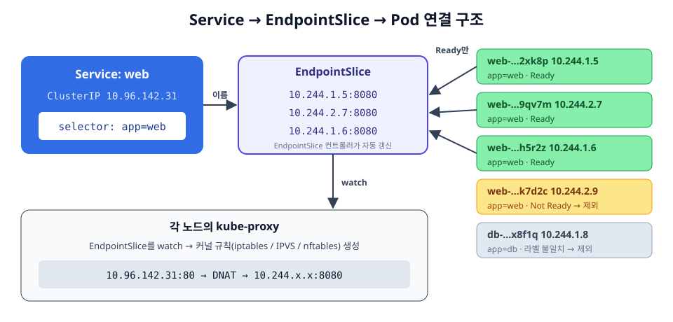
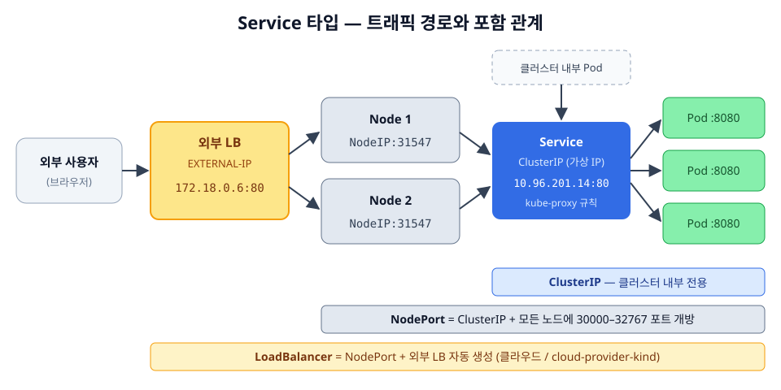

> **Chapter 2 · Kubernetes** | 난이도 ★★★☆☆ | 예상 소요 1.5 ~ 2시간

## 🎯 오늘의 목표

- Pod IP를 직접 쓰면 **왜** 안 되는지, Service가 그 문제를 어떻게 푸는지 설명할 수 있다
- Service → **selector → EndpointSlice → Pod** 로 이어지는 연결 구조를 그림으로 설명할 수 있다
- **ClusterIP / NodePort / LoadBalancer** 세 타입의 차이와 포함 관계를 안다
- 클러스터 DNS(`<서비스>.<네임스페이스>.svc.cluster.local`)로 서비스를 호출할 수 있다
- kind 클러스터에서 **cloud-provider-kind**로 LoadBalancer에 EXTERNAL-IP를 받아 접속할 수 있다

---

## 1. 왜 Service가 필요한가?

Day 11에서 Deployment로 Pod 3개를 띄웠습니다. 이제 다른 앱이 이 Pod들을 호출해야 합니다. Pod마다 IP가 있으니 그 IP로 부르면 될까요?

```bash
kubectl get pods -o wide
# NAME                   READY   STATUS    IP           NODE
# web-6d4b8c7f9d-2xk8p   1/1     Running   10.244.1.5   infra-lab-worker
# web-6d4b8c7f9d-9qv7m   1/1     Running   10.244.2.7   infra-lab-worker2
```

문제는 Pod IP가 **언제든 바뀐다**는 것입니다.

| 상황 | Pod IP에 무슨 일이? |
|---|---|
| 롤링 업데이트 (Day 11) | 옛 Pod가 지워지고 **새 IP의 Pod**가 생성됨 |
| 노드 장애 | 다른 노드에 **새 IP로** 다시 스케줄링됨 |
| 스케일 아웃 (replicas 3 → 5) | IP가 2개 늘어남 — 호출하는 쪽은 그걸 모름 |
| Pod가 여러 개 | 어느 IP로 보낼지(로드밸런싱)를 호출하는 쪽이 정해야 함 |

Docker Compose(Day 06)에서는 서비스 이름(`db`, `cache`)으로 컨테이너를 찾았죠. Kubernetes에서 같은 역할을 하는 것이 **Service**입니다.

> **Service = 계속 바뀌는 Pod 집합 앞에 세우는 "고정된 이름 + 고정된 가상 IP + 로드밸런서"**

- **고정 IP(ClusterIP)**: Service를 지우기 전까지 바뀌지 않음
- **고정 DNS 이름**: `web`, `web.default.svc.cluster.local`
- **로드밸런싱**: 뒤에 있는 Pod들에게 요청을 분산
- **자동 추적**: Pod가 생기고 사라지는 걸 **label selector**로 알아서 따라감

---

## 2. Service는 Pod를 어떻게 찾는가 — selector와 EndpointSlice



Service는 Pod를 이름으로 기억하지 않습니다. **라벨(label)** 로 찾습니다. Day 10~11에서 Pod에 붙였던 `app: web` 라벨이 바로 여기서 쓰입니다.

1. Service에 `selector: {app: web}` 을 적는다
2. 컨트롤 플레인의 **EndpointSlice 컨트롤러**가 이 라벨을 가진 Pod 중 **Ready 상태인 것**의 IP:Port 목록을 `EndpointSlice` 오브젝트로 만든다
3. 각 노드의 **kube-proxy**가 EndpointSlice를 보고 iptables(또는 IPVS/nftables) 규칙을 만든다
4. 누군가 `ClusterIP:80`으로 패킷을 보내면, 커널이 규칙에 따라 Pod IP 중 하나로 **목적지를 바꿔(DNAT)** 보낸다

> 💡 ClusterIP는 어떤 네트워크 인터페이스에도 붙어 있지 않은 **가상 IP**입니다. `ping`이 안 되는 게 정상이에요. 실체는 각 노드의 커널에 들어 있는 NAT 규칙뿐입니다. (kind의 kube-proxy 기본 모드는 iptables)

### port / targetPort / nodePort 정리

| 필드 | 의미 | 예 |
|---|---|---|
| `port` | **Service가** 받는 포트 (ClusterIP:port) | 80 |
| `targetPort` | 요청을 넘겨줄 **Pod(컨테이너)의** 포트. 숫자 또는 컨테이너 포트 이름 | 8080 |
| `nodePort` | NodePort/LoadBalancer일 때 **모든 노드에** 열리는 포트 (기본 범위 30000–32767) | 30080 |

> ⚠️ `targetPort`를 생략하면 `port`와 같은 값이 됩니다. 컨테이너가 8080에서 듣는데 `port: 80`만 적으면 연결이 안 됩니다. 가장 흔한 실수 1위!

---

## 3. Service 타입 비교



| 타입 | 접근 가능한 곳 | 동작 | 주 용도 |
|---|---|---|---|
| **ClusterIP** (기본값) | 클러스터 **내부**만 | 가상 IP 하나 할당 | 마이크로서비스 간 통신, DB |
| **NodePort** | 노드 IP에 닿는 곳이면 어디서나 | ClusterIP + **모든 노드의 같은 포트**(30000–32767) 개방 | 테스트, 외부 LB를 직접 붙일 때 |
| **LoadBalancer** | 인터넷/사내망 | NodePort + **클라우드 LB를 자동 생성**해 EXTERNAL-IP 부여 | 운영 환경 외부 노출 |
| ExternalName | (클러스터 내부) | DNS **CNAME**만 반환, 프록시 없음 | 외부 DB 주소에 내부 별칭 붙이기 |
| Headless (`clusterIP: None`) | 클러스터 내부 | 가상 IP 없이 DNS가 **Pod IP 목록**을 직접 반환 | StatefulSet(Day 14), 클라이언트 측 분산 |

세 타입은 **포함 관계**라는 게 핵심입니다.

- NodePort를 만들면 ClusterIP도 자동으로 생깁니다
- LoadBalancer를 만들면 NodePort와 ClusterIP가 자동으로 생깁니다 (클라우드 LB → 노드의 NodePort → Pod)

### LoadBalancer는 누가 만들어 주나?

`type: LoadBalancer`는 "LB를 하나 달라"는 **요청서**일 뿐입니다. 실제 LB는 **cloud-controller-manager**(Day 08 아키텍처 그림의 그 컴포넌트)가 AWS ELB, GCP LB, OpenStack Octavia(Chapter 4!) 같은 클라우드 API를 호출해서 만듭니다.

그래서 kind, kubeadm 같은 **온프렘/로컬 클러스터에서는 EXTERNAL-IP가 영원히 `<pending>`** 입니다. 이 빈자리를 채우는 도구가 있습니다.

| 도구 | 방식 | 어디에 적합? |
|---|---|---|
| **cloud-provider-kind** | kind 전용 클라우드 컨트롤러. LB Service마다 Envoy 컨테이너를 띄워 IP 부여 | **kind 로컬 실습 (오늘 사용)** |
| MetalLB | 노드가 ARP(L2) 또는 BGP로 IP 풀의 주소를 광고 | 베어메탈/온프렘 클러스터 (Day 20 kubeadm에서 고려) |

---

## 4. 실습 준비

- 실습 환경: Day 09에서 kind로 만든 `infra-lab` 클러스터 (control-plane 1 + worker 2, Kubernetes v1.31+), Docker Desktop 또는 Linux Docker Engine
- 셸 예시는 bash 기준 (Linux / macOS / WSL2 / Git Bash)

```bash
kubectl config current-context   # kind-<클러스터 이름> 이어야 함
kubectl get nodes
```

실습용 Deployment를 만듭니다. `agnhost`는 Kubernetes 테스트용 공식 이미지로, `netexec` 모드에서 `/hostname` 경로로 **자기 Pod 이름**을 돌려줍니다. 로드밸런싱 확인에 딱 좋습니다.

```yaml
# web-deploy.yaml
apiVersion: apps/v1
kind: Deployment
metadata:
  name: web
spec:
  replicas: 3
  selector:
    matchLabels:
      app: web
  template:
    metadata:
      labels:
        app: web
    spec:
      containers:
      - name: web
        image: registry.k8s.io/e2e-test-images/agnhost:2.39
        args: ["netexec", "--http-port=8080"]
        ports:
        - name: http
          containerPort: 8080
```

```bash
kubectl apply -f web-deploy.yaml
kubectl rollout status deployment/web
kubectl get pods -l app=web -o wide
```

---

## 5. 실습 ① ClusterIP

```yaml
# web-svc.yaml
apiVersion: v1
kind: Service
metadata:
  name: web
spec:
  type: ClusterIP          # 생략해도 기본값
  selector:
    app: web               # 이 라벨을 가진 Pod로 보냄
  ports:
  - name: http
    port: 80               # Service 포트
    targetPort: http       # 컨테이너 포트 이름(=8080)으로 지정 가능
```

```bash
kubectl apply -f web-svc.yaml
kubectl get svc web
```

```
NAME   TYPE        CLUSTER-IP     EXTERNAL-IP   PORT(S)   AGE
web    ClusterIP   10.96.142.31   <none>        80/TCP    5s
```

### EndpointSlice 확인

```bash
kubectl get endpointslices -l kubernetes.io/service-name=web
```

```
NAME        ADDRESSTYPE   PORTS   ENDPOINTS                          AGE
web-7xk2p   IPv4          8080    10.244.1.5,10.244.2.7,10.244.1.6   10s
```

Pod IP 3개가 그대로 들어 있습니다. `kubectl describe svc web`의 `Endpoints:` 줄에서도 볼 수 있습니다.

### 클러스터 안에서 호출해 보기

ClusterIP는 클러스터 **내부 전용**이니, 임시 Pod를 하나 띄워서 그 안에서 호출합니다.

```bash
kubectl run client --rm -it --image=curlimages/curl:8.20.0 --restart=Never -- sh
```

```sh
# (client Pod 안에서)
for i in $(seq 1 6); do curl -s http://web/hostname; echo; done
```

```
web-6d4b8c7f9d-2xk8p
web-6d4b8c7f9d-9qv7m
web-6d4b8c7f9d-2xk8p
web-6d4b8c7f9d-h5r2z
...
```

요청이 Pod 3개로 **분산**되는 게 보입니다. 이어서 DNS도 확인합니다.

```sh
nslookup web
# Name:   web.default.svc.cluster.local
# Address: 10.96.142.31
curl -s http://web.default.svc.cluster.local/hostname; echo
exit
```

### 클러스터 DNS 이름 규칙

| 호출하는 위치 | 쓸 수 있는 이름 |
|---|---|
| **같은** 네임스페이스 | `web` |
| **다른** 네임스페이스 | `web.default` 또는 `web.default.svc` |
| 어디서나 (FQDN) | `web.default.svc.cluster.local` |

> 💡 Pod 안의 `/etc/resolv.conf`에 `search default.svc.cluster.local svc.cluster.local cluster.local` 이 들어 있어서 짧은 이름이 동작합니다. DNS 서버는 kube-system 네임스페이스의 **CoreDNS**입니다.

### 자동 추적 확인 — Pod를 죽여도 Service는 그대로

```bash
kubectl delete pod -l app=web --wait=false   # Pod 전부 삭제 → Deployment가 새로 생성
kubectl get endpointslices -l kubernetes.io/service-name=web -w   # IP가 새 것으로 교체됨 (Ctrl+C)
kubectl get svc web                           # CLUSTER-IP는 그대로!
```

### 개발 중 잠깐 접속: port-forward

```bash
kubectl port-forward svc/web 8080:80
# 다른 터미널에서
curl http://localhost:8080/hostname
```

> ⚠️ `port-forward`는 kubectl 프로세스가 터널을 만드는 **디버깅 도구**입니다. 여러 Pod로 분산되지 않고(하나의 Pod에 고정), kubectl을 끄면 끊깁니다. 서비스 노출 수단으로 쓰지 마세요.

---

## 6. 실습 ② NodePort

```yaml
# web-nodeport.yaml
apiVersion: v1
kind: Service
metadata:
  name: web-nodeport
spec:
  type: NodePort
  selector:
    app: web
  ports:
  - port: 80
    targetPort: 8080
    nodePort: 30080      # 생략하면 30000-32767 중 자동 할당
```

```bash
kubectl apply -f web-nodeport.yaml
kubectl get svc web-nodeport
```

```
NAME           TYPE       CLUSTER-IP     EXTERNAL-IP   PORT(S)        AGE
web-nodeport   NodePort   10.96.88.120   <none>        80:30080/TCP   4s
```

`80:30080` = ClusterIP의 80번 + **모든 노드**의 30080번. 이제 노드 IP로 접속해 봅니다.

```bash
kubectl get nodes -o wide     # INTERNAL-IP 확인 (예: 172.18.0.3)
```

kind의 "노드"는 사실 **Docker 컨테이너**입니다(Day 09). 그래서 노드 IP는 `kind`라는 Docker 네트워크 안의 주소이고, 접근 방법이 환경마다 다릅니다.

```bash
# (A) 어느 환경에서나: Day 09에서 열어 둔 extraPortMappings (호스트 30080 → control-plane 노드 30080)
curl http://localhost:30080/hostname

# (B) 어느 환경에서나: kind 네트워크에 붙은 임시 컨테이너에서 노드 IP로 호출
docker run --rm --network kind curlimages/curl:8.20.0 -s http://172.18.0.3:30080/hostname

# (C) Linux 호스트라면 노드 IP로 직접 호출 가능
curl http://172.18.0.3:30080/hostname
```

> 💡 Day 09에서 `infra-lab` 클러스터를 만들 때 **nodePort 30080을 미리 호스트에 매핑**해 둔 이유가 바로 이것입니다. Docker Desktop(Windows/macOS)에서는 컨테이너가 VM 안에 있어 `172.18.x.x`에 호스트가 직접 닿지 않으므로, `extraPortMappings` 없이는 (B)처럼 kind 네트워크 안에서 호출해야 합니다. 매핑은 클러스터 **생성 시에만** 지정할 수 있다는 점도 기억해 두세요 (Day 15에서 다시 활용).

다른 노드의 IP로 호출해도 응답이 옵니다. **Pod가 없는 노드라도** kube-proxy 규칙이 다른 노드의 Pod로 전달해 주기 때문입니다.

---

## 7. 실습 ③ LoadBalancer — cloud-provider-kind

먼저 아무 준비 없이 만들어 봅시다.

```yaml
# web-lb.yaml
apiVersion: v1
kind: Service
metadata:
  name: web-lb
spec:
  type: LoadBalancer
  selector:
    app: web
  ports:
  - port: 80
    targetPort: 8080
```

```bash
kubectl apply -f web-lb.yaml
kubectl get svc web-lb
```

```
NAME     TYPE           CLUSTER-IP     EXTERNAL-IP   PORT(S)        AGE
web-lb   LoadBalancer   10.96.201.14   <pending>     80:31547/TCP   10s
```

`<pending>` — LB를 만들어 줄 클라우드 컨트롤러가 없기 때문입니다. NodePort(31547)는 이미 열렸다는 점도 보세요(포함 관계).

### 7-1. cloud-provider-kind 설치

[cloud-provider-kind](https://github.com/kubernetes-sigs/cloud-provider-kind)는 kind 프로젝트(kubernetes-sigs)가 만든 공식 도구로, **호스트에서 실행되는 클라우드 컨트롤러**입니다. LoadBalancer Service를 감지하면 kind Docker 네트워크에 Envoy 프록시 컨테이너(`kindccm-...`)를 띄우고 그 IP를 EXTERNAL-IP로 채워 줍니다.

```bash
# 방법 1) Go가 설치되어 있다면 (바이너리는 ~/go/bin 에 생성)
go install sigs.k8s.io/cloud-provider-kind@latest

# 방법 2) GitHub Releases 페이지에서 OS에 맞는 바이너리를 내려받아 PATH에 둔다
#   https://github.com/kubernetes-sigs/cloud-provider-kind/releases

# 방법 3) macOS Homebrew (커뮤니티 패키지)
brew install cloud-provider-kind
```

### 7-2. 실행 — 별도 터미널에서 켜 두기

```bash
# Linux
cloud-provider-kind

# macOS / WSL2: sudo 필요
sudo cloud-provider-kind

# Windows: "관리자 권한으로 실행"한 터미널에서
cloud-provider-kind
```

이 프로세스는 **포그라운드로 계속 실행**되면서 모든 kind 클러스터를 지켜봅니다. 실습 동안 끄지 마세요.

### 7-3. control-plane 노드 라벨 해제

Kubernetes는 control-plane 노드에 `node.kubernetes.io/exclude-from-external-load-balancers` 라벨을 붙여 **외부 LB 대상에서 제외**합니다. kind는 control-plane에서도 워크로드를 돌리므로(특히 단일 노드 클러스터), 이 라벨을 지워 줍니다.

```bash
# 끝의 '-' 는 "라벨 삭제"라는 뜻. 라벨이 없는 노드는 not found 메시지만 나오고 무시됨
kubectl label nodes --all node.kubernetes.io/exclude-from-external-load-balancers-
```

### 7-4. EXTERNAL-IP 확인 및 접속

```bash
kubectl get svc web-lb -w
```

```
NAME     TYPE           CLUSTER-IP     EXTERNAL-IP   PORT(S)        AGE
web-lb   LoadBalancer   10.96.201.14   <pending>     80:31547/TCP   1m
web-lb   LoadBalancer   10.96.201.14   172.18.0.6    80:31547/TCP   1m
```

```bash
LB_IP=$(kubectl get svc web-lb -o jsonpath='{.status.loadBalancer.ingress[0].ip}')
echo $LB_IP

# Linux / WSL2: EXTERNAL-IP로 바로 접속
for i in $(seq 1 6); do curl -s http://$LB_IP/hostname; echo; done

# 어느 환경에서나 동작하는 방법: kind 네트워크 안에서 호출
docker run --rm --network kind curlimages/curl:8.20.0 -s http://$LB_IP/hostname
```

LB 역할을 하는 컨테이너도 직접 볼 수 있습니다.

```bash
docker ps --filter "name=kindccm"
```

> 💡 **Docker Desktop(Windows/macOS)** 에서는 `172.18.x.x`가 호스트에서 닿지 않으므로, cloud-provider-kind가 `kindccm-...` 컨테이너의 포트를 **호스트의 임의 포트에 매핑**해 줍니다. `docker ps` 의 PORTS 열에서 `0.0.0.0:4xxxx->80/tcp` 같은 매핑을 찾아 `curl http://localhost:4xxxx/hostname` 으로 접속하세요.

### 7-5. 정리

```bash
kubectl delete svc web-lb web-nodeport
# nodePort 30080은 Day 15에서 Traefik이 사용하므로 web-nodeport는 꼭 지워 두세요
# web Deployment와 web Service는 남겨 둬도 됩니다
# cloud-provider-kind는 Ctrl+C로 종료 (LB 컨테이너도 함께 정리됨)
```

---

## 8. 알아두면 좋은 옵션

| 옵션 | 설명 |
|---|---|
| `sessionAffinity: ClientIP` | 같은 클라이언트 IP는 같은 Pod로 (기본 None) |
| `externalTrafficPolicy: Local` | NodePort/LB에서 **그 노드의 Pod로만** 전달 → 클라이언트 원본 IP 보존, 대신 Pod 없는 노드는 응답 안 함 |
| `internalTrafficPolicy: Local` | 클러스터 내부 트래픽도 같은 노드의 Pod로만 |
| selector 없는 Service | EndpointSlice를 직접 만들어 클러스터 **외부 서버**를 Service처럼 사용 |

> 💡 Service는 **L4(TCP/UDP)** 로드밸런서입니다. "`/api`는 A로, `/web`은 B로" 같은 **HTTP 경로/호스트 기반 라우팅**은 못 합니다. 그리고 LoadBalancer를 서비스마다 만들면 LB(=비용)가 서비스 수만큼 늘어나죠. 이 두 문제를 푸는 것이 **Day 15 Ingress**입니다.

---

## 9. 트러블슈팅

| 증상 | 원인 | 해결 |
|---|---|---|
| `curl: (7) Failed to connect` / 응답 없음, Endpoints가 비어 있음 | Service `selector`와 Pod 라벨이 **불일치** | `kubectl get pods --show-labels` 와 `kubectl describe svc` 의 Selector 비교 |
| Endpoints는 있는데 `Connection refused` | `targetPort`가 컨테이너의 실제 포트와 다름 | 컨테이너가 듣는 포트로 `targetPort` 수정 (이름 지정 추천) |
| Pod는 Running인데 EndpointSlice에 안 보임 | readinessProbe 실패로 **Ready가 아님** | `kubectl describe pod` 에서 Readiness 확인 — Not Ready Pod는 트래픽에서 제외됨 |
| `curl: Could not resolve host: web` | 다른 네임스페이스에서 짧은 이름으로 호출 / CoreDNS 이상 | `web.<네임스페이스>` 사용, `kubectl -n kube-system get pods -l k8s-app=kube-dns` 확인 |
| `ping <ClusterIP>` 이 안 됨 | ClusterIP는 가상 IP — ICMP 응답 주체가 없음 | 정상. `curl`로 확인 |
| LoadBalancer EXTERNAL-IP가 계속 `<pending>` | 클라우드 컨트롤러 없음 / cloud-provider-kind 미실행 | cloud-provider-kind 실행 확인, 실행 로그 확인 |
| EXTERNAL-IP는 받았는데 응답이 없음 | control-plane 노드 제외 라벨 / Docker Desktop에서 IP 직접 접근 | 7-3의 라벨 삭제, Docker Desktop은 `docker ps`의 매핑 포트로 `localhost` 접속 |
| `provided port is already allocated` | 다른 Service가 같은 nodePort 사용 중 | nodePort를 바꾸거나 생략해서 자동 할당 |

---

## 10. 핵심 정리

- Pod IP는 수시로 바뀐다 → **Service**가 고정 IP·DNS 이름·로드밸런싱을 제공한다
- Service는 **label selector**로 Pod를 찾고, Ready인 Pod 목록은 **EndpointSlice**에 담긴다
- 실제 전달은 각 노드의 **kube-proxy**가 만든 커널 규칙(DNAT)이 한다 — ClusterIP는 가상 IP
- 타입은 포함 관계: **LoadBalancer ⊃ NodePort ⊃ ClusterIP**
- `port`(Service) / `targetPort`(컨테이너) / `nodePort`(노드, 30000–32767) 구분
- 로컬·온프렘에는 LB를 만들어 줄 클라우드가 없다 → kind는 **cloud-provider-kind**, 베어메탈은 MetalLB
- DNS: `<서비스>.<네임스페이스>.svc.cluster.local`

---

## 11. 셀프 체크

<details>
<summary>Q1. Deployment의 Pod가 롤링 업데이트로 모두 교체되었다. Service의 ClusterIP는 어떻게 되는가?</summary>

그대로입니다. ClusterIP는 **Service 오브젝트**에 할당되며 Service를 삭제하기 전까지 유지됩니다. 바뀌는 것은 EndpointSlice 안의 Pod IP 목록뿐이고, 이는 selector로 자동 갱신됩니다.
</details>

<details>
<summary>Q2. <code>type: LoadBalancer</code> 를 만들었을 때 자동으로 함께 생기는 것 두 가지는?</summary>

**ClusterIP**와 **NodePort**. 외부 LB는 각 노드의 NodePort로 트래픽을 보내고, 노드의 kube-proxy 규칙이 다시 Pod로 전달합니다.
</details>

<details>
<summary>Q3. Pod는 Running인데 Service로 호출하면 그 Pod로는 트래픽이 가지 않는다. 가능한 원인은?</summary>

readinessProbe가 실패해 Pod가 **Ready가 아닌** 상태입니다. Ready가 아닌 Pod는 EndpointSlice에서 serving 대상에서 빠집니다. 또는 그 Pod의 라벨이 selector와 다를 수도 있습니다.
</details>

<details>
<summary>Q4. kind 클러스터에서 LoadBalancer의 EXTERNAL-IP가 <code>&lt;pending&gt;</code> 인 이유와 해결 방법은?</summary>

LB를 실제로 만들어 주는 **클라우드 컨트롤러가 없기 때문**입니다. `cloud-provider-kind`를 호스트에서 실행해 두면 LB Service마다 Envoy 컨테이너를 띄우고 그 IP를 EXTERNAL-IP로 채워 줍니다. (베어메탈이라면 MetalLB)
</details>

<details>
<summary>Q5. <code>dev</code> 네임스페이스의 Pod에서 <code>default</code> 네임스페이스의 <code>web</code> 서비스를 호출하려면 어떤 이름을 써야 하나?</summary>

`web.default` (또는 `web.default.svc`, `web.default.svc.cluster.local`). 짧은 이름 `web`은 자기 네임스페이스(`dev`)에서 찾기 때문에 실패합니다.
</details>

---

## ⏭️ 다음 예고 — Day 13. ConfigMap & Secret

오늘 만든 앱의 설정값(로그 레벨, DB 주소, 비밀번호)을 이미지에 박아 넣으면 환경마다 이미지를 새로 빌드해야 합니다. 설정과 코드를 분리하는 **ConfigMap**과 민감 정보를 다루는 **Secret**, 그리고 "Secret은 정말 비밀인가?"라는 질문을 파헤쳐 봅니다.
