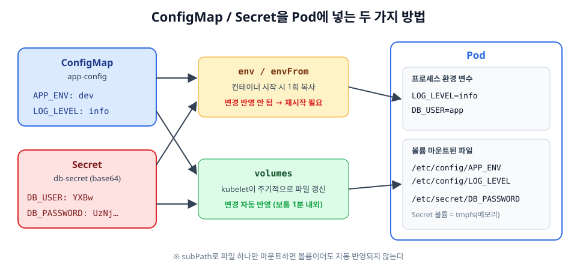
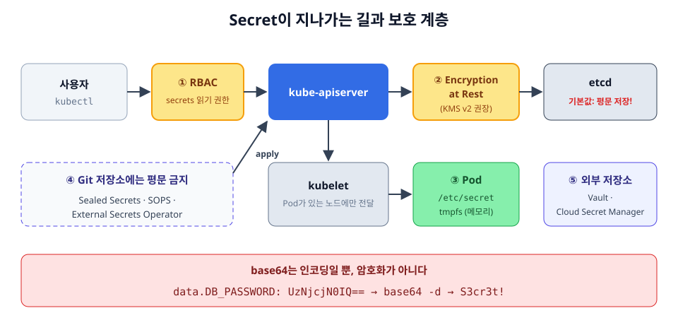

> **Chapter 2 · Kubernetes** | 난이도 ★★☆☆☆ | 예상 소요 1.5시간

## 🎯 오늘의 목표

- 설정을 이미지에서 **분리해야 하는 이유**를 설명할 수 있다
- ConfigMap / Secret을 **명령어와 YAML** 두 방식으로 만들 수 있다
- 설정을 Pod에 넣는 두 가지 방법 — **환경 변수 vs 볼륨 파일** — 의 차이(특히 변경 반영 여부)를 안다
- "Secret은 base64일 뿐 암호화가 아니다"의 의미를 **etcd에서 직접 확인**하고, 실제로 지키는 방법을 안다

---

## 1. 왜 설정을 분리하는가?

Day 03에서 Dockerfile에 `ENV LOG_LEVEL=info` 를 적을 수 있었죠. 하지만 이렇게 하면:

| 문제 | 설명 |
|---|---|
| 환경마다 이미지 빌드 | dev / stage / prod 의 DB 주소가 다르면 이미지를 3번 빌드해야 함 |
| "테스트한 이미지 ≠ 배포한 이미지" | 운영용으로 다시 빌드하는 순간 검증한 결과물이 아님 |
| 비밀번호 유출 | 이미지 레이어(Day 02)에 비밀번호가 남아 레지스트리에 그대로 올라감 |

> **같은 이미지 + 환경별 설정 = 환경별 배포.** (12-Factor App의 "Config" 원칙)

Docker에서는 `-e`, `--env-file`, Compose의 `environment:`로 이 일을 했습니다. Kubernetes는 설정을 아예 **독립된 API 오브젝트**로 만들어 클러스터에 저장합니다.

| 구분 | ConfigMap | Secret |
|---|---|---|
| 용도 | 일반 설정 (로그 레벨, 기능 플래그, 설정 파일) | 민감 정보 (비밀번호, API 키, TLS 인증서, 레지스트리 인증) |
| 저장 형태 | 평문 `data` | **base64 인코딩**된 `data` (암호화 아님!) |
| 크기 제한 | 1 MiB | 1 MiB |
| 볼륨 마운트 시 | 노드 디스크 | 노드의 **tmpfs(메모리)** — 디스크에 안 남음 |
| `kubectl describe` | 값이 보임 | 값 대신 **바이트 수만** 보임 |
| 추가 보호 | — | RBAC 분리, etcd 저장 암호화 대상, 외부 비밀 저장소 연동 |

---

## 2. Pod에 설정을 넣는 방법



| 방식 | 문법 | 변경이 실행 중인 Pod에 반영? | 적합한 경우 |
|---|---|---|---|
| 환경 변수 (키 하나) | `env[].valueFrom.configMapKeyRef` / `secretKeyRef` | ❌ **Pod 재시작 필요** | 값 몇 개 |
| 환경 변수 (전체) | `envFrom[].configMapRef` / `secretRef` | ❌ Pod 재시작 필요 | 키가 많을 때 일괄 주입 |
| **볼륨 파일** | `volumes[].configMap` / `secret` | ⭕ **자동 반영** (보통 1분 내외 지연) | 설정 파일(nginx.conf 등), 인증서 |
| 볼륨 + `subPath` | 특정 파일 하나만 마운트 | ❌ 반영 안 됨 | 기존 디렉터리를 덮지 않고 파일 하나만 넣을 때 |
| 명령 인자 | `args: ["--level=$(LOG_LEVEL)"]` | ❌ | 환경 변수를 인자로 넘길 때 |

> 💡 환경 변수는 **프로세스가 시작될 때** 한 번 복사되는 값이라 바뀔 수가 없습니다(리눅스 프로세스의 원리). 반면 볼륨은 kubelet이 주기적으로 파일을 갱신합니다. 단, 파일이 바뀌어도 **앱이 파일을 다시 읽어야** 효과가 있습니다.

---

## 3. 실습 준비

- 실습 환경: Day 09에서 만든 kind 클러스터 (Kubernetes v1.31+)
- 셸 예시는 bash 기준 (Linux / macOS / WSL2 / Git Bash)

```bash
kubectl config current-context
mkdir -p ~/k8s-day13 && cd ~/k8s-day13
```

---

## 4. 실습 ① ConfigMap 만들기 — 세 가지 방법

### 4-1. 명령어로 (`--from-literal`)

```bash
kubectl create configmap app-config \
  --from-literal=APP_ENV=dev \
  --from-literal=LOG_LEVEL=info
```

### 4-2. 파일로 (`--from-file`)

```bash
cat > app.properties <<'EOF'
greeting=hello
feature.newUI=true
EOF

kubectl create configmap app-file --from-file=app.properties
kubectl get configmap app-file -o yaml
```

```yaml
apiVersion: v1
kind: ConfigMap
metadata:
  name: app-file
  namespace: default
data:
  app.properties: |       # 파일 이름이 키, 파일 내용이 값
    greeting=hello
    feature.newUI=true
```

### 4-3. YAML로 (권장 — Git으로 관리 가능)

명령어로 만든 것을 YAML로 뽑아내는 요령도 같이 익혀 둡시다.

```bash
kubectl create configmap app-config \
  --from-literal=APP_ENV=dev --from-literal=LOG_LEVEL=info \
  --dry-run=client -o yaml
```

```yaml
# app-config.yaml
apiVersion: v1
kind: ConfigMap
metadata:
  name: app-config
data:
  APP_ENV: dev
  LOG_LEVEL: info
```

> ⚠️ `data`의 값은 **반드시 문자열**입니다. `PORT: 8080` 이나 `DEBUG: true` 처럼 쓰면 숫자/불리언으로 해석돼 apply가 실패합니다. `PORT: "8080"` 처럼 따옴표로 감싸세요.

---

## 5. 실습 ② ConfigMap을 Pod에 주입

환경 변수와 볼륨을 **한 Pod에서 동시에** 써서 차이를 비교합니다.

```yaml
# config-demo.yaml
apiVersion: v1
kind: Pod
metadata:
  name: config-demo
spec:
  containers:
  - name: app
    image: busybox:1.36
    command: ["sh", "-c", "sleep 3600"]
    env:
    - name: LOG_LEVEL                 # 키 하나만 골라서
      valueFrom:
        configMapKeyRef:
          name: app-config
          key: LOG_LEVEL
    envFrom:
    - configMapRef:                   # 모든 키를 환경 변수로
        name: app-config
      prefix: CFG_                    # CFG_APP_ENV, CFG_LOG_LEVEL
    volumeMounts:
    - name: config-vol
      mountPath: /etc/config          # 키마다 파일 하나씩 생성
      readOnly: true
    - name: props-vol
      mountPath: /etc/app
      readOnly: true
  volumes:
  - name: config-vol
    configMap:
      name: app-config
  - name: props-vol
    configMap:
      name: app-file
```

```bash
kubectl apply -f config-demo.yaml
kubectl exec config-demo -- env | grep -E 'LOG_LEVEL|APP_ENV'
```

```
LOG_LEVEL=info
CFG_APP_ENV=dev
CFG_LOG_LEVEL=info
```

```bash
kubectl exec config-demo -- ls /etc/config
kubectl exec config-demo -- cat /etc/config/LOG_LEVEL; echo
kubectl exec config-demo -- cat /etc/app/app.properties
```

```
APP_ENV
LOG_LEVEL
info
greeting=hello
feature.newUI=true
```

### 5-1. 값을 바꾸면? — 환경 변수 vs 볼륨

```bash
kubectl patch configmap app-config --type merge -p '{"data":{"LOG_LEVEL":"debug"}}'

# 1~2분 기다린 뒤
kubectl exec config-demo -- cat /etc/config/LOG_LEVEL; echo   # debug  ← 볼륨은 반영됨
kubectl exec config-demo -- printenv LOG_LEVEL                # info   ← 환경 변수는 그대로
```

볼륨 디렉터리를 보면 kubelet이 어떻게 갱신하는지 알 수 있습니다.

```bash
kubectl exec config-demo -- ls -la /etc/config
```

```
lrwxrwxrwx ... APP_ENV -> ..data/APP_ENV
lrwxrwxrwx ... LOG_LEVEL -> ..data/LOG_LEVEL
lrwxrwxrwx ... ..data -> ..2026_11_15_08_31_02.123456789
drwxr-xr-x ... ..2026_11_15_08_31_02.123456789
```

새 내용을 타임스탬프 디렉터리에 쓴 뒤 `..data` 심볼릭 링크만 **원자적으로 바꿔치기**합니다. 앱이 반쯤 바뀐 파일을 읽을 일이 없도록 한 설계입니다. (`subPath`로 마운트하면 이 링크 구조를 우회하기 때문에 갱신이 안 됩니다.)

### 5-2. 환경 변수를 바꾼 값으로 다시 읽게 하려면

Deployment라면 롤링 재시작으로 Pod를 새로 만들면 됩니다 (Day 11).

```bash
kubectl rollout restart deployment/<이름>
```

> 💡 실무에서는 ConfigMap 이름에 **내용 해시를 붙이는** 방식을 많이 씁니다. Kustomize의 `configMapGenerator`(`kubectl apply -k`)는 `app-config-7g8f9k2m4t` 같은 이름을 생성하고 Deployment의 참조도 같이 바꿔 주므로, **설정이 바뀌면 자동으로 롤링 업데이트**가 일어납니다. Helm(Day 16)에서는 체크섬 어노테이션으로 같은 효과를 냅니다.

### 5-3. 바뀌면 안 되는 설정은 immutable로

```yaml
apiVersion: v1
kind: ConfigMap
metadata:
  name: app-config-v1
data:
  APP_ENV: prod
immutable: true      # 이후 data 수정 불가 (삭제 후 재생성만 가능)
```

실수로 운영 설정을 바꾸는 사고를 막고, kubelet이 변경 감시(watch)를 하지 않아 **API 서버 부하도 줄어듭니다.**

---

## 6. 실습 ③ Secret

### 6-1. Secret 타입

| type | 용도 | 만드는 명령 |
|---|---|---|
| `Opaque` (기본) | 임의의 키-값 | `kubectl create secret generic` |
| `kubernetes.io/tls` | TLS 인증서/키 (`tls.crt`, `tls.key`) | `kubectl create secret tls` — **Day 15 Ingress에서 사용** |
| `kubernetes.io/dockerconfigjson` | 프라이빗 레지스트리 로그인 정보 | `kubectl create secret docker-registry` |
| `kubernetes.io/service-account-token` | ServiceAccount 토큰 (레거시) | Day 19 RBAC에서 |

### 6-2. 생성과 조회

```bash
kubectl create secret generic db-secret \
  --from-literal=DB_USER=app \
  --from-literal=DB_PASSWORD='S3cr3t!'

kubectl describe secret db-secret
```

```
Name:         db-secret
Type:         Opaque

Data
====
DB_PASSWORD:  7 bytes
DB_USER:      3 bytes
```

`describe`는 값을 숨깁니다. 하지만…

```bash
kubectl get secret db-secret -o yaml
```

```yaml
apiVersion: v1
kind: Secret
type: Opaque
metadata:
  name: db-secret
data:
  DB_PASSWORD: UzNjcjN0IQ==
  DB_USER: YXBw
```

```bash
kubectl get secret db-secret -o jsonpath='{.data.DB_PASSWORD}' | base64 -d; echo
# S3cr3t!
```

**secret 조회 권한만 있으면 누구나 평문을 볼 수 있습니다.** base64는 바이너리를 텍스트로 옮기기 위한 **인코딩**이지 암호화가 아닙니다.

### 6-3. YAML로 만들 때는 stringData

`data`에는 base64로 인코딩한 값을 넣어야 하지만, `stringData`를 쓰면 평문으로 적고 API 서버가 인코딩해 줍니다.

```yaml
# db-secret.yaml
apiVersion: v1
kind: Secret
metadata:
  name: db-secret
type: Opaque
stringData:
  DB_USER: app
  DB_PASSWORD: "S3cr3t!"
```

> ⚠️ 이 파일을 **Git에 그대로 커밋하면 안 됩니다.** Secret YAML을 Git으로 관리하려면 아래 8장의 Sealed Secrets / External Secrets 같은 도구를 씁니다.

> 💡 `echo 'S3cr3t!' | base64` 처럼 `-n` 없이 인코딩하면 **끝에 줄바꿈(\n)까지** 인코딩됩니다. "비밀번호가 맞는데 DB 접속이 안 된다"의 단골 원인입니다. 항상 `echo -n` 을 쓰거나 `stringData`를 쓰세요.

### 6-4. Pod에 주입

```yaml
# secret-demo.yaml
apiVersion: v1
kind: Pod
metadata:
  name: secret-demo
spec:
  containers:
  - name: app
    image: busybox:1.36
    command: ["sh", "-c", "sleep 3600"]
    env:
    - name: DB_USER
      valueFrom:
        secretKeyRef:
          name: db-secret
          key: DB_USER
    volumeMounts:
    - name: secret-vol
      mountPath: /etc/secret
      readOnly: true
  volumes:
  - name: secret-vol
    secret:
      secretName: db-secret
      defaultMode: 0400       # 소유자 읽기 전용
```

```bash
kubectl apply -f secret-demo.yaml
kubectl exec secret-demo -- printenv DB_USER
kubectl exec secret-demo -- cat /etc/secret/DB_PASSWORD; echo
kubectl exec secret-demo -- sh -c 'mount | grep /etc/secret'
```

```
app
S3cr3t!
tmpfs on /etc/secret type tmpfs (ro,relatime,size=...)
```

Secret 볼륨은 **tmpfs(메모리)** 에 올라갑니다. 노드 디스크에 비밀번호 파일이 남지 않습니다 (Day 04의 tmpfs 마운트 기억나시죠?).

> 💡 환경 변수보다 **파일 마운트를 권장**합니다. 환경 변수는 앱의 에러 로그·크래시 덤프·`/proc/<pid>/environ`·자식 프로세스로 새어 나가기 쉽습니다.

### 6-5. 프라이빗 레지스트리 인증 (참고)

```bash
kubectl create secret docker-registry regcred \
  --docker-server=registry.example.com \
  --docker-username=<사용자> \
  --docker-password=<토큰>
```

```yaml
spec:
  imagePullSecrets:
  - name: regcred
  containers:
  - name: app
    image: registry.example.com/team/app:1.0
```

---

## 7. Secret은 정말 비밀인가? — etcd 직접 들여다보기

모든 오브젝트는 컨트롤 플레인의 **etcd**(Day 08)에 저장됩니다. 기본 설정에서 Secret이 etcd에 어떻게 저장되는지 직접 확인해 봅시다.

```bash
ETCD_POD=$(kubectl -n kube-system get pods -l component=etcd -o jsonpath='{.items[0].metadata.name}')

kubectl -n kube-system exec $ETCD_POD -- etcdctl \
  --endpoints=https://127.0.0.1:2379 \
  --cacert=/etc/kubernetes/pki/etcd/ca.crt \
  --cert=/etc/kubernetes/pki/etcd/server.crt \
  --key=/etc/kubernetes/pki/etcd/server.key \
  get /registry/secrets/default/db-secret
```

출력은 바이너리(protobuf)가 섞여 깨져 보이지만, 그 사이에 **`S3cr3t!` 가 평문 그대로** 보입니다. base64조차 아닙니다. etcd 백업 파일을 손에 넣으면 모든 Secret이 털린다는 뜻입니다.



| 계층 | 위협 | 대책 |
|---|---|---|
| **etcd 저장** | etcd 데이터/백업 유출 | **Encryption at Rest** — API 서버가 etcd에 쓰기 전에 암호화 |
| **API 접근** | 아무나 `kubectl get secret` | **RBAC**으로 secrets 읽기 권한 최소화 (Day 19) |
| **노드** | 노드 디스크 탈취 | Secret 볼륨은 tmpfs, 해당 Secret을 쓰는 Pod가 있는 노드에만 전달 |
| **Git / CI** | YAML이 저장소에 커밋됨 | Sealed Secrets, SOPS, External Secrets Operator |
| **원천 저장소** | 비밀이 클러스터에 흩어짐 | HashiCorp Vault, AWS Secrets Manager 등 외부 저장소를 진실의 원천으로 |

### Encryption at Rest 설정 예 (참고)

kube-apiserver에 `--encryption-provider-config` 플래그로 아래 파일을 지정합니다. kubeadm으로 직접 클러스터를 만드는 Day 20에서 적용해 볼 수 있습니다.

```yaml
apiVersion: apiserver.config.k8s.io/v1
kind: EncryptionConfiguration
resources:
  - resources:
      - secrets
    providers:
      - aescbc:
          keys:
            - name: key1
              secret: <head -c 32 /dev/urandom | base64 로 만든 값>
      - identity: {}     # 암호화 전에 저장된 기존 데이터 읽기용
```

> ⚠️ 이 방식은 암호화 키가 컨트롤 플레인 노드의 파일에 있다는 한계가 있습니다. 운영 환경에서는 키를 외부 KMS에 두는 **KMS v2 provider**를 권장합니다. 설정 후 기존 Secret은 `kubectl get secrets -A -o json | kubectl replace -f -` 로 다시 써야 암호화됩니다.

---

## 8. 정리

```bash
kubectl delete pod config-demo secret-demo
kubectl delete configmap app-config app-file
kubectl delete secret db-secret
```

---

## 9. 트러블슈팅

| 증상 | 원인 | 해결 |
|---|---|---|
| Pod가 `CreateContainerConfigError` | 참조한 ConfigMap/Secret 또는 **키가 없음** | `kubectl describe pod` 이벤트 확인 → 이름/키 오타 수정. 없어도 되는 값이면 `optional: true` |
| 볼륨 마운트 Pod가 `ContainerCreating`에서 멈춤 | 볼륨으로 참조한 ConfigMap/Secret이 없음 | 이벤트의 `MountVolume.SetUp failed ... not found` 확인 후 생성 |
| ConfigMap을 바꿨는데 앱 동작이 그대로 | 환경 변수로 주입함 / `subPath` 마운트 / 앱이 파일을 다시 안 읽음 | `kubectl rollout restart`, 또는 볼륨 마운트 + 앱의 reload 기능 사용 |
| `apply` 시 `cannot unmarshal number into ... string` | `data` 값에 따옴표 없는 숫자/불리언 | `"8080"`, `"true"` 처럼 문자열로 |
| Secret 값 끝에 이상한 줄바꿈 | `echo` 로 base64 만들 때 `-n` 누락 | `echo -n` 또는 `stringData` 사용 |
| `illegal base64 data at input byte` | `data`에 평문을 넣음 | base64 인코딩하거나 `stringData`로 변경 |
| 마운트한 디렉터리의 기존 파일이 사라짐 | 볼륨이 디렉터리 **전체를 덮어씀** | 다른 경로에 마운트하거나 `subPath`로 파일 하나만 마운트 (단, 자동 갱신 안 됨) |

---

## 10. 핵심 정리

- **같은 이미지 + 환경별 설정** — 설정은 ConfigMap, 민감 정보는 Secret으로 분리
- 주입 방법은 **환경 변수**(시작 시 1회 복사, 변경 반영 ❌)와 **볼륨 파일**(kubelet이 자동 갱신 ⭕, `subPath`는 ❌)
- 환경 변수 변경은 `kubectl rollout restart`, 실무에선 해시 이름(Kustomize)·체크섬(Helm)으로 자동 롤링
- Secret은 **base64 인코딩일 뿐** — 기본 설정의 etcd에는 평문으로 저장된다
- 진짜 보호는 **Encryption at Rest(KMS) + RBAC + 외부 비밀 저장소**의 조합
- Secret 볼륨은 tmpfs, 환경 변수보다 **파일 마운트**가 더 안전

---

## 11. 셀프 체크

<details>
<summary>Q1. ConfigMap의 값을 바꿨는데 환경 변수로 주입한 Pod에서는 예전 값이 보인다. 왜이고 어떻게 해결하나?</summary>

환경 변수는 컨테이너 프로세스가 **시작될 때 한 번** 설정되는 값이기 때문입니다. Pod를 다시 만들어야 하며, Deployment라면 `kubectl rollout restart deployment/<이름>` 으로 롤링 재시작합니다.
</details>

<details>
<summary>Q2. Secret의 <code>data</code> 필드에 들어 있는 값은 암호화된 것인가?</summary>

아닙니다. **base64 인코딩**일 뿐이라 `base64 -d` 로 누구나 복원할 수 있습니다. 게다가 Encryption at Rest를 설정하지 않으면 etcd에는 평문으로 저장됩니다.
</details>

<details>
<summary>Q3. ConfigMap을 <code>subPath</code>로 마운트했을 때의 단점은?</summary>

kubelet의 **자동 갱신이 적용되지 않습니다.** `..data` 심볼릭 링크 교체 방식으로 갱신하는데, `subPath`는 파일을 직접 바인드 마운트해서 이 구조를 우회하기 때문입니다.
</details>

<details>
<summary>Q4. 민감 정보를 환경 변수보다 볼륨 파일로 주입하는 것이 권장되는 이유는?</summary>

환경 변수는 로그·크래시 덤프·`/proc/<pid>/environ`·자식 프로세스 상속 등으로 유출되기 쉽습니다. Secret 볼륨은 tmpfs에 올라가고 파일 권한(`defaultMode`)으로 접근을 제한할 수 있으며, 값이 바뀌면 자동 갱신도 됩니다.
</details>

<details>
<summary>Q5. Secret YAML을 Git으로 관리하고 싶다. 어떤 선택지가 있나?</summary>

평문 커밋은 금지. **Sealed Secrets**(클러스터 공개키로 암호화한 SealedSecret을 커밋), **SOPS**(파일 단위 암호화), **External Secrets Operator**(Vault·클라우드 Secret Manager의 값을 참조하는 오브젝트만 커밋) 등을 사용합니다.
</details>

---

## ⏭️ 다음 예고 — Day 14. 스토리지 — Volume / PV / PVC / StorageClass

Pod를 지우면 컨테이너 안의 데이터는 사라집니다 (Day 01, Day 04의 그 문제!). Kubernetes는 이 문제를 **"스토리지를 요청하는 쪽(PVC)"과 "제공하는 쪽(PV)"을 분리**해서 풉니다. kind에 기본으로 들어 있는 StorageClass로 **동적 프로비저닝**까지 직접 해 봅니다.
