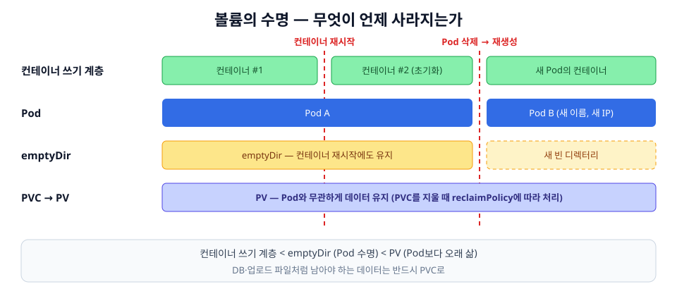
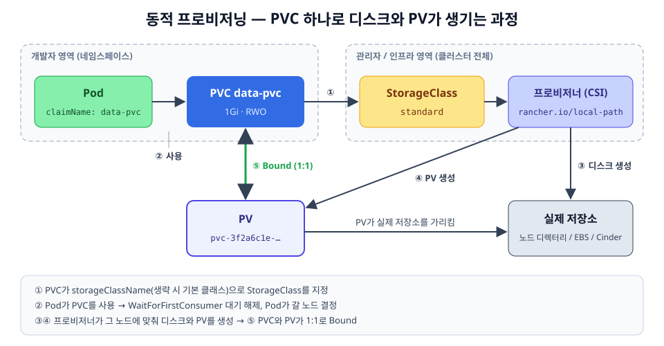

> **Chapter 2 · Kubernetes** | 난이도 ★★★☆☆ | 예상 소요 1.5 ~ 2시간

## 🎯 오늘의 목표

- Pod 수명에 묶인 **임시 볼륨**(emptyDir)과 Pod보다 오래 사는 **영구 볼륨**의 차이를 설명할 수 있다
- **PV / PVC / StorageClass** 가 각각 누구의 관심사인지(관리자 vs 개발자) 설명할 수 있다
- 정적 프로비저닝과 **동적 프로비저닝**을 kind 클러스터에서 직접 해 볼 수 있다
- accessModes, reclaimPolicy, volumeBindingMode 같은 핵심 옵션의 의미를 안다
- StatefulSet의 `volumeClaimTemplates`가 왜 필요한지 안다

---

## 1. 왜 Kubernetes 스토리지는 복잡해 보일까?

Day 04에서 Docker 볼륨은 간단했습니다. `docker volume create` 후 `-v data:/var/lib/mysql`. 끝.

Kubernetes에서는 상황이 다릅니다.

| Docker (Day 04) | Kubernetes |
|---|---|
| 서버 1대 — 볼륨은 그 서버 디스크에 있음 | 노드 여러 대 — Pod가 **어느 노드로 갈지 모름** |
| 컨테이너는 내가 직접 띄우고 지움 | Pod는 장애·업데이트 때 **언제든 다른 노드에서 재생성** |
| 저장소 종류: 로컬 디스크 정도 | AWS EBS, GCE PD, NFS, Ceph, OpenStack Cinder(Day 31)… 수십 가지 |

그래서 Kubernetes는 두 가지를 분리합니다.

> **"스토리지가 필요해요 (요청)"** 와 **"스토리지가 여기 있어요 (제공)"** 를 분리한다.

- 개발자는 **PVC(PersistentVolumeClaim)** 로 "10Gi, 읽기/쓰기 가능한 디스크 주세요"라고 **요청**만 한다
- 실제 디스크는 **PV(PersistentVolume)** 로 표현되며, 관리자가 미리 만들거나 **StorageClass**가 자동으로 만든다
- 앱 YAML에는 NFS 서버 주소나 EBS 볼륨 ID 같은 **인프라 정보가 들어가지 않는다** → 어느 클러스터에서나 같은 YAML

---

## 2. 볼륨의 종류 한눈에 보기



| 분류 | 볼륨 | 수명 | 용도 |
|---|---|---|---|
| **임시** | `emptyDir` | **Pod와 함께** 생성·삭제 (컨테이너 재시작에는 유지) | 컨테이너 간 파일 공유, 캐시, 임시 작업 공간 |
| 임시 | `configMap`, `secret` (Day 13) | Pod와 함께 | 설정·비밀 주입 |
| 노드 | `hostPath` | **노드**에 남음 | 노드 로그 수집 에이전트 등 시스템용. 일반 앱엔 비권장 |
| **영구** | `persistentVolumeClaim` → PV | **Pod와 무관**하게 유지 | DB, 업로드 파일, 메시지 큐 |

> ⚠️ `hostPath`는 Docker의 bind mount와 같습니다. Pod가 다른 노드로 옮겨지면 **다른 디스크**를 보게 되고, 노드 파일 시스템 전체에 접근할 수 있어 보안상 위험합니다. 테스트 외에는 피하세요.

---

## 3. PV / PVC / StorageClass



| 오브젝트 | 누가 다루나 | 범위 | 비유 |
|---|---|---|---|
| **StorageClass** | 클러스터 관리자 | 클러스터 전체 | "디스크 메뉴판" (SSD / HDD / NFS…) |
| **PV** (PersistentVolume) | 관리자 또는 프로비저너가 자동 생성 | 클러스터 전체 (네임스페이스 없음) | 실제 디스크 한 개 |
| **PVC** (PersistentVolumeClaim) | 개발자 | **네임스페이스** | "디스크 주문서" |
| Pod | 개발자 | 네임스페이스 | PVC 이름만 참조 |

### 정적 vs 동적 프로비저닝

| 방식 | 흐름 | 단점/장점 |
|---|---|---|
| **정적** | 관리자가 PV를 미리 만들어 둠 → PVC가 조건 맞는 PV에 **바인딩** | 수요를 예측해야 함, 관리 부담 |
| **동적** | PVC가 StorageClass를 지정 → **프로비저너가 디스크 + PV를 자동 생성** | 요청 즉시 생성. 현재 표준 방식 |

프로비저너는 대부분 **CSI(Container Storage Interface)** 드라이버입니다. Day 01의 CRI(컨테이너 런타임 인터페이스)처럼, 스토리지 업체가 표준 인터페이스에 맞춰 드라이버만 만들면 Kubernetes 코드 수정 없이 붙일 수 있습니다. (OpenStack Cinder용 CSI 드라이버는 Day 34에서 다시 등장합니다.)

### 핵심 옵션

**accessModes** — 몇 개의 노드가 어떻게 마운트할 수 있는가

| 모드 | 약어 | 의미 | 대표 스토리지 |
|---|---|---|---|
| ReadWriteOnce | RWO | **한 노드**에서 읽기/쓰기 (그 노드의 여러 Pod는 가능) | 블록 디스크(EBS, Cinder), local-path |
| ReadOnlyMany | ROX | 여러 노드에서 읽기 전용 | NFS 등 |
| ReadWriteMany | RWX | 여러 노드에서 읽기/쓰기 | NFS, CephFS, EFS |
| ReadWriteOncePod | RWOP | **Pod 하나**만 읽기/쓰기 | CSI 드라이버 (v1.29 GA) |

**reclaimPolicy** — PVC를 지우면 PV(와 실제 데이터)는?

| 정책 | 동작 |
|---|---|
| `Delete` | PV와 실제 디스크까지 **삭제** (동적 프로비저닝 기본값) |
| `Retain` | PV를 `Released` 상태로 남김 → 데이터 보존, 관리자가 수동 정리 (정적 PV 기본값) |

**volumeBindingMode** — PV를 언제 만들/연결할 것인가

| 모드 | 동작 |
|---|---|
| `Immediate` | PVC 생성 즉시 바인딩 → Pod가 디스크와 **다른 노드/존**에 스케줄될 위험 |
| `WaitForFirstConsumer` | **PVC를 쓰는 Pod가 스케줄될 때까지 대기** → Pod가 갈 노드에 맞춰 디스크 생성 |

---

## 4. 실습 준비 — kind의 기본 StorageClass

- 실습 환경: Day 09에서 만든 kind 클러스터 (Kubernetes v1.31+)

kind에는 Rancher의 **local-path-provisioner**가 기본 StorageClass로 설치되어 있습니다. 노드(=Docker 컨테이너)의 로컬 디렉터리를 PV로 만들어 주는 동적 프로비저너입니다.

```bash
kubectl get storageclass
```

```
NAME                 PROVISIONER             RECLAIMPOLICY   VOLUMEBINDINGMODE      ALLOWVOLUMEEXPANSION   AGE
standard (default)   rancher.io/local-path   Delete          WaitForFirstConsumer   false                  2d
```

```bash
kubectl -n local-path-storage get pods      # 프로비저너 Pod
```

> 💡 `(default)` 표시가 붙은 StorageClass는 PVC에서 `storageClassName`을 생략했을 때 자동으로 쓰입니다. 클라우드에선 보통 `gp3`(AWS), `standard-rwo`(GKE) 같은 이름이 기본값입니다.

---

## 5. 실습 ① emptyDir — Pod 안에서 파일 공유

한 컨테이너가 쓰고 다른 컨테이너가 읽는 사이드카 구조(Day 10)입니다.

```yaml
# emptydir-demo.yaml
apiVersion: v1
kind: Pod
metadata:
  name: emptydir-demo
spec:
  containers:
  - name: writer
    image: busybox:1.36
    command: ["sh", "-c", "while true; do date >> /data/log.txt; sleep 5; done"]
    volumeMounts:
    - name: shared
      mountPath: /data
  - name: reader
    image: busybox:1.36
    command: ["sh", "-c", "tail -f /data/log.txt"]
    volumeMounts:
    - name: shared
      mountPath: /data
  volumes:
  - name: shared
    emptyDir: {}           # medium: Memory 를 주면 tmpfs 사용
```

```bash
kubectl apply -f emptydir-demo.yaml
kubectl logs emptydir-demo -c reader -f      # writer가 쓴 내용이 보임 (Ctrl+C)
kubectl delete pod emptydir-demo             # Pod 삭제 = emptyDir 데이터도 삭제
```

---

## 6. 실습 ② 동적 프로비저닝 — PVC만 만들면 PV가 생긴다

### 6-1. PVC 생성

```yaml
# data-pvc.yaml
apiVersion: v1
kind: PersistentVolumeClaim
metadata:
  name: data-pvc
spec:
  accessModes:
  - ReadWriteOnce
  resources:
    requests:
      storage: 1Gi
  # storageClassName 생략 → 기본 StorageClass(standard) 사용
```

```bash
kubectl apply -f data-pvc.yaml
kubectl get pvc data-pvc
```

```
NAME       STATUS    VOLUME   CAPACITY   ACCESS MODES   STORAGECLASS   VOLUMEATTRIBUTESCLASS   AGE
data-pvc   Pending                                      standard       <unset>                 5s
```

`Pending`은 고장이 아닙니다. 이유를 확인해 봅시다.

```bash
kubectl describe pvc data-pvc
# ... Normal  WaitForFirstConsumer  ...  waiting for first consumer to be created before binding
```

`WaitForFirstConsumer` — 이 PVC를 쓰는 Pod가 나타나야 그 Pod가 갈 노드에 디스크를 만듭니다.

### 6-2. PVC를 쓰는 Pod 생성

```yaml
# pvc-pod.yaml
apiVersion: v1
kind: Pod
metadata:
  name: pvc-pod
spec:
  containers:
  - name: app
    image: busybox:1.36
    command: ["sh", "-c", "sleep 3600"]
    volumeMounts:
    - name: data
      mountPath: /data
  volumes:
  - name: data
    persistentVolumeClaim:
      claimName: data-pvc      # Pod는 PVC 이름만 안다
```

```bash
kubectl apply -f pvc-pod.yaml
kubectl get pvc data-pvc
kubectl get pv
```

```
NAME       STATUS   VOLUME                                     CAPACITY   ACCESS MODES   STORAGECLASS   ...
data-pvc   Bound    pvc-3f2a6c1e-8b9d-4e57-a0c2-7d1e9b4f6a21   1Gi        RWO            standard       ...

NAME                                       CAPACITY   ACCESS MODES   RECLAIM POLICY   STATUS   CLAIM              STORAGECLASS   ...
pvc-3f2a6c1e-8b9d-4e57-a0c2-7d1e9b4f6a21   1Gi        RWO            Delete           Bound    default/data-pvc   standard       ...
```

`pvc-<UID>` 이름의 PV가 **자동으로** 만들어지고 PVC와 묶였습니다(Bound).

### 6-3. 데이터가 Pod보다 오래 사는지 확인

```bash
kubectl exec pvc-pod -- sh -c 'echo "hello persistent world" > /data/hello.txt'
kubectl delete pod pvc-pod
kubectl apply -f pvc-pod.yaml
kubectl exec pvc-pod -- cat /data/hello.txt
# hello persistent world   ← Pod를 지웠다 다시 만들어도 데이터가 남아 있다
```

### 6-4. 실제 데이터는 어디에?

local-path-provisioner는 노드의 `/var/local-path-provisioner/` 아래에 디렉터리를 만듭니다. kind 노드는 Docker 컨테이너이니 `docker exec`로 들여다볼 수 있습니다.

```bash
NODE=$(kubectl get pod pvc-pod -o jsonpath='{.spec.nodeName}')
echo $NODE                                   # 예: infra-lab-worker
docker exec $NODE ls /var/local-path-provisioner/
# pvc-3f2a6c1e-..._default_data-pvc
docker exec $NODE sh -c 'cat /var/local-path-provisioner/*_default_data-pvc/hello.txt'
```

> ⚠️ local-path는 **그 노드의 로컬 디스크**입니다. 노드가 죽으면 데이터도 접근 불가이고, PV에 nodeAffinity가 걸려 있어 Pod는 **반드시 그 노드에만** 스케줄됩니다. 학습·개발용이며, 운영에서는 네트워크 스토리지(EBS, Ceph, Cinder 등) CSI 드라이버를 씁니다.

### 6-5. PVC 삭제 → reclaimPolicy: Delete

```bash
kubectl delete pod pvc-pod
kubectl delete pvc data-pvc
kubectl get pv            # 방금의 PV가 사라짐 (No resources found)
```

> 💡 PVC를 쓰는 Pod가 살아 있는 동안 PVC를 지우면 `Terminating`에서 멈춥니다. **Storage Object in Use Protection** 이라는 보호 장치(`kubernetes.io/pvc-protection` finalizer) 덕분에 쓰고 있는 디스크가 갑자기 사라지지 않습니다.

---

## 7. 실습 ③ 정적 프로비저닝 — PV를 직접 만들기

관리자가 PV를 미리 만들고, PVC가 조건에 맞는 PV를 찾아 바인딩하는 과정을 봅니다.

```yaml
# static-pv.yaml
apiVersion: v1
kind: PersistentVolume
metadata:
  name: manual-pv
spec:
  capacity:
    storage: 2Gi
  accessModes:
  - ReadWriteOnce
  persistentVolumeReclaimPolicy: Retain
  storageClassName: manual             # PVC와 맞춰 줄 "이름표"
  hostPath:
    path: /tmp/manual-pv               # 학습용. 노드(컨테이너) 안의 경로
    type: DirectoryOrCreate
---
apiVersion: v1
kind: PersistentVolumeClaim
metadata:
  name: manual-pvc
spec:
  storageClassName: manual
  accessModes:
  - ReadWriteOnce
  resources:
    requests:
      storage: 1Gi                     # 1Gi 요청 → 2Gi PV에 바인딩 가능
```

```bash
kubectl apply -f static-pv.yaml
kubectl get pv manual-pv
kubectl get pvc manual-pvc
```

```
NAME        CAPACITY   ACCESS MODES   RECLAIM POLICY   STATUS   CLAIM                STORAGECLASS   ...
manual-pv   2Gi        RWO            Retain           Bound    default/manual-pvc   manual         ...

NAME         STATUS   VOLUME      CAPACITY   ACCESS MODES   STORAGECLASS   ...
manual-pvc   Bound    manual-pv   2Gi        RWO            manual         ...
```

- `manual`이라는 StorageClass **오브젝트는 존재하지 않습니다.** 이 경우 이름은 PV–PVC 매칭용 라벨처럼만 쓰이고, 프로비저너가 없으니 **즉시 바인딩**됩니다
- 1Gi를 요청했지만 2Gi PV에 묶였습니다. 바인딩은 1:1이라 남는 1Gi는 다른 PVC가 쓸 수 없습니다

Retain 정책을 확인합니다.

```bash
kubectl delete pvc manual-pvc
kubectl get pv manual-pv
# STATUS: Released   ← PV와 데이터가 남아 있음. 새 PVC에 자동으로 다시 묶이지는 않음
kubectl delete pv manual-pv   # 관리자가 수동 정리
```

> ⚠️ `storageClassName`을 **생략**한 PVC는 기본 StorageClass(standard)로 동적 프로비저닝을 시도해 우리가 만든 PV와 매칭되지 않습니다. 정적 PV를 쓰려면 PV와 PVC 양쪽에 같은 `storageClassName`을 명시하세요. (기본 클래스를 쓰지 않으려면 `storageClassName: ""`)

---

## 8. StatefulSet과 volumeClaimTemplates (맛보기)

DB를 replicas 3으로 늘린다고 해 봅시다. Deployment에 PVC 하나를 연결하면 3개 Pod가 **같은 디스크**를 공유하려 하고, RWO라면 다른 노드의 Pod는 마운트조차 못 합니다. DB는 **Pod마다 자기 디스크**가 필요합니다.

```yaml
# web-sts.yaml
apiVersion: v1
kind: Service
metadata:
  name: web-sts
spec:
  clusterIP: None          # Headless Service (Day 12)
  selector:
    app: web-sts
  ports:
  - port: 80
---
apiVersion: apps/v1
kind: StatefulSet
metadata:
  name: web-sts
spec:
  serviceName: web-sts
  replicas: 2
  selector:
    matchLabels:
      app: web-sts
  template:
    metadata:
      labels:
        app: web-sts
    spec:
      containers:
      - name: nginx
        image: nginx:1.27
        volumeMounts:
        - name: www
          mountPath: /usr/share/nginx/html
  volumeClaimTemplates:          # Pod마다 PVC를 하나씩 찍어냄
  - metadata:
      name: www
    spec:
      accessModes: ["ReadWriteOnce"]
      resources:
        requests:
          storage: 1Gi
```

```bash
kubectl apply -f web-sts.yaml
kubectl get pods -l app=web-sts       # web-sts-0, web-sts-1 (순서대로, 고정 이름)
kubectl get pvc                       # www-web-sts-0, www-web-sts-1
```

| | Deployment | StatefulSet |
|---|---|---|
| Pod 이름 | 랜덤 (`web-6d4b8c7f9d-2xk8p`) | **고정 순번** (`web-sts-0`, `web-sts-1`) |
| 스토리지 | 모든 Pod가 같은 PVC 공유 | **Pod마다 전용 PVC**, 재생성돼도 같은 PVC에 다시 연결 |
| 네트워크 ID | Service 뒤 익명 | `web-sts-0.web-sts` 처럼 Pod별 DNS |
| 생성/삭제 순서 | 동시 | 0 → 1 → 2 순서 |

> ⚠️ StatefulSet을 지워도 PVC는 **자동 삭제되지 않습니다**(데이터 보호). 정리할 때 직접 지워야 합니다.

```bash
kubectl delete -f web-sts.yaml
kubectl delete pvc www-web-sts-0 www-web-sts-1
```

---

## 9. 트러블슈팅

| 증상 | 원인 | 해결 |
|---|---|---|
| PVC가 `Pending`, 이벤트에 `waiting for first consumer` | `WaitForFirstConsumer` 모드 — 정상 | PVC를 쓰는 Pod를 만들면 바인딩됨 |
| PVC가 `Pending`, `no persistent volumes available for this claim and no storage class is set` | 기본 StorageClass 없음 / 맞는 PV 없음 | `kubectl get sc` 확인, `storageClassName` 지정 또는 조건(용량·accessModes) 맞는 PV 생성 |
| Pod가 `Pending`, `unbound immediate PersistentVolumeClaims` | Pod가 참조한 PVC가 아직 바인딩 안 됨 | PVC 상태와 이벤트부터 확인 |
| Pod가 `ContainerCreating`, `Multi-Attach error` | RWO 볼륨을 **다른 노드**의 Pod가 이미 사용 중 | 기존 Pod 종료 확인, 공유가 필요하면 RWX 스토리지 사용 |
| PVC 삭제가 `Terminating`에서 멈춤 | 아직 Pod가 사용 중 (pvc-protection finalizer) | 그 PVC를 쓰는 Pod/Deployment 먼저 삭제 |
| PVC 용량을 늘렸는데 `only dynamically provisioned pvc can be resized and the storageclass that provisions the pvc must support resize` 오류 | StorageClass가 확장 미지원 (kind의 local-path 포함) | 확장 지원 StorageClass(`allowVolumeExpansion: true`)와 CSI 드라이버 사용 |
| `Released` PV에 새 PVC가 안 붙음 | Retain PV에 이전 claimRef가 남아 있음 | 데이터 백업 후 PV 삭제·재생성 (또는 `spec.claimRef` 제거) |

---

## 10. 핵심 정리

- `emptyDir`은 Pod와 운명을 같이하는 임시 공간, **PVC**에 연결된 PV는 Pod와 무관하게 남는다
- **PVC = 요청(개발자)**, **PV = 실제 디스크(관리자/프로비저너)**, **StorageClass = 디스크 종류와 자동 생성 규칙**
- 동적 프로비저닝: PVC → StorageClass의 **CSI 프로비저너**가 디스크와 PV를 자동 생성
- kind 기본 StorageClass `standard` = local-path, **WaitForFirstConsumer**, **Delete**
- accessModes(RWO/ROX/RWX/RWOP), reclaimPolicy(Delete/Retain)는 꼭 확인
- 상태가 있는 앱의 복제본마다 디스크가 필요하면 **StatefulSet + volumeClaimTemplates**

---

## 11. 셀프 체크

<details>
<summary>Q1. PVC를 만들었는데 STATUS가 계속 Pending이다. kind 환경에서 가장 먼저 의심할 것은?</summary>

kind 기본 StorageClass는 `volumeBindingMode: WaitForFirstConsumer` 이므로, **그 PVC를 사용하는 Pod가 아직 없으면 Pending이 정상**입니다. Pod를 만들면 바인딩됩니다. `kubectl describe pvc` 이벤트로 확인할 수 있습니다.
</details>

<details>
<summary>Q2. PV와 PVC 중 네임스페이스에 속하는 것은? 그 이유는?</summary>

**PVC**입니다. PVC는 앱(개발자)이 네임스페이스 안에서 하는 요청이고, PV는 클러스터 전체가 공유하는 인프라 자원(실제 디스크)이라 네임스페이스가 없습니다.
</details>

<details>
<summary>Q3. reclaimPolicy가 Delete인 PV의 PVC를 지우면 어떻게 되나? Retain이면?</summary>

Delete: PV와 **실제 디스크(데이터)까지 삭제**됩니다. Retain: PV가 `Released` 상태로 남고 데이터도 보존되며, 관리자가 수동으로 정리하거나 재사용해야 합니다.
</details>

<details>
<summary>Q4. <code>WaitForFirstConsumer</code>가 <code>Immediate</code>보다 나은 상황은?</summary>

디스크가 특정 노드나 가용 영역(AZ)에 묶이는 경우입니다. Immediate는 Pod 위치를 모른 채 디스크를 먼저 만들어서, Pod가 디스크와 다른 노드/AZ에 스케줄돼 마운트를 못 하는 문제가 생길 수 있습니다. WaitForFirstConsumer는 Pod 스케줄링 결과에 맞춰 디스크를 만듭니다.
</details>

<details>
<summary>Q5. replicas 3인 DB를 Deployment + PVC 1개로 만들면 어떤 문제가 생기나?</summary>

세 Pod가 **같은 PVC 하나**를 공유하려 합니다. RWO 볼륨이면 다른 노드의 Pod는 `Multi-Attach error`로 뜨지 못하고, 같은 노드라도 DB 프로세스 여러 개가 한 데이터 디렉터리를 쓰면 데이터가 깨집니다. StatefulSet의 `volumeClaimTemplates`로 Pod마다 전용 PVC를 만들어야 합니다.
</details>

---

## ⏭️ 다음 예고 — Day 15. Ingress & Gateway API로 외부 트래픽 라우팅

Day 12에서 서비스마다 LoadBalancer를 만들면 LB가 서비스 수만큼 늘어난다고 했죠. **LB 하나로 `/api`는 A 서비스, `/web`은 B 서비스**로 보내고, HTTPS 인증서도 한곳에서 처리하는 **Ingress**를 kind + Traefik으로 직접 구성하고, 앞으로의 표준인 **Gateway API**로 가중치 기반 카나리 라우팅까지 해 봅니다.
