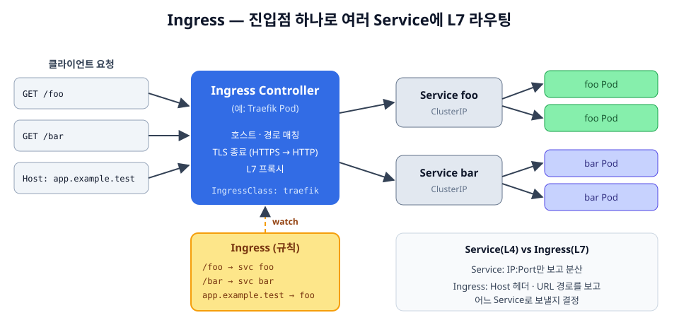
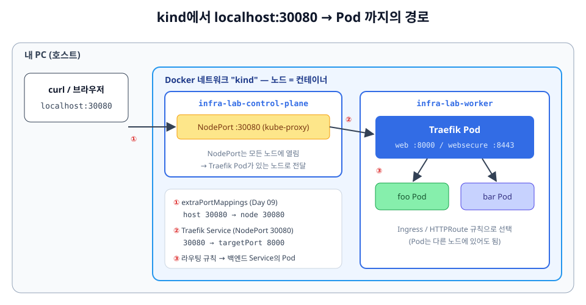
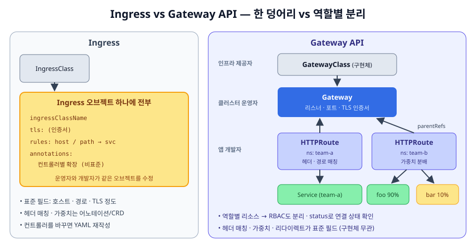

> **Chapter 2 · Kubernetes** | 난이도 ★★★☆☆ | 예상 소요 2 ~ 2.5시간

## 🎯 오늘의 목표

- Service(L4)만으로는 부족한 이유와 **Ingress(L7)** 가 푸는 문제를 설명할 수 있다
- **Ingress 리소스**(규칙)와 **Ingress Controller**(실행자)의 차이를 안다
- kind의 `extraPortMappings` + **Traefik** NodePort로 `localhost`까지 이어지는 경로를 구성할 수 있다
- **경로 기반 / 호스트 기반 라우팅**과 **TLS 종료**를 Ingress로 설정할 수 있다
- 앞으로의 표준인 **Gateway API**(GatewayClass / Gateway / HTTPRoute)로 같은 라우팅과 **가중치 기반 카나리**를 구성할 수 있다

---

## 1. 왜 Ingress인가?

Day 12에서 Service를 외부에 노출하는 방법으로 NodePort와 LoadBalancer를 배웠습니다. 그런데 서비스가 10개라면?

| 방법 | 문제 |
|---|---|
| 서비스마다 **LoadBalancer** | 클라우드 LB 10개 = 비용 10배, 공인 IP 10개 |
| 서비스마다 **NodePort** | `:30080`, `:30081`… 사용자가 포트 번호를 외워야 함 |
| Service 자체 | **L4(IP:Port)** 만 봄 → `/api`와 `/web`을 구분 못 함, HTTPS 인증서도 각 앱이 처리 |

Ingress는 **HTTP(S) 계층(L7)** 에서 동작하는 "클러스터의 정문"입니다.

> **진입점 하나 → Ingress Controller → 호스트/경로 규칙에 따라 → 여러 Service로 분배**

- `shop.example.com` → shop 서비스, `api.example.com` → api 서비스 (**호스트 기반**)
- `example.com/foo` → foo 서비스, `example.com/bar` → bar 서비스 (**경로 기반**)
- HTTPS 인증서는 진입점에서 한 번에 처리 (**TLS 종료**) — 뒤쪽 앱은 HTTP만 신경 쓰면 됨

Docker 시절로 비유하면, Day 06에서 nginx 컨테이너를 리버스 프록시로 앞에 세워 여러 앱으로 나눠 보내던 구성을 **Kubernetes 오브젝트로 선언**하는 것입니다.

---

## 2. Ingress 리소스 vs Ingress Controller



| 구분 | Ingress (리소스) | Ingress Controller |
|---|---|---|
| 정체 | YAML로 작성하는 **라우팅 규칙** | 규칙을 읽어 실제로 트래픽을 처리하는 **프록시 Pod** |
| 기본 설치 여부 | API는 기본 제공 (`networking.k8s.io/v1`) | ❌ **직접 설치해야 함** |
| 예 | `host: foo.example.test`, `path: /foo` | Traefik, HAProxy, Contour, Kong, 클라우드 LB 연동 컨트롤러 |

> ⚠️ Ingress Controller 없이 Ingress만 만들면 **아무 일도 일어나지 않습니다.** 에러도 없이 조용히 무시될 뿐이라 초보자가 가장 많이 헤매는 지점입니다. Deployment에 Deployment 컨트롤러(Day 11)가 있듯 Ingress에도 컨트롤러가 필요한데, 이건 기본 탑재가 아닙니다.

어느 컨트롤러가 어떤 Ingress를 처리할지는 **IngressClass**로 정합니다. Ingress의 `spec.ingressClassName`이 IngressClass 이름을 가리키고, IngressClass는 다시 컨트롤러를 가리킵니다.

### Ingress 매니페스트 해부

```yaml
apiVersion: networking.k8s.io/v1
kind: Ingress
metadata:
  name: example
spec:
  ingressClassName: traefik        # 어느 컨트롤러가 처리할지 (IngressClass 이름)
  tls:                             # (선택) HTTPS
  - hosts: ["app.example.test"]
    secretName: app-tls            # kubernetes.io/tls 타입 Secret (Day 13)
  rules:
  - host: app.example.test         # 생략하면 모든 호스트
    http:
      paths:
      - path: /foo
        pathType: Prefix           # Prefix | Exact | ImplementationSpecific
        backend:
          service:
            name: foo              # 같은 네임스페이스의 Service
            port:
              number: 8080
  defaultBackend:                  # (선택) 어떤 규칙에도 안 맞을 때
    service:
      name: fallback
      port:
        number: 80
```

| pathType | 매칭 방식 (명세 기준) | `/foo` 규칙에 대해 |
|---|---|---|
| `Exact` | 정확히 일치 | `/foo` ⭕, `/foo/` ❌, `/foo/a` ❌ |
| `Prefix` | **`/` 단위 경로 요소**의 접두사 | `/foo` ⭕, `/foo/a` ⭕, `/foobar` ❌ |
| `ImplementationSpecific` | 컨트롤러 마음대로 | 컨트롤러 문서 참조 |

> 💡 여러 규칙이 겹치면 **가장 긴 경로**가 우선이고, 길이가 같으면 `Exact`가 `Prefix`보다 우선합니다.

---

## 3. 컨트롤러 선택 — Traefik, 그리고 Gateway API

> ⚠️ **ingress-nginx는 지원이 종료되었습니다.** 블로그·책·사내 문서 같은 레거시 자료에서는 `kubectl apply -f .../ingress-nginx/.../deploy.yaml` 과 `ingressClassName: nginx`, `nginx.ingress.kubernetes.io/...` 어노테이션을 아주 많이 보게 됩니다. 하지만 Kubernetes 커뮤니티의 ingress-nginx 프로젝트는 2025년 11월 은퇴를 발표했고 **2026년 3월 이후 릴리스·버그 수정·보안 패치가 없습니다**(저장소 아카이브). 기존 클러스터에서 읽고 이관할 줄은 알아야 하지만, **새로 설치하지는 마세요.**

| 항목 | 상태 |
|---|---|
| **Ingress API** (`networking.k8s.io/v1`) | GA, 계속 지원됨. 다만 기능 추가는 동결 |
| **Traefik** | 활발히 유지보수 중. **Ingress와 Gateway API를 모두 지원** |
| **Gateway API** | Ingress의 후속 표준. 신규 구축의 기본 선택지 |

오늘은 **Traefik** 하나로 Ingress(5~6장)와 Gateway API(7장)를 모두 실습합니다. 같은 컨트롤러가 두 API를 동시에 처리하니 차이를 나란히 비교하기 좋습니다.

> 💡 Gateway API 전용 구현체로는 **Envoy Gateway**, NGINX Gateway Fabric, Istio, Cilium, Kong 등이 있습니다. 개념과 YAML(GatewayClass / Gateway / HTTPRoute)은 구현체가 달라도 동일합니다.

---

## 4. kind에서 트래픽이 들어오는 경로



kind의 노드는 Docker 컨테이너입니다(Day 09). Day 09에서 `infra-lab` 클러스터를 만들 때 control-plane 노드에 **`extraPortMappings`(호스트 30080 → 노드 30080)** 를 미리 열어 두었죠. 오늘은 이 다리를 그대로 Ingress 진입점으로 씁니다.

1. **호스트 → 노드 컨테이너**: `extraPortMappings` 가 내 PC `localhost:30080` → control-plane 노드 컨테이너 `30080` 을 연결 (= `docker run -p 30080:30080`)
2. **노드 → Traefik Pod**: Traefik Service를 **NodePort `30080`** 으로 고정 → kube-proxy가 Traefik Pod의 `8000`(web 엔트리포인트)으로 전달 (Day 12). NodePort는 모든 노드에 열리므로 Traefik Pod가 워커 노드에 있어도 됨
3. **Traefik → 앱**: Ingress/HTTPRoute 규칙에 따라 foo / bar Service의 Pod로 프록시

> ⚠️ `extraPortMappings`는 **클러스터 생성 시에만** 지정할 수 있습니다(`docker run -p` 처럼). Day 09에서 30080 하나만 열어 두었으므로, HTTPS(443) 실습은 6-4에서 `kubectl port-forward`로 대신합니다. Day 12 실습의 `web-nodeport` Service(nodePort 30080)가 남아 있다면 먼저 지우세요: `kubectl delete svc web-nodeport --ignore-not-found`

---

## 5. 실습 ① Traefik 설치

- 실습 환경: Day 09의 kind 클러스터 `infra-lab` (Kubernetes v1.31+), Docker Desktop 또는 Linux Docker Engine
- **Helm** 필요 — Helm 자체는 Day 16에서 자세히 다루고, 오늘은 설치 명령만 씁니다
  - macOS `brew install helm` / Windows `winget install Helm.Helm` / Linux는 [공식 설치 문서](https://helm.sh/docs/intro/install/)
- 셸 예시는 bash 기준 (Linux / macOS / WSL2 / Git Bash)

### 5-1. 클러스터와 포트 매핑 확인

```bash
mkdir -p ~/k8s-day15 && cd ~/k8s-day15
kubectl config use-context kind-infra-lab
docker ps --filter "name=infra-lab-control-plane" --format "{{.Names}}  {{.Ports}}"
# infra-lab-control-plane  0.0.0.0:30080->30080/tcp, 127.0.0.1:xxxxx->6443/tcp
```

`0.0.0.0:30080->30080/tcp` 가 보이면 준비 완료입니다.

> 💡 **(선택) `localhost:80/443` 으로 쓰고 싶다면** — 80/443을 매핑한 실습용 클러스터를 따로 만들 수 있습니다. 이때 5-3의 values에 `ports.websecure.nodePort: 30443` 도 추가하고, 이후 명령의 30080 대신 80을 쓰면 됩니다. (호스트의 80/443이 비어 있어야 함)
>
> ```yaml
> # kind-ingress.yaml
> kind: Cluster
> apiVersion: kind.x-k8s.io/v1alpha4
> name: ingress-lab
> nodes:
> - role: control-plane
>   extraPortMappings:
>   - containerPort: 30080    # Traefik web NodePort
>     hostPort: 80
>     protocol: TCP
>   - containerPort: 30443    # Traefik websecure NodePort
>     hostPort: 443
>     protocol: TCP
> ```
>
> `kind create cluster --config kind-ingress.yaml` → context `kind-ingress-lab`

### 5-2. Gateway API CRD 설치

Gateway API는 Kubernetes에 **기본 포함되지 않은 CRD(Custom Resource Definition)** 입니다. Traefik이 Gateway API를 처리하려면 CRD가 먼저 있어야 하므로 Traefik보다 **먼저** 설치합니다. (Traefik 차트가 안내하는 표준 채널 버전)

```bash
kubectl apply --server-side -f https://github.com/kubernetes-sigs/gateway-api/releases/download/v1.6.3/standard-install.yaml
kubectl get crd | grep gateway.networking.k8s.io
# gatewayclasses.gateway.networking.k8s.io / gateways... / httproutes... / grpcroutes... / referencegrants...
```

### 5-3. Traefik 설치 (Helm 차트)

```yaml
# traefik-values.yaml
service:
  spec:
    type: NodePort            # kind에는 클라우드 LB가 없으므로 NodePort로 노출
ports:
  web:
    nodePort: 30080           # Day 09 extraPortMappings의 containerPort와 일치시킴
providers:
  kubernetesIngress:
    strictPrefixMatching: true  # pathType: Prefix를 명세대로(경로 요소 단위) 매칭
  kubernetesGateway:
    enabled: true             # Gateway API 지원 켜기
gateway:
  listeners:
    web:
      port: 8000              # Traefik web 엔트리포인트 포트
      protocol: HTTP
      namespacePolicy:
        from: All             # 모든 네임스페이스의 HTTPRoute 허용 (기본은 같은 네임스페이스만)
```

```bash
helm repo add traefik https://traefik.github.io/charts
helm repo update
helm install traefik traefik/traefik --version 42.4.0 \
  --namespace traefik --create-namespace \
  -f traefik-values.yaml

kubectl -n traefik rollout status deployment/traefik
```

설치 결과를 확인합니다.

```bash
kubectl -n traefik get pods,svc
kubectl get ingressclass
kubectl get gatewayclass
kubectl -n traefik get gateway
```

```
NAME                           READY   STATUS    RESTARTS   AGE
pod/traefik-7f9c8d6b5d-q8x2m   1/1     Running   0          40s

NAME              TYPE       CLUSTER-IP     EXTERNAL-IP   PORT(S)                      AGE
service/traefik   NodePort   10.96.73.210   <none>        80:30080/TCP,443:31872/TCP   40s

NAME      CONTROLLER                      PARAMETERS   AGE
traefik   traefik.io/ingress-controller   <none>       40s

NAME      CONTROLLER                      ACCEPTED   AGE
traefik   traefik.io/gateway-controller   True       40s

NAME              CLASS     ADDRESS   PROGRAMMED   AGE
traefik-gateway   traefik             True         40s
```

차트 하나로 **IngressClass `traefik`**(기본 클래스로 지정됨), **GatewayClass `traefik`**, 그리고 기본 **Gateway `traefik-gateway`** 까지 만들어졌습니다.

websecure 쪽 NodePort(`443:31872`)는 자동 할당되었습니다. 호스트에 매핑하지 않았으므로 값은 상관없습니다.

아무 규칙 없이 접속하면 Traefik의 기본 404가 돌아옵니다. **localhost:30080 → 노드:30080 → Traefik** 경로가 열렸다는 증거입니다.

```bash
curl -i http://localhost:30080/
# HTTP/1.1 404 Not Found
# ...
# 404 page not found
```

---

## 6. 실습 ② Ingress — 경로 · 호스트 · TLS

### 6-1. 백엔드 앱 두 개

`agnhost serve-hostname`은 어느 경로로 요청하든 **자기 Pod 이름**을 돌려주는 Kubernetes 공식 테스트 서버입니다. 어떤 서비스로 라우팅됐는지 바로 보입니다.

```yaml
# apps.yaml
apiVersion: apps/v1
kind: Deployment
metadata:
  name: foo
spec:
  replicas: 2
  selector:
    matchLabels: {app: foo}
  template:
    metadata:
      labels: {app: foo}
    spec:
      containers:
      - name: foo
        image: registry.k8s.io/e2e-test-images/agnhost:2.39
        command: ["/agnhost", "serve-hostname", "--http=true", "--port=8080"]
---
apiVersion: v1
kind: Service
metadata:
  name: foo
spec:
  selector: {app: foo}
  ports:
  - port: 8080
---
apiVersion: apps/v1
kind: Deployment
metadata:
  name: bar
spec:
  replicas: 2
  selector:
    matchLabels: {app: bar}
  template:
    metadata:
      labels: {app: bar}
    spec:
      containers:
      - name: bar
        image: registry.k8s.io/e2e-test-images/agnhost:2.39
        command: ["/agnhost", "serve-hostname", "--http=true", "--port=8080"]
---
apiVersion: v1
kind: Service
metadata:
  name: bar
spec:
  selector: {app: bar}
  ports:
  - port: 8080
```

```bash
kubectl apply -f apps.yaml
kubectl rollout status deployment/foo && kubectl rollout status deployment/bar
```

두 Service 모두 **ClusterIP**(기본값)입니다. 외부 노출은 오직 Traefik 하나가 담당합니다.

### 6-2. 경로 기반 라우팅

```yaml
# ingress-path.yaml
apiVersion: networking.k8s.io/v1
kind: Ingress
metadata:
  name: path-ingress
spec:
  ingressClassName: traefik
  rules:
  - http:
      paths:
      - path: /foo
        pathType: Prefix
        backend:
          service:
            name: foo
            port:
              number: 8080
      - path: /bar
        pathType: Prefix
        backend:
          service:
            name: bar
            port:
              number: 8080
```

```bash
kubectl apply -f ingress-path.yaml
kubectl get ingress path-ingress
```

```
NAME           CLASS     HOSTS   ADDRESS   PORTS   AGE
path-ingress   traefik   *                 80      10s
```

> 💡 Traefik을 NodePort로 노출했기 때문에 Ingress의 ADDRESS 칸은 비어 있을 수 있습니다. 라우팅과는 무관하니 신경 쓰지 않아도 됩니다.

```bash
curl http://localhost:30080/foo        # foo-6b7c9d8f5-k2x8z
curl http://localhost:30080/foo/abc    # foo-6b7c9d8f5-p9q4w   (Prefix: 하위 경로 매칭)
curl http://localhost:30080/bar        # bar-5d8f7c6b9-h3j7m
curl -i http://localhost:30080/foobar  # 404 — Prefix는 경로 "요소" 단위라 /foo와 매칭 안 됨
```

> 💡 values에서 `strictPrefixMatching: true` 를 주지 않으면 Traefik은 `/foobar`도 `/foo`로 보냅니다. 이렇게 **명세와 구현의 미묘한 차이**가 컨트롤러마다 있다는 점이 Ingress의 약점 중 하나입니다. 백엔드에는 `/foo` 경로가 그대로 전달되며, 앱이 `/`만 처리한다면 Traefik은 `Middleware`(stripPrefix) CRD로 경로를 잘라 넘깁니다 — 이런 확장 역시 **컨트롤러 전용 문법**입니다.

### 6-3. 호스트 기반 라우팅

```yaml
# ingress-host.yaml
apiVersion: networking.k8s.io/v1
kind: Ingress
metadata:
  name: host-ingress
spec:
  ingressClassName: traefik
  rules:
  - host: foo.example.test
    http:
      paths:
      - path: /
        pathType: Prefix
        backend:
          service:
            name: foo
            port:
              number: 8080
  - host: bar.example.test
    http:
      paths:
      - path: /
        pathType: Prefix
        backend:
          service:
            name: bar
            port:
              number: 8080
```

```bash
kubectl apply -f ingress-host.yaml
```

DNS가 없으니 curl에게 "이 도메인:포트로 가는 연결은 실제로는 127.0.0.1:30080으로 보내라"고 알려 줍니다. `--connect-to`는 **URL과 `Host` 헤더는 그대로 두고 접속 대상만** 바꿉니다.

```bash
curl --connect-to foo.example.test:80:127.0.0.1:30080 http://foo.example.test/   # foo-...
curl --connect-to bar.example.test:80:127.0.0.1:30080 http://bar.example.test/   # bar-...

# 같은 효과: Host 헤더를 직접 지정
curl -H "Host: bar.example.test" http://localhost:30080/
```

> 💡 `.test`는 테스트용으로 예약된 TLD라 실제 도메인과 충돌하지 않습니다. 80/443을 매핑한 선택 클러스터를 만들었다면 hosts 파일(Linux/macOS `/etc/hosts`, Windows `C:\Windows\System32\drivers\etc\hosts`)에 `127.0.0.1 foo.example.test bar.example.test` 를 추가해 브라우저로도 확인할 수 있습니다.

### 6-4. TLS 종료 (HTTPS)

자체 서명 인증서로 TLS Secret을 만듭니다 (Day 13의 `kubernetes.io/tls` 타입).

```bash
openssl req -x509 -nodes -days 365 -newkey rsa:2048 \
  -keyout tls.key -out tls.crt \
  -subj "/CN=app.example.test" \
  -addext "subjectAltName=DNS:app.example.test"

kubectl create secret tls app-tls --cert=tls.crt --key=tls.key
kubectl get secret app-tls       # TYPE: kubernetes.io/tls
```

> ⚠️ Windows Git Bash에서는 `-subj "/CN=..."` 의 `/`가 Windows 경로로 바뀌어 오류가 날 수 있습니다. 명령 앞에 `MSYS_NO_PATHCONV=1` 을 붙이거나 `-subj "//CN=app.example.test"` 로 쓰세요.

```yaml
# ingress-tls.yaml
apiVersion: networking.k8s.io/v1
kind: Ingress
metadata:
  name: tls-ingress
  annotations:
    traefik.ingress.kubernetes.io/router.entrypoints: websecure   # HTTPS(443) 쪽에서만 받기
spec:
  ingressClassName: traefik
  tls:
  - hosts:
    - app.example.test
    secretName: app-tls
  rules:
  - host: app.example.test
    http:
      paths:
      - path: /
        pathType: Prefix
        backend:
          service:
            name: foo
            port:
              number: 8080
```

```bash
kubectl apply -f ingress-tls.yaml
```

호스트에 443을 매핑하지 않았으므로, **다른 터미널**에서 Traefik Service의 443 포트로 터널을 엽니다. (Day 12의 port-forward)

```bash
kubectl -n traefik port-forward svc/traefik 8443:443
```

```bash
# -k: 자체 서명 인증서라 검증 생략. SNI와 Host는 app.example.test, 실제 접속은 127.0.0.1:8443
curl -k --connect-to app.example.test:443:127.0.0.1:8443 https://app.example.test/
# foo-6b7c9d8f5-k2x8z

# 어떤 인증서가 제시되는지 확인 → CN=app.example.test
curl -kv --connect-to app.example.test:443:127.0.0.1:8443 https://app.example.test/ 2>&1 | grep -E "subject:|issuer:"
```

backend의 foo Pod는 여전히 평문 HTTP 8080만 처리하고, 암호화/복호화는 Traefik이 전담합니다. 이것이 **TLS 종료**입니다.

> 💡 운영에서는 **cert-manager**가 Let's Encrypt 등에서 인증서를 자동 발급·갱신해 TLS Secret을 채워 줍니다. HTTP → HTTPS 리다이렉트는 Traefik values의 `ports.web.http.redirections` 로 전역 설정할 수 있습니다.

---

## 7. 실습 ③ Gateway API — 앞으로의 표준



### 7-1. Ingress의 한계와 Gateway API의 설계

| Ingress의 한계 | Gateway API의 해법 |
|---|---|
| 표준 필드가 호스트·경로·TLS 정도 → 헤더 매칭, 가중치, 리다이렉트는 **컨트롤러별 어노테이션/CRD** | 헤더·쿼리·메서드 매칭, **가중치 분배**, 리다이렉트·URL 재작성·헤더 수정이 **표준 필드** |
| 인프라 담당자와 앱 개발자가 **한 오브젝트**를 같이 수정 | **역할별 리소스 분리** — 권한(RBAC)도 리소스 단위로 분리 가능 |
| HTTP(S) 위주 | HTTPRoute 외에 **GRPCRoute**, TLSRoute, TCP/UDPRoute |
| 동작 차이가 구현체마다 제각각 | **적합성(conformance) 테스트**로 구현체 간 동작 통일 |

| 리소스 | 담당 | 역할 | Ingress의 대응 |
|---|---|---|---|
| **GatewayClass** | 인프라 제공자 | 어떤 구현체(컨트롤러)를 쓸지 | IngressClass |
| **Gateway** | 클러스터 운영자 | 리스너(포트·프로토콜·TLS 인증서), 어느 네임스페이스의 라우트를 받을지 | 컨트롤러 설정 + `spec.tls` |
| **HTTPRoute** | 앱 개발자 | 호스트·경로·헤더 매칭 → 백엔드(가중치) | `spec.rules` + 어노테이션 |
| ReferenceGrant | 대상 네임스페이스 소유자 | 다른 네임스페이스의 Secret/Service 참조 허용 | (없음) |

방금 Traefik 차트가 GatewayClass(`traefik`)와 Gateway(`traefik-gateway`, traefik 네임스페이스)를 만들어 두었습니다. **운영자 몫은 끝난 셈**이고, 개발자는 자기 네임스페이스에 HTTPRoute만 만들면 됩니다.

```bash
kubectl -n traefik get gateway traefik-gateway -o yaml | grep -A8 "listeners:"
```

```yaml
  listeners:
  - allowedRoutes:
      namespaces:
        from: All          # values의 namespacePolicy
    name: web
    port: 8000
    protocol: HTTP
```

### 7-2. HTTPRoute — 호스트 + 경로 라우팅

```yaml
# route-basic.yaml
apiVersion: gateway.networking.k8s.io/v1
kind: HTTPRoute
metadata:
  name: app-route
  namespace: default
spec:
  parentRefs:                        # 어느 Gateway에 붙을지 (다른 네임스페이스)
  - name: traefik-gateway
    namespace: traefik
  hostnames:
  - "gw.example.test"
  rules:
  - matches:
    - path:
        type: PathPrefix
        value: /foo
    backendRefs:
    - name: foo
      port: 8080
  - matches:
    - path:
        type: PathPrefix
        value: /bar
    backendRefs:
    - name: bar
      port: 8080
```

```bash
kubectl apply -f route-basic.yaml
kubectl get httproute app-route
```

```
NAME        HOSTNAMES             AGE
app-route   ["gw.example.test"]   5s
```

```bash
curl --connect-to gw.example.test:80:127.0.0.1:30080 http://gw.example.test/foo   # foo-...
curl --connect-to gw.example.test:80:127.0.0.1:30080 http://gw.example.test/bar   # bar-...
```

라우트가 Gateway에 제대로 붙었는지는 **status**에서 확인합니다. Ingress에는 없던, Gateway API의 큰 장점입니다.

```bash
kubectl describe httproute app-route
# Status:
#   Parents:
#     Conditions:
#       Reason: Accepted      Status: True    Type: Accepted       ← Gateway가 받아들임
#       Reason: ResolvedRefs  Status: True    Type: ResolvedRefs   ← 백엔드 Service 확인됨
#     Parent Ref:  Name: traefik-gateway  Namespace: traefik
```

### 7-3. 어노테이션 없이 카나리 배포 — 가중치와 헤더 매칭

foo를 현재 버전(stable), bar를 새 버전(canary)이라고 가정해 봅시다. 트래픽의 **10%만 새 버전**으로 보내고, `X-Canary: true` 헤더를 붙인 테스터는 **무조건 새 버전**으로 보냅니다.

```yaml
# route-canary.yaml
apiVersion: gateway.networking.k8s.io/v1
kind: HTTPRoute
metadata:
  name: canary-route
  namespace: default
spec:
  parentRefs:
  - name: traefik-gateway
    namespace: traefik
  hostnames:
  - "canary.example.test"
  rules:
  - matches:                         # 규칙 1: 헤더가 있으면 새 버전
    - path:
        type: PathPrefix
        value: /
      headers:
      - name: X-Canary
        value: "true"
    backendRefs:
    - name: bar
      port: 8080
  - matches:                         # 규칙 2: 나머지는 90:10 분배
    - path:
        type: PathPrefix
        value: /
    backendRefs:
    - name: foo
      port: 8080
      weight: 90
    - name: bar
      port: 8080
      weight: 10
```

```bash
kubectl apply -f route-canary.yaml

# 50번 호출해서 어느 쪽으로 갔는지 세어 보기
for i in $(seq 1 50); do
  curl -s --connect-to canary.example.test:80:127.0.0.1:30080 http://canary.example.test/; echo
done | cut -d- -f1 | sort | uniq -c
```

```
     45 foo
      5 bar
```

(확률 분배라 매번 숫자는 조금씩 다릅니다.)

```bash
curl -s -H "X-Canary: true" --connect-to canary.example.test:80:127.0.0.1:30080 http://canary.example.test/
# bar-...   ← 헤더가 있으면 항상 새 버전
```

> 💡 경로가 같은 규칙끼리는 **헤더 조건이 더 많은 규칙이 우선**합니다. 그래서 규칙 순서와 상관없이 헤더를 붙인 요청은 규칙 1로 갑니다. 이 우선순위 규칙까지 **명세에 정의**되어 있어 구현체를 바꿔도 동작이 같습니다. Ingress로 같은 일을 하려면 컨트롤러마다 다른 어노테이션이나 전용 CRD가 필요했습니다.

비율을 바꾸려면 `weight`만 고쳐 다시 apply하면 됩니다(예: 50:50 → 0:100). Deployment의 롤링 업데이트(Day 11)가 **Pod 단위** 교체라면, 이건 **트래픽 단위** 교체입니다.

### 7-4. HTTPS는 Gateway에서

Gateway API에서 TLS 인증서는 앱 개발자의 HTTPRoute가 아니라 **운영자의 Gateway 리스너**에 둡니다.

```yaml
# (참고) HTTPS 리스너 예시 — Gateway 소유자가 관리
listeners:
- name: websecure
  port: 8443                 # Traefik websecure 엔트리포인트
  protocol: HTTPS
  hostname: "app.example.test"
  tls:
    mode: Terminate
    certificateRefs:
    - kind: Secret
      name: app-tls          # Gateway와 같은 네임스페이스의 TLS Secret
```

Traefik 차트에서는 values의 `gateway.listeners.websecure`(`certificateRefs` 포함)로 이 리스너를 추가합니다. 인증서는 운영자가, 라우팅은 개발자가 관리하는 **역할 분리**가 바로 이 구조입니다.

---

## 8. 정리

```bash
kubectl delete httproute app-route canary-route
kubectl delete ingress path-ingress host-ingress tls-ingress
kubectl delete secret app-tls
kubectl delete -f apps.yaml
# port-forward 터미널은 Ctrl+C로 종료
```

> 💡 Traefik과 Gateway API CRD는 **남겨 두세요.** Day 16(Helm)에서 `helm list -n traefik` 으로 오늘 설치한 릴리스를 들여다볼 수 있습니다. 완전히 지우려면 `helm uninstall traefik -n traefik` 입니다. (선택 클러스터 `ingress-lab`을 만들었다면 `kind delete cluster --name ingress-lab`)

---

## 9. 트러블슈팅

| 증상 | 원인 | 해결 |
|---|---|---|
| `helm install` 시 `provided port is already allocated` | Day 12의 `web-nodeport` 등 다른 Service가 nodePort 30080 사용 중 | `kubectl get svc -A` 에서 `30080` 을 쓰는 Service를 찾아 삭제 후 재설치 |
| `curl localhost:30080` 이 `Connection refused` / `Empty reply` | extraPortMappings의 `containerPort`와 Traefik `nodePort` 불일치 | `docker ps` 의 매핑과 `kubectl -n traefik get svc traefik` 의 `80:30080` 비교 |
| `helm install` 시 `no matches for kind "Gateway"` | Gateway API CRD 미설치 | 5-2의 CRD를 먼저 설치하고 다시 `helm install` |
| `helm install` 시 values 스키마 오류 | 차트 버전과 values 키 불일치 (예: `service.type` 대신 `service.spec.type`) | 차트 버전 고정(`--version`), `helm show values traefik/traefik --version 42.4.0` 으로 키 확인 |
| Ingress가 무시됨 (항상 404) | `ingressClassName` 불일치 / 컨트롤러 없음 | `kubectl get ingressclass` 확인, `ingressClassName: traefik` |
| `503 Service Unavailable` | 백엔드 Service에 Ready Pod(Endpoints)가 없음 | `kubectl get endpointslices -l kubernetes.io/service-name=foo`, selector/Readiness 확인 (Day 12) |
| `404 page not found` | 호스트/경로가 어떤 규칙과도 안 맞음 | `Host` 헤더(`--connect-to`, `-H`)와 pathType 확인 |
| HTTPRoute를 만들었는데 404, status에 `NotAllowedByListeners` | 리스너의 `allowedRoutes`가 다른 네임스페이스의 라우트를 거부 | Gateway 리스너에 `namespaces.from: All`(또는 Selector) 설정 |
| HTTPRoute status `ResolvedRefs False` / `BackendNotFound` | backendRefs의 Service 이름·포트 오타, 또는 다른 네임스페이스 Service를 ReferenceGrant 없이 참조 | 이름/포트 수정, 필요하면 대상 네임스페이스에 ReferenceGrant 생성 |

---

## 10. 핵심 정리

- Service는 L4, **Ingress는 L7(HTTP)** — 진입점 하나로 **호스트/경로 기반 라우팅** + **TLS 종료**
- Ingress 리소스는 규칙일 뿐, 실제 처리는 **Ingress Controller**가 한다 (기본 설치 안 됨, IngressClass로 연결)
- kind: `extraPortMappings`(호스트 30080 → 노드 30080, Day 09) + Traefik **NodePort 30080** 으로 `localhost`까지 연결
- **ingress-nginx는 지원 종료** — 레거시 자료에서 많이 보이지만 신규 설치 금지
- **Gateway API** = GatewayClass(인프라) → Gateway(운영자, 리스너·TLS) → HTTPRoute(개발자, 라우팅)
- 헤더 매칭·**가중치 카나리**·status 조건이 **표준 필드** → 구현체(Traefik, Envoy Gateway…)를 바꿔도 같은 YAML

---

## 11. 셀프 체크

<details>
<summary>Q1. Ingress를 apply했는데 에러도 없고 접속도 안 된다. 가장 먼저 확인할 것은?</summary>

**Ingress Controller가 설치되어 있는지**, 그리고 Ingress의 `ingressClassName`이 존재하는 IngressClass와 일치하는지입니다. Ingress는 규칙일 뿐이라 이를 처리할 컨트롤러가 없으면 아무 일도 일어나지 않습니다. (`kubectl get ingressclass`)
</details>

<details>
<summary>Q2. kind의 <code>extraPortMappings</code>에서 <code>containerPort</code>와 <code>hostPort</code>는 각각 무엇과 맞춰야 하나? 기존 클러스터에 추가할 수 있나?</summary>

`hostPort`는 브라우저/curl이 접속할 **내 PC의 포트**(오늘은 30080, 선택 클러스터는 80), `containerPort`는 노드 컨테이너의 포트로 **Traefik Service의 nodePort(30080)와 같아야** 합니다. `docker run -p`처럼 **컨테이너 생성 시점**에만 지정할 수 있으므로 기존 클러스터에는 추가할 수 없고 클러스터를 다시 만들어야 합니다.
</details>

<details>
<summary>Q3. <code>path: /foo</code>, <code>pathType: Prefix</code> 규칙은 명세상 <code>/foobar</code> 요청과 매칭되는가?</summary>

매칭되지 않습니다. Prefix는 문자열 접두사가 아니라 **`/`로 나뉜 경로 요소 단위**로 비교합니다. `/foo`, `/foo/`, `/foo/bar`는 매칭되지만 `/foobar`는 아닙니다. (Traefik은 `strictPrefixMatching: true` 일 때 명세대로 동작)
</details>

<details>
<summary>Q4. HTTPRoute를 만들었는데 404가 난다. Ingress였다면 알기 어려웠을 원인을 Gateway API에서는 어디서 확인하나?</summary>

`kubectl describe httproute <이름>` 의 **status.parents[].conditions** 입니다. `Accepted: False`(예: `NotAllowedByListeners` — 리스너가 이 네임스페이스의 라우트를 허용하지 않음)나 `ResolvedRefs: False`(예: `BackendNotFound` — Service 이름/포트 오류)처럼 **왜 붙지 않았는지가 표준 조건으로** 기록됩니다.
</details>

<details>
<summary>Q5. Gateway API에서 TLS 인증서는 Gateway에, 라우팅 규칙은 HTTPRoute에 두는 이유는?</summary>

**역할 분리** 때문입니다. 포트·프로토콜·인증서 같은 진입점 설정은 클러스터 운영자(Gateway), 호스트·경로·가중치 같은 앱 라우팅은 개발자(HTTPRoute)가 관리합니다. 리소스가 나뉘어 있어 RBAC으로 권한도 따로 줄 수 있고, 개발자가 실수로 공용 진입점이나 인증서를 망가뜨리는 일을 막을 수 있습니다.
</details>

---

## ⏭️ 다음 예고 — Day 16. Helm으로 패키지 관리

오늘 Traefik을 `helm install` 한 줄과 values 파일 몇 줄로 설치했습니다. 그 뒤에서 무슨 일이 일어났을까요? **Helm**은 수백 줄의 YAML 묶음을 **차트(Chart)** 로 패키징하고, `values.yaml`로 설정을 주입하며, 설치·업그레이드·롤백을 명령 한 줄로 해 줍니다. 직접 차트를 만들어 Day 11~15에서 만든 앱을 패키징해 봅니다.
