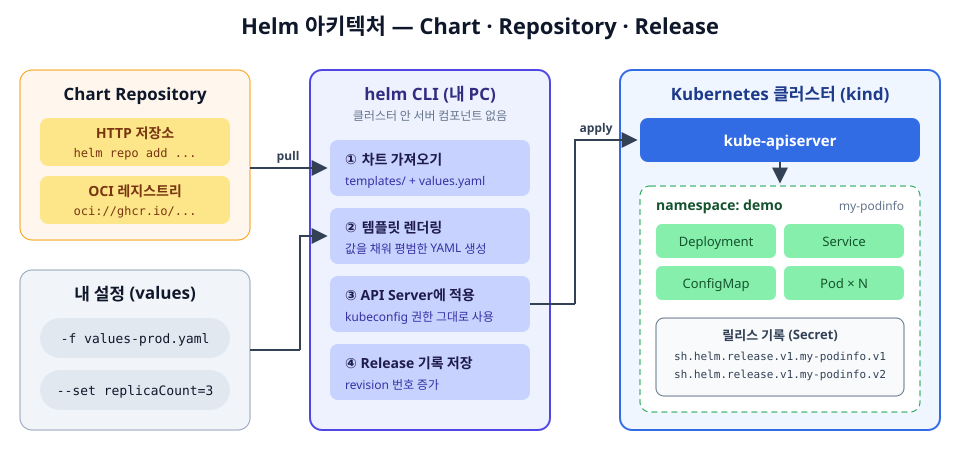
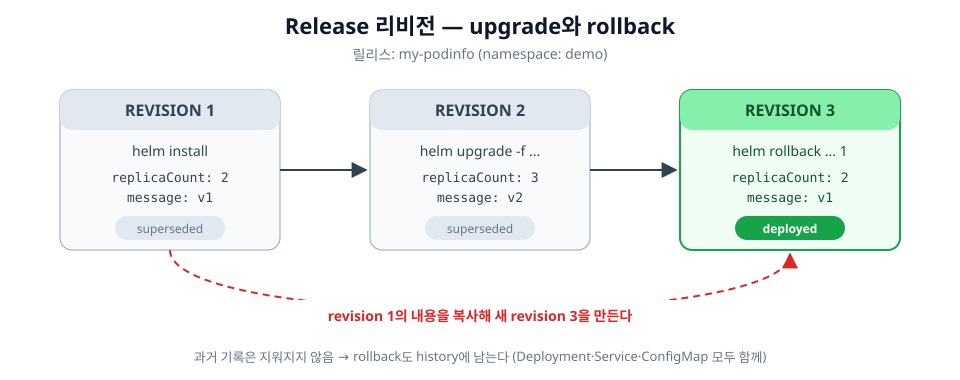
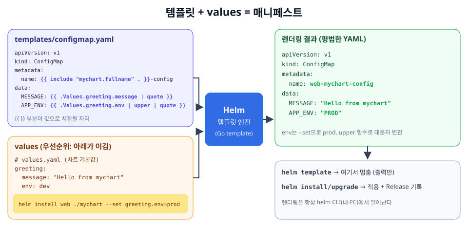

> **Chapter 2 · Kubernetes** | 난이도 ★★★☆☆ | 예상 소요 1.5 ~ 2시간

## 🎯 오늘의 목표

- YAML을 `kubectl apply`로 직접 관리할 때의 **한계**와 Helm이 그것을 어떻게 해결하는지 설명할 수 있다
- Helm의 3대 개념 **Chart / Repository / Release** 를 구분할 수 있다
- 공개 차트를 검색 → 설치 → 값 변경(upgrade) → **롤백** → 삭제까지 해볼 수 있다
- `helm create`로 나만의 차트를 만들고, **템플릿 + values = 매니페스트** 렌더링 과정을 이해한다

---

## 1. 왜 Helm인가?

Day 10~15를 거치면서 우리가 만든 YAML을 세어 봅시다. 웹 앱 하나를 제대로 띄우려면 이 정도는 기본입니다.

```
deployment.yaml  service.yaml  configmap.yaml  secret.yaml
pvc.yaml         ingress.yaml  (+ 다음 시간에 hpa.yaml, servicemonitor.yaml ...)
```

여기서 곧바로 이런 문제들이 생깁니다.

| 문제 | 상황 |
|---|---|
| **환경별 복붙** | dev는 replicas 1, prod는 3. 이미지 태그·도메인만 다른 YAML 세트가 환경 수만큼 생김 |
| **묶음 관리 불가** | "이 앱을 구성하는 리소스 6개"를 한 단위로 설치/삭제/버전 관리할 방법이 없음 |
| **롤백이 어렵다** | Deployment는 `rollout undo`가 되지만, ConfigMap·Service·Ingress까지 *함께* 이전 상태로 되돌리긴 어려움 |
| **남이 만든 앱 설치** | Prometheus, Grafana 같은 오픈소스를 설치하려면 수십~수백 개의 YAML을 직접 받아 고쳐야 함 |

**Helm**은 "쿠버네티스의 패키지 매니저"입니다. `apt`가 우분투에, `npm`이 Node.js에 하는 일을 쿠버네티스에 합니다.

| 비유 | apt (Ubuntu) | Helm (Kubernetes) |
|---|---|---|
| 패키지 | `.deb` 파일 | **Chart** (템플릿 묶음) |
| 저장소 | `archive.ubuntu.com` | **Repository** (HTTP 저장소 또는 OCI 레지스트리) |
| 설치된 인스턴스 | 설치된 패키지 | **Release** (차트를 클러스터에 설치한 결과) |
| 설정 | `/etc/...` 수정 | **values** (`values.yaml`, `--set`) |

> 💡 Helm 3부터는 클러스터 안에 따로 설치하는 서버 컴포넌트(옛 Tiller)가 **없습니다.** `helm` CLI가 내 kubeconfig로 API Server와 직접 통신합니다. 즉, `kubectl`과 똑같은 권한으로 동작합니다.

---

## 2. Helm 아키텍처 — Chart, Repository, Release



| 개념 | 설명 |
|---|---|
| **Chart** | 쿠버네티스 리소스를 만들어 내는 **템플릿 + 기본값(values) + 메타데이터** 묶음. 디렉터리 또는 `.tgz` 파일 |
| **Repository** | 차트를 모아 둔 저장소. 전통적인 HTTP 저장소(`index.yaml`)와 **OCI 레지스트리**(Docker Hub, GHCR 등) 두 방식이 있음 |
| **Release** | 차트를 특정 values로 클러스터에 설치한 **인스턴스**. 이름을 가짐 (`my-podinfo`) |
| **Revision** | 릴리스가 install/upgrade/rollback 될 때마다 1씩 증가하는 버전 번호 |

Day 01의 "이미지 vs 컨테이너" 관계와 똑같습니다.

| Chart | Release |
|---|---|
| 클래스 / 이미지 | 객체 / 컨테이너 |
| 하나의 차트로 | 이름만 다르게 여러 릴리스를 설치 가능 (`podinfo-dev`, `podinfo-prod`) |

### Helm이 하는 일을 한 문장으로

> **템플릿(templates/) 에 값(values)을 채워 넣어 평범한 YAML을 만들고, 그 YAML을 API Server에 적용한 뒤, 무엇을 적용했는지 Release 기록으로 남긴다.**

릴리스 기록은 기본적으로 **릴리스가 설치된 네임스페이스의 Secret**에 저장됩니다(`sh.helm.release.v1.<이름>.v<리비전>`). 그래서 롤백이 가능합니다.

---

## 3. 설치

실습 환경은 **Day 09에서 kind로 만든 로컬 클러스터**입니다. 먼저 클러스터가 살아 있는지 확인합니다.

```bash
kubectl config current-context   # kind-로 시작하는 컨텍스트여야 함
kubectl get nodes
```

### Helm CLI 설치

```bash
# macOS
brew install helm

# Windows (PowerShell)
winget install Helm.Helm

# Linux (공식 설치 스크립트)
curl -fsSL -o get_helm.sh https://raw.githubusercontent.com/helm/helm/main/scripts/get-helm-3
chmod 700 get_helm.sh
./get_helm.sh
```

```bash
helm version
# version.BuildInfo{Version:"v3.x.x", ...}
```

> 💡 이 글의 명령은 Helm 3.x 기준이며, 최신 메이저인 Helm 4에서도 그대로 동작하는 기본 명령만 사용합니다.

---

## 4. 실습 ① — 공개 차트 설치하고 다루기

예제 앱으로 **podinfo**를 씁니다. 작은 Go 웹 앱으로, 쿠버네티스 실습용으로 널리 쓰이고 `/metrics`도 노출해서 Day 17에서도 다시 씁니다.

### 4-1. 저장소 추가와 검색

```bash
helm repo add podinfo https://stefanprodan.github.io/podinfo
helm repo update
helm search repo podinfo
```

```
NAME            CHART VERSION   APP VERSION     DESCRIPTION
podinfo/podinfo 6.x.x           6.x.x           Podinfo Helm chart for Kubernetes
```

| 버전 | 의미 |
|---|---|
| **CHART VERSION** | 차트(템플릿 묶음) 자체의 버전. 템플릿이 바뀌면 올라감 |
| **APP VERSION** | 차트가 배포하는 애플리케이션(이미지)의 버전 |

### 4-2. 설치 전에 "무엇을 바꿀 수 있는지" 보기

```bash
helm show chart podinfo/podinfo     # Chart.yaml 메타데이터
helm show values podinfo/podinfo | head -40   # 기본 values — 이게 곧 설정 매뉴얼
```

```yaml
replicaCount: 1
logLevel: info
...
ui:
  color: "#34577c"
  message: ""
  logo: ""
...
service:
  enabled: true
  type: ClusterIP
  ...
  httpPort: 9898
```

> 💡 차트를 처음 쓸 때 가장 먼저 할 일은 `helm show values`입니다. 문서보다 정확합니다.

### 4-3. 설치 (install)

```bash
helm install my-podinfo podinfo/podinfo \
  --namespace demo --create-namespace \
  --set replicaCount=2 \
  --set ui.message="Hello Helm v1"
```

```
NAME: my-podinfo
LAST DEPLOYED: ...
NAMESPACE: demo
STATUS: deployed
REVISION: 1
NOTES:
1. Get the application URL by running these commands:
  ...
```

명령 하나로 Deployment, Service 등이 한꺼번에 만들어졌습니다.

```bash
helm list -n demo
kubectl get deploy,svc,pod -n demo
```

```
NAME        NAMESPACE  REVISION  UPDATED  STATUS    CHART          APP VERSION
my-podinfo  demo       1         ...      deployed  podinfo-6.x.x  6.x.x
```

접속해 봅시다.

```bash
kubectl port-forward -n demo svc/my-podinfo 9898:9898
# 다른 터미널에서
curl -s http://localhost:9898 | grep message
#   "message": "Hello Helm v1",
```

### 4-4. 값 변경 (upgrade) — values 파일로

`--set`이 여러 개가 되면 관리가 어렵습니다. 실무에서는 **values 파일**을 Git에 두고 씁니다.

```yaml
# podinfo-values.yaml
replicaCount: 3
ui:
  message: "Hello Helm v2"
  color: "#326ce5"
resources:
  requests:
    cpu: 50m
    memory: 64Mi
```

```bash
helm upgrade my-podinfo podinfo/podinfo -n demo -f podinfo-values.yaml
kubectl get pod -n demo          # 3개로 늘어남
helm get values my-podinfo -n demo   # 사용자가 지정한 값만 출력
```

> ⚠️ `helm upgrade`는 **이전 릴리스의 `--set` 값을 자동으로 이어받지 않습니다.** 위 명령은 revision 1에서 준 `--set`을 버리고 `podinfo-values.yaml`만 적용합니다. 이전 값을 유지하려면 `--reuse-values`가 있지만, 헷갈리기 쉬우니 **모든 값을 values 파일에 모아 두는 습관**을 들이세요.

#### values 우선순위 (아래로 갈수록 강함)

| 순서 | 출처 |
|---|---|
| 1 | 차트 안의 `values.yaml` (기본값) |
| 2 | `-f a.yaml -f b.yaml` (여러 개면 **뒤쪽 파일이 이김**) |
| 3 | `--set key=value` (가장 강함) |

### 4-5. 히스토리와 롤백



```bash
helm history my-podinfo -n demo
```

```
REVISION  UPDATED  STATUS      CHART          APP VERSION  DESCRIPTION
1         ...      superseded  podinfo-6.x.x  6.x.x        Install complete
2         ...      deployed    podinfo-6.x.x  6.x.x        Upgrade complete
```

revision 1(Hello Helm v1, 2개)로 돌아가 봅시다.

```bash
helm rollback my-podinfo 1 -n demo
helm history my-podinfo -n demo
```

```
REVISION  ...  STATUS      DESCRIPTION
1         ...  superseded  Install complete
2         ...  superseded  Upgrade complete
3         ...  deployed    Rollback to 1
```

> 💡 롤백은 과거로 "되감기"가 아니라 **revision 1의 내용으로 새 revision 3을 만드는 것**입니다. Day 11의 `kubectl rollout undo`와 같은 발상이지만, Helm은 Deployment뿐 아니라 **차트에 포함된 모든 리소스**를 함께 되돌립니다.

릴리스 기록이 어디 있는지도 확인해 봅니다.

```bash
kubectl get secret -n demo -l owner=helm
```

```
NAME                               TYPE                 DATA   AGE
sh.helm.release.v1.my-podinfo.v1   helm.sh/release.v1   1      ...
sh.helm.release.v1.my-podinfo.v2   helm.sh/release.v1   1      ...
sh.helm.release.v1.my-podinfo.v3   helm.sh/release.v1   1      ...
```

### 4-6. OCI 레지스트리에서 바로 설치

최근에는 차트를 컨테이너 이미지처럼 **OCI 레지스트리**에 올리는 방식이 표준이 되어 가고 있습니다. `repo add` 없이 주소로 바로 씁니다.

```bash
helm show chart oci://ghcr.io/stefanprodan/charts/podinfo
helm install podinfo-oci oci://ghcr.io/stefanprodan/charts/podinfo -n demo
helm list -n demo
helm uninstall podinfo-oci -n demo
```

---

## 5. 차트의 구조 — 템플릿 + values = 매니페스트



### 5-1. `helm create`로 뼈대 만들기

```bash
helm create mychart
tree mychart       # tree가 없으면 find mychart
```

```
mychart/
├── Chart.yaml          # 차트 이름, 차트 버전(version), 앱 버전(appVersion)
├── values.yaml         # 기본값
├── charts/             # 의존 차트(서브 차트)
├── .helmignore         # 패키징 시 제외할 파일
└── templates/
    ├── _helpers.tpl    # 이름 규칙 등 재사용 템플릿 함수
    ├── deployment.yaml
    ├── service.yaml
    ├── serviceaccount.yaml
    ├── ingress.yaml
    ├── hpa.yaml
    ├── NOTES.txt       # 설치 후 출력되는 안내문
    └── tests/
        └── test-connection.yaml
```

> 💡 Helm 버전에 따라 `templates/` 안의 기본 파일이 한두 개 다를 수 있습니다. 구조와 역할은 동일합니다.

기본 차트는 nginx를 배포하도록 되어 있습니다.

### 5-2. 템플릿 문법 맛보기

`templates/deployment.yaml`의 일부입니다.

```yaml
apiVersion: apps/v1
kind: Deployment
metadata:
  name: {{ include "mychart.fullname" . }}
  labels:
    {{- include "mychart.labels" . | nindent 4 }}
spec:
  {{- if not .Values.autoscaling.enabled }}
  replicas: {{ .Values.replicaCount }}
  {{- end }}
  ...
      containers:
        - name: {{ .Chart.Name }}
          image: "{{ .Values.image.repository }}:{{ .Values.image.tag | default .Chart.AppVersion }}"
```

| 문법 | 의미 |
|---|---|
| `{{ .Values.replicaCount }}` | values의 값을 꺼냄 |
| `{{ .Release.Name }}` / `{{ .Chart.Name }}` | 릴리스 이름 / 차트 이름 같은 내장 객체 |
| `{{ include "mychart.fullname" . }}` | `_helpers.tpl`에 정의한 템플릿 호출 |
| `{{- ... }}` / `{{ ... -}}` | 앞/뒤 공백·줄바꿈 제거 |
| `\| default X` | 값이 비어 있으면 X 사용 |
| `\| nindent 4` | 줄바꿈 후 4칸 들여쓰기 (YAML 들여쓰기 맞추기) |
| `{{- if ... }} ... {{- end }}` | 조건부 출력 |
| `{{- with .Values.x }} ... {{- end }}` | 값이 있을 때만 블록 출력, 블록 안의 `.`이 바뀜 |

### 5-3. 나만의 리소스 추가 — ConfigMap 템플릿

Day 13의 ConfigMap을 차트에 넣어 봅시다.

```yaml
# values.yaml 맨 아래에 추가
greeting:
  message: "Hello from mychart"
  env: dev
```

```yaml
# templates/configmap.yaml (새 파일)
apiVersion: v1
kind: ConfigMap
metadata:
  name: {{ include "mychart.fullname" . }}-config
  labels:
    {{- include "mychart.labels" . | nindent 4 }}
data:
  MESSAGE: {{ .Values.greeting.message | quote }}
  APP_ENV: {{ .Values.greeting.env | upper | quote }}
```

### 5-4. 설치 전에 반드시 — lint와 template

```bash
helm lint ./mychart
# ==> Linting ./mychart
# [INFO] Chart.yaml: icon is recommended
# 1 chart(s) linted, 0 chart(s) failed

helm template web ./mychart --set greeting.env=prod -s templates/configmap.yaml
```

```yaml
---
# Source: mychart/templates/configmap.yaml
apiVersion: v1
kind: ConfigMap
metadata:
  name: web-mychart-config
  labels:
    helm.sh/chart: mychart-0.1.0
    app.kubernetes.io/name: mychart
    app.kubernetes.io/instance: web
    ...
data:
  MESSAGE: "Hello from mychart"
  APP_ENV: "PROD"
```

| 명령 | 하는 일 | 클러스터 접속 |
|---|---|---|
| `helm lint` | 차트 문법·구조 검사 | ❌ |
| `helm template` | 로컬에서 렌더링 결과(YAML)만 출력 | ❌ |
| `helm install --dry-run=server` | 서버 검증까지 하되 실제로는 생성 안 함 | ⭕ |
| `helm get manifest <릴리스>` | 이미 설치된 릴리스가 적용한 YAML 확인 | ⭕ |

> 💡 `helm template ... | kubectl apply -f -` 처럼 쓸 수도 있지만, 그러면 Release 기록이 남지 않아 롤백·히스토리 기능을 잃습니다. Argo CD 같은 GitOps 도구가 내부적으로 이 방식을 쓰기도 합니다.

### 5-5. 설치와 환경별 values

```bash
# dev
helm install web ./mychart -n demo

# prod 처럼 쓰는 values 파일
cat > values-prod.yaml <<'EOF'
replicaCount: 3
greeting:
  env: prod
EOF

helm upgrade web ./mychart -n demo -f values-prod.yaml
kubectl get cm web-mychart-config -n demo -o jsonpath='{.data.APP_ENV}'; echo
# PROD
```

차트를 고쳤다면 `Chart.yaml`의 `version`을 올리고 패키징합니다.

```bash
helm package ./mychart        # mychart-0.1.0.tgz 생성
```

> 💡 `.tgz`는 `helm push mychart-0.1.0.tgz oci://<레지스트리>/<경로>` 로 OCI 레지스트리에 올려 팀과 공유할 수 있습니다(레지스트리에 `helm registry login` 필요).

### 5-6. 정리

```bash
helm uninstall web -n demo
helm uninstall my-podinfo -n demo
kubectl delete namespace demo
```

> ⚠️ `helm uninstall`은 차트가 만든 리소스를 지우지만, **StatefulSet이 만든 PVC**처럼 차트 밖에서 생긴 리소스는 남을 수 있습니다(Day 14). 필요하면 직접 정리하세요.

---

## 6. 자주 쓰는 명령 한눈에

| 목적 | 명령 |
|---|---|
| 저장소 추가 / 갱신 | `helm repo add <이름> <URL>` / `helm repo update` |
| 차트 검색 | `helm search repo <키워드>` (Artifact Hub 검색은 `helm search hub`) |
| 기본값 보기 | `helm show values <차트>` |
| 설치 | `helm install <릴리스> <차트> -n <ns> --create-namespace -f values.yaml` |
| 있으면 업그레이드, 없으면 설치 | `helm upgrade --install <릴리스> <차트> ...` (CI/CD에서 단골) |
| 상태 / 목록 | `helm status <릴리스>` / `helm list -A` |
| 적용된 값 / 매니페스트 | `helm get values <릴리스>` / `helm get manifest <릴리스>` |
| 히스토리 / 롤백 | `helm history <릴리스>` / `helm rollback <릴리스> <리비전>` |
| 삭제 | `helm uninstall <릴리스>` |

---

## 7. 트러블슈팅

| 증상 | 원인 | 해결 |
|---|---|---|
| `Error: INSTALLATION FAILED: cannot re-use a name that is still in use` | 같은 네임스페이스에 같은 이름의 릴리스가 이미 있음 | `helm list -n <ns>`로 확인 후 `helm upgrade` 사용, 또는 다른 이름 |
| `Error: Kubernetes cluster unreachable` | kubeconfig 컨텍스트가 없거나 kind 클러스터가 꺼짐 | `kubectl config current-context`, Docker Desktop 실행 여부 확인 |
| `helm list`에 릴리스가 안 보임 | Helm은 **현재 네임스페이스**만 보여줌 | `-n <ns>` 지정 또는 `helm list -A` |
| `another operation (install/upgrade/rollback) is in progress` | 이전 작업이 중간에 끊겨 `pending-*` 상태로 남음 | `helm history`로 확인 후 정상 리비전으로 `helm rollback` |
| upgrade 후 이전에 `--set`한 값이 사라짐 | upgrade는 이전 `--set` 값을 이어받지 않음 | 모든 값을 values 파일로 관리 (`-f`) |
| 템플릿 렌더링 에러 `error converting YAML to JSON` | 들여쓰기(`nindent`) 또는 `{{-` 공백 제거 실수 | `helm template`으로 렌더링 결과를 직접 눈으로 확인 |

---

## 8. 핵심 정리

- Helm = 쿠버네티스 **패키지 매니저**. 여러 YAML을 하나의 **Chart**로 묶고, 설정은 **values**로 분리
- **Chart**(템플릿 묶음) → 클러스터에 설치하면 **Release**, 바뀔 때마다 **Revision** 증가
- 저장소는 HTTP 저장소(`helm repo add`)와 **OCI 레지스트리**(`oci://...`) 두 가지
- values 우선순위: 차트 `values.yaml` < `-f` 파일 < `--set`
- `helm rollback`은 과거 리비전 내용으로 **새 리비전**을 만들고, 차트의 모든 리소스를 함께 되돌린다
- 설치 전 `helm show values`, `helm lint`, `helm template`으로 확인하는 습관

---

## 9. 셀프 체크

<details>
<summary>Q1. Chart와 Release의 관계를 Docker의 개념에 빗대어 설명하면?</summary>

Chart는 이미지, Release는 컨테이너에 해당합니다. 하나의 Chart로 이름과 values만 달리해서 여러 Release(`podinfo-dev`, `podinfo-prod`)를 설치할 수 있습니다.
</details>

<details>
<summary>Q2. <code>helm show values</code> 결과에는 <code>replicaCount: 1</code>, 내 파일에는 <code>replicaCount: 3</code>, 명령에는 <code>--set replicaCount=5</code>를 줬다. 결과는?</summary>

**5개**. `--set`이 가장 높은 우선순위입니다. (차트 기본값 < `-f` 파일 < `--set`)
</details>

<details>
<summary>Q3. revision 4 상태에서 <code>helm rollback myapp 2</code>를 하면 히스토리는 어떻게 되는가?</summary>

revision 2의 내용으로 **revision 5**가 새로 만들어지고 STATUS가 deployed가 됩니다. 기존 revision들은 지워지지 않고 superseded로 남습니다.
</details>

<details>
<summary>Q4. Helm 3은 릴리스 정보를 어디에 저장하는가?</summary>

릴리스가 설치된 네임스페이스의 **Secret**(`sh.helm.release.v1.<릴리스>.v<리비전>`, 타입 `helm.sh/release.v1`)에 저장합니다. 클러스터 안에 별도 서버(Tiller)는 없습니다.
</details>

<details>
<summary>Q5. <code>helm template</code>과 <code>helm install --dry-run=server</code>의 차이는?</summary>

`helm template`은 클러스터에 접속하지 않고 로컬에서 렌더링만 합니다. `--dry-run=server`는 API Server에 보내 검증까지 받지만 실제 리소스는 만들지 않습니다. 둘 다 Release 기록은 남기지 않습니다.
</details>

---

## ⏭️ 다음 예고 — Day 17. 모니터링 — Prometheus & Grafana

오늘 배운 Helm으로 **명령 한 줄에 수십 개의 리소스**를 설치해 봅니다. kube-prometheus-stack 차트로 Prometheus · Grafana · Alertmanager를 띄우고, 클러스터와 podinfo의 메트릭을 수집해 대시보드로 그려 봅니다.
