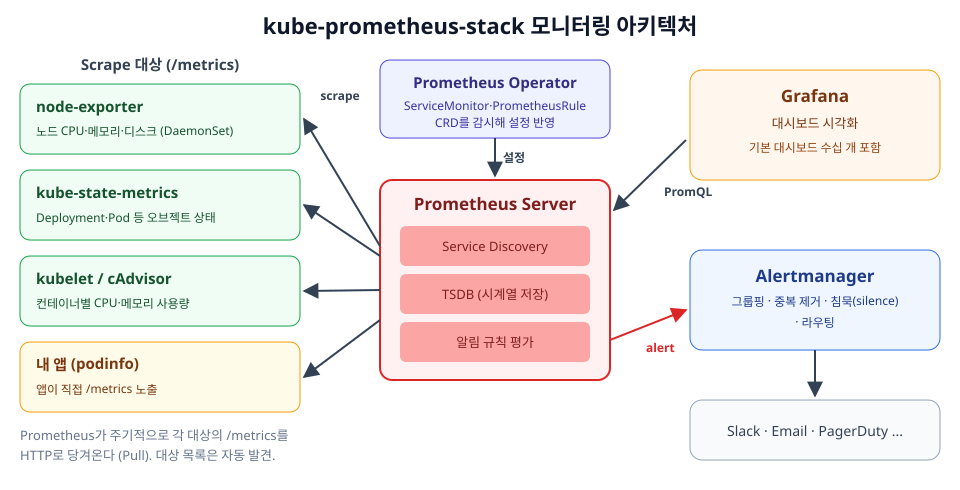
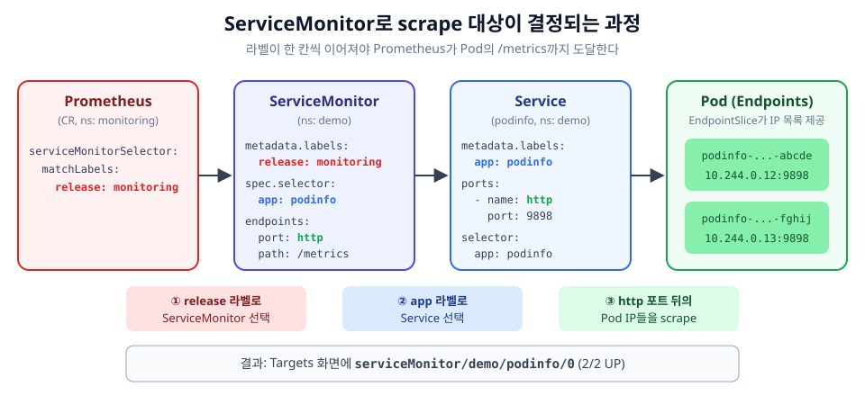

> **Chapter 2 · Kubernetes** | 난이도 ★★★☆☆ | 예상 소요 2 ~ 2.5시간

## 🎯 오늘의 목표

- 쿠버네티스에서 모니터링이 **왜 더 어려운지**, 메트릭·로그·트레이스가 각각 무엇인지 설명할 수 있다
- Prometheus의 **Pull 방식 수집** 구조와 Exporter, Alertmanager, Grafana의 역할을 안다
- Day 16의 Helm으로 **kube-prometheus-stack**을 설치하고 Grafana 대시보드를 볼 수 있다
- **ServiceMonitor**로 내 앱의 메트릭을 수집하고, **PromQL**로 조회하고, **PrometheusRule**로 알림 규칙을 만든다

---

## 1. 왜 모니터링이 필요한가?

Day 11에서 Deployment가 죽은 Pod를 알아서 되살리는 것을 봤습니다. 그런데 이런 질문에는 쿠버네티스가 답해 주지 않습니다.

- 지금 **어떤 Pod가 CPU를 제일 많이** 쓰고 있나?
- 어젯밤 3시에 응답이 느려졌던 이유는? (그 시점의 메모리는?)
- 에러율이 5%를 넘으면 **누가, 어떻게** 알게 되나?

게다가 쿠버네티스 환경은 전통적인 서버보다 모니터링이 까다롭습니다.

| 전통적인 서버 | 쿠버네티스 |
|---|---|
| 서버 IP가 고정, 몇 대 안 됨 | Pod IP는 수시로 바뀌고, 수백 개가 생겼다 사라짐 |
| 모니터링 대상 목록을 손으로 관리 | 대상 목록을 **자동으로 발견(Service Discovery)** 해야 함 |
| "서버"만 보면 됨 | 노드 / Pod / 컨테이너 / 쿠버네티스 오브젝트 상태까지 여러 계층 |

### 관측성(Observability)의 세 기둥

| 종류 | 무엇 | 예시 | 대표 도구 |
|---|---|---|---|
| **메트릭(Metric)** | 시간에 따른 **숫자** | CPU 사용률, 초당 요청 수, 에러율 | **Prometheus**, Grafana |
| **로그(Log)** | 이벤트 단위 **텍스트** | `GET /api 500 12ms` | Loki, Elasticsearch |
| **트레이스(Trace)** | 요청 하나가 여러 서비스를 지나간 **경로** | 프론트 → 주문 → 결제 각 구간 지연 | Jaeger, Tempo, OpenTelemetry |

오늘은 가장 먼저 갖춰야 할 **메트릭**을 다룹니다.

---

## 2. Prometheus 아키텍처



### 2-1. Pull 방식

Prometheus는 대상(target)이 데이터를 보내오길 기다리지 않고, **정해진 주기마다 대상의 `/metrics` HTTP 엔드포인트를 직접 긁어 옵니다(scrape).**

```
# HELP http_request_duration_seconds Seconds spent serving HTTP requests.
# TYPE http_request_duration_seconds histogram
http_request_duration_seconds_count{method="GET",path="root",status="200"} 1523
```

| Pull 방식의 장점 | 설명 |
|---|---|
| 대상이 죽었는지 바로 앎 | scrape 실패 = `up` 메트릭이 0 |
| 앱은 단순 | 앱은 `/metrics`만 열어 두면 됨. 어디로 보낼지 몰라도 됨 |
| 대상 목록은 Prometheus가 관리 | 쿠버네티스 API로 Pod/Service를 **자동 발견** |

### 2-2. 구성 요소

| 구성 요소 | 역할 |
|---|---|
| **Prometheus Server** | 대상을 scrape해서 **시계열 DB(TSDB)** 에 저장하고, PromQL 질의와 알림 규칙 평가를 담당 |
| **Exporter** | `/metrics`가 없는 대상을 대신해 메트릭을 만들어 주는 프로그램 |
| ├ node-exporter | **노드(리눅스 호스트)** 의 CPU·메모리·디스크·네트워크. DaemonSet으로 노드마다 1개 |
| ├ kube-state-metrics | **쿠버네티스 오브젝트 상태** (Deployment 원하는/실제 replicas, Pod phase, 재시작 횟수 등) |
| └ kubelet / cAdvisor | **컨테이너별** CPU·메모리 사용량 (kubelet에 내장) |
| **Alertmanager** | Prometheus가 보낸 알림을 묶고(grouping), 중복 제거하고, Slack·메일 등으로 전달 |
| **Grafana** | Prometheus를 데이터 소스로 **대시보드** 시각화 |

### 2-3. Prometheus Operator와 kube-prometheus-stack

Prometheus 설정 파일(`prometheus.yml`)을 손으로 고치는 대신, **쿠버네티스 리소스(CRD)** 로 모니터링을 선언하게 해 주는 것이 **Prometheus Operator**입니다.

| CRD | 의미 |
|---|---|
| `Prometheus` / `Alertmanager` | Prometheus·Alertmanager 서버 자체를 선언 (Operator가 StatefulSet으로 만듦) |
| **`ServiceMonitor`** | "이 라벨을 가진 **Service** 뒤의 Pod들을 scrape해라" |
| `PodMonitor` | Service 없이 **Pod**를 직접 scrape |
| **`PrometheusRule`** | 알림/레코딩 규칙 |

**kube-prometheus-stack**은 이 모든 것(Operator + Prometheus + Alertmanager + Grafana + node-exporter + kube-state-metrics + 기본 대시보드와 알림 규칙)을 한 번에 설치하는 **Helm 차트**입니다.

> 💡 Day 16에서 "남이 만든 앱을 수십 개의 YAML 없이 설치"하는 게 Helm의 장점이라고 했죠. 이 차트 하나가 만드는 리소스는 **수백 개**입니다.

---

## 3. 실습 ① — kube-prometheus-stack 설치

### 3-0. 실습 환경

- Day 09에서 만든 **kind 클러스터** + Day 16에서 설치한 **Helm**
- Docker Desktop에 메모리를 **4GB 이상** 할당해 두는 것을 권장합니다 (Settings → Resources)

```bash
kubectl config current-context    # kind-...
kubectl get nodes
```

### 3-1. kind용 values 파일

kind(그리고 kubeadm 기본 설정)에서는 **controller-manager · scheduler · etcd · kube-proxy**가 메트릭 포트를 `127.0.0.1`(노드 자신)에만 열어 둡니다. 그래서 Prometheus가 접근하지 못해 타깃이 `DOWN`으로 뜨고 관련 알림이 계속 울립니다. 학습용 로컬 클러스터에서는 이 4개 수집을 끄고 시작합니다.

```yaml
# monitoring-values.yaml
kubeControllerManager:
  enabled: false
kubeScheduler:
  enabled: false
kubeEtcd:
  enabled: false
kubeProxy:
  enabled: false
```

> 💡 운영 클러스터에서는 끄는 대신 각 컴포넌트의 bind 주소를 `0.0.0.0`으로 바꿔 수집합니다. 이는 Day 20(kubeadm)에서 클러스터를 직접 만들 때 설정할 수 있습니다.

### 3-2. 설치

```bash
helm repo add prometheus-community https://prometheus-community.github.io/helm-charts
helm repo update

helm install monitoring prometheus-community/kube-prometheus-stack \
  --namespace monitoring --create-namespace \
  -f monitoring-values.yaml
```

```
NAME: monitoring
NAMESPACE: monitoring
STATUS: deployed
REVISION: 1
NOTES:
kube-prometheus-stack has been installed. Check its status by running:
  kubectl --namespace monitoring get pods -l "release=monitoring"
...
```

1~3분 정도 기다린 뒤 확인합니다.

```bash
kubectl get pods -n monitoring
```

```
NAME                                                     READY   STATUS    RESTARTS   AGE
alertmanager-monitoring-kube-prometheus-alertmanager-0   2/2     Running   0          2m
monitoring-grafana-7d9c8b6f5-x2k8p                       3/3     Running   0          2m
monitoring-kube-prometheus-operator-6b8f7c9d4-qw7rt      1/1     Running   0          2m
monitoring-kube-state-metrics-5c6d8f7b9-lm4n2            1/1     Running   0          2m
monitoring-prometheus-node-exporter-8xk2p                1/1     Running   0          2m
prometheus-monitoring-kube-prometheus-prometheus-0       2/2     Running   0          2m
```

| Pod | 정체 |
|---|---|
| `prometheus-...-0` | Prometheus 서버 (Operator가 만든 StatefulSet) |
| `alertmanager-...-0` | Alertmanager (역시 StatefulSet) |
| `...-operator-...` | Prometheus Operator — CRD를 감시해 설정을 반영 |
| `...-grafana-...` | Grafana |
| `...-kube-state-metrics-...` | 쿠버네티스 오브젝트 상태 Exporter |
| `...-node-exporter-...` | 노드 Exporter (DaemonSet — 노드 수만큼) |

설치된 CRD도 확인해 봅시다.

```bash
kubectl get crd | grep monitoring.coreos.com
kubectl get servicemonitor -n monitoring    # 차트가 기본으로 만든 수집 대상들
```

### 3-3. Prometheus UI

```bash
kubectl port-forward -n monitoring svc/monitoring-kube-prometheus-prometheus 9090:9090
```

http://localhost:9090 접속 후 상단 메뉴 **Status → Targets**(버전에 따라 *Target health*)를 엽니다. `serviceMonitor/monitoring/...` 항목들이 모두 **UP**이면 정상입니다.

**Query** 화면에서 첫 PromQL을 실행해 봅시다.

```promql
up
```

결과의 각 줄이 "scrape 대상 하나"이고 값 `1`은 성공, `0`은 실패입니다.

### 3-4. Grafana 접속

```bash
# 관리자 비밀번호 (사용자명: admin)
kubectl get secret -n monitoring monitoring-grafana \
  -o jsonpath="{.data.admin-password}" | base64 -d; echo

kubectl port-forward -n monitoring svc/monitoring-grafana 3000:80
```

> 💡 Windows PowerShell에는 `base64` 명령이 없습니다. Git Bash나 WSL에서 실행하거나, PowerShell에서는 다음처럼 디코딩하세요.
> `[Text.Encoding]::UTF8.GetString([Convert]::FromBase64String((kubectl get secret -n monitoring monitoring-grafana -o jsonpath="{.data.admin-password}")))`

http://localhost:3000 에 `admin` / 위 비밀번호로 로그인 → **Dashboards** 메뉴에 이미 수십 개의 대시보드가 들어 있습니다.

| 추천 대시보드 | 볼 수 있는 것 |
|---|---|
| **Kubernetes / Compute Resources / Cluster** | 클러스터 전체 CPU·메모리 사용량과 requests/limits 대비 비율 |
| **Kubernetes / Compute Resources / Namespace (Pods)** | 네임스페이스별 Pod 단위 사용량 |
| **Node Exporter / Nodes** | 노드의 CPU·메모리·디스크·네트워크 |

> ⚠️ 이 Secret과 port-forward는 학습용입니다. 운영에서는 Grafana를 Ingress(Day 15) + 인증(SSO)으로 노출하고, 비밀번호는 values에 평문으로 넣지 않습니다.

---

## 4. PromQL 기초

PromQL은 Prometheus의 질의 언어입니다. 메트릭은 **이름 + 라벨 집합**으로 하나의 시계열(time series)이 됩니다.

```
container_memory_working_set_bytes{namespace="monitoring", pod="monitoring-grafana-...", container="grafana"}
└──────────── 메트릭 이름 ───────────┘└──────────────────────── 라벨 ─────────────────────────────────┘
```

### 4-1. 메트릭 타입

| 타입 | 특징 | 예시 |
|---|---|---|
| **Counter** | 계속 **증가만** 하는 값 (재시작 시 0으로) | `http_requests_total`, `container_cpu_usage_seconds_total` |
| **Gauge** | 오르내리는 현재 값 | `container_memory_working_set_bytes`, `node_memory_MemAvailable_bytes` |
| **Histogram** | 값의 분포를 구간(bucket)별로 셈 | `http_request_duration_seconds_bucket` / `_sum` / `_count` |

> 💡 Counter 값 자체(누적 1523회)는 쓸모가 적습니다. 거의 항상 **`rate()`로 초당 증가율**을 구해서 씁니다.

### 4-2. 자주 쓰는 질의

Prometheus UI의 Query 화면 또는 Grafana의 **Explore**에서 하나씩 실행해 보세요.

```promql
# 1) 네임스페이스별 Pod 개수
count by (namespace) (kube_pod_info)

# 2) monitoring 네임스페이스 Pod별 CPU 사용량 (코어 단위, 최근 5분 평균)
sum by (pod) (rate(container_cpu_usage_seconds_total{namespace="monitoring", container!=""}[5m]))

# 3) Pod별 메모리 사용량 (MiB)
sum by (pod) (container_memory_working_set_bytes{namespace="monitoring", container!=""}) / 1024 / 1024

# 4) 재시작이 한 번이라도 있었던 컨테이너
kube_pod_container_status_restarts_total > 0

# 5) 노드 메모리 사용률 (%)
100 * (1 - node_memory_MemAvailable_bytes / node_memory_MemTotal_bytes)
```

| 문법 | 의미 |
|---|---|
| `metric{label="값"}` | 라벨로 필터 (`!=`, `=~` 정규식, `!~` 도 가능) |
| `[5m]` | 최근 5분 구간의 값들 (range vector) |
| `rate(x[5m])` | Counter의 **초당 평균 증가율** |
| `sum by (pod) (...)` | pod 라벨 기준으로 묶어서 합계 (`avg`, `max`, `count`도 같은 방식) |

> 💡 `container!=""` 조건은 cAdvisor가 함께 내보내는 **Pod 전체 합계 행**(container 라벨이 빈 값)을 빼서 중복 집계를 막기 위함입니다.

---

## 5. 실습 ② — 내 앱 메트릭 수집하기 (ServiceMonitor)



### 5-1. 메트릭을 노출하는 앱 배포

Day 16에서 쓴 **podinfo**는 `:9898/metrics`에 Prometheus 메트릭을 노출합니다. 이번에는 라벨을 정확히 통제하기 위해 매니페스트로 직접 배포합니다.

```yaml
# podinfo.yaml
apiVersion: v1
kind: Namespace
metadata:
  name: demo
---
apiVersion: apps/v1
kind: Deployment
metadata:
  name: podinfo
  namespace: demo
spec:
  replicas: 2
  selector:
    matchLabels:
      app: podinfo
  template:
    metadata:
      labels:
        app: podinfo
    spec:
      containers:
        - name: podinfo
          image: ghcr.io/stefanprodan/podinfo:6.7.1
          ports:
            - name: http
              containerPort: 9898
---
apiVersion: v1
kind: Service
metadata:
  name: podinfo
  namespace: demo
  labels:
    app: podinfo          # ← ServiceMonitor가 찾는 라벨 (Service의 라벨!)
spec:
  selector:
    app: podinfo
  ports:
    - name: http          # ← ServiceMonitor는 포트를 "이름"으로 지정
      port: 9898
      targetPort: http
```

```bash
kubectl apply -f podinfo.yaml
kubectl get pod -n demo
kubectl run -n demo tmp --rm -it --image=curlimages/curl --restart=Never -- \
  curl -s http://podinfo:9898/metrics | grep http_request_duration_seconds_count
```

### 5-2. ServiceMonitor 작성

```yaml
# podinfo-servicemonitor.yaml
apiVersion: monitoring.coreos.com/v1
kind: ServiceMonitor
metadata:
  name: podinfo
  namespace: demo
  labels:
    release: monitoring     # ← ⚠️ 이게 없으면 Prometheus가 무시함
spec:
  selector:
    matchLabels:
      app: podinfo          # 이 라벨을 가진 Service를 찾아서
  endpoints:
    - port: http            # 그 Service의 'http' 포트 뒤 Pod들의
      path: /metrics        # /metrics 를
      interval: 15s         # 15초마다 scrape
```

```bash
kubectl apply -f podinfo-servicemonitor.yaml
```

> ⚠️ **가장 흔한 실수.** kube-prometheus-stack이 만든 Prometheus는 기본적으로 **`release: <릴리스 이름>` 라벨이 붙은 ServiceMonitor만** 골라 씁니다. 실제 설정을 확인해 보세요.
>
> ```bash
> kubectl get prometheus -n monitoring -o jsonpath='{.items[0].spec.serviceMonitorSelector}'; echo
> # {"matchLabels":{"release":"monitoring"}}
> ```
>
> 라벨 없이 모든 ServiceMonitor를 받게 하려면 values에 `prometheus.prometheusSpec.serviceMonitorSelectorNilUsesHelmValues: false`를 주고 `helm upgrade` 합니다.

30초~1분 뒤 Prometheus의 **Targets** 화면에 `serviceMonitor/demo/podinfo/0` 이 생기고, 엔드포인트 2개(Pod 2개)가 **UP**이 됩니다.

### 5-3. 트래픽을 만들고 질의하기

```bash
kubectl run -n demo loadgen --image=curlimages/curl --restart=Never -- \
  sh -c 'while true; do curl -s -o /dev/null http://podinfo:9898/; sleep 0.2; done'
```

```promql
# podinfo의 초당 요청 수 (Pod별)
sum by (pod) (rate(http_request_duration_seconds_count{namespace="demo"}[1m]))

# 상태 코드별 초당 요청 수
sum by (status) (rate(http_request_duration_seconds_count{namespace="demo"}[1m]))

# p95 응답 시간 (초)
histogram_quantile(0.95, sum by (le) (rate(http_request_duration_seconds_bucket{namespace="demo"}[5m])))
```

> 💡 `namespace`, `pod`, `service`, `job` 라벨은 앱이 붙인 게 아니라 **Prometheus가 쿠버네티스 정보로 자동으로 붙여 준 것**입니다. 이게 Service Discovery의 힘입니다.

### 5-4. Grafana에 패널 만들기

1. Grafana → **Dashboards → New → New dashboard → Add visualization**
2. 데이터 소스로 **Prometheus** 선택
3. 쿼리에 `sum by (pod) (rate(http_request_duration_seconds_count{namespace="demo"}[1m]))` 입력
4. 우측 패널 설정에서 Title을 `podinfo RPS`, Unit을 **requests/sec (reqps)** 로 지정 후 저장

> 💡 Grafana에서 만든 대시보드는 Grafana 내부 DB에 저장되므로 Pod가 재생성되면 사라질 수 있습니다. 운영에서는 대시보드 JSON을 **ConfigMap(라벨 `grafana_dashboard: "1"`)** 으로 만들어 Git으로 관리하는 방식(차트의 sidecar 기능)을 씁니다.

---

## 6. 실습 ③ — 알림 규칙 (PrometheusRule)

"podinfo Pod가 하나도 응답하지 않는 상태가 1분 이상 지속되면 알림"을 만들어 봅시다.

```yaml
# podinfo-rule.yaml
apiVersion: monitoring.coreos.com/v1
kind: PrometheusRule
metadata:
  name: podinfo-rules
  namespace: demo
  labels:
    release: monitoring     # ← Rule도 같은 라벨 규칙
spec:
  groups:
    - name: podinfo.rules
      rules:
        - alert: PodinfoDown
          expr: (sum(up{job="podinfo", namespace="demo"}) or vector(0)) < 1
          for: 1m
          labels:
            severity: warning
          annotations:
            summary: "podinfo 대상이 1분 이상 응답하지 않습니다"
```

```bash
kubectl apply -f podinfo-rule.yaml
```

> 💡 Pod가 0개가 되면 scrape 대상 자체가 사라져 `up` 시계열이 **없어집니다**(0이 되는 게 아님). 그래서 `or vector(0)`으로 "값 없음"을 0으로 바꿔 비교합니다.

일부러 장애를 내 봅시다.

```bash
kubectl scale deploy podinfo -n demo --replicas=0
```

Prometheus UI의 **Alerts** 화면에서 `PodinfoDown`이 `Inactive → Pending(for 1m 대기) → Firing` 순서로 바뀌는 것을 확인합니다. Firing이 되면 Alertmanager로 전달됩니다.

```bash
kubectl port-forward -n monitoring svc/monitoring-kube-prometheus-alertmanager 9093:9093
# http://localhost:9093 에서 PodinfoDown 확인
```

| 알림 상태 | 의미 |
|---|---|
| **Inactive** | 조건 불만족 |
| **Pending** | 조건은 만족했지만 `for` 시간을 아직 못 채움 (순간적인 튐 무시) |
| **Firing** | `for` 시간 동안 계속 만족 → Alertmanager로 전송 |

> 💡 실제 Slack/메일 전송은 Alertmanager 설정(`alertmanager.config` values 또는 `AlertmanagerConfig` CRD)에서 receiver를 지정합니다. 오늘은 Alertmanager UI까지 확인합니다.

복구 후 정리합니다.

```bash
kubectl scale deploy podinfo -n demo --replicas=2
kubectl delete pod loadgen -n demo
```

> 모니터링 스택은 **Day 18에서도 계속 씁니다.** `monitoring` 네임스페이스는 지우지 마세요. 완전히 지우려면 `helm uninstall monitoring -n monitoring` 후, Helm이 지우지 않는 CRD를 `kubectl get crd -o name | grep monitoring.coreos.com | xargs kubectl delete`로 정리합니다.

---

## 7. 트러블슈팅

| 증상 | 원인 | 해결 |
|---|---|---|
| ServiceMonitor를 만들었는데 Targets에 안 나타남 | ServiceMonitor에 `release: monitoring` 라벨이 없음 | 라벨 추가, 또는 `serviceMonitorSelectorNilUsesHelmValues: false` |
| Targets에 나오지만 엔드포인트가 0개 | `spec.selector`가 **Service의 라벨**과 불일치 (Pod 라벨과 혼동) 또는 `port` 이름 불일치 | `kubectl get svc -n demo --show-labels`, Service 포트에 `name` 지정 |
| `KubeControllerManagerDown`, `KubeSchedulerDown` 등 알림이 계속 Firing | kind의 컨트롤 플레인 메트릭이 127.0.0.1에만 바인딩 | 3-1의 values로 해당 수집 비활성화 |
| node-exporter Pod가 `CreateContainerError` / `path / is mounted on / but it is not a shared or slave mount` | Docker Desktop 환경에서 호스트 루트 마운트 전파(propagation) 불가 | values에 `prometheus-node-exporter.hostRootFsMount.enabled: false` 추가 후 `helm upgrade` |
| Prometheus / Grafana Pod가 `Pending` 또는 `OOMKilled` | Docker Desktop 메모리 부족 | Docker Desktop 메모리 4GB 이상으로 증가 |
| Grafana 로그인 실패 | 비밀번호를 추측해서 입력 | Secret `monitoring-grafana`의 `admin-password`를 디코딩해서 사용 |

---

## 8. 핵심 정리

- 관측성은 **메트릭 · 로그 · 트레이스**. 오늘은 메트릭 — Prometheus가 사실상 표준
- Prometheus는 대상의 `/metrics`를 **주기적으로 당겨오는(Pull)** 방식, 대상 목록은 쿠버네티스 API로 **자동 발견**
- node-exporter(노드), kube-state-metrics(오브젝트 상태), kubelet/cAdvisor(컨테이너) 세 축으로 클러스터를 본다
- **kube-prometheus-stack** = Operator + Prometheus + Alertmanager + Grafana + Exporter + 기본 대시보드/규칙, Helm 한 번에 설치
- 내 앱 수집은 **ServiceMonitor**, 알림은 **PrometheusRule** — 둘 다 `release: <릴리스명>` 라벨 필수 (기본 설정 기준)
- Counter는 `rate()`로, 묶을 때는 `sum by (라벨)`로

---

## 9. 셀프 체크

<details>
<summary>Q1. Prometheus가 Push가 아닌 Pull 방식을 쓰면서 얻는 이점 두 가지는?</summary>

① scrape가 실패하면 `up == 0`으로 **대상의 생사를 바로 알 수 있고**, ② 앱은 `/metrics`만 열면 되므로 **어디로 보낼지 알 필요가 없습니다**. 대상 목록은 Prometheus가 Service Discovery로 관리합니다.
</details>

<details>
<summary>Q2. node-exporter와 kube-state-metrics는 각각 무엇을 측정하나?</summary>

node-exporter는 **노드(리눅스 호스트)의 자원**(CPU, 메모리, 디스크, 네트워크)을, kube-state-metrics는 **쿠버네티스 오브젝트의 상태**(Deployment replicas, Pod phase, 재시작 횟수 등)를 메트릭으로 만듭니다. 컨테이너별 사용량은 kubelet에 내장된 cAdvisor가 제공합니다.
</details>

<details>
<summary>Q3. ServiceMonitor를 만들었는데 Prometheus Targets에 전혀 나타나지 않는다. 가장 먼저 확인할 것은?</summary>

ServiceMonitor 자체에 Prometheus의 `serviceMonitorSelector`가 요구하는 라벨(kube-prometheus-stack 기본값: `release: <릴리스명>`)이 붙어 있는지 확인합니다.
</details>

<details>
<summary>Q4. <code>http_requests_total</code> 같은 Counter를 그대로 그래프로 그리면 왜 쓸모가 적은가?</summary>

Counter는 누적값이라 계속 증가하는 선만 보입니다. `rate(http_requests_total[5m])`처럼 **초당 증가율**로 바꿔야 "지금 초당 몇 건"인지 알 수 있습니다. 또 재시작 시 0으로 리셋되는 것도 `rate()`가 보정해 줍니다.
</details>

<details>
<summary>Q5. 알림 규칙의 <code>for: 1m</code> 은 어떤 역할을 하나?</summary>

조건이 만족되어도 바로 Firing하지 않고 **1분 동안 계속 만족해야** Firing합니다(그동안은 Pending). 순간적인 튐으로 인한 오탐을 줄입니다.
</details>

---

## ⏭️ 다음 예고 — Day 18. 오토스케일링 (HPA) & 리소스 관리

오늘 Grafana에서 본 CPU·메모리 그래프, 그 옆에 있던 **requests / limits** 선은 무엇일까요? 컨테이너에 자원을 얼마나 주고 어디까지 허용할지 정하는 법, 그리고 부하에 따라 Pod 수를 **자동으로** 늘리고 줄이는 HPA를 metrics-server와 함께 실습합니다.
