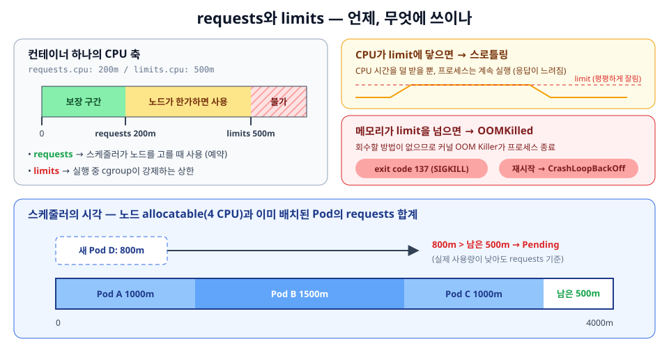
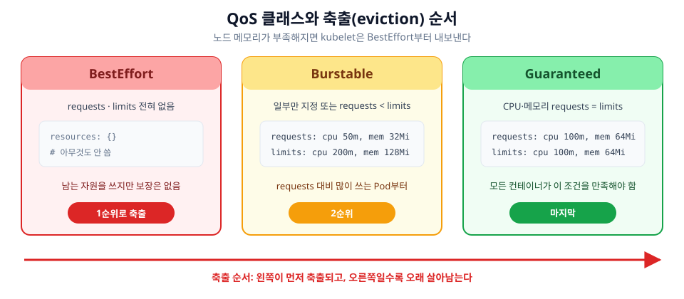
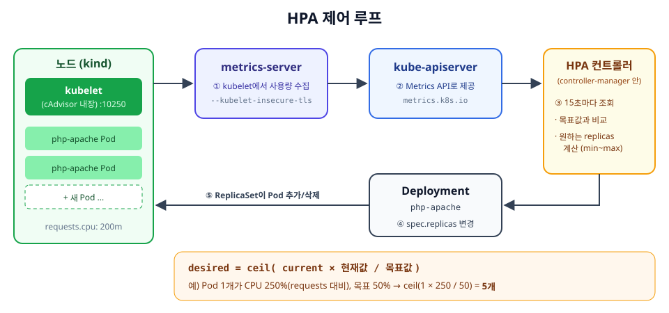

> **Chapter 2 · Kubernetes** | 난이도 ★★★☆☆ | 예상 소요 2 ~ 2.5시간

## 🎯 오늘의 목표

- 컨테이너의 **requests / limits**가 스케줄링과 실행에 각각 어떤 영향을 주는지 설명할 수 있다
- CPU를 넘겨 쓸 때(**스로틀링**)와 메모리를 넘겨 쓸 때(**OOMKilled**)의 차이를 안다
- **QoS 클래스**(Guaranteed / Burstable / BestEffort)와 **LimitRange · ResourceQuota**로 네임스페이스 자원을 통제할 수 있다
- kind에 **metrics-server**를 설치하고(`--kubelet-insecure-tls`), **HPA**로 부하에 따라 Pod 수가 자동으로 늘고 주는 것을 관찰한다

---

## 1. 왜 리소스 관리가 필요한가?

Day 07에서 컨테이너의 자원 제한은 **cgroup**이 담당한다고 배웠습니다. 쿠버네티스에서는 그 cgroup 설정을 Pod 스펙의 `resources`로 선언합니다. 아무것도 적지 않으면 이런 일이 생깁니다.

| 상황 | 결과 |
|---|---|
| **시끄러운 이웃(noisy neighbor)** | 한 Pod가 메모리 누수로 노드 메모리를 다 먹으면, 같은 노드의 멀쩡한 Pod들까지 쫓겨남 |
| **스케줄러가 눈을 감음** | 스케줄러는 Pod가 얼마나 쓸지 모르니, 이미 꽉 찬 노드에 Pod를 계속 배치 |
| **오토스케일 불가** | HPA의 "CPU 50%"는 **requests 대비** 비율이라, requests가 없으면 계산 자체가 안 됨 |

---

## 2. requests와 limits



```yaml
resources:
  requests:        # "최소 이만큼은 보장해 줘" → 스케줄링 기준
    cpu: 200m
    memory: 128Mi
  limits:          # "아무리 많아도 이 이상은 못 써" → 실행 중 상한
    cpu: 500m
    memory: 256Mi
```

| 구분 | requests | limits |
|---|---|---|
| 언제 쓰이나 | **스케줄링할 때** — 노드의 남은 할당 가능량(allocatable)과 비교 | **실행 중** — cgroup 상한으로 강제 |
| 의미 | 보장받는 양 (예약) | 넘을 수 없는 상한 |
| 실제 사용량과의 관계 | 실제로 덜 써도 예약은 유지됨 | 사용량이 여기에 닿으면 제재 |

### 단위

| 자원 | 단위 | 예 |
|---|---|---|
| CPU | 코어. `1` = 1 vCPU, `1000m`(밀리코어) = 1 | `250m` = 0.25 코어 |
| 메모리 | 바이트. `Ki/Mi/Gi`(1024 기반), `K/M/G`(1000 기반) | `128Mi` = 134,217,728 B |

> ⚠️ `memory: 128m`은 128 **밀리바이트**(0.128 바이트)라는 뜻이 되어 버립니다. 메모리에는 반드시 `Mi`/`Gi`를 쓰세요.

### limit을 넘으면? — CPU와 메모리는 다르다

| 자원 | 성격 | limit 초과 시 |
|---|---|---|
| **CPU** | 압축 가능(compressible) — 나눠 쓸 수 있음 | **스로틀링**: 느려질 뿐 죽지 않음 |
| **메모리** | 압축 불가(incompressible) — 회수할 방법이 없음 | 커널 OOM Killer가 프로세스 종료 → **`OOMKilled`** (exit code 137) |

> 💡 그래서 실무에서는 "메모리는 requests = limits로 넉넉히, CPU limit은 신중히(지연에 민감한 서비스는 CPU limit을 생략하기도)" 같은 가이드가 자주 나옵니다. 정답은 서비스마다 다르니 Day 17의 Grafana로 **실제 사용량을 보고** 정하는 게 원칙입니다.

---

## 3. QoS 클래스 — 노드가 부족할 때 누가 먼저 쫓겨나나



쿠버네티스는 requests/limits 설정 모양에 따라 Pod에 **QoS 클래스**를 자동으로 붙입니다. 노드의 메모리가 부족해지면 kubelet은 이 순서를 참고해 Pod를 **축출(eviction)** 합니다.

| QoS 클래스 | 조건 | 축출 우선순위 |
|---|---|---|
| **Guaranteed** | 모든 컨테이너가 CPU·메모리 **requests = limits** 를 지정 | 가장 마지막 |
| **Burstable** | Guaranteed는 아니지만 하나라도 requests 또는 limits가 있음 | 중간 (requests 대비 많이 쓰는 Pod부터) |
| **BestEffort** | 어떤 컨테이너에도 requests·limits가 **전혀 없음** | **가장 먼저** |

> 💡 limits만 적고 requests를 생략하면, requests가 **limits와 같은 값으로 자동 설정**됩니다. CPU·메모리 모두 그렇게 하면 Guaranteed가 됩니다.

---

## 4. 실습 ① — requests / limits / QoS / OOMKilled

### 4-0. 실습 환경

- Day 09의 **kind 클러스터**, Day 16의 Helm, Day 17의 모니터링 스택(선택 — Grafana로 함께 관찰하면 좋음)

```bash
kubectl create namespace res-demo
```

### 4-1. 노드의 할당 가능량 보기

```bash
kubectl describe node | grep -A 8 "Allocated resources"
```

```
Allocated resources:
  (Total limits may be over 100 percent, i.e., overcommitted.)
  Resource           Requests     Limits
  --------           --------     ------
  cpu                950m (11%)   200m (2%)
  memory             490Mi (6%)   940Mi (12%)
  ...
```

스케줄러는 여기의 **Requests 합계**와 노드의 `Allocatable`을 비교해 Pod를 배치합니다. 실제 사용량이 아닙니다!

### 4-2. QoS 클래스 확인

```yaml
# qos-pods.yaml
apiVersion: v1
kind: Pod
metadata:
  name: qos-guaranteed
  namespace: res-demo
spec:
  containers:
    - name: nginx
      image: nginx:1.27
      resources:
        requests: { cpu: 100m, memory: 64Mi }
        limits:   { cpu: 100m, memory: 64Mi }
---
apiVersion: v1
kind: Pod
metadata:
  name: qos-burstable
  namespace: res-demo
spec:
  containers:
    - name: nginx
      image: nginx:1.27
      resources:
        requests: { cpu: 50m, memory: 32Mi }
        limits:   { cpu: 200m, memory: 128Mi }
---
apiVersion: v1
kind: Pod
metadata:
  name: qos-besteffort
  namespace: res-demo
spec:
  containers:
    - name: nginx
      image: nginx:1.27
```

```bash
kubectl apply -f qos-pods.yaml
kubectl get pod -n res-demo -o custom-columns=NAME:.metadata.name,QOS:.status.qosClass
```

```
NAME             QOS
qos-besteffort   BestEffort
qos-burstable    Burstable
qos-guaranteed   Guaranteed
```

### 4-3. 메모리 limit 초과 → OOMKilled

메모리 limit을 100Mi로 걸어 놓고 250MB를 쓰려는 컨테이너를 띄웁니다.

```yaml
# memory-hog.yaml
apiVersion: v1
kind: Pod
metadata:
  name: memory-hog
  namespace: res-demo
spec:
  containers:
    - name: stress
      image: polinux/stress
      command: ["stress"]
      args: ["--vm", "1", "--vm-bytes", "250M", "--vm-hang", "1"]
      resources:
        requests:
          memory: 50Mi
        limits:
          memory: 100Mi
```

```bash
kubectl apply -f memory-hog.yaml
kubectl get pod memory-hog -n res-demo -w
```

```
NAME         READY   STATUS             RESTARTS      AGE
memory-hog   0/1     ContainerCreating  0             2s
memory-hog   0/1     OOMKilled          0             5s
memory-hog   0/1     OOMKilled          1 (3s ago)    9s
memory-hog   0/1     CrashLoopBackOff   1 (12s ago)   20s
```

```bash
kubectl describe pod memory-hog -n res-demo | grep -A 4 "Last State"
#     Last State:     Terminated
#       Reason:       OOMKilled
#       Exit Code:    137
```

> 💡 exit code **137 = 128 + 9(SIGKILL)**. Day 01의 `docker kill`과 같은 신호로 강제 종료된 것입니다. CPU limit 초과는 이런 흔적 없이 "느려지기만" 하므로 Grafana에서 `container_cpu_cfs_throttled_periods_total` 같은 스로틀링 메트릭으로 찾아야 합니다.

```bash
kubectl delete pod --all -n res-demo     # 다음 실습을 위해 정리
```

---

## 5. 실습 ② — 네임스페이스 단위 통제: LimitRange & ResourceQuota

Day 19에서 다룰 멀티테넌시의 기초입니다. "팀 A 네임스페이스는 CPU 2코어까지" 같은 규칙을 겁니다.

| 리소스 | 적용 대상 | 하는 일 |
|---|---|---|
| **LimitRange** | 컨테이너/Pod **하나하나** | 기본값(default) 주입, 최소/최대 강제 |
| **ResourceQuota** | 네임스페이스 **전체 합계** | requests/limits 합계, Pod 수, PVC 수 등의 총량 제한 |

```yaml
# ns-policy.yaml
apiVersion: v1
kind: LimitRange
metadata:
  name: default-limits
  namespace: res-demo
spec:
  limits:
    - type: Container
      defaultRequest:      # requests를 안 적으면 이 값
        cpu: 100m
        memory: 64Mi
      default:             # limits를 안 적으면 이 값
        cpu: 200m
        memory: 128Mi
      max:                 # 이보다 큰 limits는 거부
        cpu: "1"
        memory: 512Mi
---
apiVersion: v1
kind: ResourceQuota
metadata:
  name: team-quota
  namespace: res-demo
spec:
  hard:
    requests.cpu: "1"
    requests.memory: 1Gi
    limits.cpu: "2"
    limits.memory: 2Gi
    pods: "10"
```

```bash
kubectl apply -f ns-policy.yaml
kubectl describe quota team-quota -n res-demo
```

resources를 **하나도 적지 않은** Deployment를 15개 replicas로 만들어 봅시다.

```bash
kubectl create deployment quota-test -n res-demo --image=nginx:1.27 --replicas=15
kubectl get pod -n res-demo
kubectl get pod -n res-demo -l app=quota-test -o jsonpath='{.items[0].spec.containers[0].resources}'; echo
# {"limits":{"cpu":"200m","memory":"128Mi"},"requests":{"cpu":"100m","memory":"64Mi"}}
```

LimitRange가 기본값을 주입해 줬고, Pod는 **10개만** 만들어집니다(requests.cpu 합계 1코어 = 100m × 10, pods 10개). 나머지는 왜 안 생겼는지 이벤트에서 확인합니다.

```bash
kubectl get events -n res-demo --field-selector reason=FailedCreate | tail -2
# ... Error creating: pods "quota-test-..." is forbidden: exceeded quota: team-quota,
#     requested: ..., used: ..., limited: ...   (초과한 항목과 현재 사용량이 표시됨)

kubectl describe quota team-quota -n res-demo
```

> ⚠️ ResourceQuota에 `requests.cpu` 같은 항목을 걸면, 그 네임스페이스의 모든 Pod는 해당 값을 **반드시 지정**해야 합니다. LimitRange가 없다면 resources를 안 적은 Pod는 `must specify requests.cpu...` 에러로 거부됩니다. 그래서 둘을 **세트로** 씁니다.

```bash
kubectl delete namespace res-demo
```

---

## 6. 오토스케일링의 종류

| 종류 | 무엇을 늘리나 | 기준 | 비고 |
|---|---|---|---|
| **HPA** (Horizontal Pod Autoscaler) | **Pod 개수** | CPU/메모리 사용률, 커스텀 메트릭 | 쿠버네티스 기본 내장. 오늘의 주인공 |
| **VPA** (Vertical Pod Autoscaler) | Pod의 **requests/limits 크기** | 과거 사용량 | 별도 설치. 적정 requests 추천용으로도 유용 |
| **Cluster Autoscaler / Karpenter** | **노드 개수** | Pending Pod 발생 여부 | 클라우드 환경에서 주로 사용 |
| **KEDA** | Pod 개수 (0개까지) | 큐 길이, Kafka lag 등 이벤트 | HPA를 확장한 이벤트 기반 오토스케일러 |

> 💡 HPA가 Pod를 늘렸는데 노드에 자리가 없으면 Pod는 `Pending`이 됩니다. 이때 노드를 늘려 주는 게 Cluster Autoscaler입니다. 둘은 **짝**으로 동작합니다.

---

## 7. HPA 동작 원리



### 7-1. 메트릭은 어디서 오나 — metrics-server

HPA는 Prometheus를 직접 보지 않습니다. 쿠버네티스 **Metrics API**(`metrics.k8s.io`)를 보는데, 이 API를 제공하는 것이 **metrics-server**입니다. metrics-server는 각 노드의 kubelet에서 CPU·메모리 사용량을 주기적으로 모아 메모리에만 보관합니다(저장 기능 없음).

| | metrics-server | Prometheus (Day 17) |
|---|---|---|
| 목적 | **오토스케일링 · `kubectl top`** 용 실시간 값 | 장기 저장 · 분석 · 알림 |
| 저장 | 최신 값만 메모리에 | TSDB에 시계열로 |
| 제공 API | `metrics.k8s.io` | PromQL (HTTP API) |

> 💡 kube-prometheus-stack을 설치했다고 `kubectl top`이 되는 게 아닙니다. Prometheus 메트릭으로 HPA를 하려면 **prometheus-adapter** 같은 어댑터가 필요하고, 기본 CPU/메모리 HPA는 metrics-server로 충분합니다.

### 7-2. 계산식

HPA 컨트롤러는 기본 **15초마다** 다음을 계산합니다.

```
원하는 replicas = ceil( 현재 replicas × 현재 메트릭 값 / 목표 메트릭 값 )
```

- CPU **Utilization**은 **requests 대비 %** 입니다. requests가 200m인 Pod가 100m를 쓰면 50%.
- 예) 1개 Pod가 250%를 쓰고 목표가 50% → `ceil(1 × 250 / 50)` = **5개**
- 현재/목표 비율이 1.0 ± **0.1(10%)** 이내면 흔들림 방지를 위해 아무것도 하지 않습니다.
- **스케일 다운**은 기본적으로 최근 **5분(300초)** 동안의 권장값 중 가장 큰 값을 따릅니다(stabilization window). 부하가 잠깐 줄었다고 바로 줄이지 않기 위함입니다.

---

## 8. 실습 ③ — metrics-server 설치 (kind)

### 8-1. 설치

```bash
kubectl apply -f https://github.com/kubernetes-sigs/metrics-server/releases/latest/download/components.yaml
kubectl get pod -n kube-system -l k8s-app=metrics-server
```

```
NAME                              READY   STATUS    RESTARTS   AGE
metrics-server-6f7dd4c4c4-9zq5k   0/1     Running   0          60s
```

**READY 0/1에서 넘어가지 않습니다.** 로그를 보면 이유가 나옵니다.

```bash
kubectl logs -n kube-system deploy/metrics-server
# ... "Failed to scrape node" err="Get \"https://172.18.0.2:10250/metrics/resource\":
#     tls: failed to verify certificate: x509: cannot validate certificate for 172.18.0.2
#     because it doesn't contain any IP SANs" node="kind-control-plane"
```

### 8-2. 왜? — kubelet의 자체 서명 인증서

metrics-server는 각 노드 kubelet의 `:10250` 포트에 **HTTPS**로 접속합니다. kind 노드의 kubelet은 클러스터 CA가 서명하지 않은 **자체 서명(self-signed) 서빙 인증서**를 쓰고, 그 인증서에는 노드 IP가 SAN에 들어 있지 않습니다. 그래서 인증서 검증에 실패합니다.

학습용 로컬 클러스터에서는 **kubelet 인증서 검증을 건너뛰는** `--kubelet-insecure-tls` 인자를 추가합니다.

```bash
kubectl patch deployment metrics-server -n kube-system --type=json \
  -p '[{"op":"add","path":"/spec/template/spec/containers/0/args/-","value":"--kubelet-insecure-tls"}]'

kubectl rollout status deployment metrics-server -n kube-system
```

```bash
kubectl get deploy metrics-server -n kube-system \
  -o jsonpath='{.spec.template.spec.containers[0].args}'; echo
# ["--cert-dir=/tmp","--secure-port=10250",...,"--kubelet-insecure-tls"]
```

> 💡 **Windows PowerShell**에서는 작은따옴표 안의 큰따옴표 처리가 달라 위 `-p` 인자가 깨질 수 있습니다. Git Bash/WSL에서 실행하거나, 아래 Helm 방식을 쓰세요.

Helm(Day 16)으로 설치한다면 처음부터 인자를 넣을 수 있습니다. (위 방식과 **둘 중 하나만** 하세요.)

```bash
helm repo add metrics-server https://kubernetes-sigs.github.io/metrics-server/
helm upgrade --install metrics-server metrics-server/metrics-server \
  -n kube-system --set "args={--kubelet-insecure-tls}"
```

> ⚠️ `--kubelet-insecure-tls`는 **로컬 실습 전용**입니다. 운영 클러스터에서는 kubelet이 클러스터 CA로 서명된 서빙 인증서를 쓰도록(`serverTLSBootstrap: true` + CSR 승인) 구성하고 이 옵션을 쓰지 않습니다.

### 8-3. kubectl top

1분쯤 기다린 뒤:

```bash
kubectl top nodes
kubectl top pods -A --sort-by=memory | head
```

```
NAME                 CPU(cores)   CPU(%)   MEMORY(bytes)   MEMORY(%)
kind-control-plane   215m         2%       1350Mi          17%
```

> `error: Metrics API not available`가 나오면 아직 첫 수집 전입니다. 30초~1분 더 기다려 보세요.

---

## 9. 실습 ④ — HPA로 자동 확장/축소

### 9-1. 부하용 앱 배포

쿠버네티스 공식 예제의 `hpa-example` 이미지는 요청마다 CPU를 많이 쓰는 PHP 앱입니다.

```yaml
# php-apache.yaml
apiVersion: v1
kind: Namespace
metadata:
  name: hpa-demo
---
apiVersion: apps/v1
kind: Deployment
metadata:
  name: php-apache
  namespace: hpa-demo
spec:
  selector:
    matchLabels:
      run: php-apache
  template:
    metadata:
      labels:
        run: php-apache
    spec:
      containers:
        - name: php-apache
          image: registry.k8s.io/hpa-example
          ports:
            - containerPort: 80
          resources:
            requests:
              cpu: 200m        # ← HPA 사용률 계산의 기준 (필수!)
            limits:
              cpu: 500m
---
apiVersion: v1
kind: Service
metadata:
  name: php-apache
  namespace: hpa-demo
spec:
  selector:
    run: php-apache
  ports:
    - port: 80
```

```bash
kubectl apply -f php-apache.yaml
```

### 9-2. HPA 생성 (autoscaling/v2)

```yaml
# php-apache-hpa.yaml
apiVersion: autoscaling/v2
kind: HorizontalPodAutoscaler
metadata:
  name: php-apache
  namespace: hpa-demo
spec:
  scaleTargetRef:
    apiVersion: apps/v1
    kind: Deployment
    name: php-apache
  minReplicas: 1
  maxReplicas: 10
  metrics:
    - type: Resource
      resource:
        name: cpu
        target:
          type: Utilization
          averageUtilization: 50     # requests(200m)의 50% = Pod당 평균 100m 목표
  behavior:
    scaleDown:
      stabilizationWindowSeconds: 60 # 실습용으로 기본 300초 → 60초로 단축
      policies:
        - type: Percent
          value: 100
          periodSeconds: 15
```

```bash
kubectl apply -f php-apache-hpa.yaml
kubectl get hpa -n hpa-demo
```

```
NAME         REFERENCE               TARGETS       MINPODS   MAXPODS   REPLICAS   AGE
php-apache   Deployment/php-apache   cpu: 0%/50%   1         10        1          30s
```

> 💡 kubectl 버전에 따라 TARGETS가 `0%/50%`처럼 메트릭 이름 없이 보일 수 있습니다. 생성 직후 잠깐 `<unknown>/50%`인 것은 정상입니다(첫 메트릭 수집 전).

### 9-3. 부하 주기

**터미널 1** — 관찰:

```bash
kubectl get hpa php-apache -n hpa-demo --watch
```

**터미널 2** — 부하 발생 (Ctrl+C로 종료하면 Pod도 삭제됨):

```bash
kubectl run -n hpa-demo -i --tty load-generator --rm --image=busybox:1.28 --restart=Never -- \
  /bin/sh -c "while sleep 0.01; do wget -q -O- http://php-apache; done"
```

1분 남짓 지나면 터미널 1이 이렇게 변합니다(숫자는 PC 성능에 따라 다름).

```
NAME         REFERENCE               TARGETS         MINPODS   MAXPODS   REPLICAS   AGE
php-apache   Deployment/php-apache   cpu: 0%/50%     1         10        1          2m
php-apache   Deployment/php-apache   cpu: 248%/50%   1         10        1          3m
php-apache   Deployment/php-apache   cpu: 248%/50%   1         10        5          3m15s
php-apache   Deployment/php-apache   cpu: 71%/50%    1         10        5          3m30s
php-apache   Deployment/php-apache   cpu: 71%/50%    1         10        7          3m45s
php-apache   Deployment/php-apache   cpu: 49%/50%    1         10        7          4m30s
```

`248% → ceil(1 × 248/50) = 5개` 로 늘고, 그래도 목표를 넘자 7개로 한 번 더 늘어 목표(50%) 근처에서 안정됩니다. 7-2의 계산식 그대로입니다.

```bash
kubectl get deploy php-apache -n hpa-demo
kubectl describe hpa php-apache -n hpa-demo | tail -8   # Events에 스케일 이유가 기록됨
#   Normal  SuccessfulRescale  ...  New size: 5; reason: cpu resource utilization (percentage of request) above target
```

### 9-4. 부하 중지 → 축소

터미널 2에서 **Ctrl+C**. CPU가 0%로 떨어진 뒤 **stabilizationWindowSeconds(60초)** 가 지나면 replicas가 1로 돌아옵니다.

```
php-apache   Deployment/php-apache   cpu: 0%/50%     1         10        7          6m
php-apache   Deployment/php-apache   cpu: 0%/50%     1         10        1          7m
```

> 💡 Day 17의 Grafana에서 **Kubernetes / Compute Resources / Namespace (Pods)** 대시보드를 `hpa-demo` 네임스페이스로 열어 두고 실습하면, Pod 수와 CPU 그래프가 함께 출렁이는 모습을 볼 수 있습니다.

> ⚠️ HPA를 쓰는 Deployment에 `replicas`를 매니페스트로 다시 `apply`하면 HPA가 정한 값과 싸웁니다. HPA를 붙였다면 매니페스트에서 `replicas` 필드를 빼는 것이 일반적입니다(Day 16의 `helm create` 템플릿이 `autoscaling.enabled`일 때 replicas를 생략하는 이유).

### 9-5. 정리

```bash
kubectl delete namespace hpa-demo
# metrics-server는 Day 19 이후에도 kubectl top에 쓰니 남겨 둡니다.
```

---

## 10. 트러블슈팅

| 증상 | 원인 | 해결 |
|---|---|---|
| metrics-server가 `0/1 Running`, 로그에 `x509: cannot validate certificate ... doesn't contain any IP SANs` | kind kubelet의 자체 서명 인증서 | `--kubelet-insecure-tls` 인자 추가 (8-2) |
| `kubectl top` → `error: Metrics API not available` | metrics-server 미설치 또는 아직 첫 수집 전 | 설치 확인, `kubectl get apiservice v1beta1.metrics.k8s.io` 가 `True`인지 확인 후 1분 대기 |
| HPA TARGETS가 계속 `<unknown>/50%` | ① metrics-server 없음 ② 대상 컨테이너에 **CPU requests가 없음** | `kubectl describe hpa`의 Events 확인, Deployment에 `resources.requests.cpu` 추가 |
| Pod가 `OOMKilled` → `CrashLoopBackOff` 반복 | 메모리 limit보다 많이 사용 | 실제 사용량(`kubectl top pod`, Grafana) 확인 후 limit 상향 또는 메모리 누수 수정 |
| Pod가 `Pending`, 이벤트에 `0/1 nodes are available: 1 Insufficient cpu` | 노드의 남은 **requests** 여유 부족 (실제 사용량과 무관) | requests 하향, 다른 Pod 정리, 노드 추가 |
| `forbidden: exceeded quota` | ResourceQuota 총량 초과 | `kubectl describe quota`로 사용량 확인 후 조정 |
| `forbidden: failed quota: ... must specify limits.cpu` | Quota는 있는데 Pod에 해당 값이 없음 | LimitRange로 기본값 주입 또는 Pod에 명시 |

---

## 11. 핵심 정리

- **requests** = 스케줄링 기준(예약), **limits** = 실행 중 상한(cgroup)
- CPU 초과 → **스로틀링**(느려짐), 메모리 초과 → **OOMKilled**(exit 137)
- QoS: **Guaranteed**(requests=limits) > **Burstable** > **BestEffort**(없음) 순으로 오래 살아남는다
- **LimitRange**는 컨테이너 하나하나의 기본값·상하한, **ResourceQuota**는 네임스페이스 총량 — 세트로 사용
- HPA는 **metrics-server**(Metrics API)의 값을 보고 `ceil(현재 × 현재값/목표값)`으로 replicas 조정. CPU 사용률은 **requests 대비**
- kind에서는 metrics-server에 **`--kubelet-insecure-tls`** 가 필요(로컬 실습 전용)
- 스케일 다운은 stabilization window(기본 300초) 때문에 천천히 일어난다

---

## 12. 셀프 체크

<details>
<summary>Q1. 노드의 실제 CPU 사용률은 20%인데 새 Pod가 <code>Insufficient cpu</code>로 Pending이다. 왜일까?</summary>

스케줄러는 실제 사용량이 아니라 **이미 배치된 Pod들의 requests 합계**를 노드 allocatable과 비교합니다. requests를 크게 잡은 Pod들이 예약만 해 두고 실제로는 덜 쓰고 있는 상태입니다.
</details>

<details>
<summary>Q2. requests: cpu 100m / memory 128Mi, limits: cpu 100m / memory 256Mi 인 단일 컨테이너 Pod의 QoS 클래스는?</summary>

**Burstable**. Guaranteed가 되려면 CPU와 메모리 **모두** requests = limits여야 하는데, 메모리가 다릅니다.
</details>

<details>
<summary>Q3. CPU requests 200m, 목표 averageUtilization 50%인 HPA에서 Pod 2개가 각각 평균 300m를 쓰고 있다. 원하는 replicas는?</summary>

현재 사용률 = 300m / 200m = 150%. `ceil(2 × 150 / 50)` = **6개**.
</details>

<details>
<summary>Q4. kind에서 metrics-server에 <code>--kubelet-insecure-tls</code>가 필요한 이유와, 운영에서 쓰면 안 되는 이유는?</summary>

kind 노드의 kubelet은 클러스터 CA가 서명하지 않았고 노드 IP SAN도 없는 자체 서명 인증서를 쓰기 때문에, metrics-server가 TLS 검증에 실패합니다. 이 옵션은 검증을 아예 건너뛰므로 중간자 공격에 취약해져 운영에서는 kubelet 서빙 인증서를 제대로 발급(serverTLSBootstrap)해서 해결해야 합니다.
</details>

<details>
<summary>Q5. 부하를 멈췄는데 HPA가 Pod 수를 바로 줄이지 않는다. 고장인가?</summary>

아닙니다. 스케일 다운에는 기본 **300초의 stabilization window**가 있어, 그 기간의 권장값 중 최댓값을 따릅니다. 부하가 출렁일 때 Pod가 늘었다 줄었다 반복(flapping)하는 것을 막기 위한 설계입니다. `behavior.scaleDown.stabilizationWindowSeconds`로 조정할 수 있습니다.
</details>

---

## ⏭️ 다음 예고 — Day 19. RBAC & 네임스페이스로 멀티테넌시

오늘 ResourceQuota로 "팀별 자원 한도"를 걸어 봤습니다. 그런데 팀 A가 팀 B 네임스페이스의 Deployment를 지워 버린다면? **ServiceAccount, Role, RoleBinding**으로 "누가 어디서 무엇을 할 수 있는지"를 정하고, 네임스페이스 단위로 클러스터를 안전하게 나눠 쓰는 법을 배웁니다.
