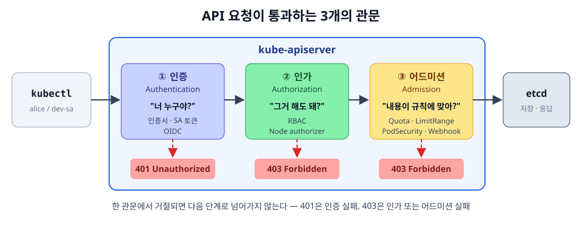
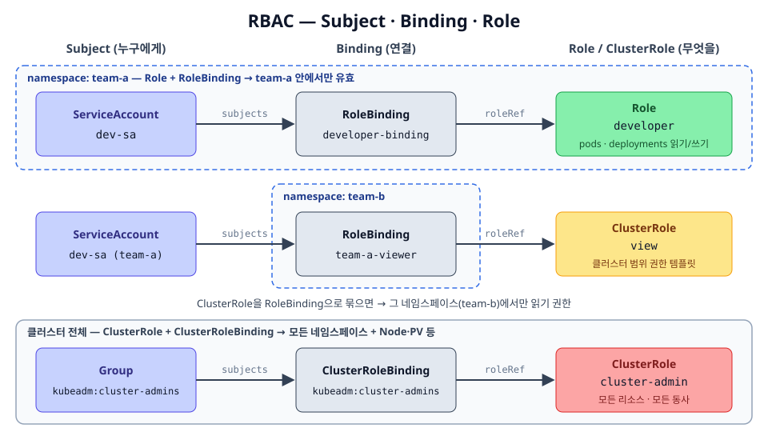
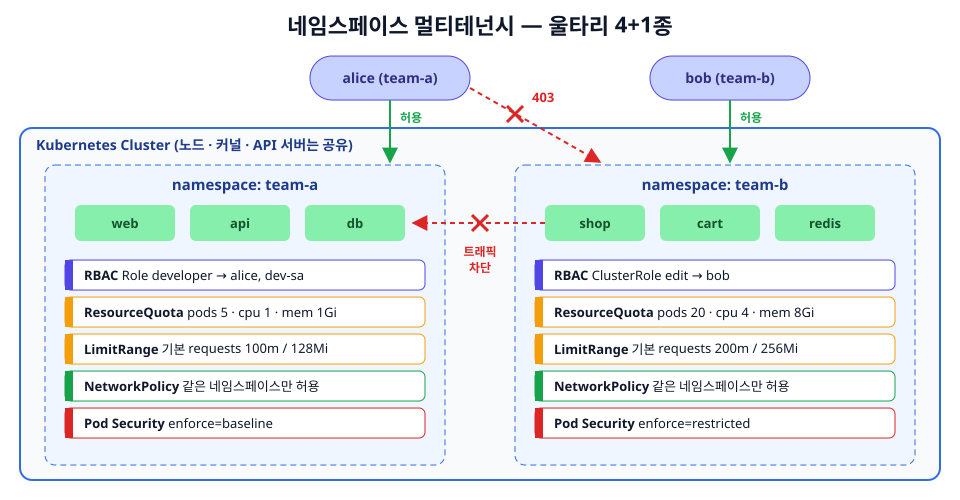

> **Chapter 2 · Kubernetes** | 난이도 ★★★★☆ | 예상 소요 2 ~ 2.5시간

## 🎯 오늘의 목표

- 하나의 클러스터를 여러 팀이 나눠 쓰는 **멀티테넌시**가 왜 필요한지, 어디까지 가능한지 설명할 수 있다
- API 요청이 **인증(Authentication) → 인가(Authorization) → 어드미션(Admission)** 을 거치는 흐름을 안다
- RBAC의 4가지 오브젝트(**Role / ClusterRole / RoleBinding / ClusterRoleBinding**)를 조합해 권한을 설계할 수 있다
- ServiceAccount 토큰과 X.509 인증서로 **"다른 사람"으로 접속하는 kubeconfig**를 직접 만들 수 있다
- ResourceQuota · LimitRange · NetworkPolicy · Pod Security로 네임스페이스에 **울타리**를 칠 수 있다

---

## 1. 왜 멀티테넌시인가?

지금까지 우리는 혼자서 클러스터 관리자(`cluster-admin`) 권한으로 모든 것을 했습니다. 하지만 실제 회사에서는 이런 상황이 벌어집니다.

> "결제팀 신입이 `kubectl delete deployment --all` 을 쳤는데, 네임스페이스를 안 줘서… 그게 default가 아니라 **운영 네임스페이스**였습니다."

여러 팀이 하나의 클러스터를 같이 쓰려면 두 가지가 필요합니다.

1. **권한 분리** — A팀은 A팀 리소스만 만지고, B팀 Secret은 볼 수조차 없어야 함
2. **자원 분리** — A팀이 Pod를 1000개 띄워서 B팀이 굶는 일이 없어야 함

| 방식 | 격리 수준 | 비용·운영 부담 | 언제 쓰나 |
|---|---|---|---|
| 팀마다 **클러스터 분리** (hard multitenancy) | 매우 강함 (컨트롤 플레인까지 분리) | 높음 — 클러스터 N개를 업그레이드·모니터링 | 고객사별 격리, 규제 환경 |
| **네임스페이스 분리** (soft multitenancy) | 중간 (커널·노드·API 서버 공유) | 낮음 — 클러스터 1개 | 사내 여러 팀, 개발/스테이징 환경 |
| 아무것도 안 함 | 없음 | 가장 낮음 | 개인 실습용 (지금까지의 우리) |

오늘은 가장 흔한 **네임스페이스 기반 소프트 멀티테넌시**를 만듭니다.

> 💡 네임스페이스는 **논리적인 칸막이**일 뿐, 그 자체로는 아무것도 막지 않습니다. 칸막이에 **RBAC(누가 무엇을)**, **ResourceQuota(얼마나)**, **NetworkPolicy(누구와 통신)** 를 붙여야 비로소 울타리가 됩니다.

---

## 2. 네임스페이스 다시 보기

Day 09부터 `-n kube-system` 같은 옵션을 써 왔습니다. 클러스터를 처음 만들면 이런 네임스페이스가 있습니다.

| 네임스페이스 | 용도 |
|---|---|
| `default` | 네임스페이스를 지정하지 않으면 여기에 생성 |
| `kube-system` | CoreDNS, kube-proxy 등 쿠버네티스 시스템 컴포넌트 |
| `kube-public` | 인증 없이도 읽을 수 있는 공개 정보 (cluster-info ConfigMap) |
| `kube-node-lease` | 노드 하트비트용 Lease 오브젝트 |

### 네임스페이스에 속하는 것 vs 속하지 않는 것

모든 리소스가 네임스페이스 안에 들어가는 것은 아닙니다.

| 네임스페이스 리소스 (namespaced) | 클러스터 리소스 (cluster-scoped) |
|---|---|
| Pod, Deployment, Service, ConfigMap, Secret, PVC, Ingress | Node, PersistentVolume, StorageClass, Namespace 자체 |
| ServiceAccount, **Role, RoleBinding** | **ClusterRole, ClusterRoleBinding**, CRD, IngressClass |
| ResourceQuota, LimitRange, NetworkPolicy | CertificateSigningRequest |

```bash
kubectl api-resources --namespaced=true    # 네임스페이스 리소스 목록
kubectl api-resources --namespaced=false   # 클러스터 리소스 목록
```

> ⚠️ PV(Day 14)와 StorageClass는 클러스터 리소스입니다. 그래서 "A팀에게 PV 생성 권한"을 주면 **클러스터 전체**에 영향을 주게 됩니다. 이것이 Role과 ClusterRole이 따로 있는 이유입니다.

네임스페이스가 달라도 네트워크는 기본적으로 **전부 통합니다.** Day 12에서 본 DNS 이름 `<서비스>.<네임스페이스>.svc.cluster.local` 로 다른 네임스페이스 서비스를 그냥 호출할 수 있죠. 이건 6-7에서 NetworkPolicy로 막아 봅니다.

---

## 3. API 요청은 3개의 관문을 통과한다

`kubectl get pods` 한 줄이 API 서버에 도착하면 다음 순서로 검사를 받습니다.



| 단계 | 질문 | 실패 시 | 대표 구현 |
|---|---|---|---|
| **인증** (Authentication) | 너 **누구**야? | `401 Unauthorized` | X.509 클라이언트 인증서, ServiceAccount 토큰, OIDC |
| **인가** (Authorization) | 그거 **해도 돼**? | `403 Forbidden` | **RBAC**, Node authorizer |
| **어드미션** (Admission) | 요청 **내용이 규칙에 맞아**? (필요하면 수정) | `403 Forbidden` 등 | ResourceQuota, LimitRanger, PodSecurity, Webhook |

### 쿠버네티스에는 "User" 오브젝트가 없다

놀랍게도 `kubectl create user` 같은 명령은 없습니다. 쿠버네티스는 사용자 DB를 갖고 있지 않고, **외부에서 증명된 이름을 믿을 뿐**입니다.

| 주체 (Subject) | 누가 만드나 | 이름 형식 |
|---|---|---|
| **User** (사람) | 클러스터 밖 — 인증서의 `CN`, OIDC 토큰의 클레임 | `alice` |
| **Group** | 인증서의 `O`, OIDC의 groups 클레임 | `team-a-devs`, `system:masters` |
| **ServiceAccount** (프로그램) | 쿠버네티스 오브젝트로 생성 (`kubectl create sa`) | `system:serviceaccount:<ns>:<이름>` |

> 💡 Pod 안의 앱이 API 서버를 호출할 때는 ServiceAccount를 씁니다. Day 17의 Prometheus가 모든 Pod 목록을 조회할 수 있었던 것도, Helm 차트가 만들어 준 ServiceAccount + ClusterRole 덕분입니다.

---

## 4. RBAC — 4개의 오브젝트로 권한 설계하기

RBAC(Role-Based Access Control)은 "**무엇을 할 수 있는가(Role)**"와 "**누구에게 줄 것인가(Binding)**"를 분리합니다.



| 오브젝트 | 범위 | 하는 일 |
|---|---|---|
| **Role** | 네임스페이스 | 특정 네임스페이스 안의 권한 목록 정의 |
| **ClusterRole** | 클러스터 | 클러스터 전체 / 클러스터 리소스(Node 등)에 대한 권한 정의, 또는 **재사용 템플릿** |
| **RoleBinding** | 네임스페이스 | Role 또는 ClusterRole을 주체에 연결 → **그 네임스페이스에서만** 유효 |
| **ClusterRoleBinding** | 클러스터 | ClusterRole을 주체에 연결 → **모든 네임스페이스**에서 유효 |

### 규칙(rule)은 "API 그룹 + 리소스 + 동사"

```yaml
rules:
- apiGroups: ["apps"]              # "" 은 core 그룹(Pod, Service, Secret ...)
  resources: ["deployments"]
  verbs: ["get", "list", "create"]
```

| 동사 (verb) | kubectl 예시 |
|---|---|
| `get` / `list` / `watch` | `kubectl get pod x` / `kubectl get pods` / `kubectl get pods -w` |
| `create` | `kubectl create`, `kubectl apply`(신규) |
| `update` / `patch` | `kubectl edit`, `kubectl apply`(변경), `kubectl scale` |
| `delete` / `deletecollection` | `kubectl delete pod x` / `kubectl delete pods --all` |

> ⚠️ RBAC은 **허용 목록(allow-list)만 있고 거부 규칙이 없습니다.** 여러 Binding이 겹치면 권한은 **합집합**이 됩니다. "이것만 빼고 다 허용" 같은 건 안 되니, 처음부터 최소 권한으로 설계하세요.

### 조합 규칙 — 이 표만 기억하면 된다

| Role 종류 | Binding 종류 | 결과 |
|---|---|---|
| Role | RoleBinding | 그 네임스페이스에서만 권한 (가장 기본) |
| **ClusterRole** | **RoleBinding** | ClusterRole에 적힌 권한을 **그 네임스페이스에서만** 부여 (템플릿 재사용 ⭐) |
| ClusterRole | ClusterRoleBinding | 모든 네임스페이스 + 클러스터 리소스에 권한 |
| Role | ClusterRoleBinding | ❌ 불가능 (roleRef에 Role을 쓸 수 없음) |

### 기본 제공 ClusterRole

매번 Role을 새로 만들 필요 없이, 쿠버네티스가 미리 만들어 둔 것을 RoleBinding으로 재사용하면 됩니다.

| ClusterRole | 권한 |
|---|---|
| `view` | 대부분 읽기 전용 (**Secret은 제외**) |
| `edit` | 대부분 읽기/쓰기 (Role·RoleBinding 수정은 불가) |
| `admin` | 네임스페이스 안에서 거의 전부 + Role/RoleBinding 관리 (ResourceQuota·Namespace 자체는 불가) |
| `cluster-admin` | 전부 (`*` on `*`). 우리가 지금까지 써온 권한 |

---

## 5. 멀티테넌시 울타리 4종 세트



| 울타리 | 막는 것 | 오브젝트 |
|---|---|---|
| **RBAC** | 남의 네임스페이스 리소스 조회·변경 | Role, RoleBinding |
| **ResourceQuota** | 네임스페이스 전체가 쓰는 자원 **총량** 초과 | ResourceQuota |
| **LimitRange** | 컨테이너 **하나**의 기본값/최대값 (requests 누락 방지) | LimitRange |
| **NetworkPolicy** | 다른 네임스페이스 Pod와의 통신 | NetworkPolicy |
| (+) **Pod Security Admission** | privileged 컨테이너, hostPath 등 위험한 Pod | 네임스페이스 라벨 |

> 💡 Day 18에서 requests/limits와 HPA를 배웠죠. ResourceQuota가 `requests.cpu` 를 제한하면 **requests가 없는 Pod는 아예 생성이 거부**됩니다. 그래서 LimitRange로 기본값을 채워 주는 것이 짝꿍처럼 따라다닙니다.

---

## 6. 실습

**실습 환경**: Day 09에서 쓴 **kind v0.24 이상** + kubectl v1.31 이상. 인증서 실습(6-5)은 `openssl`, `base64` 가 있는 Linux / macOS / WSL 셸 기준입니다.

### 6-1. 실습용 클러스터와 네임스페이스

```bash
kind create cluster --name rbac-lab
kubectl config current-context        # kind-rbac-lab

kubectl create namespace team-a
kubectl create namespace team-b
kubectl get ns
```

지금 우리 권한을 확인해 봅시다.

```bash
kubectl auth can-i '*' '*'            # yes  ← cluster-admin 이라 뭐든 가능
kubectl auth whoami
```

```
ATTRIBUTE   VALUE
Username    kubernetes-admin
Groups      [kubeadm:cluster-admins system:authenticated]
```

### 6-2. ServiceAccount + Role + RoleBinding

team-a 개발자용 권한을 만듭니다. Pod·Deployment는 다 만질 수 있지만 **Secret은 못 보게** 합니다.

```yaml
# rbac-team-a.yaml
apiVersion: v1
kind: ServiceAccount
metadata:
  name: dev-sa
  namespace: team-a
---
apiVersion: rbac.authorization.k8s.io/v1
kind: Role
metadata:
  name: developer
  namespace: team-a
rules:
- apiGroups: [""]
  resources: ["pods", "pods/log", "services", "configmaps"]
  verbs: ["get", "list", "watch", "create", "update", "patch", "delete"]
- apiGroups: [""]
  resources: ["pods/exec"]
  verbs: ["create"]
- apiGroups: ["apps"]
  resources: ["deployments", "replicasets"]
  verbs: ["get", "list", "watch", "create", "update", "patch", "delete"]
---
apiVersion: rbac.authorization.k8s.io/v1
kind: RoleBinding
metadata:
  name: developer-binding
  namespace: team-a
subjects:
- kind: ServiceAccount
  name: dev-sa
  namespace: team-a
- kind: User                       # 6-5에서 만들 사람 사용자
  name: alice
  apiGroup: rbac.authorization.k8s.io
roleRef:
  kind: Role
  name: developer
  apiGroup: rbac.authorization.k8s.io
```

```bash
kubectl apply -f rbac-team-a.yaml
```

`--as` 옵션으로 **다른 주체인 척(impersonation)** 하면서 권한을 확인할 수 있습니다. (cluster-admin이라 가능한 것)

```bash
SA=system:serviceaccount:team-a:dev-sa

kubectl auth can-i create deployments -n team-a --as=$SA   # yes
kubectl auth can-i get secrets        -n team-a --as=$SA   # no
kubectl auth can-i list pods          -n team-b --as=$SA   # no
kubectl auth can-i list nodes                   --as=$SA   # no

kubectl auth can-i --list -n team-a --as=$SA               # 가진 권한 전체 목록
```

실제로 요청을 보내면 403이 어떻게 생겼는지도 보세요.

```bash
kubectl get pods -n team-b --as=$SA
```

```
Error from server (Forbidden): pods is forbidden: User "system:serviceaccount:team-a:dev-sa"
cannot list resource "pods" in API group "" in the namespace "team-b"
```

> 💡 이 에러 메시지에 **누가(User) / 무엇을(verb, resource, API group) / 어디서(namespace)** 가 다 들어 있습니다. Role의 rules에 그대로 옮겨 적으면 됩니다.

명령형으로도 만들 수 있습니다. YAML이 귀찮을 때 유용합니다.

```bash
kubectl create role pod-reader --verb=get,list,watch --resource=pods -n team-a
kubectl create rolebinding pod-reader-binding --role=pod-reader --serviceaccount=team-a:dev-sa -n team-a
```

### 6-3. ClusterRole 재사용 — team-b는 "읽기만"

team-a 개발자가 협업 때문에 team-b를 **보기만** 해야 한다면? 기본 ClusterRole `view` 를 team-b 네임스페이스의 RoleBinding으로 연결합니다.

```bash
kubectl create rolebinding team-a-viewer \
  --clusterrole=view \
  --serviceaccount=team-a:dev-sa \
  -n team-b

kubectl auth can-i list pods      -n team-b --as=$SA   # yes  (view)
kubectl auth can-i delete pods    -n team-b --as=$SA   # no
kubectl auth can-i get secrets    -n team-b --as=$SA   # no   (view는 Secret 제외)
kubectl auth can-i list pods -n default   --as=$SA     # no   (RoleBinding은 team-b에만)
```

ClusterRole이지만 **RoleBinding으로 묶었기 때문에 team-b 안에서만** 유효하다는 것이 핵심입니다.

### 6-4. ServiceAccount 토큰으로 kubeconfig 만들기

`--as` 는 흉내일 뿐이니, 이번엔 진짜 dev-sa의 **토큰**으로 접속해 봅니다. v1.24부터 ServiceAccount 토큰 Secret이 자동 생성되지 않으므로 `kubectl create token` 으로 **만료 시간이 있는 토큰**을 발급합니다.

```bash
TOKEN=$(kubectl create token dev-sa -n team-a --duration=1h)

kubectl config set-credentials dev-sa --token="$TOKEN"
kubectl config set-context team-a-dev \
  --cluster=kind-rbac-lab --user=dev-sa --namespace=team-a

kubectl --context team-a-dev auth whoami
```

```
ATTRIBUTE                                           VALUE
Username                                            system:serviceaccount:team-a:dev-sa
Groups                                              [system:serviceaccounts system:serviceaccounts:team-a system:authenticated]
...
```

```bash
kubectl --context team-a-dev create deployment hello --image=nginx   # 성공
kubectl --context team-a-dev get pods                                # 성공 (team-a)
kubectl --context team-a-dev get secrets                             # Forbidden
kubectl --context team-a-dev get nodes                               # Forbidden
kubectl --context team-a-dev delete deployment hello
```

> ⚠️ 토큰은 1시간 뒤 만료됩니다. 만료되면 `error: You must be logged in to the server (Unauthorized)` (401) — 인가가 아니라 **인증** 실패입니다. 다시 `kubectl create token` 으로 발급받으세요.

### 6-5. 사람 사용자 alice — X.509 인증서 발급

이번엔 사람을 위한 인증서를 만듭니다. 인증서의 **CN이 사용자 이름**, **O가 그룹**이 됩니다. 쿠버네티스의 CertificateSigningRequest API로 클러스터 CA에 서명을 받습니다.

```bash
# 1) 개인키와 CSR 생성 (alice 본인이 하는 일)
openssl genrsa -out alice.key 2048
openssl req -new -key alice.key -out alice.csr -subj "/CN=alice/O=team-a-devs"

# 2) 쿠버네티스에 서명 요청 제출 (관리자가 하는 일)
cat <<EOF | kubectl apply -f -
apiVersion: certificates.k8s.io/v1
kind: CertificateSigningRequest
metadata:
  name: alice
spec:
  request: $(base64 < alice.csr | tr -d '\n')
  signerName: kubernetes.io/kube-apiserver-client
  expirationSeconds: 86400
  usages:
  - client auth
EOF

kubectl get csr alice                # CONDITION: Pending
kubectl certificate approve alice
kubectl get csr alice                # CONDITION: Approved,Issued

# 3) 발급된 인증서 꺼내기
kubectl get csr alice -o jsonpath='{.status.certificate}' | base64 -d > alice.crt
openssl x509 -in alice.crt -noout -subject -enddate
```

```
subject=CN = alice, O = team-a-devs
notAfter=...  (24시간 뒤)
```

kubeconfig에 등록하고 접속해 봅니다. alice는 6-2의 RoleBinding에 이미 들어 있습니다.

```bash
kubectl config set-credentials alice \
  --client-key=alice.key --client-certificate=alice.crt --embed-certs=true
kubectl config set-context alice@rbac-lab \
  --cluster=kind-rbac-lab --user=alice --namespace=team-a

kubectl --context alice@rbac-lab auth whoami      # Username alice, Groups [team-a-devs system:authenticated]
kubectl --context alice@rbac-lab get pods         # 성공 (No resources found 도 성공)
kubectl --context alice@rbac-lab get pods -n team-b   # Forbidden
```

> 💡 실무에서는 사람마다 RoleBinding을 만들지 않고, **그룹(`kind: Group`, `name: team-a-devs`)** 에 바인딩합니다. 신규 입사자는 인증서(또는 OIDC 계정)의 그룹만 맞으면 자동으로 권한을 얻습니다.

> ⚠️ 쿠버네티스는 **인증서를 폐기(revoke)할 방법이 없습니다.** 퇴사자의 인증서는 만료 전까지 유효하므로, 짧은 `expirationSeconds` 를 쓰거나 실무에선 OIDC(Keycloak, Google, Azure AD 등)를 씁니다.

### 6-6. ResourceQuota + LimitRange

team-a가 쓸 수 있는 자원 총량과 컨테이너 기본값을 정합니다.

```yaml
# quota-team-a.yaml
apiVersion: v1
kind: ResourceQuota
metadata:
  name: team-a-quota
  namespace: team-a
spec:
  hard:
    requests.cpu: "1"
    requests.memory: 1Gi
    limits.cpu: "2"
    limits.memory: 2Gi
    pods: "5"
    services.nodeports: "0"       # NodePort 서비스 금지
---
apiVersion: v1
kind: LimitRange
metadata:
  name: team-a-defaults
  namespace: team-a
spec:
  limits:
  - type: Container
    defaultRequest:               # requests 안 적으면 이 값
      cpu: 100m
      memory: 128Mi
    default:                      # limits 안 적으면 이 값
      cpu: 200m
      memory: 256Mi
    max:                          # 컨테이너 하나의 상한
      cpu: "1"
      memory: 1Gi
```

```bash
kubectl apply -f quota-team-a.yaml

# 개발자(dev-sa) 권한으로 Pod 8개짜리 Deployment 배포
kubectl --context team-a-dev create deployment web --image=nginx --replicas=8

kubectl get pods -n team-a                 # 5개만 Running
kubectl describe quota team-a-quota -n team-a
```

```
Name:            team-a-quota
Namespace:       team-a
Resource            Used    Hard
--------            ----    ----
limits.cpu          1       2
limits.memory       1280Mi  2Gi
pods                5       5
requests.cpu        500m    1
requests.memory     640Mi   1Gi
services.nodeports  0       0
```

나머지 3개는 왜 안 떴을까요? Pod를 만드는 주체인 ReplicaSet의 이벤트를 보면 됩니다.

```bash
kubectl describe rs -n team-a | grep -A3 Events
```

```
Warning  FailedCreate  ...  Error creating: pods "web-xxxxx" is forbidden: exceeded quota: team-a-quota,
requested: pods=1, used: pods=5, limited: pods=5
```

LimitRange가 requests/limits를 자동으로 채웠는지도 확인합니다.

```bash
kubectl get pod -n team-a -l app=web -o jsonpath='{.items[0].spec.containers[0].resources}'; echo
# {"limits":{"cpu":"200m","memory":"256Mi"},"requests":{"cpu":"100m","memory":"128Mi"}}

kubectl --context team-a-dev expose deployment web --port=80 --type=NodePort
# ... forbidden: exceeded quota: team-a-quota, requested: services.nodeports=1 ...
```

> 💡 `kubectl --context team-a-dev describe quota` 는 Forbidden입니다. Role에 `resourcequotas` 를 안 넣었기 때문이죠. 팀이 자기 쿼터를 볼 수 있게 하려면 `resourcequotas` 에 `get, list` 를 추가하세요.

### 6-7. NetworkPolicy — 다른 네임스페이스 접근 차단

kind v0.24부터 기본 CNI(kindnet)가 NetworkPolicy를 지원합니다. 먼저 정책 **없이** 통신이 되는지 확인합니다. (쿼터 때문에 web을 2개로 줄여 둡니다.)

```bash
kubectl scale deployment web --replicas=2 -n team-a
kubectl expose deployment web --port=80 -n team-a     # ClusterIP 서비스

kubectl run curl -n team-b --image=curlimages/curl --rm -it --restart=Never -- \
  curl -s -m 3 -o /dev/null -w "%{http_code}\n" http://web.team-a
# 200  ← 다른 네임스페이스인데도 통함
```

이제 "**같은 네임스페이스에서 오는 트래픽만 허용**" 하는 정책을 겁니다.

```yaml
# netpol-team-a.yaml
apiVersion: networking.k8s.io/v1
kind: NetworkPolicy
metadata:
  name: allow-same-namespace
  namespace: team-a
spec:
  podSelector: {}            # team-a의 모든 Pod에 적용
  policyTypes: ["Ingress"]
  ingress:
  - from:
    - podSelector: {}        # 같은 네임스페이스의 모든 Pod만 허용
```

```bash
kubectl apply -f netpol-team-a.yaml

# team-b → team-a : 차단 (타임아웃)
kubectl run curl -n team-b --image=curlimages/curl --rm -it --restart=Never -- \
  curl -s -m 3 -o /dev/null -w "%{http_code}\n" http://web.team-a
# 000  (curl: (28) ... timed out)

# team-a → team-a : 허용
kubectl run curl -n team-a --image=curlimages/curl --rm -it --restart=Never -- \
  curl -s -m 3 -o /dev/null -w "%{http_code}\n" http://web
# 200
```

> ⚠️ NetworkPolicy는 **CNI가 구현**합니다. CNI가 지원하지 않으면 오브젝트는 만들어지지만 **아무 효과가 없습니다**(에러도 안 남!). Day 20에서 설치할 Calico·Cilium은 지원합니다.

### 6-8. Pod Security Admission — 위험한 Pod 거부

네임스페이스에 라벨 하나만 붙이면 됩니다. 레벨은 `privileged`(제한 없음) < `baseline`(알려진 위험 차단) < `restricted`(강력한 하드닝)입니다.

```bash
kubectl label namespace team-a pod-security.kubernetes.io/enforce=baseline

cat <<EOF | kubectl apply -f -
apiVersion: v1
kind: Pod
metadata:
  name: priv
  namespace: team-a
spec:
  containers:
  - name: nginx
    image: nginx
    securityContext:
      privileged: true
EOF
```

```
Error from server (Forbidden): error when creating "STDIN": pods "priv" is forbidden:
violates PodSecurity "baseline:latest": privileged (container "nginx" must not set securityContext.privileged=true)
```

> 💡 Day 07에서 본 것처럼 privileged 컨테이너는 호스트 커널 기능을 거의 다 쓸 수 있습니다. 멀티테넌트 클러스터에서 한 팀이 privileged Pod를 띄우면 **노드 전체, 즉 다른 팀까지** 위험해집니다.

### 6-9. 정리

```bash
kind delete cluster --name rbac-lab

# kind가 지우지 않는, 우리가 직접 추가한 kubeconfig 항목 정리
kubectl config delete-context team-a-dev
kubectl config delete-context alice@rbac-lab
kubectl config delete-user dev-sa
kubectl config delete-user alice
rm -f alice.key alice.csr alice.crt
```

---

## 7. 트러블슈팅

| 증상 | 원인 | 해결 |
|---|---|---|
| `... is forbidden: User "X" cannot list resource "pods" in API group "" in the namespace "Y"` (403) | 해당 주체에 권한 없음 | 메시지의 verb / resource / API group / namespace를 그대로 Role rules에 추가. `kubectl auth can-i --list --as=X -n Y` 로 확인 |
| `You must be logged in to the server (Unauthorized)` (401) | **인증** 실패 — 토큰 만료, 잘못된 인증서 | `kubectl create token` 재발급, 인증서 만료일(`openssl x509 -enddate`) 확인 |
| RoleBinding을 만들었는데 권한이 안 생김 | RoleBinding과 Role이 **서로 다른 네임스페이스** / subject의 SA namespace 오타 | Role·RoleBinding·SA 네임스페이스 일치 확인. RoleBinding은 같은 네임스페이스의 Role만 참조 가능 |
| RoleBinding의 roleRef 수정 시 `cannot change roleRef` | roleRef는 **불변(immutable)** 필드 | RoleBinding을 삭제 후 재생성 |
| Deployment는 생겼는데 Pod가 0개 | ResourceQuota 초과 | `kubectl describe rs` 이벤트에서 `exceeded quota` 확인, `kubectl describe quota` |
| `failed quota: ... must specify limits.cpu ...` | 쿼터가 requests/limits를 제한하는데 Pod에 값이 없음 | LimitRange로 기본값을 주거나 매니페스트에 resources 명시 |
| NetworkPolicy를 걸었는데 아무 효과 없음 | CNI가 NetworkPolicy 미지원 | 지원 CNI(Calico, Cilium, kind v0.24+ kindnet) 사용 |
| `kubectl get csr` 가 계속 `Pending` | 아무도 승인하지 않음 | `kubectl certificate approve <이름>` |

---

## 8. 핵심 정리

- 네임스페이스는 **논리적 칸막이**. RBAC·ResourceQuota·LimitRange·NetworkPolicy·PSA를 붙여야 **멀티테넌시 울타리**가 된다
- API 요청은 **인증(누구?) → 인가(해도 돼?) → 어드미션(내용 OK?)** 순서. 401은 인증, 403은 인가/어드미션 실패
- 쿠버네티스엔 User 오브젝트가 없다. 사람은 **인증서 CN/O 또는 OIDC**, 프로그램은 **ServiceAccount**
- RBAC = **Role(무엇을)** + **Binding(누구에게)**. 허용만 있고 거부는 없으며, 권한은 합집합
- **ClusterRole + RoleBinding** = 공용 권한 템플릿을 특정 네임스페이스에만 적용 (`view`, `edit`, `admin`)
- `kubectl auth can-i ... --as=...` 와 `kubectl auth whoami` 로 권한을 검증하는 습관
- ResourceQuota(총량)와 LimitRange(기본값·개별 상한)는 짝으로 쓴다

---

## 9. 셀프 체크

<details>
<summary>Q1. 401 Unauthorized와 403 Forbidden의 차이는?</summary>

401은 **인증 실패** — API 서버가 "너 누군지 모르겠다"(토큰 만료, 잘못된 인증서). 403은 **인가 또는 어드미션 실패** — "누군지는 알겠는데 그건 못 하게 돼 있다"(RBAC 권한 없음, 쿼터 초과, PodSecurity 위반 등).
</details>

<details>
<summary>Q2. ClusterRole <code>view</code> 를 RoleBinding으로 연결하면 권한 범위는?</summary>

RoleBinding이 있는 **그 네임스페이스 안에서만** view 권한이 생깁니다. ClusterRole은 "권한 목록 템플릿"으로 쓰였을 뿐이고, 적용 범위는 Binding의 종류가 결정합니다.
</details>

<details>
<summary>Q3. dev-sa가 team-a에서 Secret을 읽지 못하게 하려면 어떤 규칙을 추가해야 하나?</summary>

**아무것도 추가하지 않으면 됩니다.** RBAC은 허용 목록만 있고 기본이 거부입니다. 다만 다른 Binding(예: `edit` ClusterRole)이 Secret 읽기를 허용하고 있다면 합집합이 되므로, 그 Binding을 제거해야 합니다.
</details>

<details>
<summary>Q4. ResourceQuota에 <code>requests.cpu</code> 를 걸었더니 기존 매니페스트가 배포되지 않는다. 왜이고, 어떻게 해결하나?</summary>

쿼터가 requests.cpu를 추적하려면 모든 Pod가 requests 값을 가져야 하므로, 값이 없는 Pod는 어드미션 단계에서 거부됩니다. **LimitRange의 `defaultRequest` / `default`** 로 기본값을 자동 주입하거나 매니페스트에 resources를 명시합니다.
</details>

<details>
<summary>Q5. X.509 인증서로 만든 사용자의 접근을 즉시 차단하려면?</summary>

쿠버네티스는 인증서 폐기를 지원하지 않으므로, 그 사용자(또는 그룹)를 참조하는 **RoleBinding/ClusterRoleBinding을 삭제**해 인가 단계에서 막습니다. 인증 자체는 만료 전까지 통과합니다. 그래서 짧은 만료 기간이나 OIDC를 권장합니다.
</details>

---

## ⏭️ 다음 예고 — Day 20. kubeadm으로 멀티노드 클러스터 직접 구축

지금까지 kind가 몇 초 만에 만들어 준 클러스터를 썼습니다. 그 안에서는 무슨 일이 일어났을까요? 내일은 **Ubuntu VM 3대**에 containerd, kubelet, kubeadm을 직접 설치하고, 컨트롤 플레인을 `kubeadm init` 으로 띄우고, CNI를 깔고, 워커를 join시켜 **진짜 멀티노드 클러스터**를 손으로 조립합니다. Chapter 2의 마지막 날입니다!
