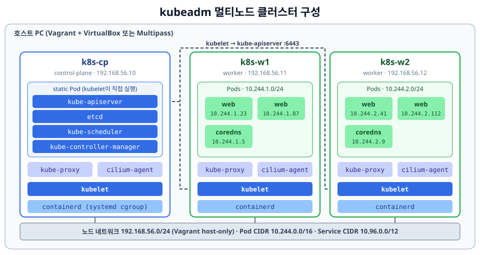
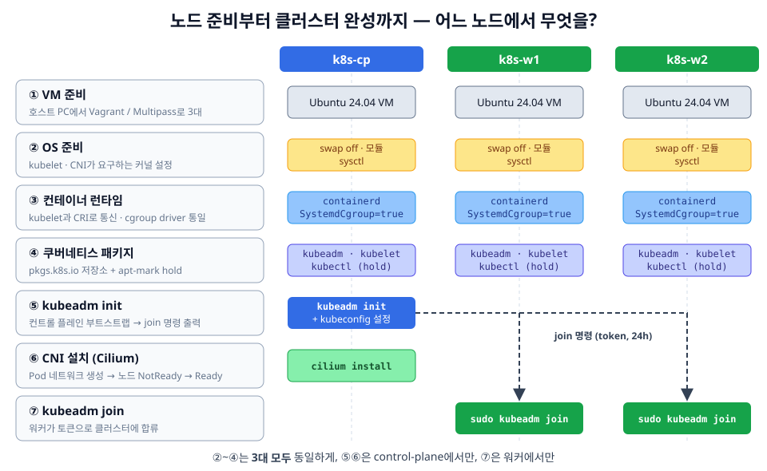
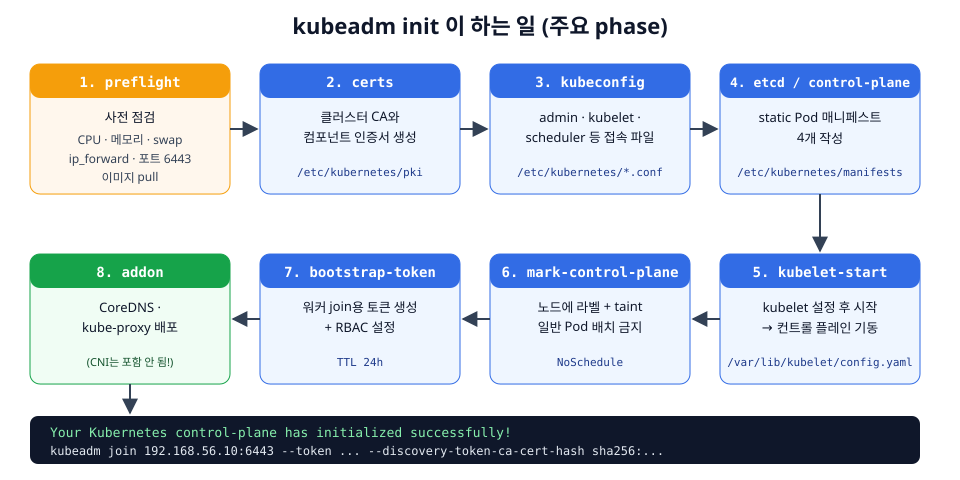

> **Chapter 2 · Kubernetes** | 난이도 ★★★★★ | 예상 소요 3 ~ 4시간

## 🎯 오늘의 목표

- kind/minikube가 숨겨 주던 **클러스터 부트스트랩 과정**을 단계별로 설명할 수 있다
- 노드 준비 작업(**swap off, 커널 모듈, sysctl, containerd + SystemdCgroup**)을 왜 하는지 안다
- `pkgs.k8s.io` 저장소로 **kubeadm / kubelet / kubectl** 을 설치하고 버전을 고정할 수 있다
- `kubeadm init` → **CNI 설치** → `kubeadm join` 으로 **control-plane 1 + worker 2** 클러스터를 완성한다
- 완성된 클러스터에서 static Pod, 인증서, kubelet 설정 파일이 어디 있는지 찾아볼 수 있다

---

## 1. 왜 직접 구축해 보나?

Day 09에서 `kind create cluster` 한 줄로 클러스터가 생겼습니다. 편하지만, 그 안에서 무슨 일이 일어났는지는 보이지 않았죠.

| 방식 | 노드 | 용도 | 숨겨진 것 |
|---|---|---|---|
| kind / minikube | 컨테이너 or VM 1~N개 (자동) | 로컬 개발·학습 | 거의 전부 |
| **kubeadm** | 내가 준비한 서버(VM/물리) | 온프레미스, 학습, 자체 구축 | 노드 준비·CNI·LB는 내 몫 |
| EKS / GKE / AKS | 클라우드가 관리 | 운영 | 컨트롤 플레인 전체 |

> 💡 사실 **kind도 내부적으로 kubeadm을 씁니다.** 노드 컨테이너 안에서 `kubeadm init/join` 을 대신 실행해 줄 뿐이죠. 오늘은 그걸 손으로 합니다.

kubeadm은 "**클러스터를 띄우는 것**"까지만 책임집니다. OS 준비, 컨테이너 런타임 설치, CNI 선택은 우리가 해야 합니다. 그래서 공부가 됩니다.

---

## 2. 오늘 만들 클러스터



| 호스트명 | 역할 | vCPU | 메모리 | IP (Vagrant 기준) |
|---|---|---|---|---|
| `k8s-cp` | control-plane | 2 | 4GB | 192.168.56.10 |
| `k8s-w1` | worker | 2 | 2GB | 192.168.56.11 |
| `k8s-w2` | worker | 2 | 2GB | 192.168.56.12 |

| 항목 | 값 |
|---|---|
| OS | Ubuntu 24.04 LTS |
| 컨테이너 런타임 | containerd (Ubuntu 패키지) |
| Kubernetes | v1.34 (`pkgs.k8s.io` 저장소) |
| CNI | Cilium (cilium CLI로 설치) |
| Pod CIDR | `10.244.0.0/16` (노드마다 /24씩 할당) |
| Service CIDR | `10.96.0.0/12` (kubeadm 기본값) |

> ⚠️ kubeadm 요구 사항: 노드당 **2 vCPU / 2GB RAM 이상**, 노드끼리 네트워크 통신 가능, **호스트명·MAC·product_uuid가 노드마다 달라야** 합니다. 호스트 PC는 RAM 16GB 이상을 권장합니다.

> 💡 버전: 이 글은 v1.34 기준입니다. 최신 마이너 버전은 [kubernetes.io/releases](https://kubernetes.io/releases/)에서 확인하고, 아래 `K8S_MINOR` 값만 바꾸면 됩니다.

---

## 3. 전체 순서 한눈에 보기



| 단계 | 대상 노드 | 하는 일 |
|---|---|---|
| ① VM 준비 | 호스트 PC | Ubuntu 24.04 VM 3대 생성 |
| ② OS 준비 | **3대 모두** | swap off, 커널 모듈, sysctl |
| ③ 런타임 | **3대 모두** | containerd 설치 + `SystemdCgroup = true` |
| ④ 패키지 | **3대 모두** | kubeadm / kubelet / kubectl 설치 + hold |
| ⑤ init | control-plane | `kubeadm init` → kubeconfig 설정 |
| ⑥ CNI | control-plane | Cilium 설치 → 노드 Ready |
| ⑦ join | worker 2대 | `kubeadm join` |

---

## 4. ① VM 3대 준비

두 가지 방법 중 하나를 고르세요.

| 방법 | 추천 환경 | 비고 |
|---|---|---|
| **A. Multipass** | macOS, Linux, Windows **Pro**(Hyper-V) | 명령 몇 줄로 끝. 가장 간단 |
| **B. Vagrant + VirtualBox** | Windows **Home** 포함 어디서나 | IP 고정이 쉬움. NIC가 2개라 `node-ip` 설정 필요 |

> ⚠️ Windows Home에서 Multipass는 VirtualBox 드라이버를 쓰는데, 이때 VM들은 각자 NAT 뒤에 있어 **서로 통신이 안 됩니다.** Windows Home이라면 방법 B를 쓰세요.

### A. Multipass

```bash
multipass launch 24.04 --name k8s-cp --cpus 2 --memory 4G --disk 20G
multipass launch 24.04 --name k8s-w1 --cpus 2 --memory 2G --disk 15G
multipass launch 24.04 --name k8s-w2 --cpus 2 --memory 2G --disk 15G

multipass list
```

```
Name                    State             IPv4             Image
k8s-cp                  Running           172.25.112.10    Ubuntu 24.04 LTS
k8s-w1                  Running           172.25.112.11    Ubuntu 24.04 LTS
k8s-w2                  Running           172.25.112.12    Ubuntu 24.04 LTS
```

각 노드 접속은 `multipass shell k8s-cp` 처럼 합니다. (IP는 환경마다 다릅니다. 아래에서 `192.168.56.x` 가 나오면 **자신의 IP로 바꿔 읽으세요.**)

### B. Vagrant + VirtualBox

빈 폴더에 `Vagrantfile` 을 만듭니다.

```ruby
# Vagrantfile
Vagrant.configure("2") do |config|
  config.vm.box = "bento/ubuntu-24.04"

  nodes = {
    "k8s-cp" => "192.168.56.10",
    "k8s-w1" => "192.168.56.11",
    "k8s-w2" => "192.168.56.12",
  }

  nodes.each do |name, ip|
    config.vm.define name do |node|
      node.vm.hostname = name
      node.vm.network "private_network", ip: ip
      node.vm.provider "virtualbox" do |vb|
        vb.cpus   = 2
        vb.memory = (name == "k8s-cp") ? 4096 : 2048
      end
    end
  end
end
```

```bash
vagrant up            # VM 3대 생성 (첫 실행은 box 다운로드로 수 분 소요)
vagrant status
vagrant ssh k8s-cp    # 접속
```

> 💡 Vagrant VM은 NIC가 2개입니다. `eth0`(enp0s3)은 **모든 VM이 똑같이 10.0.2.15**인 NAT용이고, 노드끼리는 `enp0s8`(192.168.56.x)로 통신합니다. 그래서 뒤에서 kubelet과 API 서버에 **어느 IP를 쓸지 명시**해야 합니다.

---

## 5. ② OS 준비 — 3대 모두

여기서부터 ④까지는 **세 노드 모두에서 똑같이** 실행합니다. (터미널 3개를 띄워 두면 편합니다.)

### 5-1. swap 끄기

```bash
sudo swapoff -a
sudo sed -ri '/\sswap\s/s/^#?/#/' /etc/fstab     # 재부팅 후에도 꺼지도록 주석 처리
free -h                                          # Swap: 0B 확인
```

> 💡 **왜?** kubelet은 Pod의 메모리 requests/limits(Day 18)를 기준으로 스케줄링과 OOM 판단을 합니다. swap이 켜져 있으면 메모리 계산이 어긋나므로 kubelet은 기본적으로 swap이 있으면 **시작을 거부**합니다.

### 5-2. 커널 모듈

```bash
cat <<EOF | sudo tee /etc/modules-load.d/k8s.conf
overlay
br_netfilter
EOF

sudo modprobe overlay
sudo modprobe br_netfilter
lsmod | grep -E 'overlay|br_netfilter'
```

| 모듈 | 왜 필요한가 |
|---|---|
| `overlay` | containerd가 이미지 레이어를 겹쳐 쓰는 **OverlayFS** (Day 02의 Union FS) |
| `br_netfilter` | 리눅스 브리지를 지나는 패킷도 **iptables 규칙**을 거치게 함 → kube-proxy의 Service 규칙(Day 12)이 동작 |

### 5-3. sysctl

```bash
cat <<EOF | sudo tee /etc/sysctl.d/k8s.conf
net.bridge.bridge-nf-call-iptables  = 1
net.bridge.bridge-nf-call-ip6tables = 1
net.ipv4.ip_forward                 = 1
EOF

sudo sysctl --system
sysctl net.ipv4.ip_forward net.bridge.bridge-nf-call-iptables
```

```
net.ipv4.ip_forward = 1
net.bridge.bridge-nf-call-iptables = 1
```

> 💡 `ip_forward = 1` 은 노드가 **라우터 역할**을 하게 합니다. 다른 노드의 Pod로 가는 패킷을 넘겨줘야 하니까요. 이 값이 0이면 `kubeadm init` 의 preflight 검사에서 바로 에러가 납니다.

---

## 6. ③ containerd 설치 — 3대 모두

Day 01에서 본 그 containerd입니다. Kubernetes는 dockerd 없이 **CRI**로 containerd와 직접 통신합니다.

```bash
sudo apt-get update
sudo apt-get install -y containerd

sudo mkdir -p /etc/containerd
containerd config default | sudo tee /etc/containerd/config.toml > /dev/null
sudo sed -i 's/SystemdCgroup = false/SystemdCgroup = true/' /etc/containerd/config.toml

sudo systemctl restart containerd
sudo systemctl enable containerd
grep 'SystemdCgroup' /etc/containerd/config.toml
```

```
            SystemdCgroup = true
```

> ⚠️ `grep` 결과에 **`SystemdCgroup = true` 가 반드시 보여야 합니다.** 아무것도 안 나오면(설치된 containerd 버전에 따라 기본 설정에 이 줄이 없을 수 있음) `runc.options` 섹션 아래에 직접 추가하세요.

### 왜 SystemdCgroup인가?

Day 07에서 본 cgroup을 관리하는 주체(cgroup driver)가 둘 있습니다: `cgroupfs` 와 `systemd`. Ubuntu 24.04는 **systemd가 init이고 cgroup v2**를 씁니다.

| 구성 | 결과 |
|---|---|
| kubelet = systemd, containerd = systemd | ✅ 하나의 관리자가 cgroup 트리를 일관되게 관리 |
| kubelet = systemd, containerd = cgroupfs | ❌ 두 관리자가 충돌 → 리소스 압박 시 불안정, **컨트롤 플레인 Pod가 주기적으로 재시작** |

kubeadm은 v1.22부터 kubelet을 `cgroupDriver: systemd` 로 설정하므로, containerd도 맞춰 줘야 합니다.

(선택) `crictl` 이 containerd 소켓을 바로 찾도록 설정해 두면 경고가 줄어듭니다.

```bash
sudo crictl config --set runtime-endpoint=unix:///run/containerd/containerd.sock
```

> 이 명령은 ④에서 `cri-tools` 패키지가 설치된 뒤에 동작하니, ④ 이후에 실행하세요.

---

## 7. ④ kubeadm / kubelet / kubectl 설치 — 3대 모두

예전의 `apt.kubernetes.io` 저장소는 2024년에 종료됐습니다. 지금은 **`pkgs.k8s.io`** 를 쓰며, 저장소가 **마이너 버전별로 분리**되어 있습니다.

```bash
K8S_MINOR=v1.34

sudo apt-get update
sudo apt-get install -y apt-transport-https ca-certificates curl gpg

sudo mkdir -p -m 755 /etc/apt/keyrings
curl -fsSL https://pkgs.k8s.io/core:/stable:/${K8S_MINOR}/deb/Release.key \
  | sudo gpg --dearmor -o /etc/apt/keyrings/kubernetes-apt-keyring.gpg

echo "deb [signed-by=/etc/apt/keyrings/kubernetes-apt-keyring.gpg] https://pkgs.k8s.io/core:/stable:/${K8S_MINOR}/deb/ /" \
  | sudo tee /etc/apt/sources.list.d/kubernetes.list

sudo apt-get update
sudo apt-get install -y kubelet kubeadm kubectl
sudo apt-mark hold kubelet kubeadm kubectl
sudo systemctl enable --now kubelet

kubeadm version -o short
```

| 패키지 | 역할 |
|---|---|
| `kubeadm` | 클러스터 부트스트랩 도구 (init / join / upgrade / reset) |
| `kubelet` | 모든 노드에서 도는 에이전트. Pod를 실제로 띄움 (systemd 서비스) |
| `kubectl` | CLI. 사실 control-plane에만 있어도 됨 |

> 💡 `apt-mark hold` 는 `apt upgrade` 때 **멋대로 버전이 올라가지 않게** 고정합니다. 쿠버네티스 업그레이드는 `kubeadm upgrade` 절차로 컨트롤 플레인부터 순서대로 해야 하기 때문입니다.

> ⚠️ 이 시점에 `systemctl status kubelet` 을 보면 **몇 초마다 재시작(activating → auto-restart)** 합니다. 아직 설정 파일(`/var/lib/kubelet/config.yaml`)이 없어서이며, `kubeadm init/join` 이 만들어 주면 정상화됩니다. **정상입니다.**

### Vagrant 사용자만: kubelet이 쓸 IP 지정

NIC가 2개라 kubelet이 NAT IP(10.0.2.15)를 자기 IP로 신고해 버리는 것을 막습니다. **노드마다 자기 IP**를 넣으세요.

```bash
# k8s-cp 에서는 .10, k8s-w1 은 .11, k8s-w2 는 .12
NODE_IP=192.168.56.10
echo "KUBELET_EXTRA_ARGS=--node-ip=${NODE_IP}" | sudo tee /etc/default/kubelet
sudo systemctl restart kubelet
```

> 💡 3대에 같은 명령을 치기 귀찮다면 5~7장의 명령을 `prep.sh` 하나로 저장해 실행해도 됩니다. Vagrant는 호스트의 프로젝트 폴더가 VM의 `/vagrant` 로 공유되고, Multipass는 `multipass transfer prep.sh k8s-w1:` 로 복사할 수 있습니다. (Windows 편집기로 만들었다면 줄바꿈을 **LF**로 저장하세요. CRLF면 bash가 `$'\r': command not found` 를 뱉습니다.)

---

## 8. ⑤ kubeadm init — control-plane에서만



```bash
# k8s-cp 에서
NODE_IP=192.168.56.10          # Multipass면: NODE_IP=$(hostname -I | awk '{print $1}')

sudo kubeadm config images pull     # (선택) 컨트롤 플레인 이미지를 미리 받기

sudo kubeadm init \
  --apiserver-advertise-address=${NODE_IP} \
  --pod-network-cidr=10.244.0.0/16
```

| 옵션 | 의미 |
|---|---|
| `--apiserver-advertise-address` | API 서버가 광고할 IP. 워커들이 이 주소로 접속하며, 인증서 SAN에도 들어감 |
| `--pod-network-cidr` | Pod IP 대역. 노드마다 이 중 /24를 나눠 줌 (`10.244.0.0/24`, `10.244.1.0/24` …) |

1~3분 뒤 이런 메시지가 나오면 성공입니다.

```
[init] Using Kubernetes version: v1.34.x
[preflight] Running pre-flight checks
[certs] Using certificateDir folder "/etc/kubernetes/pki"
...
[control-plane] Creating static Pod manifest for "kube-apiserver"
...
Your Kubernetes control-plane has initialized successfully!

To start using your cluster, you need to run the following as a regular user:

  mkdir -p $HOME/.kube
  sudo cp -i /etc/kubernetes/admin.conf $HOME/.kube/config
  sudo chown $(id -u):$(id -g) $HOME/.kube/config
...
Then you can join any number of worker nodes by running the following on each as root:

kubeadm join 192.168.56.10:6443 --token abcdef.0123456789abcdef \
	--discovery-token-ca-cert-hash sha256:1a2b3c...
```

> ⚠️ 마지막의 `kubeadm join ...` 명령을 **메모장에 복사**해 두세요. 토큰은 기본 **24시간** 뒤 만료됩니다. (잃어버려도 다시 만들 수 있습니다 — 10장 참고)

안내대로 일반 사용자 kubeconfig를 설정합니다.

```bash
mkdir -p $HOME/.kube
sudo cp -i /etc/kubernetes/admin.conf $HOME/.kube/config
sudo chown $(id -u):$(id -g) $HOME/.kube/config

kubectl get nodes
kubectl get pods -n kube-system
```

```
NAME     STATUS     ROLES           AGE   VERSION
k8s-cp   NotReady   control-plane   2m    v1.34.x

NAME                             READY   STATUS    RESTARTS   AGE
coredns-xxxxxxxxxx-aaaaa         0/1     Pending   0          2m
coredns-xxxxxxxxxx-bbbbb         0/1     Pending   0          2m
etcd-k8s-cp                      1/1     Running   0          2m
kube-apiserver-k8s-cp            1/1     Running   0          2m
kube-controller-manager-k8s-cp   1/1     Running   0          2m
kube-proxy-xxxxx                 1/1     Running   0          2m
kube-scheduler-k8s-cp            1/1     Running   0          2m
```

노드는 **NotReady**, CoreDNS는 **Pending** 입니다. 고장이 아니라 **CNI가 아직 없어서** Pod 네트워크를 만들 수 없기 때문입니다.

---

## 9. ⑥ CNI 설치 (Cilium) — control-plane에서만

CNI(Container Network Interface) 플러그인은 **Pod에 IP를 주고, 노드 간 Pod 통신을 연결**합니다. 쿠버네티스는 CNI를 기본 제공하지 않습니다.

| CNI | 특징 |
|---|---|
| Flannel | 가장 단순. VXLAN 오버레이. **NetworkPolicy 미지원** |
| Calico | BGP/VXLAN, 강력한 NetworkPolicy. 오랜 기간 표준처럼 쓰임 |
| **Cilium** | **eBPF** 기반. NetworkPolicy, 관측(Hubble), kube-proxy 대체 가능 |

오늘은 Cilium을 공식 cilium CLI로 설치합니다.

```bash
# k8s-cp 에서 — cilium CLI 설치 (공식 문서 방식)
CILIUM_CLI_VERSION=$(curl -s https://raw.githubusercontent.com/cilium/cilium-cli/main/stable.txt)
CLI_ARCH=amd64
if [ "$(uname -m)" = "aarch64" ]; then CLI_ARCH=arm64; fi
curl -L --fail --remote-name-all https://github.com/cilium/cilium-cli/releases/download/${CILIUM_CLI_VERSION}/cilium-linux-${CLI_ARCH}.tar.gz{,.sha256sum}
sha256sum --check cilium-linux-${CLI_ARCH}.tar.gz.sha256sum
sudo tar xzvfC cilium-linux-${CLI_ARCH}.tar.gz /usr/local/bin
rm cilium-linux-${CLI_ARCH}.tar.gz{,.sha256sum}

# Cilium 설치 — kubeadm이 노드에 나눠 준 Pod CIDR(10.244.x.0/24)를 그대로 쓰도록
cilium install --set ipam.mode=kubernetes
cilium status --wait
```

```
    /¯¯\
 /¯¯\__/¯¯\    Cilium:             OK
 \__/¯¯\__/    Operator:           OK
 /¯¯\__/¯¯\    Envoy DaemonSet:    OK
 \__/¯¯\__/    Hubble Relay:       disabled
    \__/       ClusterMesh:        disabled
...
```

```bash
kubectl get nodes
# k8s-cp   Ready   control-plane   6m   v1.34.x

kubectl get pods -n kube-system -l k8s-app=kube-dns
# coredns 2개 모두 Running
```

> 💡 **왜 `ipam.mode=kubernetes`?** Cilium의 기본 IPAM은 자체 대역(`10.0.0.0/8`)에서 IP를 나눠 주는데, 이 대역은 VirtualBox NAT(10.0.2.0/24)와 겹칠 수 있습니다. kubeadm에 준 `--pod-network-cidr` 를 그대로 쓰게 하면 충돌도 없고, `kubectl get node -o wide` 와 Pod IP가 일치해서 이해하기도 쉽습니다.

> 💡 Calico를 쓰고 싶다면 Tigera Operator 매니페스트를 설치한 뒤 `custom-resources.yaml` 의 `cidr` 를 `10.244.0.0/16` 으로 바꿔 적용하면 됩니다. 어떤 CNI든 **`--pod-network-cidr` 와 CNI의 Pod 대역을 일치**시키는 것이 핵심입니다. (Calico 기본값 `192.168.0.0/16` 은 VirtualBox 호스트 전용 네트워크 `192.168.56.0/24` 와 겹치니 특히 주의)

---

## 10. ⑦ worker join — k8s-w1, k8s-w2에서

8장에서 복사해 둔 명령을 **워커 노드에서 sudo로** 실행합니다.

```bash
# k8s-w1, k8s-w2 각각에서
sudo kubeadm join 192.168.56.10:6443 --token abcdef.0123456789abcdef \
  --discovery-token-ca-cert-hash sha256:1a2b3c...
```

```
[preflight] Running pre-flight checks
...
This node has joined the cluster:
* Certificate signing request was sent to apiserver and a response was received.
* The Kubelet was informed of the new secure connection details.

Run 'kubectl get nodes' on the control-plane to see this node join the cluster.
```

join 명령을 잃어버렸거나 토큰이 만료됐다면, control-plane에서 새로 만듭니다.

```bash
sudo kubeadm token create --print-join-command
```

### 확인 (control-plane에서)

```bash
kubectl get nodes -o wide
```

```
NAME     STATUS   ROLES           AGE   VERSION   INTERNAL-IP     OS-IMAGE             CONTAINER-RUNTIME
k8s-cp   Ready    control-plane   12m   v1.34.x   192.168.56.10   Ubuntu 24.04.x LTS   containerd://1.7.x
k8s-w1   Ready    <none>          2m    v1.34.x   192.168.56.11   Ubuntu 24.04.x LTS   containerd://1.7.x
k8s-w2   Ready    <none>          1m    v1.34.x   192.168.56.12   Ubuntu 24.04.x LTS   containerd://1.7.x
```

> ⚠️ Vagrant 사용자는 **INTERNAL-IP가 모두 192.168.56.x** 인지 꼭 확인하세요. `10.0.2.15` 가 보이면 7장의 `--node-ip` 설정이 빠진 것입니다.

ROLES가 `<none>` 인 게 허전하면 라벨을 붙입니다. (표시용일 뿐 기능 차이는 없습니다.)

```bash
kubectl label node k8s-w1 node-role.kubernetes.io/worker=
kubectl label node k8s-w2 node-role.kubernetes.io/worker=
```

---

## 11. 완성된 클러스터 둘러보기

### 11-1. 앱 배포 — Pod가 워커에 분산되는가?

```bash
kubectl create deployment web --image=nginx --replicas=4
kubectl get pods -o wide
```

```
NAME                   READY   STATUS    IP             NODE
web-xxxxxxxxxx-aaaaa   1/1     Running   10.244.1.23    k8s-w1
web-xxxxxxxxxx-bbbbb   1/1     Running   10.244.2.41    k8s-w2
web-xxxxxxxxxx-ccccc   1/1     Running   10.244.1.87    k8s-w1
web-xxxxxxxxxx-ddddd   1/1     Running   10.244.2.112   k8s-w2
```

- Pod IP가 노드별 대역(`10.244.1.x` = w1, `10.244.2.x` = w2)으로 나뉘어 있습니다
- **k8s-cp에는 하나도 안 갔습니다.** 컨트롤 플레인 노드에는 taint가 걸려 있기 때문입니다

```bash
kubectl describe node k8s-cp | grep Taints
# Taints: node-role.kubernetes.io/control-plane:NoSchedule
```

NodePort(Day 12)로 호스트 PC에서 접속해 봅니다.

```bash
kubectl expose deployment web --port=80 --type=NodePort
kubectl get svc web
# web   NodePort   10.10x.x.x   <none>   80:3xxxx/TCP
```

호스트 PC 브라우저에서 `http://192.168.56.11:<NodePort>` (또는 Multipass의 워커 IP)로 접속해 nginx 페이지가 나오면 성공입니다. **어떤 노드 IP로 접속해도** 응답합니다 — kube-proxy가 모든 노드에 같은 규칙을 깔아 두었기 때문입니다.

### 11-2. 컨트롤 플레인은 "static Pod"

```bash
# k8s-cp 에서
ls /etc/kubernetes/manifests/
# etcd.yaml  kube-apiserver.yaml  kube-controller-manager.yaml  kube-scheduler.yaml

sudo crictl ps --name kube-apiserver
```

API 서버는 API 서버가 띄울 수 없습니다(닭과 달걀 문제). 그래서 **kubelet이 이 폴더의 YAML을 직접 읽어** Pod를 띄웁니다. 이것이 **static Pod**입니다. 파일을 수정하면 kubelet이 자동으로 재시작합니다.

| 경로 | 내용 |
|---|---|
| `/etc/kubernetes/manifests/` | 컨트롤 플레인 static Pod 매니페스트 |
| `/etc/kubernetes/pki/` | CA와 각 컴포넌트 인증서 (Day 19의 alice 인증서도 이 CA가 서명) |
| `/etc/kubernetes/admin.conf` | cluster-admin kubeconfig |
| `/var/lib/kubelet/config.yaml` | kubelet 설정 (`cgroupDriver: systemd` 확인해 보세요) |
| `/var/lib/etcd/` | etcd 데이터 — **클러스터의 모든 상태** |

```bash
sudo kubeadm certs check-expiration     # 인증서는 기본 1년 유효
grep cgroupDriver /var/lib/kubelet/config.yaml
```

### 11-3. 호스트 PC에서 kubectl 쓰기 (선택)

```bash
# Vagrant: k8s-cp 안에서 공유 폴더로 복사 → 호스트의 Vagrantfile 폴더에 생김
cp ~/.kube/config /vagrant/kubeconfig-lab

# Multipass: 호스트에서
multipass transfer k8s-cp:/home/ubuntu/.kube/config ./kubeconfig-lab
```

```bash
# 호스트 PC에서
kubectl --kubeconfig ./kubeconfig-lab get nodes
```

### 11-4. 정리

```bash
# 클러스터만 초기화하고 VM은 남길 때 (각 노드에서)
sudo kubeadm reset -f
sudo rm -rf /etc/cni/net.d $HOME/.kube/config

# VM까지 삭제 (호스트에서)
vagrant destroy -f                                  # Vagrant
multipass delete --purge k8s-cp k8s-w1 k8s-w2       # Multipass
```

> 💡 Day 34에서 **OpenStack VM 위에** 이 과정을 그대로 반복합니다. 오늘 명령들을 스크립트로 정리해 두면 그때 큰 도움이 됩니다.

---

## 12. 트러블슈팅

| 증상 | 원인 | 해결 |
|---|---|---|
| `kubeadm init` 전 kubelet이 계속 재시작 | 설정 파일이 아직 없음 | **정상.** init/join 후 안정화됨 |
| `[ERROR FileContent--proc-sys-net-ipv4-ip_forward]: ... contents are not set to 1` | sysctl 미적용 | 5-3 재실행, `sudo sysctl --system` |
| `[ERROR NumCPU]: the number of available CPUs 1 is less than the required 2` | VM vCPU 부족 | VM을 2 vCPU 이상으로 재생성 |
| `[ERROR Swap]` 또는 kubelet 로그에 swap 관련 실패 | swap 켜져 있음 | `sudo swapoff -a` + `/etc/fstab` 주석 |
| etcd / kube-apiserver가 몇 분마다 재시작, `kubectl` 이 간헐적으로 `connection refused` | containerd가 cgroupfs 사용 (cgroup driver 불일치) | `SystemdCgroup = true` 확인 후 `sudo systemctl restart containerd`. 이미 꼬였다면 `kubeadm reset -f` 후 재init |
| `The connection to the server localhost:8080 was refused` | kubeconfig 미설정 | 8장의 `mkdir -p $HOME/.kube ...` 3줄 실행 |
| 노드 `NotReady`, CoreDNS `Pending` | CNI 미설치 | 9장 Cilium 설치, `cilium status` 확인 |
| join 시 `token id "..." is invalid` / `could not find a JWS signature` | 토큰 만료(24h) | control-plane에서 `sudo kubeadm token create --print-join-command` |
| join 시 `dial tcp 192.168.56.10:6443: connect: connection refused` / timeout | IP 오류, 방화벽, 노드 간 통신 불가 | 워커에서 `nc -vz 192.168.56.10 6443`. Windows Home + Multipass라면 방법 B로 |
| Vagrant: 모든 노드 INTERNAL-IP가 `10.0.2.15`, 다른 노드 Pod의 `kubectl logs/exec` 실패 | kubelet이 NAT NIC IP를 사용 | `/etc/default/kubelet` 에 `--node-ip` 설정 후 kubelet 재시작 |
| Multipass(Hyper-V) VM 재부팅 후 클러스터가 안 뜸 | Default Switch IP가 바뀌어 인증서·kubeconfig의 IP와 불일치 | 학습용이면 `kubeadm reset` 후 재구축. 고정 IP가 필요하면 방법 B |
| `detected that the sandbox image "registry.k8s.io/pause:3.8" ... is inconsistent` 경고 | containerd 기본 pause 이미지 버전이 kubeadm 권장과 다름 | 경고일 뿐 동작엔 문제 없음. 맞추려면 config.toml의 `sandbox_image` 를 경고에 나온 권장 버전으로 수정 |

---

## 13. 핵심 정리

- kubeadm은 **클러스터 부트스트랩**만 담당한다. OS 준비 · 런타임 · CNI는 직접 해야 한다
- 노드 준비 3종: **swap off**, **overlay / br_netfilter** 모듈, **ip_forward · bridge-nf-call-iptables** sysctl
- containerd와 kubelet의 **cgroup driver는 systemd로 통일** (`SystemdCgroup = true`)
- 저장소는 `pkgs.k8s.io` (마이너 버전별), 설치 후 **`apt-mark hold`**
- `kubeadm init` → kubeconfig → **CNI 설치(이전까지 NotReady)** → `kubeadm join`
- **`--pod-network-cidr` 와 CNI의 Pod 대역을 일치**시키고, 호스트 네트워크 대역과 겹치지 않게
- 컨트롤 플레인 컴포넌트는 `/etc/kubernetes/manifests` 의 **static Pod**, 인증서는 `/etc/kubernetes/pki`

---

## 14. 셀프 체크

<details>
<summary>Q1. kubeadm init 직후 노드가 NotReady이고 CoreDNS가 Pending인 이유는?</summary>

CNI 플러그인이 설치되지 않아 kubelet이 Pod 네트워크를 구성할 수 없기 때문입니다. kubelet은 CNI 설정(`/etc/cni/net.d`)이 없으면 노드를 NotReady로 보고하고, CoreDNS 같은 일반 Pod는 Ready 노드가 없어 스케줄되지 못합니다. (static Pod와 hostNetwork를 쓰는 kube-proxy는 CNI 없이도 뜹니다.)
</details>

<details>
<summary>Q2. containerd의 SystemdCgroup을 false로 두면 어떤 일이 생기나?</summary>

kubelet(systemd)과 containerd(cgroupfs)가 서로 다른 방식으로 cgroup을 관리하게 되어, 리소스 압박 시 노드가 불안정해지고 etcd·API 서버 같은 컨트롤 플레인 Pod가 주기적으로 재시작되는 증상이 나타납니다.
</details>

<details>
<summary>Q3. 컨트롤 플레인 컴포넌트(API 서버, etcd)는 누가 띄우나?</summary>

**kubelet**이 `/etc/kubernetes/manifests/` 의 YAML을 직접 읽어 static Pod로 띄웁니다. API 서버가 아직 없으니 일반적인 Deployment 방식으로는 띄울 수 없기 때문입니다.
</details>

<details>
<summary>Q4. Vagrant(VirtualBox) 환경에서 <code>--apiserver-advertise-address</code> 와 <code>--node-ip</code> 를 지정해야 하는 이유는?</summary>

모든 VM의 첫 번째 NIC(NAT)가 똑같이 `10.0.2.15` 이고 기본 경로도 그쪽이라, 지정하지 않으면 API 서버와 kubelet이 이 IP를 자기 주소로 사용합니다. 그러면 노드끼리 서로를 찾을 수 없어 join이나 `kubectl logs/exec` 가 실패합니다.
</details>

<details>
<summary>Q5. 워커를 하루 뒤에 추가하려고 했더니 join이 실패했다. 어떻게 하나?</summary>

부트스트랩 토큰의 기본 TTL이 24시간이라 만료된 것입니다. control-plane에서 `sudo kubeadm token create --print-join-command` 로 새 join 명령을 받아 실행합니다.
</details>

---

## 🏁 Chapter 2 회고 — Kubernetes

13일 동안 "컨테이너 하나"에서 "**스스로 복구하고, 확장하고, 나눠 쓰는 클러스터**"까지 왔습니다.

| Day | 주제 | 한 줄 요약 |
|---|---|---|
| 08 | K8s 아키텍처 | 선언형 API + 컨트롤 루프. 컨트롤 플레인과 노드의 역할 |
| 09 | 로컬 클러스터 | kind / minikube와 kubectl 기본기 |
| 10 | Pod | 함께 뜨고 함께 죽는 컨테이너 묶음, 가장 작은 배포 단위 |
| 11 | Deployment | ReplicaSet으로 개수 유지, 롤링 업데이트와 롤백 |
| 12 | Service | 바뀌는 Pod IP 앞의 고정 주소 — ClusterIP / NodePort / LB |
| 13 | ConfigMap & Secret | 설정과 비밀을 이미지 밖으로 |
| 14 | 스토리지 | PV / PVC / StorageClass로 데이터 영속화 |
| 15 | Ingress | 도메인·경로 기반 L7 라우팅 |
| 16 | Helm | 매니페스트를 패키지(차트)로 |
| 17 | 모니터링 | Prometheus 수집 + Grafana 시각화 |
| 18 | 오토스케일링 | requests/limits와 HPA |
| 19 | RBAC & 네임스페이스 | 권한과 자원에 울타리 치기 |
| 20 | kubeadm | VM 3대에 클러스터를 손으로 조립 |

오늘 직접 조립하면서, 지금까지 배운 것들이 어디에 붙어 있는지 보였을 겁니다 — containerd(Day 01), OverlayFS(Day 02), cgroup(Day 07), kube-proxy와 iptables(Day 12), CA 인증서(Day 19).

그런데 한 가지가 남았습니다. 오늘 우리는 **VM**을 너무 쉽게 만들었습니다. `vagrant up` 한 줄로요. VM은 대체 어떻게 만들어지고, VM끼리는 어떻게 네트워크로 연결될까요? 이 질문의 답이 Chapter 3이고, 그 끝에서 OpenStack을 만나게 됩니다.

---

## ⏭️ 다음 예고 — Day 21. 하이퍼바이저와 KVM / QEMU / libvirt

Chapter 3 · 가상화 & 네트워크 기초가 시작됩니다. Day 01에서 "VM은 하드웨어를 가상화한다"고 한 줄로 넘어갔던 그 이야기를 이제 제대로 파고듭니다. Type 1/Type 2 하이퍼바이저, CPU 가상화 확장(VT-x/AMD-V), 그리고 OpenStack Nova가 실제로 VM을 만들 때 쓰는 **KVM + QEMU + libvirt** 조합으로 `virsh` 명령을 써서 VM을 직접 만들어 봅니다.
