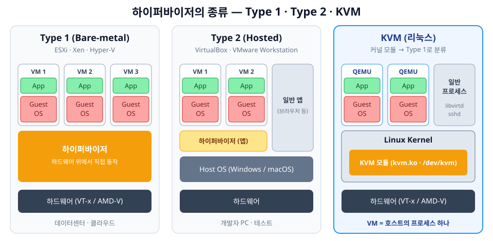
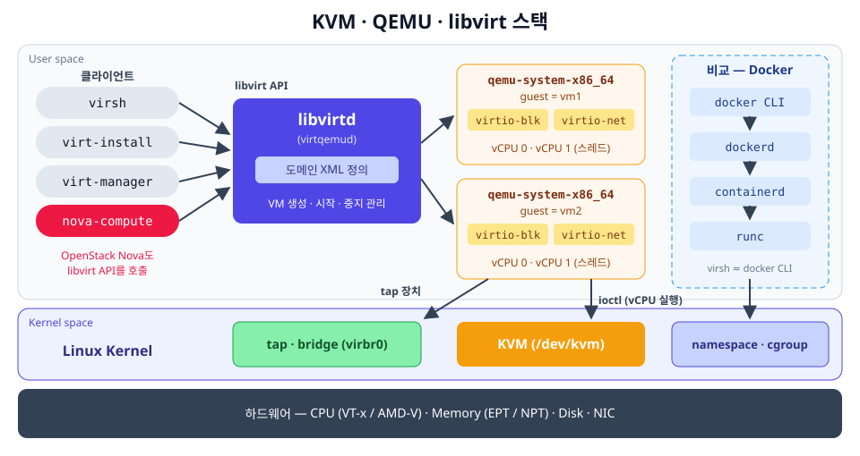
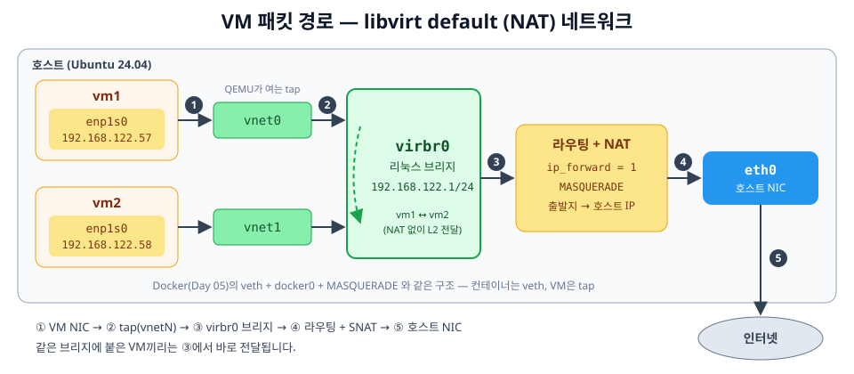

> **Chapter 3 · 가상화 & 네트워크 기초** | 난이도 ★★★☆☆ | 예상 소요 2 ~ 3시간

## 🎯 오늘의 목표

- Type 1 / Type 2 하이퍼바이저의 차이와, **KVM이 어디에 속하는지** 설명할 수 있다
- **KVM · QEMU · libvirt** 가 각각 무슨 일을 하는지, 왜 셋이 함께 쓰이는지 안다
- `virt-install` 로 클라우드 이미지 기반 VM을 만들고 `virsh` 로 생명주기를 다룰 수 있다
- OpenStack **Nova** 가 내부적으로 libvirt를 통해 VM을 만든다는 것을 "손으로" 이해한다

---

## 1. 왜 다시 VM인가?

Chapter 1~2에서는 줄곧 "VM은 무겁고 컨테이너는 가볍다"고 했습니다. 그런데 Chapter 4의 주인공 **OpenStack** 은 결국 VM을 찍어내는 플랫폼입니다. 왜 아직도 VM일까요?

| 이유 | 설명 |
|---|---|
| **강한 격리** | 커널까지 분리되므로, 서로 모르는 고객(테넌트)을 한 서버에 태우는 퍼블릭/프라이빗 클라우드에 적합 |
| **다른 OS** | 리눅스 호스트 위에 Windows, 다른 커널 버전의 리눅스를 그대로 실행 |
| **컨테이너의 토대** | EKS·GKE의 워커 노드도, Day 34에서 만들 K8s 노드도 결국 **VM** 이다 |

> 💡 Day 01의 VM vs 컨테이너 그림에서 "Hypervisor" 라고 한 줄로 넘어갔던 그 층을 오늘 직접 열어봅니다.

---

## 2. 하이퍼바이저의 종류



| 구분 | Type 1 (Bare-metal) | Type 2 (Hosted) |
|---|---|---|
| 위치 | 하드웨어 바로 위 | 일반 OS 위의 애플리케이션 |
| 예시 | VMware ESXi, Xen, Hyper-V | VirtualBox, VMware Workstation, Parallels |
| 성능 | 높음 | 상대적으로 낮음 (Host OS를 한 번 더 거침) |
| 용도 | 데이터센터, 클라우드 | 개발자 PC, 테스트 |

### KVM은 어디에 속할까?

**KVM(Kernel-based Virtual Machine)** 은 리눅스 커널에 들어 있는 **커널 모듈**(`kvm.ko` + `kvm_intel.ko` / `kvm_amd.ko`)입니다. 모듈을 올리는 순간 **리눅스 커널 자체가 하이퍼바이저**가 됩니다. 그래서 KVM은 보통 **Type 1** 로 분류합니다 — 하이퍼바이저가 "OS 위의 앱"이 아니라 커널 안에 있기 때문이죠.

KVM 위의 VM은 호스트 입장에서 **그냥 리눅스 프로세스(`qemu-system-x86_64`)** 입니다. 그래서 `ps`, `top`, cgroup, `kill` 같은 익숙한 도구가 그대로 통합니다. Day 01에서 "컨테이너 = 프로세스"였다면, 오늘은 **"KVM VM도 프로세스"** 입니다.

### 하드웨어 가상화 지원 (VT-x / AMD-V)

예전에는 게스트 OS의 특권 명령을 소프트웨어로 번역(바이너리 번역)해야 했지만, 지금 CPU는 **Intel VT-x / AMD-V** 라는 하드웨어 기능으로 게스트 코드를 CPU에서 직접 실행합니다. 메모리 주소 변환도 **EPT / NPT** 로 하드웨어가 처리합니다. KVM은 이 기능을 커널에서 다루기 쉽게 감싼 것입니다.

---

## 3. KVM · QEMU · libvirt — 세 형제의 역할 분담



| 구성 요소 | 위치 | 역할 | 비유 |
|---|---|---|---|
| **KVM** | 커널 (`/dev/kvm`) | CPU·메모리 가상화. vCPU를 실제 CPU에서 실행 | 엔진 |
| **QEMU** | 유저 공간 프로세스 | 디스크, NIC, 그래픽, USB 등 **장치 에뮬레이션**. KVM이 없으면 CPU까지 소프트웨어로 에뮬레이션(매우 느림) | 차체와 계기판 |
| **libvirt** (`libvirtd` / `virtqemud`) | 데몬 + API | VM 정의(XML), 시작/중지, 네트워크·스토리지 풀 관리. QEMU 명령줄 수십 개 옵션을 대신 조립 | 운전자 |
| **virsh / virt-install / virt-manager** | 클라이언트 | libvirt API를 호출하는 CLI / GUI | 운전대 |

> 💡 Docker 구조와 겹쳐 보면 이해가 쉽습니다.
> `docker CLI → dockerd → containerd → runc → 커널(namespace·cgroup)`
> `virsh → libvirtd → QEMU → KVM(커널)`

### virtio — 왜 VM 디스크/네트워크가 빠를까

QEMU가 실제 존재하는 NIC(e1000 등)를 흉내 내면 게스트 드라이버의 레지스터 접근마다 VM 탈출(VM exit)이 일어나 느립니다. **virtio** 는 "가상화를 위해 설계된 가짜 장치" 규격으로, 게스트와 호스트가 공유 메모리 큐로 데이터를 주고받습니다. 리눅스 게스트에는 드라이버가 기본 내장이라, 디스크는 `vda`, NIC은 `virtio-net` 으로 보입니다. **OpenStack Nova도 기본으로 virtio 장치를 붙입니다.**

### OpenStack Nova와의 관계

```
openstack server create ...
   → nova-api → nova-scheduler → nova-compute (컴퓨트 노드)
       → libvirt 드라이버가 도메인 XML 생성
           → libvirtd → QEMU 프로세스 + KVM
```

Nova는 하이퍼바이저를 직접 만지지 않고 **libvirt API** 를 부릅니다. 즉 오늘 `virsh` 로 하는 일 = Day 29에서 Nova가 자동으로 해주는 일입니다. 컴퓨트 노드에서 `sudo virsh list` 를 치면 `instance-00000001` 같은 이름의 도메인이 보입니다.

---

## 4. 실습 환경 준비

| 항목 | 내용 |
|---|---|
| OS | **Ubuntu 24.04 LTS** (베어메탈 권장, 또는 중첩 가상화가 켜진 VM) |
| 사양 | vCPU 4+, RAM 8GB+, 디스크 여유 30GB+ |
| 패키지 | qemu-kvm, libvirt, virtinst (virt-install) |

### 4-1. CPU 가상화 지원 확인

```bash
grep -cE 'vmx|svm' /proc/cpuinfo     # 0 이면 지원 안 함 (또는 BIOS/중첩 가상화 꺼짐)

sudo apt-get update
sudo apt-get install -y cpu-checker
kvm-ok
```

```
INFO: /dev/kvm exists
KVM acceleration can be used
```

### 4-2. 중첩 가상화(Nested Virtualization)

Windows/macOS 위의 Ubuntu VM에서 실습한다면, 바깥 하이퍼바이저가 VT-x를 안쪽 VM에 **노출** 해줘야 합니다.

| 바깥 하이퍼바이저 | 설정 방법 (VM 전원 끈 상태에서) |
|---|---|
| Hyper-V | PowerShell(관리자): `Set-VMProcessor -VMName <VM이름> -ExposeVirtualizationExtensions $true` |
| VirtualBox | `VBoxManage modifyvm <VM이름> --nested-hw-virt on` |
| VMware Workstation | VM 설정 → Processors → **Virtualize Intel VT-x/EPT or AMD-V/RVI** 체크 |

베어메탈 Ubuntu에서 "내가 만든 VM 안에서 또 VM을" 돌리려면 호스트의 nested 옵션을 확인합니다.

```bash
cat /sys/module/kvm_intel/parameters/nested   # AMD 는 kvm_amd. Y 또는 1 이면 켜짐
```

> ⚠️ OpenStack 실습(Day 26 DevStack)도 보통 VM 안에서 하므로, 그 안에서 인스턴스를 KVM 가속으로 띄우려면 **중첩 가상화가 필수** 입니다. 지금 확인해 두세요.

### 4-3. 패키지 설치

```bash
sudo apt-get install -y qemu-kvm libvirt-daemon-system libvirt-clients virtinst \
  qemu-utils bridge-utils

sudo usermod -aG libvirt,kvm $USER     # 적용하려면 로그아웃 후 재로그인
echo 'export LIBVIRT_DEFAULT_URI=qemu:///system' >> ~/.bashrc
source ~/.bashrc
```

> ⚠️ 일반 사용자로 `virsh` 를 실행하면 기본 접속 대상이 **`qemu:///session`** (사용자 전용 VM 공간)입니다. 시스템 전체 VM과 `default` 네트워크를 보려면 `qemu:///system` 이어야 하므로 위처럼 환경 변수를 지정합니다.

```bash
virsh version
virsh list --all          # 아직 비어 있음
virsh net-list --all
```

```
 Name      State    Autostart   Persistent
--------------------------------------------
 default   active   yes         yes
```

`default` 네트워크는 libvirt가 설치하면서 만든 **NAT 네트워크** 입니다. 호스트에 `virbr0` 라는 리눅스 브리지(192.168.122.1/24)가 생겼을 겁니다.

```bash
ip -br addr show virbr0
# virbr0   UP   192.168.122.1/24
```

---

## 5. 실습 — 클라우드 이미지로 VM 만들기

ISO로 설치 마법사를 돌리는 대신, **클라우드 이미지 + cloud-init** 방식을 씁니다. OpenStack도 정확히 이 방식(Glance 이미지 + cloud-init 메타데이터)으로 인스턴스를 만듭니다.

### 5-1. 베이스 이미지와 오버레이 디스크

```bash
cd /var/lib/libvirt/images
sudo wget -O noble-base.img \
  https://cloud-images.ubuntu.com/noble/current/noble-server-cloudimg-amd64.img

qemu-img info noble-base.img      # file format: qcow2, virtual size: 3.5 GiB 내외
```

베이스 이미지는 건드리지 않고, VM마다 **변경분만 저장하는 오버레이(qcow2 backing file)** 를 만듭니다.

```bash
sudo qemu-img create -f qcow2 -F qcow2 \
  -b /var/lib/libvirt/images/noble-base.img \
  /var/lib/libvirt/images/vm1.qcow2 10G

sudo qemu-img info /var/lib/libvirt/images/vm1.qcow2
```

```
image: /var/lib/libvirt/images/vm1.qcow2
file format: qcow2
virtual size: 10 GiB (10737418240 bytes)
disk size: 196 KiB
backing file: /var/lib/libvirt/images/noble-base.img
backing file format: qcow2
```

> 💡 디스크 크기 196KiB! Day 02의 이미지 레이어(읽기 전용 하위 + 쓰기 가능한 상위)와 같은 발상입니다. Nova도 컴퓨트 노드의 `/var/lib/nova/instances/_base/` 에 베이스 이미지를 캐시하고, 인스턴스마다 qcow2 오버레이를 만듭니다.

### 5-2. cloud-init 설정 (user-data)

```bash
mkdir -p ~/kvm-lab && cd ~/kvm-lab
[ -f ~/.ssh/id_ed25519.pub ] || ssh-keygen -t ed25519 -N '' -f ~/.ssh/id_ed25519

cat > user-data <<EOF
#cloud-config
hostname: vm1
users:
  - name: ubuntu
    sudo: ALL=(ALL) NOPASSWD:ALL
    shell: /bin/bash
    lock_passwd: false
    plain_text_passwd: ubuntu
    ssh_authorized_keys:
      - $(cat ~/.ssh/id_ed25519.pub)
EOF
```

> ⚠️ `plain_text_passwd` 는 `virsh console` 로그인 연습용입니다. 실습 환경에서만 쓰세요.

### 5-3. virt-install 로 생성

```bash
virt-install --osinfo list | grep -i ubuntu24   # ubuntu24.04 가 있는지 확인

virt-install \
  --name vm1 \
  --memory 2048 --vcpus 2 \
  --disk path=/var/lib/libvirt/images/vm1.qcow2,format=qcow2,bus=virtio \
  --import \
  --osinfo ubuntu24.04 \
  --network network=default,model=virtio \
  --cloud-init user-data=./user-data \
  --graphics none \
  --noautoconsole
```

| 옵션 | 의미 |
|---|---|
| `--import` | OS 설치 과정 없이 기존 디스크로 바로 부팅 |
| `--osinfo` | 게스트 OS 종류 → 적절한 기본 장치 선택. 목록에 없으면 `linux2022` |
| `--network network=default,model=virtio` | libvirt `default` NAT 네트워크에 virtio NIC 연결 |
| `--cloud-init user-data=...` | user-data를 담은 seed ISO를 만들어 첫 부팅에 전달 |
| `--graphics none` | 화면 없이 시리얼 콘솔만 |
| `--noautoconsole` | 생성 후 콘솔에 자동으로 붙지 않음 |

### 5-4. 접속하기

```bash
virsh list
virsh domifaddr vm1          # 부팅 후 20~30초 뒤
```

```
 Name       MAC address          Protocol     Address
-------------------------------------------------------------------------------
 vnet0      52:54:00:6b:3c:1a    ipv4         192.168.122.57/24
```

```bash
ssh ubuntu@192.168.122.57
# VM 안에서
lsblk                       # vda  ← virtio 디스크
lspci | grep -i virtio      # Virtio network / block device
exit
```

시리얼 콘솔로도 들어갈 수 있습니다. (빠져나오기: `Ctrl + ]`)

```bash
virsh console vm1
```

### 5-5. "VM도 프로세스다" 확인

```bash
ps -ef | grep [q]emu-system
```

`qemu-system-x86_64 -name guest=vm1,...` 로 시작하는 아주 긴 명령줄이 보입니다. libvirt가 이 옵션들을 대신 조립해준 것이죠. 이 프로세스를 죽이면 VM 전원이 뽑힌 것과 같습니다.

### 5-6. 도메인 XML 들여다보기

```bash
virsh dumpxml vm1 | less
```

```xml
<domain type='kvm' id='1'>
  <name>vm1</name>
  <memory unit='KiB'>2097152</memory>
  <vcpu placement='static'>2</vcpu>
  ...
  <devices>
    <disk type='file' device='disk'>
      <driver name='qemu' type='qcow2'/>
      <source file='/var/lib/libvirt/images/vm1.qcow2'/>
      <target dev='vda' bus='virtio'/>
    </disk>
    <interface type='network'>
      <mac address='52:54:00:6b:3c:1a'/>
      <source network='default' .../>
      <target dev='vnet0'/>
      <model type='virtio'/>
    </interface>
```

> 💡 `domain type='kvm'` 이 KVM 가속을 쓴다는 뜻입니다(`qemu` 면 순수 에뮬레이션). Nova가 만드는 XML도 이와 거의 같은 모양이며, 컴퓨트 노드의 `/etc/libvirt/qemu/instance-*.xml` 에서 볼 수 있습니다.

### 5-7. VM의 네트워크는 어떻게 밖으로 나갈까 — 패킷 경로



```bash
ip -br link show master virbr0     # vnet0 이 virbr0 브리지에 붙어 있음
bridge link show                   # 같은 정보를 bridge 명령으로
sudo nft list ruleset | grep 192.168.122   # libvirt가 넣은 NAT(MASQUERADE) 규칙
```

VM의 NIC(`enp1s0`) ↔ 호스트의 **tap 장치 `vnet0`** ↔ 리눅스 브리지 **`virbr0`** ↔ 라우팅 + NAT ↔ 호스트 NIC. Day 05의 `docker0` + veth + MASQUERADE 구조와 거의 같습니다. 다른 점은 컨테이너는 **veth**, VM은 QEMU가 여는 **tap** 장치라는 것뿐입니다. 이 브리지·tap·NAT의 정체를 **Day 22** 에서 맨손으로 만들어 봅니다.

### 5-8. 생명주기 다루기

```bash
virsh dominfo vm1               # 상태, vCPU, 메모리
virsh shutdown vm1              # 게스트 OS에 ACPI 종료 요청 (정상 종료)
virsh start vm1
virsh suspend vm1               # 일시 정지 (메모리는 유지)
virsh resume vm1
virsh reboot vm1
virsh destroy vm1               # 강제 전원 차단 (이름과 달리 삭제 아님!)
virsh start vm1

# 스냅샷 (먼저 디스크 목록 확인: 모든 디스크가 qcow2 여야 내부 스냅샷 가능)
virsh domblklist vm1
virsh snapshot-create-as vm1 snap1 "before-change"
virsh snapshot-list vm1
virsh snapshot-revert vm1 snap1
virsh snapshot-delete vm1 snap1

# 자원 변경 (다음 부팅부터 적용)
virsh setmaxmem vm1 3G --config
virsh setmem vm1 3G --config
```

| virsh | OpenStack 명령 (Chapter 4) |
|---|---|
| `virsh start` | `openstack server start` |
| `virsh shutdown` | `openstack server stop` |
| `virsh suspend` / `resume` | `openstack server pause` / `unpause` |
| `virsh reboot` / `destroy`+`start` | `openstack server reboot` (`--soft` / `--hard`) |
| `virsh snapshot-*` | `openstack server image create` (방식은 다름) |
| 디스크·메모리 수정 | `openstack server resize` (flavor 변경) |

### 5-9. 두 번째 VM 만들기 (Day 23·24에서 사용)

Day 23·24는 "컴퓨트 노드 2대" 역할을 할 VM 2대가 필요합니다. 하나 더 만들어 둡시다.

```bash
cd ~/kvm-lab
sed 's/^hostname: vm1/hostname: vm2/' user-data > user-data-vm2
sudo qemu-img create -f qcow2 -F qcow2 \
  -b /var/lib/libvirt/images/noble-base.img /var/lib/libvirt/images/vm2.qcow2 10G

virt-install --name vm2 --memory 2048 --vcpus 2 \
  --disk path=/var/lib/libvirt/images/vm2.qcow2,format=qcow2,bus=virtio \
  --import --osinfo ubuntu24.04 \
  --network network=default,model=virtio \
  --cloud-init user-data=./user-data-vm2 \
  --graphics none --noautoconsole

virsh net-dhcp-leases default     # vm1, vm2 의 IP 확인
```

### 5-10. 정리 (Day 23 이후에 하세요)

```bash
virsh destroy vm2
virsh undefine vm2 --remove-all-storage   # 정의 + vm2.qcow2 삭제 (베이스 이미지는 남음)
```

> ⚠️ `--remove-all-storage` 는 디스크 파일을 **영구 삭제** 합니다. 지금은 vm1·vm2를 남겨 두세요.

---

## 6. 트러블슈팅

| 증상 | 원인 | 해결 |
|---|---|---|
| `kvm-ok` → `Your CPU does not support KVM extensions` | BIOS에서 VT-x/AMD-V 꺼짐, 또는 바깥 하이퍼바이저가 중첩 가상화를 노출하지 않음 | BIOS에서 Intel VT-x / SVM 활성화, 4-2의 중첩 가상화 설정 |
| `virsh list --all` 이 비어 있는데 VM은 돌고 있음 | `qemu:///session` 에 접속 중 | `export LIBVIRT_DEFAULT_URI=qemu:///system` 또는 `sudo virsh` |
| `failed to connect to the hypervisor ... Permission denied` | `libvirt` 그룹 미적용 | `sudo usermod -aG libvirt $USER` 후 재로그인 |
| `ERROR Unknown OS name 'ubuntu24.04'` | osinfo-db 에 해당 항목 없음 | `--osinfo linux2022` 사용 또는 `sudo apt-get install --only-upgrade osinfo-db` |
| `virsh domifaddr` 결과가 비어 있음 | 아직 부팅 중이거나 DHCP 미완료 | 30초 후 재시도, `virsh console vm1` 로 부팅 로그 확인 |
| `Permission denied` 로 디스크를 못 염 | 이미지가 홈 디렉터리 등 QEMU(libvirt-qemu) 사용자가 읽을 수 없는 곳에 있음 | 이미지를 `/var/lib/libvirt/images` 로 옮기기 |
| `Requested operation is not valid: network 'default' is not active` | default 네트워크 꺼짐 | `virsh net-start default && virsh net-autostart default` |
| `internal snapshot for disk ... unsupported for storage type raw` | cloud-init seed ISO(raw)가 CD-ROM으로 아직 붙어 있음 | `virsh domblklist vm1` 로 CD-ROM 타깃(예: `sda`) 확인 후 `virsh change-media vm1 sda --eject --live --config` |
| VM 안에서 또 VM을 띄우면 극도로 느림 | 중첩 가상화가 꺼져 TCG(소프트웨어 에뮬레이션)로 동작 | 바깥 계층부터 nested 활성화, 안쪽 XML이 `domain type='kvm'` 인지 확인 |

---

## 7. 핵심 정리

- 하이퍼바이저는 Type 1(베어메탈)과 Type 2(호스트형). **KVM은 리눅스 커널을 하이퍼바이저로 만드는 모듈** 이라 Type 1로 본다
- **KVM**: CPU·메모리 가상화(커널) / **QEMU**: 장치 에뮬레이션(유저 공간) / **libvirt**: 관리 API와 XML 정의
- `virsh → libvirtd → QEMU → KVM` 은 `docker → dockerd → containerd → runc` 와 닮은 계층 구조
- KVM VM은 호스트에서 보면 **`qemu-system-x86_64` 프로세스** 하나
- 클라우드 이미지 + **qcow2 오버레이** + **cloud-init** = OpenStack 인스턴스 생성 방식의 축소판
- VM NIC → **tap(vnetN)** → **리눅스 브리지(virbr0)** → NAT → 외부. Docker의 veth + docker0 와 같은 패턴
- OpenStack **Nova = libvirt를 대신 호출해주는 거대한 자동화**

---

## 8. 셀프 체크

<details>
<summary>Q1. KVM만 있고 QEMU가 없다면 VM을 만들 수 있을까?</summary>

KVM은 CPU·메모리 가상화만 제공하고 디스크·NIC·펌웨어 같은 장치는 제공하지 않습니다. 이를 에뮬레이션해 줄 유저 공간 프로그램(QEMU, 또는 Firecracker·Cloud Hypervisor 같은 대안 VMM)이 반드시 필요합니다.
</details>

<details>
<summary>Q2. <code>virsh destroy vm1</code> 을 하면 VM 디스크가 지워질까?</summary>

아니요. `destroy` 는 **강제 전원 차단** 일 뿐입니다. 정의와 디스크는 그대로이며 `virsh start` 로 다시 켤 수 있습니다. 정의를 지우는 것은 `undefine`, 디스크까지 지우려면 `--remove-all-storage` 를 붙입니다.
</details>

<details>
<summary>Q3. qcow2 오버레이(backing file)를 쓰면 어떤 장점이 있나?</summary>

베이스 이미지를 여러 VM이 공유하고, 각 VM은 변경분만 저장하므로 **디스크 사용량이 적고 VM 생성이 즉시** 끝납니다. 단, 오버레이가 존재하는 동안 베이스 이미지를 수정하면 모든 VM이 깨집니다. Nova의 `_base` 캐시가 같은 원리입니다.
</details>

<details>
<summary>Q4. VM이 192.168.122.x 대역에서 인터넷에 나갈 수 있는 이유는?</summary>

VM의 tap 장치(vnet0)가 `virbr0` 브리지에 연결되어 있고, 호스트가 192.168.122.1 게이트웨이로 패킷을 받아 라우팅한 뒤 **MASQUERADE(SNAT)** 로 호스트 IP로 바꿔 내보내기 때문입니다. Docker의 `docker0` 와 같은 구조입니다.
</details>

<details>
<summary>Q5. OpenStack 컴퓨트 노드에서 <code>sudo virsh list</code> 를 치면 무엇이 보일까?</summary>

Nova가 libvirt를 통해 만든 인스턴스들이 `instance-0000000a` 같은 이름의 도메인으로 보입니다. Nova는 하이퍼바이저를 직접 다루지 않고 libvirt API를 호출하기 때문입니다.
</details>

---

## ⏭️ 다음 예고 — Day 22. 리눅스 네트워킹 — bridge, veth, network namespace

오늘 `virbr0` 와 `vnet0` 이 등장했습니다. Day 05의 `docker0`, K8s CNI의 `cni0`, 그리고 OpenStack Neutron의 `qrouter-` 네임스페이스까지 — 모두 **리눅스 브리지 · veth · network namespace** 세 가지 부품으로 만들어집니다. 내일은 `ip netns` 와 `ip link` 만으로 "Docker 브리지 네트워크"를 맨손으로 재현해 봅니다.
