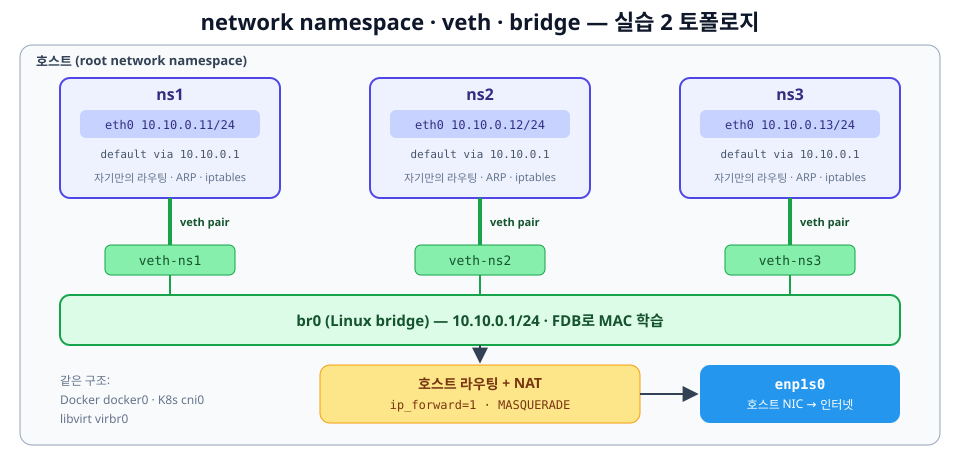
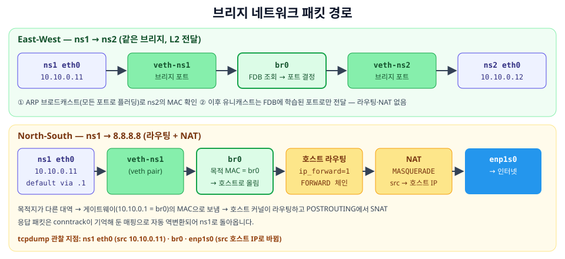
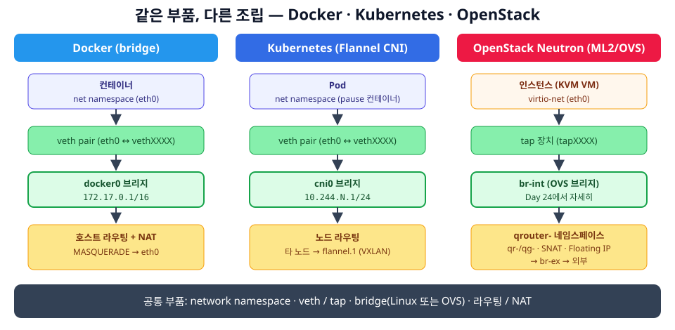

> **Chapter 3 · 가상화 & 네트워크 기초** | 난이도 ★★★☆☆ | 예상 소요 2 ~ 3시간

## 🎯 오늘의 목표

- **network namespace · veth pair · Linux bridge** 가 각각 무엇을 격리하고 연결하는지 설명할 수 있다
- `ip netns` · `ip link` · `bridge` 명령만으로 **Docker bridge 네트워크를 맨손으로 재현** 할 수 있다
- 네임스페이스 → veth → 브리지 → 라우팅/NAT → 외부로 나가는 **패킷 경로** 를 `tcpdump` 로 추적할 수 있다
- Docker `docker0`, K8s CNI `cni0`, OpenStack Neutron `qrouter-`/`qdhcp-` 네임스페이스가 같은 부품으로 만들어졌음을 안다

---

## 1. 왜 맨손 네트워킹인가?

지금까지 네트워크는 늘 누군가가 대신 만들어 줬습니다.

| 누가 | 무엇을 만들었나 | 언제 봤나 |
|---|---|---|
| Docker | `docker0` 브리지 + 컨테이너마다 veth + MASQUERADE | Day 05 |
| Kubernetes CNI (Flannel 등) | `cni0` 브리지 + Pod마다 veth | Day 09 ~ 12 |
| libvirt | `virbr0` 브리지 + VM마다 tap + NAT | Day 21 |
| **OpenStack Neutron** | 네임스페이스 라우터, DHCP 네임스페이스, tap/veth, 브리지(OVS) | Day 30 |

이들은 모두 **리눅스 커널이 제공하는 같은 부품** 을 조립한 결과입니다. 부품을 직접 조립해 보면, Neutron 장애가 났을 때 `ip netns exec qrouter-... ping` 같은 디버깅 명령이 왜 필요한지 자연스럽게 이해됩니다.

---

## 2. 세 가지 부품



### 2-1. network namespace — "나만의 네트워크 스택"

Day 07에서 본 namespace 중 **net namespace** 는 다음을 통째로 분리합니다.

- 네트워크 인터페이스 목록 (`lo`, `eth0` …)
- IP 주소, **라우팅 테이블**, ARP(neighbor) 테이블
- iptables/nftables 규칙, 소켓, `sysctl net.*` 값

즉 네임스페이스 하나 = **NIC 없는 작은 서버 한 대** 라고 생각하면 됩니다.

### 2-2. veth pair — "양 끝이 있는 가상 랜선"

veth는 **항상 쌍으로 만들어지는** 가상 인터페이스입니다. 한쪽으로 들어간 프레임은 반드시 다른 쪽으로 나옵니다. 한쪽 끝을 네임스페이스 안에, 다른 끝을 호스트(또는 브리지)에 두면 "격리된 서버에 랜선을 꽂은" 것과 같습니다.

### 2-3. Linux bridge — "커널 안의 L2 스위치"

여러 인터페이스를 **포트** 로 붙여 MAC 주소를 학습(FDB)하고 프레임을 전달하는 소프트웨어 스위치입니다. 브리지 자체에 IP를 주면 그 IP가 **연결된 네임스페이스들의 게이트웨이** 가 됩니다. (`docker0` 의 172.17.0.1, `virbr0` 의 192.168.122.1이 바로 그것)

### 2-4. tap vs veth

| 구분 | veth | tap |
|---|---|---|
| 형태 | 커널 인터페이스 **2개가 한 쌍** | 커널 인터페이스 1개 + **유저 공간 프로세스의 파일 디스크립터** |
| 주 사용처 | 컨테이너, 네임스페이스 연결 | **VM** (QEMU가 tap을 열어 virtio-net과 연결) |
| 예 | Docker `vethXXXX`, Neutron `qr-`/`qg-`(OVS 내부 포트일 수도 있음) | libvirt `vnet0`, Neutron `tapXXXX` |

---

## 3. 실습 환경

| 항목 | 내용 |
|---|---|
| OS | Ubuntu 24.04 LTS (Day 21의 호스트 또는 vm1, 어느 쪽이든 OK) |
| 패키지 | `iproute2`(기본 설치), `tcpdump`, `iptables` |
| 권한 | 모든 명령에 `sudo` 필요 |

```bash
sudo apt-get update
sudo apt-get install -y iproute2 tcpdump iptables
```

> ⚠️ **Docker가 설치된 머신** 이라면 브리지 트래픽이 iptables `FORWARD` 체인(정책 DROP)을 거쳐 막힐 수 있습니다. 7장 트러블슈팅을 먼저 읽거나, Day 21에서 만든 깨끗한 VM에서 실습하는 것을 추천합니다.

---

## 4. 실습 1 — 네임스페이스 두 개를 veth로 직결

```bash
# 1) 네임스페이스 생성
sudo ip netns add red
sudo ip netns add blue
ip netns list

# 2) veth 쌍 생성 후 양 끝을 각 네임스페이스로 이동
sudo ip link add veth-red type veth peer name veth-blue
sudo ip link set veth-red netns red
sudo ip link set veth-blue netns blue

# 3) IP 부여 + 링크 UP
sudo ip -n red  addr add 10.0.0.1/24 dev veth-red
sudo ip -n blue addr add 10.0.0.2/24 dev veth-blue
sudo ip -n red  link set veth-red up
sudo ip -n blue link set veth-blue up
sudo ip -n red  link set lo up
sudo ip -n blue link set lo up
```

> 💡 `ip -n red ...` 는 `ip netns exec red ip ...` 의 줄임입니다. `ip` 이외의 명령(ping, tcpdump, curl)은 `ip netns exec <ns> <명령>` 으로 실행합니다.

```bash
sudo ip netns exec red ping -c 2 10.0.0.2
```

```
PING 10.0.0.2 (10.0.0.2) 56(84) bytes of data.
64 bytes from 10.0.0.2: icmp_seq=1 ttl=64 time=0.051 ms
64 bytes from 10.0.0.2: icmp_seq=2 ttl=64 time=0.043 ms
```

격리도 확인해 봅시다.

```bash
sudo ip netns exec red ip -br addr    # lo, veth-red 만 보임 (호스트 eth0 없음)
sudo ip netns exec red ip route       # 10.0.0.0/24 dev veth-red ... 한 줄뿐
ip -br link | grep veth               # 호스트에서는 veth가 하나도 안 보임 (둘 다 이동했으므로)
```

veth 직결은 **딱 두 개** 만 연결할 수 있습니다. 세 개 이상이면? 스위치, 즉 브리지가 필요합니다.

```bash
# 정리 — 네임스페이스를 지우면 안에 있던 veth도 함께 사라짐
sudo ip netns del red
sudo ip netns del blue
```

---

## 5. 실습 2 — 브리지로 "Docker 네트워크" 재현하기

목표 토폴로지: 네임스페이스 `ns1`, `ns2`, `ns3` 을 브리지 `br0` 에 연결하고, `br0` 에 게이트웨이 IP를 주고, NAT로 인터넷까지 내보냅니다. Docker가 `docker run` 할 때마다 하는 일과 **똑같습니다.**

### 5-1. 브리지 생성

```bash
sudo ip link add br0 type bridge
sudo ip link set br0 up
```

### 5-2. 네임스페이스 3개 + veth 연결

```bash
i=1
for ns in ns1 ns2 ns3; do
  sudo ip netns add $ns
  # 호스트 쪽 이름: veth-ns1 / 네임스페이스 안쪽 이름: eth0
  sudo ip link add veth-$ns type veth peer name eth0 netns $ns
  sudo ip link set veth-$ns master br0
  sudo ip link set veth-$ns up
  sudo ip -n $ns addr add 10.10.0.1$i/24 dev eth0
  sudo ip -n $ns link set eth0 up
  sudo ip -n $ns link set lo up
  i=$((i+1))
done
```

> 💡 `peer name eth0 netns ns1` 처럼 만들 때부터 한쪽 끝을 네임스페이스에 넣을 수 있습니다. 네임스페이스마다 인터페이스 이름 공간이 따로라서 셋 다 `eth0` 이라는 같은 이름을 써도 충돌하지 않습니다 — 컨테이너 안이 늘 `eth0` 인 이유입니다.

```bash
bridge link show
```

```
5: veth-ns1@if2: <BROADCAST,MULTICAST,UP,LOWER_UP> mtu 1500 master br0 state forwarding ...
7: veth-ns2@if2: <BROADCAST,MULTICAST,UP,LOWER_UP> mtu 1500 master br0 state forwarding ...
9: veth-ns3@if2: <BROADCAST,MULTICAST,UP,LOWER_UP> mtu 1500 master br0 state forwarding ...
```

`@if2` 는 "짝꿍 인터페이스의 ifindex는 (다른 네임스페이스의) 2번" 이라는 뜻입니다.

### 5-3. 같은 브리지 안의 통신 (East-West)

```bash
sudo ip netns exec ns1 ping -c 2 10.10.0.12
sudo ip netns exec ns1 ping -c 2 10.10.0.13

bridge fdb show br br0 | grep -v permanent   # 브리지가 학습한 MAC ↔ 포트
sudo ip netns exec ns1 ip neigh              # ns1의 ARP 테이블
```

### 5-4. 패킷 경로를 눈으로 보기



터미널 3개를 띄워서 동시에 봅니다.

```bash
# 터미널 A — ns1 안쪽 eth0
sudo ip netns exec ns1 tcpdump -ni eth0 icmp or arp

# 터미널 B — 호스트 쪽 veth (브리지 포트)
sudo tcpdump -ni veth-ns2 icmp or arp

# 터미널 C — 핑 발사
sudo ip netns exec ns1 ping -c 1 10.10.0.12
```

ARP 요청(브로드캐스트)은 **모든 브리지 포트** 로 퍼지고, 그 뒤의 ICMP는 학습된 MAC 덕분에 **ns2 포트로만** 갑니다. `veth-ns3` 에서 tcpdump를 걸면 ARP는 보이지만 ICMP는 안 보이는 것을 확인해 보세요. 이것이 스위치의 MAC 학습입니다.

### 5-5. 게이트웨이 + NAT로 외부 연결 (North-South)

```bash
# 1) 브리지에 게이트웨이 IP → 호스트가 이 대역의 라우터가 됨
sudo ip addr add 10.10.0.1/24 dev br0

# 2) 각 네임스페이스의 기본 경로를 br0 로
for ns in ns1 ns2 ns3; do
  sudo ip -n $ns route add default via 10.10.0.1
done

# 3) 호스트에서 IP 포워딩 허용
sudo sysctl -w net.ipv4.ip_forward=1

# 4) 이 대역에서 밖으로 나가는 패킷의 출발지를 호스트 IP로 변경 (SNAT)
sudo iptables -t nat -A POSTROUTING -s 10.10.0.0/24 ! -o br0 -j MASQUERADE

# 5) FORWARD 허용 (FORWARD 정책이 DROP인 환경 대비 — Docker/ufw 설치 시)
sudo iptables -I FORWARD -i br0 -j ACCEPT
sudo iptables -I FORWARD -o br0 -m conntrack --ctstate RELATED,ESTABLISHED -j ACCEPT
```

```bash
sudo ip netns exec ns1 ping -c 2 8.8.8.8
```

DNS까지 쓰려면 네임스페이스 전용 resolv.conf를 둡니다. `ip netns exec` 은 `/etc/netns/<ns>/` 아래 파일을 `/etc/` 에 겹쳐 보여줍니다.

```bash
sudo mkdir -p /etc/netns/ns1
echo "nameserver 8.8.8.8" | sudo tee /etc/netns/ns1/resolv.conf
sudo ip netns exec ns1 ping -c 1 ubuntu.com
```

NAT가 실제로 일어나는지 호스트 NIC에서 확인합니다. (NIC 이름은 `ip route get 8.8.8.8` 로 확인)

```bash
sudo tcpdump -ni enp1s0 icmp      # 출발지가 10.10.0.11 이 아니라 호스트 IP로 보임
sudo conntrack -L 2>/dev/null | grep 10.10.0.11   # conntrack 패키지가 있다면 NAT 매핑 확인
```

> 💡 방금 만든 것: **브리지(docker0) + veth + 게이트웨이 IP + ip_forward + MASQUERADE**. Day 05에서 `docker network inspect bridge` 로 봤던 구성 요소 전부입니다. 포트 포워딩(`-p 8080:80`)은 여기에 `-t nat PREROUTING ... -j DNAT` 규칙이 하나 더 붙은 것입니다.

---

## 6. 실제 Docker · K8s · OpenStack에서 찾아보기



### 6-1. Docker 컨테이너의 네임스페이스 들여다보기

Docker 컨테이너는 `ip netns list` 에 나오지 않습니다. Docker가 네임스페이스 파일을 `/var/run/netns` 에 등록하지 않기 때문입니다. 대신 **컨테이너 프로세스의 PID** 로 들어갑니다(Day 07의 nsenter).

```bash
docker run -d --name c1 nginx
PID=$(docker inspect -f '{{.State.Pid}}' c1)

# 방법 1) nsenter — 호스트의 ip 명령을 컨테이너 net namespace에서 실행
sudo nsenter -t $PID -n ip -br addr
# eth0@if12   UP   172.17.0.2/16

# 방법 2) ip netns 에 등록해서 오늘 배운 명령 그대로 쓰기
sudo mkdir -p /var/run/netns
sudo ln -sf /proc/$PID/ns/net /var/run/netns/c1
sudo ip netns exec c1 ip route
# default via 172.17.0.1 dev eth0

ip -br link show master docker0    # 호스트 쪽 veth 짝꿍 (ifindex 12)
```

> nginx 이미지에는 `ip` 명령이 없지만, nsenter/ip netns exec 는 **호스트의 바이너리** 를 컨테이너 네트워크 공간에서 실행하므로 문제없습니다. 실습 후 `sudo rm /var/run/netns/c1 && docker rm -f c1`.

### 6-2. Kubernetes CNI

| CNI | 노드 위의 구조 |
|---|---|
| bridge 플러그인 / Flannel | Pod 네임스페이스 ↔ veth ↔ **`cni0` 브리지** ↔ 노드 라우팅 (노드 간은 VXLAN — Day 23) |
| Calico | 브리지 없이 Pod마다 veth(`caliXXXX`) + **호스트 라우팅 테이블** 로 직접 전달 |
| Cilium | veth(`lxcXXXX`) + eBPF로 전달 |

노드에서 `ip netns list` 를 치면 containerd가 만든 `cni-xxxxxxxx-...` 네임스페이스가 보입니다(CNI는 `/var/run/netns` 에 등록합니다).

### 6-3. OpenStack Neutron

| Neutron 구성 | 정체 |
|---|---|
| `qdhcp-<network-id>` | 네임스페이스 + 그 안에서 도는 dnsmasq (인스턴스에 DHCP 제공) |
| `qrouter-<router-id>` | 네임스페이스 하나 = **가상 라우터** 하나. 내부 포트 `qr-`, 외부 포트 `qg-`, 그 안의 iptables가 SNAT·Floating IP(DNAT) 담당 |
| `tapXXXX` | 인스턴스(VM)와 연결된 tap 장치 |
| `ovnmeta-<network-id>` | ML2/OVN 환경의 메타데이터용 네임스페이스 |

> 💡 위 `qrouter-`/`qdhcp-` 는 ML2/OVS(L3 agent) 방식입니다. 최신 DevStack 기본값인 **ML2/OVN** 은 라우팅을 OVS 흐름 규칙으로 처리해서 `qrouter-` 가 없습니다. 어느 쪽이든 "네임스페이스 + veth/tap + 스위치" 라는 부품은 같습니다. (Day 24, Day 30)

---

## 7. 트러블슈팅

| 증상 | 원인 | 해결 |
|---|---|---|
| 같은 `br0` 에 붙은 네임스페이스끼리 ping 안 됨 (Docker 설치된 호스트) | `br_netfilter` 모듈 때문에 브리지 트래픽도 iptables `FORWARD` 를 거치는데, Docker가 FORWARD 정책을 DROP으로 설정 | `sudo iptables -I FORWARD -i br0 -o br0 -j ACCEPT` (현재 값 확인: `sysctl net.bridge.bridge-nf-call-iptables`) |
| 네임스페이스에서 게이트웨이(10.10.0.1)는 되는데 외부(8.8.8.8)가 안 됨 | ip_forward 꺼짐 / MASQUERADE 누락 / FORWARD DROP | `sysctl net.ipv4.ip_forward` 확인, `sudo iptables -t nat -S POSTROUTING`, `sudo iptables -S FORWARD` 확인 |
| `ping: connect: Network is unreachable` | 네임스페이스에 기본 경로 없음 | `sudo ip -n ns1 route add default via 10.10.0.1` |
| IP는 되는데 도메인 이름이 안 풀림 | 네임스페이스용 DNS 설정 없음 | `/etc/netns/<ns>/resolv.conf` 작성 |
| `RTNETLINK answers: File exists` | 같은 이름의 링크/주소가 이미 있음 | `ip -br link` 로 확인 후 `sudo ip link del <이름>` |
| `Cannot open network namespace "ns1": No such file or directory` | 네임스페이스 이름 오타 또는 이미 삭제됨 | `ip netns list` |
| 인터페이스 생성 시 `name not a valid ifname` | 리눅스 인터페이스 이름은 **최대 15자** | 이름을 짧게 (`veth-tenant-a-1` ✕ → `vth-ta1` ○) |
| 재부팅하니 다 사라짐 | `ip` 명령으로 만든 것은 **휘발성** | 운영 환경은 netplan / systemd-networkd 또는 오케스트레이터(Docker, CNI, Neutron)가 다시 만들어 줌 |

### 실습 정리

```bash
for ns in ns1 ns2 ns3; do sudo ip netns del $ns; done   # 안쪽 veth와 짝꿍도 함께 삭제
sudo ip link del br0
sudo iptables -t nat -D POSTROUTING -s 10.10.0.0/24 ! -o br0 -j MASQUERADE
sudo iptables -D FORWARD -i br0 -j ACCEPT
sudo iptables -D FORWARD -o br0 -m conntrack --ctstate RELATED,ESTABLISHED -j ACCEPT
sudo rm -rf /etc/netns/ns1
```

---

## 8. 핵심 정리

- **network namespace** = 인터페이스·IP·라우팅·iptables를 통째로 분리한 "작은 서버"
- **veth pair** = 양 끝이 있는 가상 랜선. 한쪽은 네임스페이스, 다른 쪽은 브리지에
- **Linux bridge** = 커널 안의 L2 스위치. 브리지 IP = 연결된 네임스페이스들의 게이트웨이
- 외부 통신 = **기본 경로 + ip_forward + MASQUERADE(SNAT)**, 포트 포워딩 = **DNAT**
- `docker0`(Docker), `cni0`(K8s), `virbr0`(libvirt), `qrouter-`(Neutron) 은 모두 이 부품의 조합
- 디버깅의 기본기: `ip netns exec <ns> <명령>`, `nsenter -t <PID> -n`, `bridge link`, `bridge fdb`, `tcpdump -i <인터페이스>`

---

## 9. 셀프 체크

<details>
<summary>Q1. 네임스페이스 3개를 서로 통신시키려면 왜 veth 직결만으로는 부족할까?</summary>

veth는 항상 **두 끝점만** 잇는 케이블입니다. 3개 이상을 연결하려면 모든 쌍마다 veth를 만들어야 하고, 각 네임스페이스에 인터페이스가 여러 개 생깁니다. 브리지(스위치)를 두면 각 네임스페이스는 veth 하나만 브리지에 꽂으면 됩니다.
</details>

<details>
<summary>Q2. 브리지 <code>br0</code> 에 10.10.0.1 IP를 주는 것은 어떤 의미인가?</summary>

호스트 자신이 그 L2 세그먼트의 한 구성원(포트)이 된다는 뜻입니다. 네임스페이스들은 이 IP를 **기본 게이트웨이** 로 삼아 호스트 라우팅 테이블로 패킷을 넘기고, 호스트가 포워딩·NAT로 외부에 내보냅니다. `docker0` 의 172.17.0.1과 같습니다.
</details>

<details>
<summary>Q3. Docker 컨테이너의 네임스페이스가 <code>ip netns list</code> 에 안 보이는 이유와, 들어가는 방법은?</summary>

`ip netns` 는 `/var/run/netns/` 아래에 등록된 이름만 보여주는데 Docker는 그곳에 등록하지 않습니다. `docker inspect -f '{{.State.Pid}}'` 로 PID를 얻어 `nsenter -t <PID> -n` 으로 들어가거나, `/proc/<PID>/ns/net` 를 `/var/run/netns/` 에 심볼릭 링크로 걸면 됩니다.
</details>

<details>
<summary>Q4. ARP 요청은 모든 포트에서 보이는데 ICMP는 특정 포트에서만 보이는 이유는?</summary>

ARP 요청은 **브로드캐스트**(ff:ff:ff:ff:ff:ff)라 브리지가 모든 포트로 플러딩합니다. 응답을 받으면서 브리지가 "이 MAC은 이 포트" 를 FDB에 학습하므로, 이후 유니캐스트 프레임(ICMP)은 해당 포트로만 전달합니다.
</details>

<details>
<summary>Q5. OpenStack에서 "Floating IP로 인스턴스 접속이 안 된다" 면 어디부터 볼까?</summary>

(ML2/OVS 기준) 네트워크 노드에서 `ip netns` 로 `qrouter-<id>` 를 찾고, `ip netns exec qrouter-<id> ip addr` 로 `qg-` 포트에 Floating IP가 있는지, `ip netns exec qrouter-<id> iptables -t nat -S` 로 DNAT/SNAT 규칙이 있는지, 그 안에서 인스턴스 사설 IP로 ping이 되는지 확인합니다. 오늘 배운 명령 그대로입니다.
</details>

---

## ⏭️ 다음 예고 — Day 23. VLAN과 VXLAN, Overlay 네트워크

오늘의 브리지는 **한 호스트 안** 에서만 통했습니다. 그런데 OpenStack 인스턴스나 K8s Pod는 여러 서버에 흩어져 있으면서도 같은 네트워크처럼 통신해야 하고, 테넌트끼리는 격리되어야 합니다. 내일은 하나의 물리 네트워크를 쪼개는 **VLAN**, 그리고 UDP 안에 L2 프레임을 싸서 서버 사이를 잇는 **VXLAN Overlay** 를 Day 21의 VM 2대로 직접 만들어 봅니다.
