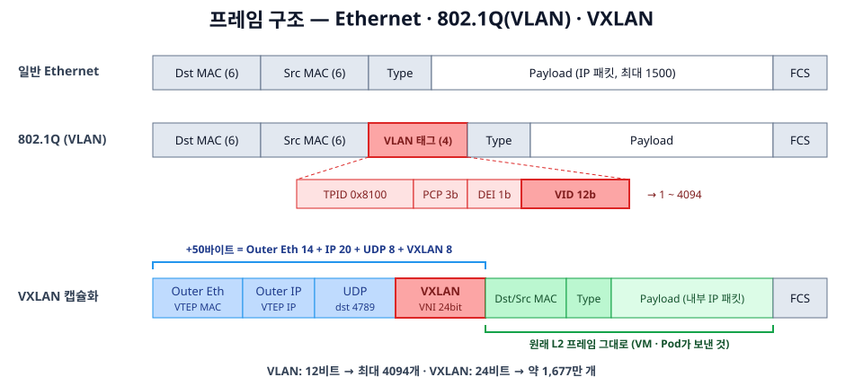
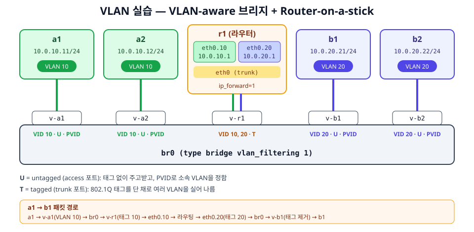
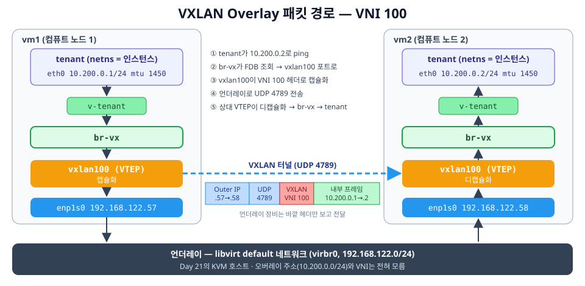

> **Chapter 3 · 가상화 & 네트워크 기초** | 난이도 ★★★★☆ | 예상 소요 2.5 ~ 3시간

## 🎯 오늘의 목표

- 하나의 물리 네트워크를 논리적으로 쪼개는 **VLAN(802.1Q)** 의 원리와 access / trunk 포트를 설명할 수 있다
- **VXLAN** 이 L2 프레임을 UDP로 감싸 서버 사이를 잇는 **Overlay** 방식임을 패킷 구조로 설명할 수 있다
- VLAN-aware 리눅스 브리지와 VXLAN 터널을 `ip link` · `bridge` 명령으로 직접 만들고 `tcpdump` 로 태그·캡슐화를 확인할 수 있다
- OpenStack Neutron의 **provider(VLAN) / self-service(VXLAN·Geneve)** 네트워크, Flannel VXLAN 백엔드와 연결 지을 수 있다

---

## 1. 왜 네트워크를 "쪼개고" "덮어야" 하나?

Day 22의 브리지는 **한 호스트 안** 의 네임스페이스만 묶었습니다. 클라우드는 두 가지 문제를 더 풀어야 합니다.

| 문제 | 예 | 해법 |
|---|---|---|
| **격리** — 같은 스위치에 붙어 있어도 테넌트끼리 섞이면 안 됨 | 고객 A의 브로드캐스트가 고객 B에게 보이면 안 됨 | **VLAN**: 프레임에 태그를 달아 L2 도메인을 나눔 |
| **확장** — 서로 다른 서버(심지어 다른 L3 대역)의 VM/Pod를 같은 L2처럼 묶어야 함 | 컴퓨트 노드 1의 VM ↔ 컴퓨트 노드 2의 VM | **Overlay(VXLAN/Geneve)**: L2 프레임을 UDP 패킷에 넣어 IP 망 위로 전달 |

> 💡 Overlay는 "기존 물리 네트워크(**Underlay**) 위에 가상 네트워크를 덮어 씌운다" 는 뜻입니다. 물리 스위치 설정을 바꾸지 않고 소프트웨어만으로 네트워크를 만들 수 있다는 것이 클라우드에서 결정적인 장점입니다.

---

## 2. VLAN — 태그로 나누기



**IEEE 802.1Q** 는 Ethernet 프레임의 출발지 MAC 뒤에 **4바이트 태그** 를 끼워 넣습니다. 그중 12비트가 **VLAN ID(VID)** 이고, 0과 4095는 예약이라 실제로 **1 ~ 4094** 를 씁니다.

| 용어 | 의미 |
|---|---|
| **Access 포트** (untagged) | 단말(서버, VM)이 연결되는 포트. 태그 없는 프레임을 받아 **PVID** 의 VLAN에 넣고, 나갈 때 태그를 떼어 줌 |
| **Trunk 포트** (tagged) | 스위치↔스위치, 스위치↔라우터/하이퍼바이저. 여러 VLAN의 프레임을 **태그를 단 채로** 실어 나름 |
| **PVID** | 태그 없이 들어온 프레임에 붙일 기본 VLAN |
| **Router-on-a-stick** | trunk 하나에 VLAN별 서브인터페이스를 만들어 VLAN 간 라우팅 |

다른 VLAN끼리는 **같은 서브넷 IP를 써도 서로 보이지 않습니다.** 브로드캐스트(ARP)가 VLAN 경계를 넘지 못하기 때문입니다. 통신하려면 반드시 **L3 라우터** 를 거쳐야 합니다.

### VLAN의 한계

- **4094개** — 테넌트가 수만인 클라우드에서는 부족
- 물리 스위치의 trunk 설정이 필요 — VLAN을 추가할 때마다 네트워크 팀과 협업
- L2 도메인이 데이터센터 전체로 커지면 브로드캐스트·STP 문제가 커짐

---

## 3. VXLAN — UDP로 감싸기

**VXLAN(Virtual eXtensible LAN, RFC 7348)** 은 원래의 L2 프레임 전체를 **UDP 패킷의 payload** 로 넣어 보냅니다.

| 항목 | 내용 |
|---|---|
| 식별자 | **VNI** (VXLAN Network Identifier) **24비트 → 약 1,677만 개** |
| 전송 | UDP, IANA 표준 포트 **4789** (리눅스 커널 기본값은 역사적 이유로 8472 — 그래서 `dstport 4789` 를 명시) |
| VTEP | VXLAN Tunnel End Point. 캡슐화/디캡슐화하는 지점(리눅스 `vxlan` 장치, OVS 포트, 하드웨어 스위치) |
| 오버헤드 | Outer Ethernet 14 + Outer IP 20 + UDP 8 + VXLAN 8 = **50바이트** → 내부 MTU **1450** (언더레이 1500 기준) |
| 상대 VTEP 찾기 | ① 멀티캐스트 그룹 ② 정적 지정(unicast, head-end replication) ③ 컨트롤 플레인(BGP EVPN, OVN, Flannel 등이 FDB를 채워 줌) |

### VLAN vs VXLAN 비교

| 구분 | VLAN | VXLAN |
|---|---|---|
| 동작 계층 | L2 (프레임에 태그 삽입) | L2 over **L3** (UDP 캡슐화) |
| 개수 | 4094 | 약 1,677만 |
| 물리 스위치 설정 | 필요 (trunk에 VLAN 허용) | 불필요 (IP만 통하면 됨) |
| 오버헤드 | 4바이트 | 50바이트 (MTU 주의!) |
| 대표 사용처 | Neutron **provider network**, 데이터센터 물리망 | Neutron **self-service(tenant) network**, Flannel, Calico VXLAN 모드 |

### 어디서 쓰이나

- **OpenStack Neutron** — 관리자가 만드는 provider network는 주로 `flat`/`vlan`, 사용자가 만드는 tenant network는 `vxlan`(ML2/OVS) 또는 `geneve`(ML2/OVN). Neutron이 tenant network MTU를 1450(Geneve는 1442) 으로 자동 설정하는 이유가 바로 이 오버헤드입니다.
- **Kubernetes Flannel** — 노드마다 `flannel.1` 이라는 VXLAN 장치(VNI 1, UDP 8472)를 만들고, 다른 노드의 Pod 대역으로 가는 트래픽을 캡슐화합니다. Day 22의 `cni0` 브리지 다음 단계가 이것입니다.
- **Geneve** — VXLAN과 비슷하지만 가변 길이 옵션 헤더를 가진 후속 규격. OVN(Day 24·30)이 사용합니다.

---

## 4. 실습 1 — VLAN-aware 브리지로 VLAN 나누기



| 항목 | 내용 |
|---|---|
| 환경 | Ubuntu 24.04 한 대 (호스트 또는 Day 21의 vm1) |
| 구성 | `a1`, `a2` → VLAN 10 / `b1`, `b2` → VLAN 20 / `r1` → trunk(10, 20) 라우터 |

### 4-1. VLAN 필터링 브리지와 access 포트

```bash
sudo ip link add br0 type bridge vlan_filtering 1
sudo ip link set br0 up

# 네임스페이스 하나를 VLAN access 포트에 연결하는 함수
# 사용법: add_host <ns> <VLAN ID> <IP/prefix> <게이트웨이>
add_host() {
  sudo ip netns add $1
  sudo ip link add v-$1 type veth peer name eth0 netns $1
  sudo ip link set v-$1 master br0
  sudo ip link set v-$1 up
  sudo bridge vlan del dev v-$1 vid 1                 # 기본 VLAN 1 제거
  sudo bridge vlan add dev v-$1 vid $2 pvid untagged  # access 포트
  sudo ip -n $1 addr add $3 dev eth0
  sudo ip -n $1 link set eth0 up
  sudo ip -n $1 route add default via $4
}

add_host a1 10 10.0.10.11/24 10.0.10.1
add_host a2 10 10.0.10.12/24 10.0.10.1
add_host b1 20 10.0.20.21/24 10.0.20.1
add_host b2 20 10.0.20.22/24 10.0.20.1

bridge vlan show
```

```
port              vlan-id
br0               1 PVID Egress Untagged
v-a1              10 PVID Egress Untagged
v-a2              10 PVID Egress Untagged
v-b1              20 PVID Egress Untagged
v-b2              20 PVID Egress Untagged
```

### 4-2. 격리 확인

```bash
sudo ip netns exec a1 ping -c 2 10.0.10.12     # 같은 VLAN 10 → 성공
sudo ip netns exec b1 ping -c 2 10.0.20.22     # 같은 VLAN 20 → 성공
```

이제 **같은 서브넷 IP** 를 다른 VLAN에 줘 봅니다.

```bash
sudo ip -n b1 addr add 10.0.10.21/24 dev eth0   # b1 에 VLAN 10 대역 IP를 하나 더
sudo ip netns exec a1 ping -c 2 -W 1 10.0.10.21 # 실패 — Destination Host Unreachable
```

IP 대역이 같아도 ARP 브로드캐스트가 VLAN 20의 `b1` 까지 가지 못합니다. 눈으로 확인해 보세요.

```bash
# 터미널 A
sudo ip netns exec b1 tcpdump -ni eth0 arp      # 아무것도 안 잡힘
# 터미널 B
sudo ip netns exec a2 tcpdump -ni eth0 arp      # "Request who-has 10.0.10.21 tell 10.0.10.11" 가 보임
# 터미널 C
sudo ip netns exec a1 ping -c 2 -W 1 10.0.10.21
```

```bash
sudo ip -n b1 addr del 10.0.10.21/24 dev eth0   # 원상복구
```

### 4-3. trunk 포트 + Router-on-a-stick

VLAN 10과 20을 잇는 라우터 `r1` 을 trunk 포트 하나로 붙입니다.

```bash
sudo ip netns add r1
sudo ip link add v-r1 type veth peer name eth0 netns r1
sudo ip link set v-r1 master br0
sudo ip link set v-r1 up
sudo bridge vlan del dev v-r1 vid 1
sudo bridge vlan add dev v-r1 vid 10      # pvid/untagged 없음 = tagged (trunk)
sudo bridge vlan add dev v-r1 vid 20

# r1 안: eth0 위에 VLAN 서브인터페이스 2개
sudo ip -n r1 link set eth0 up
sudo ip -n r1 link add link eth0 name eth0.10 type vlan id 10
sudo ip -n r1 link add link eth0 name eth0.20 type vlan id 20
sudo ip -n r1 addr add 10.0.10.1/24 dev eth0.10
sudo ip -n r1 addr add 10.0.20.1/24 dev eth0.20
sudo ip -n r1 link set eth0.10 up
sudo ip -n r1 link set eth0.20 up
sudo ip netns exec r1 sysctl -w net.ipv4.ip_forward=1   # ip_forward 도 네임스페이스별 값
```

```bash
sudo ip netns exec a1 ping -c 2 10.0.20.21
# 64 bytes from 10.0.20.21: icmp_seq=1 ttl=63 ...   ← ttl 64 → 63, 라우터 하나 통과
```

trunk 포트에서 **802.1Q 태그** 를 직접 봅니다. `-e` 는 L2 헤더를 출력하는 옵션입니다.

```bash
sudo tcpdump -eni v-r1 icmp
```

```
... ethertype 802.1Q (0x8100), length 102: vlan 10, p 0, ethertype IPv4 (0x0800), 10.0.10.11 > 10.0.20.21: ICMP echo request ...
... ethertype 802.1Q (0x8100), length 102: vlan 20, p 0, ethertype IPv4 (0x0800), 10.0.10.11 > 10.0.20.21: ICMP echo request ...
```

같은 핑이 **VLAN 10 태그로 r1에 들어갔다가 VLAN 20 태그로 나오는 것** 이 보입니다. 반면 access 포트 `v-a1` 에서 `tcpdump -eni v-a1` 을 하면 태그가 없습니다.

> 💡 이것이 Neutron **VLAN provider network** 의 기본 원리입니다. 컴퓨트 노드의 물리 NIC가 스위치의 trunk 포트에 연결되고, Neutron이 네트워크마다 VID(예: `--provider-segment 100`)를 붙여 내보냅니다.

### 4-4. 정리

```bash
for ns in a1 a2 b1 b2 r1; do sudo ip netns del $ns; done
sudo ip link del br0
```

---

## 5. 실습 2 — VM 2대 사이에 VXLAN Overlay 만들기



| 항목 | 내용 |
|---|---|
| 환경 | **Day 21에서 만든 vm1, vm2** (= 컴퓨트 노드 2대 역할) |
| 언더레이 | libvirt `default` 네트워크 192.168.122.0/24 |
| 오버레이 | VNI 100, 10.200.0.0/24 (각 VM 안의 `tenant` 네임스페이스 = "인스턴스" 역할) |

먼저 두 VM의 NIC 이름과 IP를 확인합니다. (Ubuntu 클라우드 이미지 + virtio NIC는 보통 `enp1s0`)

```bash
# 호스트에서
virsh net-dhcp-leases default
# 각 VM 안에서
ip -br addr
sudo apt-get update && sudo apt-get install -y tcpdump
```

### 5-1. VTEP + 브리지 + "인스턴스" 네임스페이스

**vm1** 과 **vm2** 에서 각각 실행합니다. 변수 값만 노드에 맞게 바꾸세요.

```bash
# ---- vm1 기준 (vm2 에서는 LOCAL/REMOTE 를 맞바꾸고 TENANT_IP=10.200.0.2/24) ----
DEV=enp1s0
LOCAL=192.168.122.57
REMOTE=192.168.122.58
TENANT_IP=10.200.0.1/24

# 1) VTEP: VNI 100, 상대 VTEP을 정적으로 지정
sudo ip link add vxlan100 type vxlan id 100 dstport 4789 local $LOCAL remote $REMOTE dev $DEV

# 2) 브리지에 VTEP을 포트로 연결
sudo ip link add br-vx type bridge
sudo ip link set vxlan100 master br-vx
sudo ip link set vxlan100 up
sudo ip link set br-vx up

# 3) "인스턴스" 역할 네임스페이스를 같은 브리지에 연결 (MTU 1450!)
sudo ip netns add tenant
sudo ip link add v-tenant type veth peer name eth0 netns tenant
sudo ip link set v-tenant master br-vx
sudo ip link set v-tenant mtu 1450 up
sudo ip -n tenant link set eth0 mtu 1450 up
sudo ip -n tenant addr add $TENANT_IP dev eth0
```

```bash
ip -d link show vxlan100
```

```
... vxlan100: <BROADCAST,MULTICAST,UP,LOWER_UP> mtu 1450 ... master br-vx ...
    vxlan id 100 remote 192.168.122.58 local 192.168.122.57 dev enp1s0 srcport 0 0 dstport 4789 ...
```

`dev enp1s0` 을 지정했기 때문에 커널이 MTU를 1500 - 50 = **1450** 으로 자동 설정했습니다.

### 5-2. 통신과 캡슐화 확인

```bash
# vm2 에서 언더레이를 관찰
sudo tcpdump -ni enp1s0 udp port 4789

# vm1 에서 오버레이로 핑
sudo ip netns exec tenant ping -c 3 10.200.0.2
```

```
IP 192.168.122.57.46512 > 192.168.122.58.4789: VXLAN, flags [I] (0x08), vni 100
IP 10.200.0.1 > 10.200.0.2: ICMP echo request, id 2, seq 1, length 64
IP 192.168.122.58.38211 > 192.168.122.57.4789: VXLAN, flags [I] (0x08), vni 100
IP 10.200.0.2 > 10.200.0.1: ICMP echo reply, id 2, seq 1, length 64
```

바깥은 **VM ↔ VM 간 UDP 4789**, 안쪽은 **10.200.0.x 끼리의 ICMP**. 이것이 캡슐화입니다. KVM 호스트에서 `sudo tcpdump -ni virbr0 udp port 4789` 로 봐도 같은 패킷이 보입니다 — 물리 스위치(여기서는 virbr0)는 VNI도, 10.200.0.0/24도 전혀 모릅니다.

```bash
bridge fdb show dev vxlan100
```

```
00:00:00:00:00:00 dst 192.168.122.58 self permanent      ← 모르는 MAC/브로드캐스트는 이 VTEP으로
6a:1f:...:c2 dst 192.168.122.58 self                    ← 학습된 상대 인스턴스 MAC
```

### 5-3. MTU 확인 — Overlay의 단골 장애

```bash
# 1422 + ICMP 8 + IP 20 = 1450 → 통과
sudo ip netns exec tenant ping -c 1 -M do -s 1422 10.200.0.2
# 1423 → 내부 MTU 초과
sudo ip netns exec tenant ping -c 1 -M do -s 1423 10.200.0.2
# ping: local error: message too long, mtu=1450
```

`-M do` 는 "조각내지 말라(DF 비트)" 입니다. 만약 tenant 쪽 MTU를 1500으로 두면, 작은 핑은 되는데 SSH 접속 후 큰 출력이나 `apt update` 가 멈추는 **전형적인 Overlay MTU 장애** 가 생깁니다.

### 5-4. 테넌트 하나 더 — 같은 IP, 다른 VNI

```bash
# 두 VM 모두에서 (TENANT_IP 는 앞과 동일하게!)
sudo ip link add vxlan200 type vxlan id 200 dstport 4789 local $LOCAL remote $REMOTE dev $DEV
sudo ip link add br-vx2 type bridge
sudo ip link set vxlan200 master br-vx2
sudo ip link set vxlan200 up
sudo ip link set br-vx2 up
sudo ip netns add tenant2
sudo ip link add v-tenant2 type veth peer name eth0 netns tenant2
sudo ip link set v-tenant2 master br-vx2
sudo ip link set v-tenant2 mtu 1450 up
sudo ip -n tenant2 link set eth0 mtu 1450 up
sudo ip -n tenant2 addr add $TENANT_IP dev eth0
```

`tenant` 와 `tenant2` 는 **완전히 같은 IP 대역(10.200.0.0/24)** 을 쓰지만 VNI가 달라 서로 섞이지 않습니다. tcpdump에서 `vni 100` / `vni 200` 으로 구분되는 것을 확인해 보세요. OpenStack에서 프로젝트 A와 B가 둘 다 `10.0.0.0/24` 서브넷을 만들 수 있는 이유가 이것입니다.

> 💡 노드가 3대 이상이면 `remote` 대신 `nolearning` 으로 만들고, 상대 VTEP마다 `sudo bridge fdb append 00:00:00:00:00:00 dev vxlan100 dst <상대 IP>` 를 추가합니다(head-end replication). 이 FDB를 자동으로 채워주는 것이 Flannel·OVN·EVPN 같은 **컨트롤 플레인** 의 일입니다.

### 5-5. 정리 (Day 24 전에 반드시!)

```bash
# vm1, vm2 모두에서
sudo ip netns del tenant;  sudo ip netns del tenant2
sudo ip link del vxlan100; sudo ip link del vxlan200
sudo ip link del br-vx;    sudo ip link del br-vx2
```

> ⚠️ Day 24에서 Open vSwitch도 UDP 4789로 VXLAN을 엽니다. 리눅스 `vxlan100` 이 남아 있으면 포트 충돌이 납니다.

---

## 6. 트러블슈팅

| 증상 | 원인 | 해결 |
|---|---|---|
| VLAN 실습에서 같은 VLAN끼리도 ping 실패 | `bridge vlan del ... vid 1` 후 새 VID 추가를 빠뜨림, 또는 `vlan_filtering` 이 0 | `bridge vlan show` 로 포트별 VID 확인, `ip -d link show br0` 에서 `vlan_filtering 1` 확인 |
| 라우터 경유 ping 실패 (`a1` → `b1`) | `r1` 안의 `ip_forward=0`, 서브인터페이스 DOWN, trunk 포트에 VID 미허용 | `ip netns exec r1 sysctl net.ipv4.ip_forward`, `ip -n r1 -br link`, `bridge vlan show dev v-r1` |
| Docker 설치된 호스트에서 브리지 트래픽이 막힘 | `br_netfilter` 로 브리지 프레임이 iptables FORWARD(DROP)를 거침 (Day 22 참고) | `sudo iptables -I FORWARD -i br0 -o br0 -j ACCEPT` 또는 깨끗한 VM에서 실습 |
| VXLAN ping 실패, tcpdump에 UDP 4789가 아예 안 보임 | `local`/`remote` IP 오타, `dev` 이름 오류, 장치 DOWN | `ip -d link show vxlan100`, 언더레이 ping(`ping $REMOTE`) 먼저 확인 |
| UDP 4789는 보이는데 응답이 없음 | 상대 노드 방화벽(ufw/보안 그룹)이 UDP 4789 차단, 상대 쪽 VNI·dstport 불일치 | `sudo ufw allow 4789/udp`, 양쪽 `id`·`dstport` 동일한지 확인 |
| 작은 ping은 되는데 SSH·HTTP 큰 응답에서 멈춤 | 오버레이 MTU 미조정 (1500 그대로) | 인스턴스 쪽 MTU 1450, 또는 언더레이 MTU를 1550+ (점보 프레임)로 |
| `RTNETLINK answers: Address already in use` (vxlan 생성 시) | 같은 VNI·포트 조합의 장치가 이미 있음 | `ip -d link | grep vxlan` 확인 후 기존 장치 삭제 |

---

## 7. 핵심 정리

- **VLAN** = 프레임에 4바이트 802.1Q 태그(12비트 VID, 최대 4094)를 달아 L2 도메인을 분리. access(untagged) / trunk(tagged)
- VLAN이 다르면 같은 서브넷이어도 통신 불가 → **L3 라우터** 필요 (Router-on-a-stick)
- **VXLAN** = L2 프레임을 **UDP(4789)** 로 감싸 IP 망 위에 L2를 만드는 **Overlay**. 24비트 VNI(약 1,677만)
- 캡슐화/디캡슐화 지점 = **VTEP**. 상대 VTEP 정보(FDB)를 채우는 것이 컨트롤 플레인(Flannel, OVN, EVPN)의 역할
- 오버헤드 50바이트 → 오버레이 **MTU 1450**. MTU 불일치는 가장 흔한 장애
- Neutron: provider network = **VLAN**, tenant network = **VXLAN(ML2/OVS) / Geneve(ML2/OVN)**. Flannel: `flannel.1` VXLAN

---

## 8. 셀프 체크

<details>
<summary>Q1. VLAN ID가 12비트인데 왜 실제로 쓸 수 있는 VLAN은 4094개인가?</summary>

2^12 = 4096개 중 **0(우선순위 태그 전용)과 4095(예약)** 를 제외하기 때문입니다.
</details>

<details>
<summary>Q2. access 포트와 trunk 포트의 차이는?</summary>

access 포트는 한 VLAN에만 속하며 **태그 없는** 프레임을 주고받습니다(들어올 때 PVID로 분류, 나갈 때 태그 제거). trunk 포트는 여러 VLAN의 프레임을 **802.1Q 태그를 단 채로** 실어 나릅니다. 실습에서 `v-a1` 은 access, `v-r1` 은 trunk였습니다.
</details>

<details>
<summary>Q3. VXLAN에서 "언더레이"와 "오버레이"는 각각 실습의 무엇이었나?</summary>

언더레이 = VM들이 실제로 붙어 있는 **192.168.122.0/24 (virbr0)** 네트워크. 오버레이 = 그 위에 VNI 100으로 만든 **10.200.0.0/24** 가상 L2 네트워크입니다. 언더레이 장비는 오버레이의 주소를 전혀 모릅니다.
</details>

<details>
<summary>Q4. VXLAN 오버레이에서 MTU를 1450으로 맞춰야 하는 이유는?</summary>

원래 프레임에 Outer Ethernet(14) + Outer IP(20) + UDP(8) + VXLAN(8) = **50바이트** 가 더 붙습니다. 언더레이 MTU가 1500이면 내부 IP 패킷은 1450을 넘을 수 없습니다. 넘으면 DF 비트가 설정된 패킷이 버려져 큰 전송만 실패하는 장애가 생깁니다.
</details>

<details>
<summary>Q5. OpenStack에서 두 프로젝트가 모두 10.0.0.0/24 서브넷을 쓸 수 있는 이유는?</summary>

각 tenant network가 서로 다른 **VNI(또는 VLAN ID)** 로 분리되어 있어 L2 도메인이 겹치지 않기 때문입니다. 실습 5-4에서 `tenant` 와 `tenant2` 가 같은 IP를 쓰면서도 VNI 100/200으로 격리된 것과 같습니다. (라우터도 프로젝트별 네임스페이스나 논리 라우터로 분리됩니다.)
</details>

---

## ⏭️ 다음 예고 — Day 24. Open vSwitch 기초

오늘은 VLAN과 VXLAN을 리눅스 브리지로 만들었습니다. 하지만 OpenStack Neutron(ML2/OVS, OVN)과 일부 K8s CNI(OVN-Kubernetes, Antrea)는 **Open vSwitch** 를 씁니다. 내일은 `ovs-vsctl` 로 OVS 브리지를 만들고, VLAN 태그 포트와 VXLAN 터널을 붙이고, `ovs-ofctl` 로 **OpenFlow 흐름 규칙** 을 직접 넣어 "프로그래밍 가능한 스위치" 를 체험합니다. Neutron의 `br-int` / `br-tun` / `br-ex` 가 무엇인지도 정체를 밝힙니다.
