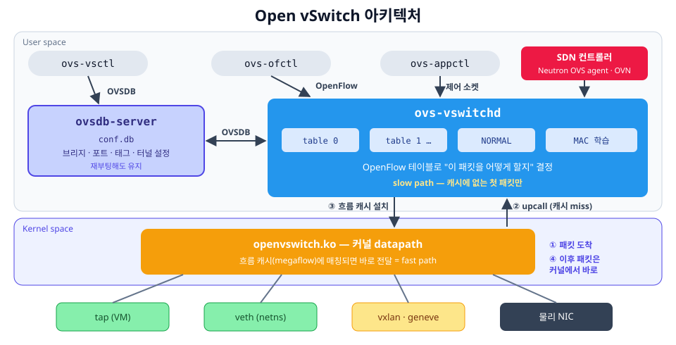
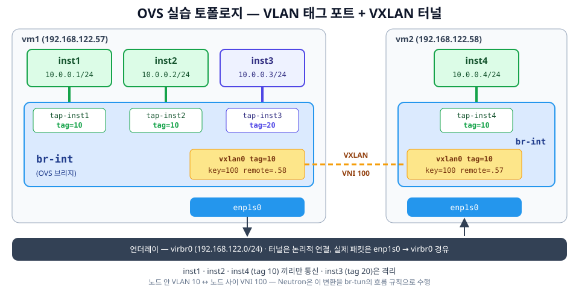
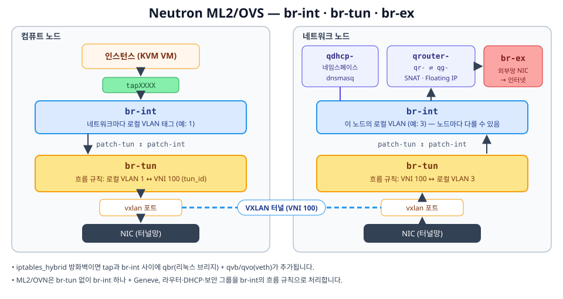

> **Chapter 3 · 가상화 & 네트워크 기초** | 난이도 ★★★★☆ | 예상 소요 2.5 ~ 3시간

## 🎯 오늘의 목표

- 리눅스 브리지 대신 **Open vSwitch(OVS)** 가 클라우드에서 쓰이는 이유를 설명할 수 있다
- OVS 구성 요소(**ovsdb-server · ovs-vswitchd · 커널 datapath**)와 `ovs-vsctl` / `ovs-ofctl` / `ovs-appctl` 의 역할을 구분할 수 있다
- OVS 브리지에 **VLAN 태그 포트** 와 **VXLAN 터널 포트** 를 붙이고, **OpenFlow 규칙** 을 직접 넣어 트래픽을 제어할 수 있다
- OpenStack Neutron의 **`br-int` / `br-tun` / `br-ex`** 가 각각 무엇이고 패킷이 어떻게 흐르는지 그릴 수 있다

---

## 1. 왜 Open vSwitch인가?

Day 22·23에서 리눅스 브리지 + VLAN + VXLAN만으로도 꽤 많은 것을 만들었습니다. 그런데 수백 대의 컴퓨트 노드와 수만 개의 포트를 **중앙에서 프로그래밍** 하려면 한계가 있습니다.

| 구분 | Linux bridge | Open vSwitch |
|---|---|---|
| 설정 방식 | `ip` / `bridge` 명령 (휘발성) | **OVSDB** 에 저장 (재부팅해도 유지), 원격 관리 가능 |
| 전달 규칙 | MAC 학습 + VLAN 필터 정도 | **OpenFlow** — L2~L4 필드로 매칭해서 수정·전달·드롭 |
| 터널 | 별도 `vxlan` 장치 + 브리지 | 브리지 **포트 하나** 로 VXLAN / Geneve / GRE |
| VLAN | `bridge vlan` | 포트에 `tag=` 한 줄 |
| 관측 | tcpdump | `ofproto/trace` 로 "이 패킷이 어떤 규칙을 탈지" 시뮬레이션 |
| 외부 제어 | 없음 | SDN 컨트롤러(OVN, Neutron agent, ONOS 등)가 원격으로 흐름 설치 |

> 💡 **어디서 쓰이나** — OpenStack Neutron(**ML2/OVS**, **ML2/OVN**), Kubernetes CNI(**OVN-Kubernetes**, **Antrea**, **Kube-OVN**), 그리고 OpenShift 기본 네트워크(OVN-Kubernetes). Neutron의 최근 기본값인 OVN도 결국 OVS 위에서 동작합니다.

---

## 2. OVS 아키텍처



| 구성 요소 | 위치 | 역할 |
|---|---|---|
| **ovsdb-server** | 유저 공간 | 설정 DB(`/etc/openvswitch/conf.db`). 어떤 브리지에 어떤 포트가, 어떤 태그로 붙어 있는지 저장 |
| **ovs-vswitchd** | 유저 공간 | 스위치의 두뇌. OVSDB 설정을 읽고, **OpenFlow 테이블** 로 "이 패킷을 어떻게 할지" 결정 (**slow path**) |
| **openvswitch.ko** (datapath) | 커널 | 결정 결과를 **흐름 캐시** 로 들고 있다가, 같은 종류 패킷은 커널에서 바로 처리 (**fast path**) |

| 명령 | 대화 상대 | 용도 |
|---|---|---|
| `ovs-vsctl` | ovsdb-server | 브리지·포트·태그·터널 **설정** (`add-br`, `add-port`, `set`) |
| `ovs-ofctl` | ovs-vswitchd (OpenFlow) | **흐름 규칙** 조회·추가·삭제 (`dump-flows`, `add-flow`) |
| `ovs-appctl` | ovs-vswitchd (제어 소켓) | 런타임 조회·디버깅 (`fdb/show`, `ofproto/trace`, `dpctl/dump-flows`) |

### 첫 패킷과 나머지 패킷

1. 새 종류의 패킷이 커널 datapath에 도착 → 캐시에 없음(miss)
2. **upcall** 로 ovs-vswitchd에 질문 → OpenFlow 테이블을 따라가며 결정
3. 결정 결과를 커널에 **megaflow** 캐시로 설치
4. 같은 흐름의 이후 패킷은 커널에서 바로 처리

> Docker에 비유하면 `ovs-vsctl` 은 `docker network create` 같은 "설정", `ovs-ofctl` 은 그 네트워크의 iptables 규칙을 직접 만지는 "정책" 에 가깝습니다.

---

## 3. 설치

| 항목 | 내용 |
|---|---|
| 환경 | Day 21에서 만든 **vm1, vm2** (Ubuntu 24.04). 실습 1은 vm1에서, 실습 2는 두 대 모두 |
| 패키지 | `openvswitch-switch` (Ubuntu 24.04 기준 OVS 3.3.x) |

> ⚠️ Day 23 실습의 `vxlan100` / `vxlan200` 장치가 남아 있다면 먼저 지우세요(Day 23 5-5). OVS VXLAN 포트도 UDP 4789를 사용합니다.

```bash
sudo apt-get update
sudo apt-get install -y openvswitch-switch tcpdump
sudo ovs-vsctl --version
sudo systemctl status openvswitch-switch --no-pager
sudo ovs-vsctl show
```

```
1f6c3b2e-....
    ovs_version: "3.3.0"
```

---

## 4. 실습 1 — OVS 브리지와 VLAN 태그 포트 (vm1)

### 4-1. 브리지 만들고 "인스턴스" 3개 연결

```bash
sudo ovs-vsctl add-br br-int
ip -br link show br-int        # OVS 브리지는 같은 이름의 internal 인터페이스를 가짐

# 사용법: add_inst <ns 이름> <IP/prefix> <VLAN tag>
add_inst() {
  sudo ip netns add $1
  sudo ip link add tap-$1 type veth peer name eth0 netns $1
  sudo ip link set tap-$1 mtu 1450 up               # 실습 2(VXLAN) 대비 MTU 1450
  sudo ovs-vsctl add-port br-int tap-$1 tag=$3      # access 포트 + VLAN 태그
  sudo ip -n $1 link set eth0 mtu 1450 up
  sudo ip -n $1 addr add $2 dev eth0
}

add_inst inst1 10.0.0.1/24 10
add_inst inst2 10.0.0.2/24 10
add_inst inst3 10.0.0.3/24 20

sudo ovs-vsctl show
```

```
1f6c3b2e-....
    Bridge br-int
        Port tap-inst1
            tag: 10
            Interface tap-inst1
        Port tap-inst2
            tag: 10
            Interface tap-inst2
        Port tap-inst3
            tag: 20
            Interface tap-inst3
        Port br-int
            Interface br-int
                type: internal
    ovs_version: "3.3.0"
```

> 💡 Day 23에서는 `bridge vlan del ... vid 1` + `bridge vlan add ... pvid untagged` 두 줄이었던 access 포트 설정이 `tag=10` 한 단어로 끝납니다. 그리고 이 설정은 OVSDB에 저장되어 **재부팅해도 유지** 됩니다.

### 4-2. VLAN 격리 확인

```bash
sudo ip netns exec inst1 ping -c 2 10.0.0.2          # tag 10 ↔ tag 10 → 성공
sudo ip netns exec inst1 ping -c 2 -W 1 10.0.0.3     # tag 10 ↔ tag 20 → 실패 (같은 서브넷인데도!)

sudo ovs-vsctl set port tap-inst3 tag=10             # inst3 를 VLAN 10으로 옮기면
sudo ip netns exec inst1 ping -c 2 10.0.0.3          # → 성공
sudo ovs-vsctl set port tap-inst3 tag=20             # 원상복구
```

```bash
sudo ovs-appctl fdb/show br-int      # OVS가 학습한 MAC 테이블 (VLAN별)
```

```
 port  VLAN  MAC                Age
    1    10  6e:3a:1c:...:01     12
    2    10  b2:48:9f:...:7c     12
```

### 4-3. OpenFlow 규칙 들여다보기

```bash
sudo ovs-ofctl show br-int          # 포트 번호(ofport) ↔ 이름
sudo ovs-ofctl dump-flows br-int
```

```
 cookie=0x0, duration=412.3s, table=0, n_packets=58, n_bytes=4872, priority=0 actions=NORMAL
```

규칙이 딱 하나, **"모든 패킷 → NORMAL"** 입니다. `NORMAL` 은 "평범한 L2 스위치처럼(MAC 학습 + VLAN) 처리하라" 는 특수 액션입니다. 지금까지의 동작은 전부 이 한 줄 덕분이었습니다.

### 4-4. 흐름 규칙 추가 — inst1의 ICMP만 차단

```bash
OFPORT=$(sudo ovs-vsctl get Interface tap-inst1 ofport)
echo $OFPORT        # 예: 1

sudo ovs-ofctl add-flow br-int "table=0,priority=100,in_port=$OFPORT,icmp,actions=drop"
sudo ovs-ofctl dump-flows br-int
```

```
 cookie=0x0, duration=3.1s, table=0, n_packets=0, n_bytes=0, priority=100,icmp,in_port=1 actions=drop
 cookie=0x0, duration=430.8s, table=0, n_packets=58, n_bytes=4872, priority=0 actions=NORMAL
```

(OVS 버전·출력 환경에 따라 `in_port="tap-inst1"` 처럼 포트 이름으로 표시될 수 있습니다.)

```bash
sudo ip netns exec inst1 ping -c 2 -W 1 10.0.0.2   # 실패
sudo ovs-ofctl dump-flows br-int | grep drop       # n_packets 가 2로 증가
```

**우선순위(priority)** 가 높은 규칙부터 매칭됩니다. ICMP는 priority 100 규칙에 걸려 drop, 나머지(ARP, TCP 등)는 priority 0의 NORMAL로 갑니다. Neutron의 보안 그룹(openvswitch 방화벽 드라이버)이 바로 이런 흐름 규칙 수십~수백 줄로 구현됩니다.

### 4-5. ofproto/trace — 패킷 시뮬레이션

실제로 패킷을 보내지 않고 "이런 패킷이 오면 어떻게 처리될지" 를 물어볼 수 있습니다. OVS 디버깅의 핵심 도구입니다.

```bash
sudo ovs-appctl ofproto/trace br-int in_port=$OFPORT,icmp,nw_src=10.0.0.1,nw_dst=10.0.0.2
```

```
Flow: icmp,in_port=1,vlan_tci=0x0000,...,nw_src=10.0.0.1,nw_dst=10.0.0.2,...

bridge("br-int")
----------------
 0. icmp,in_port=1, priority 100
    drop

Final flow: unchanged
Megaflow: recirc_id=0,eth,icmp,in_port=1,nw_frag=no
Datapath actions: drop
```

규칙을 지우고 다시 trace 해 보세요. `NORMAL` 을 타고 VLAN 10 포트로 나가는 과정이 보입니다.

```bash
sudo ovs-ofctl --strict del-flows br-int "priority=100,in_port=$OFPORT,icmp"
sudo ip netns exec inst1 ping -c 2 10.0.0.2        # 다시 성공

sudo ovs-appctl dpctl/dump-flows                   # 커널 datapath에 설치된 캐시(megaflow)
```

> ⚠️ `ovs-ofctl del-flows br-int` 처럼 조건 없이 실행하면 NORMAL 규칙까지 지워져 **브리지가 모든 트래픽을 버립니다.** 실수했다면 `sudo ovs-ofctl add-flow br-int "priority=0,actions=NORMAL"` 로 복구하세요.

---

## 5. 실습 2 — OVS VXLAN 터널로 두 노드 잇기 (vm1 + vm2)



### 5-1. vm2 준비

vm2에서 OVS를 설치하고(3장), 4-1의 `add_inst` 함수를 다시 정의한 뒤:

```bash
# vm2
sudo ovs-vsctl add-br br-int
add_inst inst4 10.0.0.4/24 10
```

### 5-2. VXLAN 포트 추가 (양쪽 모두)

```bash
# vm1 에서 REMOTE=vm2 IP, vm2 에서 REMOTE=vm1 IP
REMOTE=192.168.122.58

sudo ovs-vsctl add-port br-int vxlan0 tag=10 -- \
  set interface vxlan0 type=vxlan options:remote_ip=$REMOTE options:key=100
```

| 부분 | 의미 |
|---|---|
| `add-port br-int vxlan0 tag=10` | 터널 포트를 VLAN 10의 access 포트로 — VLAN 10 트래픽만 터널로 나감 |
| `--` | 한 번의 트랜잭션으로 여러 명령을 이어서 실행 |
| `type=vxlan` | 포트 종류. `geneve`, `gre` 도 가능 |
| `options:remote_ip` | 상대 VTEP IP |
| `options:key=100` | VNI 100 |

```bash
sudo ovs-vsctl show          # Port vxlan0 / tag: 10 / type: vxlan / options: {key="100", remote_ip="..."}
ip -br link | grep vxlan     # vxlan_sys_4789 — OVS가 만든 커널 VXLAN 장치
```

### 5-3. 노드 간 통신 확인

```bash
# vm2 — 언더레이 관찰
sudo tcpdump -ni enp1s0 udp port 4789

# vm1 — 다른 노드의 인스턴스로 ping
sudo ip netns exec inst1 ping -c 3 10.0.0.4      # 성공
sudo ip netns exec inst3 ping -c 2 -W 1 10.0.0.4 # 실패 — inst3 는 VLAN 20, 터널은 VLAN 10 전용
```

```
IP 192.168.122.57.51123 > 192.168.122.58.4789: VXLAN, flags [I] (0x08), vni 100
IP 10.0.0.1 > 10.0.0.4: ICMP echo request, id 5, seq 1, length 64
```

여기서 중요한 포인트는 **노드 안의 VLAN 10 ↔ 노드 사이의 VNI 100** 이 짝지어졌다는 것입니다. 노드 안에서는 VLAN 태그로, 노드 사이에서는 VNI로 네트워크를 구분합니다. Neutron ML2/OVS가 정확히 이 방식이며, 다만 `tag=` 대신 `br-tun` 의 흐름 규칙으로 "로컬 VLAN ↔ VNI" 변환을 합니다.

### 5-4. 정리

```bash
# vm1
for ns in inst1 inst2 inst3; do sudo ip netns del $ns; done
sudo ovs-vsctl del-br br-int
# vm2
sudo ip netns del inst4
sudo ovs-vsctl del-br br-int
```

> ⚠️ 이 VM에 나중에 DevStack(Day 26)을 설치할 계획이라면 `br-int` 를 반드시 지워 두세요. Neutron이 같은 이름의 브리지를 직접 만듭니다.

---

## 6. OpenStack Neutron은 OVS를 이렇게 쓴다



| 브리지 | 위치 | 역할 |
|---|---|---|
| **br-int** (integration) | 모든 노드 | 인스턴스 tap, DHCP·라우터 포트가 붙는 중앙 스위치. 네트워크마다 **로컬 VLAN 태그** 로 구분 (오늘 실습의 `tag=10`) |
| **br-tun** (tunnel) | 모든 노드 (VXLAN 사용 시) | br-int와 **patch 포트** 로 연결. 흐름 규칙으로 로컬 VLAN 태그를 떼고 **VNI(tun_id)** 를 붙여 VXLAN 포트로 내보냄. 받을 때는 반대 |
| **br-ex** (external) | 네트워크 노드 | 외부망 NIC가 붙는 브리지. `qrouter-` 네임스페이스의 `qg-` 포트가 여기 연결되어 SNAT·Floating IP 트래픽이 나감 |

인스턴스 → 인터넷 경로 (ML2/OVS, VXLAN tenant network):

```
VM eth0 → tapXXXX → br-int (로컬 VLAN 1) → patch-tun → br-tun (VLAN 1 → VNI 100)
  → vxlan 포트 → [언더레이] → 네트워크 노드 br-tun (VNI 100 → 로컬 VLAN 3)
  → br-int → qr-XXXX → qrouter- 네임스페이스 (라우팅 + SNAT) → qg-XXXX → br-ex → 외부
```

Day 22의 네임스페이스, Day 23의 VLAN·VXLAN, 오늘의 OVS가 한 경로 안에 모두 등장합니다.

### ML2/OVN은?

최신 Neutron 기본값인 **ML2/OVN** 은 구조가 더 단순합니다.

- `br-tun` 없이 **br-int 하나** + **Geneve** 터널
- 라우터·DHCP·보안 그룹·NAT를 네임스페이스가 아니라 **br-int의 OpenFlow 규칙** 으로 구현 (`ovn-controller` 가 설치)
- 그래서 `ovs-ofctl dump-flows br-int` 를 치면 수천 줄의 규칙이 나옵니다 — 오늘 손으로 넣은 `priority=100,icmp,actions=drop` 의 대규모 자동화 버전입니다

Chapter 4에서 DevStack을 설치한 뒤, 컴퓨트 노드에서 다음 명령으로 오늘 배운 것을 확인해 보세요.

```bash
sudo ovs-vsctl show                     # br-int, (br-tun), br-ex 와 tap/patch/vxlan·geneve 포트
sudo ovs-ofctl dump-flows br-int | head
sudo virsh list                         # Day 21 — Nova가 만든 instance-0000000X
```

---

## 7. 트러블슈팅

| 증상 | 원인 | 해결 |
|---|---|---|
| `ovs-vsctl: unix:/var/run/openvswitch/db.sock: database connection failed` | OVS 서비스 미실행 | `sudo systemctl start openvswitch-switch` |
| `ovs-vsctl: cannot create a bridge named br-int because a bridge named br-int already exists` | 이전 실습 잔여물 | `sudo ovs-vsctl --if-exists del-br br-int` 후 재생성 |
| 포트 추가 후 `ovs-vsctl show` 에 `error: "could not open network device tap-inst1 (No such device)"` | OVSDB에는 등록됐지만 실제 인터페이스가 없음(네임스페이스 삭제 등) | `sudo ovs-vsctl del-port br-int tap-inst1` 후 다시 생성 |
| 모든 통신이 갑자기 끊김 | `del-flows` 로 NORMAL 규칙까지 삭제 | `sudo ovs-ofctl add-flow br-int "priority=0,actions=NORMAL"` |
| VXLAN 포트에 `error: ... Address already in use` 류 오류 | Day 23의 리눅스 `vxlan` 장치가 UDP 4789를 점유 | `ip -d link \| grep -B1 'dstport 4789'` 로 찾아 `sudo ip link del vxlan100` |
| 터널 ping 실패, tcpdump에 UDP 4789도 없음 | 포트 `tag` 불일치(인스턴스 10 / 터널 20), `remote_ip` 오타 | `sudo ovs-vsctl list interface vxlan0`, `ovs-vsctl show` 에서 tag 비교 |
| 작은 ping은 되는데 큰 전송이 멈춤 | 인스턴스 MTU 1500 그대로 | 인스턴스 쪽 veth/eth0 MTU 1450 |
| 원인을 모르겠다 | — | `sudo ovs-appctl ofproto/trace br-int <흐름>` 으로 어느 규칙에서 막히는지 확인, `sudo journalctl -u ovs-vswitchd` / `/var/log/openvswitch/ovs-vswitchd.log` |

---

## 8. 핵심 정리

- **OVS** = OVSDB로 설정을 저장하고 **OpenFlow** 로 프로그래밍하는 소프트웨어 스위치. Neutron(ML2/OVS·OVN), OVN-Kubernetes, Antrea의 기반
- **ovsdb-server**(설정) · **ovs-vswitchd**(판단, slow path) · **커널 datapath**(캐시, fast path)
- `ovs-vsctl` = 설정, `ovs-ofctl` = 흐름 규칙, `ovs-appctl` = 디버깅(`fdb/show`, `ofproto/trace`, `dpctl/dump-flows`)
- 기본 규칙 `priority=0 actions=NORMAL` 이 평범한 L2 스위치 동작. 더 높은 priority 규칙으로 덮어쓴다
- 포트 `tag=` 로 VLAN, `type=vxlan options:remote_ip= options:key=` 로 터널
- Neutron ML2/OVS: **br-int(로컬 VLAN) ↔ patch ↔ br-tun(VLAN ↔ VNI) ↔ 언더레이**, 외부는 **qrouter → br-ex**. ML2/OVN: br-int 하나 + Geneve + 흐름 규칙

---

## 9. 셀프 체크

<details>
<summary>Q1. <code>ovs-vsctl</code> 과 <code>ovs-ofctl</code> 은 각각 누구와 통신하며 무엇을 바꾸나?</summary>

`ovs-vsctl` 은 **ovsdb-server** 와 통신해 브리지·포트·태그·터널 같은 **설정** 을 바꿉니다(영구 저장). `ovs-ofctl` 은 **ovs-vswitchd** 와 OpenFlow로 통신해 **흐름 규칙** 을 조회·추가·삭제합니다.
</details>

<details>
<summary>Q2. 새로 만든 OVS 브리지가 아무 설정 없이도 스위치처럼 동작하는 이유는?</summary>

기본 흐름 규칙 `priority=0, actions=NORMAL` 이 있기 때문입니다. NORMAL은 MAC 학습과 VLAN 처리를 하는 전통적인 L2 스위치 동작입니다. 이 규칙을 지우면 모든 패킷이 버려집니다.
</details>

<details>
<summary>Q3. 같은 패킷 흐름의 두 번째 패킷부터 빨라지는 이유는?</summary>

첫 패킷은 커널 datapath 캐시에 없어서 **upcall** 로 ovs-vswitchd가 OpenFlow 테이블을 따라 판단(slow path)합니다. 그 결과가 커널에 **megaflow** 로 설치되므로, 이후 패킷은 유저 공간을 거치지 않고 커널에서 바로 처리됩니다(fast path).
</details>

<details>
<summary>Q4. Neutron ML2/OVS에서 br-int와 br-tun의 역할 분담은?</summary>

br-int는 인스턴스·DHCP·라우터 포트가 붙는 중앙 스위치로, 노드 안에서 네트워크를 **로컬 VLAN 태그** 로 구분합니다. br-tun은 patch 포트로 br-int와 연결되어, 흐름 규칙으로 **로컬 VLAN ↔ VNI** 를 변환하고 VXLAN 터널로 다른 노드와 연결합니다. 실습 2에서 `vxlan0 tag=10 key=100` 이 한 일을 br-tun이 흐름 규칙으로 합니다.
</details>

<details>
<summary>Q5. "보안 그룹 규칙을 넣었는데 이상하게 막힌다" — OVS 기반 환경에서 무엇으로 확인할까?</summary>

`ovs-appctl ofproto/trace br-int <in_port, 프로토콜, IP, 포트 등>` 으로 해당 패킷이 어느 테이블·어느 규칙에서 drop 되는지 추적합니다. `ovs-ofctl dump-flows br-int` 의 `n_packets` 카운터 증가로도 어떤 규칙에 걸리는지 확인할 수 있습니다.
</details>

---

## ⏭️ 다음 예고 — Day 25. OpenStack 개요와 아키텍처

Chapter 3에서 OpenStack이 내부적으로 쓰는 부품 — **KVM/libvirt(Nova), 네임스페이스·veth·브리지, VLAN·VXLAN, Open vSwitch(Neutron)** — 를 모두 손으로 만져 봤습니다. 이제 이 부품들을 API 하나로 묶어 주는 **OpenStack** 의 전체 그림을 그립니다. Keystone · Glance · Nova · Neutron · Cinder · Swift · Heat가 각각 무슨 일을 하고 서로 어떻게 대화하는지, 그리고 "인스턴스 하나가 만들어지기까지" 의 흐름을 따라가 봅니다.
