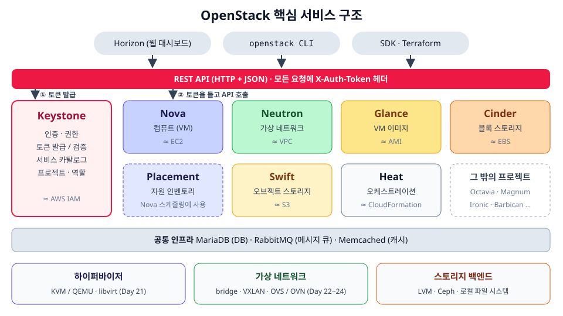
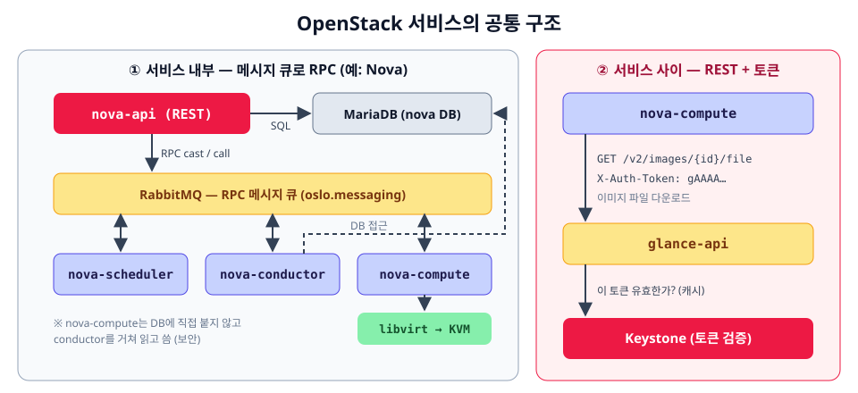

> **Chapter 4 · OpenStack** | 난이도 ★★★☆☆ | 예상 소요 1 ~ 1.5시간

## 🎯 오늘의 목표

- 클라우드의 서비스 모델(IaaS / PaaS / SaaS)과 **프라이빗 클라우드**가 왜 필요한지 설명할 수 있다
- OpenStack의 핵심 서비스(Keystone, Glance, Nova, Neutron, Cinder, Swift, Placement, Horizon, Heat)가 **각각 무슨 일을 하는지** 안다
- OpenStack 서비스의 공통 구조 — **REST API + 메시지 큐(RabbitMQ) + DB** — 를 그림으로 설명할 수 있다
- Chapter 3에서 배운 KVM / libvirt / bridge / VXLAN / OVS가 OpenStack의 **어디에** 쓰이는지 연결할 수 있다
- 내일(Day 26) DevStack 설치를 위한 **VM 사양과 중첩 가상화**를 미리 준비한다

---

## 1. 왜 OpenStack인가?

Chapter 3에서 우리는 이런 일을 손으로 했습니다.

- Day 21: `virt-install`, `virsh`로 **VM을 하나씩** 만들고 지웠다
- Day 22~23: bridge, veth, VXLAN으로 **네트워크를 직접** 이어 붙였다
- Day 24: OVS 브리지와 포트를 **명령어로** 구성했다

서버가 3대일 때는 괜찮지만, **서버 100대 · VM 수천 개 · 사용자(팀) 수십 개**가 되면 이야기가 달라집니다.

> "개발팀 A가 VM 5개를 원해요. 4 vCPU, 8GB, Ubuntu 24.04, 사설망 하나, 공인 IP 하나요."

이 요청을 처리하려면 누군가 **빈 자원이 있는 서버를 고르고, 이미지를 복사하고, 디스크를 만들고, 네트워크를 연결하고, IP를 할당하고, 권한을 관리**해야 합니다. 이걸 사람이 매번 하는 대신, **API 한 번 호출로 셀프 서비스**가 되게 만드는 것이 클라우드이고, 그 클라우드를 **내 데이터센터에 직접 구축**하게 해주는 오픈소스가 OpenStack입니다.

### 클라우드 서비스 모델

| 모델 | 사용자가 받는 것 | 사용자가 관리하는 것 | 예 |
|---|---|---|---|
| **IaaS** | VM, 네트워크, 디스크 | OS부터 그 위 전부 | AWS EC2, **OpenStack** |
| PaaS | 앱 실행 환경 | 코드와 데이터 | Heroku, Cloud Run |
| SaaS | 완성된 서비스 | 데이터(사용법) | Gmail, Slack |

OpenStack은 **IaaS를 만드는 소프트웨어**입니다. AWS가 자기 데이터센터로 EC2를 제공하듯, 기업은 OpenStack으로 **사내용 EC2/VPC/EBS**를 만들 수 있습니다.

### 퍼블릭 vs 프라이빗 클라우드

| 구분 | 퍼블릭 클라우드 (AWS, GCP, Azure) | 프라이빗 클라우드 (OpenStack) |
|---|---|---|
| 하드웨어 | 클라우드 업체 소유 | **내 소유** (자체 데이터센터) |
| 비용 구조 | 쓴 만큼 (OPEX) | 초기 투자 크고 규모가 커질수록 유리 (CAPEX) |
| 데이터 위치 | 업체 리전 | 사내 — 규제·보안 요건 충족이 쉬움 |
| 커스터마이징 | 업체가 제공하는 범위 | 소스까지 수정 가능 |
| 운영 부담 | 낮음 | **높음** — 직접 운영해야 함 |

> 💡 통신사(5G 코어망 NFV), 금융권, 공공기관, 연구소, 대형 IT 기업이 OpenStack을 많이 씁니다. 국내에서도 통신사와 대형 포털, 공공 클라우드 등에서 운영되고 있습니다.

### 짧은 역사

- **2010년** NASA(컴퓨트, Nova의 전신)와 Rackspace(오브젝트 스토리지, Swift의 전신)가 코드를 합쳐 시작
- **6개월마다 릴리스** — 예전엔 알파벳 순 이름(Austin, Bexar, … Zed)
- **2023년부터** `연도.회차` 형식 + 코드명: 2023.1 Antelope → … → **2025.1 Epoxy**, 2025.2 Flamingo …
- `.1` 릴리스는 **SLURP**(Skip Level Upgrade Release Process) — 1년 단위로 건너뛰어 업그레이드 가능

> 이 시리즈는 **2025.1 Epoxy 이후** 릴리스를 기준으로 합니다. 명령어는 릴리스가 바뀌어도 거의 그대로 동작합니다.

---

## 2. OpenStack 전체 그림



OpenStack은 하나의 프로그램이 아니라 **여러 독립 프로젝트(서비스)의 묶음**입니다. 각 서비스는 자기 API와 DB를 가지고, 서로 **REST API로 대화**합니다.

### 핵심 서비스 한눈에 보기

| 서비스 | 역할 | AWS로 치면 | 이 시리즈 |
|---|---|---|---|
| **Keystone** | 인증(Identity), 프로젝트·사용자·역할, 서비스 카탈로그 | IAM | Day 27 |
| **Glance** | VM 이미지 저장·조회 | AMI | Day 28 |
| **Nova** | VM(인스턴스) 생성·관리 — 실제로는 libvirt에 명령 | EC2 | Day 29 |
| **Placement** | 각 서버의 자원 인벤토리(CPU/RAM/디스크) 관리 | (내부 기능) | Day 29 |
| **Neutron** | 가상 네트워크, 서브넷, 라우터, Floating IP, 보안 그룹 | VPC | Day 30 |
| **Cinder** | 블록 스토리지(볼륨) — VM에 붙이는 디스크 | EBS | Day 31 |
| **Swift** | 오브젝트 스토리지 | S3 | Day 31 |
| **Heat** | 템플릿으로 여러 리소스를 한 번에 생성 | CloudFormation | Day 32 |
| **Horizon** | 웹 대시보드 | AWS 콘솔 | Day 26 |

그 외에도 Octavia(로드밸런서 ≈ ELB), Magnum(K8s 클러스터 ≈ EKS), Ironic(베어메탈), Barbican(키 관리 ≈ KMS), Designate(DNS ≈ Route 53), Manila(공유 파일 시스템 ≈ EFS) 등 수십 개의 프로젝트가 있습니다. **처음에는 위 표의 핵심 서비스만** 알면 충분합니다.

### 최소 구성은?

VM 하나를 띄우는 데 꼭 필요한 서비스는 다섯 개입니다.

```
Keystone(누구냐?) → Glance(어떤 OS?) → Nova + Placement(어디에, 얼마나?) → Neutron(어떤 네트워크?)
```

Cinder·Swift·Heat·Horizon은 있으면 편하지만 VM 생성 자체에는 필수가 아닙니다.

### Chapter 3과의 연결

| Chapter 3에서 배운 것 | OpenStack에서 쓰이는 곳 |
|---|---|
| Day 21 KVM / QEMU / libvirt | **Nova** (nova-compute)가 libvirt API로 VM을 정의·시작 |
| Day 22 bridge, veth, netns | **Neutron**의 라우터·DHCP가 network namespace 안에서 동작 |
| Day 23 VLAN / VXLAN | **Neutron**의 프로젝트(테넌트) 네트워크 분리 방식 |
| Day 24 Open vSwitch | **Neutron**의 가상 스위치 (ML2/OVS 또는 OVN) |

> 💡 결국 OpenStack은 **"Chapter 3에서 손으로 하던 일을 API 뒤에서 자동으로 해주는 컨트롤러들의 모음"**입니다. Kubernetes가 컨테이너 런타임 위의 컨트롤러 모음이었던 것과 같은 발상이죠.

---

## 3. 모든 서비스의 공통 구조



OpenStack 서비스는 거의 다 같은 모양으로 만들어져 있습니다. 하나를 이해하면 나머지도 쉽게 읽힙니다.

| 구성 요소 | 역할 | 사용하는 기술 |
|---|---|---|
| **API 서버** (`nova-api`, `glance-api`, …) | 외부 요청(REST/JSON)을 받는 입구. 토큰 검증 후 처리 | Python WSGI (uWSGI / Apache mod_wsgi) |
| **메시지 큐** | **서비스 내부** 컴포넌트끼리 RPC 통신 | RabbitMQ (oslo.messaging) |
| **DB** | 서비스 상태 저장 — 서비스마다 별도 스키마 | MariaDB / MySQL (oslo.db) |
| **워커 / 에이전트** | 실제 일을 하는 프로세스 (`nova-scheduler`, `nova-compute` …) | Python 데몬 |
| **캐시** | 토큰 검증 결과 등 캐싱 | Memcached |

### 두 가지 통신 규칙

1. **서비스 내부**는 메시지 큐(RabbitMQ)로 — 예: `nova-api` → `nova-conductor` → `nova-compute`
2. **서비스 사이**는 REST API + Keystone 토큰으로 — 예: `nova-compute` → `glance-api`(이미지 다운로드), `nova-compute` → `neutron-server`(포트 생성)

> 💡 그래서 **Nova는 Neutron의 DB를 직접 보지 않습니다.** 반드시 Neutron API를 호출합니다. 서비스가 서로 느슨하게 연결되어 있어서 하나씩 교체·확장할 수 있습니다.

### 컨트롤 플레인 vs 데이터 플레인

| 구분 | 무엇이 있나 | 일반적인 노드 |
|---|---|---|
| **컨트롤 플레인** | API 서버, 스케줄러, DB, RabbitMQ, Keystone, Horizon | **컨트롤러 노드** (보통 3대로 HA) |
| **데이터 플레인** | 실제 VM이 도는 하이퍼바이저, VM 트래픽 | **컴퓨트 노드** (수십~수천 대) |
| 네트워크 | L3 라우터, DHCP, 외부망 연결 | 네트워크 노드 (또는 컨트롤러/컴퓨트에 분산) |
| 스토리지 | Cinder 볼륨, Swift, Ceph | 스토리지 노드 |

K8s에 비유하면 컨트롤러 노드 ≈ **컨트롤 플레인**(kube-apiserver, scheduler, etcd), 컴퓨트 노드 ≈ **워커 노드**(kubelet + 컨테이너 런타임)입니다.

| Kubernetes | OpenStack |
|---|---|
| kube-apiserver | 각 서비스의 API 서버 (`nova-api` 등) |
| etcd | MariaDB (+ RabbitMQ로 이벤트 전달) |
| kube-scheduler | `nova-scheduler` + Placement |
| kubelet | `nova-compute` |
| containerd / runc | libvirt / QEMU-KVM |
| Namespace + RBAC | Project + Role (Keystone) |
| CNI 플러그인 | Neutron (ML2 드라이버) |
| CSI 드라이버 | Cinder 드라이버 |

> 이번 Chapter의 학습용 환경(DevStack)은 이 모든 걸 **VM 한 대에 몰아넣은 올인원**이고, Day 33의 Kolla-Ansible에서 **컨트롤러 / 컴퓨트를 나눈 멀티노드**로 확장합니다.

---

## 4. 요청 하나가 흘러가는 길 (미리 보기)

`openstack server create ...` 한 줄을 치면 내부적으로 이런 일이 벌어집니다.

1. CLI가 **Keystone**에 아이디/비밀번호를 주고 **토큰**과 **서비스 카탈로그**(각 서비스 API 주소 목록)를 받는다
2. 카탈로그에서 Nova 주소를 찾아 **nova-api**에 "서버 만들어줘" 요청 (헤더에 토큰)
3. nova-api는 토큰을 검증하고 즉시 `202 Accepted` 응답 → 상태는 `BUILD`
4. **nova-scheduler**가 **Placement**에 "vCPU 1, RAM 512MB 남은 서버?"를 물어보고 호스트를 고른다
5. 선택된 호스트의 **nova-compute**가 Glance에서 이미지를, Neutron에서 포트를 받아와
6. **libvirt**에 VM XML을 정의하고 시작한다 → 상태 `ACTIVE`

이 흐름은 Day 27(토큰), Day 28(이미지), Day 29(스케줄링·libvirt), Day 30(포트)에서 하나씩 뜯어봅니다.

---

## 5. 실습 — Day 26 설치 준비

오늘은 OpenStack을 설치하지 않고, 내일 DevStack을 올릴 **Ubuntu 24.04 VM**을 준비합니다.

### 5-1. VM 사양 (Day 26~29 공통)

| 항목 | 최소 | 권장 |
|---|---|---|
| OS | Ubuntu Server **24.04 LTS** (새로 설치한 깨끗한 VM) | 동일 |
| vCPU | 4 | 8 |
| RAM | 8 GB | **16 GB** |
| 디스크 | 60 GB | 100 GB |
| 네트워크 | NAT + 호스트 전용(또는 브리지) 1개 | 고정 IP (예: `192.168.56.10`) |
| 중첩 가상화 | 없으면 QEMU 에뮬레이션(느림) | **켜기** (VM 안에서 KVM 사용) |

> ⚠️ DevStack은 시스템 전체를 바꿔 놓는 **개발·학습용 설치 도구**입니다. 내 노트북 OS나 다른 용도로 쓰는 서버에 직접 설치하지 말고, **반드시 전용 VM**에 설치하세요.

### 5-2. 중첩 가상화(Nested Virtualization) 켜기

DevStack VM 안에서 다시 VM(인스턴스)을 띄우므로 **VM 안의 VM** 구조가 됩니다. 하이퍼바이저별로 켜는 방법:

```powershell
# Hyper-V (Windows, 관리자 PowerShell, VM 이름이 devstack 이고 꺼진 상태에서)
Set-VMProcessor -VMName devstack -ExposeVirtualizationExtensions $true
```

```bash
# VirtualBox (VM이 꺼진 상태에서)
VBoxManage modifyvm devstack --nested-hw-virt on

# 물리 리눅스 + KVM 호스트에서 중첩 가상화 활성화 여부 확인 (Y 또는 1 이면 켜짐)
cat /sys/module/kvm_intel/parameters/nested     # AMD는 kvm_amd
```

VMware Workstation은 VM 설정 → Processors → **Virtualize Intel VT-x/EPT or AMD-V/RVI** 체크.

### 5-3. VM 안에서 확인

Ubuntu 24.04 VM에 접속해 KVM을 쓸 수 있는지 확인합니다. (Day 21에서 했던 것과 같습니다.)

```bash
grep -Ec '(vmx|svm)' /proc/cpuinfo   # 0보다 크면 CPU 가상화 확장이 보임
sudo apt-get update && sudo apt-get install -y cpu-checker
kvm-ok
```

```
INFO: /dev/kvm exists
KVM acceleration can be used
```

> 💡 `KVM acceleration can NOT be used` 가 나와도 DevStack은 설치됩니다. 대신 Day 26의 `local.conf`에 `LIBVIRT_TYPE=qemu` 를 넣어 소프트웨어 에뮬레이션으로 VM을 띄웁니다(느리지만 cirros 같은 작은 이미지는 충분).

### 5-4. 고정 IP와 기본 정보 확인

```bash
ip -br addr          # DevStack에 쓸 인터페이스와 IP 확인
hostname -I
lsb_release -a       # Ubuntu 24.04 (noble) 인지 확인
free -h && nproc && df -h /
```

내일 `local.conf`의 `HOST_IP`에 넣을 IP(호스트 PC에서 접속 가능한 IP)를 메모해 두세요. DHCP로 IP가 바뀌면 설치 후 OpenStack 엔드포인트가 전부 깨지므로 **고정 IP**를 권장합니다.

### 5-5. openstack CLI 미리 맛보기 (선택)

CLI 구조만 먼저 구경하고 싶다면 아무 리눅스(또는 WSL)에서 가상환경에 클라이언트만 설치해볼 수 있습니다.

```bash
sudo apt-get install -y python3-venv
python3 -m venv ~/osc && source ~/osc/bin/activate
pip install python-openstackclient
openstack --version
openstack command list --group compute | head -20
```

명령은 모두 `openstack <리소스> <동작>` 형식입니다.

| 명령 | 서비스 |
|---|---|
| `openstack token issue` | Keystone |
| `openstack image list` | Glance |
| `openstack server create` | Nova |
| `openstack network list` | Neutron |
| `openstack volume create` | Cinder |
| `openstack stack create` | Heat |

> `kubectl get pods` 처럼 리소스 이름이 앞에 오는 대신, `openstack server list` 처럼 **리소스 → 동작** 순서라는 점이 다릅니다. 아직 접속할 클라우드가 없으니 실제 호출은 Day 26부터 합니다.

---

## 6. 트러블슈팅

| 증상 | 원인 | 해결 |
|---|---|---|
| `kvm-ok`: `Your CPU does not support KVM extensions` | 하이퍼바이저에서 중첩 가상화가 꺼져 있음 | 5-2의 방법으로 켜고 VM을 **완전히 종료 후** 재시작. 불가하면 `LIBVIRT_TYPE=qemu` 사용 |
| Windows에서 VirtualBox 중첩 가상화 옵션이 회색 | Hyper-V(또는 WSL2·VBS)가 켜져 있어 VirtualBox가 VT-x를 직접 못 씀 | Hyper-V로 VM을 만들거나, Hyper-V 기능을 끄고 VirtualBox 사용 |
| VM 재부팅 후 IP가 바뀜 | DHCP 할당 | netplan으로 고정 IP 설정 (`/etc/netplan/*.yaml`) |
| 메모리 8GB 미만에서 이후 설치 실패/매우 느림 | OpenStack 서비스 + MariaDB + RabbitMQ만으로 수 GB 사용 | 최소 8GB, 가능하면 16GB 할당 |

---

## 7. 핵심 정리

- OpenStack = **내 데이터센터에 IaaS(사내 EC2/VPC/EBS)를 만드는 오픈소스** 서비스 묶음
- 핵심 서비스: **Keystone**(인증) · **Glance**(이미지) · **Nova + Placement**(컴퓨트) · **Neutron**(네트워크) · **Cinder / Swift**(스토리지) · **Heat**(템플릿) · **Horizon**(대시보드)
- 서비스 공통 구조: **API 서버 + RabbitMQ(내부 RPC) + MariaDB(상태) + 워커**
- 서비스 **내부**는 메시지 큐로, 서비스 **사이**는 REST API + Keystone 토큰으로 통신
- Nova는 결국 **libvirt/KVM**(Day 21)을, Neutron은 **namespace·VXLAN·OVS**(Day 22~24)를 자동으로 다루는 컨트롤러
- 학습은 **Ubuntu 24.04 VM 한 대(4 vCPU / 8~16GB / 60GB+, 중첩 가상화)** 에 DevStack 올인원으로

---

## 8. 셀프 체크

<details>
<summary>Q1. OpenStack은 IaaS / PaaS / SaaS 중 무엇을 만드는 소프트웨어인가?</summary>

**IaaS**입니다. VM(Nova), 네트워크(Neutron), 디스크(Cinder) 같은 인프라 자원을 API로 셀프 서비스하게 해줍니다. 그 위에 Magnum(K8s) 같은 프로젝트로 PaaS에 가까운 기능을 더할 수는 있습니다.
</details>

<details>
<summary>Q2. VM 하나를 띄우는 데 반드시 필요한 OpenStack 서비스는?</summary>

**Keystone**(인증), **Glance**(이미지), **Nova**(컴퓨트), **Placement**(자원 인벤토리), **Neutron**(네트워크). Cinder/Swift/Heat/Horizon은 VM 생성 자체에는 필수가 아닙니다.
</details>

<details>
<summary>Q3. nova-compute가 VM 이미지를 받아올 때 Glance DB를 직접 읽지 않고 Glance API를 호출하는 이유는?</summary>

OpenStack 서비스는 **서비스 사이에는 REST API + 토큰**으로만 통신하도록 설계되어 있습니다. 덕분에 서비스별로 독립적으로 배포·업그레이드·확장할 수 있고, 권한 검사도 일관되게 적용됩니다. DB 직접 접근은 그 서비스 내부 컴포넌트만 합니다.
</details>

<details>
<summary>Q4. 서비스 내부 컴포넌트(예: nova-api ↔ nova-compute)끼리는 무엇으로 통신하는가?</summary>

**메시지 큐(RabbitMQ)** 를 통한 RPC(oslo.messaging)입니다. 요청을 큐에 넣고(cast) 응답을 기다리지 않거나(call) 기다리는 방식으로 비동기 처리를 합니다.
</details>

<details>
<summary>Q5. Kubernetes의 kube-scheduler와 kubelet에 대응하는 Nova 컴포넌트는?</summary>

kube-scheduler ≈ **nova-scheduler**(+ Placement), kubelet ≈ **nova-compute**. kubelet이 containerd에 컨테이너를 요청하듯 nova-compute는 libvirt에 VM을 요청합니다.
</details>

---

## ⏭️ 다음 예고 — Day 26. DevStack으로 올인원 설치

오늘 준비한 Ubuntu 24.04 VM에 **DevStack**으로 OpenStack 전체를 한 번에 설치합니다. `stack` 사용자 만들기, `local.conf` 작성, `./stack.sh` 실행, Horizon 대시보드 접속, 그리고 `source openrc admin admin` 후 `openstack` CLI로 첫 명령을 날려봅니다.
