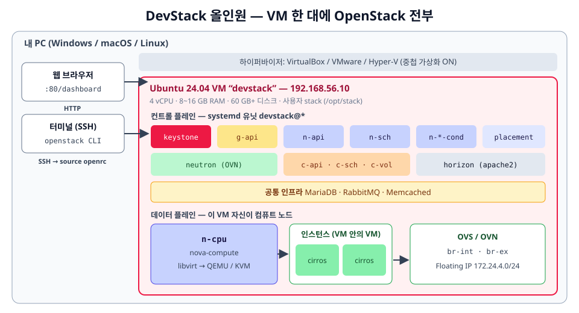
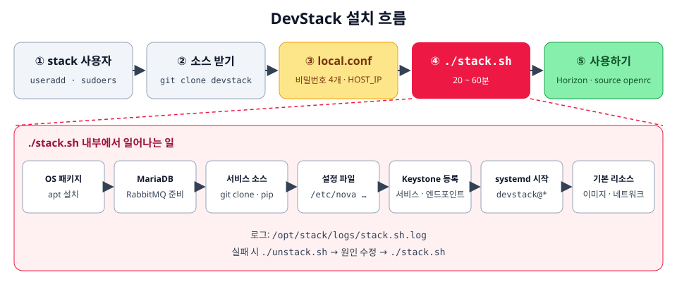

> **Chapter 4 · OpenStack** | 난이도 ★★★☆☆ | 예상 소요 2 ~ 3시간 (설치 대기 30~60분 포함)

## 🎯 오늘의 목표

- DevStack이 무엇이고, **운영용 설치 도구와 무엇이 다른지** 안다
- Ubuntu 24.04 VM에 `stack` 사용자를 만들고 **`local.conf` → `./stack.sh`** 로 OpenStack을 설치한다
- **Horizon** 대시보드에 접속하고, `source openrc admin admin` 후 **`openstack` CLI**로 서비스 상태를 확인한다
- DevStack 서비스가 `devstack@*` **systemd 유닛**으로 돈다는 것을 알고, 로그를 보고 재시작할 수 있다

---

## 1. DevStack이란?

OpenStack은 서비스가 10개 가까이 되고, 각각 DB 스키마 생성 · 설정 파일 · Keystone 등록 · 데몬 실행이 필요합니다. 이걸 손으로 하면 하루가 꼬박 걸립니다. **DevStack**은 이 과정을 셸 스크립트 하나(`stack.sh`)로 자동화한 도구입니다.

| 설치 방법 | 용도 | 특징 |
|---|---|---|
| **DevStack** | 개발 · 학습 · CI 테스트 | 소스(git)에서 바로 설치, 올인원, **재부팅·업그레이드 고려 안 함** |
| 수동 설치 (공식 Install Guide) | 원리 학습 | 서비스마다 패키지 설치·설정을 직접 |
| **Kolla-Ansible** | 운영 | 서비스를 **컨테이너**로 배포, 멀티노드·HA (Day 33) |
| OpenStack-Ansible, Charmed OpenStack 등 | 운영 | 배포 방식만 다를 뿐 결과물은 같은 OpenStack |

> ⚠️ DevStack은 OS 패키지·Python 환경·네트워크 설정을 **대량으로 바꿉니다.** 반드시 **Day 25에서 준비한 전용 VM**에서 진행하세요. 그리고 **운영 환경에는 절대 쓰지 않습니다.**



DevStack을 설치하면 **VM 한 대 안에** 다음이 모두 들어갑니다.

- 컨트롤 플레인: Keystone, Glance, Nova(api/scheduler/conductor), Placement, Neutron(OVN), Cinder, Horizon
- 공통 인프라: MariaDB(MySQL), RabbitMQ, Memcached, Apache(Horizon과 API 프록시)
- 데이터 플레인: nova-compute + **libvirt/QEMU-KVM**, OVS/OVN — 여기서 **VM 안의 VM**(인스턴스)이 뜹니다

---

## 2. 실습 환경

| 항목 | 값 |
|---|---|
| 호스트 | Windows/macOS/Linux PC + VirtualBox / VMware / Hyper-V |
| VM OS | **Ubuntu Server 24.04 LTS** (새로 설치한 깨끗한 상태) |
| VM 사양 | 4 vCPU / **8 GB RAM (권장 16 GB)** / 60 GB+ 디스크, **중첩 가상화 ON** |
| VM IP | 이 문서에서는 `192.168.56.10` (본인 VM IP로 바꿔서 사용) |
| OpenStack | DevStack `master` 브랜치(최신 개발 버전) 또는 `stable/<릴리스>` 브랜치 |

> 💡 설치가 끝나면 **하이퍼바이저에서 VM 스냅샷**을 꼭 찍어두세요. DevStack 환경이 망가졌을 때 30분 재설치 대신 1분 만에 되돌릴 수 있습니다.



---

## 3. 설치

### 3-1. OS 업데이트

```bash
sudo apt-get update
sudo apt-get -y upgrade
sudo apt-get install -y git
sudo reboot          # 커널이 업데이트됐다면 재부팅
```

### 3-2. stack 사용자 만들기

DevStack은 **root로 실행하면 거부**합니다. 전용 사용자 `stack`을 만들고, 비밀번호 없이 sudo를 쓸 수 있게 합니다. 홈 디렉터리 `/opt/stack`이 모든 OpenStack 소스와 데이터가 놓이는 곳입니다.

```bash
sudo useradd -s /bin/bash -d /opt/stack -m stack
sudo chmod +x /opt/stack
echo "stack ALL=(ALL) NOPASSWD: ALL" | sudo tee /etc/sudoers.d/stack
sudo -u stack -i          # stack 사용자로 전환 (이후 명령은 전부 stack 사용자로)
```

```bash
whoami     # stack
pwd        # /opt/stack
```

### 3-3. DevStack 소스 받기

```bash
git clone https://opendev.org/openstack/devstack
cd devstack
```

특정 릴리스로 고정하고 싶다면 stable 브랜치를 받습니다. 어떤 브랜치가 있는지 먼저 확인하세요.

```bash
git branch -r | grep stable        # 예: origin/stable/2025.1, origin/stable/2025.2 ...
git checkout stable/2025.2         # 원하는 릴리스로 (선택)
```

> 💡 DevStack 브랜치를 바꾸면 Nova·Glance 등 **모든 서비스가 같은 릴리스 브랜치**로 받아집니다. 학습용으로는 기본(master)도 괜찮지만, 개발 중인 코드라 가끔 설치가 깨질 수 있습니다. 그럴 땐 stable 브랜치를 쓰세요.

### 3-4. local.conf 작성

`devstack` 디렉터리에 `local.conf`를 만듭니다. **최소 필수 항목은 비밀번호 4개**이고, 나머지는 기본값이 있습니다.

```bash
cat > local.conf <<'EOF'
[[local|localrc]]
# --- 비밀번호 (학습용) ---
ADMIN_PASSWORD=secret
DATABASE_PASSWORD=$ADMIN_PASSWORD
RABBIT_PASSWORD=$ADMIN_PASSWORD
SERVICE_PASSWORD=$ADMIN_PASSWORD

# --- 이 VM의 IP (Horizon/API 주소가 됨) ---
HOST_IP=192.168.56.10

# --- 중첩 가상화가 안 되는 환경이면 주석 해제 (QEMU 소프트웨어 에뮬레이션) ---
#LIBVIRT_TYPE=qemu

# --- 로그 ---
LOGFILE=$DEST/logs/stack.sh.log
LOGDAYS=2

[[post-config|$NOVA_CONF]]
[DEFAULT]
# 노드 1대에서도 인스턴스 resize 실습이 가능하도록 (Day 29)
allow_resize_to_same_host = True
EOF
```

| 항목 | 의미 |
|---|---|
| `[[local\|localrc]]` | DevStack 변수 섹션. 셸 변수 형식(`KEY=VALUE`) |
| `ADMIN_PASSWORD` | Keystone `admin`, `demo` 사용자의 비밀번호 (Horizon 로그인에도 사용) |
| `DATABASE_PASSWORD` / `RABBIT_PASSWORD` | MariaDB root, RabbitMQ 계정 비밀번호 |
| `SERVICE_PASSWORD` | 서비스 계정(nova, glance …)이 Keystone에 인증할 때 쓰는 비밀번호 |
| `HOST_IP` | 서비스 엔드포인트가 이 IP로 등록됨. **NIC가 여러 개면 꼭 지정** |
| `LIBVIRT_TYPE` | `kvm`(기본) 또는 `qemu`. `/dev/kvm`이 없으면 `qemu` |
| `$DEST` | 설치 위치. 기본값 `/opt/stack` |
| `[[post-config\|$NOVA_CONF]]` | 설치 후 `/etc/nova/nova.conf`에 덧붙일 INI 설정 |

> 💡 DevStack은 기본으로 Keystone · Glance · Nova · Placement · Neutron(OVN) · Cinder · Horizon을 켭니다. Swift, Heat 같은 서비스는 `enable_service` 또는 `enable_plugin` 줄을 추가해야 하며, 필요한 Day에서 다룹니다.

### 3-5. 설치 실행

```bash
./stack.sh
```

네트워크 속도에 따라 **20~60분** 걸립니다. 패키지 설치 → MariaDB/RabbitMQ 설정 → 각 서비스 git clone & pip 설치 → 설정 파일 생성 → Keystone에 서비스·엔드포인트 등록 → systemd 유닛 시작 → 기본 이미지(cirros)·flavor·네트워크 생성 순서로 진행됩니다.

성공하면 마지막에 다음과 비슷한 메시지가 나옵니다.

```
This is your host IP address: 192.168.56.10
This is your host IPv6 address: ::1
Horizon is now available at http://192.168.56.10/dashboard
Keystone is serving at http://192.168.56.10/identity/
The default users are: admin and demo
The password: secret

Services are running under systemd unit files.
For more information see:
https://docs.openstack.org/devstack/latest/systemd.html

...
stack.sh completed in 1834 seconds.
```

> ⚠️ 중간에 실패하면 화면 마지막 에러와 `/opt/stack/logs/stack.sh.log`를 확인합니다. 원인을 고친 뒤에는 **`./unstack.sh` → `./stack.sh`** 순서로 다시 실행합니다. (6장 트러블슈팅 참고)

---

## 4. Horizon 대시보드 접속

호스트 PC 브라우저에서 접속합니다.

```
http://192.168.56.10/dashboard
```

| 입력 | 값 |
|---|---|
| User Name | `admin` |
| Password | `secret` (local.conf의 `ADMIN_PASSWORD`) |

둘러볼 곳:

| 메뉴 | 내용 |
|---|---|
| **Project → Compute → Overview** | 현재 프로젝트의 쿼터 사용량 |
| **Project → Compute → Images** | DevStack이 올려둔 `cirros` 이미지 |
| **Project → Network → Network Topology** | `public`(외부) / `private`(내부) 네트워크와 라우터 |
| **Admin → Compute → Hypervisors** | 이 VM이 컴퓨트 노드(하이퍼바이저) 1대로 보임 |
| **Identity → Projects / Users** | `admin`, `demo`, `alt_demo` 프로젝트와 사용자 |

> 💡 오른쪽 위 프로젝트 선택 메뉴에서 `admin` ↔ `demo`를 바꿔보세요. **프로젝트마다 보이는 리소스가 다릅니다.** 이것이 Day 27에서 배울 Keystone의 멀티테넌시입니다.

---

## 5. openstack CLI 사용하기

### 5-1. openrc로 인증 정보 불러오기

DevStack 디렉터리의 `openrc`는 **사용자 이름과 프로젝트 이름**을 인자로 받아 `OS_*` 환경 변수를 설정합니다.

```bash
cd ~/devstack
source openrc admin admin          # 사용법: source openrc <사용자> <프로젝트>
env | grep ^OS_ | sort
```

```
OS_AUTH_TYPE=password
OS_AUTH_URL=http://192.168.56.10/identity
OS_PASSWORD=secret
OS_PROJECT_DOMAIN_ID=default
OS_PROJECT_NAME=admin
OS_REGION_NAME=RegionOne
OS_USERNAME=admin
OS_USER_DOMAIN_ID=default
...
```

`openstack` CLI는 이 환경 변수를 읽어 Keystone에 로그인합니다. 일반 사용자로 바꾸려면 `source openrc demo demo`.

### 5-2. 첫 명령들

```bash
openstack token issue                       # 토큰이 발급되면 인증 성공
openstack service list                      # 등록된 서비스
openstack catalog list                      # 서비스별 엔드포인트 (서비스 카탈로그)
```

```
+----------------------------------+-------------+----------------+
| ID                               | Name        | Type           |
+----------------------------------+-------------+----------------+
| 0b1f...                          | keystone    | identity       |
| 2c7e...                          | glance      | image          |
| 4d9a...                          | nova        | compute        |
| 7f3c...                          | placement   | placement      |
| 9a21...                          | neutron     | network        |
| ...                              | ...         | ...            |
+----------------------------------+-------------+----------------+
```

서비스별 상태 확인:

```bash
openstack compute service list -c Binary -c Host -c State     # nova 컴포넌트
openstack network agent list -c "Agent Type" -c Host -c Alive  # neutron(OVN) 에이전트
openstack hypervisor list                                       # 컴퓨트 노드
```

```
+----------------+----------+-------+
| Binary         | Host     | State |
+----------------+----------+-------+
| nova-scheduler | devstack | up    |
| nova-conductor | devstack | up    |
| nova-conductor | devstack | up    |
| nova-compute   | devstack | up    |
+----------------+----------+-------+
```

> 💡 `nova-conductor`가 두 줄인 이유: DevStack은 Cells v2 구조로 **super conductor**와 **cell1 conductor**를 따로 띄웁니다. Day 29에서 설명합니다.

DevStack이 미리 만들어 둔 리소스:

```bash
openstack project list
openstack user list
openstack image list
openstack flavor list -c Name -c RAM -c Disk -c VCPUs
openstack network list
openstack router list
```

```
+--------------------------------------+--------------------------+--------+
| ID                                   | Name                     | Status |
+--------------------------------------+--------------------------+--------+
| 5e1c...                              | cirros-0.6.3-x86_64-disk | active |
+--------------------------------------+--------------------------+--------+
```

> cirros 버전은 DevStack 시점에 따라 다를 수 있습니다. 이후 실습에서는 `openstack image list`로 본 **실제 이름**을 쓰세요.

### 5-3. 출력 형식 바꾸기

```bash
openstack image list -f json                 # JSON
openstack image list -f value -c Name        # 값만 (스크립트용)
openstack server list --long                 # 더 많은 컬럼
openstack help server create                 # 명령 도움말
```

### 5-4. clouds.yaml로 인증하기 (openrc 대신)

DevStack은 `/etc/openstack/clouds.yaml`도 만들어 줍니다. 환경 변수 대신 **클라우드 이름 하나**로 전환할 수 있어 편합니다.

```bash
cat /etc/openstack/clouds.yaml       # devstack, devstack-admin 등의 항목이 있음
```

```bash
# openrc 변수가 섞이지 않도록 새 셸에서
export OS_CLOUD=devstack-admin       # admin 사용자 / admin 프로젝트
openstack server list --all-projects

openstack --os-cloud devstack server list    # demo 사용자 / demo 프로젝트
```

> ⚠️ `source openrc`로 설정한 `OS_*` 변수와 `OS_CLOUD`를 섞으면 어느 쪽이 적용되는지 헷갈립니다. 한 셸에서는 **한 가지 방식만** 쓰세요.

---

## 6. DevStack 운영 기초 — systemd

DevStack의 모든 서비스는 `devstack@<약어>.service` 형태의 systemd 유닛으로 실행됩니다.

```bash
sudo systemctl list-units 'devstack@*'
```

| 유닛 | 서비스 |
|---|---|
| `devstack@keystone` | Keystone API |
| `devstack@g-api` | Glance API |
| `devstack@n-api` | Nova API |
| `devstack@n-sch` | nova-scheduler |
| `devstack@n-super-cond` / `devstack@n-cond-cell1` | nova-conductor (super / cell1) |
| `devstack@n-cpu` | nova-compute |
| `devstack@placement-api` | Placement API |
| `devstack@q-svc` 또는 `devstack@neutron-api` | neutron-server (DevStack 버전에 따라 이름이 다름 — `list-units`로 확인) |
| `devstack@c-api` / `c-sch` / `c-vol` | Cinder |

```bash
sudo systemctl status devstack@n-cpu                 # 상태
sudo journalctl -u devstack@n-cpu -f                 # 실시간 로그 (Ctrl+C로 종료)
sudo journalctl -u devstack@g-api --since "10 min ago"
sudo systemctl restart devstack@n-api                # 설정 변경 후 재시작
```

설정 파일은 일반 OpenStack과 같은 위치입니다.

```bash
ls /etc/nova/ /etc/glance/ /etc/keystone/ /etc/neutron/
sudo grep -n allow_resize_to_same_host /etc/nova/nova.conf   # post-config가 반영됐는지
```

### 설치 중지 · 제거 · 재설치

```bash
./unstack.sh       # 모든 서비스 중지 (데이터는 남음)
./clean.sh         # unstack + DB, 데이터, 설정까지 제거
./stack.sh         # 다시 설치
```

> ⚠️ DevStack은 **VM 재부팅을 공식적으로 고려하지 않습니다.** 재부팅 후 대부분의 서비스는 systemd가 다시 올리지만, 외부 브리지(`br-ex`) IP 같은 일부 설정이 사라질 수 있습니다. 실습 중에는 VM을 **일시 정지(suspend)** 하거나, 문제가 생기면 스냅샷으로 되돌리세요.

---

## 7. 트러블슈팅

| 증상 | 원인 | 해결 |
|---|---|---|
| `You are running this script as root.` | root로 `stack.sh` 실행 | `sudo -u stack -i` 로 전환 후 실행 |
| `stack.sh` 도중 git clone / pip 타임아웃 | 네트워크 불안정, 프록시 | 네트워크 확인 후 `./unstack.sh` → `./stack.sh` 재실행 |
| `Could not determine host ip address` 또는 엔드포인트가 엉뚱한 IP | NIC가 여러 개라 IP 자동 선택 실패 | `local.conf`에 `HOST_IP` 명시 |
| 인스턴스가 `ERROR`, 로그에 `/dev/kvm` 관련 오류 | 중첩 가상화 미지원 | `LIBVIRT_TYPE=qemu` 설정 후 재설치 |
| 설치 중 OOM, 서비스가 랜덤하게 죽음 | RAM 부족 | VM RAM 8GB 이상(권장 16GB), swap 추가 |
| `openstack: command not found` | stack 사용자 셸이 아니거나 PATH 문제 | `sudo -u stack -i` 로 접속. DevStack이 만든 가상환경을 쓰려면 `source /opt/stack/data/venv/bin/activate` |
| `Missing value auth-url required for auth plugin password` | 인증 정보가 없음 | `cd ~/devstack && source openrc admin admin` 또는 `export OS_CLOUD=devstack-admin` |
| Horizon 접속 불가 | Apache 중지, 방화벽, 잘못된 IP | `sudo systemctl status apache2`, 호스트 PC에서 `HOST_IP`로 ping 확인 |

---

## 8. 핵심 정리

- **DevStack** = 소스에서 OpenStack 전체를 한 번에 설치하는 **개발·학습용** 스크립트 (운영용 아님)
- 순서: Ubuntu 24.04 VM → **`stack` 사용자** → `git clone devstack` → **`local.conf`** → **`./stack.sh`**
- `local.conf` 최소 항목: `ADMIN_PASSWORD`, `DATABASE_PASSWORD`, `RABBIT_PASSWORD`, `SERVICE_PASSWORD` (+ `HOST_IP` 권장)
- Horizon: `http://<HOST_IP>/dashboard` (admin / ADMIN_PASSWORD)
- CLI: **`source openrc <사용자> <프로젝트>`** 또는 `export OS_CLOUD=devstack-admin` 후 `openstack ...`
- 서비스는 `devstack@*` systemd 유닛 → `systemctl`, `journalctl -u`로 관리
- 설치 성공 직후 **VM 스냅샷**을 남겨두자

---

## 9. 셀프 체크

<details>
<summary>Q1. DevStack을 운영 환경 설치에 쓰지 않는 이유는?</summary>

DevStack은 git 소스에서 바로 설치하고 OS 설정을 대량으로 바꾸며, **재부팅·업그레이드·HA·보안 강화를 고려하지 않는** 개발/CI용 도구이기 때문입니다. 운영에는 Kolla-Ansible(Day 33), OpenStack-Ansible 같은 배포 도구를 씁니다.
</details>

<details>
<summary>Q2. <code>source openrc demo demo</code> 에서 두 인자는 각각 무엇인가?</summary>

첫 번째는 **사용자 이름**(`OS_USERNAME`), 두 번째는 **프로젝트 이름**(`OS_PROJECT_NAME`)입니다. 같은 사용자라도 어느 프로젝트로 로그인하느냐에 따라 보이는 리소스와 권한이 달라집니다.
</details>

<details>
<summary>Q3. local.conf의 <code>HOST_IP</code>를 잘못 지정하면 어떤 문제가 생기는가?</summary>

Keystone 서비스 카탈로그에 **잘못된 IP로 엔드포인트가 등록**됩니다. 토큰 발급은 되더라도 CLI가 Nova/Glance 등의 API를 그 IP로 호출하다 실패하고, Horizon에도 접속할 수 없습니다.
</details>

<details>
<summary>Q4. nova-compute의 로그를 실시간으로 보려면?</summary>

`sudo journalctl -u devstack@n-cpu -f`. DevStack의 서비스는 모두 `devstack@<약어>` systemd 유닛이므로 `journalctl -u` 로 로그를 봅니다.
</details>

<details>
<summary>Q5. 중첩 가상화가 안 되는 PC에서 DevStack 인스턴스를 띄우려면?</summary>

`local.conf`에 `LIBVIRT_TYPE=qemu`를 넣고 설치합니다. KVM 가속 없이 QEMU 소프트웨어 에뮬레이션으로 VM을 띄우므로 느리지만, cirros 같은 작은 이미지는 실습에 충분합니다.
</details>

---

## ⏭️ 다음 예고 — Day 27. Keystone — 인증과 프로젝트

방금 `source openrc admin admin` 한 줄로 로그인했는데, 그 뒤에서는 무슨 일이 있었을까요? **도메인 · 프로젝트 · 사용자 · 그룹 · 역할**의 관계, 토큰이 발급되고 검증되는 흐름, 서비스 카탈로그를 파헤치고, 나만의 프로젝트와 사용자를 만들어 권한을 나눠봅니다.
