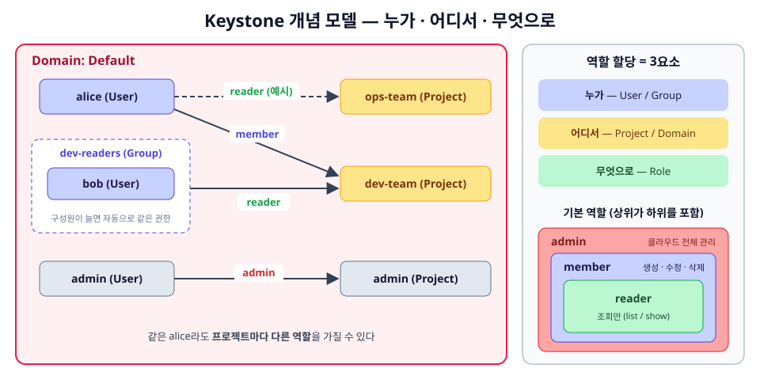
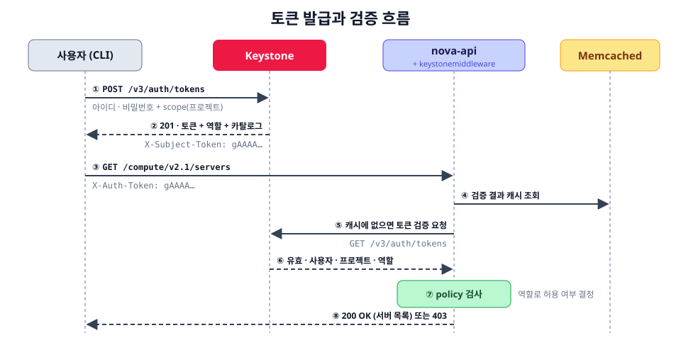

> **Chapter 4 · OpenStack** | 난이도 ★★★☆☆ | 예상 소요 1.5 ~ 2시간

## 🎯 오늘의 목표

- Keystone의 세 가지 역할 — **인증 · 인가(역할) · 서비스 카탈로그** — 을 설명할 수 있다
- **도메인 · 프로젝트 · 사용자 · 그룹 · 역할**의 관계와 "역할 할당(role assignment)"을 그림으로 설명할 수 있다
- 토큰이 **발급 → API 호출 → 검증**되는 흐름을 알고, `curl`로 직접 따라가 본다
- DevStack에서 프로젝트·사용자·그룹을 만들고 `admin` / `member` / `reader` 역할로 **권한 차이**를 확인한다

> 실습 환경: **Day 26의 DevStack** (Ubuntu 24.04 VM, `stack` 사용자, `HOST_IP=192.168.56.10`). IP는 본인 환경에 맞게 바꾸세요.

---

## 1. Keystone이 하는 일

Day 25에서 "모든 요청에는 토큰이 붙는다"고 했습니다. 그 토큰을 발급하고 검증하는 서비스가 **Keystone(Identity 서비스)** 입니다. OpenStack의 **정문 경비실**이라고 생각하면 됩니다.

| 기능 | 질문 | 예 |
|---|---|---|
| **인증 (Authentication)** | 너 누구야? | 아이디/비밀번호 확인 → **토큰** 발급 |
| **인가 (Authorization)** | 무엇을 할 수 있어? | 토큰에 담긴 **프로젝트 + 역할** 정보로 각 서비스가 판단 |
| **서비스 카탈로그 (Catalog)** | 어디로 가야 해? | "Nova는 `http://…/compute/v2.1`, Glance는 `http://…/image`" |

> 💡 인가 결정은 Keystone이 아니라 **각 서비스**(Nova, Glance …)가 합니다. Keystone은 "이 토큰은 alice, dev-team 프로젝트, member 역할"이라는 **사실만 보증**하고, 각 서비스가 자기 **정책 파일(policy)** 로 허용 여부를 판단합니다.

---

## 2. 핵심 개념 — 누가, 어디서, 무엇을



| 개념 | 설명 | 비유 |
|---|---|---|
| **Domain** | 사용자·그룹·프로젝트를 담는 최상위 그릇. 기본은 `Default` | 회사 |
| **Project** (= Tenant) | 리소스(VM, 네트워크, 볼륨)의 **소유 단위**이자 쿼터 단위 | 팀의 예산 계정 |
| **User** | 사람 또는 서비스 계정 | 직원 |
| **Group** | 사용자의 묶음. 그룹에 역할을 주면 구성원 모두에게 적용 | 부서 |
| **Role** | 권한 묶음의 **이름표** (`admin`, `member`, `reader`) | 직급 |
| **Role Assignment** | **(사용자 또는 그룹) + (프로젝트 또는 도메인) + 역할** 의 3요소 | "alice는 dev-team에서 member" |

핵심은 **역할은 사용자에게 붙는 게 아니라, "어느 프로젝트에서"라는 범위와 함께 붙는다**는 점입니다. alice가 `dev-team`에서는 `member`이고 `ops-team`에서는 `reader`일 수 있습니다.

### 기본 역할 (Secure RBAC)

| 역할 | 할 수 있는 일 | 포함 관계 |
|---|---|---|
| `reader` | 조회만 (list, show) | — |
| `member` | 프로젝트 안의 리소스 생성·수정·삭제 | reader 포함 |
| `admin` | 클라우드 전체 관리 (다른 프로젝트, 사용자, 쿼터 …) | member 포함 |

> `admin` → `member` → `reader` 순으로 **암묵적 역할(implied role)** 이 연결되어 있어서, `member`를 받으면 `reader` 권한도 자동으로 가집니다. `openstack implied role list`로 확인할 수 있습니다.

### Kubernetes · AWS와 비교

| Keystone | Kubernetes (Day 19) | AWS |
|---|---|---|
| Domain | (클러스터) | Organization |
| Project | Namespace | Account |
| User / Group | User / Group | IAM User / Group |
| Role + Role Assignment | Role + RoleBinding | IAM Policy 연결 |
| Token | ServiceAccount 토큰 / 인증서 | 임시 자격 증명(STS) |
| Application Credential | ServiceAccount | Access Key |

### 서비스 카탈로그와 엔드포인트

Keystone에는 **서비스(Service)** 와 각 서비스의 **엔드포인트(Endpoint)** 가 등록되어 있습니다. DevStack이 `stack.sh` 중에 자동으로 등록한 것이죠.

| 항목 | 의미 |
|---|---|
| Service | `nova` (type: `compute`), `glance` (type: `image`) … |
| Endpoint | 서비스의 URL. **interface**(`public` / `internal` / `admin`)별로 등록 가능 |
| Region | 엔드포인트가 속한 지역. DevStack 기본은 `RegionOne` |

CLI가 Nova 주소를 몰라도 동작하는 이유가 이것입니다. **Keystone 주소(`OS_AUTH_URL`) 하나만 알면** 나머지는 토큰 발급 시 받은 카탈로그에서 찾습니다.

---

## 3. 토큰 — 발급과 검증



1. 사용자가 Keystone에 `POST /v3/auth/tokens` (아이디/비밀번호 + **어느 프로젝트로** 로그인할지 = scope)
2. Keystone이 응답 헤더 `X-Subject-Token`으로 **토큰**을, 본문으로 **사용자·프로젝트·역할·카탈로그**를 돌려줌
3. 사용자가 카탈로그에서 찾은 Nova 주소로 요청, 헤더에 `X-Auth-Token: <토큰>`
4. Nova 안의 **keystonemiddleware**가 Keystone에 토큰 검증을 요청 (결과는 Memcached에 캐시)
5. 검증 결과(프로젝트, 역할)로 Nova의 **policy**가 허용 여부 결정 → 응답

### 토큰의 특징

| 항목 | 내용 |
|---|---|
| 형식 | **Fernet** 토큰 (기본). 대칭키로 암호화된 짧은 문자열 — DB에 저장하지 않음 |
| 유효 기간 | 기본 1시간 (`/etc/keystone/keystone.conf`의 `[token] expiration = 3600`) |
| 범위(scope) | **프로젝트 범위**(일반적), 도메인 범위, 시스템 범위, 범위 없음(unscoped) |
| 폐기 | `openstack token revoke` — 폐기 목록에 올라가 만료 전에도 무효 |

> 💡 Fernet 키는 `/etc/keystone/fernet-keys/`에 있고, 운영 환경에서는 `keystone-manage fernet_rotate`로 주기적으로 교체합니다. **멀티 컨트롤러라면 모든 Keystone 노드의 키가 같아야** 서로 발급한 토큰을 검증할 수 있습니다(Day 33).

---

## 4. 실습 ① — 현재 상태 둘러보기

```bash
sudo -u stack -i
cd ~/devstack
source openrc admin admin
```

### 4-1. 토큰과 카탈로그

```bash
openstack token issue
```

```
+------------+-----------------------------------------------------------------+
| Field      | Value                                                           |
+------------+-----------------------------------------------------------------+
| expires    | 2026-11-15T10:42:17+0000                                        |
| id         | gAAAAABn...                                                     |
| project_id | 6f0c3e...                                                       |
| user_id    | 1d2a9b...                                                       |
+------------+-----------------------------------------------------------------+
```

```bash
openstack catalog list
openstack endpoint list --service image
openstack region list
```

### 4-2. 도메인 · 프로젝트 · 사용자 · 역할

```bash
openstack domain list
openstack project list
openstack user list
openstack role list
openstack implied role list
openstack role assignment list --names --project demo
```

```
+--------+--------------------+-------+------------------+--------+--------+-----------+
| Role   | User               | Group | Project          | Domain | System | Inherited |
+--------+--------------------+-------+------------------+--------+--------+-----------+
| member | demo@Default       |       | demo@Default     |        |        | False     |
| ...    | ...                |       | ...              |        |        |           |
+--------+--------------------+-------+------------------+--------+--------+-----------+
```

> 💡 `user list`에 `nova`, `glance`, `neutron` 같은 사용자가 보이죠? **서비스 계정**입니다. 서비스끼리 API를 호출할 때(예: nova-compute → Neutron) 이 계정으로 토큰을 받습니다. local.conf의 `SERVICE_PASSWORD`가 이들의 비밀번호입니다.

---

## 5. 실습 ② — 팀 프로젝트와 사용자 만들기

시나리오: **dev-team** 프로젝트를 만들고, alice는 리소스를 만들 수 있는 `member`, bob은 조회만 하는 `reader`(그룹을 통해)로 설정합니다. (admin으로 진행)

### 5-1. 프로젝트

```bash
openstack project create --domain default --description "개발팀 프로젝트" dev-team
```

### 5-2. 사용자

```bash
openstack user create --domain default --project dev-team --password 'alice-pass' alice
openstack user create --domain default --project dev-team --password 'bob-pass' bob
```

> ⚠️ `--password`로 넣으면 셸 히스토리에 남습니다. 실습이 아니라면 `--password-prompt`로 대화형 입력을 쓰세요. `--project`는 **기본 프로젝트**를 지정할 뿐 **역할을 주지는 않습니다.**

### 5-3. 역할 할당 — 사용자에게 직접

```bash
openstack role add --project dev-team --user alice member
```

### 5-4. 역할 할당 — 그룹을 통해

```bash
openstack group create --domain default dev-readers
openstack group add user dev-readers bob
openstack role add --project dev-team --group dev-readers reader
```

### 5-5. 확인

```bash
openstack role assignment list --project dev-team --names
openstack role assignment list --user bob --effective --names   # 그룹을 통해 받은 것까지 펼쳐서
```

```
+--------+---------------+-------+------------------+--------+--------+-----------+
| Role   | User          | Group | Project          | Domain | System | Inherited |
+--------+---------------+-------+------------------+--------+--------+-----------+
| reader | bob@Default   |       | dev-team@Default |        |        | False     |
+--------+---------------+-------+------------------+--------+--------+-----------+
```

### 5-6. 쿼터

프로젝트는 쿼터(사용 한도)의 단위입니다.

```bash
openstack quota show dev-team
openstack quota set --instances 5 --cores 10 --ram 10240 dev-team
openstack quota show dev-team          # instances 5, cores 10, ram 10240 으로 바뀌었는지 확인
```

---

## 6. 실습 ③ — alice와 bob으로 로그인해 권한 비교

admin 환경 변수가 섞이지 않도록, 사용자별 rc 파일을 만들어 **새 셸**에서 불러옵니다.

```bash
cat > ~/alice-openrc <<'EOF'
export OS_AUTH_URL=http://192.168.56.10/identity
export OS_IDENTITY_API_VERSION=3
export OS_USERNAME=alice
export OS_PASSWORD=alice-pass
export OS_PROJECT_NAME=dev-team
export OS_USER_DOMAIN_NAME=Default
export OS_PROJECT_DOMAIN_NAME=Default
export OS_REGION_NAME=RegionOne
EOF

sed -e 's/alice-pass/bob-pass/' -e 's/USERNAME=alice/USERNAME=bob/' ~/alice-openrc > ~/bob-openrc
```

### 6-1. alice (member)

```bash
exit                       # admin 셸 종료
sudo -u stack -i           # 깨끗한 셸
source ~/alice-openrc

openstack token issue -c project_id -c user_id
openstack project list --my-projects       # 내가 속한 프로젝트만
openstack server list                      # (비어 있음 — dev-team 소유 VM 없음)
openstack network create alice-net         # member → 생성 가능
openstack network delete alice-net
```

```bash
openstack user list
```

```
You are not authorized to perform the requested action: identity:list_users. (HTTP 403) ...
```

`openstack project list`(전체 목록)나 `openstack user list`는 **admin 전용**이라 거부됩니다. 대신 `--my-projects`처럼 자기 범위의 조회는 됩니다.

### 6-2. bob (reader)

```bash
exit && sudo -u stack -i
source ~/bob-openrc

openstack network list                     # 조회는 가능
openstack network create bob-net           # reader → 거부 (HTTP 403)
```

> 💡 reader 역할 거부는 서비스가 **새 기본 정책(secure RBAC)** 을 적용하고 있을 때 동작합니다. Neutron은 최근 릴리스에서 기본 적용되어 있고, 서비스·릴리스에 따라 적용 시점이 다르므로 결과가 다르면 해당 서비스의 `enforce_new_defaults` 설정을 확인해 보세요.

### 6-3. 토큰을 curl로 직접 따라가기

CLI가 내부에서 하는 일을 손으로 해봅니다. (alice 셸에서)

```bash
source ~/alice-openrc

# ① 토큰 발급 — 응답 헤더의 X-Subject-Token 이 토큰
curl -si -X POST "$OS_AUTH_URL/v3/auth/tokens" \
  -H "Content-Type: application/json" \
  -d '{"auth":{"identity":{"methods":["password"],"password":{"user":{"name":"alice","domain":{"name":"Default"},"password":"alice-pass"}}},"scope":{"project":{"name":"dev-team","domain":{"name":"Default"}}}}}' \
  | grep -i '^x-subject-token'
```

```bash
# ② CLI로 토큰을 받고, 카탈로그에서 Nova(compute) public URL 확인
TOKEN=$(openstack token issue -f value -c id)
openstack catalog show compute          # public 엔드포인트 URL 확인
NOVA=http://192.168.56.10/compute/v2.1  # 위에서 본 URL (DevStack 기본 형식)

# ③ 토큰을 들고 Nova API 직접 호출
curl -s -H "X-Auth-Token: $TOKEN" "$NOVA/servers" | python3 -m json.tool
curl -s -o /dev/null -w "%{http_code}\n" -H "X-Auth-Token: wrong-token" "$NOVA/servers"   # 401
```

```bash
# ④ 토큰 폐기 후 다시 호출하면 401
openstack token revoke $TOKEN
curl -s -o /dev/null -w "%{http_code}\n" -H "X-Auth-Token: $TOKEN" "$NOVA/servers"
```

### 6-4. Application Credential — 스크립트/CI용 자격 증명

비밀번호를 스크립트에 넣는 대신, 사용자가 **자기 권한의 일부를 위임한 자격 증명**을 만들 수 있습니다(AWS Access Key와 비슷).

```bash
source ~/alice-openrc
openstack application credential create --role member alice-ci
```

출력의 `id`와 `secret`을 메모합니다(**secret은 이때 한 번만** 보여줍니다).

```bash
# 새 셸에서
export OS_AUTH_TYPE=v3applicationcredential
export OS_AUTH_URL=http://192.168.56.10/identity
export OS_IDENTITY_API_VERSION=3
export OS_APPLICATION_CREDENTIAL_ID=<id>
export OS_APPLICATION_CREDENTIAL_SECRET=<secret>
openstack server list
```

> Terraform(Day 35)이나 CI 파이프라인에서 OpenStack에 접근할 때 이 방식을 권장합니다. 사용자 비밀번호를 바꿔도 영향이 없고, 언제든 `openstack application credential delete alice-ci`로 회수할 수 있습니다.

> 💡 dev-team · alice · bob은 **지우지 말고 남겨두세요.** Day 28에서 이미지 공유, Day 29에서 alice 프로젝트에 인스턴스를 만드는 데 다시 씁니다.

---

## 7. 트러블슈팅

| 증상 | 원인 | 해결 |
|---|---|---|
| `The request you have made requires authentication. (HTTP 401)` | 비밀번호/사용자/도메인 틀림, 또는 토큰 만료·폐기 | rc 파일 값 확인. `OS_USER_DOMAIN_NAME=Default` 누락 여부 |
| `You are not authorized to perform the requested action ... (HTTP 403)` | 인증은 됐지만 **역할이 부족** | `openstack role assignment list --user <u> --effective --names`로 확인 후 `role add` |
| `Expecting to find domain in project` | 프로젝트 도메인 정보 없음 | `OS_PROJECT_DOMAIN_NAME=Default` (또는 `_ID=default`) 설정 |
| alice로 로그인했는데 admin 리소스가 보임 | 이전 `source openrc admin admin`의 변수가 남아 있음 | 새 셸을 열거나 `env | grep ^OS_` 로 확인 |
| 사용자를 만들었는데 아무 것도 못 함 | `--project`는 기본 프로젝트일 뿐, 역할 미할당 | `openstack role add --project <p> --user <u> member` |
| 토큰 검증이 간헐적으로 실패 (멀티 노드) | 컨트롤러 간 Fernet 키 불일치, 시간 차이 | 키 동기화, NTP(chrony) 시간 동기화 |

---

## 8. 핵심 정리

- Keystone = **인증(토큰) + 인가 정보(프로젝트·역할) + 서비스 카탈로그**
- 역할은 **(사용자/그룹) + (프로젝트/도메인) + 역할** 의 조합으로 할당된다
- 기본 역할 `admin` ⊃ `member` ⊃ `reader`. 허용 여부는 **각 서비스의 policy**가 결정
- 토큰은 기본 **Fernet**, 1시간 유효. 요청 헤더 `X-Auth-Token`으로 전달하고 **keystonemiddleware**가 검증
- CLI는 `OS_AUTH_URL`만 알면 나머지 서비스 주소는 **카탈로그**에서 찾는다
- 자동화에는 비밀번호 대신 **Application Credential**

---

## 9. 셀프 체크

<details>
<summary>Q1. 인가(이 요청을 허용할지)는 Keystone이 결정하는가?</summary>

아닙니다. Keystone은 토큰이 유효한지, 그 토큰의 사용자·프로젝트·역할이 무엇인지를 알려줄 뿐이고, **허용 여부는 각 서비스(Nova, Glance …)가 자기 policy 규칙으로 결정**합니다.
</details>

<details>
<summary>Q2. <code>openstack user create --project dev-team alice</code> 만 하면 alice가 dev-team에서 VM을 만들 수 있는가?</summary>

만들 수 없습니다. `--project`는 **기본 프로젝트** 설정일 뿐입니다. `openstack role add --project dev-team --user alice member` 처럼 역할 할당이 있어야 합니다.
</details>

<details>
<summary>Q3. 사용자 10명에게 같은 권한을 주는 가장 관리하기 쉬운 방법은?</summary>

**그룹**을 만들어 사용자를 넣고, 그룹에 역할을 할당합니다(`openstack role add --project <p> --group <g> <role>`). 사람이 들어오고 나갈 때 그룹 멤버십만 바꾸면 됩니다.
</details>

<details>
<summary>Q4. CLI는 Keystone 주소만 알고 있는데 어떻게 Nova API 주소를 찾는가?</summary>

토큰 발급 응답에 **서비스 카탈로그**(서비스별 엔드포인트 목록)가 포함되어 있습니다. CLI는 여기서 type이 `compute`이고 interface가 `public`인 URL을 찾아 요청합니다.
</details>

<details>
<summary>Q5. Fernet 토큰을 DB에 저장하지 않아도 검증할 수 있는 이유는?</summary>

토큰 자체에 사용자·프로젝트·만료 시각 등이 **대칭키로 암호화**되어 들어 있어서, 같은 Fernet 키를 가진 Keystone이 복호화만 하면 검증할 수 있습니다. 그래서 여러 Keystone 노드가 **같은 키**를 공유해야 합니다.
</details>

---

## ⏭️ 다음 예고 — Day 28. Glance — 이미지 서비스

VM을 만들려면 OS가 담긴 **디스크 이미지**가 필요합니다. qcow2와 raw 포맷의 차이, Ubuntu 클라우드 이미지 등록, public / private / shared 공개 범위와 프로젝트 간 이미지 공유, 그리고 이미지가 Glance 저장소에서 컴퓨트 노드로 흘러가는 과정을 살펴봅니다.
