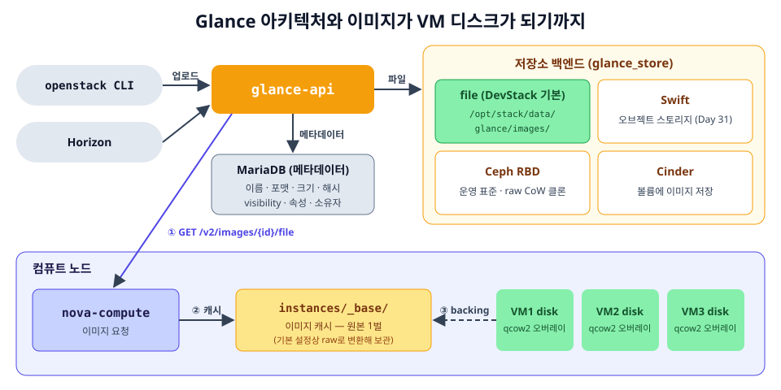
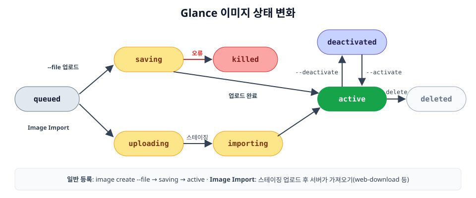

> **Chapter 4 · OpenStack** | 난이도 ★★★☆☆ | 예상 소요 1.5 ~ 2시간

## 🎯 오늘의 목표

- Glance가 하는 일(이미지 **메타데이터 + 실제 파일 저장소**)과 저장 백엔드(file / Swift / Ceph RBD / Cinder)를 설명할 수 있다
- **디스크 포맷**(qcow2, raw …)과 **컨테이너 포맷**(bare …)의 차이를 알고 `qemu-img`로 확인·변환할 수 있다
- 이미지의 **공개 범위**(public / private / shared / community)와 **상태**(queued → saving → active …)를 안다
- cirros와 Ubuntu 24.04 클라우드 이미지를 등록하고, 프로젝트 간 **이미지 공유**를 해본다

> 실습 환경: **Day 26의 DevStack** + Day 27에서 만든 `dev-team` 프로젝트와 `alice`(member), `~/alice-openrc`.

---

## 1. 왜 이미지 서비스가 필요한가?

Day 21에서 `virt-install`로 VM을 만들 때는 ISO로 OS를 **설치**했습니다. 클라우드에서는 매번 설치하지 않고, **OS가 이미 설치된 디스크 이미지를 복사**해서 VM을 바로 부팅합니다.

> Docker에서 **이미지 → 컨테이너**였던 관계가, OpenStack에서는 **Glance 이미지 → Nova 인스턴스**입니다.

| Docker (Day 01~02) | OpenStack |
|---|---|
| Docker Registry (Docker Hub) | **Glance** |
| 이미지 (레이어 묶음) | 이미지 (디스크 파일 1개 + 메타데이터) |
| `docker pull` / `push` | `openstack image save` / `create` |
| 컨테이너 | 인스턴스 (Nova) |
| `docker commit` | `openstack server image create` (스냅샷) |

### 클라우드 이미지란?

일반 설치 ISO가 아니라 **클라우드용으로 미리 만들어 둔 디스크 이미지**입니다.

- 비밀번호 로그인 대신 **SSH 키**로 접속 (키는 부팅 시 주입)
- 부팅할 때 **cloud-init**이 메타데이터 서버에서 호스트명·SSH 키·사용자 스크립트를 받아 초기 설정
- 디스크 크기에 맞춰 파티션을 자동 확장

| 이미지 | 크기 | 용도 |
|---|---|---|
| **cirros** | 약 20 MB | 테스트용 초소형 리눅스. 기본 계정 `cirros` / `gocubsgo` |
| **Ubuntu 24.04 cloud image** | 약 600 MB | 실제 서비스용. 계정 `ubuntu` + SSH 키 |
| Rocky / Debian / Fedora cloud image | 수백 MB | 배포판별 공식 클라우드 이미지 |

---

## 2. Glance 아키텍처



| 구성 요소 | 역할 |
|---|---|
| **glance-api** | REST API. 이미지 등록·조회·다운로드 요청 처리 |
| **DB** | 메타데이터 — 이름, 포맷, 크기, 체크섬, 공개 범위, 속성(property), 소유 프로젝트 |
| **저장소(Store) 백엔드** | 실제 이미지 파일이 놓이는 곳 (`glance_store` 라이브러리) |

> 💡 예전에는 `glance-registry`라는 별도 서비스가 있었지만 제거되었고, 지금은 **glance-api 하나**가 DB와 저장소를 모두 다룹니다. Nova처럼 RabbitMQ를 쓰지도 않는 **가장 단순한 구조의 서비스**입니다.

### 저장소 백엔드

| 백엔드 | 저장 위치 | 특징 |
|---|---|---|
| `file` | 로컬 디렉터리 (**DevStack 기본**: `/opt/stack/data/glance/images/`) | 간단. 컨트롤러가 여러 대면 공유 스토리지(NFS) 필요 |
| `swift` | Swift 오브젝트 스토리지 (Day 31) | 대용량·분산 |
| `rbd` | **Ceph** RBD 풀 | 운영에서 가장 흔함. Nova·Cinder도 Ceph면 **복사 없이 CoW 클론**으로 즉시 부팅 |
| `cinder` | Cinder 볼륨 | 블록 스토리지 재활용 |
| `http` | 외부 URL (읽기 전용) | 등록만 하고 실제 파일은 외부 |

### Nova가 이미지를 쓰는 방법

1. 인스턴스 생성 시 nova-compute가 Glance에서 이미지를 **다운로드**
2. 컴퓨트 노드의 `_base` 디렉터리에 **캐시** (같은 이미지로 두 번째 VM은 다운로드 생략)
3. 인스턴스 디스크는 `_base` 이미지를 **backing file로 하는 qcow2 오버레이**로 생성 → VM은 변경분만 기록

> Day 21에서 `qemu-img create -f qcow2 -b base.qcow2 ...`로 만들었던 **backing file 구조** 그대로입니다. 그래서 VM 10개를 만들어도 원본 이미지는 컴퓨트 노드에 1벌만 있습니다.

---

## 3. 디스크 포맷과 컨테이너 포맷

이미지를 등록할 때 두 가지 포맷을 지정합니다.

### 디스크 포맷 (`--disk-format`) — 디스크 내용의 형식

| 포맷 | 설명 | 언제 쓰나 |
|---|---|---|
| **qcow2** | QEMU Copy-On-Write. 실제 쓴 만큼만 용량 차지, 압축·스냅샷 지원 | **file 백엔드 + KVM**의 기본 선택 |
| **raw** | 바이트 그대로의 디스크. 가상 크기 = 파일 크기 | **Ceph RBD 백엔드**(CoW 클론은 raw에서만) |
| vmdk | VMware 디스크 | VMware에서 가져온 이미지 |
| vhd / vhdx | Hyper-V 디스크 | Hyper-V에서 가져온 이미지 |
| iso | 광학 디스크 이미지 | 설치용 ISO로 부팅 |

### 컨테이너 포맷 (`--container-format`) — 디스크를 감싸는 포장

| 포맷 | 설명 |
|---|---|
| **bare** | 포장 없음 — **거의 항상 이것** |
| ovf / ova | 메타데이터가 붙은 가상 어플라이언스 포장 |

> ⚠️ 디스크 포맷을 **실제 파일과 다르게** 등록하면(예: qcow2 파일을 `raw`로 등록) 인스턴스가 부팅되지 않거나 디스크가 깨져 보입니다. 등록 전에 **`qemu-img info`로 반드시 확인**하세요. 최근 Glance는 업로드 시 포맷 검사(format inspection)로 불일치를 거부하기도 합니다.

---

## 4. 공개 범위와 상태

### 공개 범위 (visibility)

| 값 | 누가 볼 수 있나 | 누가 설정 가능 |
|---|---|---|
| `public` | 모든 프로젝트 | 기본 정책상 **admin** |
| `private` | 소유 프로젝트만 | 소유자 |
| `shared` | 소유 프로젝트 + **멤버로 추가된 프로젝트** | 소유자 (**아무 값 없이 만들면 기본값**) |
| `community` | 모든 프로젝트 (목록에는 기본으로 안 보임, 직접 지정하면 사용 가능) | 소유자 |

> 💡 `--private`을 주지 않고 이미지를 만들면 `shared`가 됩니다. 멤버를 추가하기 전까지는 private과 똑같이 동작하므로 걱정하지 않아도 됩니다.

### 이미지 상태



| 상태 | 의미 |
|---|---|
| `queued` | 메타데이터만 등록됨, 파일은 아직 없음 |
| `saving` | 파일 업로드 중 |
| `uploading` / `importing` | (Image Import 방식) 스테이징 업로드 / 가져오기 처리 중 |
| **`active`** | 사용 가능 |
| `deactivated` | 관리자가 비활성화 — 다운로드·부팅 불가(관리자 제외) |
| `killed` | 업로드 중 오류 |
| `deleted` / `pending_delete` | 삭제됨 / 지연 삭제 대기 |

---

## 5. 실습 ① — 이미지 둘러보기와 등록

```bash
sudo -u stack -i
cd ~/devstack && source openrc admin admin
mkdir -p ~/images && cd ~/images
```

### 5-1. DevStack 기본 이미지 확인

```bash
openstack image list
openstack image show cirros-0.6.3-x86_64-disk      # 이름은 본인 환경의 image list 결과로
ls -lh /opt/stack/data/glance/images/               # 파일 이름 = 이미지 ID
```

```
+------------------+--------------------------------------+
| Field            | Value                                |
+------------------+--------------------------------------+
| container_format | bare                                 |
| disk_format      | qcow2                                |
| id               | 5e1c...                              |
| min_disk         | 0                                    |
| min_ram          | 0                                    |
| os_hash_algo     | sha512                               |
| size             | 21692416                             |
| status           | active                               |
| visibility       | public                               |
| ...              | ...                                  |
+------------------+--------------------------------------+
```

### 5-2. cirros 이미지 직접 등록

```bash
wget https://download.cirros-cloud.net/0.6.2/cirros-0.6.2-x86_64-disk.img
qemu-img info cirros-0.6.2-x86_64-disk.img
```

```
image: cirros-0.6.2-x86_64-disk.img
file format: qcow2
virtual size: 112 MiB (117440512 bytes)
disk size: 20.4 MiB
...
```

`file format: qcow2` 를 확인했으니 qcow2로 등록합니다. admin이므로 `--public`이 가능합니다.

```bash
openstack image create \
  --disk-format qcow2 \
  --container-format bare \
  --file cirros-0.6.2-x86_64-disk.img \
  --public \
  cirros-0.6.2

openstack image list
```

체크섬 확인 — Glance가 계산한 해시와 로컬 파일 해시가 같아야 합니다.

```bash
openstack image show cirros-0.6.2 -c os_hash_algo -c os_hash_value
sha512sum cirros-0.6.2-x86_64-disk.img
```

### 5-3. raw로 변환해서 비교

```bash
qemu-img convert -f qcow2 -O raw cirros-0.6.2-x86_64-disk.img cirros-0.6.2.raw
ls -lh cirros-0.6.2*            # qcow2 ≈ 21 MB, raw ≈ 112 MB (가상 크기 그대로)
qemu-img info cirros-0.6.2.raw  # file format: raw

openstack image create --disk-format raw --container-format bare \
  --file cirros-0.6.2.raw cirros-0.6.2-raw
openstack image list -c Name -c Status
openstack image show cirros-0.6.2-raw -c size -c visibility    # visibility: shared (기본값)
```

> 💡 같은 OS인데 Glance에 저장되는 크기가 5배 차이 납니다. file 백엔드에서는 qcow2가 유리하고, Ceph 백엔드에서는 raw가 유리합니다(복사 없는 클론).

### 5-4. Ubuntu 24.04 클라우드 이미지 등록

실제 서비스용 이미지는 **최소 요구 사양**과 **OS 정보 속성**을 함께 등록하는 것이 좋습니다.

```bash
wget https://cloud-images.ubuntu.com/noble/current/noble-server-cloudimg-amd64.img
qemu-img info noble-server-cloudimg-amd64.img       # 확장자는 .img지만 file format: qcow2

openstack image create \
  --disk-format qcow2 \
  --container-format bare \
  --file noble-server-cloudimg-amd64.img \
  --min-disk 10 \
  --min-ram 1024 \
  --property os_distro=ubuntu \
  --property os_version=24.04 \
  --public \
  ubuntu-24.04
```

| 옵션 | 효과 |
|---|---|
| `--min-disk 10` | 루트 디스크 10 GB 미만 flavor로는 부팅 거부 |
| `--min-ram 1024` | RAM 1 GB 미만 flavor로는 부팅 거부 |
| `--property key=value` | 자유 메타데이터. `os_distro` 같은 표준 키와 `hw_*` 키는 Nova가 해석 |

```bash
openstack image show ubuntu-24.04 -c min_disk -c min_ram -c properties
openstack image set --property os_admin_user=ubuntu ubuntu-24.04     # 나중에 속성 추가
openstack image unset --property os_admin_user ubuntu-24.04          # 속성 제거
```

> ⚠️ Ubuntu 이미지로 인스턴스를 띄우려면 RAM 1 GB 이상 flavor가 필요합니다. DevStack VM 메모리가 8 GB라면 Day 29 실습은 cirros 위주로 하고, Ubuntu는 1~2개만 띄우세요.

---

## 6. 실습 ② — 프로젝트 간 이미지 공유

시나리오: alice(dev-team)가 만든 이미지를 **demo 프로젝트**와 공유합니다.

```bash
# (admin) demo 프로젝트 ID 확인 — alice는 다른 프로젝트 이름을 조회할 권한이 없음
openstack project show demo -f value -c id
```

### 6-1. alice가 이미지 등록 + 멤버 추가

```bash
exit && sudo -u stack -i
source ~/alice-openrc
cd ~/images

openstack image create --disk-format qcow2 --container-format bare \
  --file cirros-0.6.2-x86_64-disk.img alice-cirros
openstack image show alice-cirros -c owner -c visibility      # owner = dev-team, visibility = shared

openstack image add project alice-cirros <demo-프로젝트-ID>
openstack image member list alice-cirros
```

```
+--------------------------------------+----------------------------------+---------+
| Image ID                             | Member ID                        | Status  |
+--------------------------------------+----------------------------------+---------+
| 8c41...                              | 3b9d...                          | pending |
+--------------------------------------+----------------------------------+---------+
```

### 6-2. demo 프로젝트가 수락

```bash
exit && sudo -u stack -i
cd ~/devstack && source openrc demo demo

openstack image list                       # 아직 alice-cirros 가 안 보임 (pending)
openstack image set --accept <alice-cirros-이미지-ID>
openstack image list                       # 이제 보임
```

> 💡 멤버 상태가 `pending`이면 목록에는 안 보이지만, 받는 쪽이 원치 않는 이미지가 목록을 어지럽히지 않게 하려는 설계입니다. 수락(`--accept`) 또는 거절(`--reject`)은 **받는 프로젝트**가 합니다.

---

## 7. 실습 ③ — 이미지 보호 · 비활성화 · 다운로드 (admin)

```bash
exit && sudo -u stack -i
cd ~/devstack && source openrc admin admin

# 보호: 실수로 삭제 방지
openstack image set --protected cirros-0.6.2
openstack image delete cirros-0.6.2        # 실패 — protected 이미지는 삭제 불가 (403)
openstack image set --unprotected cirros-0.6.2

# 비활성화: 취약점이 발견된 이미지를 잠시 막기
openstack image set --deactivate cirros-0.6.2-raw
openstack image show cirros-0.6.2-raw -c status     # deactivated
openstack image set --activate cirros-0.6.2-raw

# 다운로드 (Glance → 로컬 파일)
openstack image save --file /tmp/cirros-from-glance.img cirros-0.6.2
sha512sum /tmp/cirros-from-glance.img ~/images/cirros-0.6.2-x86_64-disk.img   # 같아야 함
```

정리 (raw 실습 이미지만 삭제, `cirros-0.6.2`와 `ubuntu-24.04`, `alice-cirros`는 Day 29에서 사용):

```bash
openstack image delete cirros-0.6.2-raw
rm -f ~/images/cirros-0.6.2.raw /tmp/cirros-from-glance.img
```

---

## 8. 트러블슈팅

| 증상 | 원인 | 해결 |
|---|---|---|
| 인스턴스가 부팅 중 `No bootable device` | 디스크 포맷을 실제 파일과 다르게 등록 | `qemu-img info`로 확인 후 올바른 `--disk-format`으로 재등록 |
| `403 Forbidden` (`--public` 사용 시) | public 설정은 기본 정책상 admin 전용 | 일반 사용자는 `shared` + 멤버 추가, 또는 `--community` |
| 이미지가 `queued`에서 멈춤 | 메타데이터만 만들고 파일 업로드 안 됨 (`--file` 누락 등) | 삭제 후 `--file`로 다시 생성 |
| 이미지가 `killed` | 업로드 중 연결 끊김, 저장소 용량 부족 | `df -h /opt/stack/data`, `sudo journalctl -u devstack@g-api` 확인 후 재업로드 |
| 공유 받은 이미지가 목록에 안 보임 | 멤버 상태 `pending` | 받는 프로젝트에서 `openstack image set --accept <ID>` |
| `Image ... is protected` 로 삭제 실패 | protected 플래그 | `openstack image set --unprotected <이미지>` 후 삭제 |
| Flavor가 작다며 부팅 거부 (`Flavor's disk is too small for requested image`) | 이미지 `min_disk` / `min_ram` 또는 가상 크기보다 flavor가 작음 | 더 큰 flavor 사용 |

---

## 9. 핵심 정리

- Glance = 이미지 **메타데이터(DB)** + **파일 저장소(file / Swift / Ceph / Cinder)** 를 관리하는 API 서비스
- 디스크 포맷: **qcow2**(쓴 만큼만, file 백엔드) vs **raw**(Ceph CoW 클론), 컨테이너 포맷은 거의 **bare**
- 등록 전 **`qemu-img info`** 로 실제 포맷 확인
- 공개 범위: `public`(admin) / `private` / **`shared`(기본값, 멤버 추가로 공유)** / `community`
- 공유 흐름: 소유자 `image add project` → 받는 쪽 `image set --accept`
- Nova는 이미지를 받아 컴퓨트 노드 `_base`에 캐시하고 **qcow2 backing file**로 인스턴스 디스크를 만든다

---

## 10. 셀프 체크

<details>
<summary>Q1. Ubuntu 클라우드 이미지 파일 확장자가 <code>.img</code>인데 왜 qcow2로 등록하는가?</summary>

확장자는 관례일 뿐 실제 포맷과 무관합니다. `qemu-img info`로 보면 `file format: qcow2`이므로 `--disk-format qcow2`로 등록해야 합니다.
</details>

<details>
<summary>Q2. Ceph RBD를 Glance·Nova 백엔드로 쓸 때 raw 포맷을 권장하는 이유는?</summary>

Ceph는 raw 이미지에서만 **복사 없는 CoW 클론**을 만들 수 있습니다. qcow2면 Nova가 이미지를 내려받아 변환해야 해서 부팅이 느리고 공간도 더 씁니다.
</details>

<details>
<summary>Q3. visibility를 지정하지 않고 만든 이미지는 다른 프로젝트에서 보이는가?</summary>

기본값은 `shared`이지만, **멤버를 추가하기 전까지는** 소유 프로젝트에서만 보입니다. 멤버로 추가되고 상대가 수락(`--accept`)하면 그 프로젝트 목록에도 나타납니다.
</details>

<details>
<summary>Q4. 같은 이미지로 VM 10개를 같은 컴퓨트 노드에 만들면 이미지가 10번 다운로드되는가?</summary>

아닙니다. 처음 한 번 `_base`에 캐시하고, 각 인스턴스 디스크는 그 파일을 **backing file로 하는 qcow2 오버레이**로 만듭니다. 원본은 1벌, 인스턴스마다 변경분만 저장됩니다.
</details>

<details>
<summary>Q5. 보안 취약점이 발견된 이미지로 새 VM이 만들어지는 것을 막되, 이미지는 지우고 싶지 않다면?</summary>

`openstack image set --deactivate <이미지>`로 비활성화합니다. `deactivated` 상태에서는 일반 사용자의 다운로드·부팅이 막히고, 나중에 `--activate`로 되돌릴 수 있습니다.
</details>

---

## ⏭️ 다음 예고 — Day 29. Nova — 컴퓨트(인스턴스) 서비스

드디어 VM을 띄웁니다. nova-api · scheduler · conductor · compute와 Placement가 **서버 생성 요청 하나를 어떻게 나눠 처리하는지** 시퀀스로 따라가고, 오늘 등록한 cirros 이미지로 인스턴스를 만든 뒤, 컴퓨트 노드에서 `virsh`로 **libvirt 도메인**(Day 21)을 직접 확인합니다.
