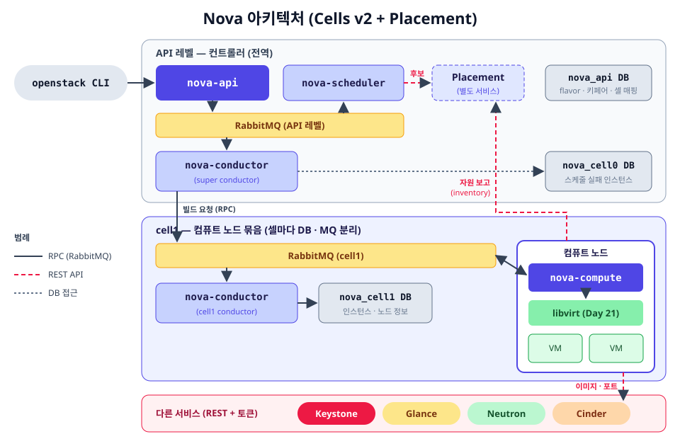
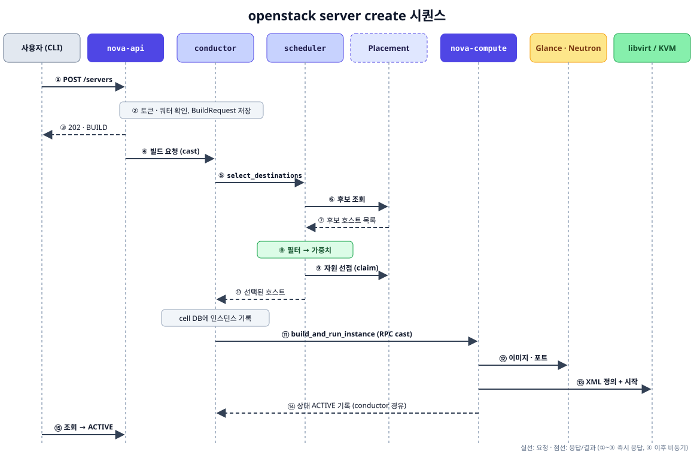
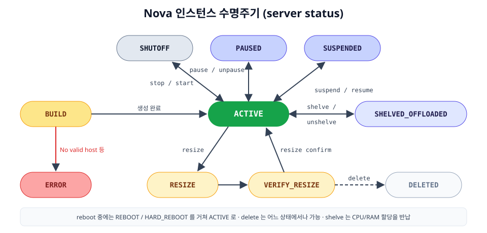

> **Chapter 4 · OpenStack** | 난이도 ★★★★☆ | 예상 소요 2 ~ 2.5시간

## 🎯 오늘의 목표

- Nova의 구성 요소 — **nova-api · nova-scheduler · nova-conductor · nova-compute** — 와 **Placement**의 역할을 설명할 수 있다
- `openstack server create` 한 번이 **어떤 순서로 처리되는지** 시퀀스로 설명할 수 있다
- **flavor, 할당 비율(allocation ratio), 필터·가중치 스케줄링**을 이해한다
- DevStack에서 인스턴스를 만들고 SSH로 접속한 뒤, 컴퓨트 노드에서 **libvirt 도메인**(Day 21)으로 직접 확인한다
- stop / pause / suspend / shelve / resize / snapshot 같은 **인스턴스 수명주기**를 다룬다

> 실습 환경: **Day 26의 DevStack** + Day 27의 `dev-team` / `alice`(`~/alice-openrc`) + Day 28에서 등록한 `cirros-0.6.2` 이미지.

---

## 1. Nova란?

Nova는 OpenStack의 **컴퓨트 서비스**, AWS로 치면 **EC2**입니다. 하지만 Nova가 직접 VM을 실행하지는 않습니다. Day 21에서 우리가 `virsh`로 하던 일을 **하이퍼바이저 드라이버(libvirt)** 를 통해 대신 시킬 뿐입니다.

| 질문 | 담당 |
|---|---|
| 이 요청 받아도 돼? (인증·쿼터) | **nova-api** (+ Keystone) |
| 어느 서버에 띄울까? | **nova-scheduler** (+ **Placement**) |
| 작업 순서 조율, DB 대리 접근 | **nova-conductor** |
| 실제로 VM 만들기 | **nova-compute** → **libvirt** → QEMU/KVM |
| 어떤 OS로? | Glance (Day 28) |
| 어떤 네트워크에? | Neutron (Day 30) |
| 추가 디스크는? | Cinder (Day 31) |

---

## 2. Nova 아키텍처



| 구성 요소 | 위치 | 역할 | DevStack 유닛 |
|---|---|---|---|
| **nova-api** | 컨트롤러 | REST API. 인증·쿼터 확인 후 요청 접수 | `devstack@n-api` |
| **nova-scheduler** | 컨트롤러 | Placement에서 후보를 받아 필터·가중치로 호스트 선택 | `devstack@n-sch` |
| **nova-conductor (super)** | 컨트롤러 | 빌드 흐름 조율, 셀로 작업 전달 | `devstack@n-super-cond` |
| **nova-conductor (cell)** | 셀 | 해당 셀의 compute 대신 DB 접근 | `devstack@n-cond-cell1` |
| **nova-compute** | 컴퓨트 노드 | libvirt로 VM 생성·삭제·상태 관리, 자원 보고 | `devstack@n-cpu` |
| nova-novncproxy | 컨트롤러 | 브라우저 VNC 콘솔 프록시 | `devstack@n-novnc-cell1` |
| nova-api-metadata | 컨트롤러 | VM의 cloud-init이 읽는 메타데이터 제공 | `devstack@n-api-meta` |
| **Placement** | 컨트롤러 | 자원 인벤토리·사용량·할당 관리 (**별도 프로젝트**) | `devstack@placement-api` |

### Cells v2 — 왜 conductor가 둘인가?

컴퓨트 노드가 수천 대가 되면 DB와 RabbitMQ 하나로는 버티지 못합니다. 그래서 Nova는 컴퓨트 노드를 **셀(cell)** 단위로 나누고, 셀마다 **DB와 RabbitMQ를 따로** 둡니다.

| DB | 내용 |
|---|---|
| `nova_api` | 전역 정보 — flavor, 키페어, 셀 매핑, 빌드 요청 |
| `nova_cell0` | 스케줄링에 실패해 **어느 셀에도 못 들어간 인스턴스** 보관 |
| `nova_cell1` | cell1에 속한 인스턴스·컴퓨트 노드 정보 |

DevStack은 셀이 하나(cell1)뿐이지만 구조는 운영과 같아서, **super conductor**(전역)와 **cell1 conductor**가 따로 뜹니다. Day 26에서 `nova-conductor`가 두 줄 보였던 이유입니다.

> 💡 nova-compute는 **DB에 직접 접근하지 않습니다.** 컴퓨트 노드는 VM(=사용자 코드)과 같은 서버에 있어 공격받을 위험이 크므로, DB 접근은 conductor를 거치게 만든 보안 설계입니다.

---

## 3. Placement와 스케줄링

### 3-1. Placement — 자원 장부

Placement는 "어느 서버에 무슨 자원이 얼마나 있고, 얼마나 쓰였는지"를 관리하는 **장부**입니다.

| 용어 | 의미 | 예 |
|---|---|---|
| **Resource Provider** | 자원을 가진 주체 | 컴퓨트 노드 `devstack` |
| **Resource Class** | 자원 종류 | `VCPU`, `MEMORY_MB`, `DISK_GB` |
| **Inventory** | 총량 + 할당 비율 + 예약분 | VCPU total 4, allocation_ratio 4.0 |
| **Allocation** | 인스턴스(consumer)가 차지한 양 | vm1: VCPU 1, MEMORY_MB 256, DISK_GB 1 |
| **Trait** | 자원 특성 태그 | `HW_CPU_X86_AVX2`, `COMPUTE_STATUS_DISABLED` |

nova-compute가 주기적으로 자기 인벤토리를 Placement에 보고하고, 스케줄러는 Placement에 "이만큼 줄 수 있는 후보?"를 묻습니다.

### 3-2. 할당 비율 (Overcommit)

| 자원 | 초기 기본 비율 | 의미 |
|---|---|---|
| VCPU | **4.0** | 물리 코어 4개 → vCPU 16개까지 할당 |
| MEMORY_MB | **1.0** | 오버커밋 없음 (예약분 제외) |
| DISK_GB | **1.0** | 오버커밋 없음 |

> 대부분의 VM은 CPU를 100% 쓰지 않으므로 CPU는 과할당해도 괜찮지만, 메모리를 과할당하면 OOM이나 스왑으로 성능이 무너집니다. K8s의 requests/limits(Day 18)와 비슷한 고민입니다.

### 3-3. 스케줄링 3단계

| 단계 | 하는 일 | 예 |
|---|---|---|
| ① **Placement 사전 필터** | 자원(VCPU/RAM/DISK)과 trait이 맞는 후보 목록 | "VCPU 1, RAM 256MB, DISK 1GB 남은 노드" |
| ② **필터 (Filter)** | 조건에 안 맞는 호스트 제거 | `ComputeFilter`(서비스 살아 있나), `ImagePropertiesFilter`(이미지 요구 사항), `ServerGroupAntiAffinityFilter` |
| ③ **가중치 (Weigher)** | 남은 후보에 점수 → 1등 선택 | `RAMWeigher`(여유 RAM 많은 곳), `CPUWeigher` … |

K8s 스케줄러의 **Filtering → Scoring** 과 같은 구조입니다. 후보가 하나도 안 남으면 그 유명한 **`No valid host was found`** 에러가 납니다.

### 3-4. Flavor — 인스턴스 크기표

| 항목 | 의미 |
|---|---|
| `vcpus` | vCPU 개수 |
| `ram` | 메모리 (MB) |
| `disk` | 루트 디스크 (GB). 0이면 이미지 크기 사용 |
| `ephemeral` / `swap` | 추가 임시 디스크 / 스왑 |
| `properties` (extra specs) | `hw:cpu_policy=dedicated` 처럼 세부 배치·성능 옵션 |

AWS의 `t3.micro`, `m5.large` 같은 **인스턴스 타입**에 해당합니다. Flavor는 기본적으로 **admin만 생성**할 수 있습니다.

---

## 4. 서버 생성 시퀀스



| 단계 | 일어나는 일 |
|---|---|
| ① | CLI가 Keystone 토큰(Day 27)을 들고 `POST /servers` |
| ② | nova-api: 토큰·정책·**쿼터** 확인, `nova_api` DB에 **BuildRequest** 저장 |
| ③ | 사용자에게 바로 `202 Accepted` — 상태 **BUILD**. 나머지는 비동기 |
| ④ | nova-api → super conductor: `schedule_and_build_instances` (RPC cast) |
| ⑤ | conductor → scheduler: `select_destinations` (RPC call — 답을 기다림) |
| ⑥⑦ | scheduler → Placement: `GET /allocation_candidates` → 자원 있는 후보 목록 |
| ⑧ | 필터 → 가중치로 호스트 1대 선택 |
| ⑨ | scheduler → Placement: 그 호스트의 자원을 **선점(claim)** — 동시에 들어온 요청과 충돌 방지 |
| ⑩⑪ | conductor가 cell DB에 인스턴스 레코드 생성 → 선택된 nova-compute에 `build_and_run_instance` (RPC cast) |
| ⑫ | nova-compute: Glance에서 이미지 다운로드(`_base` 캐시), Neutron에서 포트 생성·바인딩, (볼륨이면 Cinder) |
| ⑬ | libvirt에 도메인 **XML 정의 → 시작** (Day 21의 `virsh define` + `virsh start`) |
| ⑭⑮ | 상태가 **ACTIVE**로 기록되고, CLI(`--wait`)가 폴링으로 확인 |

> 💡 스케줄링에 실패하면 인스턴스는 `nova_cell0` DB에 **ERROR** 상태로 기록됩니다. `openstack server show <이름> -c fault`로 이유를 볼 수 있습니다.

---

## 5. 실습 ① — 컴퓨트 자원 살펴보기 (admin)

```bash
sudo -u stack -i
cd ~/devstack && source openrc admin admin
```

```bash
openstack compute service list -c Binary -c Host -c Zone -c State
openstack hypervisor list
openstack availability zone list --compute
openstack flavor list -c Name -c RAM -c Disk -c VCPUs
```

> 💡 최근 Nova API는 `hypervisor show`에서 vCPU/메모리 사용량 필드를 더 이상 보여주지 않습니다. 사용량의 "진짜 장부"는 **Placement**입니다.

### 5-1. Placement 조회

Placement 명령은 `osc-placement` 플러그인이 제공합니다. (`openstack resource provider list`가 "Unknown command"라면 CLI가 설치된 Python 환경에 `pip install osc-placement`)

```bash
openstack resource provider list
RP=$(openstack resource provider list -f value -c uuid | head -1)
openstack resource provider inventory list $RP
openstack resource provider usage show $RP
```

```
+----------------+------------------+----------+----------+----------+-----------+--------+
| resource_class | allocation_ratio | min_unit | max_unit | reserved | step_size |  total |
+----------------+------------------+----------+----------+----------+-----------+--------+
| VCPU           |              4.0 |        1 |        4 |        0 |         1 |      4 |
| MEMORY_MB      |              1.0 |        1 |    15990 |      512 |         1 |  15990 |
| DISK_GB        |              1.0 |        1 |       96 |        0 |         1 |     96 |
+----------------+------------------+----------+----------+----------+-----------+--------+
```

이 노드는 VCPU를 `4 × 4.0 = 16`개까지, 메모리는 `15990 - 512`MB까지 할당할 수 있습니다.

```bash
# "VCPU 1, RAM 256MB, DISK 1GB 를 줄 수 있는 후보는?" — 스케줄러가 묻는 질문 그대로
openstack --os-placement-api-version 1.10 allocation candidate list \
  --resource VCPU=1 --resource MEMORY_MB=256 --resource DISK_GB=1
```

### 5-2. Flavor 만들기

```bash
openstack flavor create --vcpus 1 --ram 256 --disk 1 lab.tiny
openstack flavor create --vcpus 1 --ram 512 --disk 2 lab.small
openstack flavor create --vcpus 1 --ram 256 --disk 500 lab.bigdisk     # 일부러 실패용
openstack flavor list -c Name -c RAM -c Disk -c VCPUs
```

---

## 6. 실습 ② — 인스턴스 만들기 (alice / dev-team)

### 6-1. 준비: 키페어 · 네트워크 · 보안 그룹

```bash
exit && sudo -u stack -i
source ~/alice-openrc

# SSH 키페어 (키페어는 사용자 소유)
ssh-keygen -t ed25519 -N '' -f ~/.ssh/id_ed25519
openstack keypair create --public-key ~/.ssh/id_ed25519.pub alice-key
```

dev-team에는 아직 네트워크가 없습니다. Neutron은 Day 30에서 자세히 다루고, 오늘은 **필요한 최소 구성**만 만듭니다.

```bash
openstack network create dev-net
openstack subnet create --network dev-net --subnet-range 10.10.0.0/24 dev-subnet
openstack router create dev-router
openstack router set --external-gateway public dev-router
openstack router add subnet dev-router dev-subnet
```

기본 보안 그룹은 들어오는 트래픽을 막으므로 ping과 SSH를 엽니다.

```bash
openstack security group rule create --protocol icmp default
openstack security group rule create --protocol tcp --dst-port 22 default
```

### 6-2. 서버 생성

```bash
openstack server create \
  --flavor lab.tiny \
  --image cirros-0.6.2 \
  --network dev-net \
  --key-name alice-key \
  --security-group default \
  --wait \
  vm1
```

| 옵션 | 의미 |
|---|---|
| `--flavor` | 크기 (vCPU / RAM / 디스크) |
| `--image` | 부팅할 Glance 이미지 |
| `--network` | 붙일 Neutron 네트워크 (포트가 자동 생성됨) |
| `--key-name` | cloud-init이 주입할 SSH 공개 키 |
| `--security-group` | 방화벽 규칙 묶음 |
| `--wait` | ACTIVE(또는 ERROR)가 될 때까지 대기 |

```bash
openstack server list
```

```
+--------------------------------------+------+--------+--------------------+--------------+----------+
| ID                                   | Name | Status | Networks           | Image        | Flavor   |
+--------------------------------------+------+--------+--------------------+--------------+----------+
| 0f3a7c2e-...                         | vm1  | ACTIVE | dev-net=10.10.0.23 | cirros-0.6.2 | lab.tiny |
+--------------------------------------+------+--------+--------------------+--------------+----------+
```

### 6-3. 상태와 로그 확인

```bash
openstack server show vm1 -c status -c addresses -c flavor -c image -c key_name
openstack server event list vm1                  # create, stop 등 작업 이력
openstack console log show vm1 | tail -20         # 부팅 로그 (cloud-init 출력 포함)
openstack console url show vm1                    # 브라우저용 noVNC 콘솔 URL
```

콘솔 로그 끝부분에 cirros의 로그인 프롬프트가 보이면 부팅 성공입니다.

### 6-4. Floating IP로 SSH 접속

```bash
openstack floating ip create public
FIP=$(openstack floating ip list -f value -c "Floating IP Address" | head -1)
openstack server add floating ip vm1 $FIP
openstack server list -c Name -c Networks

ping -c 3 $FIP
ssh -i ~/.ssh/id_ed25519 cirros@$FIP
```

```bash
# vm1 안에서
hostname          # vm1  ← cloud-init이 메타데이터에서 받아 설정
cat /proc/cpuinfo | grep -c processor     # 1 (lab.tiny)
free -m           # 약 200MB대
exit
```

> 💡 Floating IP(`172.24.4.x`)는 DevStack VM의 `br-ex`를 통해서만 닿습니다. 그래서 SSH는 **DevStack VM 안에서** 합니다. 구조는 Day 30에서 뜯어봅니다.

---

## 7. 실습 ③ — libvirt로 직접 확인 (Day 21 연결)

이번엔 admin으로 **컴퓨트 노드(= DevStack VM)** 에서 실제 VM을 들여다봅니다.

```bash
openstack server show vm1 -f value -c id     # alice 셸에서 ID를 확인해 메모 → 이하 <VM_ID>
exit && sudo -u stack -i
cd ~/devstack && source openrc admin admin

openstack server show <VM_ID> -c OS-EXT-SRV-ATTR:host -c OS-EXT-SRV-ATTR:instance_name
```

```
+-------------------------------+-------------------+
| Field                         | Value             |
+-------------------------------+-------------------+
| OS-EXT-SRV-ATTR:host          | devstack          |
| OS-EXT-SRV-ATTR:instance_name | instance-00000001 |
+-------------------------------+-------------------+
```

`instance_name`이 바로 **libvirt 도메인 이름**입니다.

```bash
sudo virsh list --all
sudo virsh dominfo instance-00000001
sudo virsh dumpxml instance-00000001 | grep -E '<nova:name>|<memory|<vcpu|source file'
```

```
      <nova:name>vm1</nova:name>
  <memory unit='KiB'>262144</memory>
  <vcpu placement='static'>1</vcpu>
      <source file='/opt/stack/data/nova/instances/0f3a7c2e-.../disk'/>
```

Nova가 만든 XML도 결국 Day 21에서 `virsh dumpxml`로 보던 것과 같은 형식입니다. **flavor의 RAM/vCPU가 `<memory>`/`<vcpu>`로**, Glance 이미지가 **`<source file=…/disk>`로** 바뀌어 들어갔습니다.

```bash
sudo ls -l /opt/stack/data/nova/instances/<VM_ID>/      # console.log, disk ...
sudo qemu-img info -U /opt/stack/data/nova/instances/<VM_ID>/disk
```

```
file format: qcow2
virtual size: 1 GiB (1073741824 bytes)
backing file: /opt/stack/data/nova/instances/_base/3d6b...
...
```

인스턴스 디스크는 **`_base`의 캐시 이미지를 backing file로 쓰는 qcow2 오버레이**입니다(Day 28). `-U`(`--force-share`)는 실행 중인 VM의 디스크 잠금을 건드리지 않고 읽기 위한 옵션입니다.

Placement 장부에서도 확인해 봅니다.

```bash
openstack resource provider allocation show <VM_ID>
openstack resource provider usage show $(openstack resource provider list -f value -c uuid | head -1)
```

> ⚠️ `virsh destroy`/`virsh undefine`처럼 **libvirt를 직접 조작하지 마세요.** Nova DB와 실제 상태가 어긋납니다. 조회만 하고, 조작은 항상 `openstack server ...`로 합니다.

---

## 8. 실습 ④ — 인스턴스 수명주기



alice 셸로 돌아가서 진행합니다.

```bash
exit && sudo -u stack -i
source ~/alice-openrc
```

| 명령 | 상태 변화 | 내부 동작 |
|---|---|---|
| `openstack server stop vm1` | ACTIVE → **SHUTOFF** | 게스트 종료 (`virsh shutdown`) — 자원은 계속 점유 |
| `openstack server start vm1` | SHUTOFF → ACTIVE | |
| `openstack server reboot vm1` | ACTIVE → REBOOT → ACTIVE | 게스트 OS 재부팅. `--hard`면 전원 리셋 |
| `openstack server pause vm1` / `unpause` | ↔ **PAUSED** | 메모리에 둔 채 vCPU 정지 (`virsh suspend`) |
| `openstack server suspend vm1` / `resume` | ↔ **SUSPENDED** | 메모리를 디스크에 저장 (`virsh managedsave`) |
| `openstack server shelve vm1` / `unshelve` | ↔ **SHELVED_OFFLOADED** | 스냅샷 후 호스트에서 내림 → **CPU/RAM 자원 반납** |

```bash
openstack server stop vm1 && sleep 5 && openstack server show vm1 -c status
openstack server start vm1
openstack server pause vm1   && openstack server show vm1 -c status
openstack server unpause vm1
sudo virsh list --all        # (admin 권한 불필요 — 호스트 sudo) 상태 변화를 libvirt에서도 확인
```

### 8-1. Resize — flavor 바꾸기

```bash
openstack server resize --flavor lab.small vm1
openstack server show vm1 -c status          # RESIZE → VERIFY_RESIZE
openstack server resize confirm vm1          # 확정 (되돌리려면: openstack server resize revert vm1)
openstack server show vm1 -c flavor -c status
```

> 노드가 1대뿐인 DevStack에서 resize가 되는 것은 Day 26의 `local.conf`에 넣은 **`allow_resize_to_same_host = True`** 덕분입니다. 기본값(False)이면 다른 호스트로만 resize하므로 `No valid host`가 납니다. (구버전 CLI는 `openstack server resize --confirm vm1` 형식)

### 8-2. 스냅샷 — 인스턴스를 이미지로

```bash
openstack server image create --name vm1-snap --wait vm1
openstack image list                          # vm1-snap 이 Glance에 생김
openstack server create --flavor lab.small --image vm1-snap \
  --network dev-net --key-name alice-key --wait vm2
```

`docker commit`처럼 **현재 디스크 상태를 이미지로** 만들어 같은 VM을 복제할 수 있습니다.

### 8-3. 일부러 실패시켜 보기 — No valid host

```bash
openstack server create --flavor lab.bigdisk --image cirros-0.6.2 \
  --network dev-net --wait vm-fail
openstack server show vm-fail -c status -c fault
```

```
| fault  | {'code': 500, 'created': '...', 'message': 'No valid host was found. ...'} |
| status | ERROR                                                                       |
```

루트 디스크 500 GB를 줄 수 있는 노드가 Placement에 없으니 ①단계에서 후보가 0개가 된 것입니다. admin 셸에서 `sudo journalctl -u devstack@n-sch --since "5 min ago"`로 스케줄러 로그도 확인해 보세요.

### 8-4. 정리

```bash
openstack server delete vm-fail vm2
openstack image delete vm1-snap

# Day 30부터는 DevStack 기본 demo 프로젝트(source openrc demo demo)로 실습하므로
# dev-team 실습 자원도 정리합니다. (Floating IP가 있다면 먼저 해제)
openstack server delete --wait vm1
openstack floating ip list -f value -c ID | xargs -r openstack floating ip delete
openstack router remove subnet dev-router dev-subnet
openstack router unset --external-gateway dev-router
openstack router delete dev-router
openstack network delete dev-net      # 서브넷도 함께 삭제됨
openstack keypair delete alice-key
```

---

## 9. 트러블슈팅

| 증상 | 원인 | 해결 |
|---|---|---|
| `ERROR` + `No valid host was found` | 자원 부족, 필터 불일치, 이미지 `min_disk`/`min_ram` | `server show -c fault`, `journalctl -u devstack@n-sch`, `allocation candidate list`로 자원 확인 |
| `Quota exceeded for cores/ram/instances` (403) | 프로젝트 쿼터 초과 (Day 27에서 설정) | `openstack quota show`, admin이 `quota set` |
| 인스턴스가 `BUILD`에서 멈춤 | nova-compute/conductor 다운, RabbitMQ 문제 | `openstack compute service list`, `journalctl -u devstack@n-cpu` |
| `ERROR` + libvirt `/dev/kvm` 관련 메시지 | 중첩 가상화 미지원 | `local.conf`에 `LIBVIRT_TYPE=qemu` 후 재설치 |
| ACTIVE인데 ping/SSH 안 됨 | 보안 그룹 규칙 없음, Floating IP 미연결, cloud-init 미완료 | 6-1의 규칙 추가, `console log show`로 부팅 완료 확인 |
| SSH `Permission denied (publickey)` | 키페어 없이 생성했거나 다른 키 사용 | `--key-name` 확인, `ssh -i` 경로 확인 |
| `resize` 후 `No valid host` | 단일 노드인데 `allow_resize_to_same_host` 미설정 | nova.conf 설정 후 `systemctl restart devstack@n-*` |
| `openstack resource provider list` 없음 | osc-placement 미설치 | CLI 환경에 `pip install osc-placement` |

---

## 10. 핵심 정리

- Nova = **nova-api**(접수) + **nova-scheduler**(배치 결정) + **nova-conductor**(조율·DB 대리) + **nova-compute**(실행)
- **Placement**는 자원 장부: Resource Provider · Inventory · Allocation, 할당 비율 CPU 4.0 / RAM 1.0 / DISK 1.0
- 스케줄링: **Placement 사전 필터 → 필터 → 가중치**, 후보 0개면 `No valid host was found`
- API는 `202 Accepted`로 즉시 응답하고 나머지는 **RabbitMQ RPC로 비동기** 처리
- nova-compute는 결국 **libvirt 도메인**(`instance-0000000X`)을 정의·시작한다 — `virsh`로 확인 가능
- 수명주기: stop / pause / suspend / **shelve(자원 반납)** / **resize**(confirm) / **snapshot**(`server image create`)

---

## 11. 셀프 체크

<details>
<summary>Q1. <code>openstack server create</code>가 VM이 다 뜨기 전에 바로 응답을 돌려주는 이유는?</summary>

nova-api는 요청을 검증하고 BuildRequest만 저장한 뒤 `202 Accepted`를 반환합니다. 스케줄링·이미지 다운로드·부팅은 수십 초가 걸리므로 RabbitMQ를 통해 **비동기**로 처리하고, 클라이언트는 상태를 폴링(`--wait`)합니다.
</details>

<details>
<summary>Q2. 스케줄러가 Placement에 자원을 "선점(claim)"하는 이유는?</summary>

동시에 여러 요청이 들어오면 같은 노드의 남은 자원을 두 요청이 동시에 차지하려 할 수 있습니다. 스케줄링 시점에 Placement에 **할당을 먼저 기록**해서, 이미 다른 요청이 가져간 자원을 중복으로 배정하지 않게 합니다.
</details>

<details>
<summary>Q3. 물리 코어 8개인 컴퓨트 노드에 vCPU 2개짜리 VM을 기본 설정으로 몇 개까지 배치할 수 있는가? (CPU만 고려)</summary>

기본 CPU 할당 비율 4.0 → `8 × 4.0 = 32` vCPU → vCPU 2개짜리 **16개**. (실제로는 RAM 비율 1.0 때문에 메모리가 먼저 부족해지는 경우가 많습니다.)
</details>

<details>
<summary>Q4. nova-compute가 DB에 직접 접근하지 않고 conductor를 거치는 이유는?</summary>

컴퓨트 노드는 사용자 VM이 실행되는 곳이라 침해 위험이 가장 큽니다. 컴퓨트 노드에 DB 자격 증명을 두지 않고 conductor를 통해 필요한 작업만 하게 해서 **피해 범위를 줄이는 보안 설계**입니다. 덕분에 DB 스키마 변경의 영향도 줄어듭니다.
</details>

<details>
<summary>Q5. stop과 shelve의 차이는?</summary>

`stop`(SHUTOFF)은 게스트만 끄고 **호스트 자원(Placement 할당)을 계속 점유**합니다. `shelve`는 스냅샷을 만든 뒤 호스트에서 내려(SHELVED_OFFLOADED) **CPU/RAM 할당을 반납**합니다. 대신 unshelve 시 다시 스케줄링되므로 시간이 걸리고 다른 호스트로 갈 수 있습니다.
</details>

---

## ⏭️ 다음 예고 — Day 30. Neutron — 네트워크 서비스

오늘 "일단 만들어 둔" `dev-net`, `dev-router`, Floating IP, 보안 그룹은 내부적으로 어떻게 동작할까요? Neutron의 네트워크 · 서브넷 · 포트 · 라우터 모델과 ML2/OVN 구조, 그리고 VM 패킷이 `br-int`와 VXLAN/Geneve 터널(Day 23~24)을 거쳐 외부로 나가는 길을 따라갑니다.
