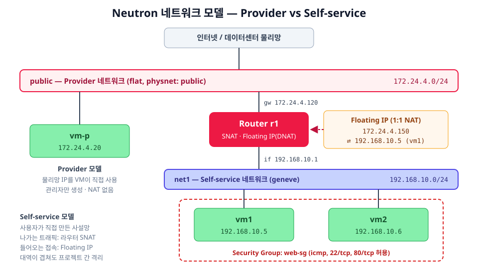
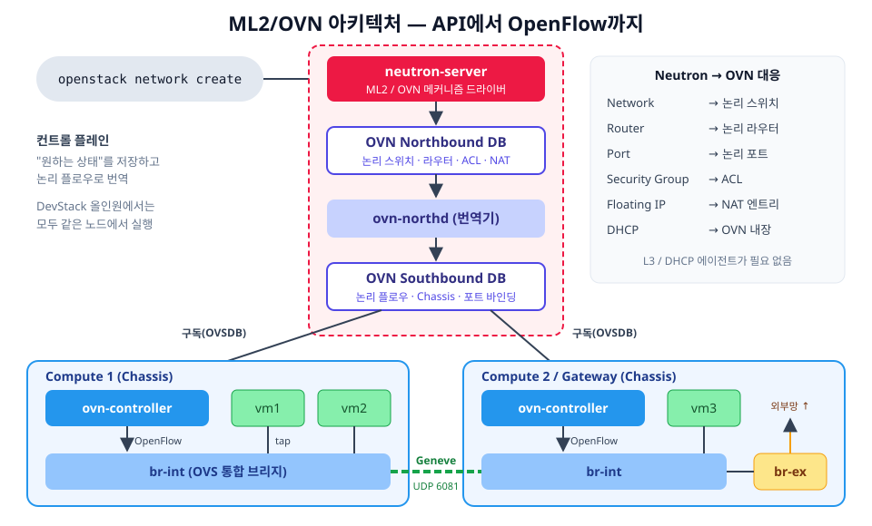
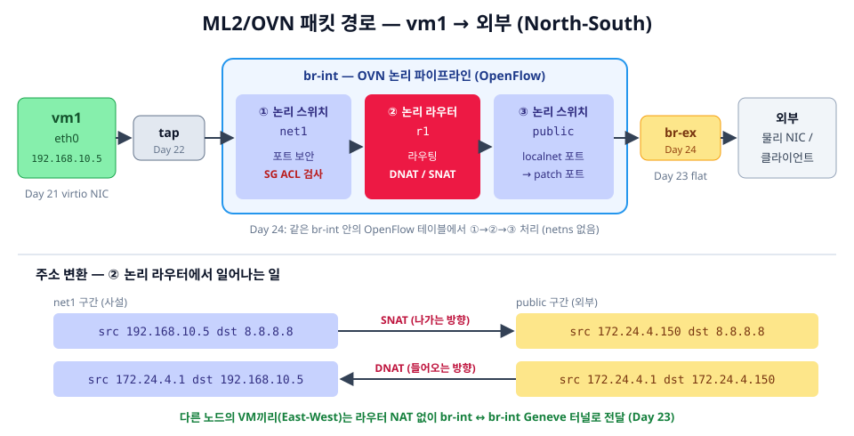

> **Chapter 4 · OpenStack** | 난이도 ★★★★☆ | 예상 소요 2 ~ 2.5시간

## 🎯 오늘의 목표

- Neutron이 **왜** 별도 서비스로 존재하는지, 무엇을 추상화하는지 설명할 수 있다
- **Provider 네트워크**와 **Self-service 네트워크**의 차이를 그림으로 설명할 수 있다
- 네트워크 · 서브넷 · 라우터 · Floating IP · Security Group을 CLI로 직접 만들 수 있다
- ML2/OVN 구조(Northbound DB → ovn-northd → Southbound DB → ovn-controller)를 이해한다
- VM 패킷이 tap → br-int → 논리 라우터 → br-ex로 나가는 경로를 Day 22~24 지식으로 따라갈 수 있다

---

## 1. 왜 Neutron인가?

Day 29에서 Nova로 VM을 만들 때 `--network private` 한 줄로 끝났습니다. 그런데 그 한 줄 뒤에서는 이런 일이 일어나야 합니다.

- VM에 줄 **IP를 할당**하고 (DHCP)
- 다른 프로젝트의 VM과 **트래픽이 섞이지 않게 격리**하고 (멀티테넌시)
- 사설망 VM이 **인터넷에 나갈 수 있게** 해주고 (라우팅 + SNAT)
- 외부에서 특정 VM으로 **들어올 수 있게** 해주고 (Floating IP = DNAT)
- 허용된 포트만 통과시켜야 합니다 (방화벽 = Security Group)

물리 서버 시절에는 네트워크 팀이 스위치에 VLAN을 잡고, 라우터에 NAT를 걸고, 방화벽 정책을 넣어줬습니다. 클라우드에서는 사용자가 **API 호출 한 번**으로 이걸 셀프서비스해야 하죠. 그 역할이 **Neutron(Networking-as-a-Service)** 입니다.

| 물리 네트워크 | Neutron 리소스 | Day 22~24에서 본 구현 기술 |
|---|---|---|
| 스위치 / VLAN 세그먼트 | **Network** | Linux bridge, OVS 브리지, VLAN, VXLAN/Geneve |
| IP 대역 + DHCP 서버 | **Subnet** | dnsmasq 또는 OVN 내장 DHCP |
| 스위치 포트 + 랜선 | **Port** | tap / veth 장치 |
| 라우터 + NAT 장비 | **Router** | network namespace + iptables, 또는 OVN 논리 라우터 |
| 공인 IP 매핑 | **Floating IP** | DNAT/SNAT 규칙 |
| 방화벽 | **Security Group** | iptables, 또는 OVN ACL(OpenFlow) |

> 💡 Neutron 자체는 **API와 DB**일 뿐입니다. "네트워크를 만들어라"라는 요청을 받아 실제 데이터 플레인(OVS, OVN, Linux bridge…)에 반영하는 일은 **ML2 플러그인의 메커니즘 드라이버**가 합니다. 2025년 현재 DevStack과 대부분의 신규 배포에서 기본값은 **ML2/OVN** 입니다.

---

## 2. 네트워크 모델 — Provider vs Self-service



| 구분 | Provider 네트워크 | Self-service(Tenant) 네트워크 |
|---|---|---|
| 누가 만드나 | **관리자** (물리망 정보를 알아야 함) | **일반 사용자** 누구나 |
| 물리망과의 관계 | 물리망(flat/VLAN)에 **직접 매핑** | 물리망 위에 **오버레이**(Geneve/VXLAN)로 생성 |
| IP 대역 | 데이터센터가 정한 실제 대역 | 사용자가 자유롭게 (다른 프로젝트와 겹쳐도 OK) |
| 외부 통신 | 물리 라우터가 처리 | Neutron **Router**의 SNAT / Floating IP |
| 대표 용도 | 외부(External) 네트워크, 고성능 직결 | 일반 서비스용 사설망 |
| DevStack 예시 | `public` (172.24.4.0/24, flat) | `private` (10.0.0.0/26, geneve) |

### 핵심 용어 정리

- **physnet(물리 네트워크 이름)** — `public` 같은 논리 이름을 실제 OVS 브리지(`br-ex`)에 연결하는 이름표. OVN에서는 `ovn-bridge-mappings=public:br-ex` 로 매핑됩니다.
- **segmentation type** — `flat`(태그 없음), `vlan`(802.1Q 태그, Day 23), `geneve`/`vxlan`(오버레이, Day 23)
- **External network** — `router:external=True` 가 붙은 provider 네트워크. 라우터의 게이트웨이와 Floating IP가 여기서 나옵니다.
- **Floating IP** — External 네트워크의 IP 하나를 사설 IP에 **1:1 NAT** 로 붙였다 뗐다 하는 IP. VM을 지워도 IP는 프로젝트에 남아 다른 VM에 다시 붙일 수 있습니다.
- **Security Group** — **포트(=VM NIC) 단위**로 붙는 상태 기반(stateful) 방화벽. 기본 정책은 "들어오는 건 전부 거부, 나가는 건 전부 허용".

> ⚠️ `default` Security Group은 **같은 그룹끼리만** 들어오는 트래픽을 허용합니다. 외부에서 ping/SSH가 안 되는 원인 1위가 바로 이것입니다.

---

## 3. ML2/OVN 아키텍처



Day 24에서 OVS는 "프로그래밍 가능한 스위치"라고 했습니다. 하지만 노드가 수십 대가 되면 각 노드의 OVS에 OpenFlow 규칙을 누가 일관되게 넣어줄까요? 그 답이 **OVN(Open Virtual Network)** — OVS 위에서 동작하는 **SDN 컨트롤 플레인**입니다.

| 구성 요소 | 위치 | 역할 |
|---|---|---|
| **neutron-server** + ML2/OVN 드라이버 | 컨트롤러 | Neutron API 요청을 OVN **Northbound DB**의 논리 객체로 변환 |
| **OVN Northbound DB** | 컨트롤러 | "원하는 상태" — 논리 스위치, 논리 라우터, ACL, NAT |
| **ovn-northd** | 컨트롤러 | NB의 논리 구성을 **논리 플로우(Logical Flow)** 로 번역해 SB에 기록 |
| **OVN Southbound DB** | 컨트롤러 | 논리 플로우 + 각 노드(Chassis) 정보 + 포트가 어느 노드에 있는지 |
| **ovn-controller** | 모든 노드 | SB를 구독해 자기 노드의 OVS(`br-int`)에 **실제 OpenFlow** 를 설치 |
| **ovn-metadata-agent** | 모든 compute | `169.254.169.254` 메타데이터 요청을 Nova로 프록시 (netns 사용) |

ML2/OVS(예전 방식)와 비교하면 차이가 확실합니다.

| 항목 | ML2/OVS (구 기본값) | ML2/OVN (현 기본값) |
|---|---|---|
| L3 라우터 | `qrouter-` netns + iptables (L3 agent) | OVN **분산 논리 라우터** (OpenFlow) |
| DHCP | `qdhcp-` netns + dnsmasq (DHCP agent) | OVN **내장 DHCP** (에이전트 없음) |
| Security Group | iptables (hybrid bridge) 또는 OVS firewall | OVN **ACL** → OpenFlow conntrack |
| 오버레이 | VXLAN | **Geneve** (UDP 6081) |
| 에이전트 수 | L2/L3/DHCP/Metadata agent 여러 개 | ovn-controller + metadata agent |

> 💡 **Geneve**는 Day 23의 VXLAN과 같은 "UDP로 L2 프레임을 감싸는" 오버레이지만, 헤더에 **가변 길이 옵션(TLV)** 을 붙일 수 있어 OVN이 "어느 논리 포트에서 왔는지" 같은 메타데이터를 함께 실어 보냅니다.

---

## 4. 실습 환경

- Day 26에서 구축한 **DevStack 올인원** (Ubuntu 24.04, `stack` 사용자, `~/devstack`)
- Neutron 백엔드: **ML2/OVN** (DevStack 기본값)
- DevStack이 미리 만들어 둔 리소스: `public`(external), `private`, `shared` 네트워크, `router1` 라우터

```bash
cd ~/devstack
source openrc demo demo        # demo 사용자 / demo 프로젝트로 전환

openstack network list
```

```
+--------------------------------------+---------+----------------------------------------------------------------------------+
| ID                                   | Name    | Subnets                                                                    |
+--------------------------------------+---------+----------------------------------------------------------------------------+
| 1c0e...                              | public  | 5a1d..., 9e3b...                                                           |
| 6f2a...                              | private | 0b7c..., c4d8...                                                           |
| 8d41...                              | shared  | 2e9f...                                                                    |
+--------------------------------------+---------+----------------------------------------------------------------------------+
```

`public`이 어떤 provider 네트워크인지는 관리자 권한으로 확인합니다.

```bash
source openrc admin admin
openstack network show public -c provider:network_type -c provider:physical_network -c router:external
```

```
+---------------------------+----------+
| Field                     | Value    |
+---------------------------+----------+
| provider:network_type     | flat     |
| provider:physical_network | public   |
| router:external           | External |
+---------------------------+----------+
```

→ `public`은 **flat provider 네트워크**이고, physnet `public`은 호스트의 `br-ex`에 매핑돼 있습니다.

---

## 5. 실습 — Self-service 네트워크부터 Floating IP까지

이제 demo 사용자로 돌아가서, 그림 2장의 오른쪽 구조(net1 + r1 + vm1 + FIP)를 직접 만들어 봅시다.

```bash
source ~/devstack/openrc demo demo
```

### 5-1. 네트워크와 서브넷

```bash
openstack network create net1

openstack subnet create subnet1 \
  --network net1 \
  --subnet-range 192.168.10.0/24 \
  --dns-nameserver 8.8.8.8

openstack network show net1 -c mtu -c status
```

```
+--------+--------+
| Field  | Value  |
+--------+--------+
| mtu    | 1442   |
| status | ACTIVE |
+--------+--------+
```

> 💡 MTU가 1500이 아니라 **1442**인 이유: Geneve 캡슐화 헤더(외부 IP+UDP+Geneve, 약 58바이트)만큼 빼 둔 것입니다. Day 23의 VXLAN MTU 이야기와 같은 원리입니다.

### 5-2. 라우터 — 외부로 나가는 길

```bash
openstack router create r1
openstack router set r1 --external-gateway public   # 게이트웨이 포트를 public에 연결 (SNAT 활성)
openstack router add subnet r1 subnet1             # net1 쪽 인터페이스(192.168.10.1) 연결

openstack router show r1 -c external_gateway_info -c status
```

`external_gateway_info`에 `172.24.4.x` 형태의 IP와 `"enable_snat": true`가 보이면 성공입니다.

### 5-3. Security Group

```bash
openstack security group create web-sg --description "Day30 SSH/ICMP/HTTP"

openstack security group rule create web-sg --protocol icmp
openstack security group rule create web-sg --protocol tcp --dst-port 22
openstack security group rule create web-sg --protocol tcp --dst-port 80

openstack security group rule list web-sg
```

> `--remote-ip`를 생략하면 `0.0.0.0/0`(어디서든)으로 들어갑니다. 운영에서는 `--remote-ip 203.0.113.0/24`처럼 좁히세요.

### 5-4. VM 생성

```bash
# Day 29에서 키페어를 만들지 않았다면
openstack keypair create --public-key ~/.ssh/id_ed25519.pub mykey

IMAGE=$(openstack image list -f value -c Name | grep -m1 cirros)
echo $IMAGE    # 예: cirros-0.6.3-x86_64-disk

openstack server create vm1 \
  --flavor m1.tiny \
  --image "$IMAGE" \
  --network net1 \
  --security-group web-sg \
  --key-name mykey \
  --wait

openstack server list
```

```
+--------------------------------------+------+--------+-------------------+--------------------------+---------+
| ID                                   | Name | Status | Networks          | Image                    | Flavor  |
+--------------------------------------+------+--------+-------------------+--------------------------+---------+
| 3e7a...                              | vm1  | ACTIVE | net1=192.168.10.5 | cirros-0.6.3-x86_64-disk | m1.tiny |
+--------------------------------------+------+--------+-------------------+--------------------------+---------+
```

### 5-5. Floating IP 붙이기

```bash
# public 대역에서 IP 하나를 프로젝트로 할당받고, 주소만 변수에 저장
FIP=$(openstack floating ip create public -f value -c floating_ip_address)
echo $FIP    # 예: 172.24.4.150

openstack server add floating ip vm1 $FIP

openstack server show vm1 -c addresses
```

```
+-----------+-----------------------------------+
| Field     | Value                             |
+-----------+-----------------------------------+
| addresses | net1=192.168.10.5, 172.24.4.150   |
+-----------+-----------------------------------+
```

### 5-6. 접속 확인

DevStack 호스트는 `br-ex`에 `172.24.4.1`을 가지고 있어서 public 대역에 바로 닿습니다.

```bash
ping -c 3 $FIP
ssh cirros@$FIP          # 키 인증으로 접속
```

VM 안에서 바깥으로 나가는 것(SNAT)도 확인합니다.

```bash
# vm1 내부
ip addr show eth0        # 192.168.10.5 — VM은 자기 FIP를 모른다! (NAT는 라우터가 함)
ping -c 2 172.24.4.1     # 라우터 SNAT를 거쳐 호스트 br-ex까지
exit
```

> ⚠️ VM 안에서 `ip addr`를 보면 Floating IP가 **없습니다.** Floating IP는 VM NIC에 붙는 게 아니라 **라우터의 NAT 테이블**에만 존재합니다. Docker의 `-p 8080:80`(Day 01)이 컨테이너 안에서 안 보이는 것과 같은 이치입니다.

### 5-7. Security Group 효과 확인

```bash
openstack security group rule list web-sg -f value -c ID -c "IP Protocol" | grep icmp
openstack security group rule delete <icmp-규칙-ID>

ping -c 3 -W 1 $FIP       # 100% packet loss — ACL이 막음
ssh cirros@$FIP           # SSH는 여전히 됨 (22/tcp는 허용)

openstack security group rule create web-sg --protocol icmp   # 원복
```

---

## 6. OVN 내부 들여다보기



Neutron API로 만든 것들이 OVN에 어떻게 저장됐는지 확인해 봅니다. (DevStack 호스트에서, `sudo` 필요)

### 6-1. Northbound DB — 논리 구성

```bash
sudo ovn-nbctl show
```

```
switch 7c1f... (neutron-6a0e...) (aka net1)
    port 9a8b...
        type: router
        router-port: lrp-9a8b...
    port 4d2e...
        addresses: ["fa:16:3e:12:34:56 192.168.10.5"]
router 1e2f... (neutron-8c9d...) (aka r1)
    port lrp-9a8b...
        mac: "fa:16:3e:aa:bb:cc"
        networks: ["192.168.10.1/24"]
    port lrp-0f3c...
        mac: "fa:16:3e:dd:ee:ff"
        networks: ["172.24.4.120/24"]
        gateway chassis: [...]
    nat 5b6c...
        external ip: "172.24.4.150"
        logical ip: "192.168.10.5"
        type: "dnat_and_snat"
    nat 8e1a...
        external ip: "172.24.4.120"
        logical ip: "192.168.10.0/24"
        type: "snat"
```

(출력은 일부이며 ID는 환경마다 다릅니다.) 읽는 법:

- Neutron **network** = OVN **logical switch** (`neutron-<네트워크 UUID>`)
- Neutron **router** = OVN **logical router**, 인터페이스는 `lrp-` 포트
- **Floating IP** = `dnat_and_snat` NAT 엔트리, 라우터 기본 SNAT = `snat` 엔트리

### 6-2. Security Group = Port Group + ACL

```bash
sudo ovn-nbctl --columns=name,external_ids list Port_Group
# name : pg_<SG UUID의 - 를 _ 로 바꾼 값>

sudo ovn-nbctl acl-list pg_<위에서-찾은-이름>
```

```
from-lport  1002 (inport == @pg_... && ip4) allow-related
  to-lport  1002 (outport == @pg_... && ip4 && ip4.src == 0.0.0.0/0 && icmp4) allow-related
  to-lport  1002 (outport == @pg_... && ip4 && ip4.src == 0.0.0.0/0 && tcp && tcp.dst == 22) allow-related
  to-lport  1002 (outport == @pg_... && ip4 && ip4.src == 0.0.0.0/0 && tcp && tcp.dst == 80) allow-related
```

`allow-related`가 바로 **stateful** — 허용된 연결의 응답 패킷은 conntrack이 자동으로 통과시킵니다.

### 6-3. Southbound DB — 노드(Chassis)와 포트 바인딩

```bash
sudo ovn-sbctl show
```

```
Chassis "b0f1..."
    hostname: devstack
    Encap geneve
        ip: "10.0.2.15"
        options: {csum="true"}
    Port_Binding "4d2e..."      # vm1의 포트가 이 노드에 바인딩됨
    Port_Binding "cr-lrp-0f3c..."   # 라우터 게이트웨이 포트도 이 노드에
```

멀티노드라면 `Chassis`가 여러 개 나오고, 서로 다른 Chassis의 VM끼리는 `Encap geneve`의 IP로 **터널**을 맺습니다.

### 6-4. 실제 OVS — Day 24 복습

```bash
sudo ovs-vsctl show
```

```
    Bridge br-int
        fail_mode: secure
        Port tap4d2e...            # vm1의 NIC (Day 22: tap 장치)
            Interface tap4d2e...
        Port patch-br-int-to-provnet-...
            Interface patch-br-int-to-provnet-...
                type: patch
    Bridge br-ex
        Port patch-provnet-...-to-br-int
            Interface patch-provnet-...-to-br-int
                type: patch
        Port br-ex
            Interface br-ex
                type: internal
```

```bash
sudo ovs-ofctl dump-flows br-int | wc -l   # 수백~수천 줄: ovn-controller가 넣은 OpenFlow
sudo ip netns                              # ovnmeta-<네트워크 UUID> : 메타데이터 프록시용 netns (Day 22)
```

### 6-5. 패킷 경로 정리 (vm1 → 외부)

| 단계 | 위치 | 일어나는 일 | 연결되는 Day |
|---|---|---|---|
| ① | VM `eth0` → `tap` | VM의 virtio NIC가 호스트의 tap 장치로 연결 | Day 21, 22 |
| ② | `br-int` — 논리 스위치 net1 | 포트 보안(MAC/IP 위조 차단), **SG ACL 검사** | Day 24 |
| ③ | `br-int` — 논리 라우터 r1 | 라우팅 + **SNAT/DNAT** (192.168.10.5 ↔ 172.24.4.150) | Day 22 (NAT 개념) |
| ④ | `br-int` — 논리 스위치 public | `localnet` 포트 → patch 포트로 `br-ex`에 전달 | Day 24 |
| ⑤ | `br-ex` → 물리 NIC | 물리망(flat)으로 송출 | Day 23 |

> 💡 ②~④가 **전부 같은 `br-int` 안의 OpenFlow 테이블**에서 처리됩니다. ML2/OVS 시절처럼 `qrouter-` netns를 거치지 않기 때문에 `ip netns`에 라우터가 안 보이는 것이 정상입니다.

---

## 7. (참고) Provider 네트워크에 직접 붙이기

관리자는 VM을 provider 네트워크에 바로 연결할 수도 있습니다. NAT 없이 물리망 IP를 그대로 쓰는 방식입니다.

```bash
source ~/devstack/openrc admin admin
openstack server create vm-p \
  --flavor m1.tiny --image "$IMAGE" \
  --network public --security-group default --wait
openstack server show vm-p -c addresses     # public=172.24.4.x — Floating IP 없이 바로 외부 대역
```

> ⚠️ 운영 환경의 provider 네트워크는 물리 스위치에 VLAN 설정이 맞아야 하고, IP 대역을 데이터센터와 협의해야 합니다. 그래서 **관리자만** 만들 수 있습니다.

---

## 8. 정리

```bash
source ~/devstack/openrc admin admin
openstack server delete --wait vm-p

source ~/devstack/openrc demo demo
openstack server delete --wait vm1
openstack floating ip delete $FIP
openstack router remove subnet r1 subnet1
openstack router delete r1
openstack network delete net1          # 서브넷도 같이 삭제
openstack security group delete web-sg
```

> 라우터는 **인터페이스를 먼저 떼야** 삭제됩니다. 순서가 중요합니다 — Day 32 Heat는 이 순서를 자동으로 계산해 줍니다.

---

## 9. 트러블슈팅

| 증상 | 원인 | 해결 |
|---|---|---|
| Floating IP로 ping/SSH가 안 됨 | SG에 icmp/22번 규칙 없음 (특히 `default` SG만 붙인 경우) | `openstack security group rule create <sg> --protocol icmp` 등 추가 |
| VM은 ACTIVE인데 IP를 못 받음 / SSH 키가 안 들어감 | 메타데이터·DHCP 경로 문제 | `openstack console log show vm1`로 부팅 로그 확인, `sudo ip netns`에 `ovnmeta-` netns가 있는지 확인 |
| `router set --external-gateway` 시 `Network ... could not be found` | 대상 네트워크가 external이 아니거나 이름 오타 | `openstack network list --external` 로 확인 |
| `router delete` 시 `Router ... still has ports` | 서브넷 인터페이스가 남아 있음 | `openstack router remove subnet r1 subnet1` 먼저 |
| `IpAddressGenerationFailure` / `No more IP addresses available` | 서브넷(또는 public 대역) IP 고갈 | 안 쓰는 Floating IP/포트 삭제, 서브넷 범위 확대 |
| SSH는 붙는데 큰 파일 전송 시 멈춤 | MTU 불일치 (VM이 1500으로 전송) | 네트워크 MTU(1442) 확인, 이미지가 DHCP MTU 옵션을 따르는지 확인 |
| 다른 PC에서 172.24.4.x로 접속 불가 | DevStack의 public은 호스트 내부 br-ex 대역 | DevStack 호스트에서 테스트하거나, 실제 물리 NIC를 br-ex에 연결하는 구성 필요 (Day 33 멀티노드) |
| Neutron 서버 에러 로그를 보고 싶음 | — | `sudo systemctl list-units 'devstack@*'` 로 유닛 이름 확인 후 `sudo journalctl -u 'devstack@q-*' -u 'devstack@neutron*' -f` |

---

## 10. 핵심 정리

- Neutron = 네트워크의 **API + DB**, 실제 동작은 **ML2 메커니즘 드라이버**(현 기본: **OVN**)가 담당
- **Provider 네트워크**: 관리자가 물리망(flat/VLAN)에 매핑 / **Self-service**: 사용자가 오버레이(Geneve) 위에 자유롭게
- 사설망의 외부 통신 = **Router(SNAT)**, 외부에서 들어오기 = **Floating IP(DNAT, 1:1 NAT)**
- **Security Group** = 포트 단위 stateful 방화벽, 기본은 인바운드 전부 거부
- OVN 흐름: neutron-server → **NB DB** → **ovn-northd** → **SB DB** → 각 노드 **ovn-controller** → `br-int` OpenFlow
- 패킷 경로: VM → tap → **br-int(스위치 → 라우터 → 스위치)** → patch → **br-ex** → 물리 NIC, 노드 간은 **Geneve 터널**

---

## 11. 셀프 체크

<details>
<summary>Q1. VM 안에서 <code>ip addr</code>를 하면 Floating IP가 보이지 않는 이유는?</summary>

Floating IP는 VM NIC에 할당되는 것이 아니라 **라우터의 NAT 규칙**(OVN의 `dnat_and_snat` 엔트리)으로만 존재하기 때문입니다. VM은 자기 사설 IP만 알고, 라우터가 들어오고 나가는 패킷의 주소를 바꿔줍니다.
</details>

<details>
<summary>Q2. 일반 사용자가 provider 네트워크를 만들 수 없는 이유는?</summary>

provider 네트워크는 **실제 물리망**(physnet, VLAN ID, IP 대역)에 직접 매핑되기 때문입니다. 아무나 만들면 다른 테넌트나 데이터센터 망과 충돌할 수 있으므로 물리 구성을 아는 관리자만 생성합니다.
</details>

<details>
<summary>Q3. ML2/OVN 환경에서 <code>ip netns</code>에 <code>qrouter-</code>가 보이지 않는 것은 정상인가?</summary>

정상입니다. OVN은 라우터를 netns + iptables가 아니라 `br-int`의 **OpenFlow 기반 논리 라우터**로 구현합니다. 보이는 netns는 메타데이터 프록시용 `ovnmeta-` 뿐입니다.
</details>

<details>
<summary>Q4. Self-service 네트워크의 MTU가 1442인 이유는?</summary>

Self-service 네트워크는 **Geneve 오버레이**로 노드 간에 전달되므로, 원래 프레임 앞에 외부 IP/UDP/Geneve 헤더가 붙습니다. 물리망 MTU 1500을 넘지 않도록 그 오버헤드만큼 줄인 값입니다.
</details>

<details>
<summary>Q5. ovn-northd와 ovn-controller의 역할 차이는?</summary>

**ovn-northd**는 컨트롤러에서 NB DB의 논리 구성(스위치·라우터·ACL)을 **논리 플로우**로 번역해 SB DB에 씁니다. **ovn-controller**는 모든 노드에서 SB DB를 읽어 **자기 노드의 OVS에 실제 OpenFlow 규칙**을 설치합니다.
</details>

---

## ⏭️ 다음 예고 — Day 31. Cinder & Swift — 블록/오브젝트 스토리지

VM을 지우면 루트 디스크의 데이터도 함께 사라집니다. 오늘 만든 네트워크처럼 **VM과 독립된 수명**을 갖는 디스크가 필요하다면? 붙였다 뗄 수 있는 블록 스토리지 **Cinder**와, S3처럼 HTTP로 파일을 넣고 꺼내는 오브젝트 스토리지 **Swift**를 다룹니다.
