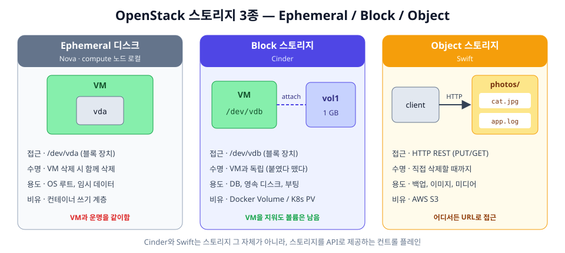
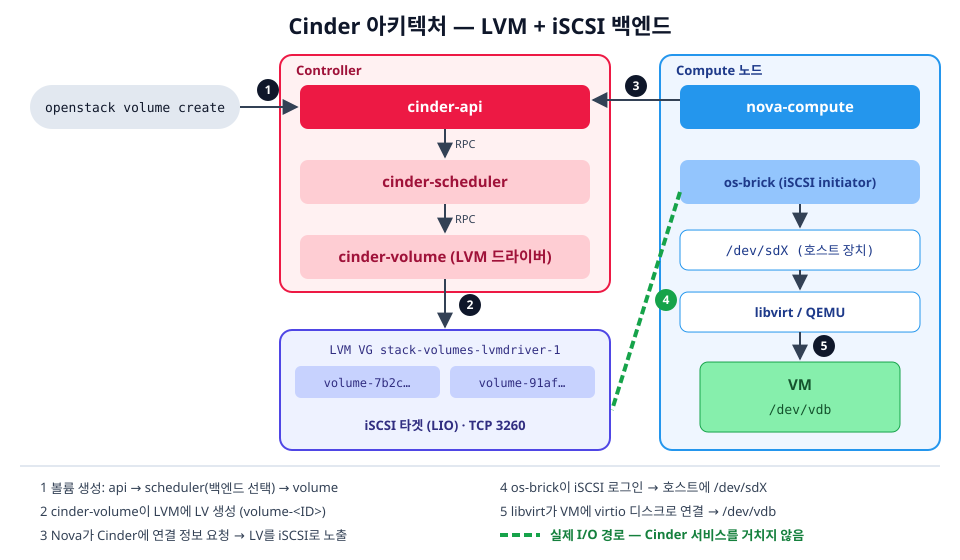
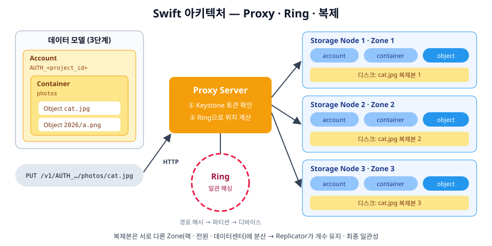

> **Chapter 4 · OpenStack** | 난이도 ★★★☆☆ | 예상 소요 2시간

## 🎯 오늘의 목표

- OpenStack의 세 가지 스토리지(**Ephemeral / Block / Object**)를 구분할 수 있다
- Cinder의 구성 요소(api / scheduler / volume)와 **LVM + iSCSI** 백엔드 동작을 설명할 수 있다
- 볼륨을 만들고, VM에 붙이고, 떼고, 스냅샷을 찍고, **볼륨으로 부팅**할 수 있다
- Swift의 **Account / Container / Object** 구조와 **Ring**, 복제 원리를 설명할 수 있다
- Swift에 파일을 올리고 내려받을 수 있다

---

## 1. 왜 스토리지 서비스가 따로 필요한가?

Day 29에서 만든 VM의 루트 디스크는 `/opt/stack/data/nova/instances/<UUID>/disk`처럼 **compute 노드의 로컬 파일**이었습니다. 이 디스크는 VM과 운명을 같이합니다.

- VM을 `delete` 하면 → 디스크도 삭제
- compute 노드가 죽으면 → 디스크도 접근 불가
- 디스크를 다른 VM으로 옮겨 붙이기 → 불가능

Docker에서도 똑같은 문제를 겪었죠. 컨테이너 쓰기 계층은 `docker rm`과 함께 사라졌고, 그래서 **Volume**(Day 04)을 썼습니다. Kubernetes에서는 **PV/PVC**(Day 14)였고요. OpenStack에서 그 역할을 하는 것이 **Cinder**입니다.

그리고 "디스크"가 아니라 **파일(객체)** 을 HTTP로 넣고 꺼내는 저장소 — 이미지, 백업, 로그, 정적 파일 — 가 필요할 때 쓰는 것이 **Swift**입니다.



| 구분 | Ephemeral (Nova) | Block (Cinder) | Object (Swift) |
|---|---|---|---|
| 접근 방식 | VM의 블록 장치 (`/dev/vda`) | VM의 블록 장치 (`/dev/vdb`) | **HTTP REST API** (PUT/GET) |
| 수명 | VM과 함께 삭제 | **VM과 독립** — 명시적으로 삭제할 때까지 | 명시적으로 삭제할 때까지 |
| 동시 접근 | 1개 VM | 기본 1개 VM (multiattach 예외) | 무제한 클라이언트 |
| 크기 단위 | flavor가 결정 | 사용자가 GB 단위로 지정 | 객체당 최대 5GB (분할 업로드로 그 이상) |
| 주 용도 | OS 루트 디스크, 임시 데이터 | DB 데이터, 영속 디스크, 부팅 볼륨 | 백업, 이미지, 미디어, 로그 |
| 비슷한 것 | Docker 컨테이너 쓰기 계층 | Docker Volume / K8s PV, AWS EBS | AWS S3 |

---

## 2. Cinder 아키텍처



| 구성 요소 | 역할 |
|---|---|
| **cinder-api** | REST API 접수 (`openstack volume ...`), Keystone 토큰 검증 |
| **cinder-scheduler** | 여러 백엔드 중 **어디에 볼륨을 만들지** 결정 (용량, 볼륨 타입 기준) — Nova scheduler와 같은 역할 |
| **cinder-volume** | 실제 스토리지 백엔드 드라이버를 호출해 볼륨 생성/삭제/스냅샷 |
| **cinder-backup** | 볼륨을 Swift/Ceph 등에 백업 (선택) |
| **스토리지 백엔드** | LVM, Ceph RBD, NetApp, Pure 등 100여 종 드라이버 |

### 볼륨이 VM에 붙는 과정 (LVM + iSCSI)

1. `openstack volume create` → cinder-volume이 LVM 볼륨 그룹에 **논리 볼륨(LV)** 생성
2. `openstack server add volume` → Nova가 Cinder에 "이 볼륨 연결 정보 줘" 요청
3. cinder-volume이 해당 LV를 **iSCSI 타겟**으로 노출 (LIO)
4. compute 노드의 **os-brick**이 iSCSI 이니시에이터로 로그인 → 호스트에 `/dev/sdX` 생김
5. libvirt가 그 장치를 VM에 virtio 디스크로 연결 → VM 안에서 `/dev/vdb`

> 💡 Cinder는 **데이터 경로에 끼지 않습니다.** 볼륨을 만들고 연결 정보를 넘겨줄 뿐, 실제 I/O는 compute 노드 ↔ 스토리지 사이에서 직접 오갑니다. Kubernetes의 CSI 드라이버(Day 14)와 같은 "컨트롤 플레인" 역할이죠.

### 볼륨 타입과 백엔드

운영 환경에서는 백엔드를 여러 개 붙이고 **볼륨 타입**으로 고르게 합니다. K8s의 StorageClass와 같은 개념입니다.

| Cinder | Kubernetes (Day 14) |
|---|---|
| Volume Type (`ssd`, `hdd`) | StorageClass |
| Volume | PersistentVolume |
| `openstack volume create --type ssd` | PVC의 `storageClassName: ssd` |

---

## 3. 실습 환경

- Day 26의 **DevStack 올인원** (Ubuntu 24.04, `~/devstack`)
- **Cinder는 DevStack 기본 활성화** — 백엔드는 루프백 파일 위의 **LVM**(`stack-volumes-lvmdriver-1`), 타겟은 LIO iSCSI
- **Swift는 기본 비활성화** — 5장에서 `local.conf`에 추가합니다

```bash
cd ~/devstack
source openrc admin admin

openstack volume service list
```

```
+------------------+-----------------------------+------+---------+-------+----------------------------+
| Binary           | Host                        | Zone | Status  | State | Updated At                 |
+------------------+-----------------------------+------+---------+-------+----------------------------+
| cinder-scheduler | devstack                    | nova | enabled | up    | 2026-11-15T03:12:41.000000 |
| cinder-volume    | devstack@lvmdriver-1        | nova | enabled | up    | 2026-11-15T03:12:44.000000 |
+------------------+-----------------------------+------+---------+-------+----------------------------+
```

```bash
openstack volume type list       # lvmdriver-1, __DEFAULT__
sudo vgs                         # stack-volumes-lvmdriver-1 VG 확인
```

---

## 4. 실습 — Cinder

```bash
source ~/devstack/openrc demo demo
IMAGE=$(openstack image list -f value -c Name | grep -m1 cirros)
```

### 4-1. 테스트용 VM 준비

```bash
openstack server create vm1 \
  --flavor m1.tiny --image "$IMAGE" \
  --network private --key-name mykey --wait
```

> 키페어가 없다면 Day 30처럼 `openstack keypair create --public-key ~/.ssh/id_ed25519.pub mykey` 먼저.

### 4-2. 볼륨 생성

```bash
openstack volume create --size 1 vol1
openstack volume list
```

```
+--------------------------------------+------+-----------+------+-------------+
| ID                                   | Name | Status    | Size | Attached to |
+--------------------------------------+------+-----------+------+-------------+
| 7b2c...                              | vol1 | available |    1 |             |
+--------------------------------------+------+-----------+------+-------------+
```

호스트에서 실제 LV가 생겼는지 확인합니다.

```bash
sudo lvs stack-volumes-lvmdriver-1
#  LV                                          VG                         Attr       LSize
#  volume-7b2c...                              stack-volumes-lvmdriver-1  Vwi-a-tz-- 1.00g
```

→ Cinder 볼륨 = LVM 논리 볼륨 하나. 이름도 `volume-<볼륨 ID>`로 1:1 대응합니다.

### 4-3. VM에 연결

```bash
openstack server add volume vm1 vol1
openstack volume list
```

```
| 7b2c... | vol1 | in-use | 1 | Attached to vm1 on /dev/vdb |
```

호스트에서 iSCSI 타겟과 세션을 확인해 봅니다.

```bash
sudo targetcli ls /iscsi        # Cinder가 만든 iqn.2010-10.org.openstack:volume-7b2c... 타겟 (LIO 기준)
sudo iscsiadm -m session        # compute(os-brick)가 로그인한 세션
```

VM 안에서 새 디스크를 확인합니다. (Floating IP가 없다면 `openstack console url show vm1`의 noVNC 콘솔 사용)

```bash
# vm1 내부
cat /proc/partitions
```

```
major minor  #blocks  name
 253        0    1048576 vda
 253        1    1036271 vda1
  ...
 253       16    1048576 vdb        ← 새로 붙은 1GB Cinder 볼륨
```

> 💡 Ubuntu 클라우드 이미지로 VM을 만들었다면 `sudo mkfs.ext4 /dev/vdb && sudo mount /dev/vdb /mnt`로 파일을 써 두고, 볼륨을 떼서 **다른 VM에 붙여도 파일이 그대로** 있는 것을 확인해 보세요. 이게 "VM과 독립된 수명"입니다.

### 4-4. 분리 · 스냅샷 · 확장

```bash
openstack server remove volume vm1 vol1        # 분리 → 다시 available

openstack volume snapshot create --volume vol1 vol1-snap
openstack volume snapshot list

# 스냅샷으로부터 새 볼륨 복제
openstack volume create --snapshot vol1-snap --size 1 vol1-clone

# 용량 확장 (분리된 상태에서)
openstack volume set --size 2 vol1
openstack volume show vol1 -c size -c status
```

> ⚠️ 볼륨 **축소는 불가능**합니다. 확장만 됩니다. 그리고 스냅샷이 남아 있는 볼륨은 삭제할 수 없습니다(스냅샷 먼저 삭제).

### 4-5. 볼륨으로 부팅 (Boot from Volume)

루트 디스크 자체를 Cinder 볼륨으로 만들면, VM을 지워도 OS 디스크가 남습니다.

```bash
openstack volume create --image "$IMAGE" --size 1 --bootable bootvol

openstack server create vm-bfv \
  --flavor m1.tiny \
  --volume bootvol \
  --network private --key-name mykey --wait

openstack server show vm-bfv -c image -c volumes_attached
```

```
+------------------+-------------------------------------------+
| Field            | Value                                     |
+------------------+-------------------------------------------+
| image            | N/A (booted from volume)                  |
| volumes_attached | delete_on_termination='False', id='...'   |
+------------------+-------------------------------------------+
```

`delete_on_termination=False` — VM을 지워도 `bootvol`은 `available`로 남아 **다른 VM을 같은 디스크로 다시 부팅**할 수 있습니다.

---

## 5. Swift 아키텍처



### 데이터 모델: Account / Container / Object

```
/v1/AUTH_<project_id>          ← Account   (= Keystone 프로젝트)
    /photos                    ← Container (= S3의 버킷)
        /2026/cat.jpg          ← Object    (= 파일 + 메타데이터)
```

> 폴더처럼 보이는 `2026/`은 실제 디렉터리가 아니라 **객체 이름의 일부**일 뿐입니다. Swift에는 계층 구조가 Account → Container → Object 3단계뿐입니다.

### 구성 요소

| 구성 요소 | 역할 |
|---|---|
| **Proxy Server** | 모든 요청의 입구. 인증 확인 후 **Ring**으로 저장 위치를 계산해 스토리지 노드로 전달 |
| **Account Server** | 계정별 컨테이너 목록 관리 |
| **Container Server** | 컨테이너별 객체 목록 관리 |
| **Object Server** | 실제 객체 파일을 디스크(XFS 등)에 저장 |
| **Ring** | "이 객체는 어느 노드 어느 디스크에?"를 계산하는 **일관 해싱(consistent hashing)** 테이블 |
| **Replicator / Auditor** | 복제본 개수 유지, 손상된 객체 감지 후 복구 |

### Ring과 복제

- 객체 경로를 해시 → **파티션** 번호 → Ring에서 그 파티션의 **복제본 3개가 놓일 디바이스** 조회
- 복제본은 서로 다른 **Zone/Region**(랙, 전원, 데이터센터)에 분산 → 노드 하나가 죽어도 데이터 유지
- 디스크를 추가하면 Ring을 다시 만들고(rebalance), 일부 파티션만 이동 → 전체 재배치 없음
- **최종 일관성(Eventual Consistency)** — 쓰기 직후 목록에 바로 안 보일 수 있지만 결국 맞춰짐

| 비교 | Cinder (블록) | Swift (오브젝트) |
|---|---|---|
| 확장 방식 | 백엔드 스토리지 용량에 의존 | 노드/디스크 추가로 **수평 확장** (PB급) |
| 일관성 | 강한 일관성 (디스크) | 최종 일관성 |
| 수정 | 블록 단위 부분 수정 | 객체 **전체 교체**만 가능 |
| 접근 | VM 내부에서만 | 어디서든 HTTP |

> 💡 Swift는 `s3api` 미들웨어를 켜면 **S3 호환 API**도 제공합니다. 실무에서는 Swift 대신 **Ceph RGW**로 오브젝트 스토리지를 제공하는 경우도 많습니다(Ceph 하나로 Cinder·Glance·Nova·오브젝트를 모두 처리).

---

## 6. 실습 — Swift

### 6-1. DevStack에 Swift 켜기

`~/devstack/local.conf`의 `[[local|localrc]]` 섹션에 추가합니다.

```ini
enable_service s-proxy s-object s-container s-account
SWIFT_HASH=66a3d6b56c1f479c8b4e70ab5c2000f5
SWIFT_REPLICAS=1
```

| 설정 | 의미 |
|---|---|
| `enable_service s-*` | proxy / object / container / account 서버 활성화 |
| `SWIFT_HASH` | Ring 해시에 쓰는 고유 값 (아무 랜덤 문자열, **한 번 정하면 바꾸면 안 됨**) |
| `SWIFT_REPLICAS=1` | 올인원이라 복제본 1개 (운영은 3) |

```bash
cd ~/devstack
./unstack.sh
./stack.sh
```

> ⚠️ `unstack.sh` → `stack.sh`는 DevStack 리소스를 **새로 만듭니다.** 앞에서 만든 VM/볼륨은 정리된다고 생각하세요. 재설치 후 Cinder 실습을 다시 해도 좋습니다.

```bash
source ~/devstack/openrc demo demo
openstack catalog list | grep -A3 object-store   # swift 엔드포인트 확인
```

### 6-2. 컨테이너와 객체

```bash
openstack container create photos

echo "hello swift" > hello.txt
openstack object create photos hello.txt
openstack object create photos hello.txt --name 2026/hello-copy.txt   # 이름에 / 포함

openstack object list photos
```

```
+---------------------+
| Name                |
+---------------------+
| 2026/hello-copy.txt |
| hello.txt           |
+---------------------+
```

```bash
openstack object show photos hello.txt          # 크기, etag(MD5), content-type
openstack object save photos hello.txt --file /tmp/downloaded.txt
cat /tmp/downloaded.txt                          # hello swift

openstack container show photos                  # 객체 수, 바이트 수
openstack object store account show              # 계정 전체 사용량
```

### 6-3. HTTP로 직접 접근하기

Swift의 본질은 REST API입니다. curl로 직접 호출해 봅니다.

```bash
# swift CLI(python-swiftclient)가 토큰과 스토리지 URL을 export 문으로 출력해 줌
# (없으면: pip install python-swiftclient)
eval $(swift auth)
echo $OS_STORAGE_URL       # http://<호스트>:8080/v1/AUTH_<project_id>

curl -s -H "X-Auth-Token: $OS_AUTH_TOKEN" $OS_STORAGE_URL/photos            # 객체 목록 (텍스트)
curl -s -H "X-Auth-Token: $OS_AUTH_TOKEN" $OS_STORAGE_URL/photos/hello.txt  # 객체 내용
curl -s -X PUT -H "X-Auth-Token: $OS_AUTH_TOKEN" --data-binary @/etc/hostname \
  $OS_STORAGE_URL/photos/hostname.txt -o /dev/null -w "%{http_code}\n"   # 201
```

> ⚠️ 실습이 끝나면 `unset OS_STORAGE_URL OS_AUTH_TOKEN` 으로 지워 두세요. 두 변수가 남아 있으면 이후 `swift` 명령이 그 토큰을 계속 재사용하다가, 토큰이 만료되면 `401`이 납니다.

`openstack object create`도 결국 이 `PUT` 요청을 보내는 것뿐입니다.

### 6-4. 스토리지 노드 쪽 확인

```bash
sudo find /opt/stack/data/swift -name "*.data" | head
```

객체가 `.../objects/<파티션>/<해시 접미사>/<해시>/<타임스탬프>.data` 형태의 **일반 파일**로 저장된 것을 볼 수 있습니다. 경로 안의 파티션 번호가 Ring이 계산한 값입니다.

---

## 7. 정리

```bash
source ~/devstack/openrc demo demo
openstack object delete photos hello.txt 2026/hello-copy.txt hostname.txt
openstack container delete photos

# 6-1에서 재설치하지 않았다면 Cinder 리소스도 정리
openstack server delete --wait vm1 vm-bfv
openstack volume delete vol1-clone
openstack volume snapshot delete vol1-snap
openstack volume delete vol1 bootvol
```

> `openstack container delete --recursive photos`를 쓰면 객체까지 한 번에 지웁니다.

---

## 8. 트러블슈팅

| 증상 | 원인 | 해결 |
|---|---|---|
| 볼륨이 `error` 상태 | cinder-volume이 LV 생성 실패 (VG 공간 부족 등) | `sudo vgs`로 여유 공간 확인, `sudo journalctl -u devstack@c-vol -n 100` |
| 볼륨이 `creating`에서 멈춤 | cinder-volume 서비스 down | `openstack volume service list`에서 State 확인, `sudo systemctl restart devstack@c-vol` |
| `server add volume` 후 `attaching`에서 멈춤 | iSCSI 로그인 실패 | `sudo iscsiadm -m session`, `sudo journalctl -u devstack@n-cpu -n 100`에서 os-brick 에러 확인 |
| `Invalid volume: Volume status must be available` | in-use 볼륨을 삭제/확장 시도 | `openstack server remove volume` 먼저 |
| 볼륨 삭제 시 `Volume ... has snapshots` | 의존하는 스냅샷 존재 | `openstack volume snapshot delete` 먼저 |
| `openstack container create` 시 `public endpoint for object-store service not found` | Swift 미활성화 | 6-1처럼 `enable_service s-proxy ...` 후 재스택 |
| Swift `401 Unauthorized` | 토큰 만료 / 다른 프로젝트 토큰 | `openstack token issue`로 재발급, `source openrc`의 프로젝트 확인 |
| Swift `503 Service Unavailable` | Ring의 디바이스에 접근 불가 | `sudo journalctl -u 'devstack@s-*' -n 100` |

---

## 9. 핵심 정리

- **Ephemeral**(VM과 함께 사라짐) / **Block = Cinder**(VM과 독립된 디스크) / **Object = Swift**(HTTP로 접근하는 파일)
- Cinder: **api → scheduler → volume → 백엔드 드라이버**, 실제 I/O는 compute ↔ 스토리지 직접(iSCSI, RBD 등)
- DevStack의 Cinder 볼륨 = **LVM 논리 볼륨**, iSCSI(LIO)로 compute에 연결 → VM에서 `/dev/vdb`
- 볼륨 타입 ≈ K8s StorageClass, 볼륨 ≈ PV — **Docker Volume → K8s PV → Cinder**로 이어지는 같은 아이디어
- Swift: **Account / Container / Object** 3단계, Proxy가 **Ring(일관 해싱)** 으로 위치 계산, 복제본을 Zone에 분산, 최종 일관성
- 둘 다 스토리지 자체가 아니라 **스토리지를 API로 제공하는 컨트롤 플레인**

---

## 10. 셀프 체크

<details>
<summary>Q1. VM을 삭제해도 데이터가 남게 하려면 어떤 두 가지 방법이 있나?</summary>

① 데이터를 별도 **Cinder 볼륨**에 저장하고 VM에 붙여 쓰기, ② **볼륨으로 부팅(Boot from Volume)** 해서 루트 디스크 자체를 Cinder 볼륨으로 만들기 (`delete_on_termination=False`). 
</details>

<details>
<summary>Q2. cinder-volume 서비스가 잠깐 죽으면 이미 붙어 있는 볼륨의 I/O도 멈추는가?</summary>

멈추지 않습니다. Cinder는 컨트롤 플레인일 뿐이고, 실제 I/O는 compute 노드와 스토리지(iSCSI 타겟) 사이에서 직접 오갑니다. 다만 새 볼륨 생성/연결/삭제 같은 관리 작업은 불가능합니다.
</details>

<details>
<summary>Q3. Swift 객체 이름 <code>2026/cat.jpg</code>의 <code>2026/</code>은 디렉터리인가?</summary>

아닙니다. Swift는 Account → Container → Object 3단계뿐이고, `/`는 **객체 이름에 포함된 문자**일 뿐입니다. 목록 조회 시 `prefix`/`delimiter`로 디렉터리처럼 보이게 할 수 있을 뿐입니다.
</details>

<details>
<summary>Q4. Swift의 Ring이 하는 일은?</summary>

객체 경로를 해시해 **파티션**을 구하고, 그 파티션의 복제본들이 저장될 **디바이스(노드/디스크)** 를 알려주는 매핑 테이블입니다. 복제본을 서로 다른 Zone에 배치하고, 디스크 추가 시 일부 파티션만 이동하도록 일관 해싱을 사용합니다.
</details>

<details>
<summary>Q5. DB 데이터 파일을 저장하는 데 Swift보다 Cinder가 적합한 이유는?</summary>

DB는 파일의 **일부 블록을 빈번하게 수정**하고 강한 일관성이 필요합니다. Cinder는 블록 장치로 부분 쓰기가 가능하지만, Swift 객체는 **전체 교체**만 가능하고 최종 일관성 모델이라 DB 저장소로 부적합합니다. (DB 백업 파일 보관은 Swift가 적합)
</details>

---

## ⏭️ 다음 예고 — Day 32. Heat — 오케스트레이션 템플릿

Day 30~31에서 네트워크 → 서브넷 → 라우터 → 보안그룹 → VM → 볼륨 → Floating IP를 명령어 수십 줄로 만들고, 지울 때는 **역순**을 신경 써야 했습니다. 이걸 YAML 파일 하나로 선언하고 `stack create` 한 번에 만들고 지운다면? Docker Compose(Day 06)의 OpenStack 버전, **Heat**를 다룹니다.
