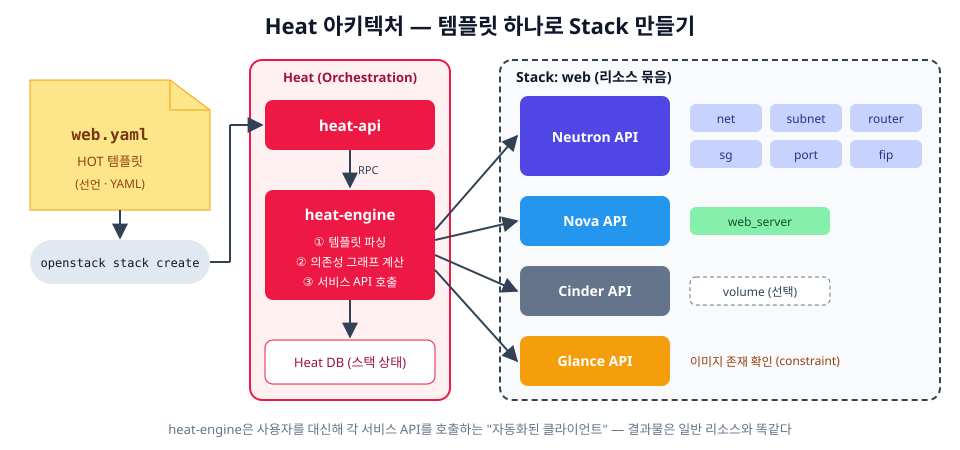
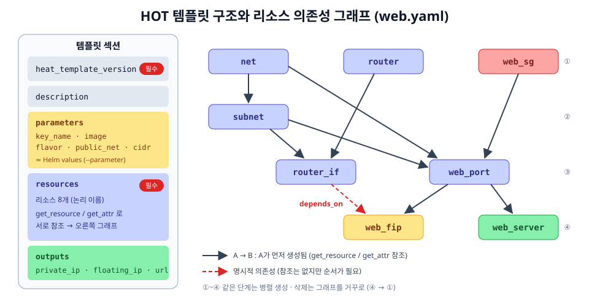

> **Chapter 4 · OpenStack** | 난이도 ★★★☆☆ | 예상 소요 1.5 ~ 2시간

## 🎯 오늘의 목표

- Heat가 해결하는 문제(수작업 순서 의존성, 일괄 생성/삭제)를 설명할 수 있다
- heat-api / heat-engine 구조와 **Stack** 개념을 이해한다
- HOT(Heat Orchestration Template)의 섹션과 **intrinsic function**(`get_param`, `get_resource`, `get_attr`)을 읽고 쓸 수 있다
- 네트워크 + 보안그룹 + VM + Floating IP를 **템플릿 하나**로 만들고, 업데이트하고, 지울 수 있다

---

## 1. 왜 Heat인가?

Day 30에서 웹 서버 1대를 외부에 노출하기 위해 실행한 명령을 세어 보면:

```
network create → subnet create → router create → router set → router add subnet
→ security group create → rule create ×3 → server create → floating ip create → server add floating ip
```

**10개가 넘는 명령**을, **정해진 순서**대로 실행해야 했습니다. 지울 때는 **정확히 역순**(라우터 인터페이스를 먼저 떼야 라우터가 지워짐)이었죠. 이걸 개발/스테이징/운영 3벌 만들어야 한다면?

Chapter 1에서 같은 고민을 했습니다. `docker run`을 여러 번 치는 대신 **Docker Compose**(Day 06) YAML 하나로 선언했죠. Chapter 2에서는 Kubernetes **매니페스트**와 **Helm 차트**(Day 16)였습니다. OpenStack에서는 그게 **Heat**입니다.

| 도구 | 대상 | 선언 파일 | 한 번에 만드는 단위 |
|---|---|---|---|
| Docker Compose (Day 06) | 컨테이너 | `compose.yaml` | Project |
| Helm (Day 16) | K8s 리소스 | Chart (`values.yaml`) | Release |
| **Heat** | **OpenStack 리소스** | **HOT 템플릿 (YAML)** | **Stack** |
| Terraform (Day 35) | 멀티 클라우드 | `.tf` (HCL) | State / Workspace |

Heat가 해 주는 일:

- 리소스 간 **의존성 그래프**를 자동 계산 → 병렬로 만들 수 있는 건 병렬로, 순서가 필요한 건 순서대로
- **삭제 시 역순**을 자동으로 처리
- 템플릿 수정 후 `stack update` → **바뀐 리소스만** 변경 (선언적)
- 실패 시 상태 추적 (`CREATE_FAILED`), 롤백 옵션

---

## 2. Heat 아키텍처



| 구성 요소 | 역할 |
|---|---|
| **python-heatclient** (`openstack stack ...`) | 템플릿 파일을 읽어 Heat API로 전송하는 OSC 플러그인 |
| **heat-api** | OpenStack 네이티브 REST API 접수 |
| **heat-api-cfn** | AWS CloudFormation 호환 API (선택) |
| **heat-engine** | 템플릿 파싱 → 의존성 그래프 → Nova/Neutron/Cinder/Glance API를 **사용자 대신 호출** |
| **DB** | Stack, 리소스, 이벤트 상태 저장 |

> 💡 heat-engine은 결국 **우리가 CLI로 하던 API 호출을 대신 해 주는 클라이언트**입니다. 그래서 Heat로 만든 VM도 `openstack server list`에 똑같이 보입니다. 단, 이름 뒤에 Stack이 관리한다는 꼬리표(메타데이터)가 붙어 있을 뿐이죠.

---

## 3. HOT 템플릿 구조



```yaml
heat_template_version: 2021-04-16   # 문법 버전 (날짜 형식, 필수)

description: 이 템플릿이 하는 일       # 설명 (선택)

parameters:        # 입력값 — stack 생성 시 --parameter 로 주입 (≈ Helm values)
  ...

resources:         # 만들 리소스 — 유일한 필수 섹션
  <논리 이름>:
    type: OS::Nova::Server
    properties: ...

outputs:           # 생성 후 꺼내 볼 값 (IP, URL 등)
  ...
```

### 자주 쓰는 리소스 타입

| 리소스 타입 | 대응 CLI |
|---|---|
| `OS::Neutron::Net` / `OS::Neutron::Subnet` | `network create` / `subnet create` |
| `OS::Neutron::Router` / `OS::Neutron::RouterInterface` | `router create` / `router add subnet` |
| `OS::Neutron::SecurityGroup` | `security group create` + `rule create` |
| `OS::Neutron::Port` | `port create` |
| `OS::Neutron::FloatingIP` | `floating ip create` + 연결 |
| `OS::Nova::Server` | `server create` |
| `OS::Cinder::Volume` / `OS::Cinder::VolumeAttachment` | `volume create` / `server add volume` |
| `OS::Heat::ResourceGroup` | 같은 리소스를 N개 복제 |

전체 목록은 `openstack orchestration resource type list`로 볼 수 있습니다.

### Intrinsic Function — 리소스를 엮는 함수

| 함수 | 의미 | 예시 |
|---|---|---|
| `get_param` | 파라미터 값 참조 | `{ get_param: flavor }` |
| `get_resource` | 같은 템플릿 안 리소스의 **ID** 참조 → **의존성 생성** | `{ get_resource: net }` |
| `get_attr` | 리소스의 **속성** 참조 (생성 후 알 수 있는 값) | `{ get_attr: [web_fip, floating_ip_address] }` |
| `str_replace` | 문자열 템플릿 치환 | user_data에 IP 끼워 넣기 |
| `list_join` | 리스트를 구분자로 합치기 | `{ list_join: ['-', [a, b]] }` |
| `depends_on` | (함수는 아니지만) **명시적 의존성** 지정 | `depends_on: router_if` |

> 💡 `get_resource`/`get_attr`를 쓰는 순간 Heat는 "이건 저게 먼저 있어야 한다"는 **간선**을 그래프에 추가합니다. 위 그림의 화살표가 바로 그것입니다. 참조 관계가 없는데 순서가 필요한 경우(예: Floating IP는 라우터 인터페이스가 먼저 붙어 있어야 함)에만 `depends_on`을 씁니다.

---

## 4. 실습 환경 — DevStack에 Heat 켜기

Heat는 DevStack 기본 서비스가 아니라 **플러그인**입니다. Day 26의 `~/devstack/local.conf`의 `[[local|localrc]]` 섹션에 추가합니다.

```ini
enable_plugin heat https://opendev.org/openstack/heat
```

> DevStack을 `stable/2025.1` 같은 안정 브랜치로 설치했다면 플러그인도 같은 브랜치로 맞춥니다: `enable_plugin heat https://opendev.org/openstack/heat stable/2025.1`

```bash
cd ~/devstack
./unstack.sh
./stack.sh
```

설치 확인:

```bash
source ~/devstack/openrc admin admin
openstack orchestration service list      # heat-engine 상태 up
openstack orchestration template version list
```

```
+--------------------------------------+------+
| Version                              | Type |
+--------------------------------------+------+
| AWSTemplateFormatVersion.2010-09-09  | cfn  |
| heat_template_version.2013-05-23     | hot  |
| ...                                  | hot  |
| heat_template_version.2021-04-16     | hot  |
| ...                                  | hot  |
+--------------------------------------+------+
```

→ `2021-04-16`(wallaby)이 목록에 있으면 오늘 템플릿을 그대로 쓸 수 있습니다.

```bash
source ~/devstack/openrc demo demo
# 키페어가 없다면
openstack keypair create --public-key ~/.ssh/id_ed25519.pub mykey
```

---

## 5. 실습 1 — 웹 서버 스택

Day 30에서 손으로 만든 구조(네트워크 + 라우터 + 보안그룹 + VM + Floating IP)를 템플릿 하나로 만듭니다. cirros 이미지에는 웹 서버가 없으므로, 부팅 시 `user_data` 스크립트로 busybox `nc`를 이용한 아주 작은 HTTP 응답기를 띄웁니다.

`~/heat/web.yaml`:

```yaml
heat_template_version: 2021-04-16

description: >
  Day 32 - 사설 네트워크 + 라우터 + 보안그룹 + 웹 서버 1대 + Floating IP

parameters:
  key_name:
    type: string
    description: SSH 접속용 키페어 이름
    constraints:
      - custom_constraint: nova.keypair
  image:
    type: string
    description: 부팅 이미지 이름 또는 ID
    constraints:
      - custom_constraint: glance.image
  flavor:
    type: string
    default: m1.tiny
    constraints:
      - custom_constraint: nova.flavor
  public_net:
    type: string
    description: Floating IP를 할당할 외부 네트워크
    default: public
    constraints:
      - custom_constraint: neutron.network
  cidr:
    type: string
    default: 192.168.50.0/24

resources:
  net:
    type: OS::Neutron::Net
    properties:
      name: { list_join: ['-', [{ get_param: 'OS::stack_name' }, net]] }

  subnet:
    type: OS::Neutron::Subnet
    properties:
      network: { get_resource: net }
      cidr: { get_param: cidr }
      dns_nameservers: [8.8.8.8]

  router:
    type: OS::Neutron::Router
    properties:
      external_gateway_info:
        network: { get_param: public_net }

  router_if:
    type: OS::Neutron::RouterInterface
    properties:
      router: { get_resource: router }
      subnet: { get_resource: subnet }

  web_sg:
    type: OS::Neutron::SecurityGroup
    properties:
      description: icmp, ssh, http
      rules:
        - protocol: icmp
          remote_ip_prefix: 0.0.0.0/0
        - protocol: tcp
          port_range_min: 22
          port_range_max: 22
          remote_ip_prefix: 0.0.0.0/0
        - protocol: tcp
          port_range_min: 80
          port_range_max: 80
          remote_ip_prefix: 0.0.0.0/0

  web_port:
    type: OS::Neutron::Port
    properties:
      network: { get_resource: net }
      fixed_ips:
        - subnet: { get_resource: subnet }
      security_groups:
        - { get_resource: web_sg }

  web_server:
    type: OS::Nova::Server
    properties:
      name: { list_join: ['-', [{ get_param: 'OS::stack_name' }, web]] }
      image: { get_param: image }
      flavor: { get_param: flavor }
      key_name: { get_param: key_name }
      networks:
        - port: { get_resource: web_port }
      user_data_format: RAW
      user_data: |
        #!/bin/sh
        MYIP=$(ip -4 addr show eth0 | awk '/inet /{print $2}' | cut -d/ -f1)
        while true; do
          echo -e "HTTP/1.0 200 OK\r\n\r\nHello from $(hostname) ($MYIP)" | nc -l -p 80
        done &

  web_fip:
    type: OS::Neutron::FloatingIP
    depends_on: router_if
    properties:
      floating_network: { get_param: public_net }
      port_id: { get_resource: web_port }

outputs:
  private_ip:
    description: 웹 서버 사설 IP
    value: { get_attr: [web_port, fixed_ips, 0, ip_address] }
  floating_ip:
    description: 웹 서버 Floating IP
    value: { get_attr: [web_fip, floating_ip_address] }
  url:
    description: 접속 URL
    value:
      str_replace:
        template: http://HOST/
        params:
          HOST: { get_attr: [web_fip, floating_ip_address] }
```

### 읽는 포인트

- **보안그룹은 Port에** 붙입니다. 포트를 직접 만들었으므로 서버의 `networks`에는 `port`만 지정합니다.
- `web_fip`는 `web_port`를 `get_resource`로 참조하지만, **라우터 인터페이스**와는 참조 관계가 없습니다. 그런데 서브넷이 라우터에 붙기 전에 Floating IP를 연결하면 `External network ... is not reachable from subnet` 에러가 납니다 → 그래서 `depends_on: router_if`.
- `OS::stack_name`은 Heat가 자동으로 넣어 주는 **의사 파라미터(pseudo parameter)** — 스택 이름으로 리소스 이름을 짓는 데 씁니다.
- `custom_constraint`는 생성 전에 "그 이미지/키페어/네트워크가 실제로 있는가"를 검사합니다. 오타는 리소스를 하나도 만들기 전에 걸러집니다.

### 5-1. 검증 → 생성

```bash
cd ~/heat
IMAGE=$(openstack image list -f value -c Name | grep -m1 cirros)

openstack orchestration template validate -t web.yaml \
  --parameter key_name=mykey --parameter image="$IMAGE"
```

에러 없이 파라미터·설명이 출력되면 문법이 맞는 것입니다.

```bash
openstack stack create -t web.yaml \
  --parameter key_name=mykey \
  --parameter image="$IMAGE" \
  --wait \
  web
```

```
2026-11-15 04:10:02Z [web]: CREATE_IN_PROGRESS  Stack CREATE started
2026-11-15 04:10:03Z [web.net]: CREATE_IN_PROGRESS  state changed
2026-11-15 04:10:03Z [web.router]: CREATE_IN_PROGRESS  state changed
2026-11-15 04:10:03Z [web.web_sg]: CREATE_IN_PROGRESS  state changed
...
2026-11-15 04:10:31Z [web.web_fip]: CREATE_COMPLETE  state changed
2026-11-15 04:10:31Z [web]: CREATE_COMPLETE  Stack CREATE completed successfully
```

`net`, `router`, `web_sg`가 **동시에** 시작되는 것에 주목하세요. 서로 의존하지 않으므로 Heat가 병렬로 만듭니다.

### 5-2. 상태 확인

```bash
openstack stack list
openstack stack resource list web
```

```
+---------------+--------------------------------------+------------------------------+-----------------+
| resource_name | physical_resource_id                 | resource_type                | resource_status |
+---------------+--------------------------------------+------------------------------+-----------------+
| web_fip       | 0c1d...                              | OS::Neutron::FloatingIP      | CREATE_COMPLETE |
| web_server    | 7f2e...                              | OS::Nova::Server             | CREATE_COMPLETE |
| web_port      | 5a3b...                              | OS::Neutron::Port            | CREATE_COMPLETE |
| router_if     | 9e8d...:subnet_id=...                | OS::Neutron::RouterInterface | CREATE_COMPLETE |
| subnet        | 2b4c...                              | OS::Neutron::Subnet          | CREATE_COMPLETE |
| web_sg        | 4d6e...                              | OS::Neutron::SecurityGroup   | CREATE_COMPLETE |
| router        | 9e8d...                              | OS::Neutron::Router          | CREATE_COMPLETE |
| net           | 1a2b...                              | OS::Neutron::Net             | CREATE_COMPLETE |
+---------------+--------------------------------------+------------------------------+-----------------+
```

`physical_resource_id`가 실제 OpenStack 리소스 ID입니다. 템플릿의 **논리 이름** ↔ 실제 **물리 ID** 매핑을 Heat가 기억합니다.

```bash
openstack stack output show web --all
openstack server list            # web-web 서버가 일반 서버처럼 보임
openstack stack event list web   # 생성 이력
```

### 5-3. 접속

```bash
FIP=$(openstack stack output show web floating_ip -f value -c output_value)
curl http://$FIP/
# Hello from web-web (192.168.50.x)

ssh cirros@$FIP
```

> ⚠️ VM이 `ACTIVE`가 된 직후에는 아직 부팅 중이라 curl이 실패할 수 있습니다. 30초~1분 기다리거나 `openstack console log show web-web | tail`로 부팅 완료를 확인하세요.

### 5-4. 업데이트 — 선언만 바꾸기

보안그룹에 443 포트를 추가하고 싶다면 템플릿만 고칩니다.

```yaml
        - protocol: tcp
          port_range_min: 443
          port_range_max: 443
          remote_ip_prefix: 0.0.0.0/0
```

```bash
openstack stack update -t web.yaml \
  --parameter key_name=mykey --parameter image="$IMAGE" \
  --wait web

openstack stack event list web | grep UPDATE
```

**`web_sg`만 UPDATE** 되고, 서버·네트워크는 그대로입니다. 반면 `cidr` 파라미터를 바꾸면 서브넷은 수정이 불가능한 속성이라 **교체(replace)** 되고, 그에 의존하는 포트·서버까지 연쇄적으로 다시 만들어집니다.

> 💡 실제로 무엇이 바뀔지 미리 보려면 `--dry-run`을 붙이세요. `openstack stack update --dry-run -t web.yaml ...`은 변경 없이 **updated / replaced / unchanged** 목록만 보여줍니다. Terraform의 `plan`과 같은 역할입니다.

---

## 6. 실습 2 — ResourceGroup으로 N대 띄우기

같은 서버를 여러 대 띄우는 것도 파라미터 하나로 됩니다. DevStack의 기존 `private` 네트워크를 사용합니다.

`~/heat/group.yaml`:

```yaml
heat_template_version: 2021-04-16

description: Day 32 - 같은 서버를 count 개 만들기

parameters:
  count:
    type: number
    default: 2
    constraints:
      - range: { min: 1, max: 5 }
  image:
    type: string
    constraints:
      - custom_constraint: glance.image
  network:
    type: string
    default: private

resources:
  servers:
    type: OS::Heat::ResourceGroup
    properties:
      count: { get_param: count }
      resource_def:
        type: OS::Nova::Server
        properties:
          name: app-%index%
          image: { get_param: image }
          flavor: m1.tiny
          networks:
            - network: { get_param: network }

outputs:
  server_ids:
    value: { get_attr: [servers, refs] }
```

```bash
openstack stack create -t group.yaml --parameter image="$IMAGE" --wait group
openstack server list --name '^app-'          # app-0, app-1

# 3대로 늘리기 — 템플릿은 그대로, 파라미터만 변경
openstack stack update --existing --parameter count=3 --wait group
openstack server list --name '^app-'          # app-0, app-1, app-2

# 1대로 줄이기 — 가장 큰 index부터 삭제
openstack stack update --existing --parameter count=1 --wait group
```

`--existing`은 "이전 템플릿과 파라미터를 재사용하고, 지정한 것만 바꾼다"는 뜻입니다. Kubernetes에서 `kubectl scale --replicas=3`(Day 11)을 한 것과 비슷한 느낌이죠.

> 💡 CPU 사용률에 따라 자동으로 늘리고 줄이는 `OS::Heat::AutoScalingGroup` + `OS::Heat::ScalingPolicy`도 있습니다. 다만 "CPU가 높다"는 신호를 보내 줄 **텔레메트리(Aodh + Ceilometer)** 서비스가 추가로 필요해 이번 실습에서는 다루지 않습니다. 개념은 Day 18의 HPA와 같습니다.

---

## 7. 정리

```bash
openstack stack delete --yes --wait group
openstack stack delete --yes --wait web
openstack stack list              # 비어 있어야 함
openstack network list            # web-net 도 사라짐 — 역순 삭제를 Heat가 처리
```

Day 30에서는 라우터 인터페이스 → 라우터 → 네트워크 순서를 직접 신경 써야 했지만, Heat는 **의존성 그래프를 거꾸로** 따라가며 알아서 지웁니다.

---

## 8. 트러블슈팅

| 증상 | 원인 | 해결 |
|---|---|---|
| `openstack stack ...` → `command not found` 또는 `Unknown command` | python-heatclient 미설치 / Heat 미활성화 | DevStack에 `enable_plugin heat ...` 후 재스택, `openstack catalog list`에 orchestration 확인 |
| `The template version is invalid` | `heat_template_version` 오타 또는 미지원 날짜 | `openstack orchestration template version list`에 있는 값 사용 |
| `CREATE_FAILED` — 원인을 모르겠음 | 특정 리소스 생성 실패 | `openstack stack resource list web --filter status=CREATE_FAILED`, `openstack stack event list web`, `openstack stack show web -c stack_status_reason` |
| `Property error: ... The Key (xxx) could not be found` | custom_constraint 검사 실패 (키페어/이미지 이름 오타) | `openstack keypair list`, `openstack image list`로 이름 확인 |
| `External network ... is not reachable from subnet` | Floating IP가 라우터 인터페이스보다 먼저 생성됨 | `web_fip`에 `depends_on: router_if` 추가 |
| `curl` 응답 없음 | VM 부팅 미완료, 또는 user_data 미실행 | `openstack console log show <서버>`로 부팅 로그와 스크립트 실행 여부 확인 |
| `DELETE_FAILED` | 템플릿 밖에서 수동으로 붙인 리소스가 남아 있음 (예: 손으로 추가한 포트) | 수동 리소스를 먼저 제거 후 `openstack stack delete` 재시도 |
| Heat 로그 확인 | — | `sudo journalctl -u devstack@h-eng -n 100` (engine), `-u devstack@h-api` (api) |

---

## 9. 핵심 정리

- Heat = OpenStack의 **IaC / 오케스트레이션** — Compose, Helm과 같은 "선언 파일 → 한 번에 생성/삭제" 도구
- 구조: CLI → **heat-api** → **heat-engine**(의존성 그래프 계산, 다른 서비스 API 대리 호출) → Nova/Neutron/Cinder…
- HOT 섹션: `heat_template_version`(필수) · `description` · `parameters` · **`resources`(필수)** · `outputs`
- `get_resource`/`get_attr`가 **의존성**을 만든다 → 병렬 생성, 역순 삭제 자동. 참조 없이 순서가 필요할 때만 `depends_on`
- `stack update`는 **바뀐 리소스만** 변경 (속성에 따라 update 또는 replace), `--dry-run`으로 미리 확인
- `ResourceGroup` + `count` 파라미터로 N대 복제, `--existing`으로 파라미터만 변경

---

## 10. 셀프 체크

<details>
<summary>Q1. <code>get_resource</code>와 <code>get_attr</code>의 차이는?</summary>

`get_resource`는 같은 템플릿 안 리소스의 **ID**(physical resource id)를 돌려주고, `get_attr`는 리소스의 **특정 속성**(예: Floating IP 주소, 포트의 fixed_ips)을 돌려줍니다. 둘 다 참조한 리소스가 먼저 만들어져야 하므로 의존성이 생깁니다.
</details>

<details>
<summary>Q2. 5장 템플릿에서 <code>web_fip</code>에 <code>depends_on: router_if</code>가 필요한 이유는?</summary>

`web_fip`는 `web_port`만 참조하므로, Heat 입장에서는 라우터 인터페이스와 순서 관계가 없습니다. 하지만 Floating IP를 포트에 연결하려면 그 서브넷이 **외부 네트워크로 가는 라우터에 붙어 있어야** 합니다. 이 숨은 의존성을 명시하기 위해 `depends_on`을 씁니다.
</details>

<details>
<summary>Q3. <code>stack update</code>로 서브넷의 <code>cidr</code>를 바꾸면 어떤 일이 일어나는가?</summary>

서브넷의 CIDR은 수정할 수 없는 속성이라 Heat는 서브넷을 **교체(replace)** 합니다. 새 서브넷을 참조하는 포트, 그 포트를 쓰는 서버 등 **의존 리소스도 연쇄적으로 교체**될 수 있습니다. 실행 전 `--dry-run`으로 replaced 목록을 확인하는 것이 안전합니다.
</details>

<details>
<summary>Q4. Heat로 만든 VM을 <code>openstack server delete</code>로 직접 지우면?</summary>

VM은 지워지지만 Heat의 스택 상태는 여전히 그 VM이 있다고 기억합니다(드리프트). 이후 `stack update` 시 리소스를 찾지 못해 다시 생성하거나 에러가 날 수 있습니다. **스택이 관리하는 리소스는 스택으로만 변경**하는 것이 원칙입니다 — Terraform state와 같은 이야기입니다.
</details>

<details>
<summary>Q5. Heat와 Docker Compose / Helm의 공통점은?</summary>

모두 **원하는 상태를 YAML로 선언**하고, 도구가 의존성과 순서를 계산해 **한 번에 생성·업데이트·삭제**합니다. 대상만 다를 뿐입니다 — Compose는 컨테이너, Helm은 K8s 리소스, Heat는 OpenStack 리소스.
</details>

---

## ⏭️ 다음 예고 — Day 33. Kolla-Ansible로 멀티노드 배포 (OpenStack을 컨테이너로!)

지금까지는 DevStack 한 대로 공부했지만, DevStack은 **개발·학습용**입니다. 실제 운영에서는 컨트롤러와 컴퓨트 노드를 나누고, 업그레이드와 장애 복구가 가능해야 하죠. 다음 시간에는 OpenStack 서비스 하나하나를 **Docker 컨테이너**로 띄우는 **Kolla-Ansible**로 멀티노드 클러스터를 배포합니다. Chapter 1의 Docker가 다시 등장합니다!
