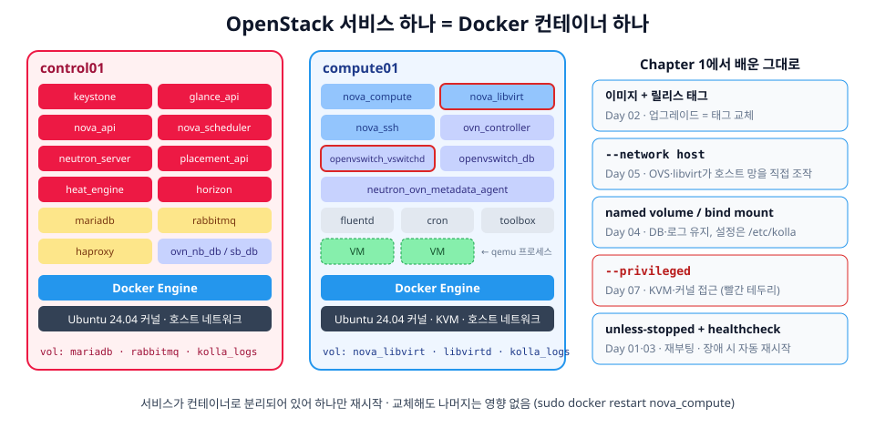
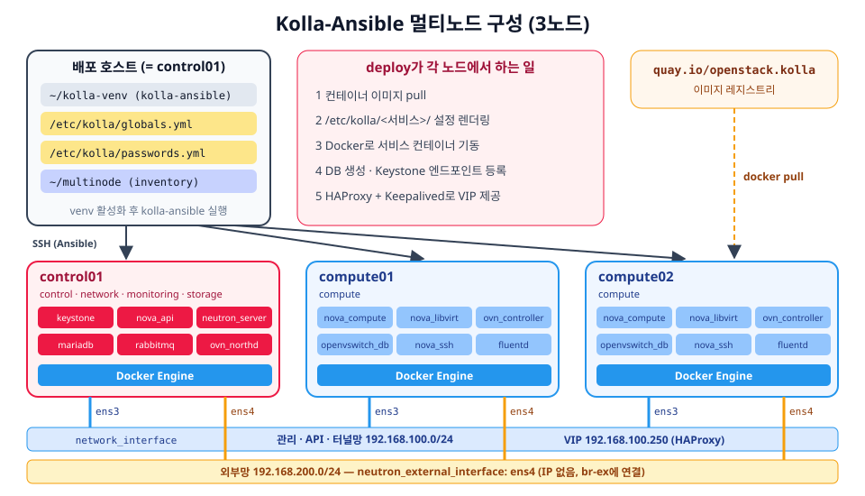
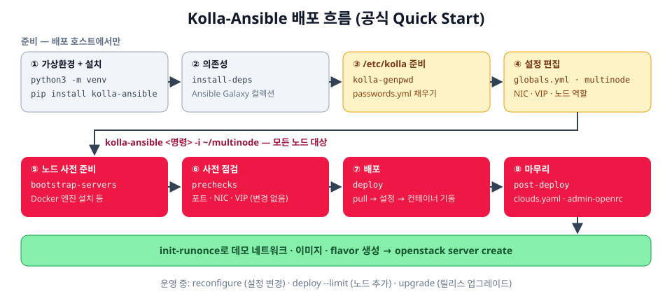

> **Chapter 4 · OpenStack** | 난이도 ★★★★★ | 예상 소요 3 ~ 4시간 (이미지 다운로드 포함)

## 🎯 오늘의 목표

- DevStack과 운영용 배포 도구의 차이를 설명할 수 있다
- Kolla(이미지)와 Kolla-Ansible(배포)의 관계, 그리고 **OpenStack 서비스가 Docker 컨테이너로 돈다**는 의미를 이해한다
- 공식 Quick Start 흐름(venv → 설치 → `globals.yml` → inventory → **bootstrap-servers → prechecks → deploy → post-deploy**)대로 3노드 클러스터를 배포할 수 있다
- 배포된 노드에서 `docker ps` / `docker logs` / `docker inspect`로 OpenStack을 운영 관점에서 들여다볼 수 있다
- Chapter 4 전체를 회고하고 Chapter 5로 넘어갈 준비를 한다

---

## 1. 왜 DevStack으로는 부족한가?

Day 26부터 써 온 DevStack은 **개발자가 OpenStack 코드를 고치고 테스트하기 위한 도구**입니다.

| 항목 | DevStack | Kolla-Ansible |
|---|---|---|
| 목적 | OpenStack **개발·학습** | **운영(프로덕션)** 배포 |
| 설치 방식 | git 소스를 호스트에 직접 설치 (systemd `devstack@*`) | 서비스별 **Docker 컨테이너** |
| 노드 구성 | 주로 올인원 | 컨트롤러 / 네트워크 / 컴퓨트 / 스토리지 분리, HA |
| 재부팅 후 | 일부 수동 복구 필요 | 컨테이너 재시작 정책으로 자동 복구 |
| 업그레이드 | 사실상 재설치 (`unstack.sh` → `stack.sh`) | `kolla-ansible upgrade` (이미지 교체) |
| 설정 변경 | 파일 직접 수정 | `globals.yml` / 오버라이드 파일 → `reconfigure` |

운영용 배포 도구는 여러 가지가 있습니다 — Kolla-Ansible, OpenStack-Ansible(LXC/호스트 설치), OpenStack-Helm(Kubernetes 위에 배포), Canonical의 Sunbeam 등. 그중 Kolla-Ansible은 **Docker 컨테이너 + Ansible**이라는, 지금까지 우리가 배운 것과 가장 잘 이어지는 방식입니다.

---

## 2. Kolla와 Kolla-Ansible

| 프로젝트 | 하는 일 | Chapter 1과 연결 |
|---|---|---|
| **Kolla** | OpenStack 서비스별 **컨테이너 이미지**를 빌드 (keystone, nova-compute, neutron-server…) | Day 02~03 이미지 · Dockerfile |
| **Kolla-Ansible** | 그 이미지들을 **Ansible로 여러 노드에 배포**하고 설정 파일을 주입 | Day 06 Compose의 멀티노드 확장판 같은 느낌 |

이미지는 공식 레지스트리 **`quay.io/openstack.kolla`** 에 릴리스별로 올라와 있어서, 직접 빌드하지 않아도 됩니다. (예: `quay.io/openstack.kolla/keystone:2025.1-ubuntu-noble`)

### "OpenStack이 컨테이너로 돈다"는 것의 의미



Day 25에서 OpenStack은 "여러 개의 독립된 서비스가 REST API와 메시지 큐로 협업하는 구조"라고 했습니다. 서비스가 독립적이니 **서비스 하나 = 컨테이너 하나**로 쪼개기 딱 좋습니다.

| Kolla가 쓰는 Docker 기능 | 왜 그렇게 하나 | 배운 곳 |
|---|---|---|
| 서비스별 이미지 + 릴리스 태그 | 업그레이드 = 이미지 태그 교체 후 컨테이너 재생성 | Day 02 |
| `--network host` | OVS·OVN·iSCSI·libvirt가 **호스트 네트워크 스택**을 직접 다뤄야 함 | Day 05 |
| Named Volume (`mariadb`, `rabbitmq`, `kolla_logs`, `nova_libvirt` …) | 컨테이너를 지우고 새 이미지로 띄워도 **DB·로그·VM 상태 유지** | Day 04 |
| Bind mount (`/etc/kolla/<서비스>/` → 컨테이너) | 설정은 호스트에서 생성·관리, 컨테이너는 시작 시 읽기만 | Day 04 |
| `--privileged` (nova_libvirt, openvswitch 등 일부) | KVM 장치, 커널 모듈, 네트워크 네임스페이스 조작 필요 | Day 07 |
| 재시작 정책 `unless-stopped` + healthcheck | 노드 재부팅·프로세스 장애 시 자동 복구 | Day 01, 03 |

> 💡 Kolla 컨테이너는 Kubernetes 위가 아니라 **각 노드의 Docker 엔진 위에서 직접** 돕니다. 오케스트레이터 역할은 Ansible이 배포 시점에만 합니다. 이 점이 Kubernetes 위에 올리는 OpenStack-Helm과의 차이입니다.

---

## 3. 실습 환경 — 3노드 구성



Day 21에서 배운 KVM/libvirt로 VM 3대를 만들어 실습합니다. (물리 서버 3대여도 동일)

| 노드 | 역할(inventory 그룹) | 최소 사양 | 관리망 IP (`ens3`) | 외부망 (`ens4`) |
|---|---|---|---|---|
| **control01** | control, network, monitoring, storage + **배포 호스트** | 4 vCPU / 16GB / 60GB | 192.168.100.11 | IP 없음 |
| **compute01** | compute | 4 vCPU / 8GB / 40GB | 192.168.100.21 | IP 없음 |
| **compute02** | compute | 4 vCPU / 8GB / 40GB | 192.168.100.22 | IP 없음 |
| (VIP) | HAProxy/Keepalived가 띄우는 API 주소 | — | **192.168.100.250** (미사용 IP) | — |

- OS: **Ubuntu 24.04 LTS** (모든 노드), OpenStack **2025.1 (Epoxy)** 기준. 이후 릴리스도 브랜치 이름만 바꾸면 흐름은 같습니다.
- NIC 2개: `ens3` = 관리·API·터널망(`network_interface`), `ens4` = Neutron 외부망(`neutron_external_interface`, **IP를 주지 않음** — `br-ex`에 붙음)
- 배포 호스트(control01)에서 모든 노드로 **SSH 키 인증 + 비밀번호 없는 sudo**가 되어야 합니다.

```bash
# control01에서
ssh-keygen -t ed25519 -N "" -f ~/.ssh/id_ed25519
for h in 192.168.100.11 192.168.100.21 192.168.100.22; do ssh-copy-id ubuntu@$h; done

# 각 노드에서 (ubuntu 사용자 기준)
echo "ubuntu ALL=(ALL) NOPASSWD:ALL" | sudo tee /etc/sudoers.d/ubuntu
sudo hostnamectl set-hostname control01   # 노드마다 inventory 이름과 같게 (compute01, compute02)
```

> ⚠️ compute 노드가 VM이라면 **중첩 가상화(nested virtualization)** 가 켜져 있어야 KVM 가속을 씁니다. 안 되면 아래 `globals.yml`에서 `nova_compute_virt_type: "qemu"`로 소프트웨어 에뮬레이션을 쓰세요(느리지만 동작).

---

## 4. 배포 흐름 한눈에 보기



| 단계 | 명령 | 하는 일 |
|---|---|---|
| 1 | `python3 -m venv` + `pip install` | 배포 도구를 격리된 Python 환경에 설치 |
| 2 | `kolla-ansible install-deps` | 필요한 Ansible Galaxy 컬렉션 설치 |
| 3 | `/etc/kolla/` 준비, `kolla-genpwd` | `globals.yml`(설정), `passwords.yml`(모든 서비스 비밀번호) |
| 4 | inventory `multinode` 편집 | 어느 노드가 어떤 역할인지 |
| 5 | **`bootstrap-servers`** | 모든 노드에 Docker 설치, 사용자/그룹, 커널 설정 등 사전 준비 |
| 6 | **`prechecks`** | 포트 충돌, NIC 존재, VIP 사용 여부 등 사전 점검 |
| 7 | **`deploy`** | 이미지 pull → 설정 생성 → 컨테이너 기동 → DB/엔드포인트 등록 |
| 8 | **`post-deploy`** | `clouds.yaml`, `admin-openrc.sh` 생성 |

---

## 5. 실습 — 설치 (control01에서)

### 5-1. 의존 패키지와 가상환경

```bash
sudo apt update
sudo apt install -y git python3-dev libffi-dev gcc libssl-dev libdbus-glib-1-dev python3-venv

python3 -m venv ~/kolla-venv
source ~/kolla-venv/bin/activate
pip install -U pip
```

> 💡 가상환경을 쓰는 이유: Kolla-Ansible이 요구하는 Ansible 버전이 시스템 패키지와 충돌하지 않게 하려는 것입니다. 이후 모든 `kolla-ansible` 명령은 **venv를 활성화한 상태**에서 실행합니다.

### 5-2. Kolla-Ansible 설치

```bash
pip install git+https://opendev.org/openstack/kolla-ansible@stable/2025.1

pip show kolla-ansible | head -2     # Name / Version 확인
```

`ansible-core`도 의존성으로 함께 설치됩니다. 이어서 Ansible Galaxy 의존성을 설치합니다.

```bash
kolla-ansible install-deps
```

### 5-3. 설정 디렉터리와 inventory 복사

```bash
sudo mkdir -p /etc/kolla
sudo chown $USER:$USER /etc/kolla

cp -r ~/kolla-venv/share/kolla-ansible/etc_examples/kolla/* /etc/kolla
cp ~/kolla-venv/share/kolla-ansible/ansible/inventory/multinode ~/

ls /etc/kolla
# globals.yml  passwords.yml
```

### 5-4. 비밀번호 생성

```bash
kolla-genpwd
grep keystone_admin_password /etc/kolla/passwords.yml
```

`passwords.yml`의 빈 값들이 랜덤 값으로 채워집니다. DB, RabbitMQ, 각 서비스 계정 비밀번호가 전부 여기 있으니 **이 파일은 Secret처럼 관리**하세요(Day 13).

### 5-5. inventory 작성

`~/multinode` 파일 **맨 위의 그룹들만** 수정하면 됩니다. 아래쪽의 서비스별 그룹(`[nova-api:children]` 등)은 이 그룹들을 참조하므로 그대로 둡니다.

```ini
[control]
control01 ansible_host=192.168.100.11 ansible_user=ubuntu ansible_become=true

[network]
control01

[compute]
compute01 ansible_host=192.168.100.21 ansible_user=ubuntu ansible_become=true
compute02 ansible_host=192.168.100.22 ansible_user=ubuntu ansible_become=true

[monitoring]
control01

[storage]
control01

[deployment]
localhost ansible_connection=local
```

연결 확인:

```bash
ansible -i ~/multinode all -m ping
```

```
control01 | SUCCESS => { "changed": false, "ping": "pong" }
compute01 | SUCCESS => { "changed": false, "ping": "pong" }
compute02 | SUCCESS => { "changed": false, "ping": "pong" }
localhost | SUCCESS => { "changed": false, "ping": "pong" }
```

### 5-6. globals.yml

`/etc/kolla/globals.yml`은 전부 주석 처리된 예시 파일입니다. 필요한 항목만 주석을 풀거나 추가합니다.

```yaml
kolla_base_distro: "ubuntu"

# 관리망 NIC와 VIP
network_interface: "ens3"
kolla_internal_vip_address: "192.168.100.250"
enable_haproxy: "yes"

# Neutron: Day 30과 같은 ML2/OVN, 외부망 NIC
neutron_plugin_agent: "ovn"
neutron_external_interface: "ens4"

# compute가 중첩 가상화를 지원하지 않는 VM이면
# nova_compute_virt_type: "qemu"

# 추가 서비스 (Day 32)
enable_heat: "yes"
```

| 변수 | 의미 |
|---|---|
| `kolla_base_distro` | 컨테이너 이미지의 베이스 OS (`ubuntu`, `debian`, `rocky`) |
| `network_interface` | API·관리·터널(Geneve) 트래픽이 오갈 NIC |
| `kolla_internal_vip_address` | HAProxy+Keepalived가 띄우는 **가상 IP**. 모든 API 엔드포인트가 이 주소로 등록됨. 관리망에서 **아무도 안 쓰는 IP**여야 함 |
| `neutron_plugin_agent` | `openvswitch`(기본) 또는 `ovn` |
| `neutron_external_interface` | `br-ex`에 붙을 외부망 NIC (**IP 없어야 함**) |
| `enable_<서비스>` | 서비스 on/off 스위치 (`enable_cinder`, `enable_heat`, `enable_swift` …) |

> 💡 Keystone, Glance, Nova, Neutron, Placement, Horizon, Heat 등 핵심 서비스는 기본으로 켜집니다. Cinder를 쓰려면 `enable_cinder: "yes"`와 함께 백엔드(예: storage 노드에 미리 만든 LVM VG `cinder-volumes` + `enable_cinder_backend_lvm: "yes"`)를 지정해야 합니다. 오늘은 단순하게 Cinder 없이 진행합니다.

---

## 6. 실습 — 배포

### 6-1. bootstrap-servers

```bash
kolla-ansible bootstrap-servers -i ~/multinode
```

모든 노드에 **Docker 엔진 설치**, `kolla` 사용자/그룹, `/etc/hosts` 정리, 불필요한 서비스 비활성화 등을 합니다. 끝나면 각 노드에서 `docker version`이 동작합니다 — Chapter 1의 그 Docker입니다.

### 6-2. prechecks

```bash
kolla-ansible prechecks -i ~/multinode
```

포트(3306, 5672, 5000 …)가 이미 쓰이고 있지 않은지, `ens3`/`ens4`가 존재하는지, VIP가 이미 응답하지 않는지 등을 점검합니다. **여기서 실패하면 deploy로 넘어가지 말고 원인부터 고칩니다.**

### 6-3. (선택) 이미지 미리 받기

```bash
kolla-ansible pull -i ~/multinode
```

deploy 중에도 받지만, 미리 받아 두면 네트워크 문제와 배포 문제를 분리할 수 있습니다.

### 6-4. deploy

```bash
kolla-ansible deploy -i ~/multinode
```

30분~1시간 걸립니다. Ansible이 서비스 순서대로(MariaDB → RabbitMQ → Keystone → Glance → Placement → Nova → Neutron → Heat → Horizon …) 진행합니다.

```
PLAY RECAP *********************************************************************
compute01   : ok=120  changed=60  unreachable=0  failed=0  skipped=90  rescued=0  ignored=0
compute02   : ok=120  changed=60  unreachable=0  failed=0  skipped=90  rescued=0  ignored=0
control01   : ok=520  changed=290 unreachable=0  failed=0  skipped=310 rescued=0  ignored=0
localhost   : ok=4    changed=0   unreachable=0  failed=0  skipped=0   rescued=0  ignored=0
```

(숫자는 환경마다 다릅니다.) **`failed=0`, `unreachable=0`** 이면 성공입니다.

### 6-5. post-deploy와 CLI 설치

```bash
pip install python-openstackclient -c https://releases.openstack.org/constraints/upper/2025.1

kolla-ansible post-deploy -i ~/multinode
ls /etc/kolla/*.sh /etc/kolla/clouds.yaml
```

```bash
# clouds.yaml을 openstack CLI가 찾는 위치로 복사하고 클라우드 이름 지정
mkdir -p ~/.config/openstack
cp /etc/kolla/clouds.yaml ~/.config/openstack/
export OS_CLOUD=kolla-admin
# (대안: source /etc/kolla/admin-openrc.sh — 둘 중 하나만 사용)

openstack endpoint list --interface public -c "Service Name" -c URL
openstack compute service list
openstack network agent list
```

```
+----+----------------+-----------+----------+---------+-------+
| ID | Binary         | Host      | Zone     | Status  | State |
+----+----------------+-----------+----------+---------+-------+
| .. | nova-scheduler | control01 | internal | enabled | up    |
| .. | nova-conductor | control01 | internal | enabled | up    |
| .. | nova-compute   | compute01 | nova     | enabled | up    |
| .. | nova-compute   | compute02 | nova     | enabled | up    |
+----+----------------+-----------+----------+---------+-------+
```

→ **compute가 2대**입니다. Day 29에서 배운 nova-scheduler가 이제 진짜로 "어느 노드에 놓을지" 고르게 됩니다.

### 6-6. 데모 리소스 만들고 VM 띄우기

Kolla-Ansible에는 외부 네트워크·데모 네트워크·라우터·cirros 이미지·flavor·키페어를 한 번에 만드는 스크립트가 있습니다. 외부망(`ens4`가 연결된 망) 대역에 맞게 환경 변수를 줍니다.

```bash
EXT_NET_CIDR='192.168.200.0/24' \
EXT_NET_RANGE='start=192.168.200.100,end=192.168.200.199' \
EXT_NET_GATEWAY='192.168.200.1' \
~/kolla-venv/share/kolla-ansible/init-runonce
```

스크립트가 마지막에 VM 생성 예시 명령을 출력해 줍니다. 비슷하게 두 대를 띄워 봅니다.

```bash
openstack server create --image cirros --flavor m1.tiny --key-name mykey --network demo-net demo1
openstack server create --image cirros --flavor m1.tiny --key-name mykey --network demo-net demo2

openstack server list --long -c Name -c Status -c Host
```

```
+-------+--------+-----------+
| Name  | Status | Host      |
+-------+--------+-----------+
| demo1 | ACTIVE | compute01 |
| demo2 | ACTIVE | compute02 |
+-------+--------+-----------+
```

두 VM이 **서로 다른 compute 노드**에 배치되었다면, demo1 → demo2 ping은 Day 30에서 그림으로만 봤던 **Geneve 터널**(compute01 `ens3` ↔ compute02 `ens3`, UDP 6081)을 실제로 지나갑니다.

```bash
# compute01에서 터널 트래픽 관찰 (demo1 콘솔에서 demo2로 ping 하는 동안)
sudo tcpdump -ni ens3 udp port 6081 -c 5
```

Horizon은 브라우저에서 `http://192.168.100.250` 으로 접속합니다 (admin / `keystone_admin_password` 값).

---

## 7. 컨테이너로 도는 OpenStack 들여다보기 — Chapter 1 복습

### 7-1. docker ps

```bash
# control01
sudo docker ps --format "table {{.Names}}\t{{.Status}}" | head -20
```

```
NAMES                       STATUS
horizon                     Up 40 minutes (healthy)
heat_engine                 Up 41 minutes (healthy)
heat_api                    Up 41 minutes (healthy)
neutron_server              Up 45 minutes (healthy)
ovn_northd                  Up 47 minutes
ovn_sb_db                   Up 47 minutes
ovn_nb_db                   Up 47 minutes
nova_conductor              Up 50 minutes (healthy)
nova_scheduler              Up 50 minutes (healthy)
nova_api                    Up 50 minutes (healthy)
placement_api               Up 52 minutes (healthy)
glance_api                  Up 54 minutes (healthy)
keystone                    Up 56 minutes (healthy)
rabbitmq                    Up 58 minutes (healthy)
mariadb                     Up 59 minutes (healthy)
keepalived                  Up 60 minutes
haproxy                     Up 60 minutes (healthy)
...
```

```bash
# compute01
sudo docker ps --format "table {{.Names}}\t{{.Status}}"
```

```
NAMES                         STATUS
nova_compute                  Up 45 minutes (healthy)
nova_libvirt                  Up 46 minutes (healthy)
nova_ssh                      Up 46 minutes (healthy)
neutron_ovn_metadata_agent    Up 44 minutes (healthy)
ovn_controller                Up 47 minutes
openvswitch_vswitchd          Up 48 minutes (healthy)
openvswitch_db                Up 48 minutes (healthy)
cron                          Up 60 minutes
kolla_toolbox                 Up 60 minutes
fluentd                       Up 60 minutes
```

Day 25의 서비스 그림이 그대로 컨테이너 목록이 되었습니다. Day 30의 **ovn-controller**, Day 24의 **ovs-vswitchd**, Day 21의 **libvirt**가 각각 컨테이너입니다.

### 7-2. docker inspect — 네트워크 모드와 권한

```bash
sudo docker inspect keystone --format '{{.HostConfig.NetworkMode}}'          # host
sudo docker inspect nova_libvirt --format '{{.HostConfig.Privileged}}'       # true
sudo docker inspect mariadb --format '{{.HostConfig.RestartPolicy.Name}}'    # unless-stopped
sudo docker inspect mariadb --format '{{range .Mounts}}{{.Name}} -> {{.Destination}}{{"\n"}}{{end}}'
```

```
mariadb -> /var/lib/mysql
kolla_logs -> /var/log/kolla
 -> /var/lib/kolla/config_files/
...
```

- `mariadb` **named volume**에 DB 데이터 → 컨테이너를 새 이미지로 교체(업그레이드)해도 데이터 유지 (Day 04)
- `/etc/kolla/mariadb/` 가 `/var/lib/kolla/config_files/`로 **bind mount** → 컨테이너 시작 시 `kolla_set_configs`가 설정 파일을 제자리에 복사

### 7-3. 설정과 로그

```bash
ls /etc/kolla/                               # 서비스별 설정 디렉터리 (nova-api, neutron-server, ...)
sudo cat /etc/kolla/nova-compute/nova.conf   # compute01에서: Ansible이 렌더링한 최종 설정

sudo docker logs --tail 20 nova_compute      # 컨테이너 표준 출력
sudo ls /var/lib/docker/volumes/kolla_logs/_data/nova/   # 서비스 로그 파일 (kolla_logs 볼륨)
sudo tail -f /var/lib/docker/volumes/kolla_logs/_data/nova/nova-compute.log
```

> ⚠️ `/etc/kolla/<서비스>/` 안의 파일을 **직접 고치지 마세요.** 다음 `deploy`/`reconfigure` 때 덮어써집니다. 설정을 바꾸려면 배포 호스트의 `/etc/kolla/config/` 아래에 오버라이드 파일(예: `/etc/kolla/config/nova.conf`)을 만들고 `reconfigure` 합니다.

### 7-4. 운영 명령

```bash
# 설정 변경 반영 (예: nova 관련만)
kolla-ansible reconfigure -i ~/multinode --tags nova

# compute 노드 추가: inventory [compute]에 compute03 추가 후
kolla-ansible bootstrap-servers -i ~/multinode --limit compute03
kolla-ansible deploy -i ~/multinode --limit compute03

# 릴리스 업그레이드: venv에 새 버전 kolla-ansible 설치 → globals.yml 확인 →
kolla-ansible upgrade -i ~/multinode

# 전체 삭제 (컨테이너·볼륨 모두 제거, 되돌릴 수 없음)
kolla-ansible destroy -i ~/multinode --yes-i-really-really-mean-it
```

> 💡 장애가 난 컨테이너는 `sudo docker restart <이름>`으로 개별 재시작할 수 있습니다. 서비스 하나가 죽어도 나머지는 영향이 없는 것 — 컨테이너로 쪼갠 가장 큰 이점입니다.

---

## 8. 트러블슈팅

| 증상 | 원인 | 해결 |
|---|---|---|
| `ansible ... -m ping`에서 `UNREACHABLE` | SSH 키 미배포 / 사용자 이름 불일치 | `ssh-copy-id`, inventory의 `ansible_user` 확인 |
| `Missing sudo password` | 원격 노드 sudo에 비밀번호 필요 | `/etc/sudoers.d/`에 `NOPASSWD` 설정 |
| prechecks: VIP 관련 실패 | `kolla_internal_vip_address`가 이미 다른 장비에서 사용 중 | 관리망에서 비어 있는 IP로 변경 (`ping`으로 확인) |
| prechecks: `neutron_external_interface` 관련 실패 | NIC 이름 오타, 또는 그 NIC에 IP가 할당됨 | `ip -br link`로 이름 확인, 외부망 NIC는 IP 없이 UP만 |
| deploy 중 이미지 pull 실패 / 매우 느림 | 레지스트리 접근 불가, 디스크 부족 | `kolla-ansible pull` 단독 실행으로 분리 확인, `df -h /var/lib/docker` |
| `nova-compute`가 `down` / VM이 `ERROR` (No valid host) | 중첩 가상화 미지원인데 `kvm` 사용 | `nova_compute_virt_type: "qemu"` 후 `kolla-ansible reconfigure -i ~/multinode --tags nova` |
| 컨테이너가 `Restarting` 반복 | 설정 오류, 의존 서비스(DB/MQ) 미기동 | `sudo docker logs <컨테이너>`, `kolla_logs` 볼륨의 서비스 로그 확인 |
| 전체 노드 재부팅 후 MariaDB 클러스터가 안 올라옴 | Galera 클러스터 전원 동시 종료 | Kolla-Ansible의 MariaDB 복구 명령 사용 (`kolla-ansible --help`에서 mariadb recovery 항목 확인) |
| `openstack` 명령이 `Missing value auth-url` | 인증 정보 미로드 | clouds.yaml 복사 후 `export OS_CLOUD=kolla-admin`, 또는 `source /etc/kolla/admin-openrc.sh` (venv 활성화 상태도 확인) |

---

## 9. 핵심 정리

- DevStack = 개발·학습용, **Kolla-Ansible = 운영용** (컨테이너 기반, 멀티노드, HA, 업그레이드)
- **Kolla**는 서비스별 이미지를 만들고, **Kolla-Ansible**은 그 이미지를 Ansible로 여러 노드에 배포
- OpenStack 서비스 하나 = Docker 컨테이너 하나 — host 네트워크(Day 05), named volume(Day 04), privileged(Day 07), 재시작 정책(Day 01)
- 흐름: venv → `pip install kolla-ansible` → `install-deps` → `/etc/kolla`(`globals.yml`, `kolla-genpwd`) → inventory → **bootstrap-servers → prechecks → deploy → post-deploy**
- 핵심 변수: `network_interface`, `neutron_external_interface`(IP 없음), `kolla_internal_vip_address`(미사용 IP), `neutron_plugin_agent`
- 설정 변경은 `/etc/kolla/config/` 오버라이드 + `reconfigure`, 노드 추가는 `--limit`

---

## 10. 셀프 체크

<details>
<summary>Q1. Kolla 컨테이너들이 Docker의 기본 bridge 네트워크가 아니라 host 네트워크를 쓰는 이유는?</summary>

Neutron/OVS/OVN은 호스트의 NIC·브리지·터널을 직접 만들고, libvirt는 VM의 tap 장치를, iSCSI는 호스트 블록 장치를 다룹니다. 별도 네트워크 namespace에 갇히면 호스트 네트워크 스택을 조작할 수 없으므로 `--network host`로 호스트와 같은 namespace를 씁니다. (Day 05의 host 네트워크 모드)
</details>

<details>
<summary>Q2. <code>kolla-ansible upgrade</code> 후에도 DB 데이터가 남아 있는 이유는?</summary>

DB 데이터는 컨테이너 쓰기 계층이 아니라 `mariadb` **named volume**에 저장되기 때문입니다. 업그레이드는 새 태그의 이미지로 컨테이너를 다시 만들 뿐, 볼륨은 그대로 다시 연결됩니다. (Day 04)
</details>

<details>
<summary>Q3. <code>neutron_external_interface</code>로 지정한 NIC에 IP를 주면 안 되는 이유는?</summary>

이 NIC는 OVS 브리지 `br-ex`의 포트로 들어가 **L2 스위치 포트처럼** 동작합니다. 외부망 IP는 Neutron 라우터 게이트웨이와 Floating IP가 사용하며, NIC 자체에 IP가 있으면 호스트와 Neutron이 같은 망을 두고 충돌하거나 연결이 끊길 수 있습니다.
</details>

<details>
<summary>Q4. bootstrap-servers, prechecks, deploy는 각각 무엇을 하나?</summary>

**bootstrap-servers**: 모든 노드에 Docker 등 사전 요구 사항 설치·설정. **prechecks**: 포트·NIC·VIP 등 배포 가능 여부 점검(변경 없음). **deploy**: 이미지 pull, 설정 렌더링, 컨테이너 기동, DB 초기화와 서비스·엔드포인트 등록.
</details>

<details>
<summary>Q5. <code>/etc/kolla/nova-compute/nova.conf</code>를 직접 수정하면 안 되는 이유와 올바른 방법은?</summary>

그 파일은 Kolla-Ansible이 매 `deploy`/`reconfigure` 때 **다시 생성**하므로 수정 내용이 사라집니다. 배포 호스트의 `/etc/kolla/config/nova.conf`(또는 서비스별 경로)에 오버라이드를 작성하고 `kolla-ansible reconfigure -i <inventory> --tags nova`로 반영합니다.
</details>

---

## 🔁 Chapter 4 회고 — 나만의 프라이빗 클라우드

| Day | 주제 | 한 줄 정리 |
|---|---|---|
| 25 | OpenStack 개요 | API + 메시지 큐 + DB로 협업하는 서비스들의 집합 |
| 26 | DevStack | 한 대에 올인원 설치로 전체를 빠르게 체험 |
| 27 | Keystone | 사용자 · 프로젝트 · 역할 · 토큰 · 서비스 카탈로그 |
| 28 | Glance | VM 이미지 저장소 (Docker Registry의 VM판) |
| 29 | Nova | 스케줄러가 compute를 고르고, libvirt/KVM으로 VM 생성 |
| 30 | Neutron | 네트워크·라우터·Floating IP·SG, ML2/OVN과 Geneve |
| 31 | Cinder & Swift | VM과 독립된 블록 볼륨, HTTP 오브젝트 스토리지 |
| 32 | Heat | YAML 템플릿으로 리소스 묶음(Stack)을 선언적으로 관리 |
| 33 | Kolla-Ansible | OpenStack 자체를 Docker 컨테이너로 멀티노드 배포 |

돌아보면 Chapter 4는 **앞의 세 챕터를 전부 다시 만나는 여정**이었습니다.

- **Chapter 1 (Docker)** → 오늘 OpenStack 서비스 하나하나가 컨테이너였고, 볼륨·host 네트워크·privileged를 그대로 썼습니다.
- **Chapter 2 (Kubernetes)** → 스케줄러(Nova ↔ kube-scheduler), PV/StorageClass(Cinder ↔ 볼륨 타입), 매니페스트·Helm(Heat), 선언적 관리 — 같은 아이디어가 VM 세계에서 반복됐습니다.
- **Chapter 3 (가상화·네트워크)** → KVM/libvirt가 Nova의 손발이었고, bridge·veth·netns·VXLAN·OVS가 Neutron의 실체였습니다.

> 💡 클라우드는 마법이 아니라 **우리가 하나씩 배운 리눅스 기술 위에 API를 얹은 것**입니다. 이 감각이 Chapter 4의 가장 큰 수확입니다.

---

## ⏭️ 다음 예고 — Day 34. OpenStack VM 위에 Kubernetes 클러스터 구축

드디어 **Chapter 5 · 종합 프로젝트**입니다. 오늘 만든 OpenStack 클라우드에서 VM 3대를 띄우고(Neutron 네트워크 + Security Group + Floating IP), 그 위에 Day 20의 kubeadm으로 **Kubernetes 클러스터**를 올립니다. Chapter 1~4가 한 그림 안에 모두 들어가는 날입니다.
