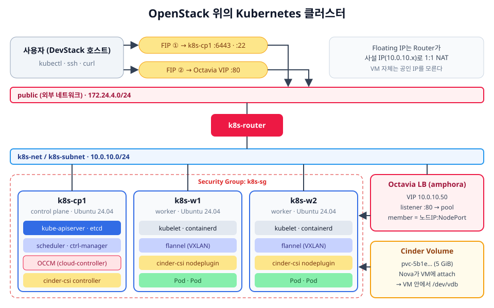
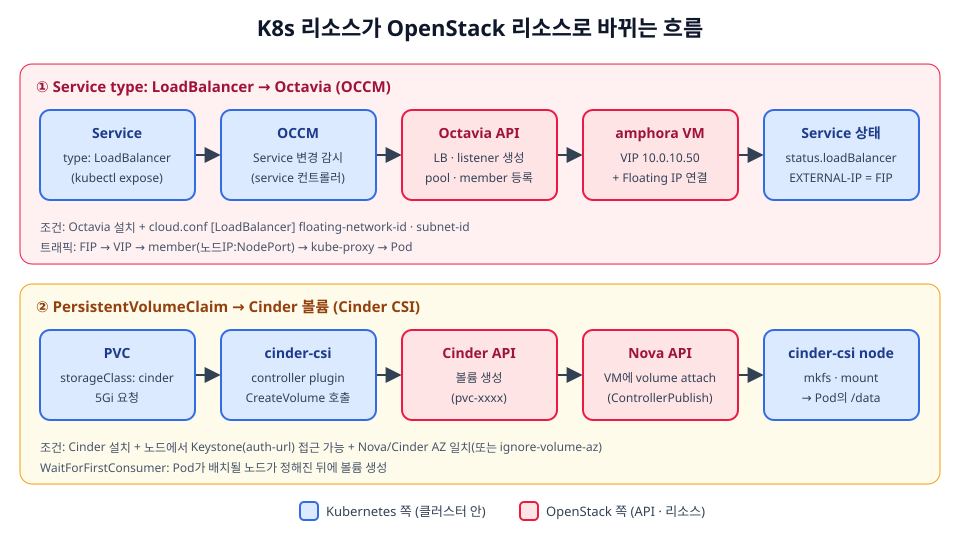

> **Chapter 5 · 종합 프로젝트** | 난이도 ★★★★★ | 예상 소요 3 ~ 4시간

## 🎯 오늘의 목표

- "클라우드 위의 Kubernetes"가 **어떤 층으로 쌓여 있는지** (물리 서버 → OpenStack → VM → K8s → Pod) 설명할 수 있다
- Chapter 4에서 배운 OpenStack으로 **network · router · security group · keypair · VM 3대**를 직접 만든다
- Day 20의 kubeadm 절차로 그 VM 3대에 **1 control plane + 2 worker** 클러스터를 올린다
- **OpenStack Cloud Controller Manager(OCCM)** 로 `Service type: LoadBalancer` → **Octavia** 로드밸런서를 자동 생성한다
- **Cinder CSI** 로 PVC → **Cinder 볼륨**이 자동으로 만들어져 VM에 붙는 흐름을 확인한다

---

## 1. 왜 OpenStack 위에 Kubernetes인가?

Chapter 2에서는 kind와 kubeadm으로 클러스터를 만들었지만, 두 가지가 계속 아쉬웠습니다.

- Day 12에서 `type: LoadBalancer` 서비스를 만들면 `EXTERNAL-IP`가 영원히 **`<pending>`** 이었다
- Day 14에서 PVC를 쓰려면 hostPath나 local-path 같은 **"그 노드에만 있는" 스토리지**로 버텨야 했다

이 두 가지는 Kubernetes가 **스스로 만들 수 없는 것**입니다. 로드밸런서와 블록 디스크는 *인프라*가 줘야 합니다. 그래서 AWS의 EKS, GCP의 GKE는 모두 "클라우드 VM 위에 K8s를 깔고, 클라우드 API와 연결하는" 구조입니다. 오늘 우리는 그 구조를 **우리가 만든 프라이빗 클라우드(OpenStack)** 로 똑같이 재현합니다.

| 층 | 누가 담당? | 오늘 쓰는 것 | 배운 곳 |
|---|---|---|---|
| 물리 서버 · 하이퍼바이저 | OpenStack 운영자 | KVM / libvirt, OVS·OVN | Day 21~24 |
| 네트워크 · VM · 디스크 · LB | OpenStack API | Neutron, Nova, Cinder, **Octavia** | Day 25~33 |
| 클러스터 | kubeadm | kube-apiserver, etcd, kubelet | Day 20 |
| **클러스터 ↔ 클라우드 연결** | **OCCM · Cinder CSI** | Service LB, PVC → OpenStack 리소스 | **오늘** |
| 애플리케이션 | 개발자 | Deployment, Service, PVC | Day 10~14 |

> 💡 **퍼블릭 클라우드와 1:1 대응**: EC2 ↔ Nova, VPC ↔ Neutron, ELB ↔ Octavia, EBS ↔ Cinder, AWS Cloud Controller ↔ OCCM, EBS CSI ↔ Cinder CSI. 이름만 다르고 구조는 같습니다.

---

## 2. 오늘 만들 아키텍처



| 리소스 | 이름 | 값 / 역할 |
|---|---|---|
| 테넌트 네트워크 / 서브넷 | `k8s-net` / `k8s-subnet` | `10.0.10.0/24` — 노드 3대가 붙는 사설망 |
| 라우터 | `k8s-router` | 외부 게이트웨이 = `public`, SNAT + Floating IP NAT |
| 보안 그룹 | `k8s-sg` | SSH·6443은 외부 허용, 노드끼리는 전부 허용 |
| 키페어 | `k8s-key` | Ubuntu 클라우드 이미지 `ubuntu` 계정에 주입 |
| VM | `k8s-cp1`, `k8s-w1`, `k8s-w2` | Ubuntu 24.04, 2 vCPU / 4 GB / 30 GB |
| Floating IP | cp1용 1개 | 내 쪽에서 `kubectl`·`ssh` 접속용 |

### 필요 조건 — 시작 전에 꼭 확인

| 항목 | 조건 | 확인 방법 |
|---|---|---|
| OpenStack 서비스 | Keystone · Glance · Nova · Neutron · **Cinder** (PVC용) · **Octavia** (LoadBalancer용) | `openstack service list` 에 `volumev3`, `load-balancer` 가 보여야 함 |
| Octavia | DevStack이면 `local.conf`에 `enable_plugin octavia https://opendev.org/openstack/octavia` + amphora 이미지, Kolla-Ansible이면 `enable_octavia: "yes"` (Day 33) | `openstack loadbalancer provider list` |
| CLI | `python-openstackclient` + **`python-octaviaclient`** | `openstack loadbalancer list` 가 에러 없이 동작 |
| 이미지 | Glance에 Ubuntu 24.04 클라우드 이미지 (Day 28) | `openstack image list` |
| 쿼터 | 인스턴스 3 + (amphora VM 1~2), vCPU 6+, RAM 12 GB+, Floating IP 3+, 볼륨 수 GB | `openstack quota show` |
| 외부 네트워크 | `router:external=True` 인 네트워크 (DevStack 기본값 `public`) | `openstack network list --external` |

> ⚠️ OCCM과 Cinder CSI는 Octavia/Cinder가 **없으면 그 기능만** 동작하지 않습니다. Octavia가 없다면 7장(LoadBalancer)은 건너뛰고 NodePort로 테스트하세요.
> DevStack의 `public`(172.24.4.0/24)은 **DevStack 호스트 안에서만** 닿습니다(Day 30). 오늘 실습의 "내 PC" 명령은 DevStack 호스트에서 실행한다고 생각하면 됩니다.

---

## 3. 실습 1 — OpenStack 리소스 만들기

실습 환경: Day 26 DevStack(또는 Day 33 Kolla-Ansible) 2025.1 이후 릴리스, CLI 실행 위치는 DevStack 호스트.

```bash
# DevStack 기준: demo 프로젝트 자격 증명 로드 (Day 27)
source ~/devstack/openrc demo demo
```

### 3-1. 네트워크 · 서브넷 · 라우터 (Day 30 복습)

```bash
openstack network create k8s-net
openstack subnet create k8s-subnet \
  --network k8s-net \
  --subnet-range 10.0.10.0/24 \
  --dns-nameserver 8.8.8.8

openstack router create k8s-router
openstack router set k8s-router --external-gateway public   # SNAT로 VM이 인터넷(apt) 접근
openstack router add subnet k8s-router k8s-subnet
```

### 3-2. 보안 그룹

```bash
openstack security group create k8s-sg --description "k8s nodes"

# 외부 → SSH, API 서버 (실무에서는 --remote-ip 를 내 IP/32 로 좁힐 것)
openstack security group rule create --protocol tcp --dst-port 22   --remote-ip 0.0.0.0/0 k8s-sg
openstack security group rule create --protocol tcp --dst-port 6443 --remote-ip 0.0.0.0/0 k8s-sg

# 노드끼리는 전부 허용 (같은 보안 그룹을 remote-group 으로 지정)
openstack security group rule create --protocol tcp  --remote-group k8s-sg k8s-sg
openstack security group rule create --protocol udp  --remote-group k8s-sg k8s-sg   # Flannel VXLAN(8472/udp) 포함
openstack security group rule create --protocol icmp --remote-group k8s-sg k8s-sg

# Octavia amphora(같은 서브넷에 붙음) → 노드의 NodePort
openstack security group rule create --protocol tcp --dst-port 30000:32767 \
  --remote-ip 10.0.10.0/24 k8s-sg
```

| 규칙 | 왜 필요한가 |
|---|---|
| 22/tcp | SSH 접속 |
| 6443/tcp | `kubectl` → kube-apiserver |
| remote-group 전체 | kubelet(10250), etcd(2379-2380), CNI 오버레이(8472/udp) 등 노드 간 통신 |
| 30000-32767/tcp from 서브넷 | LoadBalancer 서비스의 실제 목적지는 노드의 **NodePort** (Day 12) |

> 💡 보안 그룹은 **VM 포트 단위의 방화벽**입니다(Day 30). 노드끼리 통신을 IP 대역이 아니라 `--remote-group` 으로 열면, 노드가 늘어나도 규칙을 고칠 필요가 없습니다.

### 3-3. 키페어 · 플레이버

```bash
ssh-keygen -t ed25519 -f ~/.ssh/id_ed25519 -N ""          # 이미 있으면 생략
openstack keypair create --public-key ~/.ssh/id_ed25519.pub k8s-key

# 플레이버 생성은 관리자 권한 (DevStack: source ~/devstack/openrc admin admin)
openstack flavor create --vcpus 2 --ram 4096 --disk 30 k8s.medium
```

> ⚠️ kubeadm은 control plane에 **최소 2 vCPU / 2 GB RAM**을 요구합니다(preflight 검사). `m1.small`(1 vCPU)로는 `kubeadm init`이 실패합니다.

---

## 4. 실습 2 — VM 3대 + Floating IP

```bash
source ~/devstack/openrc demo demo

for n in k8s-cp1 k8s-w1 k8s-w2; do
  openstack server create \
    --image ubuntu-24.04 \
    --flavor k8s.medium \
    --network k8s-net \
    --security-group k8s-sg \
    --key-name k8s-key \
    --wait "$n"
done

openstack server list -c Name -c Status -c Networks
```

```
+---------+--------+----------------------+
| Name    | Status | Networks             |
+---------+--------+----------------------+
| k8s-w2  | ACTIVE | k8s-net=10.0.10.173  |
| k8s-w1  | ACTIVE | k8s-net=10.0.10.61   |
| k8s-cp1 | ACTIVE | k8s-net=10.0.10.208  |
+---------+--------+----------------------+
```

control plane에만 Floating IP를 붙입니다. 워커는 cp1을 **점프 호스트**로 거쳐 들어갑니다.

```bash
FIP=$(openstack floating ip create public -f value -c floating_ip_address)
openstack server add floating ip k8s-cp1 "$FIP"
echo "$FIP"        # 예: 172.24.4.120

ssh ubuntu@"$FIP"                         # control plane
ssh -J ubuntu@"$FIP" ubuntu@10.0.10.61    # 워커 (ProxyJump)
```

> 💡 Ubuntu 클라우드 이미지의 기본 계정은 `ubuntu`, 비밀번호 로그인은 꺼져 있고 **키페어로만** 들어갑니다. 호스트명은 cloud-init이 **서버 이름(`k8s-cp1`)** 으로 설정합니다 — 이게 뒤에서 OCCM이 노드와 VM을 짝짓는 열쇠가 됩니다.

---

## 5. 실습 3 — kubeadm으로 클러스터 구성 (Day 20 복습 + 한 줄 추가)

### 5-1. 모든 노드 공통 (cp1, w1, w2에서 각각)

Day 20과 같은 준비 과정입니다. 차이는 **마지막 한 줄**(`--cloud-provider=external`)뿐입니다.

```bash
sudo -i

# 1) 커널 모듈 · sysctl
cat <<EOF > /etc/modules-load.d/k8s.conf
overlay
br_netfilter
EOF
modprobe overlay && modprobe br_netfilter

cat <<EOF > /etc/sysctl.d/k8s.conf
net.bridge.bridge-nf-call-iptables  = 1
net.bridge.bridge-nf-call-ip6tables = 1
net.ipv4.ip_forward                 = 1
EOF
sysctl --system

# 2) containerd (Ubuntu 24.04 패키지) + systemd cgroup
apt-get update
apt-get install -y containerd apt-transport-https ca-certificates curl gpg
mkdir -p /etc/containerd
containerd config default > /etc/containerd/config.toml
sed -i 's/SystemdCgroup = false/SystemdCgroup = true/' /etc/containerd/config.toml
systemctl restart containerd

# 3) kubeadm · kubelet · kubectl (pkgs.k8s.io, v1.34)
mkdir -p -m 755 /etc/apt/keyrings
curl -fsSL https://pkgs.k8s.io/core:/stable:/v1.34/deb/Release.key \
  | gpg --dearmor -o /etc/apt/keyrings/kubernetes-apt-keyring.gpg
echo 'deb [signed-by=/etc/apt/keyrings/kubernetes-apt-keyring.gpg] https://pkgs.k8s.io/core:/stable:/v1.34/deb/ /' \
  > /etc/apt/sources.list.d/kubernetes.list
apt-get update
apt-get install -y kubelet kubeadm kubectl
apt-mark hold kubelet kubeadm kubectl

# 4) ★ 오늘 추가: 클라우드 연동은 외부 컨트롤러(OCCM)에게 맡긴다
echo 'KUBELET_EXTRA_ARGS=--cloud-provider=external' > /etc/default/kubelet
```

> 💡 Ubuntu 클라우드 이미지는 **swap이 없어서** Day 20의 `swapoff -a` 단계가 필요 없습니다. `free -h`로 Swap이 0인지만 확인하세요.

`--cloud-provider=external` 을 켠 kubelet은 노드를 등록할 때 **taint** 하나를 붙입니다.

```
node.cloudprovider.kubernetes.io/uninitialized=true:NoSchedule
```

"아직 클라우드 컨트롤러가 이 노드를 확인하지 않았다"는 뜻입니다. OCCM이 뜨면 이 taint를 지우고 노드에 **providerID**(= Nova 인스턴스 UUID)와 IP 주소를 채워 넣습니다.

### 5-2. control plane 초기화 (cp1)

Floating IP로도 `kubectl`을 쓰려면 API 서버 인증서에 FIP를 넣어야 합니다.

```bash
sudo kubeadm init \
  --pod-network-cidr=10.244.0.0/16 \
  --apiserver-cert-extra-sans=172.24.4.120      # ← 내 FIP로 바꿀 것

mkdir -p $HOME/.kube
sudo cp /etc/kubernetes/admin.conf $HOME/.kube/config
sudo chown $(id -u):$(id -g) $HOME/.kube/config
```

### 5-3. CNI — Flannel (VXLAN)

```bash
kubectl apply -f https://github.com/flannel-io/flannel/releases/latest/download/kube-flannel.yml
```

> ⚠️ **OpenStack 위에서는 CNI가 "캡슐화"를 해야 합니다.** Neutron은 포트 보안(anti-spoofing)으로 *그 포트에 할당되지 않은 IP*에서 나온 패킷을 버립니다. Pod IP(10.244.x.x)를 그대로 내보내는 라우팅 모드(Calico BGP·`CrossSubnet`의 같은 서브넷 구간 등)는 패킷이 사라집니다.
> Flannel VXLAN은 Pod 패킷을 **노드 IP로 감싸서**(Day 23) 보내므로 문제없습니다. Calico를 쓴다면 encapsulation을 `VXLAN`(Always) 또는 `IPIP`(이 경우 보안 그룹에 `--protocol 4` 규칙 추가)로 설정하세요.

### 5-4. 워커 조인 (w1, w2)

`kubeadm init` 마지막에 출력된 명령을 그대로 실행합니다.

```bash
sudo kubeadm join 10.0.10.208:6443 --token abcdef.0123456789abcdef \
  --discovery-token-ca-cert-hash sha256:<해시>
```

```bash
kubectl get nodes
```

```
NAME      STATUS   ROLES           AGE   VERSION
k8s-cp1   Ready    control-plane   6m    v1.34.x
k8s-w1    Ready    <none>          2m    v1.34.x
k8s-w2    Ready    <none>          2m    v1.34.x
```

노드는 Ready지만, CoreDNS를 보면 아직 `Pending`입니다.

```bash
kubectl -n kube-system get pods -l k8s-app=kube-dns
kubectl describe node k8s-w1 | grep Taints
# Taints: node.cloudprovider.kubernetes.io/uninitialized=true:NoSchedule
```

→ 정상입니다. 다음 단계에서 OCCM을 설치하면 풀립니다.

---

## 6. 실습 4 — OpenStack Cloud Controller Manager



### 6-1. 전용 자격 증명 — Application Credential

클러스터 안에 내 비밀번호를 넣는 대신, **이 프로젝트 전용 · 폐기 가능한** 자격 증명을 만듭니다(Day 27의 Keystone 기능).

```bash
# DevStack 호스트에서
openstack application credential create k8s-cloud-provider
# 출력의 id 와 secret 을 기록 (secret은 다시 볼 수 없음)

openstack network show public -f value -c id       # → floating-network-id
openstack subnet show k8s-subnet -f value -c id    # → subnet-id
```

### 6-2. cloud.conf 작성 → Secret

cp1에 `cloud.conf`를 만듭니다. `auth-url`은 DevStack이면 `http://<호스트IP>/identity`, Kolla-Ansible이면 `http://<VIP>:5000` 입니다.

```ini
[Global]
auth-url=http://192.168.0.10/identity
application-credential-id=<위에서 받은 id>
application-credential-secret=<위에서 받은 secret>
region=RegionOne

[LoadBalancer]
floating-network-id=<public 네트워크 ID>
subnet-id=<k8s-subnet ID>

[BlockStorage]
ignore-volume-az=true
```

```bash
kubectl create secret -n kube-system generic cloud-config --from-file=cloud.conf
```

> ⚠️ VM 안에서 `auth-url`에 닿아야 합니다. `curl -s http://192.168.0.10/identity/v3` 가 JSON을 돌려주는지 cp1에서 먼저 확인하세요.

### 6-3. OCCM 설치

클러스터 버전과 맞는 브랜치(`release-1.34`)의 매니페스트를 사용합니다.

```bash
git clone --depth 1 -b release-1.34 https://github.com/kubernetes/cloud-provider-openstack.git
cd cloud-provider-openstack

kubectl apply -f manifests/controller-manager/cloud-controller-manager-roles.yaml
kubectl apply -f manifests/controller-manager/cloud-controller-manager-role-bindings.yaml
kubectl apply -f manifests/controller-manager/openstack-cloud-controller-manager-ds.yaml
```

OCCM DaemonSet은 **control plane 노드에만** 뜨고, 위에서 만든 `cloud-config` Secret을 `/etc/config/cloud.conf`로 마운트합니다.

```bash
kubectl -n kube-system get pods -l k8s-app=openstack-cloud-controller-manager
kubectl get node k8s-w1 -o jsonpath='{.spec.providerID}{"\n"}'
# openstack:///6f3c1d2e-....   ← Nova 인스턴스 UUID
kubectl describe node k8s-w1 | grep Taints
# Taints: <none>
```

OCCM이 하는 일은 세 가지입니다.

| 컨트롤러 | 하는 일 |
|---|---|
| **node** | 노드 이름 = Nova 서버 이름으로 VM을 찾아 providerID · 주소를 채우고 `uninitialized` taint 제거 |
| **node lifecycle** | Nova에서 VM이 삭제되면 K8s Node 객체도 정리 |
| **service** | `type: LoadBalancer` 서비스를 감시해 **Octavia** LB를 생성·갱신·삭제 |

---

## 7. 실습 5 — Service type: LoadBalancer → Octavia

```bash
kubectl create deployment web --image=nginx --replicas=2
kubectl expose deployment web --port=80 --type=LoadBalancer
kubectl get svc web -w
```

```
NAME   TYPE           CLUSTER-IP     EXTERNAL-IP    PORT(S)        AGE
web    LoadBalancer   10.96.141.27   <pending>      80:31380/TCP   5s
web    LoadBalancer   10.96.141.27   172.24.4.188   80:31380/TCP   2m
```

Day 12에서 영원히 `<pending>`이던 그 칸이 드디어 채워졌습니다. amphora VM을 부팅하느라 1~3분 걸립니다.

```bash
curl http://172.24.4.188          # Welcome to nginx!

# OpenStack 쪽에서 본 모습
openstack loadbalancer list -c name -c vip_address -c provisioning_status
```

```
+-----------------------------------------+--------------+---------------------+
| name                                    | vip_address  | provisioning_status |
+-----------------------------------------+--------------+---------------------+
| kube_service_kubernetes_default_web     | 10.0.10.50   | ACTIVE              |
+-----------------------------------------+--------------+---------------------+
```

```bash
openstack loadbalancer member list \
  $(openstack loadbalancer pool list -f value -c id | head -n1)
# 멤버 = 각 노드IP:31380  ← NodePort
```

흐름: **FIP(172.24.4.188) → Octavia VIP(10.0.10.50) → 노드IP:NodePort → kube-proxy → Pod**. Day 12에서 "LoadBalancer는 NodePort 위에 외부 LB를 얹은 것"이라고 했던 말이 그대로 눈에 보입니다.

> 💡 외부 FIP 없이 클러스터 내부망 전용 LB가 필요하면 Service에 `service.beta.kubernetes.io/openstack-internal-load-balancer: "true"` 어노테이션을 붙입니다.

---

## 8. 실습 6 — Cinder CSI로 PVC 자동 프로비저닝

### 8-1. 드라이버 설치

같은 저장소의 Cinder CSI 매니페스트를 씁니다. **`csi-secret-cinderplugin.yaml`은 적용하지 않습니다** — 예제 값으로 우리가 만든 `cloud-config` Secret을 덮어써 버리기 때문입니다. (`cinder-csi-nodeplugin-direct.yaml`은 베어메탈용이라 역시 제외)

```bash
cd cloud-provider-openstack
kubectl apply -f manifests/cinder-csi-plugin/cinder-csi-controllerplugin-rbac.yaml
kubectl apply -f manifests/cinder-csi-plugin/cinder-csi-controllerplugin.yaml
kubectl apply -f manifests/cinder-csi-plugin/cinder-csi-nodeplugin-rbac.yaml
kubectl apply -f manifests/cinder-csi-plugin/cinder-csi-nodeplugin.yaml
kubectl apply -f manifests/cinder-csi-plugin/csi-cinder-driver.yaml

kubectl -n kube-system get pods | grep csi-cinder
# csi-cinder-controllerplugin-xxxx   6/6  Running
# csi-cinder-nodeplugin-xxxxx        3/3  Running   (노드마다 1개)
kubectl get csidrivers
# cinder.csi.openstack.org
```

### 8-2. StorageClass와 PVC

```yaml
# cinder-sc.yaml
apiVersion: storage.k8s.io/v1
kind: StorageClass
metadata:
  name: cinder
  annotations:
    storageclass.kubernetes.io/is-default-class: "true"
provisioner: cinder.csi.openstack.org
reclaimPolicy: Delete
volumeBindingMode: WaitForFirstConsumer
allowVolumeExpansion: true
---
apiVersion: v1
kind: PersistentVolumeClaim
metadata:
  name: data
spec:
  accessModes: ["ReadWriteOnce"]
  resources:
    requests:
      storage: 5Gi
---
apiVersion: v1
kind: Pod
metadata:
  name: writer
spec:
  containers:
  - name: app
    image: busybox:1.36
    command: ["sh", "-c", "date >> /data/log.txt; sleep 3600"]
    volumeMounts:
    - name: data
      mountPath: /data
  volumes:
  - name: data
    persistentVolumeClaim:
      claimName: data
```

```bash
kubectl apply -f cinder-sc.yaml
kubectl get pvc data
# NAME   STATUS   VOLUME                                     CAPACITY   STORAGECLASS
# data   Bound    pvc-5b1e2f0c-...                           5Gi        cinder

# OpenStack 쪽: 같은 이름의 볼륨이 생기고 Pod가 뜬 노드에 attach 됨
openstack volume list -c Name -c Size -c Status -c "Attached to"
# pvc-5b1e2f0c-... | 5 | in-use | Attached to 6f3c1d2e-... on /dev/vdb   ← k8s-w1의 인스턴스 ID
```

| 단계 | 담당 | OpenStack API |
|---|---|---|
| PVC 생성 → 볼륨 생성 | csi-provisioner + cinder-csi controller | Cinder `CreateVolume` |
| Pod가 노드에 배치 → 붙이기 | csi-attacher + cinder-csi controller | Nova `volume attach` |
| 포맷 · 마운트 | cinder-csi **nodeplugin** (해당 노드) | — (VM 안에서 `/dev/vdb` mkfs·mount) |

> 💡 `WaitForFirstConsumer`를 쓰는 이유: Pod가 **어느 노드(AZ)** 에 갈지 정해진 뒤 그 위치에 볼륨을 만들기 위해서입니다(Day 14).
> Pod를 지우고 다시 만들어 다른 노드로 가도, Cinder 볼륨이 **떼어졌다가 새 노드에 다시 붙으므로** `/data/log.txt` 내용이 유지됩니다. hostPath로는 불가능했던 일입니다.

---

## 9. 정리 — 순서가 중요하다

K8s가 만든 OpenStack 리소스(Octavia LB, Cinder 볼륨)는 **K8s 쪽에서 먼저 지워야** 고아 리소스가 남지 않습니다.

```bash
# 1) 클러스터 안에서 (cp1)
kubectl delete svc web            # → Octavia LB + FIP 삭제
kubectl delete pod writer
kubectl delete pvc data           # → Cinder 볼륨 삭제 (reclaimPolicy: Delete)

# 2) OpenStack 쪽 (DevStack 호스트)
openstack server delete --wait k8s-cp1 k8s-w1 k8s-w2
openstack floating ip delete "$FIP"
openstack router remove subnet k8s-router k8s-subnet
openstack router delete k8s-router
openstack network delete k8s-net          # 서브넷도 함께 삭제됨
openstack security group delete k8s-sg
openstack keypair delete k8s-key
openstack application credential delete k8s-cloud-provider
```

> ⚠️ 만들 때도 지울 때도 **순서와 개수**를 사람이 기억해야 했습니다. 명령어 30여 줄, 하나라도 빠뜨리면 다시 처음부터… 이것을 코드 한 벌로 만드는 것이 내일(Day 35)의 주제입니다.

---

## 10. 트러블슈팅

| 증상 | 원인 | 해결 |
|---|---|---|
| `kubeadm init` preflight: `the number of available CPUs 1 is less than the required 2` | 플레이버가 너무 작음 | 2 vCPU 이상 플레이버(`k8s.medium`)로 재생성 |
| 노드 Ready인데 CoreDNS·모든 Pod가 `Pending` | `--cloud-provider=external` 로 붙은 `uninitialized` taint, OCCM 미설치/실패 | OCCM 설치, `kubectl -n kube-system logs ds/openstack-cloud-controller-manager` 확인 |
| OCCM 로그 `failed to find instance` / providerID 비어 있음 | K8s 노드 이름 ≠ Nova 서버 이름 | 호스트명을 서버 이름과 같게 유지 (cloud-init 기본값 그대로 사용) |
| OCCM 로그 인증 에러 / timeout | `auth-url`에 VM에서 닿지 않음, application credential 오타 | cp1에서 `curl <auth-url>/v3` 확인, Secret 재생성 후 `kubectl -n kube-system rollout restart ds/openstack-cloud-controller-manager` |
| 다른 노드의 Pod끼리 통신 불가 | 보안 그룹이 오버레이 트래픽 차단, 또는 캡슐화 없는 CNI 라우팅 → anti-spoofing에 드롭 | remote-group udp 규칙 확인, VXLAN/IPIP 캡슐화 CNI 사용 |
| 큰 응답에서만 멈춤(작은 curl은 됨) | MTU 초과 — 테넌트망(Geneve/VXLAN) 위에 또 VXLAN | `ip link`로 `flannel.1` MTU가 eth0보다 50 작게 잡혔는지 확인 |
| `EXTERNAL-IP`가 계속 `<pending>` | Octavia 미설치, `floating-network-id`·`subnet-id` 누락, LB 쿼터 부족 | `kubectl describe svc web` 이벤트, `openstack loadbalancer list` 상태(`ERROR`) 확인 |
| LB는 ACTIVE인데 응답 없음 | amphora → NodePort 가 보안 그룹에 막힘 | `30000:32767/tcp from 10.0.10.0/24` 규칙 추가 |
| PVC `Pending`, `availability zone` 관련 에러 | Nova AZ와 Cinder AZ 이름 불일치 | `[BlockStorage] ignore-volume-az=true` 또는 StorageClass `parameters.availability` 지정 |
| VM을 지웠는데 `pvc-...` 볼륨과 `kube_service_...` LB가 남아 있음 | PVC·Service를 지우기 전에 클러스터(VM)를 먼저 삭제 | `openstack volume delete <id>`, `openstack loadbalancer delete --cascade <lb>` 로 수동 정리, 다음부턴 9장 순서 준수 |

---

## 11. 핵심 정리

- 클라우드 위의 K8s = **IaaS(OpenStack)가 VM·네트워크·디스크·LB를 주고, K8s는 그 위에서 컨테이너를 운영**하는 2층 구조
- kubelet에 `--cloud-provider=external` → 클라우드 연동은 **OCCM**이 담당, 그 전까지 노드에는 `uninitialized` taint
- OCCM: 노드 ↔ Nova VM 매핑(providerID), **`type: LoadBalancer` → Octavia LB + Floating IP**
- Cinder CSI: **PVC → Cinder 볼륨 생성 → Nova attach → 노드에서 mount**, Pod가 다른 노드로 가도 데이터 유지
- 둘 다 `cloud.conf`(Keystone application credential)를 담은 **`cloud-config` Secret**을 공유
- OpenStack 위에서는 **캡슐화 CNI**(VXLAN/IPIP)와 **보안 그룹 규칙**(remote-group, NodePort)이 핵심 함정
- 삭제는 **K8s 리소스 → VM → 네트워크** 순서. 수작업의 한계 → IaC로

---

## 12. 셀프 체크

<details>
<summary>Q1. kind 클러스터에서는 <code>EXTERNAL-IP</code>가 <code>&lt;pending&gt;</code>이었는데, 오늘은 채워진 이유는?</summary>

LoadBalancer는 K8s가 아니라 **인프라가 제공**해야 하는 리소스입니다. 오늘은 OCCM의 service 컨트롤러가 Service를 감시하다가 Octavia API로 LB와 Floating IP를 만들고, 그 주소를 `status.loadBalancer.ingress`에 기록했기 때문입니다.
</details>

<details>
<summary>Q2. <code>--cloud-provider=external</code> 을 켰는데 OCCM을 설치하지 않으면 어떤 일이 생기나?</summary>

노드에 `node.cloudprovider.kubernetes.io/uninitialized:NoSchedule` taint가 계속 남아서, 이를 tolerate하지 않는 일반 Pod(CoreDNS 포함)가 스케줄되지 않고 `Pending`에 머뭅니다.
</details>

<details>
<summary>Q3. OpenStack VM 위에서 Calico를 BGP(캡슐화 없음) 모드로 쓰면 노드 간 Pod 통신이 안 되는 이유는?</summary>

Neutron 포트 보안(anti-spoofing)이 VM 포트에 할당된 IP·MAC이 아닌 출발지(Pod IP)의 패킷을 버리기 때문입니다. VXLAN/IPIP로 노드 IP로 감싸서 보내거나, 포트에 `allowed-address-pairs`로 Pod 대역을 허용해야 합니다.
</details>

<details>
<summary>Q4. Octavia LB의 멤버(member)는 Pod IP인가, 노드 IP인가?</summary>

**노드IP:NodePort** 입니다. OCCM은 Service의 NodePort를 멤버 포트로 등록하고, 노드에 도착한 트래픽은 kube-proxy가 Pod로 전달합니다. 그래서 보안 그룹에 NodePort 대역을 열어야 합니다.
</details>

<details>
<summary>Q5. 실습을 정리할 때 VM보다 PVC·LoadBalancer 서비스를 먼저 지워야 하는 이유는?</summary>

Cinder 볼륨과 Octavia LB는 K8s 컨트롤러(CSI, OCCM)가 만든 것이라 K8s 객체 삭제를 계기로 정리됩니다. 클러스터(VM)를 먼저 없애면 지워 줄 컨트롤러가 사라져서 **고아 리소스**가 OpenStack에 남고, 쿼터와 비용을 계속 차지합니다.
</details>

---

## ⏭️ 다음 예고 — Day 35. Terraform으로 전체 인프라 코드화 (IaC)

오늘 손으로 친 `openstack ... create` 수십 줄과 VM마다 반복한 kubeadm 준비 과정을, **`terraform apply` 한 번**으로 바꿔 봅니다. terraform-provider-openstack으로 네트워크부터 VM·Floating IP까지 선언하고, cloud-init으로 kubeadm까지 자동화한 뒤, `terraform destroy` 한 줄로 순서 걱정 없이 정리합니다. 그리고 시리즈 전체(Chapter 1~5)를 돌아봅니다.
