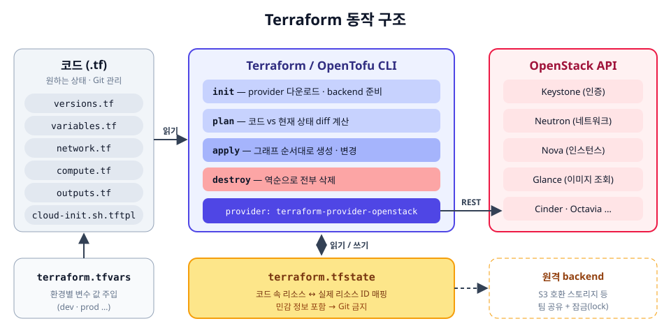
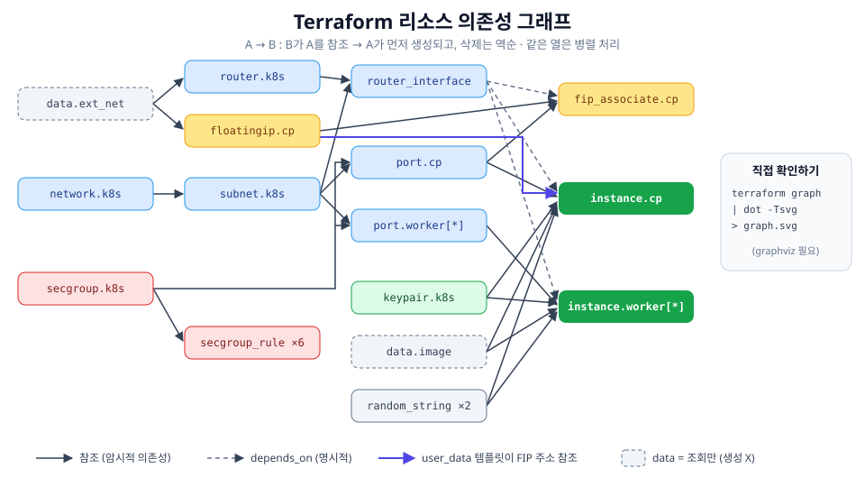
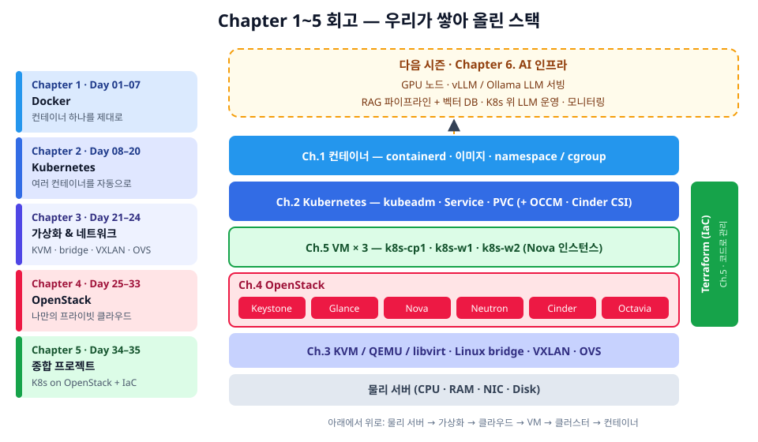

> **Chapter 5 · 종합 프로젝트** | 난이도 ★★★★☆ | 예상 소요 2.5 ~ 3.5시간

## 🎯 오늘의 목표

- IaC(Infrastructure as Code)가 **왜** 필요한지, 선언형 도구가 무엇을 대신해 주는지 설명할 수 있다
- Terraform의 **provider · variable · resource · data · output** 구조를 이해한다
- Day 34에서 손으로 만든 OpenStack 인프라를 **terraform-provider-openstack** 코드로 옮기고, cloud-init으로 kubeadm까지 자동화한다
- `init → plan → apply → destroy` 사이클과 **state 파일**의 역할 · 관리 방법을 안다
- Chapter 1~5 전체를 하나의 그림으로 회고한다

---

## 1. 왜 IaC인가?

Day 34를 떠올려 봅시다. `openstack ... create` 20여 줄, VM마다 반복한 kubeadm 준비 스크립트, 그리고 **정해진 순서대로** 지워야 했던 정리 명령까지. 이 방식에는 문제가 많습니다.

| 문제 | 수작업(CLI · 대시보드) | IaC |
|---|---|---|
| 재현성 | 내 터미널 히스토리에만 남음 | Git에 코드로 남음 — 누가 해도 같은 결과 |
| 변경 추적 | "누가 보안 그룹 규칙 바꿨어요?" | PR · 커밋 로그로 리뷰 · 추적 |
| 순서 관리 | 사람이 의존 관계를 기억 | 도구가 **의존성 그래프**로 계산 |
| 삭제 | 역순으로 하나씩, 빠뜨리면 고아 리소스 | `destroy` 한 번 |
| 환경 복제 | dev/stage/prod를 각각 손으로 | 변수만 바꿔 같은 코드 재사용 |

> 💡 Day 06의 Docker Compose, Day 11의 Deployment YAML, Day 32의 Heat 템플릿을 기억하나요? 전부 **"원하는 상태를 선언하면 도구가 맞춰 준다"** 는 같은 철학입니다. Terraform은 이것을 **클라우드 인프라 전체**에 적용합니다.

### Heat vs Terraform

| 구분 | Heat (Day 32) | Terraform / OpenTofu |
|---|---|---|
| 위치 | OpenStack **안의** 서비스 | 내 PC의 CLI (클라우드 밖) |
| 대상 | OpenStack 전용 | provider만 있으면 무엇이든 (OpenStack, AWS, K8s, DNS …) |
| 상태 저장 | Heat DB(스택) | **state 파일** (로컬 또는 원격 backend) |
| 미리보기 | `stack create --dry-run` 제한적 | **`plan`** 으로 변경점 diff를 상세히 |
| 언어 | HOT(YAML) | HCL |

---

## 2. Terraform 핵심 개념



| 개념 | 설명 | 오늘의 예 |
|---|---|---|
| **provider** | 특정 API와 통신하는 플러그인. `init` 때 다운로드 | `terraform-provider-openstack/openstack` |
| **resource** | 만들고 관리할 대상 하나 | `openstack_networking_network_v2.k8s` |
| **data** | 이미 있는 것을 **조회만** (관리 X) | 외부 네트워크 `public`, Glance 이미지 |
| **variable** | 입력값. `terraform.tfvars`·`-var`·환경 변수로 주입 | `worker_count`, `flavor_name` |
| **output** | 결과값 출력 · 다른 모듈에 전달 | control plane Floating IP |
| **state** | "코드의 리소스 ↔ 실제 리소스 ID" 매핑 기록 | `terraform.tfstate` |

동작 원리는 Kubernetes 컨트롤러와 닮았습니다.

```
원하는 상태(.tf 코드)  vs  현재 상태(state + 실제 API 조회)
                ↓ diff
          plan: + 생성 / ~ 변경 / - 삭제
                ↓ apply
       provider가 OpenStack REST API 호출
```

> 💡 차이점: K8s 컨트롤러는 **계속** 감시하며 맞추지만(reconcile loop), Terraform은 **내가 `apply` 할 때만** 맞춥니다.

---

## 3. 실습 준비

실습 환경: Day 26 DevStack(또는 Day 33 Kolla-Ansible) + Day 34와 같은 Glance 이미지 `ubuntu-24.04`, 플레이버 `k8s.medium`. Terraform은 DevStack 호스트(Ubuntu 24.04)에 설치합니다.

### 3-1. Terraform 설치 (HashiCorp 공식 apt 저장소)

```bash
wget -O - https://apt.releases.hashicorp.com/gpg \
  | sudo gpg --dearmor -o /usr/share/keyrings/hashicorp-archive-keyring.gpg
echo "deb [arch=$(dpkg --print-architecture) signed-by=/usr/share/keyrings/hashicorp-archive-keyring.gpg] \
https://apt.releases.hashicorp.com $(lsb_release -cs) main" \
  | sudo tee /etc/apt/sources.list.d/hashicorp.list
sudo apt-get update && sudo apt-get install -y terraform

terraform version      # Terraform v1.1x.x
```

### 3-2. 인증 — clouds.yaml + Application Credential

Terraform 코드에 비밀번호를 쓰지 않도록, Day 34처럼 application credential을 만들어 `clouds.yaml`에 넣습니다.

```bash
source ~/devstack/openrc demo demo
openstack application credential create terraform
```

```yaml
# ~/.config/openstack/clouds.yaml
clouds:
  devstack:
    auth_type: v3applicationcredential
    auth:
      auth_url: http://192.168.0.10/identity
      application_credential_id: "<id>"
      application_credential_secret: "<secret>"
    region_name: RegionOne
    interface: public
    identity_api_version: 3
```

```bash
openstack --os-cloud devstack server list    # 인증이 되는지 먼저 확인
```

### 3-3. 프로젝트 구조

```
k8s-openstack-tf/
├── versions.tf          # terraform · provider 버전
├── variables.tf         # 입력 변수
├── network.tf           # network / subnet / router / security group
├── compute.tf           # keypair / port / instance / floating IP
├── outputs.tf           # 출력
├── cloud-init.sh.tftpl  # VM 첫 부팅 스크립트 (kubeadm 자동화)
└── terraform.tfvars     # 환경별 값
```

> 💡 Terraform은 디렉터리 안의 **모든 `.tf` 파일을 하나로 합쳐서** 읽습니다. 파일 나누기는 사람을 위한 정리일 뿐, 순서는 상관없습니다.

---

## 4. 코드 작성

### 4-1. versions.tf — provider 설정

```hcl
terraform {
  required_version = ">= 1.9"

  required_providers {
    openstack = {
      source  = "terraform-provider-openstack/openstack"
      version = "~> 3.4"
    }
    random = {
      source  = "hashicorp/random"
      version = "~> 3.6"
    }
  }
}

provider "openstack" {
  cloud = var.cloud   # clouds.yaml 의 항목 이름
}
```

### 4-2. variables.tf

```hcl
variable "cloud" {
  description = "clouds.yaml 에 정의한 클라우드 이름"
  type        = string
  default     = "devstack"
}

variable "external_network" {
  description = "Floating IP 를 받을 외부 네트워크 이름"
  type        = string
  default     = "public"
}

variable "image_name" {
  type    = string
  default = "ubuntu-24.04"
}

variable "flavor_name" {
  type    = string
  default = "k8s.medium"
}

variable "worker_count" {
  type    = number
  default = 2
}

variable "subnet_cidr" {
  type    = string
  default = "10.0.10.0/24"
}

variable "admin_cidr" {
  description = "SSH / kube-apiserver(6443) 접속을 허용할 대역"
  type        = string
  default     = "0.0.0.0/0"
}

variable "ssh_public_key_path" {
  type    = string
  default = "~/.ssh/id_ed25519.pub"
}

variable "k8s_minor" {
  description = "pkgs.k8s.io 저장소 버전 (예: v1.34)"
  type        = string
  default     = "v1.34"

  validation {
    condition     = can(regex("^v1\\.[0-9]+$", var.k8s_minor))
    error_message = "k8s_minor 는 v1.34 같은 형식이어야 합니다."
  }
}
```

### 4-3. network.tf — Day 34 3장을 코드로

```hcl
# 이미 있는 외부 네트워크는 '조회'만 한다 (data)
data "openstack_networking_network_v2" "external" {
  name     = var.external_network
  external = true
}

resource "openstack_networking_network_v2" "k8s" {
  name           = "k8s-net"
  admin_state_up = true
}

resource "openstack_networking_subnet_v2" "k8s" {
  name            = "k8s-subnet"
  network_id      = openstack_networking_network_v2.k8s.id
  cidr            = var.subnet_cidr
  ip_version      = 4
  dns_nameservers = ["8.8.8.8"]
}

resource "openstack_networking_router_v2" "k8s" {
  name                = "k8s-router"
  external_network_id = data.openstack_networking_network_v2.external.id
}

resource "openstack_networking_router_interface_v2" "k8s" {
  router_id = openstack_networking_router_v2.k8s.id
  subnet_id = openstack_networking_subnet_v2.k8s.id
}

resource "openstack_networking_secgroup_v2" "k8s" {
  name        = "k8s-sg"
  description = "k8s nodes"
}

locals {
  external_ports = {
    ssh = 22
    api = 6443
  }
}

# 외부 → SSH, API 서버
resource "openstack_networking_secgroup_rule_v2" "external" {
  for_each          = local.external_ports
  direction         = "ingress"
  ethertype         = "IPv4"
  protocol          = "tcp"
  port_range_min    = each.value
  port_range_max    = each.value
  remote_ip_prefix  = var.admin_cidr
  security_group_id = openstack_networking_secgroup_v2.k8s.id
}

# 노드끼리는 tcp/udp/icmp 전부 허용
resource "openstack_networking_secgroup_rule_v2" "internal" {
  for_each          = toset(["tcp", "udp", "icmp"])
  direction         = "ingress"
  ethertype         = "IPv4"
  protocol          = each.key
  remote_group_id   = openstack_networking_secgroup_v2.k8s.id
  security_group_id = openstack_networking_secgroup_v2.k8s.id
}

# Octavia amphora → NodePort
resource "openstack_networking_secgroup_rule_v2" "nodeport" {
  direction         = "ingress"
  ethertype         = "IPv4"
  protocol          = "tcp"
  port_range_min    = 30000
  port_range_max    = 32767
  remote_ip_prefix  = var.subnet_cidr
  security_group_id = openstack_networking_secgroup_v2.k8s.id
}
```

> 💡 `openstack_networking_subnet_v2.k8s` 가 `openstack_networking_network_v2.k8s.id` 를 **참조**하는 순간, Terraform은 "네트워크를 먼저 만들어야 한다"는 걸 압니다. 순서를 적어 줄 필요가 없습니다.

### 4-4. compute.tf — 포트 · VM · Floating IP

VM에 IP를 고정하고 보안 그룹을 명확히 붙이기 위해 **포트를 먼저 만들고** 인스턴스에 꽂는 패턴을 씁니다.

```hcl
data "openstack_images_image_v2" "ubuntu" {
  name        = var.image_name
  most_recent = true
}

resource "openstack_compute_keypair_v2" "k8s" {
  name       = "k8s-key"
  public_key = file(pathexpand(var.ssh_public_key_path))
}

# kubeadm 부트스트랩 토큰: [a-z0-9]{6}.[a-z0-9]{16}
resource "random_string" "token_id" {
  length  = 6
  special = false
  upper   = false
}

resource "random_string" "token_secret" {
  length  = 16
  special = false
  upper   = false
}

locals {
  cp_ip         = cidrhost(var.subnet_cidr, 10)   # 10.0.10.10 고정
  kubeadm_token = "${random_string.token_id.result}.${random_string.token_secret.result}"
  pod_cidr      = "10.244.0.0/16"
}

resource "openstack_networking_port_v2" "cp" {
  name               = "k8s-cp1-port"
  network_id         = openstack_networking_network_v2.k8s.id
  security_group_ids = [openstack_networking_secgroup_v2.k8s.id]

  fixed_ip {
    subnet_id  = openstack_networking_subnet_v2.k8s.id
    ip_address = local.cp_ip
  }
}

resource "openstack_networking_port_v2" "worker" {
  count              = var.worker_count
  name               = "k8s-w${count.index + 1}-port"
  network_id         = openstack_networking_network_v2.k8s.id
  security_group_ids = [openstack_networking_secgroup_v2.k8s.id]

  fixed_ip {
    subnet_id = openstack_networking_subnet_v2.k8s.id
  }
}

resource "openstack_networking_floatingip_v2" "cp" {
  pool = var.external_network
}

resource "openstack_compute_instance_v2" "cp" {
  name        = "k8s-cp1"
  image_id    = data.openstack_images_image_v2.ubuntu.id
  flavor_name = var.flavor_name
  key_pair    = openstack_compute_keypair_v2.k8s.name

  user_data = templatefile("${path.module}/cloud-init.sh.tftpl", {
    role      = "control-plane"
    k8s_minor = var.k8s_minor
    token     = local.kubeadm_token
    cp_ip     = local.cp_ip
    cp_fip    = openstack_networking_floatingip_v2.cp.address
    pod_cidr  = local.pod_cidr
  })

  network {
    port = openstack_networking_port_v2.cp.id
  }

  # 코드상 참조는 없지만, 라우터가 붙어야 apt 로 패키지를 받을 수 있다
  depends_on = [openstack_networking_router_interface_v2.k8s]
}

resource "openstack_compute_instance_v2" "worker" {
  count       = var.worker_count
  name        = "k8s-w${count.index + 1}"
  image_id    = data.openstack_images_image_v2.ubuntu.id
  flavor_name = var.flavor_name
  key_pair    = openstack_compute_keypair_v2.k8s.name

  user_data = templatefile("${path.module}/cloud-init.sh.tftpl", {
    role      = "worker"
    k8s_minor = var.k8s_minor
    token     = local.kubeadm_token
    cp_ip     = local.cp_ip
    cp_fip    = ""
    pod_cidr  = local.pod_cidr
  })

  network {
    port = openstack_networking_port_v2.worker[count.index].id
  }

  depends_on = [openstack_networking_router_interface_v2.k8s]
}

resource "openstack_networking_floatingip_associate_v2" "cp" {
  floating_ip = openstack_networking_floatingip_v2.cp.address
  port_id     = openstack_networking_port_v2.cp.id

  # 서브넷이 라우터에 붙기 전에 연결하면 "External network ... is not reachable" 에러
  depends_on = [openstack_networking_router_interface_v2.k8s]
}
```

| 포인트 | 설명 |
|---|---|
| `count` | 같은 리소스를 N개. `worker_count = 3` 으로 바꾸면 워커가 하나 늘어남 |
| `for_each` | 맵/집합의 키마다 하나씩 (보안 그룹 규칙) — 중간 항목을 지워도 나머지 주소가 안 밀림 |
| `depends_on` | 참조로 드러나지 않는 **숨은 의존성**만 명시 |
| `templatefile()` | 변수를 채운 cloud-init 스크립트를 `user_data` 로 전달 |
| FIP를 인스턴스보다 먼저 | cp의 `user_data`가 FIP 주소를 인증서 SAN에 넣기 위해 참조 |

### 4-5. cloud-init.sh.tftpl — kubeadm 자동화 개요

Day 34 5장에서 노드마다 손으로 친 내용을 **첫 부팅 스크립트**로 만듭니다. cloud-init이 root로 한 번 실행하고, 로그는 VM의 `/var/log/cloud-init-output.log`에 남습니다.

```bash
#!/bin/bash
set -euxo pipefail

# ---------- 공통 (Day 34 5-1) ----------
cat <<EOF > /etc/modules-load.d/k8s.conf
overlay
br_netfilter
EOF
modprobe overlay
modprobe br_netfilter

cat <<EOF > /etc/sysctl.d/k8s.conf
net.bridge.bridge-nf-call-iptables  = 1
net.bridge.bridge-nf-call-ip6tables = 1
net.ipv4.ip_forward                 = 1
EOF
sysctl --system

export DEBIAN_FRONTEND=noninteractive
apt-get update
apt-get install -y containerd apt-transport-https ca-certificates curl gpg
mkdir -p /etc/containerd
containerd config default > /etc/containerd/config.toml
sed -i 's/SystemdCgroup = false/SystemdCgroup = true/' /etc/containerd/config.toml
systemctl restart containerd

mkdir -p -m 755 /etc/apt/keyrings
curl -fsSL https://pkgs.k8s.io/core:/stable:/${k8s_minor}/deb/Release.key \
  | gpg --dearmor -o /etc/apt/keyrings/kubernetes-apt-keyring.gpg
echo "deb [signed-by=/etc/apt/keyrings/kubernetes-apt-keyring.gpg] https://pkgs.k8s.io/core:/stable:/${k8s_minor}/deb/ /" \
  > /etc/apt/sources.list.d/kubernetes.list
apt-get update
apt-get install -y kubelet kubeadm kubectl
apt-mark hold kubelet kubeadm kubectl
echo 'KUBELET_EXTRA_ARGS=--cloud-provider=external' > /etc/default/kubelet

%{ if role == "control-plane" ~}
# ---------- control plane ----------
kubeadm init \
  --token "${token}" \
  --pod-network-cidr "${pod_cidr}" \
  --apiserver-advertise-address "${cp_ip}" \
  --apiserver-cert-extra-sans "${cp_fip}"

mkdir -p /home/ubuntu/.kube
cp /etc/kubernetes/admin.conf /home/ubuntu/.kube/config
chown -R ubuntu:ubuntu /home/ubuntu/.kube

kubectl --kubeconfig /etc/kubernetes/admin.conf apply \
  -f https://github.com/flannel-io/flannel/releases/latest/download/kube-flannel.yml
%{ else ~}
# ---------- worker: control plane 이 준비될 때까지 재시도 ----------
until kubeadm join "${cp_ip}:6443" --token "${token}" \
      --discovery-token-unsafe-skip-ca-verification; do
  kubeadm reset -f
  sleep 20
done
%{ endif ~}
```

| 문법 | 의미 |
|---|---|
| `${k8s_minor}` | Terraform이 채워 넣는 템플릿 변수 |
| `%{ if ... ~}` … `%{ endif ~}` | 역할(control-plane / worker)에 따라 다른 블록 출력. `~` 는 앞뒤 공백·줄바꿈 제거 |
| 셸 변수 `$VAR` | `$` 뒤에 `{` 가 없으면 Terraform이 건드리지 않음. 셸에서 `${VAR}` 가 필요하면 `$${VAR}` 로 이스케이프 |

> ⚠️ **학습용 단순화**가 두 군데 있습니다.
> ① `--discovery-token-unsafe-skip-ca-verification` — 워커가 API 서버 CA를 검증하지 않습니다. 운영에서는 CA 키를 Terraform(`tls` provider)으로 미리 만들어 넣고 `--discovery-token-ca-cert-hash`를 쓰세요.
> ② 부트스트랩 토큰 기본 수명은 **24시간**입니다. 하루 뒤에 `worker_count`를 늘리면 새 워커가 조인에 실패하므로, cp1에서 `sudo kubeadm token create <같은 토큰 값>` 으로 다시 등록해 주세요.
> 그리고 토큰은 `user_data`에 들어가므로 **state 파일과 Nova 메타데이터에 평문으로** 남습니다.

### 4-6. outputs.tf · terraform.tfvars

```hcl
# outputs.tf
output "control_plane_fip" {
  value = openstack_networking_floatingip_v2.cp.address
}

output "control_plane_ip" {
  value = local.cp_ip
}

output "worker_ips" {
  value = [for p in openstack_networking_port_v2.worker : p.all_fixed_ips[0]]
}

output "ssh_command" {
  value = "ssh ubuntu@${openstack_networking_floatingip_v2.cp.address}"
}

output "kubeadm_token" {
  value     = local.kubeadm_token
  sensitive = true          # plan/apply 출력에서 가려짐 (state에는 남음!)
}
```

```hcl
# terraform.tfvars
cloud        = "devstack"
worker_count = 2
admin_cidr   = "172.24.4.1/32"   # DevStack 호스트의 br-ex 주소 (Day 30)
```

---

## 5. 실습 — plan / apply / destroy



### 5-1. init · fmt · validate

```bash
cd k8s-openstack-tf
terraform init
```

```
Initializing provider plugins...
- Finding terraform-provider-openstack/openstack versions matching "~> 3.4"...
- Installing terraform-provider-openstack/openstack v3.4.x...
- Installing hashicorp/random v3.x.x...
Terraform has created a lock file .terraform.lock.hcl ...
Terraform has been successfully initialized!
```

```bash
terraform fmt        # 코드 스타일 자동 정렬
terraform validate   # 문법 · 참조 오류 검사 (API 호출 없음)
```

### 5-2. plan — 무엇이 바뀔지 미리 보기

```bash
terraform plan -out tfplan
```

```
  # openstack_compute_instance_v2.cp will be created
  + resource "openstack_compute_instance_v2" "cp" {
      + name        = "k8s-cp1"
      + flavor_name = "k8s.medium"
      ...
Plan: 22 to add, 0 to change, 0 to destroy.
```

22개 = 네트워크 · 서브넷 · 라우터 · 라우터 인터페이스 · 보안 그룹(1) + 규칙(6) + 키페어 · 랜덤 문자열(2) · 포트(3) · FIP · 인스턴스(3) · FIP 연결. (`data` 는 조회라 개수에 들어가지 않습니다)

### 5-3. apply — 실제로 만들기

```bash
terraform apply tfplan
```

```
openstack_networking_network_v2.k8s: Creating...
openstack_networking_secgroup_v2.k8s: Creating...
openstack_compute_keypair_v2.k8s: Creating...
...
openstack_compute_instance_v2.cp: Creation complete after 34s
Apply complete! Resources: 22 added, 0 changed, 0 destroyed.

Outputs:
control_plane_fip = "172.24.4.131"
control_plane_ip  = "10.0.10.10"
kubeadm_token     = <sensitive>
ssh_command       = "ssh ubuntu@172.24.4.131"
worker_ips        = ["10.0.10.23", "10.0.10.187"]
```

의존 관계가 없는 리소스(네트워크 · 보안 그룹 · 키페어)는 **동시에** 만들어집니다(기본 병렬도 10). 그래프 그림의 같은 열에 있는 것들이죠.

cloud-init이 끝날 때까지(5~10분) 기다린 뒤 확인합니다.

```bash
FIP=$(terraform output -raw control_plane_fip)
ssh ubuntu@"$FIP" 'cloud-init status --wait; kubectl get nodes'
```

```
status: done
NAME      STATUS   ROLES           AGE   VERSION
k8s-cp1   Ready    control-plane   4m    v1.34.x
k8s-w1    Ready    <none>          2m    v1.34.x
k8s-w2    Ready    <none>          2m    v1.34.x
```

여기서부터는 Day 34의 6~8장(OCCM, Octavia, Cinder CSI)을 그대로 이어서 적용하면 됩니다. 노드에 `uninitialized` taint가 있는 것도 같습니다.

> 💡 이 단계까지 코드로 만들고 싶다면 `helm` / `kubernetes` provider로 OCCM·CSI 설치까지 Terraform에 넣을 수 있습니다. 다만 "인프라 레이어(Terraform)"와 "클러스터 안 애플리케이션 레이어(Helm · GitOps)"를 나누는 편이 운영하기 쉬워 실무에서는 보통 분리합니다.

### 5-4. 변경 — 워커 하나 추가

```bash
terraform apply -var worker_count=3
```

```
  # openstack_compute_instance_v2.worker[2] will be created
  # openstack_networking_port_v2.worker[2] will be created
Plan: 2 to add, 0 to change, 0 to destroy.
```

기존 VM은 건드리지 않고 **차이만** 반영합니다. 반대로 `user_data`나 `image_id`처럼 바꿀 수 없는 속성을 고치면 `-/+ must be replaced`(삭제 후 재생성)로 표시되니 plan을 꼭 읽으세요.

### 5-5. destroy — 순서 걱정 없이 정리

```bash
# 먼저 클러스터 안에서 K8s가 만든 리소스 정리 (Day 34 9장과 같은 이유)
ssh ubuntu@"$FIP" 'kubectl delete svc web; kubectl delete pod writer; kubectl delete pvc --all -A'

terraform destroy
```

```
Plan: 0 to add, 0 to change, 22 to destroy.
Do you really want to destroy all resources? ... Enter a value: yes
...
Destroy complete! Resources: 22 destroyed.
```

Terraform은 그래프를 **거꾸로** 따라가며 지웁니다: FIP 연결 → 인스턴스 → 포트 → 라우터 인터페이스 → 서브넷 → 네트워크. Day 34에서 손으로 지키던 순서를 도구가 대신 지켜 줍니다.

> ⚠️ Octavia LB와 Cinder 볼륨은 **K8s(OCCM·CSI)가 만든 것**이라 Terraform state에 없습니다. 먼저 지우지 않으면 `destroy`가 서브넷 삭제 단계에서 "포트가 아직 사용 중"으로 실패합니다.

---

## 6. State 관리

### 6-1. state가 하는 일

```bash
terraform state list
```

```
data.openstack_images_image_v2.ubuntu
data.openstack_networking_network_v2.external
openstack_compute_instance_v2.cp
openstack_compute_instance_v2.worker[0]
openstack_compute_instance_v2.worker[1]
openstack_networking_network_v2.k8s
...
```

```bash
terraform state show openstack_compute_instance_v2.cp    # ID, IP, 속성 전체
terraform plan -refresh-only                             # 실제 인프라와 state 차이(drift)만 확인
```

누군가 대시보드에서 `k8s-sg`의 6443 규칙을 지웠다면, 다음 `terraform plan`이 `+ create` 로 다시 만들겠다고 알려 줍니다. **코드가 진실의 원천(Single Source of Truth)** 이 되는 것이죠.

### 6-2. 지켜야 할 규칙

| 규칙 | 이유 |
|---|---|
| `terraform.tfstate` 는 **Git에 올리지 않는다** | 토큰 · 비밀번호 등 민감 값이 평문으로 들어 있음 |
| `.terraform.lock.hcl` 은 **Git에 올린다** | provider 버전 고정 — 팀원 모두 같은 버전 사용 |
| state를 손으로 편집하지 않는다 | 필요하면 `terraform state mv / rm`, `import` 블록 사용 |
| 팀이면 **원격 backend + 잠금** | 두 사람이 동시에 apply 하면 state가 깨짐 |

```gitignore
# .gitignore
.terraform/
*.tfstate
*.tfstate.*
tfplan
```

### 6-3. 원격 backend 예시 (S3 호환 스토리지)

MinIO나 Ceph RGW 같은 S3 호환 오브젝트 스토리지를 backend로 쓸 수 있습니다. 아래 `use_lockfile`(S3 네이티브 잠금)은 **Terraform 1.10+** 에서 지원됩니다.

```hcl
terraform {
  backend "s3" {
    bucket = "tfstate"
    key    = "k8s-on-openstack/terraform.tfstate"
    region = "us-east-1"                 # S3 호환이면 형식상 값

    endpoints = {
      s3 = "http://minio.example.internal:9000"
    }
    use_path_style              = true
    skip_credentials_validation = true
    skip_region_validation      = true
    skip_requesting_account_id  = true
    use_lockfile                = true
  }
}
```

```bash
export AWS_ACCESS_KEY_ID=...  AWS_SECRET_ACCESS_KEY=...
terraform init -migrate-state      # 로컬 state 를 원격으로 옮김
```

### 6-4. 이미 만든 리소스 가져오기 — import 블록

Day 34에서 손으로 만든 `k8s-net`을 지우지 않고 Terraform 관리로 넘기고 싶다면 (Terraform 1.5+):

```hcl
import {
  to = openstack_networking_network_v2.k8s
  id = "<openstack network show k8s-net -f value -c id 결과>"
}
```

```bash
terraform plan     # "1 to import" 로 표시 → apply 하면 state에 편입
```

---

## 7. OpenTofu — 오픈소스 포크

2023년 HashiCorp가 Terraform 라이선스를 MPL에서 BSL로 바꾸자, 커뮤니티가 MPL 시점의 코드로 **OpenTofu** 를 만들었습니다. 지금은 Linux Foundation 산하의 오픈소스 프로젝트로 개발되고 있습니다.

| 구분 | Terraform | OpenTofu |
|---|---|---|
| 라이선스 | BSL 1.1 | MPL 2.0 (오픈소스) |
| CLI | `terraform` | `tofu` |
| 코드(HCL) · provider | — | 오늘 작성한 코드가 **그대로** 동작 (`registry.opentofu.org`에 같은 provider 제공) |
| 고유 기능 예 | HCP Terraform 연동 | state 파일 **클라이언트 측 암호화** (1.7+) |

```bash
# 같은 디렉터리에서 명령만 바꾸면 됨
tofu init
tofu plan -out tfplan
tofu apply tfplan
tofu destroy
```

> 💡 OpenStack 커뮤니티 · 프라이빗 클라우드 환경에서는 라이선스 문제로 OpenTofu를 표준으로 삼는 조직이 늘고 있습니다. 문법과 개념은 같으니 오늘 배운 것은 둘 다에 통합니다.

---

## 8. Chapter 1~5 회고 — 우리가 쌓아 올린 것



| Chapter | 핵심 질문 | 오늘(Day 34~35)에 어떻게 쓰였나 |
|---|---|---|
| **1. Docker** (Day 01~07) | 앱을 어디서나 똑같이 실행하려면? | Pod 안 컨테이너 = 이미지 + namespace · cgroup, 런타임은 containerd |
| **2. Kubernetes** (Day 08~20) | 컨테이너 수백 개를 누가 관리하나? | kubeadm 클러스터, Service LoadBalancer, PVC · StorageClass |
| **3. 가상화 · 네트워크** (Day 21~24) | VM과 가상 네트워크는 어떻게 동작하나? | Nova VM = KVM, 테넌트망 = Geneve/VXLAN, Flannel VXLAN 위의 VXLAN과 MTU |
| **4. OpenStack** (Day 25~33) | 그 VM·네트워크·디스크를 API로 나눠 주려면? | Keystone 인증, Neutron 라우터 · FIP · 보안 그룹, Cinder 볼륨, Octavia LB |
| **5. 종합** (Day 34~35) | 다 합치고, 재현 가능하게 만들려면? | OCCM · Cinder CSI로 K8s ↔ OpenStack 연결, Terraform으로 전체를 코드화 |

컨테이너 **한 개**(`docker run nginx`)에서 시작해서, 그 컨테이너가 돌아가는 **클러스터**, 클러스터가 올라가는 **VM**, VM을 만드는 **하이퍼바이저와 가상 네트워크**, 그것을 API로 제공하는 **클라우드**, 그리고 그 전부를 **코드 한 벌**로 만들고 지우는 데까지 왔습니다. 이제 "클라우드에서 서비스가 돈다"는 말을 들으면 그 아래 층들이 하나하나 보일 겁니다.

---

## 9. 트러블슈팅

| 증상 | 원인 | 해결 |
|---|---|---|
| `plan` 에서 인증 에러 (`auth_url` 누락, 401 등) | `clouds.yaml` 을 못 찾음 / `cloud` 이름 불일치 / credential 오타 | `~/.config/openstack/clouds.yaml` 위치와 `cloud = "devstack"` 이름 확인 |
| `Failed to query available provider packages` | 인터넷 · 프록시 문제로 registry 접근 불가 | 네트워크 확인, 필요 시 provider mirror 설정 |
| FIP 연결 시 `External network ... is not reachable from subnet` | 라우터 인터페이스보다 FIP 연결이 먼저 실행 | `depends_on = [openstack_networking_router_interface_v2.k8s]` |
| `kubectl get nodes` 에 워커가 없음 | cloud-init 진행 중이거나 실패 | 워커에서 `sudo tail -f /var/log/cloud-init-output.log`, `cloud-init status --long` |
| 워커 join이 무한 재시도 | 보안 그룹 6443 내부 허용 누락, cp 의 kubeadm init 실패 | cp1의 cloud-init 로그 확인, `internal` 규칙(tcp remote-group) 확인 |
| 코드 한 줄 고쳤는데 VM이 **재생성**됨 | `user_data` · `image_id` 등 ForceNew 속성 변경 | plan의 `-/+` 표시 확인, 의도치 않으면 `lifecycle { ignore_changes = [user_data] }` |
| `Error acquiring the state lock` | 다른 apply가 진행 중이거나 비정상 종료로 잠금이 남음 | 진행 중인 작업이 없음을 확인한 뒤 `terraform force-unlock <LOCK_ID>` |
| `destroy` 가 서브넷/네트워크에서 멈춤 | K8s가 만든 Octavia LB 포트 · 볼륨이 남아 있음 | 클러스터에서 LB Service · PVC 먼저 삭제, 또는 `openstack loadbalancer delete --cascade` |

---

## 10. 핵심 정리

- IaC = 인프라를 **선언형 코드**로 관리 → 재현 · 리뷰 · 버전 관리 · 일괄 삭제가 가능
- Terraform 구성 요소: **provider**(API 플러그인) · **resource**(관리 대상) · **data**(조회) · **variable** · **output**
- 리소스 간 **참조**가 곧 의존성 그래프 → 생성은 정방향, 삭제는 역방향으로 자동 정렬 · 병렬 처리. 숨은 의존성만 `depends_on`
- 사이클: `init → (fmt · validate) → plan → apply → destroy`. **plan을 읽는 습관**이 가장 중요 (`-/+` = 재생성)
- **state** = 코드 ↔ 실제 리소스 매핑. Git 금지 · 민감 정보 포함 · 팀은 원격 backend + 잠금
- `user_data` + cloud-init으로 VM 부팅과 동시에 kubeadm까지 자동화 (학습용 단순화의 보안 트레이드오프 인지)
- OpenTofu는 MPL 라이선스의 호환 포크 — 같은 코드, `tofu` 명령

---

## 11. 셀프 체크

<details>
<summary>Q1. <code>terraform plan</code> 은 OpenStack에 아무것도 만들지 않는데 왜 꼭 해야 하나?</summary>

코드(원하는 상태)와 state · 실제 인프라(현재 상태)의 **차이**를 미리 보여 주기 때문입니다. 특히 `-/+ must be replaced`(삭제 후 재생성)처럼 데이터 손실이 생길 수 있는 변경을 apply 전에 잡아낼 수 있습니다. `-out tfplan` 으로 저장한 계획을 apply 하면 본 그대로만 실행됩니다.
</details>

<details>
<summary>Q2. 인스턴스 리소스에 <code>depends_on = [router_interface]</code> 를 따로 적은 이유는?</summary>

인스턴스 코드는 포트만 참조하고 라우터 인터페이스는 참조하지 않으므로, Terraform이 둘 사이 관계를 모릅니다. 그런데 VM의 cloud-init은 부팅 직후 apt로 패키지를 받아야 하고, 그러려면 서브넷이 라우터(SNAT)에 붙어 있어야 합니다. 이런 **코드에 드러나지 않는 의존성**만 `depends_on` 으로 명시합니다.
</details>

<details>
<summary>Q3. state 파일을 잃어버리면 어떻게 되나?</summary>

실제 리소스는 OpenStack에 그대로 남아 있지만 Terraform은 "아무것도 없다"고 판단해, 다음 `apply` 때 같은 리소스를 **새로 또 만들려고** 합니다(이름 충돌 · 중복 생성). `import` 로 하나씩 다시 편입해야 하므로, 원격 backend로 안전하게 보관하는 것이 중요합니다.
</details>

<details>
<summary>Q4. <code>terraform destroy</code> 전에 LoadBalancer Service와 PVC를 먼저 지워야 하는 이유는?</summary>

Octavia LB와 Cinder 볼륨은 Terraform이 아니라 클러스터 안의 OCCM · Cinder CSI가 만든 것이라 **state에 없습니다**. 그대로 두면 Terraform이 VM을 지운 뒤 LB 포트가 남은 서브넷을 지우지 못해 실패하고, 고아 리소스도 남습니다.
</details>

<details>
<summary>Q5. Heat 대신 Terraform/OpenTofu를 선택하는 대표적인 이유는?</summary>

OpenStack 외에 DNS, 퍼블릭 클라우드, Kubernetes, 모니터링 등 **여러 provider를 한 코드에서 함께** 다룰 수 있고, `plan` 으로 변경점을 상세히 미리 볼 수 있으며, 생태계(모듈 · 커뮤니티)가 크기 때문입니다. 반대로 OpenStack 안에서만 완결되고 오토스케일링(Heat + Aodh) 연동이 필요하면 Heat도 여전히 좋은 선택입니다.
</details>

---

## ⏭️ 다음 예고 — Day 36. AI 인프라 개요 — LLM 서빙 스택과 GPU·VRAM 계산 (Chapter 6 시작)

Chapter 1~5로 "컨테이너 → 클러스터 → 클라우드 → 코드"까지 인프라의 뼈대를 세웠습니다. 다음 시즌에는 그 위에 요즘 가장 뜨거운 워크로드, **LLM**을 올립니다.

- **GPU 노드 구성** — 드라이버, NVIDIA Container Toolkit, K8s GPU 스케줄링 (OpenStack GPU 패스스루와 연결)
- **LLM 서빙 서버 띄우기** — Ollama로 가볍게 시작해서 vLLM으로 고성능 서빙(OpenAI 호환 API)까지
- **RAG 파이프라인과 벡터 DB** — 임베딩, 벡터 검색, 내 문서로 답하는 챗봇 구조
- **Kubernetes 위 LLM 운영 · 모니터링** — 오토스케일링, GPU 사용률 · 토큰 처리량 지표, Prometheus/Grafana(Day 17)로 관측

오늘 만든 Terraform 코드에 GPU 플레이버 노드 하나를 추가하는 것부터 시작합니다. 🚀
