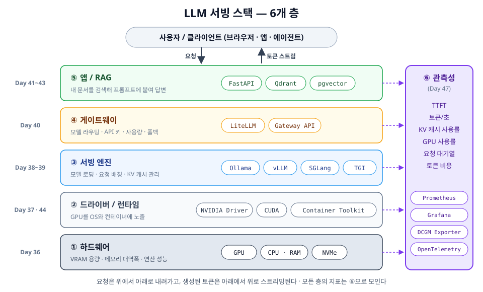
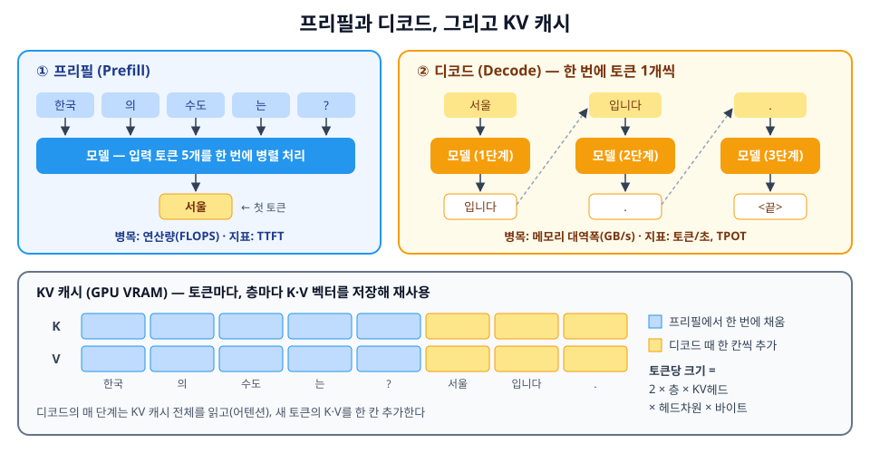
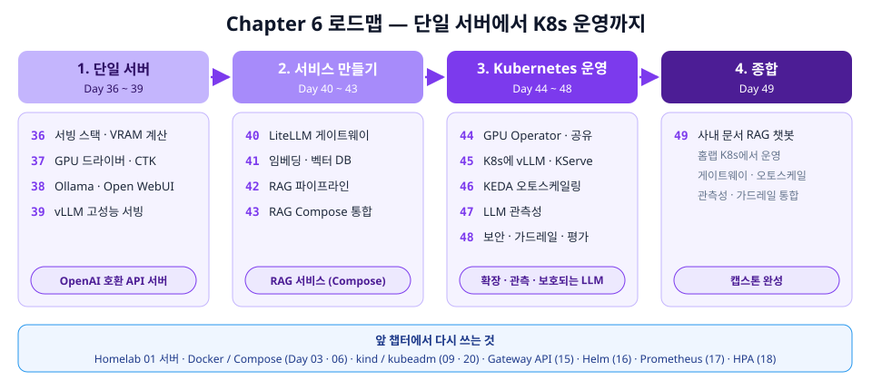

> **Chapter 6 · AI 인프라** | 난이도 ★★☆☆☆ | 예상 소요 1.5 ~ 2시간 (계산 실습 포함)

## 🎯 오늘의 목표

- LLM 서비스를 **하드웨어 → 드라이버/런타임 → 서빙 엔진 → 게이트웨이 → 앱/RAG → 관측성** 6개 층으로 나눠 설명할 수 있다
- 토큰, **프리필(prefill)과 디코드(decode)**, **KV 캐시**가 무엇이고 왜 인프라 문제인지 안다
- 모델을 올리는 데 필요한 **VRAM을 직접 계산**할 수 있다 (가중치 + KV 캐시 + 여유분)
- FP16 / INT8 / 4bit 양자화와 GGUF / AWQ / GPTQ 형식의 차이를 알고 상황에 맞게 고를 수 있다
- 홈랩과 운영 환경에서 **어떤 GPU를 고를지** 기준을 세울 수 있다

---

## 1. Chapter 6을 시작하며 — 왜 "AI 인프라"인가?

Chapter 1~5에서 우리는 컨테이너(Docker) → 클러스터(Kubernetes) → 클라우드(OpenStack) → 코드(Terraform)까지 인프라의 뼈대를 세웠습니다. 그 위에 올린 워크로드는 nginx, DB, 캐시처럼 **CPU와 메모리**가 주인공인 앱들이었죠.

LLM은 성격이 다릅니다.

| 구분 | 일반 웹 서비스 (Ch1~5) | LLM 서빙 |
|---|---|---|
| 핵심 자원 | CPU, RAM | **GPU, 그중에서도 VRAM 용량과 메모리 대역폭** |
| 요청 1건 처리 시간 | 수 ms ~ 수백 ms | 수 초 ~ 수십 초 (토큰을 하나씩 생성) |
| 응답 방식 | 한 번에 응답 | **스트리밍**(토큰 단위로 흘려보냄) |
| 컨테이너 이미지 | 수십 ~ 수백 MB | 수 GB (CUDA 라이브러리) + **모델 파일 수 GB ~ 수백 GB** 별도 |
| 기동 시간 | 1초 내외 | 모델 로딩에 수십 초 ~ 수 분 |
| 확장 단위 비용 | 파드 하나 추가는 저렴 | GPU 한 장이 서버 한 대 값인 경우도 많음 |
| 주요 지표 | RPS, 응답 시간, 에러율 | **TTFT, 토큰/초, KV 캐시 사용률, GPU 사용률** |

즉 "컨테이너를 띄우고, 오토스케일링하고, 모니터링한다"는 큰 틀은 앞 챕터와 같지만, **자원 계산 방식과 병목 지점이 완전히 다릅니다.** 그래서 오늘은 손을 움직이기 전에 큰 그림과 계산법부터 잡습니다.

> 💡 Chapter 6에서도 실습 도구는 익숙한 것들입니다. Docker/Compose(Day 03·06), kind/kubeadm(Day 09·20), Helm(Day 16), Prometheus/Grafana(Day 17), HPA(Day 18)가 그대로 다시 등장합니다.

---

## 2. LLM 서빙 스택 — 6개 층으로 보기



사용자가 챗봇에 질문 하나를 던지면, 요청은 위에서 아래로 내려갔다가 토큰 스트림이 되어 다시 올라옵니다.

| 층 | 하는 일 | 대표 기술 | 이 챕터 |
|---|---|---|---|
| ⑥ 관측성 | TTFT, 토큰 처리량, KV 캐시, 비용 추적 | Prometheus, Grafana, DCGM Exporter, OpenTelemetry, Langfuse | Day 47 |
| ⑤ 앱 / RAG | 사용자 기능. 내 문서를 검색해 답변에 붙임 | FastAPI, 임베딩 모델, Qdrant, pgvector | Day 41~43 |
| ④ 게이트웨이 | 여러 모델을 하나의 API로, 키·사용량·폴백 관리 | LiteLLM, (K8s) Gateway API | Day 40 |
| ③ 서빙 엔진 | 모델을 메모리에 올리고 요청을 배치로 묶어 토큰 생성 | **Ollama**, **vLLM**, SGLang, llama.cpp, TGI | Day 38~39 |
| ② 드라이버 / 런타임 | GPU를 OS와 컨테이너에 노출 | NVIDIA 드라이버, CUDA, NVIDIA Container Toolkit, GPU Operator | Day 37, 44 |
| ① 하드웨어 | 실제 연산 | GPU(VRAM, 대역폭), CPU, RAM, NVMe, 네트워크 | 오늘 |

### 층마다 "앞 챕터의 무엇"과 닮았나

- **② 드라이버/런타임** ↔ Day 01의 containerd/runc. 컨테이너가 GPU 장치 파일(`/dev/nvidia*`)과 드라이버 라이브러리를 볼 수 있게 해 주는 것이 NVIDIA Container Toolkit입니다.
- **③ 서빙 엔진** ↔ nginx/DB 같은 "서버 프로세스". 다만 HTTP 요청을 받아 **GPU에서 행렬 연산을 돌려** 토큰을 만들어 냅니다.
- **④ 게이트웨이** ↔ Day 15의 Ingress. 경로/호스트 대신 **모델 이름과 API 키**로 라우팅합니다.
- **⑥ 관측성** ↔ Day 17의 Prometheus. 지표 이름만 LLM 전용으로 바뀝니다.

> 💡 **OpenAI 호환 API**가 사실상 표준 인터페이스입니다. Ollama와 vLLM 모두 `/v1/chat/completions` 엔드포인트를 제공하기 때문에, 앱 코드는 그대로 두고 `base_url`만 바꿔 서빙 엔진을 교체할 수 있습니다. Day 38~40에서 계속 이 성질을 이용합니다.

---

## 3. 토큰, 프리필과 디코드, KV 캐시

### 3-1. 토큰 — LLM이 세는 단위

LLM은 글자나 단어가 아니라 **토큰(token)** 단위로 읽고 씁니다. 토크나이저가 텍스트를 잘게 쪼갠 조각입니다.

| 텍스트 | 대략적인 토큰 수 (모델마다 다름) |
|---|---|
| 영어 100단어 | 약 130 토큰 |
| 한국어 100자 | 약 50 ~ 150 토큰 (토크나이저의 한국어 지원 수준에 따라 차이 큼) |
| 코드 100줄 | 수백 ~ 천 토큰 |

토큰은 인프라에서 **모든 것의 단위**입니다. 컨텍스트 길이(최대 토큰 수), 처리량(토큰/초), 비용(백만 토큰당 가격), KV 캐시 크기(토큰당 바이트)가 전부 토큰으로 표현됩니다.

### 3-2. 프리필과 디코드 — 한 요청 안의 두 단계



LLM은 "다음 토큰 하나 예측"을 반복하는 기계입니다. 요청 하나는 두 단계로 처리됩니다.

| 단계 | 하는 일 | 병목 | 사용자가 느끼는 지표 |
|---|---|---|---|
| **프리필 (Prefill)** | 입력 프롬프트 전체를 **한 번에 병렬로** 처리하고, 첫 토큰을 생성 | **연산량(compute-bound)** — GPU의 FLOPS | **TTFT** (Time To First Token, 첫 글자가 나오기까지 시간) |
| **디코드 (Decode)** | 토큰을 **하나씩** 생성. 매 토큰마다 모델 가중치 전체를 메모리에서 읽음 | **메모리 대역폭(memory-bound)** — VRAM의 GB/s | **TPOT / ITL** (토큰 사이 간격), 토큰/초 |

- 긴 문서를 넣고 짧게 요약 → 프리필이 무겁다 → TTFT가 길어진다
- 짧게 묻고 길게 답변 → 디코드가 길다 → 토큰/초가 중요하다

> 💡 **디코드 속도의 대략적인 상한** ≈ `메모리 대역폭 ÷ 모델 가중치 크기`. 예를 들어 대역폭 1,000 GB/s인 GPU에 5GB짜리 모델이면 한 요청 기준 이론상 약 200 토큰/초가 상한입니다(실제로는 이보다 낮음). 그래서 LLM용 GPU를 고를 때는 **VRAM 용량 다음으로 대역폭**을 봅니다.

### 3-3. KV 캐시 — 이미 계산한 건 다시 계산하지 않는다

디코드에서 새 토큰을 만들려면 앞의 모든 토큰을 "참고(attention)"해야 합니다. 매번 처음부터 다시 계산하면 너무 느리므로, 각 층에서 계산한 **Key / Value 벡터를 GPU 메모리에 저장**해 두고 재사용합니다. 이것이 **KV 캐시**입니다.

KV 캐시는 공짜가 아닙니다.

- 토큰이 늘어날수록 **선형으로** 커집니다 (컨텍스트 길이 × 동시 요청 수에 비례)
- 모델 가중치와 **같은 VRAM**을 나눠 씁니다
- KV 캐시가 꽉 차면 서빙 엔진은 새 요청을 대기시키거나 기존 요청을 밀어냅니다(preemption)

그래서 vLLM의 **PagedAttention**(Day 39)은 KV 캐시를 OS의 페이지처럼 블록 단위로 관리해 낭비를 줄이고, Day 47에서는 **KV 캐시 사용률**을 핵심 지표로 모니터링합니다.

---

## 4. VRAM 계산법

### 4-1. 공식

```
필요 VRAM ≈ 가중치 + KV 캐시 + 런타임 오버헤드

가중치    = 파라미터 수 × 파라미터당 바이트
KV 캐시   = 2(K와 V) × 층 수 × KV 헤드 수 × 헤드 차원 × 바이트 × 토큰 수
오버헤드  = CUDA 컨텍스트, 활성값(activation), 엔진 내부 버퍼 등 — 대략 1 ~ 2GB 또는 10 ~ 20%
```

| 정밀도 | 파라미터당 바이트 | 8B 모델 가중치 | 70B 모델 가중치 |
|---|---|---|---|
| FP32 | 4 | 32 GB | 280 GB |
| FP16 / BF16 | 2 | 16 GB | 140 GB |
| FP8 / INT8 | 1 | 8 GB | 70 GB |
| 4bit (INT4 계열) | 0.5 (+ 스케일 값 약간) | 약 4.5 ~ 5 GB | 약 38 ~ 42 GB |

> 💡 암산 공식: **FP16이면 "파라미터(B) × 2 = GB"**, **4bit면 "파라미터(B) × 0.6 ≈ GB"** 정도로 기억하면 편합니다.

### 4-2. 예제 — Llama 3.1 8B를 컨텍스트 8K로 띄우면?

모델 설정(`config.json`)에서 필요한 값을 읽습니다. Llama 3.1 8B는 다음과 같습니다.

| 항목 | 값 | config.json 키 |
|---|---|---|
| 층 수 | 32 | `num_hidden_layers` |
| KV 헤드 수 | 8 (GQA) | `num_key_value_heads` |
| 헤드 차원 | 128 | `hidden_size(4096) ÷ num_attention_heads(32)` |

**① 가중치 (BF16)**: 8B × 2바이트 = **약 16 GB**

**② 토큰 1개당 KV 캐시 (FP16)**:

```
2 × 32층 × 8헤드 × 128차원 × 2바이트 = 131,072 바이트 = 128 KiB / 토큰
```

**③ 컨텍스트 8,192 토큰 × 동시 요청 1개**: 128 KiB × 8,192 = **1 GiB**

**④ 합계**: 16 + 1 + 오버헤드 약 1.5 ≈ **18.5 GB** → 24GB GPU(RTX 4090, L4)에 들어갑니다.

같은 모델을 **동시 요청 16개 × 8K 컨텍스트**로 서빙하면 KV 캐시만 16 GiB입니다. 16 + 16 + α ≈ 33 GB → 24GB GPU에는 안 들어갑니다. 이때 선택지는 다음과 같습니다.

| 선택지 | 효과 | 대가 |
|---|---|---|
| 가중치를 4bit로 양자화 | 16 GB → 약 5 GB | 품질 약간 하락 |
| KV 캐시를 FP8/INT8로 | KV 캐시 절반 | 품질 약간 하락, 엔진 지원 필요 |
| 최대 컨텍스트 줄이기 | KV 캐시 비례 감소 | 긴 문서 처리 불가 |
| 동시 요청 수 제한 | KV 캐시 비례 감소 | 처리량 하락, 대기 증가 |
| 더 큰 GPU / 여러 GPU (텐서 병렬) | 근본 해결 | 비용 |

> ⚠️ **GQA**(Grouped-Query Attention) 덕분에 요즘 모델은 KV 헤드 수가 어텐션 헤드 수보다 훨씬 적습니다(Llama 3.1 8B: 32 → 8). 오래된 모델 기준으로 계산하면 KV 캐시를 4배 과대평가하게 됩니다. 반드시 `num_key_value_heads`를 보세요.

### 4-3. 직접 계산해 보기 (Python)

Hugging Face에서 `config.json`을 받아 계산하는 짧은 스크립트입니다. 공개 모델인 Qwen2.5 7B Instruct로 해 봅니다(Apache 2.0, 토큰 불필요).

```bash
python3 -m venv .venv && source .venv/bin/activate
pip install huggingface_hub
```

```python
# vram_calc.py
import json
import sys

from huggingface_hub import hf_hub_download

GiB = 1024 ** 3


def estimate(repo_id: str, params_b: float, weight_bytes: float, ctx: int, batch: int, kv_bytes: int = 2) -> None:
    cfg = json.load(open(hf_hub_download(repo_id, "config.json")))
    layers = cfg["num_hidden_layers"]
    kv_heads = cfg.get("num_key_value_heads", cfg["num_attention_heads"])
    head_dim = cfg.get("head_dim") or cfg["hidden_size"] // cfg["num_attention_heads"]

    weights = params_b * 1e9 * weight_bytes
    kv_per_token = 2 * layers * kv_heads * head_dim * kv_bytes
    kv_total = kv_per_token * ctx * batch
    overhead = 1.5 * GiB

    print(f"{repo_id}: layers={layers}, kv_heads={kv_heads}, head_dim={head_dim}")
    print(f"  weights   : {weights / GiB:6.1f} GiB")
    print(f"  KV/token  : {kv_per_token / 1024:6.1f} KiB")
    print(f"  KV total  : {kv_total / GiB:6.1f} GiB  (ctx={ctx}, batch={batch})")
    print(f"  ≈ total   : {(weights + kv_total + overhead) / GiB:6.1f} GiB")


if __name__ == "__main__":
    # 사용법: python vram_calc.py <repo_id> <파라미터(B)> <바이트/파라미터> <ctx> <batch>
    repo, p, wb, ctx, b = sys.argv[1], float(sys.argv[2]), float(sys.argv[3]), int(sys.argv[4]), int(sys.argv[5])
    estimate(repo, p, wb, ctx, b)
```

```bash
python vram_calc.py Qwen/Qwen2.5-7B-Instruct 7.6 2 8192 1     # BF16, 요청 1개
python vram_calc.py Qwen/Qwen2.5-7B-Instruct 7.6 0.5 8192 8   # 4bit, 요청 8개
```

```
Qwen/Qwen2.5-7B-Instruct: layers=28, kv_heads=4, head_dim=128
  weights   :   14.2 GiB
  KV/token  :   56.0 KiB
  KV total  :    0.4 GiB  (ctx=8192, batch=1)
  ≈ total   :   16.1 GiB
```

Qwen2.5 7B는 KV 헤드가 4개라서 토큰당 KV 캐시가 Llama 3.1 8B(128 KiB)의 절반도 안 됩니다. 같은 "7~8B급"이라도 **동시 접속을 얼마나 받을 수 있는지가 모델 구조에 따라 크게 다르다**는 점을 기억하세요.

> 💡 실제 서빙 엔진은 이 계산을 자동으로 합니다. vLLM은 `--gpu-memory-utilization` 비율만큼 VRAM을 잡고 가중치를 뺀 나머지를 **전부 KV 캐시 블록**으로 씁니다(Day 39). Ollama는 `ollama ps`로 실제 메모리 사용량을 보여 줍니다(Day 38).

---

## 5. 양자화 — 정밀도를 깎아 메모리를 산다

**양자화(quantization)** 는 가중치를 16비트 대신 8비트, 4비트 같은 더 적은 비트로 표현하는 기술입니다. 메모리가 줄고, 디코드는 메모리 대역폭에 묶여 있으므로 **속도도 대개 빨라집니다.** 대가는 약간의 품질 손실입니다.

### 5-1. 정밀도 비교

| 정밀도 | 메모리 (FP16 대비) | 품질 | 비고 |
|---|---|---|---|
| FP16 / BF16 | 100% | 기준 | 대부분 모델의 원본 배포 형식 |
| FP8 | 50% | 거의 동일 | Ada(L4, L40S, RTX 40), Hopper(H100) 이상에서 하드웨어 가속 |
| INT8 (W8A8 등) | 50% | 거의 동일 | 범용적, 많은 엔진이 지원 |
| 4bit (Q4, AWQ, GPTQ) | 약 25 ~ 30% | 약간 하락 (7B 이상에서 체감 작음) | 소비자 GPU·노트북의 사실상 표준 |
| 2 ~ 3bit | 약 15 ~ 20% | 눈에 띄게 하락 | 아주 큰 모델을 억지로 올릴 때 |

### 5-2. 형식(포맷) 비교

| 형식 | 주 사용 엔진 | 특징 | 언제 쓰나 |
|---|---|---|---|
| **GGUF** | llama.cpp, **Ollama**, LM Studio | 파일 하나에 가중치 + 토크나이저 + 메타데이터. `Q4_K_M`, `Q5_K_M`, `Q8_0` 등 다양한 단계. **CPU와 GPU에 나눠 올리기(offload)** 가능 | 홈랩, 노트북, CPU 서버, 빠른 시작 |
| **AWQ** | **vLLM**, SGLang, TGI | 활성값 분포를 보고 중요한 가중치를 보호하는 4bit 양자화. GPU 전용 | GPU 서버에서 4bit 고속 서빙 |
| **GPTQ** | **vLLM**, SGLang, TGI | 층별 오차를 최소화하는 4bit/8bit 사후 양자화. 오래되고 모델 선택지가 많음 | AWQ 버전이 없을 때 |
| FP8 (safetensors) | vLLM, SGLang, TensorRT-LLM | 품질 손실이 매우 적음. 최신 GPU 필요 | L4/L40S/H100급 운영 환경 |
| safetensors (원본) | vLLM, Transformers 등 | 양자화 안 된 BF16 원본 | VRAM이 충분할 때 |

> 💡 **Ollama 모델 태그 읽기**: `qwen2.5:1.5b`의 기본 태그는 `qwen2.5:1.5b-instruct-q4_K_M`(4bit GGUF, 986MB)과 같은 파일이고, `qwen2.5:1.5b-instruct-q8_0`(1.6GB), `qwen2.5:1.5b-instruct-fp16`(3.1GB)처럼 정밀도를 골라 받을 수 있습니다. 8B급인 qwen3 8B도 Ollama 라이브러리 기준 Q4_K_M 5.2GB, Q8_0 8.9GB, FP16 16GB로 — 위 공식(8B × 0.6 ≈ 5GB, × 1 ≈ 8GB, × 2 ≈ 16GB)과 거의 맞습니다.

### 5-3. 고르는 순서

1. **VRAM에 들어가는가?** → 들어가는 가장 높은 정밀도를 고른다
2. 같은 VRAM이면 **"큰 모델 4bit" > "작은 모델 16bit"** 인 경우가 많다 (예: 14B Q4 vs 7B FP16)
3. 엔진에 맞춰 형식을 고른다 — Ollama면 GGUF, vLLM이면 AWQ/GPTQ/FP8
4. 양자화 후에는 **내 업무 데이터로 품질을 확인**한다 (Day 48 평가)

---

## 6. GPU 선택 가이드

### 6-1. 무엇을 보고 고르나

| 기준 | 왜 중요한가 | 우선순위 |
|---|---|---|
| **VRAM 용량** | 모델이 안 들어가면 시작도 못 함 | 1순위 |
| **메모리 대역폭** | 디코드 속도(토큰/초)를 결정 | 2순위 |
| 연산 성능 (FP16/FP8 TFLOPS) | 프리필(TTFT), 대량 배치 처리량 | 3순위 |
| 지원 정밀도 | FP8은 Ada/Hopper 이후, FP4는 Blackwell 이후 하드웨어 가속 | 엔진·포맷에 따라 |
| 멀티 GPU 연결 | NVLink 유무 → 텐서 병렬 효율 | 큰 모델일 때 |
| 가상화·공유 기능 | MIG(A100/H100 등), vGPU | K8s 멀티테넌시(Day 44) |
| 전력·발열·폼팩터 | 소비자용은 랙 서버 장착이 어렵고 전력이 큼 | 운영 환경 |

### 6-2. 소비자용 vs 데이터센터용

| 분류 | 예시 (VRAM) | 장점 | 단점 | 적합한 용도 |
|---|---|---|---|---|
| 노트북 GPU | RTX 4060/4070 Laptop (8GB) 등 | 이미 갖고 있을 수 있음 | VRAM 작고 전력 제한 | 1~8B 4bit 모델 학습·실습 |
| 소비자 데스크톱 | RTX 4060 Ti 16GB, RTX 3090 / 4090 (24GB), RTX 5090 (32GB) | **VRAM당 가격이 가장 저렴**, 구하기 쉬움 | 데이터센터 사용 제약(드라이버 라이선스), ECC·MIG 없음, 대형 쿨러 | 홈랩, 개인·소규모 팀 개발 |
| 데이터센터 추론용 | L4 (24GB), L40S (48GB) | 저전력·패시브 쿨링, 서버 장착, 클라우드에서 흔함 | 대역폭이 같은 가격대 소비자 GPU보다 낮을 수 있음 | 중소형 모델 운영 서빙 |
| 데이터센터 고성능 | A100 (40/80GB), H100 (80GB), H200 (141GB) | HBM 고대역폭, NVLink, MIG | 매우 비쌈, 수급 어려움 | 70B 이상, 대규모 동시 접속 |

> ⚠️ 위 VRAM 값은 대표 모델 기준이며, 같은 이름이라도 변형(PCIe/SXM, 메모리 용량 옵션)이 있습니다. 구매나 임대 전에 정확한 사양을 확인하세요.

### 6-3. 모델 크기별 권장 (4bit 기준, 동시 접속 소수)

| 모델 크기 | 4bit 가중치 | 최소 VRAM 권장 | 예시 GPU |
|---|---|---|---|
| ~ 2B | ~ 1.5 GB | 4 GB (CPU도 가능) | 내장 그래픽 노트북도 CPU로 OK |
| 7 ~ 9B | ~ 5 GB | 8 GB | 노트북 RTX 4060, RTX 3060 12GB |
| 13 ~ 14B | ~ 9 GB | 12 ~ 16 GB | RTX 4060 Ti 16GB |
| 27 ~ 32B | ~ 18 ~ 20 GB | 24 GB | RTX 3090 / 4090, L4 |
| 70B | ~ 40 GB | 48 GB 이상 또는 24GB × 2 | L40S, A100 80GB, 24GB 2장 |

### 6-4. GPU가 없다면?

Chapter 6은 **GPU 없이도 대부분 따라올 수 있게** 구성했습니다.

| 방법 | 설명 | 추천 Day |
|---|---|---|
| **CPU로 작은 모델** | Ollama는 GPU가 없으면 자동으로 CPU 모드. 0.5B ~ 3B 모델은 일반 노트북 CPU로도 대화 가능한 속도 | Day 38, 41~43 |
| **Apple Silicon Mac** | Ollama 네이티브 앱은 Metal로 통합 메모리를 GPU처럼 사용 (단, Docker 컨테이너 안에서는 GPU 사용 불가) | Day 38 |
| **클라우드 GPU 임대** | 시간당 과금으로 L4/A100/H100 등을 빌려 실습 후 삭제. 끄는 걸 잊으면 요금 폭탄 ⚠️ | Day 39, 44~46 |
| **OpenStack GPU 패스스루** | Chapter 4 환경에 GPU가 있다면 PCI 패스스루로 VM에 GPU를 붙일 수 있음 (언급 수준) | 참고 |

---

## 7. Chapter 6 로드맵



| 단계 | Day | 내용 | 결과물 |
|---|---|---|---|
| **1. 단일 서버** | 36 ~ 39 | 개요 → GPU 서버 준비 → Ollama → vLLM | 홈랩 서버에서 OpenAI 호환 API 동작 |
| **2. 서비스 만들기** | 40 ~ 43 | LiteLLM 게이트웨이 → 임베딩·벡터 DB → RAG → Compose 통합 | 내 문서로 답하는 RAG 서비스 (Compose) |
| **3. Kubernetes 운영** | 44 ~ 48 | GPU Operator → K8s LLM 배포 → KEDA 오토스케일링 → 관측성 → 보안·평가 | K8s 위에서 확장·관측·보호되는 LLM |
| **4. 종합** | 49 | 홈랩 K8s에 사내 문서 RAG 챗봇 운영 | 전 구간을 잇는 캡스톤 |

---

## 8. 실습 — 내 하드웨어 진단하고 예산 짜기

오늘은 설치 없이 **"내 장비로 무엇을 돌릴 수 있는가"** 를 확인합니다. 홈랩 서버(Homelab 01에서 만든 Ubuntu 24.04 `homelab`)나 지금 쓰는 PC에서 해 보세요.

### 8-1. GPU가 있는지 확인

```bash
# Linux
lspci | grep -iE 'vga|3d|display'
```

```
00:02.0 VGA compatible controller: Intel Corporation ... (내장 그래픽)
01:00.0 3D controller: NVIDIA Corporation AD107M [GeForce RTX 4060 Max-Q / Mobile] (rev a1)
```

```powershell
# Windows PowerShell
Get-CimInstance Win32_VideoController | Select-Object Name, AdapterRAM
```

> ⚠️ Windows의 `AdapterRAM` 값은 32비트 한계 때문에 4GB 이상 VRAM을 정확히 표시하지 못합니다. 정확한 VRAM은 작업 관리자 → 성능 → GPU의 "전용 GPU 메모리" 또는 (드라이버 설치 후) `nvidia-smi`로 확인하세요.

### 8-2. RAM과 디스크 확인

모델은 디스크에서 RAM을 거쳐 VRAM으로 올라가고, CPU 모드라면 RAM에서 직접 돌아갑니다.

```bash
free -h            # 총 RAM / 사용 가능 RAM
df -h /            # 모델 저장 공간 — 모델 몇 개만 받아도 수십 GB
nproc              # CPU 코어 수 (CPU 추론 속도에 영향)
```

### 8-3. 예산표 작성

4-3의 `vram_calc.py`로 아래 표를 채워 보세요. "들어감/안 들어감"을 직접 판단해 보는 것이 오늘의 핵심 실습입니다.

| 모델 | 정밀도 | ctx × batch | 예상 VRAM | 내 GPU(____GB)에 |
|---|---|---|---|---|
| Qwen2.5 1.5B Instruct | BF16 | 4096 × 1 | | |
| Qwen2.5 7B Instruct | 4bit | 8192 × 4 | | |
| Qwen2.5 7B Instruct | BF16 | 8192 × 4 | | |
| Qwen2.5 14B Instruct | 4bit | 8192 × 1 | | |

> 💡 GPU가 없다면 "내 GPU" 대신 "내 RAM"으로 채우세요. CPU 모드에서는 가중치 + KV 캐시가 시스템 RAM에 올라가고, OS와 다른 프로세스 몫으로 RAM의 30% 정도는 남겨 두는 것이 안전합니다.

---

## 9. 트러블슈팅

| 증상 | 원인 | 해결 |
|---|---|---|
| 모델은 로드되는데 긴 문서를 넣으면 OOM | 가중치만 계산하고 **KV 캐시**를 빼먹음 | 컨텍스트 길이 × 동시 요청 수로 KV 캐시 재계산, 최대 컨텍스트를 줄이기 |
| 계산상 들어가야 하는데 VRAM 부족 | CUDA 컨텍스트·활성값 등 **오버헤드** 미반영, 다른 프로세스(데스크톱 화면 등)가 VRAM 사용 | 1 ~ 2GB 여유 두기, `nvidia-smi`로 다른 프로세스 확인(Day 37) |
| 응답 첫 글자가 너무 늦게 나옴 (TTFT↑) | 프롬프트가 길어 **프리필**이 무거움, 또는 모델 로딩 중 | 프롬프트 줄이기, 프리픽스 캐싱, 모델 상주(keep-alive) |
| 첫 글자는 빠른데 이후가 느림 (토큰/초↓) | **디코드**가 메모리 대역폭에 묶임, 또는 일부 층이 CPU로 offload됨 | 더 작은 양자화, 대역폭 높은 GPU, 모델을 GPU에 100% 올리기 |
| 4bit로 바꿨더니 답변 품질이 이상함 | 작은 모델(1~3B)일수록 양자화 손실이 큼 | Q5/Q8로 올리거나 더 큰 모델 4bit 사용, 업무 데이터로 평가 |
| 같은 7B인데 동시 접속 수가 크게 다름 | 모델별 KV 헤드 수(GQA) 차이 | `config.json`의 `num_key_value_heads` 확인 |

---

## 10. 핵심 정리

- LLM 서빙은 **하드웨어 → 드라이버/런타임 → 서빙 엔진 → 게이트웨이 → 앱/RAG → 관측성**의 6개 층. 앞 챕터의 containerd, Ingress, Prometheus가 각 층에 대응한다
- 모든 것은 **토큰** 단위. 요청은 **프리필**(병렬, 연산 병목, TTFT)과 **디코드**(순차, 대역폭 병목, 토큰/초)로 나뉜다
- **KV 캐시**는 이미 계산한 K/V를 저장해 재사용하는 메모리. 컨텍스트 길이 × 동시 요청 수에 비례해 커진다
- **VRAM ≈ 파라미터 × 바이트 + KV 캐시(2 × 층 × KV헤드 × 헤드차원 × 바이트 × 토큰) + 오버헤드**
- 양자화: FP16 → INT8/FP8(절반) → 4bit(약 1/4). Ollama는 **GGUF**, vLLM은 **AWQ/GPTQ/FP8**
- GPU는 **VRAM 용량 → 메모리 대역폭 → 연산 성능** 순으로 본다. GPU가 없어도 CPU + 작은 모델로 대부분 실습 가능

---

## 11. 셀프 체크

<details>
<summary>Q1. 프리필과 디코드 중 메모리 대역폭에 더 크게 좌우되는 단계는? 이유는?</summary>

**디코드**입니다. 디코드는 토큰을 하나씩 만들 때마다 모델 가중치 전체를 VRAM에서 읽어야 하는데, 연산량은 토큰 하나 분량으로 작습니다. 그래서 연산 장치가 데이터를 기다리는 시간이 길어지고, 속도가 메모리 대역폭(GB/s)에 의해 결정됩니다. 반대로 프리필은 수많은 입력 토큰을 한꺼번에 처리하므로 연산량(FLOPS)이 병목입니다.
</details>

<details>
<summary>Q2. 14B 모델을 FP16과 4bit로 올릴 때 가중치만의 VRAM은 대략 얼마인가?</summary>

FP16: 14 × 2 = **약 28GB**. 4bit: 14 × 0.5 = 7GB에 스케일 값 등을 더해 **약 8 ~ 9GB**. 24GB GPU에는 4bit 버전만 KV 캐시 여유와 함께 들어갑니다.
</details>

<details>
<summary>Q3. 층 32개, KV 헤드 8개, 헤드 차원 128인 모델에서 FP16 KV 캐시로 32K 컨텍스트 요청 1개를 처리하면 KV 캐시는 몇 GiB인가?</summary>

토큰당 `2 × 32 × 8 × 128 × 2 = 131,072 바이트 = 128 KiB`. 32,768 토큰이면 `128 KiB × 32,768 = 4 GiB`. 같은 조건으로 동시 요청이 4개면 16 GiB가 됩니다.
</details>

<details>
<summary>Q4. 홈랩 GPU 서버에서 Ollama를 쓴다면 어떤 양자화 형식을, vLLM을 쓴다면 어떤 형식을 고르는가?</summary>

Ollama(llama.cpp 기반)는 **GGUF**(예: `Q4_K_M`, `Q8_0`)를 씁니다. vLLM은 GGUF도 일부 지원하지만 주력은 **AWQ, GPTQ, FP8** 같은 GPU 최적화 형식이나 BF16 원본(safetensors)입니다.
</details>

<details>
<summary>Q5. VRAM 24GB GPU 두 종류 중 하나는 대역폭 300GB/s, 다른 하나는 1,000GB/s다. 같은 4bit 8B 모델을 한 명이 쓸 때 체감 차이는?</summary>

디코드 속도 상한이 대역폭에 비례하므로, 1,000GB/s 쪽이 **토큰/초가 약 3배** 빠를 가능성이 큽니다. VRAM 용량이 같아도 "들어간다"와 "빠르다"는 다른 문제입니다.
</details>

---

## ⏭️ 다음 예고 — Day 37. GPU 서버 준비 — NVIDIA 드라이버, CUDA, Container Toolkit

계산을 마쳤으니 이제 진짜 GPU를 깨울 차례입니다. Homelab 01에서 만든 Ubuntu 24.04 서버에 **NVIDIA 드라이버**를 설치하고, `nvidia-smi` 출력을 한 칸씩 읽어 보고, **NVIDIA Container Toolkit**으로 Docker 컨테이너 안에서 GPU를 쓰는 데까지 갑니다. GPU가 없는 분을 위한 대안 경로도 함께 다룹니다.
