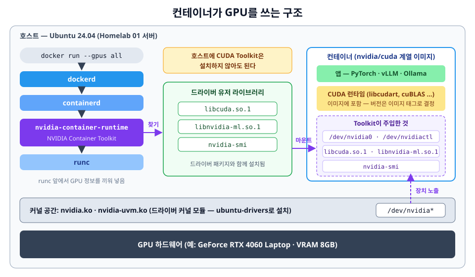
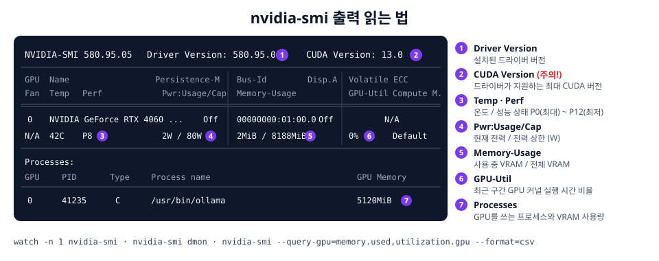

> **Chapter 6 · AI 인프라** | 난이도 ★★★☆☆ | 예상 소요 1.5 ~ 2시간 (재부팅 포함)

## 🎯 오늘의 목표

- GPU를 컨테이너에서 쓰기 위한 3요소 — **드라이버 · CUDA · NVIDIA Container Toolkit** — 가 각각 어디에 설치되는지 설명할 수 있다
- Ubuntu 24.04에 `ubuntu-drivers`로 NVIDIA 드라이버를 설치하고 Secure Boot 문제를 피할 수 있다
- `nvidia-smi` 출력에서 드라이버 버전, 지원 CUDA 버전, VRAM 사용량, 전력, 사용률을 읽을 수 있다
- **CUDA와 드라이버의 호환성** 규칙을 알고, 컨테이너 이미지 버전을 고를 수 있다
- NVIDIA Container Toolkit을 설치하고 `docker run --gpus all`로 컨테이너 안에서 GPU를 확인할 수 있다

---

## 1. 큰 그림 — 무엇을 어디에 설치하나

Day 01에서 `docker` CLI → dockerd → containerd → runc → 컨테이너 흐름을 봤습니다. 컨테이너는 **호스트 커널을 공유하는 격리된 프로세스**였죠. GPU도 마찬가지입니다. 컨테이너는 자기만의 GPU 드라이버를 가질 수 없고, **호스트 커널에 올라간 드라이버를 빌려 씁니다.**



| 요소 | 설치 위치 | 역할 | 오늘 설치? |
|---|---|---|---|
| **NVIDIA 드라이버** | **호스트** (커널 모듈 `nvidia.ko` + 유저 라이브러리 `libcuda.so`, `nvidia-smi`) | GPU 하드웨어를 OS가 다룰 수 있게 함 | ✅ |
| **CUDA 런타임 / 라이브러리** (`libcudart`, cuBLAS, cuDNN 등) | **컨테이너 이미지 안** (`nvidia/cuda`, PyTorch, vLLM 이미지 등) | 앱이 GPU 연산을 호출하는 API | ❌ 이미지에 이미 들어 있음 |
| **NVIDIA Container Toolkit** | **호스트** (Docker 런타임 설정) | 컨테이너 시작 시 `/dev/nvidia*` 장치와 드라이버 라이브러리를 **주입** | ✅ |

> 💡 **호스트에 CUDA Toolkit(`nvcc` 등)은 설치하지 않아도 됩니다.** 컨테이너로 서빙할 거라면 호스트에는 드라이버와 Container Toolkit만 있으면 충분합니다. 호스트를 깨끗하게 유지하고, CUDA 버전은 이미지 태그로 고르는 것이 컨테이너 방식의 장점입니다.

---

## 2. 사전 점검

실습 환경은 **Homelab 01에서 만든 Ubuntu Server 24.04 LTS** (`devops@homelab`, 예: `192.168.0.10`)입니다. NVIDIA GPU가 달린 노트북이나 데스크톱을 가정합니다. SSH로 접속해서 진행하세요.

```bash
ssh devops@192.168.0.10
```

### 2-1. GPU 인식 확인

```bash
lspci | grep -i nvidia
```

```
01:00.0 3D controller: NVIDIA Corporation AD107M [GeForce RTX 4060 Max-Q / Mobile] (rev a1)
```

아무것도 안 나오면 OS가 GPU를 보지 못하는 상태입니다. 노트북이라면 BIOS에서 **하이브리드 그래픽 / dGPU 비활성화** 같은 옵션이 켜져 있는지 확인하세요.

### 2-2. Secure Boot 상태 확인

```bash
mokutil --sb-state
# SecureBoot enabled   ← 켜져 있음
```

Secure Boot가 켜져 있으면 **서명되지 않은 커널 모듈은 로드되지 않습니다.** Ubuntu 공식 문서는 이 때문에 `ubuntu-drivers` 사용을 권장합니다. `ubuntu-drivers`는 기본적으로 **Canonical이 서명한 미리 빌드된(pre-built) 드라이버 모듈**을 설치하므로 Secure Boot를 켠 채로도 동작합니다.

> ⚠️ NVIDIA 홈페이지의 `.run` 설치 파일이나 DKMS 방식은 모듈을 그 자리에서 빌드하므로 Canonical 서명이 없습니다. Secure Boot 환경에서는 MOK(Machine Owner Key) 등록 같은 추가 작업이 필요하고, `ubuntu-drivers`가 설치한 패키지를 덮어써 꼬일 수 있습니다. **특별한 이유가 없다면 `ubuntu-drivers`만 쓰세요.**

### 2-3. 시스템 최신화

```bash
sudo apt update && sudo apt upgrade -y
sudo reboot
```

커널이 업데이트되었다면 재부팅한 뒤 드라이버를 설치해야 새 커널용 모듈이 맞게 깔립니다.

---

## 3. NVIDIA 드라이버 설치 (ubuntu-drivers)

### 3-1. 설치 가능한 드라이버 확인

```bash
sudo apt install -y ubuntu-drivers-common   # 서버 설치본에 없을 수 있음
sudo ubuntu-drivers devices
```

```
== /sys/devices/pci0000:00/0000:00:01.0/0000:01:00.0 ==
modalias : pci:v000010DEd000028E0...
vendor   : NVIDIA Corporation
model    : AD107M [GeForce RTX 4060 Max-Q / Mobile]
driver   : nvidia-driver-580 - distro non-free recommended
driver   : nvidia-driver-580-server - distro non-free
...
```

드라이버 패키지는 두 계열이 있습니다.

| 계열 | 목록 보기 | 대상 | 특징 |
|---|---|---|---|
| 일반(데스크톱) | `sudo ubuntu-drivers list` | GeForce 등 소비자 GPU, 노트북 | 최신 기능 위주. `nvidia-driver-<번호>` |
| 서버/연산(GPGPU) | `sudo ubuntu-drivers list --gpgpu` | L4, A100, H100 등 데이터센터 GPU | 장기 지원(LTS) 브랜치. `nvidia-driver-<번호>-server` |

> 💡 홈랩 노트북(GeForce)은 **일반 계열**로 충분합니다. 화면 없는 서버라고 해서 꼭 `-server` 계열을 써야 하는 것은 아닙니다. 데이터센터 GPU나 클라우드 인스턴스라면 `--gpgpu` 계열을 고르세요.

### 3-2. 설치

```bash
# 홈랩(소비자 GPU): 권장 드라이버 자동 선택
sudo ubuntu-drivers install

# 특정 버전을 고정하고 싶다면 (list 출력에 나온 번호로)
sudo ubuntu-drivers install nvidia:580
```

데이터센터 GPU / 클라우드 서버라면:

```bash
sudo ubuntu-drivers install --gpgpu
# 또는 버전 지정
sudo ubuntu-drivers install --gpgpu nvidia:580-server

# --gpgpu 경로는 nvidia-smi 등 유틸리티를 따로 설치
sudo apt install -y nvidia-utils-580-server
```

> ⚠️ 위의 `580`은 예시입니다. 반드시 **내 서버에서 `list` 명령이 보여 준 번호**를 쓰세요. 번호가 클수록 새 드라이버이며, 새 GPU(예: RTX 50 시리즈)는 최소 지원 버전 이상이 필요합니다.

### 3-3. 재부팅과 확인

```bash
sudo reboot
```

```bash
cat /proc/driver/nvidia/version
# NVRM version: NVIDIA UNIX x86_64 Kernel Module  580.95.05  ...

lsmod | grep nvidia
# nvidia_uvm, nvidia_drm, nvidia_modeset, nvidia ... 가 보이면 모듈 로드 성공
```

---

## 4. `nvidia-smi` 읽는 법

```bash
nvidia-smi
```

출력 예시입니다(버전, GPU 모델은 환경마다 다름).

```
+-----------------------------------------------------------------------------------------+
| NVIDIA-SMI 580.95.05              Driver Version: 580.95.05      CUDA Version: 13.0     |
+-----------------------------------------+------------------------+----------------------+
| GPU  Name                 Persistence-M | Bus-Id          Disp.A | Volatile Uncorr. ECC |
| Fan  Temp   Perf          Pwr:Usage/Cap |           Memory-Usage | GPU-Util  Compute M. |
|                                         |                        |               MIG M. |
|=========================================+========================+======================|
|   0  NVIDIA GeForce RTX 4060 ...    Off |   00000000:01:00.0 Off |                  N/A |
| N/A   42C    P8              2W /   80W |       2MiB /   8188MiB |      0%      Default |
|                                         |                        |                  N/A |
+-----------------------------------------+------------------------+----------------------+

+-----------------------------------------------------------------------------------------+
| Processes:                                                                              |
|  GPU   GI   CI              PID   Type   Process name                        GPU Memory |
|        ID   ID                                                               Usage      |
|=========================================================================================|
|  No running processes found                                                             |
+-----------------------------------------------------------------------------------------+
```



| 항목 | 의미 | 볼 때 포인트 |
|---|---|---|
| **Driver Version** | 설치된 드라이버 버전 | 3장에서 설치한 브랜치와 일치하는지 |
| **CUDA Version** | 이 드라이버가 **지원하는 최대 CUDA 버전** | ⚠️ "설치된 CUDA"가 아님! 호스트에 CUDA가 없어도 표시됨 |
| Persistence-M | 지속 모드. 켜면 GPU가 놀 때도 드라이버 상태를 유지해 첫 호출 지연이 줄어듦 | 서버라면 켜 두는 것이 일반적 |
| Temp / Perf | 온도 / 성능 상태(P0 = 최대 성능 ~ P12 = 최저 전력) | 놀 때 P8, 추론 중 P0~P2 |
| **Pwr:Usage/Cap** | 현재 소비 전력 / 전력 상한(W) | 노트북 GPU는 상한이 낮아 데스크톱보다 느림 |
| **Memory-Usage** | 사용 중 VRAM / 전체 VRAM | Day 36의 VRAM 계산과 비교 |
| **GPU-Util** | 최근 샘플 구간 동안 GPU 커널이 실행된 시간 비율 | 100%라도 "연산 장치를 다 썼다"는 뜻은 아님 |
| MIG M. | MIG(GPU 분할) 모드 | A100/H100 등에서만 의미 있음 (Day 44) |
| **Processes** | GPU를 쓰는 프로세스와 각각의 VRAM | 컨테이너 안 프로세스도 호스트 PID로 보임 |

### 자주 쓰는 nvidia-smi 명령

```bash
nvidia-smi -L                           # GPU 목록과 UUID
watch -n 1 nvidia-smi                   # 1초마다 갱신 (Ctrl+C 종료)
nvidia-smi dmon                         # 전력·온도·사용률을 한 줄씩 스트리밍
nvidia-smi --query-gpu=name,driver_version,memory.total,memory.used,utilization.gpu,temperature.gpu,power.draw \
           --format=csv                 # 스크립트·모니터링용 CSV
sudo nvidia-smi -pm 1                   # Persistence mode 켜기
```

```
name, driver_version, memory.total [MiB], memory.used [MiB], utilization.gpu [%], temperature.gpu, power.draw [W]
NVIDIA GeForce RTX 4060 Laptop GPU, 580.95.05, 8188 MiB, 2 MiB, 0 %, 42, 2.15 W
```

> 💡 `--query-gpu` CSV는 Day 47에서 Prometheus 지표(DCGM Exporter)로 넘어가기 전, 가장 간단한 모니터링 수단입니다. 사용할 수 있는 필드 전체는 `nvidia-smi --help-query-gpu`로 볼 수 있습니다.

---

## 5. CUDA와 드라이버 호환성

### 5-1. 규칙은 한 줄

> **컨테이너 이미지의 CUDA 버전 ≤ 호스트 드라이버가 지원하는 CUDA 버전(`nvidia-smi`의 CUDA Version)**

드라이버는 하위 호환(backward compatible)입니다. 새 드라이버는 옛 CUDA로 빌드된 앱을 돌릴 수 있지만, 옛 드라이버는 새 CUDA 앱을 돌리지 못합니다.

### 5-2. 버전 표 (NVIDIA CUDA 릴리스 노트 기준, Linux x86_64)

| CUDA | 필요한 최소 드라이버 | 비고 |
|---|---|---|
| 13.x (13.0 ~ 13.5) | **580 이상** | 13.x 안에서는 **마이너 버전 호환** — 580 드라이버로 13.x 앱 대부분 실행 가능 |
| 12.9 | 575.51.03 이상 | |
| 12.8 | 570.26 이상 | RTX 50(Blackwell) 지원이 시작된 버전대 |
| 12.x (마이너 버전 호환 범위) | 525 이상 | 12.0으로 빌드한 앱은 525 드라이버로도 동작 |

> ⚠️ **마이너 버전 호환**은 "같은 메이저 버전(12.x, 13.x) 안에서 최소 드라이버만 넘으면 대부분 동작"한다는 뜻이지만, 일부 새 기능(PTX JIT 등)은 해당 버전의 드라이버를 요구할 수 있습니다. 가장 안전한 방법은 **드라이버를 이미지보다 최신으로 유지**하는 것입니다.

### 5-3. 이미지 고르기

vLLM, PyTorch 같은 이미지는 특정 CUDA 버전으로 빌드되어 있습니다. 이미지 문서에서 CUDA 버전을 확인하고 내 드라이버와 비교하세요.

| 내 `nvidia-smi` CUDA Version | 쓸 수 있는 이미지 예 |
|---|---|
| 13.0 (드라이버 580) | `nvidia/cuda:13.0.3-base-ubuntu24.04`, `nvidia/cuda:12.8.1-base-ubuntu24.04` 모두 OK |
| 12.8 (드라이버 570) | `nvidia/cuda:12.8.1-base-ubuntu24.04` OK, **13.x 이미지는 실패** |

---

## 6. NVIDIA Container Toolkit 설치

Docker는 Day 01의 공식 apt 저장소 방법으로 이미 설치되어 있다고 가정합니다(`docker version`에서 Server가 보여야 함).

### 6-1. 저장소 등록과 설치

NVIDIA 공식 설치 가이드의 apt 절차입니다.

```bash
# 1) 사전 패키지
sudo apt-get update && sudo apt-get install -y --no-install-recommends \
   ca-certificates \
   curl \
   gnupg2

# 2) 저장소와 GPG 키 등록
curl -fsSL https://nvidia.github.io/libnvidia-container/gpgkey | sudo gpg --dearmor -o /usr/share/keyrings/nvidia-container-toolkit-keyring.gpg \
  && curl -s -L https://nvidia.github.io/libnvidia-container/stable/deb/nvidia-container-toolkit.list | \
    sed 's#deb https://#deb [signed-by=/usr/share/keyrings/nvidia-container-toolkit-keyring.gpg] https://#g' | \
    sudo tee /etc/apt/sources.list.d/nvidia-container-toolkit.list

# 3) 설치 (버전 고정)
sudo apt-get update
export NVIDIA_CONTAINER_TOOLKIT_VERSION=1.20.1-1
sudo apt-get install -y \
    nvidia-container-toolkit=${NVIDIA_CONTAINER_TOOLKIT_VERSION} \
    nvidia-container-toolkit-base=${NVIDIA_CONTAINER_TOOLKIT_VERSION} \
    libnvidia-container-tools=${NVIDIA_CONTAINER_TOOLKIT_VERSION} \
    libnvidia-container1=${NVIDIA_CONTAINER_TOOLKIT_VERSION}
```

> 💡 `1.20.1-1`은 이 글을 쓰는 시점(2026년 11월) 공식 설치 문서에 적힌 버전입니다. 최신 버전은 [공식 설치 가이드](https://docs.nvidia.com/datacenter/cloud-native/container-toolkit/latest/install-guide.html)에서 확인하세요. 버전 고정이 필요 없다면 `sudo apt-get install -y nvidia-container-toolkit`로 최신 버전을 받아도 됩니다. 운영 서버에서는 여러 대의 버전을 맞추기 위해 고정을 권장합니다(Day 35의 provider 버전 고정과 같은 이유).

```bash
nvidia-ctk --version
```

### 6-2. Docker 런타임 설정

```bash
sudo nvidia-ctk runtime configure --runtime=docker
sudo systemctl restart docker
```

`nvidia-ctk`가 `/etc/docker/daemon.json`에 `nvidia` 런타임을 등록합니다.

```bash
cat /etc/docker/daemon.json
```

```json
{
    "runtimes": {
        "nvidia": {
            "args": [],
            "path": "nvidia-container-runtime"
        }
    }
}
```

```bash
docker info | grep -i runtimes
# Runtimes: io.containerd.runc.v2 nvidia runc
```

> ⚠️ `daemon.json`에 이미 다른 설정(로그 드라이버, 레지스트리 미러 등)이 있었다면 `nvidia-ctk`가 그 내용을 유지한 채 `runtimes`만 추가합니다. 손으로 편집했다면 JSON 문법 오류로 Docker가 안 뜰 수 있으니 `sudo systemctl status docker`로 꼭 확인하세요.

### 6-3. 컨테이너에서 GPU 확인

```bash
docker run --rm --gpus all nvidia/cuda:12.8.1-base-ubuntu24.04 nvidia-smi
```

호스트에서 본 것과 같은 `nvidia-smi` 표가 나오면 성공입니다. 이 이미지에는 `nvidia-smi`가 들어 있지 않은데도 실행되는 이유는, **Toolkit이 호스트의 `nvidia-smi`와 드라이버 라이브러리를 컨테이너에 주입**했기 때문입니다.

NVIDIA 공식 문서의 샘플 명령은 런타임을 명시합니다. 둘 다 동작합니다.

```bash
sudo docker run --rm --runtime=nvidia --gpus all ubuntu nvidia-smi
```

### 6-4. `--gpus` 옵션 정리

| 옵션 | 의미 |
|---|---|
| `--gpus all` | 모든 GPU 할당 |
| `--gpus 1` | GPU 1개 할당 |
| `--gpus '"device=0"'` | 0번 GPU만 (따옴표 두 겹 주의) |
| `--gpus '"device=0,1"'` | 0번, 1번 GPU |
| `--gpus '"device=GPU-xxxxxxxx"'` | UUID로 지정 (`nvidia-smi -L`로 확인) |

### 6-5. CUDA 호환성 직접 확인

```bash
# 드라이버 580(CUDA 13.0 지원)이라면 둘 다 성공
docker run --rm --gpus all nvidia/cuda:12.8.1-base-ubuntu24.04 nvidia-smi -L
docker run --rm --gpus all nvidia/cuda:13.0.3-base-ubuntu24.04 nvidia-smi -L
```

드라이버가 이미지의 CUDA보다 오래되었다면 컨테이너 시작 단계에서 Toolkit이 막습니다.

```
nvidia-container-cli: requirement error: unsatisfied condition: cuda>=13.0, please update your driver to a newer version, or use an earlier cuda container
```

`nvidia/cuda` 이미지는 `NVIDIA_REQUIRE_CUDA` 환경 변수로 최소 요구 버전을 선언하고, Toolkit이 실행 전에 이를 검사합니다.

```bash
docker image inspect nvidia/cuda:13.0.3-base-ubuntu24.04 \
  --format '{{range .Config.Env}}{{println .}}{{end}}' | grep NVIDIA_REQUIRE_CUDA
```

### 6-6. Compose에서 GPU 쓰기 (Day 38 예고)

Day 06의 Compose 파일에서는 `deploy.resources.reservations.devices`로 GPU를 요청합니다.

```yaml
# compose.yaml
services:
  cuda-test:
    image: nvidia/cuda:12.8.1-base-ubuntu24.04
    command: nvidia-smi
    deploy:
      resources:
        reservations:
          devices:
            - driver: nvidia
              count: all
              capabilities: [gpu]
```

```bash
docker compose up
```

---

## 7. 홈랩 노트북 서버에서 신경 쓸 점

Homelab 01에서 노트북을 24시간 서버로 만들었다면 GPU를 쓸 때 몇 가지가 더 있습니다.

| 항목 | 내용 | 확인 / 조치 |
|---|---|---|
| **전력 상한** | 노트북 GPU는 같은 이름의 데스크톱 GPU보다 전력 상한이 낮아 느림 | `nvidia-smi --query-gpu=power.draw,power.limit --format=csv` |
| **발열** | 덮개를 닫으면 통풍이 나빠질 수 있음 (Homelab 01에서 덮개 닫힘 무시 설정) | 장시간 추론 중 `nvidia-smi dmon`으로 온도 관찰. 받침대·쿨링패드 권장 |
| **전원 어댑터** | 배터리만으로는 GPU 성능이 크게 제한됨 | 항상 어댑터 연결 |
| **하이브리드 그래픽** | 내장 GPU + NVIDIA GPU 구성. 서버는 화면을 안 쓰니 연산은 NVIDIA GPU가 전담 | `lspci`에 둘 다 보이는 것이 정상 |
| **VRAM** | 노트북 GPU는 대개 6 ~ 8GB | Day 36 표 기준 7~8B 4bit 모델까지 |
| **커널 업데이트** | 자동 보안 업데이트로 커널이 올라가면 재부팅 후 새 모듈이 필요 | `ubuntu-drivers`로 설치한 경우 `linux-modules-nvidia-*` 패키지가 커널과 함께 갱신됨 |

> 💡 홈랩 서버를 Homelab 03처럼 외부에 공개했다면, 이번 Chapter의 LLM API 포트(Ollama 11434 등)는 **절대 인터넷에 바로 열지 마세요.** 인증 없는 LLM API는 GPU를 공짜로 빌려주는 것과 같습니다. 접근 제어는 Day 40(게이트웨이)과 Day 48(보안)에서 다룹니다.

---

## 8. GPU가 없다면 — 대안 경로

| 환경 | 방법 | 비고 |
|---|---|---|
| **GPU 없는 리눅스 서버/PC** | 오늘 실습은 건너뛰고 Day 38의 **Ollama CPU 모드**로 진행 | 0.5B ~ 3B 모델은 CPU로도 대화 가능한 속도 |
| **Windows + NVIDIA GPU** | Docker Desktop (WSL2 백엔드) + 최신 NVIDIA Windows 드라이버. WSL2 안에 리눅스 드라이버를 따로 깔지 않음 | `wsl --update` 후 아래 명령으로 확인 |
| **macOS (Apple Silicon)** | Docker 컨테이너에서는 GPU를 쓸 수 없음. **Ollama 네이티브 앱**을 설치하면 Metal로 가속 | Day 38에서 컨테이너 대신 네이티브 앱 사용 |
| **클라우드 GPU 임대** | L4 / A100 / H100 인스턴스를 시간 단위로 빌림. 드라이버가 미리 설치된 이미지가 많음 | 실습 후 **반드시 삭제**. 오늘의 `nvidia-smi`, Toolkit 확인 절차는 그대로 적용 |
| **OpenStack (Ch4)** | PCI 패스스루로 GPU를 VM에 통째로 할당 (IOMMU/VT-d 필요) | 언급 수준. VM 안에서는 오늘과 같은 절차 |

Windows Docker Desktop GPU 확인 (Docker 공식 문서 명령):

```powershell
docker run --rm -it --gpus=all nvcr.io/nvidia/k8s/cuda-sample:nbody nbody -gpu -benchmark
```

---

## 9. 트러블슈팅

| 증상 | 원인 | 해결 |
|---|---|---|
| `nvidia-smi: command not found` | `--gpgpu` 경로로 설치해 유틸리티가 없음 | `sudo apt install nvidia-utils-<번호>-server` |
| `NVIDIA-SMI has failed because it couldn't communicate with the NVIDIA driver` | 설치 후 재부팅 안 함 / Secure Boot가 서명 안 된 모듈을 차단 / 새 커널용 모듈 없음 | 재부팅, `mokutil --sb-state` 확인, `.run`·DKMS 대신 `ubuntu-drivers`로 재설치 |
| `Failed to initialize NVML: Driver/library version mismatch` | apt 업그레이드로 유저 라이브러리만 새 버전, 커널 모듈은 이전 버전 | 재부팅 |
| `could not select device driver "" with capabilities: [[gpu]]` | Container Toolkit 미설치 또는 `nvidia-ctk runtime configure` 후 Docker 재시작 안 함 | 6장 절차 확인, `sudo systemctl restart docker` |
| `unsatisfied condition: cuda>=13.0` | 이미지 CUDA가 드라이버 지원 버전보다 높음 | 드라이버 업그레이드 또는 낮은 CUDA 이미지 사용 (5장) |
| 실행 중 컨테이너에서 갑자기 `Failed to initialize NVML: Unknown Error` | systemd cgroup 환경에서 `systemctl daemon-reload`나 컨테이너 업데이트로 GPU 장치 접근이 사라짐 (NVIDIA 공식 트러블슈팅에 문서화된 이슈) | 컨테이너를 **삭제 후 재생성**. 근본 대책은 공식 문서의 CDI 사용 또는 cgroup 드라이버 설정 참고 |
| `apt update` 시 `Conflicting values set for option Signed-By` | 예전 `nvidia-docker.list` 등 중복 저장소 파일 | `grep -l "nvidia.github.io" /etc/apt/sources.list.d/*`로 찾아 `nvidia-container-toolkit.list` 외 삭제 |
| 추론이 느리고 `nvidia-smi`에 프로세스가 없음 | 앱이 GPU를 못 찾고 CPU로 실행 중 | 컨테이너에 `--gpus` 누락 여부, 컨테이너 안에서 `nvidia-smi` 실행해 확인 |

---

## 10. 핵심 정리

- 컨테이너 GPU = **호스트 드라이버**(커널 모듈 + `libcuda.so`) + **이미지 안 CUDA 런타임** + 둘을 잇는 **NVIDIA Container Toolkit**
- Ubuntu에서는 `sudo ubuntu-drivers install`(소비자 GPU) / `--gpgpu`(데이터센터 GPU). 서명된 모듈이라 Secure Boot와 호환
- `nvidia-smi`의 **CUDA Version은 "지원 가능한 최대 버전"**. 이미지 CUDA ≤ 이 값이어야 실행됨. CUDA 13.x는 드라이버 580 이상
- Toolkit 설치 후 `nvidia-ctk runtime configure --runtime=docker` → Docker 재시작 → `docker run --rm --gpus all nvidia/cuda:... nvidia-smi`로 확인
- Compose는 `deploy.resources.reservations.devices`로 GPU 요청
- 노트북 서버는 전력 상한·발열·전원 어댑터를 챙기고, LLM API 포트를 외부에 열지 않는다

---

## 11. 셀프 체크

<details>
<summary>Q1. 호스트에 CUDA Toolkit을 설치하지 않았는데 <code>nvidia-smi</code>에 "CUDA Version: 13.0"이 나온다. 무슨 뜻인가?</summary>

호스트에 CUDA가 설치되었다는 뜻이 아니라, **설치된 드라이버(580 계열)가 CUDA 13.0까지의 앱을 실행할 수 있다**는 뜻입니다. 실제 CUDA 런타임 라이브러리는 컨테이너 이미지 안에 들어 있습니다.
</details>

<details>
<summary>Q2. <code>nvidia/cuda:...-base</code> 이미지에는 <code>nvidia-smi</code> 바이너리가 없는데 컨테이너 안에서 실행되는 이유는?</summary>

NVIDIA Container Toolkit이 컨테이너 시작 시 호스트의 드라이버 유저 라이브러리(`libcuda.so`, `libnvidia-ml.so`)와 `nvidia-smi` 같은 유틸리티, `/dev/nvidia*` 장치 파일을 컨테이너에 **주입(마운트)** 하기 때문입니다. 드라이버는 반드시 커널과 짝이 맞아야 하므로 이미지에 넣지 않고 호스트 것을 씁니다.
</details>

<details>
<summary>Q3. 드라이버 570이 설치된 서버에서 CUDA 13.0 기반 vLLM 이미지를 실행하면 어떻게 되고, 해결책은?</summary>

CUDA 13.x는 드라이버 580 이상이 필요하므로 Toolkit이 `unsatisfied condition: cuda>=13.0` 에러로 컨테이너 시작을 막습니다. 해결책은 ① 드라이버를 580 이상으로 업그레이드하거나 ② CUDA 12.x로 빌드된 이미지 태그를 쓰는 것입니다.
</details>

<details>
<summary>Q4. Secure Boot가 켜진 서버에서 NVIDIA 홈페이지의 .run 파일로 드라이버를 설치했더니 <code>nvidia-smi</code>가 드라이버와 통신하지 못한다. 왜인가?</summary>

.run 설치는 커널 모듈을 현장에서 빌드하는데, 이 모듈은 Canonical 키로 서명되어 있지 않아 Secure Boot가 로드를 거부합니다. `ubuntu-drivers`로 설치하면 서명된 미리 빌드된 모듈을 받으므로 Secure Boot를 켠 채로 동작합니다.
</details>

<details>
<summary>Q5. <code>nvidia-ctk runtime configure --runtime=docker</code>는 정확히 무엇을 바꾸나?</summary>

`/etc/docker/daemon.json`에 `nvidia`라는 이름의 런타임(`nvidia-container-runtime`)을 등록합니다. 이 설정이 반영되려면 Docker 데몬을 재시작해야 하고, 이후 `--gpus` 옵션을 쓴 컨테이너에 GPU가 주입됩니다.
</details>

---

## ⏭️ 다음 예고 — Day 38. Ollama로 로컬 LLM 띄우기 & Open WebUI

드디어 모델을 올립니다. 오늘 준비한 GPU 서버(또는 GPU 없는 PC의 CPU 모드)에 **Ollama**를 Docker로 띄우고, 모델을 받아 대화하고, REST API와 **OpenAI 호환 엔드포인트**를 curl과 Python으로 호출해 봅니다. 마지막으로 **Open WebUI**를 Compose로 붙여 나만의 ChatGPT 화면을 만듭니다.
