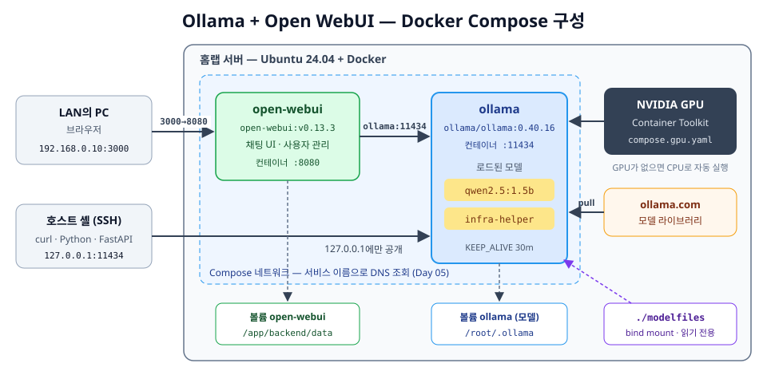
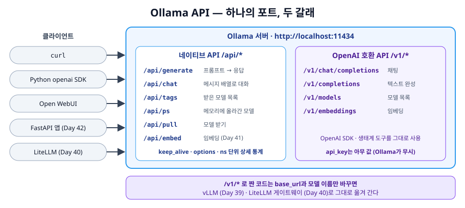

> **Chapter 6 · AI 인프라** | 난이도 ★★☆☆☆ | 예상 소요 1.5 ~ 2시간 (모델 다운로드 시간 포함)

## 🎯 오늘의 목표

- Ollama가 서빙 스택(Day 36)에서 어떤 위치이고, vLLM과 무엇이 다른지 설명할 수 있다
- Ollama를 **Docker로 GPU 모드 / CPU 모드** 각각 띄우고 모델을 pull · run 할 수 있다
- Ollama **네이티브 REST API**와 **OpenAI 호환 API**를 curl과 Python으로 호출할 수 있다
- **Modelfile**로 시스템 프롬프트와 파라미터를 고정한 나만의 모델을 만들 수 있다
- Ollama + **Open WebUI**를 Docker Compose로 묶어 브라우저 채팅 환경을 구성할 수 있다

---

## 1. Ollama란?

Day 36의 6개 층 중 **③ 서빙 엔진**에 해당합니다. Ollama는 llama.cpp 기반의 LLM 실행기로, "Docker처럼 모델을 다루게" 만든 것이 특징입니다.

| Docker (Day 01~02) | Ollama |
|---|---|
| `docker pull nginx` | `ollama pull qwen2.5:1.5b` |
| `docker run -it ubuntu` | `ollama run qwen2.5:1.5b` |
| `docker images` / `docker ps` | `ollama list` / `ollama ps` |
| Dockerfile → `docker build` | **Modelfile** → `ollama create` |
| Docker Hub | ollama.com 모델 라이브러리 |
| 이미지 태그 (`nginx:1.27`) | 모델 태그 (`qwen2.5:1.5b-instruct-q8_0`) |

### Ollama vs vLLM — 언제 무엇을?

| 구분 | Ollama (오늘) | vLLM (Day 39) |
|---|---|---|
| 목표 | **쉽게, 어디서나** 실행 | **많은 동시 요청을 빠르게** |
| 모델 형식 | GGUF (양자화 기본) | safetensors(BF16), AWQ, GPTQ, FP8 등 |
| 하드웨어 | CPU, NVIDIA, AMD, Apple Silicon | 주로 NVIDIA/AMD GPU |
| 모델 교체 | 요청에 따라 자동 로드/언로드, 여러 모델 동시 보관 | 보통 서버 하나에 모델 하나 |
| 동시 처리 | 가능하지만 기본값은 보수적 (`OLLAMA_NUM_PARALLEL` 기본 1) | 연속 배칭 + PagedAttention으로 고처리량 |
| 적합한 곳 | 개발 PC, 홈랩, 소규모 팀, 프로토타입 | 운영 서빙, 다수 사용자 |

> 💡 두 엔진 모두 **OpenAI 호환 API**를 제공합니다. 오늘 Ollama로 만든 클라이언트 코드는 Day 39에서 `base_url`만 바꿔 vLLM에 그대로 붙습니다.

---

## 2. 오늘 만들 구조



- **Ollama 컨테이너** — 모델을 `ollama` 볼륨(`/root/.ollama`)에 저장하고 11434 포트로 API 제공
- **Open WebUI 컨테이너** — 브라우저 채팅 화면. Compose 네트워크 안에서 `http://ollama:11434`로 Ollama 호출
- **호스트의 curl / Python** — `127.0.0.1:11434`로 직접 API 호출

실습 환경: Day 37을 마친 **Ubuntu 24.04 홈랩 서버**(GPU + NVIDIA Container Toolkit) 또는 GPU 없는 리눅스/Windows/macOS의 Docker. 이 글은 **Ollama 0.40.16**, **Open WebUI v0.13.3**(2026년 11월 기준 최신 안정 릴리스)으로 확인했습니다.

---

## 3. Ollama를 Docker로 띄우기

### 3-1. GPU 모드 (NVIDIA)

Ollama 공식 Docker 문서의 명령입니다. Day 37의 Container Toolkit 설정이 끝나 있어야 합니다.

```bash
docker run -d --gpus=all -v ollama:/root/.ollama -p 11434:11434 --name ollama ollama/ollama
```

### 3-2. CPU 모드 (GPU 없음)

`--gpus` 옵션만 빼면 됩니다. Ollama는 GPU를 찾지 못하면 자동으로 CPU로 실행합니다.

```bash
docker run -d -v ollama:/root/.ollama -p 11434:11434 --name ollama ollama/ollama
```

| 옵션 | 의미 |
|---|---|
| `--gpus=all` | 모든 GPU를 컨테이너에 할당 (Day 37) |
| `-v ollama:/root/.ollama` | 모델 저장소를 **named volume**에 — 컨테이너를 지워도 모델이 남음 (Day 04) |
| `-p 11434:11434` | Ollama API 포트 공개 |

> ⚠️ `-p 11434:11434`는 **서버의 모든 네트워크 인터페이스**에 포트를 엽니다. Ollama API에는 인증이 없으므로, 같은 LAN의 누구나 내 GPU로 모델을 돌릴 수 있습니다. 홈랩에서는 `-p 127.0.0.1:11434:11434`로 로컬에서만 열고, 다른 PC에서는 SSH 터널(`ssh -L 11434:localhost:11434 devops@192.168.0.10`)이나 Open WebUI로 접근하는 것을 권장합니다.

> 💡 AMD GPU라면 `ollama/ollama:rocm` 이미지와 `--device /dev/kfd --device /dev/dri` 옵션을 씁니다(공식 문서 참고). Apple Silicon Mac은 Docker 안에서 GPU(Metal)를 쓸 수 없으므로, **ollama.com에서 네이티브 앱**을 설치하는 편이 훨씬 빠릅니다. 이후 API 실습은 똑같이 `localhost:11434`로 진행됩니다.

### 3-3. 동작 확인

```bash
curl http://localhost:11434/
# Ollama is running

docker logs ollama 2>&1 | grep -iE "inference compute|gpu" | head
```

GPU가 인식되었다면 로그에 CUDA 장치와 VRAM 크기가, 아니라면 CPU로 실행한다는 내용이 찍힙니다.

---

## 4. 모델 받고 대화하기

### 4-1. 실습 모델 고르기

라이선스가 자유롭고(Apache 2.0) 작아서 CPU로도 돌아가는 **Qwen2.5** 소형 모델을 씁니다. 게이티드 모델이 아니므로 별도 토큰이 필요 없습니다.

| 모델 태그 | 크기 (기본 Q4_K_M) | 추천 환경 |
|---|---|---|
| `qwen2.5:0.5b` | 398 MB | 오래된 노트북 CPU, 빠른 테스트 |
| **`qwen2.5:1.5b`** | 986 MB | **오늘 기본** — CPU도 OK, GPU면 매우 빠름 |
| `qwen2.5:7b` | 약 4.7 GB | VRAM 8GB 이상 GPU |

> 💡 더 최신 모델(Qwen3, Gemma 등)도 ollama.com 라이브러리에서 같은 방식으로 받을 수 있습니다. 모델마다 라이선스가 다르니 업무에 쓰기 전에 모델 페이지의 라이선스를 확인하세요.

### 4-2. pull / run / list / ps

```bash
docker exec -it ollama ollama pull qwen2.5:1.5b
docker exec -it ollama ollama list
```

```
NAME            ID              SIZE      MODIFIED
qwen2.5:1.5b    65ec06548149    986 MB    10 seconds ago
```

대화형으로 실행해 봅니다. `--verbose`를 붙이면 응답마다 속도 통계가 나옵니다.

```bash
docker exec -it ollama ollama run qwen2.5:1.5b --verbose
```

```
>>> 쿠버네티스 Pod를 한 문장으로 설명해줘
Pod는 하나 이상의 컨테이너를 묶어 같은 네트워크와 스토리지를 공유하게 하는 쿠버네티스의 가장 작은 배포 단위입니다.

total duration:       1.02s
load duration:        25ms
prompt eval count:    38 token(s)
prompt eval rate:     ...
eval count:           31 token(s)
eval rate:            ... tokens/s
>>> /bye
```

| 통계 | Day 36 개념 |
|---|---|
| `load duration` | 모델 로딩 시간 (처음 한 번만 큼) |
| `prompt eval count / rate` | **프리필** — 입력 토큰 수와 처리 속도 |
| `eval count / rate` | **디코드** — 생성 토큰 수와 토큰/초 |

다른 터미널에서 지금 메모리에 올라간 모델을 확인합니다.

```bash
docker exec -it ollama ollama ps
```

```
NAME            ID              SIZE      PROCESSOR    CONTEXT    UNTIL
qwen2.5:1.5b    65ec06548149    1.9 GB    100% GPU     4096       4 minutes from now
```

| 컬럼 | 의미 |
|---|---|
| `SIZE` | 가중치 + KV 캐시 등 **실제 메모리 사용량** (Day 36 계산과 비교해 보세요) |
| `PROCESSOR` | `100% GPU` / `100% CPU` / `48%/52% CPU/GPU`(일부 층만 GPU — 느려짐) |
| `CONTEXT` | 할당된 컨텍스트 길이. 기본값은 VRAM에 따라 다름 (24GiB 미만이면 4K) |
| `UNTIL` | 이 시간 동안 요청이 없으면 메모리에서 내림 (기본 5분) |

호스트에서 `nvidia-smi`를 보면 Processes 칸에 ollama가 VRAM을 쓰는 모습이 보입니다(Day 37).

### 4-3. 그 밖의 명령

```bash
docker exec -it ollama ollama show qwen2.5:1.5b     # 아키텍처, 파라미터 수, 컨텍스트, 양자화, 라이선스
docker exec -it ollama ollama stop qwen2.5:1.5b     # 메모리에서 즉시 내리기
docker exec -it ollama ollama rm qwen2.5:0.5b       # 모델 삭제
```

---

## 5. REST API 호출하기



Ollama는 두 종류의 API를 같은 11434 포트에서 제공합니다.

| 종류 | 경로 | 장점 |
|---|---|---|
| **네이티브 API** | `/api/generate`, `/api/chat`, `/api/tags`, `/api/ps`, `/api/pull`, `/api/embed` … | Ollama 고유 기능(`keep_alive`, `options.num_ctx`, 상세 통계) |
| **OpenAI 호환 API** | `/v1/chat/completions`, `/v1/completions`, `/v1/models`, `/v1/embeddings` … | OpenAI SDK와 생태계 도구를 그대로 사용, **엔진 교체가 쉬움** |

### 5-1. 네이티브 API — curl

```bash
# 한 번의 프롬프트 → 응답 (스트리밍 끄기)
curl -s http://localhost:11434/api/generate -d '{
  "model": "qwen2.5:1.5b",
  "prompt": "Docker volume과 bind mount의 차이를 두 줄로",
  "stream": false
}' | jq '{response, prompt_eval_count, eval_count, eval_duration}'
```

```json
{
  "response": "Volume은 Docker가 관리하는 저장소이고 ...",
  "prompt_eval_count": 41,
  "eval_count": 58,
  "eval_duration": 312845000
}
```

`*_duration` 값은 **나노초** 단위입니다. 토큰/초 = `eval_count ÷ eval_duration × 10⁹` → 위 예시라면 58 ÷ 0.313초 ≈ 185 토큰/초입니다.

```bash
# 대화형(메시지 배열) + 옵션 지정
curl -s http://localhost:11434/api/chat -d '{
  "model": "qwen2.5:1.5b",
  "messages": [
    {"role": "system", "content": "너는 리눅스 인프라 전문가야. 한국어로 짧게 답해."},
    {"role": "user", "content": "nvidia-smi의 CUDA Version은 무슨 뜻이야?"}
  ],
  "stream": false,
  "options": {"temperature": 0.2, "num_ctx": 8192},
  "keep_alive": "30m"
}' | jq -r '.message.content'
```

```bash
curl -s http://localhost:11434/api/tags | jq -r '.models[].name'   # 받은 모델 목록
curl -s http://localhost:11434/api/ps   | jq                       # 메모리에 올라간 모델
```

> 💡 `stream`을 생략하면 기본값 `true`로, 토큰이 생성될 때마다 **JSON 한 줄씩(NDJSON)** 흘려보냅니다. 채팅 화면에서 글자가 타이핑되듯 나오는 것이 이 방식입니다.

### 5-2. OpenAI 호환 API — curl

```bash
curl -s http://localhost:11434/v1/chat/completions \
  -H "Content-Type: application/json" \
  -d '{
    "model": "qwen2.5:1.5b",
    "messages": [{"role": "user", "content": "Kubernetes Service 타입 3가지를 나열해줘"}]
  }' | jq -r '.choices[0].message.content'

curl -s http://localhost:11434/v1/models | jq -r '.data[].id'
```

### 5-3. Python으로 호출하기

Python 3.12 가상환경을 만듭니다.

```bash
python3 -m venv .venv && source .venv/bin/activate
pip install openai httpx fastapi uvicorn
```

**(1) OpenAI SDK + 스트리밍** — 가장 많이 쓰게 될 형태입니다.

```python
# chat_openai.py
from openai import OpenAI

client = OpenAI(base_url="http://localhost:11434/v1/", api_key="ollama")  # api_key는 필수지만 Ollama는 무시

stream = client.chat.completions.create(
    model="qwen2.5:1.5b",
    messages=[
        {"role": "system", "content": "너는 친절한 인프라 튜터야. 한국어로 답해."},
        {"role": "user", "content": "KV 캐시가 뭔지 비유로 설명해줘"},
    ],
    temperature=0.3,
    stream=True,
)
for chunk in stream:
    print(chunk.choices[0].delta.content or "", end="", flush=True)
print()
```

**(2) 네이티브 API + 토큰/초 측정** — 서버 성능을 재고 싶을 때.

```python
# chat_native.py
import json

import httpx

payload = {
    "model": "qwen2.5:1.5b",
    "messages": [{"role": "user", "content": "프리필과 디코드의 차이를 설명해줘"}],
}

with httpx.stream("POST", "http://localhost:11434/api/chat", json=payload, timeout=None) as r:
    for line in r.iter_lines():
        if not line:
            continue
        data = json.loads(line)
        print(data["message"]["content"], end="", flush=True)
        if data.get("done"):
            tps = data["eval_count"] / data["eval_duration"] * 1e9
            ttft_ms = (data["load_duration"] + data["prompt_eval_duration"]) / 1e6
            print(f"\n\n[eval] {data['eval_count']} tokens, {tps:.1f} tok/s, 프리필까지 약 {ttft_ms:.0f} ms")
```

**(3) FastAPI로 감싸기** — Day 42 RAG 서비스의 뼈대가 될 최소 API입니다.

```python
# app.py
import os

from fastapi import FastAPI
from openai import AsyncOpenAI
from pydantic import BaseModel

LLM_BASE_URL = os.getenv("LLM_BASE_URL", "http://localhost:11434/v1/")
LLM_MODEL = os.getenv("LLM_MODEL", "qwen2.5:1.5b")

client = AsyncOpenAI(base_url=LLM_BASE_URL, api_key=os.getenv("LLM_API_KEY", "ollama"))
app = FastAPI()


class Question(BaseModel):
    question: str


@app.post("/ask")
async def ask(q: Question) -> dict:
    resp = await client.chat.completions.create(
        model=LLM_MODEL,
        messages=[{"role": "user", "content": q.question}],
        temperature=0.2,
    )
    return {"model": LLM_MODEL, "answer": resp.choices[0].message.content}
```

```bash
uvicorn app:app --port 8000
curl -s localhost:8000/ask -H 'Content-Type: application/json' -d '{"question":"Helm chart가 뭐야?"}' | jq
```

> 💡 모델 주소와 이름을 **환경 변수**로 뺀 것이 포인트입니다(Day 13 ConfigMap과 같은 발상). Day 39에서 `LLM_BASE_URL`만 vLLM 주소로, Day 40에서는 LiteLLM 게이트웨이 주소로 바꿉니다.

---

## 6. Modelfile — 나만의 모델 만들기

Dockerfile이 베이스 이미지 위에 설정을 쌓듯, **Modelfile**은 베이스 모델 위에 시스템 프롬프트와 파라미터를 쌓습니다. 가중치는 복사되지 않고 **같은 blob을 공유**하므로 디스크를 거의 쓰지 않습니다.

| 지시어 | 역할 |
|---|---|
| `FROM` | (필수) 베이스 모델, 또는 GGUF 파일 / safetensors 디렉터리 경로 |
| `PARAMETER` | 실행 파라미터 — `temperature`, `num_ctx`, `top_p`, `top_k`, `num_predict`, `stop`, `seed` 등 |
| `SYSTEM` | 시스템 프롬프트 |
| `TEMPLATE` | 프롬프트 템플릿 (Go 템플릿 문법, 보통 베이스 모델 것을 그대로 씀) |
| `MESSAGE` | 예시 대화(few-shot) |
| `LICENSE` | 라이선스 명시 |

```bash
mkdir -p ~/ollama-lab/modelfiles && cd ~/ollama-lab
```

```dockerfile
# modelfiles/infra-helper.Modelfile
FROM qwen2.5:1.5b

PARAMETER temperature 0.2
PARAMETER num_ctx 8192

SYSTEM """
너는 사내 인프라팀의 도우미야.
Docker, Kubernetes, 리눅스 질문에 한국어로 답하고,
명령어는 반드시 코드 블록으로 보여 줘. 모르면 모른다고 말해.
"""

MESSAGE user 파드 목록은 어떻게 봐?
MESSAGE assistant `kubectl get pods -A` 로 모든 네임스페이스의 파드를 볼 수 있습니다.
```

컨테이너 안의 Ollama가 파일을 읽어야 하므로 `docker cp`로 넣고 `create` 합니다.

```bash
docker cp modelfiles/infra-helper.Modelfile ollama:/tmp/infra-helper.Modelfile
docker exec -it ollama ollama create infra-helper -f /tmp/infra-helper.Modelfile
docker exec -it ollama ollama run infra-helper "노드 상태 확인하는 명령 알려줘"
docker exec -it ollama ollama show --modelfile infra-helper   # 최종 Modelfile 확인
```

이제 API에서도 `"model": "infra-helper"`로 부를 수 있습니다.

> ⚠️ `num_ctx`를 키우면 KV 캐시가 비례해서 커집니다(Day 36). 작은 GPU에서 `num_ctx`를 32K 같은 큰 값으로 잡으면 모델 일부가 CPU로 밀려나 `ollama ps`의 PROCESSOR가 `CPU/GPU` 분할로 바뀌고 속도가 크게 떨어집니다.

---

## 7. Compose로 Ollama + Open WebUI 구성

이제 Day 06처럼 여러 컨테이너를 Compose로 묶습니다. 앞에서 띄운 단독 컨테이너는 먼저 정리합니다(볼륨은 남겨 모델 재다운로드를 피함).

```bash
docker rm -f ollama
```

### 7-1. 디렉터리 구성

```
~/ollama-lab/
├── compose.yaml          # 기본 (CPU에서도 동작)
├── compose.gpu.yaml      # GPU 사용 시 덧씌우는 파일
├── .env                  # 비밀 값
└── modelfiles/
    └── infra-helper.Modelfile
```

### 7-2. `.env`

```bash
echo "WEBUI_SECRET_KEY=$(openssl rand -hex 32)" > .env
chmod 600 .env
```

`WEBUI_SECRET_KEY`는 Open WebUI 로그인 세션 서명에 쓰입니다. 고정해 두지 않으면 컨테이너를 다시 만들 때마다 모든 사용자가 로그아웃됩니다.

### 7-3. `compose.yaml`

```yaml
services:
  ollama:
    image: ollama/ollama:0.40.16
    container_name: ollama
    ports:
      - "127.0.0.1:11434:11434"        # 호스트 로컬에서만 접근 (LAN 비공개)
    volumes:
      - ollama:/root/.ollama
      - ./modelfiles:/modelfiles:ro
    environment:
      - OLLAMA_KEEP_ALIVE=30m          # 마지막 요청 후 30분간 모델 상주
    healthcheck:
      test: ["CMD", "ollama", "list"]
      interval: 10s
      timeout: 5s
      retries: 5
    restart: unless-stopped

  open-webui:
    image: ghcr.io/open-webui/open-webui:v0.13.3
    container_name: open-webui
    depends_on:
      ollama:
        condition: service_healthy
    ports:
      - "3000:8080"
    volumes:
      - open-webui:/app/backend/data
    environment:
      - OLLAMA_BASE_URL=http://ollama:11434   # Compose 서비스 이름으로 접근 (Day 05 DNS)
      - WEBUI_SECRET_KEY=${WEBUI_SECRET_KEY}
    restart: unless-stopped

volumes:
  ollama:
    external: true      # 3장에서 만든 볼륨 재사용 (받아 둔 모델 유지)
  open-webui:
```

> 💡 `ollama` 볼륨을 `external: true`로 둔 것은 3장에서 `docker run -v ollama:...`로 만든 볼륨을 그대로 쓰기 위해서입니다. 처음부터 Compose로 시작한다면 `external` 줄을 지우세요(그러면 Compose가 `ollama-lab_ollama` 같은 이름으로 새로 만듭니다).

### 7-4. `compose.gpu.yaml` — GPU용 덧씌우기

Day 37 6-6에서 본 GPU 예약 문법입니다. 기본 파일은 그대로 두고 GPU가 있는 서버에서만 이 파일을 추가합니다.

```yaml
services:
  ollama:
    deploy:
      resources:
        reservations:
          devices:
            - driver: nvidia
              count: all
              capabilities: [gpu]
```

### 7-5. 실행

```bash
# GPU 서버
docker compose -f compose.yaml -f compose.gpu.yaml up -d

# GPU 없는 PC
docker compose up -d
```

```bash
docker compose ps
```

```
# (COMMAND, CREATED 컬럼은 생략)
NAME         IMAGE                                   SERVICE      STATUS                    PORTS
ollama       ollama/ollama:0.40.16                   ollama       Up 40 seconds (healthy)   127.0.0.1:11434->11434/tcp
open-webui   ghcr.io/open-webui/open-webui:v0.13.3   open-webui   Up 20 seconds (healthy)   0.0.0.0:3000->8080/tcp
```

Modelfile은 이제 볼륨으로 마운트되어 있으니 `docker cp` 없이 만들 수 있습니다.

```bash
docker compose exec ollama ollama create infra-helper -f /modelfiles/infra-helper.Modelfile
docker compose exec ollama ollama list
```

### 7-6. Open WebUI 접속

1. 같은 LAN의 PC 브라우저에서 `http://192.168.0.10:3000` 접속 (홈랩 서버 IP)
2. 첫 화면에서 **관리자 계정 생성** — 처음 만든 계정이 관리자가 되고, 이후 회원가입은 기본적으로 막힘
3. 상단 모델 선택에서 `qwen2.5:1.5b` 또는 `infra-helper` 선택 후 대화
4. 관리자 패널 → 설정 → 연결(Connections)에서 Ollama 연결 상태 확인

> ⚠️ Open WebUI 첫 접속 전 서버를 인터넷에 노출하면, 남이 먼저 관리자 계정을 만들 수 있습니다. 외부 공개가 필요하면 Homelab 03의 방식(VPN/터널 + 인증)을 쓰세요.

### 7-7. 정리

```bash
docker compose down              # 컨테이너만 삭제 (볼륨 유지)
docker compose down -v           # open-webui 볼륨까지 삭제 (external인 ollama 볼륨은 유지)
docker volume rm ollama          # 모델까지 완전히 지우려면
```

---

## 8. GPU가 없을 때 체감 차이와 팁

| 환경 | `qwen2.5:1.5b` 체감 | 팁 |
|---|---|---|
| NVIDIA GPU (8GB+) | 매우 빠름 | `qwen2.5:7b`까지 올려 보기 |
| 최근 노트북/데스크톱 CPU | 대화 가능한 속도 | 0.5B ~ 3B 모델 위주, `num_ctx`는 작게 |
| 오래된 CPU / 저사양 VM | 느림 | `qwen2.5:0.5b`, 짧은 프롬프트 |
| Apple Silicon (네이티브 앱) | 빠름 (Metal 가속) | Docker 대신 네이티브 앱, Open WebUI의 `OLLAMA_BASE_URL`은 `http://host.docker.internal:11434` |

> 💡 CPU 모드에서 `ollama ps`의 PROCESSOR가 `100% CPU`로 나오는 것은 정상입니다. 속도는 메모리 대역폭에 크게 좌우되므로(Day 36 디코드), 같은 CPU라도 듀얼 채널 메모리 구성이 유리합니다.

---

## 9. 트러블슈팅

| 증상 | 원인 | 해결 |
|---|---|---|
| GPU가 있는데 `ollama ps`에 `100% CPU` | 컨테이너에 GPU 미할당 (`--gpus` 또는 `compose.gpu.yaml` 누락), Toolkit 미설정 | `docker exec ollama nvidia-smi`로 확인, Day 37 6장 재점검 |
| PROCESSOR가 `xx%/yy% CPU/GPU` | 모델 + KV 캐시가 VRAM을 초과해 일부 층이 CPU로 감 | 더 작은 모델/양자화, `num_ctx` 줄이기, 다른 GPU 프로세스 종료 |
| `model "xxx" not found` | 모델을 pull하지 않았거나 태그 오타 | `ollama list`로 정확한 이름 확인 후 `ollama pull` |
| 첫 요청만 수십 초 걸림 | 모델 로딩(`load_duration`) | `OLLAMA_KEEP_ALIVE`를 늘리거나 요청에 `keep_alive` 지정 |
| Open WebUI에 모델 목록이 비어 있음 | `OLLAMA_BASE_URL`이 `localhost`로 되어 있음 (컨테이너 안의 localhost는 자기 자신) | Compose에서는 `http://ollama:11434`, 관리자 패널 → 연결에서 확인 |
| 다른 PC에서 `:11434` 접속 불가 | `127.0.0.1`에만 바인딩 (의도된 설정) | SSH 터널 사용 또는 Open WebUI 경유 |
| `external volume "ollama" not found` | 3장 단독 실행을 건너뜀 | `docker volume create ollama` 또는 `external: true` 삭제 |
| 컨테이너 재생성 후 Open WebUI 로그인이 풀림 | `WEBUI_SECRET_KEY` 미고정 | `.env`에 고정 값 설정 |

---

## 10. 핵심 정리

- Ollama = **"모델을 Docker처럼"** 다루는 서빙 엔진. GGUF 양자화 모델, CPU/GPU 자동 선택, 모델 자동 로드/언로드
- Docker 실행: `docker run -d [--gpus=all] -v ollama:/root/.ollama -p 11434:11434 --name ollama ollama/ollama`
- `ollama pull / run / list / ps / show / create`. `ollama ps`의 **PROCESSOR**가 `100% GPU`인지가 성능의 핵심
- API 두 갈래: 네이티브 `/api/chat`·`/api/generate`(상세 통계, `keep_alive`, `options`) / OpenAI 호환 `/v1/chat/completions`(SDK 그대로, 엔진 교체 쉬움)
- **Modelfile**의 `FROM` + `PARAMETER` + `SYSTEM`으로 목적별 모델을 만든다 — 가중치는 공유
- Compose로 Ollama + Open WebUI 구성, GPU는 덧씌우기 파일로 분리. **Ollama API는 외부에 열지 않는다**

---

## 11. 셀프 체크

<details>
<summary>Q1. Ollama 컨테이너를 <code>docker rm -f</code>로 지우고 다시 만들었는데 모델을 다시 받지 않아도 되는 이유는?</summary>

모델이 컨테이너 쓰기 계층이 아니라 `-v ollama:/root/.ollama`로 연결한 **named volume**에 저장되어 있기 때문입니다(Day 04). 컨테이너와 볼륨의 수명이 분리되어 있습니다.
</details>

<details>
<summary>Q2. <code>/api/generate</code> 응답의 <code>eval_count</code>가 120, <code>eval_duration</code>이 1500000000이다. 디코드 속도는?</summary>

`eval_duration`은 나노초이므로 1.5초. 120 ÷ 1.5 = **80 토큰/초**입니다.
</details>

<details>
<summary>Q3. 같은 앱 코드를 Ollama에서 vLLM으로 옮기려면 무엇을 바꾸면 되나?</summary>

OpenAI 호환 API(`/v1/chat/completions`)와 OpenAI SDK를 썼다면 **`base_url`과 모델 이름**만 바꾸면 됩니다. 그래서 코드에서는 이 둘을 환경 변수로 빼 두는 것이 좋습니다. 네이티브 `/api/*`를 썼다면 Ollama 전용이라 코드를 고쳐야 합니다.
</details>

<details>
<summary>Q4. Compose 안의 Open WebUI가 <code>OLLAMA_BASE_URL=http://localhost:11434</code>로 설정되면 왜 연결이 안 되나?</summary>

컨테이너마다 자기만의 네트워크 namespace를 가지므로(Day 07), Open WebUI 컨테이너 안의 `localhost`는 Open WebUI 자신입니다. 같은 Compose 네트워크의 서비스 이름인 `http://ollama:11434`로 접근해야 Docker 내장 DNS가 Ollama 컨테이너 IP로 풀어 줍니다(Day 05).
</details>

<details>
<summary>Q5. Modelfile에서 <code>PARAMETER num_ctx 32768</code>로 바꿨더니 8GB GPU에서 속도가 크게 느려졌다. 왜인가?</summary>

컨텍스트가 커지면 **KV 캐시**가 비례해서 커집니다. 가중치 + KV 캐시가 VRAM을 넘으면 Ollama가 일부 층을 CPU로 내려(offload) `ollama ps`의 PROCESSOR가 `CPU/GPU` 분할로 바뀌고, CPU 쪽이 병목이 됩니다. 필요한 만큼만 컨텍스트를 잡거나 더 작은 양자화·모델을 쓰거나, 엔진 설정으로 KV 캐시를 양자화하는 방법이 있습니다.
</details>

---

## ⏭️ 다음 예고 — Day 39. vLLM으로 고성능 LLM 서빙 (OpenAI 호환 API)

Ollama는 쉽고 편하지만, 수십 명이 동시에 질문하면 대기열이 길어집니다. 다음 시간에는 **연속 배칭(continuous batching)** 과 **PagedAttention**으로 GPU를 꽉 채워 쓰는 **vLLM**을 띄우고, 오늘 만든 Python 클라이언트를 `base_url`만 바꿔 그대로 붙여 봅니다. 같은 질문을 동시에 여러 개 던져 Ollama와 처리량도 비교합니다.
