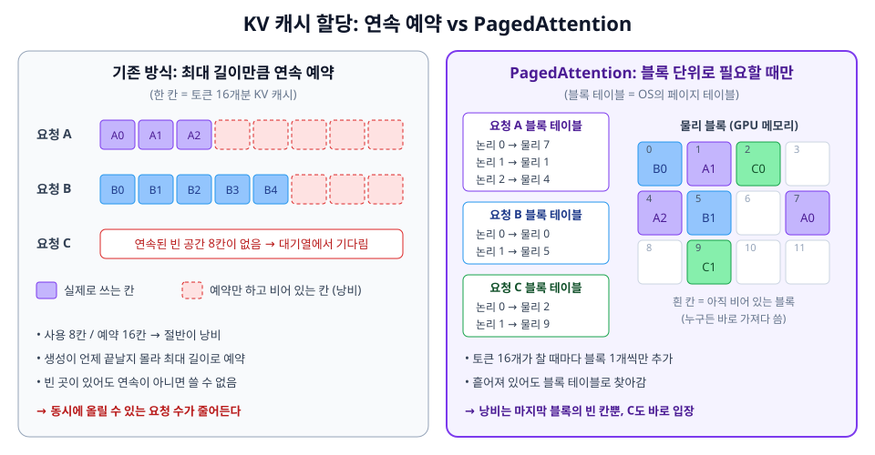
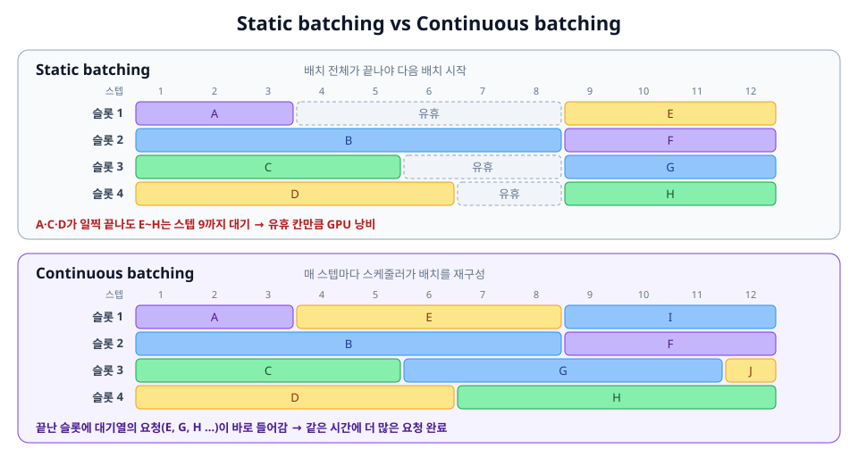

> **Chapter 6 · AI 인프라** | 난이도 ★★★☆☆ | 예상 소요 2 ~ 2.5시간

## 🎯 오늘의 목표

- Ollama와 vLLM이 **누구를 위한 도구인지** 구분하고 상황에 맞게 고를 수 있다
- vLLM이 빠른 두 가지 이유, **PagedAttention**과 **continuous batching**을 그림으로 설명할 수 있다
- `vllm/vllm-openai` 이미지로 서버를 띄우고 **OpenAI 호환 API**를 curl과 Python SDK로 호출할 수 있다
- `--max-model-len`, `--gpu-memory-utilization`, `--tensor-parallel-size`, 양자화 옵션이 VRAM에 주는 영향을 안다
- `vllm bench serve`로 처리량과 TTFT를 측정할 수 있다

---

## 1. 왜 Ollama 다음에 vLLM인가?

Day 38에서 Ollama로 모델을 띄워 보니 정말 편했습니다. `ollama run` 한 줄이면 끝이었죠. 그런데 그 서버에 **동시에 사용자 50명**이 붙으면 어떻게 될까요?

> "한 명이 쓸 때는 빠른데, 여러 명이 동시에 쓰면 줄을 서요."

LLM 서빙에서 성능은 두 가지 숫자로 봅니다.

| 지표 | 의미 | 누가 신경 쓰나 |
|---|---|---|
| **지연 시간 (Latency)** | 한 요청이 얼마나 빨리 끝나는가. 특히 첫 토큰까지 걸린 시간 **TTFT** | 채팅하는 사용자 한 명 |
| **처리량 (Throughput)** | 초당 몇 개의 토큰을 **전체 사용자에게** 뽑아내는가 (tok/s) | 서버 비용을 내는 운영자 |

Ollama(내부는 llama.cpp)는 **한 대의 PC에서 한 사람이 편하게 쓰는 것**에 최적화돼 있습니다. vLLM은 **GPU 한 장으로 최대한 많은 요청을 동시에 처리하는 것**에 최적화된 서빙 엔진입니다. 같은 GPU, 같은 모델이라도 동시 요청이 많아지면 처리량이 몇 배씩 차이 납니다.

그 비결이 오늘의 두 키워드입니다.

1. **PagedAttention** — KV 캐시 메모리를 낭비 없이 쓴다 → 더 많은 요청을 한 번에 GPU에 올린다
2. **Continuous batching** — 끝난 요청 자리에 바로 새 요청을 끼워 넣는다 → GPU가 놀지 않는다

---

## 2. KV 캐시와 PagedAttention

### 2-1. KV 캐시가 뭐였더라?

Day 36에서 VRAM을 계산할 때 **모델 가중치 + KV 캐시**로 나눴습니다. LLM은 토큰을 하나씩 생성하는데, 매번 앞의 모든 토큰을 다시 계산하면 너무 느리니 각 토큰의 Key/Value 텐서를 GPU 메모리에 저장해 둡니다. 이것이 KV 캐시입니다.

- 요청 하나의 KV 캐시 크기 ∝ **(프롬프트 + 생성) 토큰 수**
- 그런데 생성이 **언제 끝날지 미리 알 수 없다** → 여기서 문제가 시작됩니다

### 2-2. 기존 방식: 최대 길이만큼 미리 예약



옛날 방식은 요청이 들어오면 "최대 2048토큰까지 갈 수도 있으니" **연속된 메모리 덩어리를 통째로 예약**했습니다. 실제로는 300토큰에서 끝나도 나머지는 아무도 못 씁니다. 이 낭비(내부 단편화 + 예약 낭비)가 전체 KV 캐시 메모리의 큰 부분을 차지했습니다.

### 2-3. PagedAttention: OS의 가상 메모리처럼

vLLM의 아이디어는 운영체제의 **페이징**을 그대로 빌려 온 것입니다.

| OS 가상 메모리 | PagedAttention |
|---|---|
| 프로세스 | 요청(시퀀스) |
| 페이지 (예: 4KB) | **KV 블록** (예: 16토큰분) |
| 물리 프레임 | GPU 메모리의 블록 슬롯 |
| 페이지 테이블 | **블록 테이블** (논리 블록 → 물리 블록) |
| 필요할 때 페이지 할당 | 토큰이 16개 찰 때마다 블록 1개 추가 |

- 메모리를 **작은 고정 크기 블록**으로 쪼개고, 요청은 **필요한 만큼만** 블록을 받습니다
- 블록은 물리적으로 흩어져 있어도 블록 테이블로 찾아갑니다
- 낭비는 각 요청의 **마지막 블록 일부**뿐 → 같은 VRAM에 훨씬 많은 요청을 동시에 올릴 수 있습니다
- 같은 시스템 프롬프트를 쓰는 요청끼리는 블록을 **공유**할 수도 있습니다 (prefix caching)

> 💡 Day 07에서 본 cgroup이 "얼마나 쓸 수 있나"를 정했다면, PagedAttention은 "주어진 VRAM을 얼마나 알뜰하게 쓰나"의 문제입니다. 서버 로그의 `GPU KV cache size: ... tokens`가 바로 이 블록 풀의 크기입니다.

---

## 3. Continuous Batching



GPU는 여러 요청을 **한 번에 묶어서(batch)** 계산할 때 효율이 좋습니다. 문제는 요청마다 생성 길이가 다르다는 점입니다.

| 방식 | 동작 | 문제 |
|---|---|---|
| **Static batching** | 4개를 묶어 시작 → **4개가 전부 끝나야** 다음 묶음 시작 | 짧은 요청이 끝난 자리는 긴 요청이 끝날 때까지 빈칸. 대기 중인 요청은 계속 대기 |
| **Continuous batching** | 매 **스텝(토큰 1개 생성)마다** 스케줄러가 배치를 다시 짬 | 끝난 요청은 즉시 빠지고, 대기열의 요청이 바로 들어옴 |

vLLM 스케줄러는 매 스텝마다 "지금 KV 블록이 몇 개 남았나?"를 보고 대기열에서 요청을 꺼냅니다. PagedAttention 덕분에 블록 단위로 메모리가 관리되니, 이런 **잦은 입·퇴장**이 가능한 것이죠. 두 기술은 따로가 아니라 한 세트입니다.

> 💡 요즘 vLLM은 긴 프롬프트를 여러 스텝에 나눠 처리하는 **chunked prefill**도 기본으로 사용합니다. 긴 프롬프트 하나가 다른 사용자들의 토큰 생성을 막지 않게 하려는 장치입니다.

---

## 4. Ollama vs vLLM

| 구분 | Ollama (Day 38) | vLLM (오늘) |
|---|---|---|
| 목표 | 개인·소규모, 쉬운 설치 | 다중 사용자, **높은 처리량** |
| 엔진 | llama.cpp 기반 | PyTorch + 자체 CUDA 커널 |
| 모델 형식 | GGUF (Ollama 라이브러리) | Hugging Face 형식(safetensors) 그대로 |
| 양자화 | GGUF Q4/Q5/Q8 등 | AWQ, GPTQ, FP8 등 |
| GPU 없을 때 | CPU로 바로 동작 | CPU 이미지가 따로 있으나 제한적 |
| 메모리 사용 | 모델 크기만큼 + 필요분 | 시작할 때 VRAM의 지정 비율을 **미리 확보** |
| 동시 요청 | 가능하지만 처리량 향상 폭 작음 | PagedAttention + continuous batching으로 강함 |
| 멀티 GPU | 레이어를 나눠 올리는 수준 | **Tensor parallel**, pipeline parallel |
| API | 자체 API + OpenAI 호환 | OpenAI 호환이 기본 |
| 모델 교체 | 요청마다 다른 모델 로드 가능 | 서버 1개 = 모델 1개 (보통) |
| 추천 용도 | 개발 PC, 홈랩 개인용, 빠른 시험 | 팀/서비스용 API 서버, K8s 배포(Day 45) |

> 정리하면 **"내가 쓸 것"은 Ollama, "남들이 쓸 것"은 vLLM**. 둘 다 OpenAI 호환 API를 제공하므로 Day 40에서 게이트웨이 뒤에 나란히 둘 수 있습니다.

---

## 5. 실습 환경

| 항목 | 기준 |
|---|---|
| OS | Ubuntu 24.04 LTS (Day 37의 GPU 서버) |
| GPU | NVIDIA, VRAM 8GB 이상 권장 (예: RTX 3060 12GB, RTX 4060 Ti 등) |
| 소프트웨어 | Docker + NVIDIA Container Toolkit (Day 37에서 설치 완료) |
| vLLM | `vllm/vllm-openai:v0.33.0` (2026-11 기준 최신 안정 버전) |
| 모델 | [`Qwen/Qwen2.5-1.5B-Instruct`](https://huggingface.co/Qwen/Qwen2.5-1.5B-Instruct) — Apache-2.0, 게이티드 아님 |

```bash
# Day 37 복습: 컨테이너에서 GPU가 보이는지 먼저 확인
docker run --rm --gpus all ubuntu nvidia-smi
```

> ⚠️ **GPU가 없다면?** 세 가지 선택지가 있습니다.
> 1. **클라우드 GPU 임대** — 시간당 과금되는 GPU 인스턴스(예: L4/A10 24GB급)를 몇 시간만 빌려 실습. 끝나면 꼭 삭제!
> 2. **vLLM CPU 이미지** — `vllm/vllm-openai-cpu:latest-x86_64`. AVX-512 지원 CPU 권장(AVX2는 기능 제한). 0.5B~1.5B 모델이면 느리지만 API 실습은 가능합니다.
> 3. **Ollama로 대체** — 6장의 API 호출 실습은 Ollama의 OpenAI 호환 엔드포인트(`http://localhost:11434/v1`)로도 그대로 따라 할 수 있습니다. PagedAttention 효과(8장 벤치마크)만 체감하기 어렵습니다.

---

## 6. 실습 — vLLM 서버 띄우기

### 6-1. 첫 실행

```bash
# Hugging Face 캐시를 호스트에 두어 컨테이너를 지워도 모델을 다시 받지 않게
mkdir -p ~/.cache/huggingface

docker run -d --name vllm \
  --runtime nvidia --gpus all \
  -v ~/.cache/huggingface:/root/.cache/huggingface \
  --env "HF_TOKEN=$HF_TOKEN" \
  -p 8000:8000 \
  --ipc=host \
  vllm/vllm-openai:v0.33.0 \
  --model Qwen/Qwen2.5-1.5B-Instruct \
  --max-model-len 4096 \
  --gpu-memory-utilization 0.80
```

| 옵션 | 의미 |
|---|---|
| `--runtime nvidia --gpus all` | Day 37의 NVIDIA Container Toolkit으로 GPU 전달 |
| `-v ~/.cache/huggingface:/root/.cache/huggingface` | **HF 캐시 볼륨**. 수 GB짜리 가중치를 한 번만 받음 (Day 04 볼륨) |
| `--env HF_TOKEN=...` | 게이티드 모델(예: `meta-llama/Llama-3.2-1B-Instruct`)용 토큰. 오늘 모델은 없어도 됨 |
| `--ipc=host` | PyTorch 워커 간 공유 메모리 사용. 대신 `--shm-size`로 크기를 줘도 됨 |
| 이미지 뒤의 인자 | 전부 vLLM 엔진 인자 (`vllm serve`의 옵션과 같음) |

로그를 따라가 봅시다.

```bash
docker logs -f vllm
```

```
INFO ... Loading weights took 2.1 seconds
INFO ... Model loading took 2.9 GiB memory
INFO ... GPU KV cache size: 214,720 tokens
INFO ... Maximum concurrency for 4,096 tokens per request: 52.42x
INFO ... Starting vLLM API server 0 on http://0.0.0.0:8000
INFO:     Application startup complete.
```

> 💡 `Maximum concurrency ... 52.42x` — "4096토큰을 꽉 채우는 요청이라면 동시에 약 52개까지 KV 캐시에 올릴 수 있다"는 뜻입니다. 숫자는 GPU와 버전에 따라 다르지만, **가중치를 올리고 남은 VRAM이 KV 블록 풀이 된다**는 2장의 그림 그대로입니다.

`nvidia-smi`를 보면 모델은 3GB 정도인데 VRAM이 **80% 가까이** 차 있습니다. 고장이 아니라 `--gpu-memory-utilization 0.80`만큼 미리 잡아 KV 캐시로 쓰는 것입니다.

### 6-2. OpenAI 호환 API — curl

```bash
# 서버 상태 확인 (준비되면 200)
curl -i http://localhost:8000/health

# 서빙 중인 모델 목록
curl -s http://localhost:8000/v1/models | jq
```

```json
{
  "object": "list",
  "data": [
    {
      "id": "Qwen/Qwen2.5-1.5B-Instruct",
      "object": "model",
      "owned_by": "vllm",
      "max_model_len": 4096
    }
  ]
}
```

```bash
curl -s http://localhost:8000/v1/chat/completions \
  -H "Content-Type: application/json" \
  -d '{
    "model": "Qwen/Qwen2.5-1.5B-Instruct",
    "messages": [
      {"role": "system", "content": "너는 인프라 강사야. 짧게 답해."},
      {"role": "user", "content": "컨테이너와 VM의 차이를 한 문장으로."}
    ],
    "max_tokens": 128,
    "temperature": 0.2
  }' | jq '.choices[0].message.content, .usage'
```

```
"VM은 하드웨어를 가상화해 게스트 OS를 통째로 띄우고, 컨테이너는 호스트 커널을 공유하는 격리된 프로세스입니다."
{
  "prompt_tokens": 38,
  "total_tokens": 71,
  "completion_tokens": 33
}
```

> 💡 응답 형식이 OpenAI API와 같기 때문에 `usage` 필드도 그대로 옵니다. Day 40의 LiteLLM이 이 값으로 **사용량과 비용**을 집계합니다.

### 6-3. OpenAI 호환 API — Python SDK

```bash
python3.12 -m venv .venv && source .venv/bin/activate
pip install openai
```

```python
# chat.py
from openai import OpenAI

# base_url만 바꾸면 OpenAI 대신 내 vLLM 서버로 간다
client = OpenAI(base_url="http://localhost:8000/v1", api_key="EMPTY")

stream = client.chat.completions.create(
    model="Qwen/Qwen2.5-1.5B-Instruct",
    messages=[{"role": "user", "content": "Kubernetes Pod를 세 줄로 설명해줘."}],
    max_tokens=200,
    stream=True,           # 토큰이 생성되는 대로 받기
)
for chunk in stream:
    delta = chunk.choices[0].delta.content if chunk.choices else None
    if delta:
        print(delta, end="", flush=True)
print()
```

```bash
python chat.py
```

이미 OpenAI SDK로 짠 코드가 있다면 **`base_url` 한 줄**만 바꾸면 됩니다. 이것이 "OpenAI 호환"의 진짜 가치입니다.

### 6-4. API 키와 모델 이름 정리

기본 상태는 **누구나 호출 가능**합니다. 최소한의 보호와 깔끔한 모델명을 줘 봅시다.

```bash
docker rm -f vllm

docker run -d --name vllm \
  --runtime nvidia --gpus all \
  -v ~/.cache/huggingface:/root/.cache/huggingface \
  -p 8000:8000 --ipc=host \
  vllm/vllm-openai:v0.33.0 \
  --model Qwen/Qwen2.5-1.5B-Instruct \
  --served-model-name qwen2.5-1.5b \
  --max-model-len 4096 \
  --gpu-memory-utilization 0.80 \
  --api-key local-vllm-key
```

```bash
curl -s http://localhost:8000/v1/models                                   # 401 Unauthorized
curl -s http://localhost:8000/v1/models -H "Authorization: Bearer local-vllm-key" | jq '.data[].id'
# "qwen2.5-1.5b"
```

> ⚠️ `--api-key`는 키 **하나**만 공유하는 수준입니다. 사용자별 키, 예산, 사용량 집계는 vLLM의 일이 아니라 **게이트웨이(Day 40)**의 일입니다.

---

## 7. 주요 옵션과 VRAM

| 옵션 | 의미 | 언제 만지나 |
|---|---|---|
| `--max-model-len` | 요청 하나의 최대 컨텍스트(프롬프트 + 출력). 생략하면 모델 설정값(Qwen2.5는 32K) | 모델 기본값이 너무 커서 **KV 캐시가 모자라 기동 실패**할 때 줄임 |
| `--gpu-memory-utilization` | vLLM이 쓸 VRAM 비율(0~1). 가중치 + 활성화 + KV 캐시 전체 | 같은 GPU에 다른 프로세스(Ollama 등)가 있으면 낮춤. 기본값은 버전에 따라 다르니 **명시 권장** |
| `--tensor-parallel-size N` | 모델을 **GPU N장에 쪼개** 올림 | 모델이 GPU 한 장에 안 들어갈 때. 보통 한 노드 안의 GPU 수 |
| `--quantization` | 가중치 양자화 방식. AWQ/GPTQ 체크포인트는 설정 파일로 **자동 감지** | 일반 모델을 실행 시점에 FP8로 줄이려면 `--quantization fp8` (FP8 지원 GPU 필요) |
| `--max-num-seqs` | 한 스텝에 동시에 처리할 최대 시퀀스 수 | 동시성을 제한해 지연 시간을 안정시킬 때 |
| `--served-model-name` | API에 노출할 모델 이름 | 게이트웨이와 이름 맞출 때 |
| `--dtype` | 가중치 데이터 타입 (`auto`, `bfloat16`, `float16` …) | bf16 미지원 구형 GPU(Turing 등)면 `float16` |
| `--enforce-eager` | CUDA Graph 끄기 | 기동 시간·메모리를 조금 아끼고 싶을 때 (속도는 손해) |
| `--api-key` | 단일 Bearer 키 | 최소한의 보호 |

### 7-1. 양자화 모델 띄워 보기

```bash
docker rm -f vllm

docker run -d --name vllm \
  --runtime nvidia --gpus all \
  -v ~/.cache/huggingface:/root/.cache/huggingface \
  -p 8000:8000 --ipc=host \
  vllm/vllm-openai:v0.33.0 \
  --model Qwen/Qwen2.5-1.5B-Instruct-AWQ \
  --served-model-name qwen2.5-1.5b-awq \
  --max-model-len 4096 \
  --gpu-memory-utilization 0.80

docker logs vllm 2>&1 | grep -E "quantization|Model loading took|KV cache size"
```

가중치가 4bit로 줄어 **모델 로딩 메모리가 1/3 수준**으로 떨어지고, 같은 `--gpu-memory-utilization`에서 **KV 캐시 토큰 수가 늘어납니다**. 즉 양자화는 "큰 모델을 작은 GPU에" 넣는 용도이자 "동시 요청을 더 받는" 용도이기도 합니다. 대신 품질이 약간 떨어질 수 있으니 서비스 전에 꼭 평가하세요(Day 48).

### 7-2. 멀티 GPU — Tensor Parallel

```bash
# GPU 2장에 모델을 반씩 나눠 올리기 (GPU가 2장 이상일 때만)
docker run -d --name vllm \
  --runtime nvidia --gpus all \
  -v ~/.cache/huggingface:/root/.cache/huggingface \
  -p 8000:8000 --ipc=host \
  vllm/vllm-openai:v0.33.0 \
  --model Qwen/Qwen2.5-7B-Instruct \
  --tensor-parallel-size 2 \
  --max-model-len 8192
```

> 💡 Tensor parallel은 매 레이어마다 GPU끼리 결과를 주고받기 때문에 GPU 간 대역폭(NVLink, PCIe)이 중요합니다. 그래서 `--ipc=host`가 사실상 필수이고, 보통 **한 서버 안**에서만 씁니다. 여러 서버에 걸칠 때는 pipeline parallel을 함께 씁니다.

### 7-3. Compose로 고정하기

명령이 길어지면 Day 06처럼 Compose 파일로 남겨 둡시다.

```yaml
# compose.yaml
services:
  vllm:
    image: vllm/vllm-openai:v0.33.0
    container_name: vllm
    command:
      - --model=Qwen/Qwen2.5-1.5B-Instruct
      - --served-model-name=qwen2.5-1.5b
      - --max-model-len=4096
      - --gpu-memory-utilization=0.80
    ports:
      - "8000:8000"
    ipc: host
    environment:
      - HF_TOKEN=${HF_TOKEN:-}
    volumes:
      - ~/.cache/huggingface:/root/.cache/huggingface
    deploy:
      resources:
        reservations:
          devices:
            - driver: nvidia
              count: all
              capabilities: [gpu]
    healthcheck:
      # 이미지에 확실히 있는 python으로 /health 확인 (curl 유무에 의존하지 않기)
      test: ["CMD", "python3", "-c", "import urllib.request; urllib.request.urlopen('http://localhost:8000/health')"]
      interval: 30s
      start_period: 300s
    restart: unless-stopped
```

```bash
docker rm -f vllm
docker compose up -d
docker compose ps        # STATUS가 (healthy)가 될 때까지 대기
```

> 💡 `start_period`를 넉넉히 둔 이유: 첫 기동은 모델 다운로드 + CUDA Graph 캡처로 몇 분 걸립니다. 이 감각은 Day 45에서 K8s의 `startupProbe`를 설정할 때 그대로 쓰입니다.

---

## 8. 실습 — 간단한 부하 테스트

vLLM에는 벤치마크 CLI **`vllm bench serve`**가 내장돼 있습니다. 서버 이미지 안에 이미 들어 있으니 `docker exec`로 실행합니다.

```bash
docker exec -it vllm \
  vllm bench serve \
    --backend openai-chat \
    --endpoint /v1/chat/completions \
    --model Qwen/Qwen2.5-1.5B-Instruct \
    --served-model-name qwen2.5-1.5b \
    --dataset-name random \
    --random-input-len 512 \
    --random-output-len 128 \
    --num-prompts 200 \
    --max-concurrency 32
```

| 옵션 | 의미 |
|---|---|
| `--backend openai-chat` + `--endpoint` | Chat Completions API로 요청 (기본값은 `/v1/completions`) |
| `--model` | 토크나이저를 불러올 HF 모델 ID |
| `--served-model-name` | 요청 본문에 넣을 모델 이름 (서버에서 바꿨다면 지정) |
| `--dataset-name random` | 지정 길이의 무작위 프롬프트 생성 |
| `--num-prompts` | 총 요청 수 (기본 1000) |
| `--max-concurrency` | 동시에 진행할 최대 요청 수 |
| `--request-rate` | 초당 요청 수. 기본 `inf` = 한꺼번에 투입 |

출력 예시(값은 GPU마다 다름):

```
============ Serving Benchmark Result ============
Successful requests:                     200
Benchmark duration (s):                  21.37
Request throughput (req/s):              9.36
Output token throughput (tok/s):         1197.80
Total Token throughput (tok/s):          5989.12
---------------Time to First Token----------------
Mean TTFT (ms):                          88.41
P99 TTFT (ms):                           301.57
-----Time per Output Token (excl. 1st token)------
Mean TPOT (ms):                          24.12
==================================================
```

이제 `--max-concurrency`를 **1 → 8 → 32 → 64**로 바꿔 가며 표로 채워 보세요.

| max-concurrency | Output tok/s | Mean TTFT (ms) | Mean TPOT (ms) |
|---|---|---|---|
| 1 | | | |
| 8 | | | |
| 32 | | | |
| 64 | | | |

보통 이런 경향이 보입니다.

- 동시성을 올릴수록 **전체 처리량(tok/s)은 크게 증가** — continuous batching 효과
- 대신 **요청당 TPOT은 조금씩 증가** — 한 스텝에 묶이는 요청이 많아지니까
- KV 캐시가 꽉 차는 지점을 넘으면 처리량이 더 늘지 않고 **TTFT가 급증** — 대기열에서 기다리는 시간

> 💡 같은 테스트를 Ollama(`--base-url http://<host>:11434`, `--model`은 HF 토크나이저 ID)에 던져 비교해 보면 1장의 표가 숫자로 보입니다. 서버의 `/metrics`(Prometheus 형식)에는 대기 요청 수, KV 캐시 사용률 같은 지표가 나오며, Day 47에서 Grafana로 그립니다.

```bash
curl -s http://localhost:8000/metrics | grep -E "^vllm:(num_requests_running|num_requests_waiting|kv_cache_usage_perc)"
```

### 8-1. 정리

```bash
docker compose down
# 모델 캐시는 ~/.cache/huggingface에 남아 있어 다음 실행이 빠릅니다
du -sh ~/.cache/huggingface
```

---

## 9. 트러블슈팅

| 증상 | 원인 | 해결 |
|---|---|---|
| `ValueError: ... max seq len ... is larger than the maximum number of tokens that can be stored in KV cache` | 모델 기본 컨텍스트가 커서 KV 캐시가 요청 하나도 못 담음 | `--max-model-len 4096`처럼 줄이거나 `--gpu-memory-utilization`을 올림 |
| `CUDA out of memory` / `No available memory for the cache blocks` | 다른 프로세스(Ollama, 다른 vLLM)가 VRAM을 점유 | `nvidia-smi`로 확인 후 정리하거나 `--gpu-memory-utilization`을 낮춤 |
| `could not select device driver "" with capabilities: [[gpu]]` | NVIDIA Container Toolkit 미설정 | Day 37: `nvidia-ctk runtime configure --runtime=docker` 후 Docker 재시작 |
| `401 ... Access to model ... is restricted` | 게이티드 모델인데 토큰 없음/라이선스 미동의 | HF 웹에서 라이선스 동의 + `HF_TOKEN` 전달 |
| 기동 중 `Bus error` 또는 NCCL 공유 메모리 에러 | 컨테이너 `/dev/shm`이 기본 64MB | `--ipc=host` 또는 `--shm-size=8g` |
| `Bfloat16 is only supported on GPUs with compute capability of at least 8.0` | 구형 GPU(T4, RTX 20 시리즈 등) | `--dtype float16` |
| 첫 기동이 매우 오래 걸림 | 모델 다운로드 + 컴파일·CUDA Graph 캡처 | HF 캐시 볼륨 유지. 테스트 중엔 `--enforce-eager`로 단축 가능 |
| 컨테이너 재생성마다 모델을 다시 받음 | HF 캐시 볼륨 누락 | `-v ~/.cache/huggingface:/root/.cache/huggingface` |

---

## 10. 핵심 정리

- Ollama는 **편의성·개인용**, vLLM은 **처리량·다중 사용자용** 서빙 엔진
- **PagedAttention**: KV 캐시를 작은 블록으로 나눠 필요할 때만 할당 → VRAM 낭비 최소화 → 동시 요청 수 증가
- **Continuous batching**: 매 토큰 스텝마다 배치를 재구성 → 끝난 자리에 대기 요청이 즉시 투입
- vLLM은 시작할 때 `--gpu-memory-utilization`만큼 VRAM을 **미리 확보**하고, 가중치를 뺀 나머지를 KV 캐시로 씀
- `--max-model-len`은 KV 캐시 부족 에러의 1순위 해결책, `--tensor-parallel-size`는 큰 모델을 여러 GPU에
- `/v1/models`, `/v1/chat/completions`는 OpenAI와 같은 형식 → SDK는 `base_url`만 교체
- 성능 측정은 `vllm bench serve`, 핵심 지표는 **처리량(tok/s), TTFT, TPOT**

---

## 11. 셀프 체크

<details>
<summary>Q1. vLLM 컨테이너를 띄우자마자 <code>nvidia-smi</code>에서 VRAM이 80% 차 있다. 메모리 누수일까?</summary>

아닙니다. vLLM은 시작할 때 `--gpu-memory-utilization` 비율만큼 VRAM을 미리 잡고, 가중치를 올린 나머지를 KV 캐시 블록 풀로 확보합니다. 요청이 없어도 사용량이 높게 보이는 것이 정상입니다.
</details>

<details>
<summary>Q2. PagedAttention이 동시 처리량을 높이는 원리를 OS 개념에 빗대어 설명하라.</summary>

OS가 프로세스 메모리를 고정 크기 페이지로 나누고 페이지 테이블로 관리하듯, KV 캐시를 작은 블록으로 나누고 블록 테이블로 관리합니다. 최대 길이만큼 연속 공간을 미리 예약하지 않으니 낭비가 마지막 블록 일부로 줄고, 같은 VRAM에 더 많은 요청을 동시에 올릴 수 있습니다.
</details>

<details>
<summary>Q3. Static batching에서 짧은 요청이 먼저 끝나면 어떤 문제가 생기고, continuous batching은 이를 어떻게 해결하나?</summary>

Static batching은 배치의 모든 요청이 끝날 때까지 다음 배치를 시작하지 않아, 끝난 요청 자리가 비어 있고 대기 요청은 계속 기다립니다. Continuous batching은 토큰 한 스텝마다 배치를 다시 구성해 끝난 요청을 빼고 대기 요청을 바로 넣습니다.
</details>

<details>
<summary>Q4. 7B 모델이 24GB GPU 한 장에 겨우 올라가지만 기동 시 "KV cache" 관련 에러가 난다. 시도할 옵션 세 가지는?</summary>

① `--max-model-len`을 줄여 요청 하나에 필요한 KV 캐시를 줄인다 ② `--gpu-memory-utilization`을 올린다(다른 프로세스가 없을 때) ③ AWQ/GPTQ 양자화 모델이나 `--quantization fp8`로 가중치 메모리를 줄인다. GPU가 여러 장이면 `--tensor-parallel-size`도 가능합니다.
</details>

<details>
<summary>Q5. <code>vllm bench serve</code>에서 동시성을 올렸더니 처리량은 늘었는데 TTFT가 급증했다. 무슨 의미인가?</summary>

KV 캐시(또는 `--max-num-seqs`) 한도에 도달해 새 요청이 스케줄러 대기열에서 기다리고 있다는 뜻입니다. 이 지점이 해당 GPU·설정의 실질적인 최대 동시성이며, 그 이상은 GPU를 늘리거나(Day 46 오토스케일링) 양자화·컨텍스트 축소로 대응합니다.
</details>

---

## ⏭️ 다음 예고 — Day 40. LLM 게이트웨이 — LiteLLM으로 모델 통합·키·사용량 관리

이제 우리 손에는 Ollama 서버와 vLLM 서버, 그리고 어쩌면 외부 API까지 엔드포인트가 여러 개 생겼습니다. 팀원마다 어느 주소로 붙어야 하는지, 누가 얼마나 썼는지, 서버 하나가 죽으면 어떻게 되는지… 이 문제를 **LiteLLM Proxy** 하나로 묶어 가상 키, 예산, rate limit, fallback까지 정리해 봅니다.
