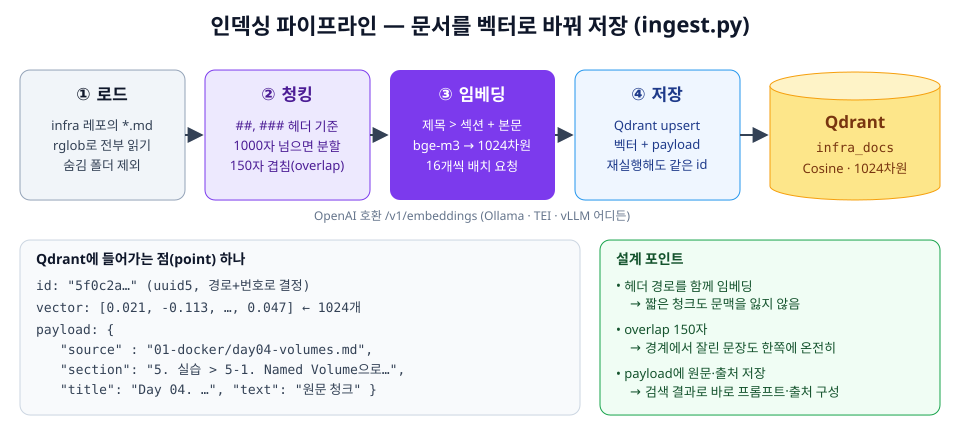
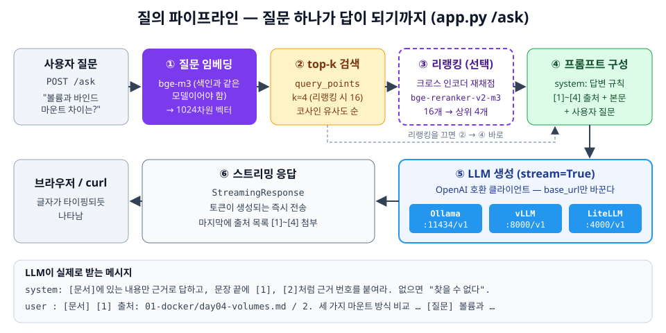
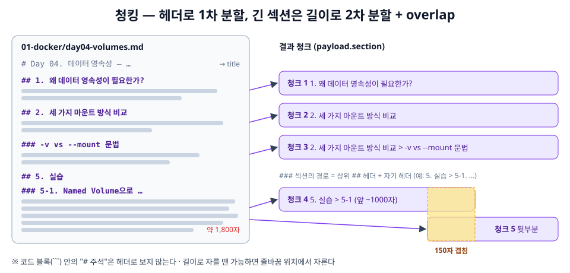

> **Chapter 6 · AI 인프라** | 난이도 ★★★☆☆ | 예상 소요 2 ~ 3시간

## 🎯 오늘의 목표

- RAG가 **왜** 필요한지, 파인튜닝·긴 컨텍스트와 무엇이 다른지 설명할 수 있다
- RAG를 **인덱싱 파이프라인**과 **질의 파이프라인** 두 개로 나눠 그릴 수 있다
- 헤더 기준 + 길이 기준 청킹, overlap, top-k 검색, 리랭킹의 역할을 안다
- 프레임워크 없이 Python 3.12로 **이 레포(`infra`)의 문서에 답하는 RAG API**를 만든다
- `base_url`만 바꿔 Ollama / vLLM / LiteLLM 어느 쪽에든 붙일 수 있다

---

## 1. 왜 RAG인가?

Day 38~39에서 띄운 LLM에게 "Day 04에서 볼륨 실습할 때 쓴 PostgreSQL 컨테이너 이름이 뭐였지?"라고 물어보면, 그럴듯하지만 **틀린 답**을 지어냅니다. 모델은 이 레포를 본 적이 없기 때문입니다.

모델이 모르는 지식을 쓰게 하는 방법은 크게 세 가지입니다.

| 방식 | 하는 일 | 장점 | 단점 |
|---|---|---|---|
| 파인튜닝 | 내 데이터로 모델 가중치를 추가 학습 | 말투·형식을 바꾸는 데 강함 | 학습 비용, 문서가 바뀌면 재학습, **출처를 댈 수 없음** |
| 긴 컨텍스트 | 문서 전체를 프롬프트에 통째로 넣기 | 구현이 가장 쉬움 | 문서가 많으면 컨텍스트 초과, 요청마다 토큰 비용·지연 폭증 |
| **RAG** | 질문과 **관련된 조각만 검색**해서 프롬프트에 넣기 | 문서 갱신 = 재색인만, **출처 제시 가능**, 작은 모델로도 가능 | 검색이 틀리면 답도 틀림 (검색 품질이 핵심) |

> **RAG (Retrieval-Augmented Generation) = 검색(Retrieval)으로 근거를 찾아 프롬프트를 보강(Augmented)한 뒤 생성(Generation)한다.**

비유하면 **오픈북 시험**입니다. 모델에게 책 전체를 외우게 하는 대신(파인튜닝), 시험지와 함께 **관련 페이지 몇 장만 펼쳐서** 건네줍니다.

---

## 2. 전체 그림 — 파이프라인은 두 개다

RAG는 하나의 흐름처럼 보이지만, 실제로는 **실행 시점이 다른 두 파이프라인**입니다.

| 구분 | 인덱싱 파이프라인 | 질의 파이프라인 |
|---|---|---|
| 언제 | 문서가 바뀔 때 (오프라인, 배치) | 사용자가 질문할 때마다 (온라인) |
| 입력 | 마크다운 파일들 | 질문 한 문장 |
| 출력 | Qdrant 컬렉션 (벡터 + payload) | 스트리밍 답변 + 출처 |
| 느려도 되나? | 몇 분 걸려도 됨 | **수 초 안에 첫 토큰**이 나와야 함 |
| 오늘 파일 | `ingest.py` | `app.py` (FastAPI `/ask`) |





두 그림에서 **임베딩 모델이 똑같이 bge-m3**라는 점에 주목하세요. 문서를 A 모델로 벡터화해 놓고 질문을 B 모델로 벡터화하면, 두 벡터는 서로 다른 좌표계에 있어서 비교 자체가 무의미해집니다. (Day 41에서 본 "같은 공간에 있어야 거리가 의미 있다"는 원칙)

---

## 3. 청킹 — 검색 품질의 절반

임베딩 모델은 긴 문서를 통째로 받으면 의미가 뭉개진 벡터 하나를 만듭니다. 그래서 문서를 **검색 단위인 청크(chunk)**로 잘라야 합니다.

| 전략 | 방법 | 장점 | 단점 |
|---|---|---|---|
| 고정 길이 | N자(토큰)마다 자름 | 단순 | 문장·코드 블록 중간이 잘림 |
| 문장/문단 | 빈 줄·마침표 기준 | 문장 보존 | 청크 크기가 들쭉날쭉 |
| **구조 기준 (헤더)** | 마크다운 `##`, `###` 단위 | 의미 단위와 일치, 출처 표시가 쉬움 | 섹션이 너무 길 수 있음 |
| 시맨틱 | 임베딩 유사도가 바뀌는 지점에서 자름 | 의미 경계에 가장 가까움 | 느리고 구현 복잡 |

이 레포의 글은 `## 1. …`, `### 5-1. …`처럼 헤더가 잘 정리되어 있으므로 **헤더로 1차 분할**하고, 그래도 긴 섹션만 **길이로 2차 분할**합니다.



| 파라미터 | 오늘 값 | 너무 작으면 | 너무 크면 |
|---|---|---|---|
| `MAX_CHARS` (청크 크기) | 1000자 | 문맥이 끊겨 답에 필요한 정보가 흩어짐 | 여러 주제가 섞여 벡터가 흐려지고, 프롬프트가 금방 참 |
| `OVERLAP` (겹침) | 150자 | 경계에 걸친 문장이 양쪽에서 다 잘림 | 중복 저장 증가 |
| `top_k` (검색 개수) | 4 | 근거 누락 | 관련 없는 문서가 섞여 답이 산만해짐 |

> 💡 청크에 **헤더 경로를 붙여서 임베딩**하는 것이 작은 트릭입니다. "`docker volume create pgdata`"만 있는 청크는 무슨 맥락인지 모호하지만, "Day 04. 데이터 영속성 > 5. 실습 > 5-1. Named Volume으로 PostgreSQL 데이터 지키기"가 앞에 붙으면 검색이 훨씬 잘 됩니다.

> ⚠️ 한글은 토큰 효율이 영어보다 낮습니다. 1000자 ≈ 수백~1000 토큰 정도로 잡고, top-k × 청크 크기가 LLM 컨텍스트(Ollama 기본값은 작을 수 있음)를 넘지 않게 하세요. (트러블슈팅 참고)

---

## 4. 검색과 리랭킹

Qdrant 검색(Day 41)은 질문 벡터와 **가장 가까운 벡터 k개**를 빠르게 찾습니다. 질문과 문서를 **따로** 임베딩해 비교하므로 **bi-encoder** 방식이라고 부릅니다. 빠르지만, 질문과 문서를 함께 읽어 보지는 않기 때문에 순위가 미묘하게 틀릴 때가 있습니다.

**리랭커(cross-encoder)**는 `(질문, 문서)` 쌍을 **한꺼번에 모델에 넣어** 관련도 점수를 다시 매깁니다. 정확하지만 후보마다 모델을 돌려야 해서 느립니다. 그래서 보통 이렇게 조합합니다.

```
벡터 검색으로 넉넉히 16개 (빠름, 대충)  →  리랭커로 16개 재채점 (느림, 정확)  →  상위 4개만 프롬프트에
```

| 구분 | bi-encoder (임베딩 검색) | cross-encoder (리랭커) |
|---|---|---|
| 입력 | 질문, 문서를 **각각** 벡터화 | (질문, 문서) **쌍**을 함께 |
| 미리 계산 | 문서 벡터를 색인 시점에 저장 | 불가 — 질문이 와야 계산 |
| 속도 | 수백만 건에서도 ms 단위 | 후보 수에 비례 (수십 건이 현실적) |
| 오늘 모델 | `bge-m3` | `BAAI/bge-reranker-v2-m3` (선택) |

오늘 코드는 `RERANK_URL` 환경 변수가 있을 때만 리랭킹을 켭니다. 처음엔 끄고 돌려 본 뒤, 6-8에서 켜서 결과를 비교해 보세요.

---

## 5. 프롬프트 구성 — 근거를 주고, 출처를 달게 한다

LLM에게 보내는 메시지는 이렇게 생겼습니다.

```
[system] 반드시 [문서]에 있는 내용만 근거로 한국어로 답하라.
         근거 문서 번호를 [1], [2]처럼 붙여라. 없으면 "찾을 수 없다"고 답하라.
[user]   [문서]
         [1] 출처: 01-docker/day04-volumes.md / 2. 세 가지 마운트 방식 비교
         (청크 본문)
         [2] 출처: ...
         [질문]
         볼륨과 바인드 마운트의 차이는?
```

| 장치 | 목적 |
|---|---|
| "문서에 있는 내용만" | 모델이 자기 기억으로 지어내는 것(환각) 억제 |
| 번호 `[1]` + 출처 경로 | 답변의 어느 문장이 어느 문서에서 왔는지 사용자가 검증 가능 |
| "없으면 모른다고" | 검색이 실패했을 때 그럴듯한 거짓말 대신 정직한 실패 |
| `temperature=0.2` | 창의성보다 근거 충실도 우선 |

> 💡 출처 목록은 LLM에게 쓰게 하지 않고 **코드가 직접 붙입니다.** 검색 결과의 payload에 경로가 이미 있으므로, 모델이 출처를 틀리게 적을 위험이 없습니다.

---

## 6. 실습 — 프레임워크 없이 RAG API 만들기

> 실습 환경: Ubuntu 24.04 (홈랩 서버 또는 WSL2), Python 3.12, Docker. LLM은 Day 38의 **Ollama**(호스트에서 `:11434`)를 기본으로 씁니다. Day 39의 vLLM, Day 40의 LiteLLM으로 바꾸는 방법은 6-7에서.
> 사용 라이브러리: `openai` 3.51, `qdrant-client` 1.20, `fastapi` 0.163, `uvicorn` 0.54 (2026-11 기준 최신)

> 💡 **GPU가 없다면**: 오늘 실습은 전부 CPU로 돌아갑니다. Ollama가 GPU를 못 찾으면 자동으로 CPU 모드로 동작하며, `qwen3:4b-instruct`(약 2.5GB)는 최근 CPU에서 초당 수~10여 토큰 정도 나옵니다. 더 느리면 `gemma3:1b`처럼 더 작은 모델을 쓰거나, 클라우드 GPU 인스턴스를 시간 단위로 빌려 vLLM을 띄우세요.

### 6-1. 재료 준비 — Qdrant, 모델, 문서

```bash
# 1) Qdrant (Day 41에서 띄웠다면 생략)
docker run -d --name qdrant -p 127.0.0.1:6333:6333 \
  -v qdrant_data:/qdrant/storage qdrant/qdrant:v1.20.1

# 2) Ollama 모델: 생성용 + 임베딩용
ollama pull qwen3:4b-instruct      # Qwen3-4B-Instruct-2507, Apache-2.0, 비추론(non-thinking) 모델
ollama pull bge-m3                 # 다국어 임베딩, 1024차원

# 3) 지식 베이스 = 이 레포
git clone --depth 1 https://github.com/yeomyaloo/infra.git ~/infra
```

Ollama의 OpenAI 호환 엔드포인트로 임베딩이 나오는지 먼저 확인합니다.

```bash
curl -s http://localhost:11434/v1/embeddings \
  -H "Content-Type: application/json" \
  -d '{"model":"bge-m3","input":"컨테이너"}' | python3 -c "import sys,json; print(len(json.load(sys.stdin)['data'][0]['embedding']))"
# 1024
```

### 6-2. 프로젝트 구조

```bash
mkdir -p ~/rag-stack/rag && cd ~/rag-stack/rag
python3.12 -m venv .venv          # Ubuntu 24.04: sudo apt install -y python3.12-venv
source .venv/bin/activate
```

```
rag-stack/
└── rag/
    ├── requirements.txt
    ├── common.py      # 설정 + 클라이언트 3개 (LLM, 임베딩, Qdrant)
    ├── ingest.py      # 인덱싱 파이프라인
    └── app.py         # 질의 파이프라인 (FastAPI)
```

`requirements.txt`:

```text
fastapi==0.163.0
uvicorn[standard]==0.54.0
openai==3.51.0
qdrant-client==1.20.0
httpx==0.28.1
```

```bash
pip install -r requirements.txt
```

> 💡 `httpx`는 리랭커 호출에만 씁니다. Day 43에서 이 폴더를 그대로 컨테이너 이미지로 만들기 때문에 버전을 고정해 둡니다.

### 6-3. `common.py` — 설정과 클라이언트

모든 접속 정보는 **환경 변수**로 받습니다. 코드는 그대로 두고 환경만 바꿔 Ollama → vLLM → LiteLLM, 로컬 → 컨테이너로 옮겨 갈 수 있게 하기 위해서입니다. (Day 13 ConfigMap, Day 43 `.env`로 이어지는 원칙)

```python
import os

from openai import OpenAI
from qdrant_client import QdrantClient

# 모든 설정은 환경 변수로 — base_url만 바꾸면 Ollama / vLLM / LiteLLM 어디든 붙는다
LLM_BASE_URL = os.getenv("LLM_BASE_URL", "http://localhost:11434/v1")   # Ollama 기본값
LLM_API_KEY = os.getenv("LLM_API_KEY", "not-needed")
LLM_MODEL = os.getenv("LLM_MODEL", "qwen3:4b-instruct")
EMBED_BASE_URL = os.getenv("EMBED_BASE_URL", LLM_BASE_URL)
EMBED_API_KEY = os.getenv("EMBED_API_KEY", LLM_API_KEY)
EMBED_MODEL = os.getenv("EMBED_MODEL", "bge-m3")
EMBED_DIM = int(os.getenv("EMBED_DIM", "1024"))                       # bge-m3 = 1024차원
QDRANT_URL = os.getenv("QDRANT_URL", "http://localhost:6333")
COLLECTION = os.getenv("COLLECTION", "infra_docs")
RERANK_URL = os.getenv("RERANK_URL", "")                               # 비워 두면 리랭킹 생략

llm = OpenAI(base_url=LLM_BASE_URL, api_key=LLM_API_KEY)
embedder = OpenAI(base_url=EMBED_BASE_URL, api_key=EMBED_API_KEY)
qdrant = QdrantClient(url=QDRANT_URL)


def embed(texts: list[str]) -> list[list[float]]:
    """OpenAI 호환 /v1/embeddings 호출. 입력 순서대로 벡터를 돌려준다."""
    resp = embedder.embeddings.create(model=EMBED_MODEL, input=texts)
    return [d.embedding for d in sorted(resp.data, key=lambda d: d.index)]
```

| 포인트 | 설명 |
|---|---|
| `OpenAI(base_url=...)` | OpenAI SDK는 **OpenAI 호환 API 클라이언트**로 쓸 수 있다. Ollama(`/v1`), vLLM, LiteLLM, TEI 모두 같은 형식 |
| `api_key="not-needed"` | Ollama·vLLM은 키를 검사하지 않지만 SDK가 빈 값을 거부하므로 아무 문자열 |
| LLM과 임베딩 클라이언트 분리 | 생성은 vLLM, 임베딩은 Ollama처럼 **서로 다른 서버**를 쓸 수 있게 |
| `sorted(... d.index)` | 응답 순서를 입력 순서에 확실히 맞춘다 |

### 6-4. `ingest.py` — 인덱싱 파이프라인

```python
"""인덱싱 파이프라인: 로드 → 청킹 → 임베딩 → Qdrant 저장"""
import re
import sys
import uuid
from pathlib import Path

from qdrant_client.models import Distance, PointStruct, VectorParams

from common import COLLECTION, EMBED_DIM, embed, qdrant

MAX_CHARS = 1000     # 청크 최대 길이(문자)
OVERLAP = 150        # 길이로 자를 때 앞 청크와 겹치는 양
BATCH = 16           # 임베딩 요청 1번에 보낼 청크 수
HEADER_RE = re.compile(r"^(#{1,3})\s+(.+)$")


def load_docs(root: Path):
    """root 아래 모든 .md 파일을 (상대 경로, 본문)으로 읽는다. 숨김 폴더는 제외."""
    for p in sorted(root.rglob("*.md")):
        rel = p.relative_to(root)
        if any(part.startswith(".") for part in rel.parts):
            continue
        yield rel.as_posix(), p.read_text(encoding="utf-8")


def split_sections(text: str) -> list[tuple[str, str]]:
    """##, ### 헤더 기준으로 (헤더 경로, 본문) 목록을 만든다. # 제목은 title로 따로 쓰고, 코드 블록 안의 #은 무시."""
    sections, path, buf, in_code = [], [], [], False

    def flush():
        body = "\n".join(buf).strip()
        if body:
            sections.append((" > ".join(path) or "개요", body))

    for line in text.splitlines():
        if line.lstrip().startswith("```"):
            in_code = not in_code
        m = None if in_code else HEADER_RE.match(line)
        if m:
            flush()
            level = len(m.group(1))                  # 1=#, 2=##, 3=###
            path = path[: level - 2] + [m.group(2).strip()] if level > 1 else []
            buf = []
        else:
            buf.append(line)
    flush()
    return sections


def split_long(body: str) -> list[str]:
    """MAX_CHARS보다 긴 섹션은 줄바꿈 위치에서 자르고 OVERLAP만큼 겹친다."""
    if len(body) <= MAX_CHARS:
        return [body]
    chunks, start = [], 0
    while start < len(body):
        end = min(start + MAX_CHARS, len(body))
        if end < len(body):
            cut = body.rfind("\n", start + MAX_CHARS // 2, end)
            if cut != -1:
                end = cut
        chunks.append(body[start:end].strip())
        if end == len(body):
            break
        start = end - OVERLAP
    return [c for c in chunks if c]


def build_chunks(root: Path) -> list[dict]:
    chunks = []
    for source, text in load_docs(root):
        title = next((ln[2:].strip() for ln in text.splitlines() if ln.startswith("# ")), source)
        for section, body in split_sections(text):
            for part in split_long(body):
                chunks.append({"source": source, "title": title, "section": section, "text": part})
    return chunks


def main(root: Path) -> None:
    chunks = build_chunks(root)
    print(f"문서 청크 {len(chunks)}개 생성")

    # 전체 재색인: 컬렉션을 새로 만든다
    if qdrant.collection_exists(COLLECTION):
        qdrant.delete_collection(COLLECTION)
    qdrant.create_collection(
        collection_name=COLLECTION,
        vectors_config=VectorParams(size=EMBED_DIM, distance=Distance.COSINE),
    )

    for i in range(0, len(chunks), BATCH):
        batch = chunks[i : i + BATCH]
        # 임베딩할 때는 제목·섹션을 앞에 붙여 "어디의 내용인지" 문맥을 준다
        vectors = embed([f"{c['title']} > {c['section']}\n{c['text']}" for c in batch])
        points = [
            PointStruct(
                id=str(uuid.uuid5(uuid.NAMESPACE_URL, f"{c['source']}#{i + j}")),
                vector=v,
                payload=c,
            )
            for j, (c, v) in enumerate(zip(batch, vectors))
        ]
        qdrant.upsert(collection_name=COLLECTION, points=points)
        print(f"  {i + len(batch)}/{len(chunks)} 저장")

    print("완료:", qdrant.count(collection_name=COLLECTION).count, "points")


if __name__ == "__main__":
    main(Path(sys.argv[1] if len(sys.argv) > 1 else "."))
```

| 단계 | 함수 | 핵심 |
|---|---|---|
| 로드 | `load_docs` | `rglob("*.md")`, `.git` 같은 숨김 폴더 제외 |
| 청킹 1차 | `split_sections` | `##`/`###` 헤더로 자르고 경로(`5. 실습 > 5-1. …`)를 기억. **코드 블록 안의 `# 주석`은 헤더로 오인하지 않게** ```` ``` ```` 토글 처리 |
| 청킹 2차 | `split_long` | 1000자를 넘으면 가능한 한 줄바꿈 위치에서 자르고 150자 겹치게 |
| 임베딩 | `embed(...)` | 16개씩 배치로. 제목·섹션 경로를 앞에 붙여서 |
| 저장 | `qdrant.upsert` | `uuid5(경로#번호)` → 같은 입력이면 같은 id |

실행합니다.

```bash
python ingest.py ~/infra
```

```
문서 청크 1452개 생성
  16/1452 저장
  32/1452 저장
  ...
  1452/1452 저장
완료: 1452 points
```

청크 개수는 레포 상태에 따라 다릅니다. CPU만으로 bge-m3를 돌리면 수 분 걸립니다. Qdrant에서 확인해 봅니다.

```bash
curl -s localhost:6333/collections/infra_docs | python3 -m json.tool | grep -E '"points_count"|"size"|"distance"'
#  "points_count": 1452,
#  "size": 1024,
#  "distance": "Cosine"
```

> 💡 브라우저에서 `http://localhost:6333/dashboard`를 열면 저장된 포인트의 payload(source, section, text)를 눈으로 볼 수 있습니다.

> ⚠️ 오늘은 단순하게 **매번 컬렉션을 지우고 새로 만드는 전체 재색인**입니다. 재색인하는 몇 분 동안 검색이 비어 버리므로, 운영에서는 새 컬렉션(`infra_docs_v2`)을 만든 뒤 **Qdrant 컬렉션 alias**를 원자적으로 바꿔 끼우는 방식(블루-그린)을 씁니다.

### 6-5. `app.py` — 질의 파이프라인 + 스트리밍

```python
"""질의 파이프라인: 질문 임베딩 → top-k 검색 → (리랭킹) → 프롬프트 → LLM 스트리밍"""
import httpx
from fastapi import FastAPI
from fastapi.responses import StreamingResponse
from pydantic import BaseModel, Field

from common import COLLECTION, LLM_MODEL, RERANK_URL, embed, llm, qdrant

app = FastAPI(title="infra-rag")

SYSTEM_PROMPT = """당신은 '인프라 학습 시리즈' 문서를 근거로 답하는 조교입니다.
- 반드시 아래 [문서]에 있는 내용만 근거로 한국어로 답하세요.
- 근거로 쓴 문서 번호를 문장 끝에 [1], [2]처럼 붙이세요.
- [문서]에 답이 없으면 "제공된 문서에서 찾을 수 없습니다."라고만 답하세요."""


class AskRequest(BaseModel):
    question: str = Field(min_length=1, max_length=2000)
    top_k: int = Field(default=4, ge=1, le=10)
    stream: bool = True


def retrieve(question: str, top_k: int) -> list[dict]:
    qvec = embed([question])[0]
    # 리랭킹을 쓰면 후보를 넉넉히(4배) 뽑은 뒤 재정렬한다
    limit = top_k * 4 if RERANK_URL else top_k
    hits = qdrant.query_points(
        collection_name=COLLECTION, query=qvec, limit=limit, with_payload=True
    ).points
    docs = [{**h.payload, "score": h.score} for h in hits]

    if RERANK_URL and docs:
        r = httpx.post(
            f"{RERANK_URL}/rerank",
            json={"query": question, "texts": [d["text"] for d in docs]},
            timeout=30,
        )
        r.raise_for_status()
        ranked = sorted(r.json(), key=lambda x: x["score"], reverse=True)
        docs = [{**docs[x["index"]], "score": x["score"]} for x in ranked]
    return docs[:top_k]


def build_messages(question: str, docs: list[dict]) -> list[dict]:
    context = "\n\n".join(
        f"[{n}] 출처: {d['source']} / {d['section']}\n{d['text']}" for n, d in enumerate(docs, 1)
    )
    return [
        {"role": "system", "content": SYSTEM_PROMPT},
        {"role": "user", "content": f"[문서]\n{context}\n\n[질문]\n{question}"},
    ]


def format_sources(docs: list[dict]) -> str:
    return "\n".join(
        f"[{n}] {d['source']} — {d['section']} (score {d['score']:.3f})" for n, d in enumerate(docs, 1)
    )


@app.get("/healthz")
def healthz():
    return {"status": "ok"}


@app.post("/ask")
def ask(req: AskRequest):
    docs = retrieve(req.question, req.top_k)
    messages = build_messages(req.question, docs)

    if not req.stream:
        resp = llm.chat.completions.create(model=LLM_MODEL, messages=messages, temperature=0.2)
        return {
            "answer": resp.choices[0].message.content,
            "sources": [{k: d[k] for k in ("source", "section", "score")} for d in docs],
        }

    def token_stream():
        stream = llm.chat.completions.create(
            model=LLM_MODEL, messages=messages, temperature=0.2, stream=True
        )
        for chunk in stream:
            if chunk.choices and chunk.choices[0].delta.content:
                yield chunk.choices[0].delta.content
        yield "\n\n---\n출처\n" + format_sources(docs) + "\n"

    return StreamingResponse(token_stream(), media_type="text/plain; charset=utf-8")
```

| 포인트 | 설명 |
|---|---|
| `query_points(query=벡터, limit=k)` | qdrant-client의 현재 검색 API. 결과는 `.points` 리스트, 각 항목에 `.score`, `.payload` |
| 리랭킹 시 `limit = top_k * 4` | 후보를 넉넉히 뽑고 리랭커가 다시 고른다 |
| `stream=True` | LLM 서버가 토큰을 SSE로 흘려보내고, SDK는 이를 `chunk.choices[0].delta.content` 반복자로 준다 |
| `StreamingResponse(generator)` | 제너레이터가 `yield`할 때마다 HTTP 응답으로 바로 전송 → **첫 토큰까지의 시간(TTFT)** 이 체감 속도를 좌우 |
| 동기 `def` 엔드포인트 | FastAPI가 스레드풀에서 실행하므로 동기 SDK를 써도 이벤트 루프가 막히지 않는다 |
| `Field(max_length=2000)` | 지나치게 긴 질문으로 컨텍스트를 터뜨리는 요청 차단 (Day 48 보안에서 확장) |

서버를 띄웁니다.

```bash
uvicorn app:app --host 0.0.0.0 --port 8000
```

다른 터미널에서 스트리밍으로 질문합니다. `-N`은 curl의 출력 버퍼링을 꺼서 글자가 오는 대로 보여 줍니다.

```bash
curl -N -X POST localhost:8000/ask \
  -H "Content-Type: application/json" \
  -d '{"question": "Docker 볼륨과 바인드 마운트의 차이는?"}'
```

```
볼륨은 Docker가 관리하는 저장소(/var/lib/docker/volumes 아래)에 데이터를 두고,
바인드 마운트는 호스트의 특정 경로를 컨테이너에 그대로 연결합니다 [1]. ...

---
출처
[1] 01-docker/day04-volumes.md — 2. 세 가지 마운트 방식 비교 (score 0.712)
[2] 01-docker/day04-volumes.md — 5. 실습 > 5-3. Bind Mount로 개발 환경 만들기 (score 0.655)
...
```

(답변 문장과 점수는 모델·환경에 따라 다릅니다.) 문서에 없는 질문도 던져 봅니다.

```bash
curl -s -X POST localhost:8000/ask -H "Content-Type: application/json" \
  -d '{"question": "이 레포 작성자의 생일은?", "stream": false}' | python3 -m json.tool
# "answer": "제공된 문서에서 찾을 수 없습니다."
```

> 💡 `http://localhost:8000/docs`에서 FastAPI가 자동으로 만든 Swagger UI로도 테스트할 수 있습니다.

### 6-6. 검색만 따로 점검하기

답이 이상할 때 가장 먼저 볼 것은 **LLM이 아니라 검색 결과**입니다. 검색이 엉뚱한 청크를 가져왔다면 어떤 LLM도 맞는 답을 못 합니다.

```bash
python -c "
from app import retrieve
for d in retrieve('kubeadm으로 워커 노드를 조인하는 명령', 4):
    print(f\"{d['score']:.3f}  {d['source']}  |  {d['section']}\")
"
```

```
0.689  02-kubernetes/day20-kubeadm-multinode.md  |  10. ⑦ worker join — k8s-w1, k8s-w2에서
0.641  02-kubernetes/day20-kubeadm-multinode.md  |  3. 전체 순서 한눈에 보기
...
```

### 6-7. `base_url`만 바꿔 다른 LLM 서버에 붙이기

코드는 한 줄도 바꾸지 않습니다. **임베딩은 그대로 Ollama의 bge-m3**를 써야 한다는 점만 기억하세요(색인과 같은 모델).

```bash
# vLLM (Day 39) — 생성만 vLLM으로
export LLM_BASE_URL=http://<vLLM 서버>:8000/v1    # 같은 호스트라면 vLLM을 다른 포트(--port 8001)로 띄운다
export LLM_MODEL=Qwen/Qwen3-4B-Instruct-2507       # vLLM이 서빙 중인 이름 (curl <vLLM>/v1/models 로 확인)
export EMBED_BASE_URL=http://localhost:11434/v1

# LiteLLM (Day 40) — 게이트웨이 경유: 키·사용량 관리가 따라온다
export LLM_BASE_URL=http://localhost:4000/v1
export LLM_API_KEY=sk-...                         # Day 40에서 발급한 virtual key
export LLM_MODEL=<config.yaml의 model_name>
export EMBED_BASE_URL=http://localhost:11434/v1
export EMBED_API_KEY=not-needed

uvicorn app:app --host 0.0.0.0 --port 8000
```

| LLM 서버 | `LLM_BASE_URL` | `LLM_MODEL` 예 |
|---|---|---|
| Ollama (Day 38) | `http://localhost:11434/v1` | `qwen3:4b-instruct` |
| vLLM (Day 39) | `http://<vLLM 호스트>:8000/v1` | `Qwen/Qwen3-4B-Instruct-2507` |
| LiteLLM (Day 40) | `http://localhost:4000/v1` | 게이트웨이에 등록한 별칭 |

> 💡 LiteLLM 경유가 운영에서 가장 편합니다. 뒤에 붙은 모델을 바꾸거나 여러 vLLM으로 부하를 나눠도 RAG 앱은 별칭만 알면 되고, 팀별 키와 토큰 사용량이 게이트웨이에 쌓입니다.

### 6-8. (선택) 리랭커 켜기

리랭커는 Hugging Face의 **TEI(Text Embeddings Inference)** 컨테이너로 띄우는 것이 가장 간단합니다. CPU 이미지로도 충분합니다.

```bash
docker run -d --name reranker -p 127.0.0.1:8081:80 -v tei_data:/data \
  ghcr.io/huggingface/text-embeddings-inference:cpu-1.9 \
  --model-id BAAI/bge-reranker-v2-m3

curl -s localhost:8081/rerank -H "Content-Type: application/json" \
  -d '{"query":"볼륨 백업","texts":["볼륨을 tar로 백업한다","Pod는 가장 작은 배포 단위다"]}'
# [{"index":0,"score":0.9...},{"index":1,"score":0.0...}]

export RERANK_URL=http://localhost:8081
uvicorn app:app --host 0.0.0.0 --port 8000
```

6-6의 검색 점검을 다시 돌려 보면 `score`가 리랭커 점수(0~1)로 바뀌고, 순서가 달라지는 질문이 생깁니다. 특히 **질문에 쓴 단어와 문서 단어가 다른 경우**(예: "컨테이너 지워도 데이터 유지" vs "영속성") 리랭커 효과가 큽니다.

### 6-9. 프레임워크를 쓰면?

> 💡 **LangChain / LlamaIndex와 비교**
> 오늘 만든 기능은 프레임워크로 수십 줄이면 됩니다. `MarkdownHeaderTextSplitter` + `RecursiveCharacterTextSplitter`(LangChain), `MarkdownNodeParser`(LlamaIndex)가 오늘의 `split_sections`·`split_long`이고, `QdrantVectorStore`, `as_retriever()`, `query_engine`이 검색·프롬프트 조립을 감쌉니다.
>
> | | 직접 구현 (오늘) | LangChain / LlamaIndex |
> |---|---|---|
> | 코드 양 | 약 200줄 | 수십 줄 |
> | 내부 동작 | 전부 보임 | 추상화 뒤에 숨음 (프롬프트·청크 크기 기본값 등) |
> | 디버깅 | print 한 줄 | 프레임워크 내부 추적 필요 |
> | 확장 | 직접 구현 | 로더·벡터DB·에이전트 통합이 풍부 |
> | 의존성 | 4~5개 | 수십 개, 버전 변화가 빠름 |
>
> 인프라 관점에서는 **한 번은 직접 만들어 각 단계의 입력·출력·지연을 아는 것**이 중요합니다. 그래야 Day 47에서 "어느 단계가 느린가"를 측정할 수 있습니다. 원리를 안 뒤에는 팀 상황에 맞게 프레임워크를 골라도 됩니다.

---

## 7. 트러블슈팅

| 증상 | 원인 | 해결 |
|---|---|---|
| `openai.NotFoundError: model "bge-m3" not found` | Ollama에 모델이 없음 | `ollama pull bge-m3`, `ollama list`로 확인 |
| `Wrong input: Vector dimension error: expected dim: 1024, got 768` | 컬렉션을 만든 차원과 임베딩 모델 차원이 다름 | `EMBED_DIM`을 모델에 맞추고 `ingest.py`로 재색인 |
| 답변이 문서와 무관하거나 "찾을 수 없다"만 반복 | 검색 실패. 색인과 질의의 임베딩 모델이 다르거나 청크가 너무 큼/작음 | 6-6으로 검색 결과부터 확인. `EMBED_MODEL`이 양쪽 동일한지, `MAX_CHARS` 조정 |
| 답이 앞부분 문서만 반영하고 뒤 문서를 무시 | Ollama 컨텍스트 길이 부족으로 프롬프트 앞부분이 잘림 | Ollama 서버에 `OLLAMA_CONTEXT_LENGTH=8192` 설정(`sudo systemctl edit ollama` → `Environment=`), 또는 `top_k`·`MAX_CHARS` 축소 |
| `curl`에 답이 한꺼번에 나옴 | curl 버퍼링, 또는 중간 프록시 버퍼링 | `curl -N`. nginx 뒤라면 `proxy_buffering off` (Day 43) |
| `qdrant_client ... Connection refused` | Qdrant 컨테이너가 꺼져 있거나 포트 불일치 | `docker ps`, `QDRANT_URL` 확인 |
| `AttributeError: 'QdrantClient' object has no attribute 'search'` | 오래된 예제 코드의 `search()` 사용 | 현재 API인 `query_points(...).points` 사용 |
| 색인이 너무 느림 | CPU에서 bge-m3 임베딩 | 처음엔 `~/infra/01-docker`처럼 일부 폴더만 색인, GPU가 있으면 Ollama가 자동 사용 |

---

## 8. 핵심 정리

- RAG = **검색으로 근거를 찾아 프롬프트에 넣고 생성**. 파인튜닝 없이 최신 문서 반영 + 출처 제시
- 파이프라인은 둘: **인덱싱**(로드 → 청킹 → 임베딩 → 저장, 오프라인) / **질의**(질문 임베딩 → top-k → 리랭킹 → 프롬프트 → 생성, 온라인)
- 청킹은 **헤더 기준 + 길이 제한 + overlap**. 헤더 경로를 함께 임베딩하면 검색 품질이 오른다
- 색인과 질의는 **반드시 같은 임베딩 모델**
- 리랭커(cross-encoder)는 넉넉히 뽑은 후보를 정확하게 재정렬하는 선택 단계
- 프롬프트에 "문서에서만 답하라 + 번호로 근거 표시 + 없으면 모른다", 출처 목록은 코드가 붙인다
- OpenAI 호환 API 덕분에 **`base_url`만 바꿔** Ollama / vLLM / LiteLLM 교체
- 답이 이상하면 **LLM보다 검색 결과를 먼저** 본다

---

## 9. 셀프 체크

<details>
<summary>Q1. 문서가 수시로 바뀌는 사내 위키에 파인튜닝보다 RAG가 유리한 이유 두 가지는?</summary>

① 문서가 바뀌면 **재색인만** 하면 되고 모델 재학습이 필요 없습니다. ② 검색된 청크의 경로를 그대로 **출처로 제시**할 수 있어 사용자가 답을 검증할 수 있습니다.
</details>

<details>
<summary>Q2. 인덱싱은 bge-m3로, 질문 임베딩은 다른 모델로 하면 어떻게 되는가?</summary>

두 벡터가 서로 다른 임베딩 공간에 있어 코사인 유사도가 의미를 잃습니다. 차원이 다르면 Qdrant가 에러를 내고, 차원이 우연히 같으면 **에러 없이 엉뚱한 결과**가 나와 더 위험합니다.
</details>

<details>
<summary>Q3. <code>split_sections</code>에서 코드 블록(<code>```</code>)을 추적하는 이유는?</summary>

bash 코드 블록 안의 `# 1) 저장소 등록` 같은 **주석이 마크다운 헤더로 오인**되어 섹션이 엉뚱하게 잘리는 것을 막기 위해서입니다.
</details>

<details>
<summary>Q4. 리랭킹을 쓸 때 벡터 검색의 <code>limit</code>을 top_k보다 크게 잡는 이유는?</summary>

리랭커는 주어진 후보 안에서만 순서를 바꿀 수 있습니다. 벡터 검색 순위가 5~16위인 정답 청크를 끌어올리려면 후보를 넉넉히(오늘은 4배) 가져와야 합니다. 대신 후보가 많을수록 리랭킹 지연이 늘어납니다.
</details>

<details>
<summary>Q5. <code>/ask</code>를 스트리밍으로 만들면 전체 응답 시간이 줄어드는가?</summary>

전체 생성 시간은 거의 같습니다. 줄어드는 것은 **첫 토큰이 보이기까지의 시간(TTFT)** 으로, 사용자가 체감하는 대기 시간이 크게 줄어듭니다. Day 47에서 TTFT를 지표로 측정합니다.
</details>

---

## ⏭️ 다음 예고 — Day 43. RAG 서비스 컨테이너화 & Docker Compose 통합

오늘은 Qdrant는 컨테이너, Ollama는 호스트, RAG 앱은 venv로 제각각 떠 있었습니다. 내일은 RAG 앱을 **멀티 스테이지 + non-root 이미지**로 만들고, LLM·임베딩·Qdrant·인덱서·프론트까지 **`compose.yaml` 하나**로 묶습니다. healthcheck와 `depends_on`으로 기동 순서를 맞추고, `profiles`로 CPU/GPU 구성을 스위치 하나로 바꿔 봅니다.
