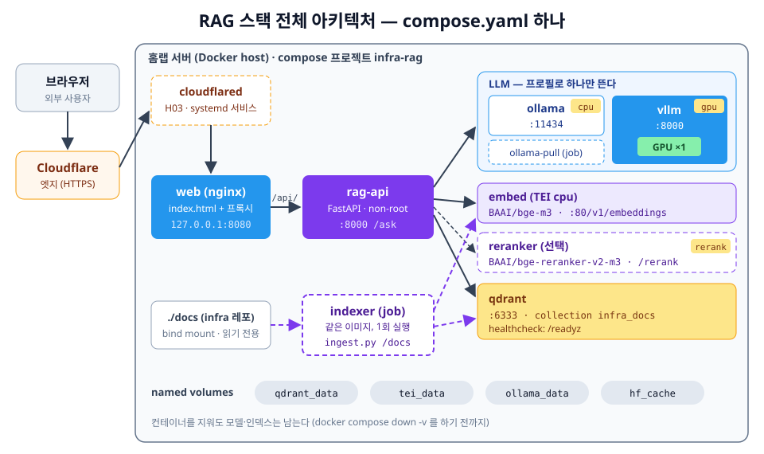
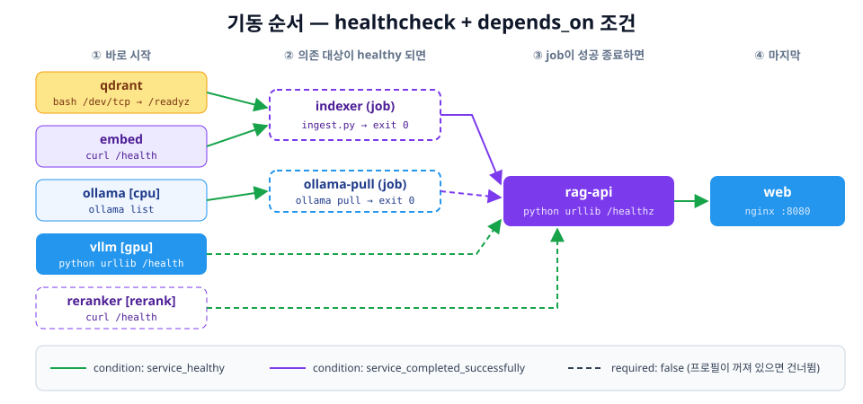

> **Chapter 6 · AI 인프라** | 난이도 ★★★☆☆ | 예상 소요 2 ~ 3시간

## 🎯 오늘의 목표

- Day 42의 RAG 앱을 **멀티 스테이지 + non-root** 이미지로 만든다
- LLM·임베딩·Qdrant·RAG API·인덱서·프론트를 **`compose.yaml` 하나**로 묶는다
- `deploy.resources.reservations.devices`로 컨테이너에 **GPU를 예약**하는 문법을 정확히 쓴다
- **healthcheck + `depends_on` 조건**으로 "모델이 준비된 뒤에" 앱이 뜨게 만든다
- `profiles`와 `.env`로 **CPU/GPU 구성을 스위치 하나로** 바꾸고, H03의 Cloudflare Tunnel로 공개한다

---

## 1. 왜 Compose로 묶나?

Day 42가 끝났을 때 서버 상태를 떠올려 봅시다.

| 구성 요소 | Day 42 상태 | 문제 |
|---|---|---|
| Qdrant | `docker run`으로 수동 실행 | 옵션을 기억해야 함 |
| Ollama | 호스트에 설치 (systemd) | 모델 pull도 손으로 |
| RAG 앱 | venv + `uvicorn` 터미널 | 터미널 닫으면 종료, 다른 서버로 옮기기 어려움 |
| 인덱싱 | `python ingest.py` 손으로 | Qdrant가 뜨기 전에 돌리면 실패 |
| 설정 | `export` 여러 줄 | 재부팅하면 사라짐 |

Day 06에서 Web + DB + Cache를 Compose로 묶었던 것과 같은 이유입니다. 다만 AI 스택에는 **추가 난관**이 있습니다.

- **기동이 느리다**: LLM 서버는 컨테이너가 "실행 중"이 된 뒤에도 모델 다운로드·로딩에 수 분이 걸립니다. 단순 `depends_on`으로는 부족하고 **healthcheck**가 필수입니다.
- **한 번만 돌고 끝나는 작업**이 있다: 모델 pull, 문서 색인. 이것들이 **성공해야** 앱이 떠야 합니다.
- **하드웨어에 따라 구성이 다르다**: GPU가 있으면 vLLM, 없으면 Ollama CPU. 파일 두 개를 관리하고 싶지 않습니다.

---

## 2. 전체 아키텍처



| 서비스 | 이미지 | 역할 | 프로필 | 종류 |
|---|---|---|---|---|
| `qdrant` | `qdrant/qdrant:v1.20.1` | 벡터 DB (Day 41) | 항상 | 상주 |
| `embed` | `text-embeddings-inference:cpu-1.9` | bge-m3 임베딩, OpenAI 호환 `/v1/embeddings` | 항상 | 상주 |
| `reranker` | `text-embeddings-inference:cpu-1.9` | bge-reranker-v2-m3, `/rerank` | `rerank` | 상주 |
| `ollama` | `ollama/ollama:0.40.16` | CPU용 LLM 서버 (Day 38) | `cpu` | 상주 |
| `ollama-pull` | `ollama/ollama:0.40.16` | 모델을 받아 두고 종료 | `cpu` | **job** |
| `vllm` | `vllm/vllm-openai:v0.33.0` | GPU용 LLM 서버 (Day 39) | `gpu` | 상주 |
| `indexer` | `infra-rag:0.1` (직접 빌드) | `ingest.py` 실행 후 종료 | 항상 | **job** |
| `rag-api` | `infra-rag:0.1` (직접 빌드) | FastAPI `/ask` | 항상 | 상주 |
| `web` | `nginx:1.30-alpine` | 정적 HTML + `/api/` 프록시 | 항상 | 상주 |

> 💡 **임베딩을 Ollama가 아닌 TEI로 분리한 이유**: LLM을 Ollama ↔ vLLM으로 갈아 끼워도 **임베딩 모델은 절대 바뀌면 안 되기** 때문입니다(Day 42: 색인과 질의는 같은 모델). 임베딩을 독립 서비스로 두면 LLM 프로필과 무관하게 항상 같은 벡터 공간이 유지됩니다. bge-m3 정도는 CPU로도 충분합니다.

> 💡 **Open WebUI는?** Day 38의 Open WebUI는 LLM 서버(`ollama`, `vllm`)에 직접 붙는 채팅 UI라서, 그대로 붙이면 RAG를 거치지 않습니다. 오늘은 RAG 흐름을 눈으로 확인하기 위해 `/ask`를 부르는 **수십 줄짜리 HTML**을 nginx로 서빙합니다. Open WebUI에서 이 RAG를 쓰려면 rag-api에 OpenAI 호환 `/v1/chat/completions` 엔드포인트를 추가하는 방법이 있으며, Day 49 종합 실습에서 다룹니다.

---

## 3. Dockerfile — 멀티 스테이지 + non-root

Day 03에서 배운 두 원칙을 Python 앱에 적용합니다.

```dockerfile
# syntax=docker/dockerfile:1

# ---- 1단계: 의존성 설치 (빌드 도구·pip 캐시는 여기 남는다) ----
FROM python:3.12-slim AS builder
RUN python -m venv /opt/venv
ENV PATH="/opt/venv/bin:$PATH"
COPY requirements.txt .
RUN pip install --no-cache-dir -r requirements.txt

# ---- 2단계: 실행 이미지 (venv와 코드만) ----
FROM python:3.12-slim
RUN useradd --create-home --uid 10001 app
COPY --from=builder /opt/venv /opt/venv
ENV PATH="/opt/venv/bin:$PATH" \
    PYTHONUNBUFFERED=1 \
    PYTHONDONTWRITEBYTECODE=1
WORKDIR /app
COPY --chown=app:app *.py ./
USER app
EXPOSE 8000
CMD ["uvicorn", "app:app", "--host", "0.0.0.0", "--port", "8000"]
```

| 줄 | 의도 |
|---|---|
| `FROM ... AS builder` | pip 다운로드·빌드 부산물은 1단계에만 남고 최종 이미지에는 안 들어감 |
| `python -m venv /opt/venv` | 설치 결과를 **한 폴더**에 모아 2단계로 통째로 복사. 두 단계가 같은 `python:3.12-slim`이라 경로가 그대로 동작 |
| `COPY requirements.txt` 먼저 | 코드만 바뀌면 의존성 레이어는 캐시 재사용 (Day 02 레이어 캐시) |
| `useradd --uid 10001` + `USER app` | 컨테이너 탈출 취약점이 있어도 root 권한이 아님 (Day 07 보안 기초) |
| `PYTHONUNBUFFERED=1` | `print`가 버퍼에 갇히지 않고 `docker logs`에 바로 보임 |
| CMD에 `--host 0.0.0.0` | 컨테이너 밖(다른 서비스)에서 접속 가능하게 |

`.dockerignore`도 같이 둡니다. Day 42의 `.venv`가 빌드 컨텍스트로 들어가면 이미지가 커지고 빌드가 느려집니다.

```text
__pycache__/
*.pyc
.venv/
.env
```

`indexer`와 `rag-api`는 **같은 이미지**를 쓰고 `command`만 다릅니다. 코드를 한 번 빌드해서 "색인 모드"와 "서버 모드"로 나눠 실행하는 셈입니다.

---

## 4. compose.yaml 해부

### 4-1. GPU 예약 문법

Compose에서 컨테이너에 GPU를 붙이는 표준 문법은 `deploy.resources.reservations.devices`입니다. (Day 37에서 설치한 **NVIDIA Container Toolkit**이 호스트에 있어야 동작)

```yaml
    deploy:
      resources:
        reservations:
          devices:
            - driver: nvidia
              count: 1            # GPU 1장. all 이면 전부
              capabilities: [gpu] # 필수. 빠지면 에러
```

| 필드 | 의미 |
|---|---|
| `driver` | `nvidia` |
| `count` | 예약할 GPU 수 (정수 또는 `all`). `device_ids`와 **동시에 쓸 수 없음** |
| `device_ids` | 특정 GPU 지정 (`["0"]`, `["GPU-uuid"]`). `nvidia-smi -L`로 확인 |
| `capabilities` | **필수**. `[gpu]` |

> ⚠️ `docker run --gpus all`과 같은 효과지만 이름이 `deploy`라고 Swarm 전용이 아닙니다. 일반 `docker compose up`에서도 적용됩니다. `runtime: nvidia`만 쓰는 예전 방식보다 이 문법이 표준입니다.

vLLM에는 `ipc: host`도 줍니다. PyTorch가 프로세스 간 공유 메모리(`/dev/shm`)를 많이 쓰는데, 컨테이너 기본값(64MB)으로는 부족하기 때문입니다(Day 39와 같은 이유).

### 4-2. healthcheck — 이미지마다 쓸 수 있는 도구가 다르다

"컨테이너가 실행 중" ≠ "서비스가 요청을 받을 준비가 됨"입니다. healthcheck는 컨테이너 **안에서** 실행되므로, 그 이미지에 있는 도구만 쓸 수 있습니다.

| 서비스 | 이미지 사정 | healthcheck |
|---|---|---|
| `qdrant` | Debian slim, **curl·wget 없음** | bash의 `/dev/tcp`로 직접 HTTP 요청 → `/readyz`가 200인지 |
| `embed`, `reranker` | TEI 이미지에 curl 있음 | `curl -fsS http://localhost:80/health` |
| `ollama` | 자체 CLI | `ollama list` (서버가 응답해야 성공) |
| `vllm` | Python 있음 | `python3 -c "urllib.request.urlopen('…/health')"` |
| `rag-api` | python slim, curl 없음 | 같은 방식으로 `/healthz` |

`start_period`는 "이 시간 동안은 실패해도 unhealthy로 치지 않는다"는 유예 기간입니다. 첫 실행에서 모델을 내려받는 `embed`(5분), `vllm`(10분)에는 넉넉히 줍니다. 유예 중에도 성공하면 즉시 healthy가 됩니다.

### 4-3. depends_on 조건 — 기동 순서



| 조건 | 의미 | 오늘 쓰는 곳 |
|---|---|---|
| `service_started` (기본) | 컨테이너가 시작만 되면 | — (AI 스택에선 거의 무의미) |
| `service_healthy` | healthcheck 통과까지 대기 | indexer → qdrant·embed, web → rag-api |
| `service_completed_successfully` | **종료 코드 0**으로 끝날 때까지 대기 | rag-api → indexer, ollama-pull |
| `required: false` | 대상 서비스가 없으면(프로필 꺼짐) 경고만 하고 무시 | rag-api → ollama-pull·vllm·reranker |

`required: false`가 프로필과 짝을 이루는 핵심입니다. `cpu` 프로필에서는 `vllm`이 아예 없으므로, 이 옵션이 없으면 Compose가 "없는 서비스에 의존한다"며 실행을 거부합니다. (Compose v2.20.2 이상)

### 4-4. 일회성 job 서비스

`indexer`와 `ollama-pull`은 **한 번 실행하고 종료하는** 서비스입니다.

- `restart: "no"` — 끝났다고 다시 띄우면 안 됨 (`unless-stopped`면 무한 반복)
- 종료 코드가 0이 아니면 `service_completed_successfully`를 기다리던 `rag-api`도 뜨지 않음 → **색인이 실패한 채로 빈 검색을 하는 API**가 뜨는 것을 막는다

Kubernetes로 치면 **Job**, 또는 Pod의 **initContainer**와 같은 역할입니다. (Day 45~49에서 K8s로 옮길 때 그대로 대응됩니다)

### 4-5. profiles + .env — 스위치 하나로 CPU/GPU 전환

`profiles`가 붙은 서비스는 해당 프로필이 켜졌을 때만 뜹니다. 프로필이 없는 서비스는 항상 뜹니다.

```bash
docker compose --profile cpu up -d          # 명령행으로 지정하거나
COMPOSE_PROFILES=gpu,rerank docker compose up -d   # 환경 변수로
```

매번 입력하기 귀찮으니 `.env`에 `COMPOSE_PROFILES`를 적어 둡니다. Compose는 같은 폴더의 `.env`를 자동으로 읽어 **`${변수}` 치환**과 `COMPOSE_*` 설정에 씁니다.

```bash
# ---- 어떤 구성으로 띄울지 ----
# cpu: Ollama로 생성 / gpu: vLLM으로 생성 / 리랭커까지: cpu,rerank 또는 gpu,rerank
COMPOSE_PROFILES=cpu

# ---- LLM (cpu 프로필 = Ollama) ----
LLM_BASE_URL=http://ollama:11434/v1
LLM_MODEL=qwen3:4b-instruct

# ---- LLM (gpu 프로필 = vLLM) — 바꿀 때는 위 3줄을 주석 처리하고 아래를 사용 ----
# COMPOSE_PROFILES=gpu
# LLM_BASE_URL=http://vllm:8000/v1
# LLM_MODEL=Qwen/Qwen3-4B-Instruct-2507

# ---- 선택 ----
# rerank 프로필을 켰다면 http://reranker:80
RERANK_URL=
# 게이티드 모델(Llama, Gemma 등)을 받을 때만 필요
HF_TOKEN=
# 색인할 마크다운 폴더
DOCS_DIR=./docs
```

> ⚠️ 프로필을 바꿀 때는 `COMPOSE_PROFILES`, `LLM_BASE_URL`, `LLM_MODEL` **세 줄을 함께** 바꿔야 합니다. 하나라도 어긋나면 rag-api가 없는 서버로 요청을 보냅니다.

### 4-6. 네트워크와 포트

Compose는 프로젝트마다 기본 네트워크(`infra-rag_default`)를 만들고, **서비스 이름이 곧 DNS 이름**이 됩니다(Day 05 사용자 정의 네트워크). 그래서 설정에 `http://qdrant:6333`, `http://embed:80/v1`처럼 씁니다.

호스트에 여는 포트는 최소한으로, 그리고 **`127.0.0.1`에만** 바인딩합니다.

| 포트 | 용도 | 외부 공개 |
|---|---|---|
| `127.0.0.1:8080` → web | 사용자 진입점 | Cloudflare Tunnel로만 (5-8) |
| `127.0.0.1:8000` → rag-api | curl 테스트용 | 안 함 |
| `127.0.0.1:6333` → qdrant | 대시보드 확인용 | 안 함 |
| ollama, vllm, embed | 포트 미공개 | 컨테이너 네트워크 안에서만 |

> ⚠️ Docker가 연 포트는 ufw 규칙을 우회할 수 있습니다(H02·H03에서 다룬 함정). `"8080:80"`처럼 쓰면 `0.0.0.0`에 열려 LAN 전체에서 GPU를 공짜로 쓸 수 있게 됩니다.

---

## 5. 실습 — compose 하나로 띄우기

> 실습 환경: Ubuntu 24.04 홈랩 서버(H01) + Docker Engine 및 Compose v2.20.2 이상 (`docker compose version`). x86_64 기준. GPU 프로필은 Day 37의 NVIDIA 드라이버 + Container Toolkit 필요.
> 💡 **GPU가 없다면** `cpu` 프로필만으로 전부 실습할 수 있습니다. 메모리는 8GB 이상(모델 2.5GB + bge-m3 약 2GB + 여유) 권장. 클라우드 GPU 인스턴스를 빌렸다면 같은 파일로 `gpu` 프로필을 그대로 시험할 수 있습니다.

### 5-1. 폴더 구조

Day 42의 `~/rag-stack/rag/`에 이어서 만듭니다.

```
rag-stack/
├── compose.yaml
├── .env
├── docs/              # 색인할 문서 (infra 레포 클론)
├── rag/               # Day 42 코드 + 오늘 추가
│   ├── Dockerfile
│   ├── .dockerignore
│   ├── requirements.txt
│   ├── common.py
│   ├── ingest.py
│   └── app.py
└── web/
    ├── index.html
    └── nginx.conf
```

```bash
cd ~/rag-stack
git clone --depth 1 https://github.com/yeomyaloo/infra.git docs
mkdir -p web
```

`rag/Dockerfile`과 `rag/.dockerignore`는 3장의 내용 그대로입니다. `.env`는 4-5의 내용으로 만듭니다.

### 5-2. compose.yaml

```yaml
name: infra-rag

# rag-api와 indexer가 같이 쓰는 설정 (YAML 앵커)
x-rag-app: &rag-app
  build: ./rag
  image: infra-rag:0.1
  environment:
    LLM_BASE_URL: ${LLM_BASE_URL}
    LLM_MODEL: ${LLM_MODEL}
    LLM_API_KEY: ${LLM_API_KEY:-not-needed}
    EMBED_BASE_URL: http://embed:80/v1
    EMBED_MODEL: BAAI/bge-m3
    EMBED_DIM: "1024"
    QDRANT_URL: http://qdrant:6333
    COLLECTION: infra_docs
    RERANK_URL: ${RERANK_URL:-}

services:
  # ---------- 벡터 DB ----------
  qdrant:
    image: qdrant/qdrant:v1.20.1
    volumes:
      - qdrant_data:/qdrant/storage
    ports:
      - "127.0.0.1:6333:6333"          # 대시보드 확인용. 외부에는 안 연다
    healthcheck:                         # 이미지에 curl이 없어서 bash의 /dev/tcp로 /readyz 확인
      test: ["CMD", "bash", "-c", "exec 3<>/dev/tcp/127.0.0.1/6333 && printf 'GET /readyz HTTP/1.0\\r\\n\\r\\n' >&3 && grep -q ' 200 ' <&3"]
      interval: 10s
      timeout: 5s
      retries: 5
    restart: unless-stopped

  # ---------- 임베딩 (CPU로 충분) ----------
  embed:
    image: ghcr.io/huggingface/text-embeddings-inference:cpu-1.9
    command: ["--model-id", "BAAI/bge-m3"]
    volumes:
      - tei_data:/data
    healthcheck:
      test: ["CMD", "curl", "-fsS", "http://localhost:80/health"]
      interval: 15s
      timeout: 5s
      retries: 5
      start_period: 300s                 # 첫 실행은 모델(약 2.3GB) 다운로드
    restart: unless-stopped

  # ---------- 리랭커 (선택: --profile rerank) ----------
  reranker:
    image: ghcr.io/huggingface/text-embeddings-inference:cpu-1.9
    profiles: [rerank]
    command: ["--model-id", "BAAI/bge-reranker-v2-m3"]
    volumes:
      - tei_data:/data
    healthcheck:
      test: ["CMD", "curl", "-fsS", "http://localhost:80/health"]
      interval: 15s
      timeout: 5s
      retries: 5
      start_period: 300s
    restart: unless-stopped

  # ---------- LLM: CPU 프로필 = Ollama ----------
  ollama:
    image: ollama/ollama:0.40.16
    profiles: [cpu]
    volumes:
      - ollama_data:/root/.ollama
    environment:
      OLLAMA_CONTEXT_LENGTH: "8192"      # RAG 프롬프트가 잘리지 않게 넉넉히
      OLLAMA_KEEP_ALIVE: "24h"
    healthcheck:
      test: ["CMD", "ollama", "list"]
      interval: 10s
      timeout: 5s
      retries: 5
    restart: unless-stopped

  ollama-pull:                           # 모델을 받아 두고 끝나는 일회성 job
    image: ollama/ollama:0.40.16
    profiles: [cpu]
    command: ["pull", "${LLM_MODEL}"]
    environment:
      OLLAMA_HOST: http://ollama:11434
    depends_on:
      ollama:
        condition: service_healthy
    restart: "no"

  # ---------- LLM: GPU 프로필 = vLLM ----------
  vllm:
    image: vllm/vllm-openai:v0.33.0
    profiles: [gpu]
    command:
      - --model=${LLM_MODEL}
      - --max-model-len=8192
      - --gpu-memory-utilization=0.85
    environment:
      HF_TOKEN: ${HF_TOKEN:-}
    volumes:
      - hf_cache:/root/.cache/huggingface
    ipc: host
    deploy:
      resources:
        reservations:
          devices:
            - driver: nvidia
              count: 1
              capabilities: [gpu]
    healthcheck:
      test: ["CMD", "python3", "-c", "import urllib.request; urllib.request.urlopen('http://localhost:8000/health')"]
      interval: 15s
      timeout: 5s
      retries: 5
      start_period: 600s                 # 모델 다운로드 + 로딩 + CUDA graph 캡처
    restart: unless-stopped

  # ---------- 인덱서: 색인만 하고 종료 ----------
  indexer:
    <<: *rag-app
    command: ["python", "ingest.py", "/docs"]
    volumes:
      - ${DOCS_DIR:-./docs}:/docs:ro
    depends_on:
      qdrant:
        condition: service_healthy
      embed:
        condition: service_healthy
    restart: "no"

  # ---------- RAG API ----------
  rag-api:
    <<: *rag-app
    ports:
      - "127.0.0.1:8000:8000"          # curl 테스트용
    depends_on:
      indexer:
        condition: service_completed_successfully
      ollama-pull:
        condition: service_completed_successfully
        required: false                  # gpu 프로필에서는 없는 서비스
      vllm:
        condition: service_healthy
        required: false                  # cpu 프로필에서는 없는 서비스
      reranker:
        condition: service_healthy
        required: false
    healthcheck:
      test: ["CMD", "python", "-c", "import urllib.request; urllib.request.urlopen('http://localhost:8000/healthz')"]
      interval: 10s
      timeout: 5s
      retries: 5
    restart: unless-stopped

  # ---------- 프론트 ----------
  web:
    image: nginx:1.30-alpine
    volumes:
      - ./web/index.html:/usr/share/nginx/html/index.html:ro
      - ./web/nginx.conf:/etc/nginx/conf.d/default.conf:ro
    ports:
      - "127.0.0.1:8080:80"
    depends_on:
      rag-api:
        condition: service_healthy
    restart: unless-stopped

volumes:
  qdrant_data:
  tei_data:
  ollama_data:
  hf_cache:
```

| 포인트 | 설명 |
|---|---|
| `x-rag-app: &rag-app` + `<<: *rag-app` | `x-`로 시작하는 최상위 키는 Compose가 무시하는 확장 필드. YAML 앵커로 indexer·rag-api의 빌드·환경 변수를 한 번만 적는다 |
| `${LLM_MODEL}` | `.env`에서 치환. vLLM의 `--model`과 rag-api의 `LLM_MODEL`이 자동으로 일치 |
| `ollama-pull`의 `OLLAMA_HOST` | 같은 `ollama` 이미지의 CLI를 클라이언트로만 쓰고, 실제 pull은 `ollama` 서버가 수행 |
| `tei_data` 공유 | embed와 reranker가 같은 모델 캐시 볼륨 사용 |
| `--gpu-memory-utilization=0.85` | vLLM이 VRAM의 85%를 가중치 + KV 캐시로 선점 (Day 39) |

### 5-3. 프론트 — web/index.html, web/nginx.conf

```html
<!doctype html>
<html lang="ko">
<meta charset="utf-8">
<title>infra RAG</title>
<style>
  body { font-family: sans-serif; max-width: 760px; margin: 40px auto; padding: 0 16px; }
  textarea { width: 100%; height: 80px; }
  pre { white-space: pre-wrap; background: #f8fafc; padding: 16px; border-radius: 8px; }
</style>
<h1>infra 문서에 질문하기</h1>
<textarea id="q">Docker 볼륨과 바인드 마운트의 차이는?</textarea>
<button id="go">질문</button>
<pre id="out"></pre>
<script>
document.getElementById("go").onclick = async () => {
  const out = document.getElementById("out");
  out.textContent = "";
  const res = await fetch("/api/ask", {
    method: "POST",
    headers: { "Content-Type": "application/json" },
    body: JSON.stringify({ question: document.getElementById("q").value }),
  });
  const reader = res.body.getReader();
  const decoder = new TextDecoder();
  for (;;) {
    const { done, value } = await reader.read();
    if (done) break;
    out.textContent += decoder.decode(value, { stream: true });
  }
};
</script>
</html>
```

`fetch`의 `res.body.getReader()`로 스트리밍 응답을 조각조각 읽어 화면에 덧붙입니다.

```nginx
server {
    listen 80;

    location / {
        root  /usr/share/nginx/html;
        index index.html;
    }

    # /api/ask → rag-api:8000/ask
    location /api/ {
        proxy_pass http://rag-api:8000/;
        proxy_http_version 1.1;
        proxy_buffering off;          # 토큰이 오는 즉시 브라우저로 흘려보낸다
        proxy_read_timeout 300s;      # 긴 답변 생성 대기
    }
}
```

> ⚠️ nginx는 기본적으로 업스트림 응답을 **버퍼에 모았다가** 보냅니다. `proxy_buffering off`가 없으면 Day 42에서 만든 스트리밍이 nginx에서 막혀, 답이 다 만들어진 뒤 한 번에 나타납니다.

### 5-4. 검증 후 기동 (cpu 프로필)

```bash
docker compose config --services     # 현재 프로필에서 뜰 서비스 목록
```

```
qdrant
embed
ollama
ollama-pull
indexer
rag-api
web
```

`vllm`과 `reranker`가 빠져 있으면 프로필이 제대로 적용된 것입니다.

```bash
docker compose up -d --build
docker compose ps -a
```

```
NAME                      SERVICE       STATUS
infra-rag-embed-1         embed         Up 3 minutes (healthy)
infra-rag-indexer-1       indexer       Exited (0) 1 minute ago
infra-rag-ollama-1        ollama        Up 3 minutes (healthy)
infra-rag-ollama-pull-1   ollama-pull   Exited (0) 2 minutes ago
infra-rag-qdrant-1        qdrant        Up 3 minutes (healthy)
infra-rag-rag-api-1       rag-api       Up 40 seconds (healthy)
infra-rag-web-1           web           Up 20 seconds
```

(출력은 일부 열을 생략했습니다.) 처음에는 bge-m3와 qwen3 모델을 내려받느라 수 분이 걸립니다. 진행 상황은 로그로 봅니다.

```bash
docker compose logs -f embed ollama-pull indexer
```

`indexer`가 `Exited (0)`, `rag-api`가 `healthy`가 되면 준비 완료입니다. non-root로 도는지도 확인합니다.

```bash
docker compose exec rag-api id
# uid=10001(app) gid=10001(app) groups=10001(app)
```

### 5-5. 테스트

```bash
curl -N -X POST localhost:8000/ask -H "Content-Type: application/json" \
  -d '{"question": "Compose에서 depends_on만으로 DB 준비를 보장할 수 없는 이유는?"}'
```

브라우저(서버에 데스크톱이 없다면 `ssh -L 8080:localhost:8080 <서버>`로 포워딩 후)에서 `http://localhost:8080`을 열고 질문하면 답이 글자 단위로 흘러나오고, 마지막에 출처 목록이 붙습니다.

### 5-6. GPU 프로필로 전환

```bash
# GPU가 컨테이너에서 보이는지 먼저 확인 (Day 37)
docker run --rm --gpus all ubuntu nvidia-smi
```

먼저 현재 구성을 내립니다(볼륨은 남으므로 모델·인덱스는 유지). 그다음 `.env`에서 cpu 3줄을 주석 처리하고 gpu 3줄의 주석을 풉니다.

```bash
docker compose down
```

```bash
COMPOSE_PROFILES=gpu
LLM_BASE_URL=http://vllm:8000/v1
LLM_MODEL=Qwen/Qwen3-4B-Instruct-2507
```

```bash
docker compose up -d
docker compose logs -f vllm               # 모델 다운로드 → 로딩 → "Application startup complete"
docker compose exec vllm nvidia-smi       # vLLM 프로세스가 VRAM을 잡고 있는지
```

> ⚠️ Qwen3-4B-Instruct-2507은 BF16 가중치만 약 8GB입니다. VRAM **16GB 이상**을 권장하고, 12GB GPU라면 `--max-model-len=4096`으로 줄이세요. 8GB GPU라면 vLLM 대신 `ollama` 서비스에 4-1의 `deploy` 블록을 붙여 Ollama가 GPU를 쓰게 하는 편이 현실적입니다. Llama·Gemma 같은 **게이티드 모델**은 Hugging Face에서 라이선스 동의 후 `.env`의 `HF_TOKEN`을 채워야 받을 수 있습니다.

임베딩은 그대로 `embed`(bge-m3)이므로 **재색인할 필요가 없습니다.** LLM만 갈아 끼운 것입니다.

### 5-7. 리랭커 켜기와 문서 재색인

```bash
# .env
COMPOSE_PROFILES=cpu,rerank      # 또는 gpu,rerank
RERANK_URL=http://reranker:80
```

```bash
docker compose up -d             # reranker가 healthy 된 뒤 rag-api가 새 설정으로 재생성됨
```

문서가 바뀌었을 때는 인덱서만 다시 돌립니다.

```bash
git -C docs pull
docker compose run --rm indexer     # 일회성으로 실행하고 컨테이너 삭제
```

> 💡 `docker compose up -d`를 다시 실행하면 종료된 `indexer`도 다시 실행되어 재색인이 일어납니다. 색인 없이 API만 갱신하고 싶다면 `docker compose up -d --no-deps rag-api`.

### 5-8. Cloudflare Tunnel로 공개 (H03)

H03에서 만든 Named Tunnel의 `ingress`에 한 줄만 추가하면 됩니다. web이 `127.0.0.1:8080`에만 열려 있어도 호스트의 `cloudflared`는 접근할 수 있습니다.

```yaml
# /etc/cloudflared/config.yml
ingress:
  - hostname: rag.example.com
    service: http://localhost:8080
  - service: http_status:404
```

```bash
cloudflared tunnel route dns homelab rag.example.com
sudo systemctl restart cloudflared
```

잠깐 시연만 할 거라면 Quick Tunnel로도 충분합니다: `cloudflared tunnel --url http://localhost:8080`

> ⚠️ 이 API는 질문 하나마다 **CPU/GPU를 수 초씩 소모**합니다. 공개 URL에는 반드시 H03에서 본 **Cloudflare Access**(이메일 OTP 등)를 앞에 붙이세요. 인증 없는 LLM 엔드포인트는 금방 남의 무료 GPU가 됩니다. 키·사용량 제한은 Day 40의 LiteLLM, 프롬프트 공격 대응은 Day 48에서 다룹니다.

### 5-9. 정리

```bash
docker compose down              # 컨테이너·네트워크 삭제 (볼륨 = 모델·인덱스는 유지)
docker compose down -v           # 볼륨까지 삭제 → 다음에 모델을 다시 내려받음
```

---

## 6. 트러블슈팅

| 증상 | 원인 | 해결 |
|---|---|---|
| `service "rag-api" depends on undefined service "vllm"` | `required: false` 누락 또는 Compose가 오래됨 | depends_on에 `required: false` 추가, Compose v2.20.2 이상으로 업데이트 |
| `could not select device driver "nvidia" with capabilities: [[gpu]]` | NVIDIA Container Toolkit 미설치 또는 Docker 미재시작 | Day 37: `nvidia-ctk runtime configure --runtime=docker` 후 `sudo systemctl restart docker` |
| `rag-api`가 계속 `Created` 상태 | indexer가 실패(종료 코드 ≠ 0)하거나 의존 서비스가 unhealthy | `docker compose ps -a`, `docker compose logs indexer` |
| `qdrant`가 계속 `unhealthy` | healthcheck를 curl로 작성 (이미지에 curl 없음) | 오늘처럼 `bash /dev/tcp` 방식 사용, `docker inspect --format '{{json .State.Health}}' infra-rag-qdrant-1`로 실패 메시지 확인 |
| `embed`가 `exec format error` | ARM 서버(라즈베리파이, Apple Silicon)에서 x86 이미지 | `cpu-arm64-1.9` 태그 사용 |
| vLLM `CUDA out of memory` / `No available memory for the cache blocks` | VRAM 부족 | `--max-model-len` 축소, `--gpu-memory-utilization` 조정, 더 작은 모델 |
| 웹에서 답이 한꺼번에 나타남 | nginx 버퍼링 | `proxy_buffering off` 확인 후 `docker compose restart web` |
| `.env`를 바꿨는데 반영 안 됨 | 이미 떠 있는 컨테이너는 그대로 | `docker compose up -d` (설정이 바뀐 서비스만 재생성) |
| 컨테이너 안 앱이 `localhost:11434`로 접속 실패 | 컨테이너의 localhost는 자기 자신 | 서비스 이름(`http://ollama:11434`) 사용 (Day 05) |

---

## 7. 핵심 정리

- RAG 앱 이미지는 **멀티 스테이지(venv 복사) + non-root(uid 10001)**, indexer와 rag-api가 같은 이미지를 `command`만 달리 사용
- GPU 예약: `deploy.resources.reservations.devices` → `driver: nvidia`, `count`(또는 `device_ids`), **`capabilities: [gpu]` 필수**
- AI 스택은 기동이 느리므로 **healthcheck + `service_healthy`**, 일회성 작업은 **`restart: "no"` + `service_completed_successfully`**
- healthcheck는 컨테이너 안에서 돈다 → 이미지에 있는 도구(curl, python, bash `/dev/tcp`, 자체 CLI)를 골라 쓴다
- `profiles` + `.env`의 `COMPOSE_PROFILES`로 CPU(Ollama)/GPU(vLLM)/리랭커를 스위치, 없는 서비스 의존은 `required: false`
- 임베딩은 LLM과 분리된 독립 서비스 → LLM을 바꿔도 재색인 불필요
- 포트는 `127.0.0.1`에만, 외부 공개는 Cloudflare Tunnel + Access로

---

## 8. 셀프 체크

<details>
<summary>Q1. <code>depends_on: [ollama]</code>(짧은 문법)만 쓰면 어떤 문제가 생기는가?</summary>

짧은 문법은 `service_started`라서 ollama 컨테이너가 **시작되자마자** 다음 서비스가 뜹니다. 서버가 아직 요청을 받을 수 없거나 모델이 없는 상태라 첫 요청들이 실패합니다. healthcheck와 `condition: service_healthy`(모델 pull은 `service_completed_successfully`)를 써야 합니다.
</details>

<details>
<summary>Q2. GPU 예약에서 <code>capabilities: [gpu]</code>를 빼면?</summary>

Compose 명세상 `capabilities`는 필수 필드라서 배포 시 에러가 납니다. `count`와 `device_ids`는 함께 쓸 수 없다는 점도 기억하세요.
</details>

<details>
<summary>Q3. indexer의 <code>restart</code>를 <code>unless-stopped</code>로 두면 어떻게 되는가?</summary>

색인을 마치고 종료(코드 0)해도 Docker가 다시 띄워 **색인이 끝없이 반복**되고, 매번 컬렉션을 지웠다 다시 만들므로 그 사이 검색이 비게 됩니다. 일회성 job은 `restart: "no"`.
</details>

<details>
<summary>Q4. cpu → gpu 프로필로 바꿀 때 재색인이 필요 없는 이유는?</summary>

바뀐 것은 **생성용 LLM**뿐이고, 문서와 질문을 벡터로 만드는 `embed`(bge-m3)는 그대로이기 때문입니다. 임베딩 모델을 바꿨다면 반드시 재색인해야 합니다.
</details>

<details>
<summary>Q5. web 포트를 <code>"8080:80"</code>이 아니라 <code>"127.0.0.1:8080:80"</code>으로 연 이유는?</summary>

`0.0.0.0`에 열면 Docker가 iptables 규칙을 직접 추가해 ufw를 우회할 수 있고, LAN(공유기 포트포워딩이 있다면 인터넷)에서 인증 없이 LLM을 쓸 수 있게 됩니다. 루프백에만 열고 외부 공개는 Cloudflare Tunnel + Access로 통제합니다.
</details>

---

## ⏭️ 다음 예고 — Day 44. Kubernetes에서 GPU 쓰기 — GPU Operator, 공유(Time-slicing/MIG)

Compose는 서버 한 대까지입니다. 내일부터는 이 스택을 Kubernetes로 옮길 준비를 합니다. K8s 노드에서 GPU를 `nvidia.com/gpu` 리소스로 노출하는 **NVIDIA GPU Operator**, 그리고 비싼 GPU 한 장을 여러 Pod가 나눠 쓰는 **Time-slicing과 MIG**를 다룹니다.
