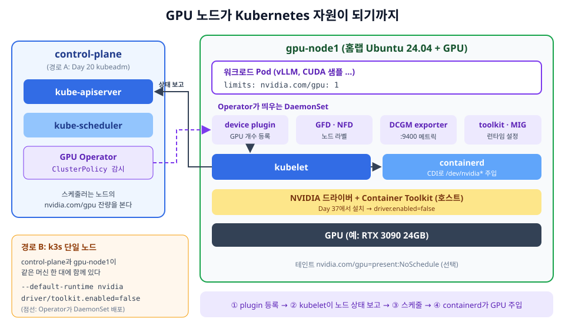
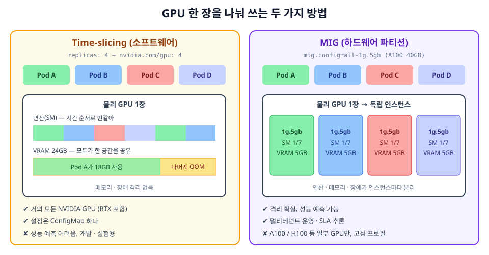
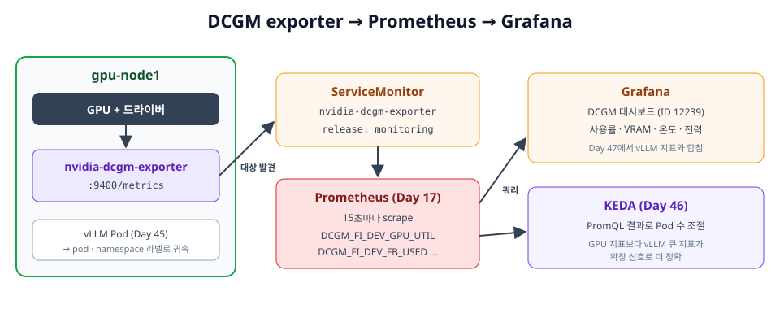

> **Chapter 6 · AI 인프라** | 난이도 ★★★★☆ | 예상 소요 2.5 ~ 3시간 (클러스터 준비 포함)

## 🎯 오늘의 목표

- Kubernetes가 GPU를 **어떻게 알고, 어떻게 Pod에 나눠 주는지**(device plugin → 확장 리소스 `nvidia.com/gpu`) 설명할 수 있다
- **NVIDIA GPU Operator**를 Helm으로 설치하고, 드라이버·Container Toolkit이 이미 깔린 노드에 맞는 옵션을 고를 수 있다
- GPU 테스트 Pod를 띄우고, **노드 라벨(GFD)** 과 RuntimeClass를 확인할 수 있다
- **Time-slicing**으로 GPU 1장을 여러 Pod가 나눠 쓰게 설정하고, **MIG**와의 차이를 안다
- **DCGM exporter** 메트릭을 Day 17의 Prometheus로 수집해 GPU 사용률·VRAM을 본다

---

## 0. 먼저 — 오늘의 실습 환경 (꼭 읽고 시작하세요)

지금까지 Kubernetes 실습은 대부분 **kind**(Day 09)로 했습니다. 하지만 GPU는 kind로 다루기 어렵습니다. kind 노드는 Docker 컨테이너라서 GPU 장치·드라이버 라이브러리를 노드 컨테이너 안으로, 다시 그 안의 Pod로 **두 번** 넘겨야 하고, GPU Operator가 기대하는 "진짜 노드" 환경(커널 모듈, containerd 설정 파일, `/dev/nvidia*`)과도 다릅니다.

그래서 Chapter 6의 Kubernetes 실습(Day 44~49)은 **GPU가 달린 실제 리눅스 머신이 노드인 클러스터**에서 진행합니다. 둘 중 하나를 고르세요.

| | A. kubeadm 클러스터 + GPU 워커 | B. k3s 단일 노드 |
|---|---|---|
| 구성 | Day 20 방식으로 만든 클러스터에 **홈랩 GPU 서버를 워커로 join** | GPU 서버 한 대에 **k3s**를 설치해 control-plane 겸 워커로 사용 |
| 장점 | 운영 환경과 같은 구조(GPU 노드 / 일반 노드 분리, 테인트) | 설치 5분. 메모리·디스크 여유가 적은 홈랩에 적합 |
| 단점 | 네트워크 준비가 필요. 노드 준비 작업이 많음 | 노드 1대라 스케줄링·장애 실습은 제한 |
| 추천 | Day 20을 끝냈고 머신이 2대 이상 | GPU 머신 1대뿐이거나 빨리 시작하고 싶을 때 |



공통 전제는 다음과 같습니다.

- GPU 서버: Homelab 01의 **Ubuntu 24.04** 서버 + Day 37에서 설치한 **NVIDIA 드라이버**(`nvidia-smi` 정상)와 **NVIDIA Container Toolkit**
- Kubernetes v1.34 (Day 20과 동일), Helm(Day 16), kube-prometheus-stack(Day 17, 릴리스 이름 `monitoring`)
- 오늘 쓰는 버전: **GPU Operator v26.7.2** (2026-10 릴리스), device plugin / GFD v0.20.1, Container Toolkit v1.20.1 (Operator 차트 기본값)

> 💡 **GPU가 없다면?** 오늘의 1~3장(개념)과 7장(MIG)은 그대로 읽고, 실습은 두 갈래 중 하나로 하세요.
> - **CPU 경로**: Day 45의 vLLM CPU 이미지 + `Qwen/Qwen2.5-0.5B-Instruct`로 "K8s에 LLM 올리기"는 GPU 없이도 끝까지 따라갈 수 있습니다. 오늘 내용 중 GPU 전용(Operator, time-slicing, DCGM)만 건너뜁니다.
> - **클라우드 GPU 임대**: 시간당 과금 GPU VM(L4·T4급 1장이면 충분) 하나를 빌려 Ubuntu 24.04 + 드라이버를 깔고 **B. k3s 경로**로 진행한 뒤 반드시 삭제하세요. 관리형 K8s(EKS/GKE/AKS)의 GPU 노드풀은 드라이버가 미리 설치된 경우가 많아 `driver.enabled=false` 옵션(4장)이 그대로 쓰입니다.

### A. kubeadm 클러스터에 GPU 워커 붙이기

Day 20의 VM들은 `192.168.56.x` **호스트 전용 네트워크**에 있어서 집 LAN의 물리 GPU 서버가 들어갈 수 없습니다. 다음 중 하나로 맞추세요.

- Day 20 절차를 **홈랩 LAN 대역**(예: `192.168.0.x`)에서 다시 수행 — control-plane VM은 브리지 네트워크로, GPU 서버는 물리 머신 그대로
- 또는 GPU 서버 자체를 control-plane으로 `kubeadm init` 하고 다른 머신을 워커로 붙이기

GPU 서버에서는 Day 20의 **5장(swap·커널 모듈·sysctl) → 6장(containerd + SystemdCgroup) → 7장(kubeadm·kubelet v1.34)** 을 똑같이 한 뒤, control-plane에서 join 명령을 새로 뽑아 실행합니다.

```bash
# control-plane 에서
kubeadm token create --print-join-command

# GPU 서버에서 (위 출력 그대로, sudo 붙여서)
sudo kubeadm join 192.168.0.10:6443 --token abcdef.0123456789abcdef \
  --discovery-token-ca-cert-hash sha256:...
```

> ⚠️ **Day 37에서 Docker를 설치했다면 주의!** Docker 공식 저장소의 `containerd.io` 패키지가 이미 containerd를 제공하므로 Ubuntu의 `containerd` 패키지를 **추가로 설치하지 마세요**(패키지 충돌). 대신 `containerd.io`가 깔아 둔 `/etc/containerd/config.toml`은 `disabled_plugins = ["cri"]`로 **Kubernetes용 CRI가 꺼져 있습니다.** Day 20 6장의 `containerd config default | sudo tee ...` 와 `SystemdCgroup = true` 수정을 반드시 다시 해 주세요.

GPU 노드에는 테인트를 걸어 GPU가 필요 없는 Pod가 비싼 노드를 차지하지 않게 하는 것이 일반적입니다(Day 19의 멀티테넌시 감각).

```bash
kubectl taint nodes gpu-node1 nvidia.com/gpu=present:NoSchedule
```

GPU Operator의 DaemonSet들은 기본값으로 `nvidia.com/gpu` 테인트를 **허용(toleration)** 하도록 되어 있어 그대로 설치됩니다. GPU를 쓰는 워크로드에는 같은 toleration을 넣어 줍니다(5장).

### B. k3s 단일 노드

GPU 서버에 Container Toolkit이 이미 설치되어 있으면, k3s는 시작할 때 `nvidia-container-runtime`을 찾아 **containerd 설정에 nvidia 런타임을 자동 추가**하고 `nvidia` RuntimeClass도 만들어 둡니다. 우리는 거기에 더해 nvidia를 **기본 런타임**으로 지정합니다.

```bash
# Day 15처럼 Traefik을 Helm으로 직접 설치할 것이므로 내장 Traefik은 끈다
curl -sfL https://get.k3s.io | sh -s - --default-runtime nvidia --disable traefik

# kubectl / helm 이 쓸 kubeconfig
mkdir -p ~/.kube
sudo cp /etc/rancher/k3s/k3s.yaml ~/.kube/config
sudo chown $USER ~/.kube/config

kubectl get nodes
sudo grep -n nvidia /var/lib/rancher/k3s/agent/etc/containerd/config.toml   # nvidia 런타임이 보여야 함
```

> 💡 k3s에는 **local-path** StorageClass가 기본 포함되어 있어 Day 45의 PVC가 바로 동작합니다. 경로 A(kubeadm)라면 Day 45에서 local-path-provisioner를 설치합니다.

---

## 1. Kubernetes는 GPU를 어떻게 알까?

Day 18에서 `resources.requests.cpu: 500m` 처럼 CPU·메모리를 요청했습니다. kubelet은 CPU 코어 수와 메모리 크기를 **스스로** 알아냅니다. 하지만 GPU는 벤더마다 장치 파일, 드라이버 라이브러리, 초기화 방법이 전부 다릅니다. 그래서 Kubernetes 본체는 GPU를 모르고, 대신 **확장 지점**을 열어 두었습니다.

| 확장 지점 | 하는 일 | NVIDIA 구현 |
|---|---|---|
| **Device Plugin** API | 노드에 "이 장치가 N개 있다"를 kubelet에 등록 → 노드에 **확장 리소스**가 생김 | `nvidia-device-plugin` |
| **확장 리소스** (Extended Resource) | `nvidia.com/gpu: 1` 처럼 Pod가 요청하는 정수 단위 자원 | `nvidia.com/gpu` |
| **CDI** (Container Device Interface) | 컨테이너 생성 시 어떤 장치 파일·라이브러리를 넣을지 표준 형식으로 기술 | Container Toolkit이 CDI 스펙 생성 |
| **RuntimeClass** | Pod별로 다른 저수준 런타임(핸들러)을 고르게 함 | `nvidia` (nvidia-container-runtime) |
| **노드 라벨** | GPU 모델·VRAM 등 노드 특성을 라벨로 표시 → nodeSelector/affinity | GFD (GPU Feature Discovery) |

흐름을 따라가 보면 이렇습니다.

1. device plugin이 kubelet에 GPU 2장을 등록 → `kubectl describe node`의 `Capacity`에 `nvidia.com/gpu: 2`
2. Pod가 `limits: nvidia.com/gpu: 1`을 요청 → 스케줄러는 **남은 GPU가 1 이상인 노드**에만 배치
3. kubelet이 device plugin에 "GPU 하나 할당해 줘" → plugin이 특정 GPU(UUID)를 골라 CDI 장치 이름으로 응답
4. containerd가 CDI 스펙대로 `/dev/nvidia0`, `libcuda.so` 등을 컨테이너에 넣어 실행 (Day 01의 containerd → runc 흐름 그대로)

> ⚠️ GPU는 **정수 단위**이고 `requests`와 `limits`가 같아야 합니다(보통 `limits`만 적으면 requests도 같은 값). CPU처럼 `0.5` GPU는 요청할 수 없습니다. 하나를 쪼개 쓰려면 6~7장의 time-slicing·MIG가 필요합니다.

---

## 2. 왜 GPU Operator인가?

1장의 구성 요소를 노드마다 손으로 깔면 할 일이 많습니다. 드라이버, Container Toolkit, containerd 설정, device plugin DaemonSet, GFD, 모니터링 exporter… 그리고 노드가 추가될 때마다 반복해야 하죠.

**NVIDIA GPU Operator**는 이 모든 것을 **Operator 패턴**(Day 17에서 본 Prometheus Operator와 같은 방식)으로 관리합니다. `ClusterPolicy`라는 CR 하나에 "원하는 상태"를 적으면, Operator가 GPU가 있는 노드를 찾아 필요한 구성 요소를 DaemonSet으로 깔아 줍니다.

| 구성 요소 | 역할 | 차트 값 (기본) |
|---|---|---|
| **NFD** (Node Feature Discovery) | PCI 장치를 보고 NVIDIA GPU가 있는 노드에 라벨 | `nfd.enabled: true` |
| **Driver** 컨테이너 | 노드에 드라이버를 컨테이너로 설치·로드 | `driver.enabled: true` |
| **Container Toolkit** | containerd에 nvidia 런타임 등록, CDI 스펙 생성 | `toolkit.enabled: true` |
| **Device Plugin** | `nvidia.com/gpu` 리소스 등록·할당 | `devicePlugin.enabled: true` |
| **GFD** | `nvidia.com/gpu.product` 등 상세 라벨 | `gfd.enabled: true` |
| **DCGM Exporter** | GPU 메트릭을 Prometheus 형식으로 노출(:9400) | `dcgmExporter.enabled: true` |
| **MIG Manager** | MIG 지원 GPU의 파티션 구성 적용 | `migManager.enabled: true` |
| **Validator** | 각 단계가 정상인지 검증하는 Pod | — |

> 💡 의존 순서가 있습니다. 드라이버가 준비되어야 toolkit이, toolkit이 준비되어야 device plugin이 뜹니다. 그래서 설치 직후 몇 분간 `Init:0/1` 상태가 보이는 것은 정상입니다.

---

## 3. 드라이버를 누가 설치하나 — 세 가지 시나리오

우리 GPU 서버에는 **Day 37에서 이미 드라이버가 설치되어** 있습니다. 이 상태에서 Operator가 드라이버를 또 설치하게 두면 충돌합니다. 그래서 상황에 맞는 옵션을 골라야 합니다. (공식 문서의 "Common Deployment Scenarios" 기준)

| 시나리오 | 노드 상태 | Helm 옵션 | 추가로 할 일 |
|---|---|---|---|
| ① 전부 Operator에게 | 드라이버 없음 (깨끗한 OS) | (기본값) | 없음. 노드 OS가 Operator의 드라이버 이미지가 지원하는 버전이어야 함 |
| ② **드라이버만 사전 설치** | 드라이버 O, toolkit은 Operator가 | `--set driver.enabled=false` | 없음 — Operator의 toolkit이 containerd 설정을 대신 해 줌 |
| ③ **드라이버 + toolkit 사전 설치** | 둘 다 O (DGX, k3s 등) | `--set driver.enabled=false --set toolkit.enabled=false` | **설치 전에 containerd의 기본 런타임을 `nvidia`로** 설정 |

- 경로 **A (kubeadm)** 는 ②를 권장합니다. Day 37의 toolkit은 Docker용으로 설정되어 있고, containerd 설정은 Operator가 관리하게 두는 편이 업그레이드가 쉽습니다.
- 경로 **B (k3s)** 는 ③입니다. 0장에서 `--default-runtime nvidia`로 이미 기본 런타임을 바꿔 두었습니다.

경로 A에서 ③을 고르고 싶다면(예: Operator가 호스트 파일을 건드리지 않게 하고 싶을 때) 설치 전에 GPU 노드에서 다음을 실행합니다.

```bash
# GPU 노드에서 — containerd의 기본 런타임을 nvidia 로
sudo nvidia-ctk runtime configure --runtime=containerd --set-as-default
sudo systemctl restart containerd
```

> 💡 **드라이버 컨테이너(①)는 언제 쓰나?** 노드가 수십 대이고 OS 이미지를 통일해 관리하는 운영 환경입니다. 드라이버 업그레이드가 "DaemonSet 이미지 태그 변경"이 되어 편합니다. 다만 커널 버전마다 맞는 드라이버 이미지가 있어야 해서, 홈랩처럼 커널을 자주 올리는 환경에서는 ②가 더 단순합니다.

---

## 4. 실습 ① — GPU Operator 설치

### 4-1. values 파일

Day 17의 Prometheus가 DCGM 메트릭을 수집하도록, Operator가 만드는 ServiceMonitor에 `release: monitoring` 라벨을 붙입니다(Day 17에서 이 라벨이 없으면 Prometheus가 무시한다고 했죠).

```yaml
# gpu-operator-values.yaml
driver:
  enabled: false          # 시나리오 ②, ③ — Day 37에서 설치한 드라이버 사용
# toolkit:
#   enabled: false        # 시나리오 ③(k3s 등)일 때만 주석 해제
dcgmExporter:
  serviceMonitor:
    enabled: true
    additionalLabels:
      release: monitoring # Day 17 kube-prometheus-stack 이 찾는 라벨
```

### 4-2. 설치

```bash
helm repo add nvidia https://helm.ngc.nvidia.com/nvidia
helm repo update

helm install gpu-operator nvidia/gpu-operator --version v26.7.2 \
  --namespace gpu-operator --create-namespace \
  -f gpu-operator-values.yaml \
  --wait
```

> 💡 공식 문서 예시는 `--generate-name`으로 랜덤 릴리스 이름을 쓰지만, Day 16에서 배운 대로 **이름을 고정**해 두면 `helm upgrade gpu-operator ...`가 편합니다.

```bash
kubectl get pods -n gpu-operator
```

```
NAME                                                          READY   STATUS      RESTARTS   AGE
gpu-feature-discovery-x7k2m                                   1/1     Running     0          3m
gpu-operator-6c9b8d7f5-m2q8w                                  1/1     Running     0          4m
gpu-operator-node-feature-discovery-gc-5d8f9c7b6-4kq2n        1/1     Running     0          4m
gpu-operator-node-feature-discovery-master-7b9d6c8f4-pl9xz    1/1     Running     0          4m
gpu-operator-node-feature-discovery-worker-h5n2c              1/1     Running     0          4m
nvidia-container-toolkit-daemonset-q8w2e                      1/1     Running     0          3m
nvidia-cuda-validator-v9r4t                                   0/1     Completed   0          2m
nvidia-dcgm-exporter-b6m3p                                    1/1     Running     0          3m
nvidia-device-plugin-daemonset-s2k7d                          1/1     Running     0          3m
nvidia-operator-validator-f4h8j                               1/1     Running     0          3m
```

드라이버 DaemonSet(`nvidia-driver-daemonset-*`)이 **없는 것**이 `driver.enabled=false`의 결과입니다. 시나리오 ③이면 `nvidia-container-toolkit-daemonset`도 없습니다. `nvidia-cuda-validator`가 `Completed`면 GPU에서 CUDA 코드가 실제로 돌았다는 뜻입니다.

```bash
kubectl get clusterpolicy
# NAME             STATUS   AGE
# cluster-policy   ready    5m
```

### 4-3. 노드에 GPU가 생겼는지 확인

```bash
kubectl describe node gpu-node1 | grep -A8 -E "^Capacity|^Allocatable"
```

```
Capacity:
  cpu:                16
  memory:             65581384Ki
  nvidia.com/gpu:     1
  pods:               110
Allocatable:
  cpu:                16
  memory:             65478984Ki
  nvidia.com/gpu:     1
```

GFD가 붙인 라벨도 봅시다. 이 라벨로 "VRAM 24GB 이상 노드에만 배치" 같은 스케줄링을 할 수 있습니다.

```bash
kubectl get node gpu-node1 -o json | jq '.metadata.labels | with_entries(select(.key | startswith("nvidia.com")))'
```

```json
{
  "nvidia.com/cuda.driver.major": "580",
  "nvidia.com/gpu.count": "1",
  "nvidia.com/gpu.family": "ampere",
  "nvidia.com/gpu.memory": "24576",
  "nvidia.com/gpu.present": "true",
  "nvidia.com/gpu.product": "NVIDIA-GeForce-RTX-3090",
  "nvidia.com/gpu.replicas": "1",
  "nvidia.com/mig.capable": "false",
  ...
}
```

(값은 GPU에 따라 다릅니다. `jq`가 없으면 `kubectl describe node gpu-node1 | grep nvidia.com`.)

### 4-4. RuntimeClass

```bash
kubectl get runtimeclass
# NAME     HANDLER   AGE
# nvidia   nvidia    5m
```

`nvidia` RuntimeClass는 "이 Pod는 containerd의 `nvidia` 핸들러(nvidia-container-runtime)로 실행하라"는 뜻입니다. 그런데 최신 Operator는 **CDI가 기본 활성화**(`cdi.enabled: true`)되어 있어서, device plugin으로 `nvidia.com/gpu`를 요청하는 **일반 워크로드는 `runtimeClassName`을 지정할 필요가 없습니다.** containerd가 CDI 스펙을 보고 GPU를 주입하기 때문입니다.

| 상황 | `runtimeClassName: nvidia` 필요? |
|---|---|
| `limits: nvidia.com/gpu: N`으로 GPU 요청 (오늘의 모든 실습) | 불필요 (있어도 무방) |
| GPU 리소스 요청 없이 `NVIDIA_VISIBLE_DEVICES=all` 환경 변수로 GPU 전체를 보려는 관리용 컨테이너 | 필요 |
| k3s에서 nvidia를 기본 런타임으로 **안** 바꾼 경우 | 필요 (k3s 문서의 예시가 이 경우) |

---

## 5. 실습 ② — GPU 테스트 Pod

공식 문서의 CUDA 샘플(벡터 덧셈)입니다.

```yaml
# cuda-vectoradd.yaml
apiVersion: v1
kind: Pod
metadata:
  name: cuda-vectoradd
spec:
  restartPolicy: OnFailure
  tolerations:                          # 0장에서 GPU 노드에 테인트를 걸었다면 필요
  - key: nvidia.com/gpu
    operator: Exists
    effect: NoSchedule
  containers:
  - name: cuda-vectoradd
    image: nvcr.io/nvidia/k8s/cuda-sample:vectoradd-cuda12.5.0-ubuntu22.04
    resources:
      limits:
        nvidia.com/gpu: 1
```

```bash
kubectl apply -f cuda-vectoradd.yaml
kubectl logs pod/cuda-vectoradd
```

```
[Vector addition of 50000 elements]
Copy input data from the host memory to the CUDA device
CUDA kernel launch with 196 blocks of 256 threads
Copy output data from the CUDA device to the host memory
Test PASSED
Done
```

이번엔 `nvidia-smi`로 컨테이너 안에서 GPU가 어떻게 보이는지 확인합니다.

```bash
kubectl run smi --rm -it --restart=Never \
  --image=nvidia/cuda:12.8.1-base-ubuntu24.04 \
  --overrides='{"spec":{"tolerations":[{"key":"nvidia.com/gpu","operator":"Exists","effect":"NoSchedule"}],"containers":[{"name":"smi","image":"nvidia/cuda:12.8.1-base-ubuntu24.04","command":["nvidia-smi","-L"],"resources":{"limits":{"nvidia.com/gpu":1}}}]}}'
# GPU 0: NVIDIA GeForce RTX 3090 (UUID: GPU-3f1c...)
```

> ⚠️ CUDA 베이스 이미지는 "드라이버가 최소 이 버전 이상"이라는 조건(`NVIDIA_REQUIRE_CUDA`)을 갖고 있습니다. `unsatisfied condition: cuda>=12.8` 오류가 나면 호스트 드라이버가 오래된 것이니, 더 낮은 CUDA 태그를 쓰거나 드라이버를 올리세요(Day 37).

이제 GPU가 1장인 노드에서 **GPU를 1개씩 요청하는 Pod를 2개** 만들어 봅시다.

```bash
kubectl apply -f cuda-vectoradd.yaml
sed 's/name: cuda-vectoradd$/name: cuda-vectoradd-2/' cuda-vectoradd.yaml | kubectl apply -f -
kubectl get pod
# cuda-vectoradd     0/1  Completed  ...
# cuda-vectoradd-2   0/1  Pending    ...   ← (첫 Pod가 아직 실행 중이면)
kubectl describe pod cuda-vectoradd-2 | grep -A3 Events
#   Warning  FailedScheduling  ...  0/1 nodes are available: 1 Insufficient nvidia.com/gpu.
```

벡터 덧셈은 금방 끝나서 운이 좋으면 둘 다 Completed가 되지만, LLM 서버처럼 **계속 떠 있는** Pod라면 두 번째는 영원히 Pending입니다. GPU 1장 = Pod 1개. 이것이 다음 장의 동기입니다.

```bash
kubectl delete pod cuda-vectoradd cuda-vectoradd-2
```

---

## 6. 실습 ③ — Time-slicing으로 GPU 나눠 쓰기



**Time-slicing**은 device plugin이 GPU 1장을 **N개인 것처럼 광고**하게 하는 설정입니다. 실제로는 CUDA의 시분할 스케줄링으로 여러 프로세스가 번갈아 GPU를 씁니다. 개발용 노트북, 작은 임베딩 모델 여러 개, Jupyter 같은 **가벼운 작업 여러 개**를 한 GPU에 올릴 때 유용합니다.

### 6-1. 설정 ConfigMap

```yaml
# time-slicing-config.yaml
apiVersion: v1
kind: ConfigMap
metadata:
  name: time-slicing-config-all
  namespace: gpu-operator
data:
  any: |-
    version: v1
    flags:
      migStrategy: none
    sharing:
      timeSlicing:
        resources:
        - name: nvidia.com/gpu
          replicas: 4
```

`any`는 설정 이름(키)입니다. 노드별로 다른 설정을 주려면 키를 여러 개 두고 노드에 `nvidia.com/device-plugin.config=<키>` 라벨을 붙입니다. 오늘은 모든 GPU 노드에 같은 설정을 기본값으로 적용합니다.

```bash
kubectl apply -f time-slicing-config.yaml

kubectl patch clusterpolicies.nvidia.com/cluster-policy \
  -n gpu-operator --type merge \
  -p '{"spec": {"devicePlugin": {"config": {"name": "time-slicing-config-all", "default": "any"}}}}'
```

device plugin과 GFD가 재시작된 뒤(1~2분) 노드를 다시 봅니다.

```bash
kubectl describe node gpu-node1 | grep -E "nvidia.com/gpu(:|.replicas|.product)"
```

```
                    nvidia.com/gpu.product=NVIDIA-GeForce-RTX-3090-SHARED
                    nvidia.com/gpu.replicas=4
  nvidia.com/gpu:     4
  nvidia.com/gpu:     4
```

물리 GPU 1장인데 `nvidia.com/gpu: 4`가 되었고, 제품 라벨에 `-SHARED`가 붙었습니다. 공유 GPU를 피하고 싶은 워크로드는 이 라벨로 걸러낼 수 있습니다.

### 6-2. 4개의 Pod가 동시에 GPU 사용

```yaml
# ts-test.yaml
apiVersion: apps/v1
kind: Deployment
metadata:
  name: ts-test
spec:
  replicas: 4
  selector:
    matchLabels: { app: ts-test }
  template:
    metadata:
      labels: { app: ts-test }
    spec:
      tolerations:
      - { key: nvidia.com/gpu, operator: Exists, effect: NoSchedule }
      containers:
      - name: cuda
        image: nvidia/cuda:12.8.1-base-ubuntu24.04
        command: ["bash", "-c", "nvidia-smi -L; sleep infinity"]
        resources:
          limits:
            nvidia.com/gpu: 1
```

```bash
kubectl apply -f ts-test.yaml
kubectl get pod -l app=ts-test        # 4개 모두 Running
kubectl logs -l app=ts-test           # 4개 모두 같은 GPU UUID
kubectl scale deploy ts-test --replicas=5
kubectl get pod -l app=ts-test        # 5번째는 Pending (Insufficient nvidia.com/gpu)
kubectl delete deploy ts-test
```

### 6-3. Time-slicing의 함정

| 주의점 | 설명 |
|---|---|
| **VRAM 격리 없음** | 4개 Pod가 24GB를 **나눠 갖는 게 아니라 같이 씁니다.** 한 Pod가 20GB를 잡으면 나머지는 OOM. vLLM은 기본으로 VRAM의 90%를 선점(`--gpu-memory-utilization 0.9`)하므로 time-slicing과 궁합이 나쁩니다 |
| **장애 격리 없음** | 한 프로세스가 GPU 오류를 내면 같은 GPU의 다른 Pod도 영향 |
| **성능 보장 없음** | `nvidia.com/gpu: 2`를 요청해도 GPU 시간을 두 배로 받지 못함. 그래서 `failRequestsGreaterThanOne: true` 옵션으로 2 이상 요청을 아예 막을 수 있음 |
| **메트릭 귀속 불가** | time-slicing 중에는 DCGM exporter가 메트릭을 컨테이너별로 나누지 못함 |
| **설정 변경 반영** | Operator는 이 ConfigMap 변경을 감시하지 않음. 수정 후 `kubectl rollout restart -n gpu-operator daemonset/nvidia-device-plugin-daemonset` |

> 💡 `renameByDefault: true`로 두면 공유 GPU가 `nvidia.com/gpu.shared`라는 **다른 리소스 이름**으로 광고됩니다. 이러면 "전용 GPU"와 "공유 GPU"를 요청 단계에서 명확히 구분할 수 있습니다.

Day 45로 넘어가기 전에 time-slicing을 끄려면 `config`를 비우고 device plugin을 재시작합니다(LLM 서빙은 전용 GPU가 원칙).

```bash
kubectl patch clusterpolicies.nvidia.com/cluster-policy -n gpu-operator --type json \
  -p '[{"op":"remove","path":"/spec/devicePlugin/config"}]'
kubectl rollout restart -n gpu-operator daemonset/nvidia-device-plugin-daemonset
```

---

## 7. MIG — 하드웨어로 쪼개기 (개념)

**MIG(Multi-Instance GPU)** 는 A100·H100·H200·B200 같은 데이터센터 GPU가 지원하는 기능으로, GPU 1장을 **SM(연산 유닛)·VRAM·캐시까지 물리적으로 분할**해 최대 7개의 독립 GPU 인스턴스로 만듭니다.

| 구분 | Time-slicing | MIG |
|---|---|---|
| 분할 방식 | 소프트웨어(시분할) | **하드웨어 파티션** |
| VRAM 격리 | ❌ 공유 | ✅ 인스턴스마다 고정 |
| 장애 격리 | ❌ | ✅ |
| 성능 예측성 | 낮음 (다른 Pod 부하에 영향) | 높음 (전용 SM) |
| 지원 GPU | 거의 모든 NVIDIA GPU (소비자용 포함) | A100, H100 등 일부 데이터센터 GPU만 |
| 분할 단위 | 자유 (replicas 수) | 정해진 프로필 (예: A100 40GB의 `1g.5gb`, `3g.20gb`) |
| K8s 리소스 이름 | `nvidia.com/gpu` (또는 `.shared`) | strategy `single`: `nvidia.com/gpu` / `mixed`: `nvidia.com/mig-1g.5gb` 등 |
| 어울리는 곳 | 개발·실험, 가벼운 추론 여러 개 | 멀티테넌트 운영, SLA가 필요한 추론 |

Operator 환경에서는 노드에 라벨 하나로 MIG 구성을 바꿉니다. MIG Manager가 라벨을 보고 GPU를 다시 파티셔닝합니다.

```bash
# (MIG 지원 GPU에서만) A100 40GB를 1g.5gb 7개로
kubectl label nodes gpu-node1 nvidia.com/mig.config=all-1g.5gb --overwrite
```

> 💡 홈랩의 RTX 시리즈는 MIG를 지원하지 않습니다(4-3의 `nvidia.com/mig.capable=false`). 개념만 알아 두고, 클라우드에서 A100/H100 인스턴스를 빌릴 일이 생기면 그때 써 보세요. 그 밖에 **MPS**(CUDA Multi-Process Service)도 device plugin의 `sharing.mps`로 설정할 수 있는데, time-slicing과 MIG 사이 정도의 성격입니다.

> 💡 **OpenStack(Ch4)에서는?** GPU를 VM에 통째로 넘기는 **PCI 패스스루**를 씁니다. Nova의 `[pci] device_spec`·`alias`로 GPU를 등록하고 flavor에 `pci_passthrough:alias`를 걸면, Day 34처럼 OpenStack VM 위에 올린 K8s 노드가 GPU를 "물리 장치처럼" 보게 됩니다. 그 VM 안에서는 오늘과 똑같이 GPU Operator를 설치하면 됩니다. (vGPU는 별도 라이선스가 필요한 NVIDIA AI Enterprise 영역)

---

## 8. 실습 ④ — DCGM exporter 메트릭 보기



**DCGM**(Data Center GPU Manager)은 NVIDIA의 GPU 관리·텔레메트리 라이브러리이고, **DCGM exporter**는 그 값을 Prometheus 형식으로 `:9400/metrics`에 노출합니다. 4장의 values로 ServiceMonitor까지 만들어 두었으니 Day 17의 Prometheus가 이미 수집 중입니다.

```bash
kubectl get servicemonitor -n gpu-operator
# NAME                   AGE
# nvidia-dcgm-exporter   20m

# 직접 원본 메트릭 보기
kubectl port-forward -n gpu-operator svc/nvidia-dcgm-exporter 9400:9400 &
curl -s localhost:9400/metrics | grep -E "^DCGM_FI_DEV_(GPU_UTIL|FB_USED|GPU_TEMP|POWER_USAGE)"
```

```
DCGM_FI_DEV_GPU_TEMP{gpu="0",UUID="GPU-3f1c...",modelName="NVIDIA GeForce RTX 3090",Hostname="gpu-node1",...} 41
DCGM_FI_DEV_POWER_USAGE{gpu="0",...} 28.53
DCGM_FI_DEV_GPU_UTIL{gpu="0",...} 0
DCGM_FI_DEV_FB_USED{gpu="0",...} 1
```

자주 쓰는 메트릭입니다.

| 메트릭 | 의미 | 단위 |
|---|---|---|
| `DCGM_FI_DEV_GPU_UTIL` | GPU 사용률 (커널이 실행 중인 시간 비율) | % |
| `DCGM_FI_DEV_FB_USED` / `DCGM_FI_DEV_FB_FREE` | 프레임버퍼(VRAM) 사용/여유 | MiB |
| `DCGM_FI_DEV_GPU_TEMP` | GPU 온도 | °C |
| `DCGM_FI_DEV_POWER_USAGE` | 전력 사용량 | W |
| `DCGM_FI_DEV_SM_CLOCK` | SM 클럭 | MHz |
| `DCGM_FI_DEV_XID_ERRORS` | 마지막 XID 오류 코드 (하드웨어·드라이버 오류 신호) | 코드 |

GPU가 Pod에 할당된 상태(time-slicing 아님)라면 메트릭에 `namespace`, `pod`, `container` 라벨이 붙어 **어느 Pod가 GPU를 쓰는지** 알 수 있습니다.

Prometheus UI(Day 17의 `port-forward ... 9090`)에서 다음 쿼리를 실행해 보세요.

```promql
# 노드별 VRAM 사용률(%)
100 * DCGM_FI_DEV_FB_USED / (DCGM_FI_DEV_FB_USED + DCGM_FI_DEV_FB_FREE)

# 지난 5분 평균 GPU 사용률
avg_over_time(DCGM_FI_DEV_GPU_UTIL[5m])
```

5장의 vectoradd Pod를 몇 번 다시 돌리거나, Day 45에서 vLLM을 올린 뒤 다시 보면 값이 움직입니다. Grafana에는 NVIDIA가 공개한 DCGM Exporter 대시보드(Grafana.com ID **12239**)를 Import하면 바로 그래프가 나옵니다.

> ⚠️ **GPU 사용률 100% ≠ GPU가 바쁘다.** `GPU_UTIL`은 "샘플링 구간 동안 커널이 하나라도 돌았는가"의 비율이라, 아주 작은 커널 하나만 돌아도 100%가 찍힐 수 있습니다. LLM 서빙의 실제 부하는 Day 46·47에서 vLLM 자체 메트릭(대기 요청 수, KV 캐시 사용률)으로 판단합니다.

---

## 9. 트러블슈팅

| 증상 | 원인 | 해결 |
|---|---|---|
| `nvidia-operator-validator`가 `Init:CrashLoopBackOff` | 드라이버가 로드되지 않음, 또는 `driver.enabled=true`인데 호스트에 드라이버가 이미 있음 | 노드에서 `nvidia-smi` 확인. 드라이버가 사전 설치면 `helm upgrade ... --set driver.enabled=false` |
| `nvidia-container-toolkit-daemonset`이 Running인데 Pod가 `failed to create containerd task` | containerd 설정 반영 실패, 또는 `containerd.io`의 `disabled_plugins = ["cri"]` 설정 잔존 | `/etc/containerd/config.toml` 재생성(Day 20 6장) 후 `systemctl restart containerd`, toolkit Pod 재시작 |
| 노드에 `nvidia.com/gpu`가 안 생김 | device plugin이 GPU 노드에 안 뜸(NFD 라벨 없음), 또는 테인트 | `kubectl get node --show-labels \| grep gpu.present`, `kubectl get pod -n gpu-operator -o wide` |
| Pod가 `Insufficient nvidia.com/gpu`로 Pending | GPU가 모두 할당됨 | `kubectl describe node`의 `Allocated resources` 확인. 남는 Pod 정리, 또는 time-slicing |
| Pod가 `untolerated taint {nvidia.com/gpu: present}` | GPU 노드 테인트에 대한 toleration 누락 | Pod spec에 `tolerations` 추가 |
| 컨테이너에서 `unsatisfied condition: cuda>=12.x` | 이미지의 CUDA 버전이 호스트 드라이버보다 새로움 | 더 낮은 CUDA 태그 사용, 또는 드라이버 업그레이드 |
| k3s에서 `nvidia-smi: not found` / GPU 미인식 | Container Toolkit 설치 **전에** k3s를 시작함 | toolkit 설치 후 `sudo systemctl restart k3s`, `config.toml`에 nvidia 런타임 확인 |
| time-slicing 설정을 바꿨는데 반영 안 됨 | Operator가 ConfigMap 변경을 감시하지 않음 | `kubectl rollout restart -n gpu-operator daemonset/nvidia-device-plugin-daemonset` |
| Prometheus에 `DCGM_FI_*`가 없음 | ServiceMonitor에 `release: monitoring` 라벨 없음 | values의 `dcgmExporter.serviceMonitor.additionalLabels` 확인 후 `helm upgrade` |

---

## 10. 핵심 정리

- Kubernetes 본체는 GPU를 모른다. **device plugin**이 `nvidia.com/gpu` **확장 리소스**를 등록하고, 컨테이너 생성 시 **CDI**로 장치를 주입한다
- **GPU Operator** = NFD + 드라이버 + toolkit + device plugin + GFD + DCGM exporter + MIG Manager를 `ClusterPolicy` 하나로 관리하는 Operator
- 드라이버가 이미 있으면 `driver.enabled=false`, toolkit까지 있으면 `toolkit.enabled=false` + **기본 런타임 nvidia** 설정
- GPU는 **정수 단위**로 요청. `limits: nvidia.com/gpu: 1`, 테인트가 있으면 toleration
- 최신 Operator는 CDI 기본 활성화 → 일반 워크로드는 `runtimeClassName` 불필요
- **Time-slicing** = 소프트웨어 공유, VRAM·장애 격리 없음 / **MIG** = 하드웨어 분할, 격리 O, 데이터센터 GPU만
- **DCGM exporter** 메트릭(`DCGM_FI_DEV_GPU_UTIL`, `DCGM_FI_DEV_FB_USED` …)을 ServiceMonitor로 Day 17 Prometheus에 연결

---

## 11. 셀프 체크

<details>
<summary>Q1. kind 대신 kubeadm(+GPU 워커)이나 k3s를 쓰는 이유는?</summary>

kind 노드는 Docker 컨테이너라 GPU 장치·드라이버를 노드 컨테이너와 Pod에 이중으로 넘겨야 하고, GPU Operator가 다루는 호스트 환경(커널 모듈, containerd 설정 파일)과 다릅니다. GPU가 꽂힌 실제 리눅스 머신이 노드여야 Operator·device plugin이 설계대로 동작합니다.
</details>

<details>
<summary>Q2. Day 37에서 드라이버와 Container Toolkit을 모두 설치한 k3s 노드에 GPU Operator를 설치할 때 필요한 옵션과 사전 작업은?</summary>

`--set driver.enabled=false --set toolkit.enabled=false`. 그리고 설치 전에 containerd의 기본 런타임을 `nvidia`로 바꿔야 합니다(k3s는 `--default-runtime nvidia`, 일반 containerd는 `nvidia-ctk runtime configure --runtime=containerd --set-as-default`).
</details>

<details>
<summary>Q3. GPU 1장 노드에서 time-slicing replicas=4로 설정하면 노드의 nvidia.com/gpu 값과 VRAM은 어떻게 되나?</summary>

`nvidia.com/gpu: 4`로 광고되어 GPU를 1개씩 요청하는 Pod 4개가 스케줄됩니다. 하지만 VRAM은 나뉘지 않고 4개 Pod가 **같은 VRAM을 공유**합니다. 한 Pod가 메모리를 많이 잡으면 다른 Pod가 OOM이 날 수 있습니다.
</details>

<details>
<summary>Q4. 멀티테넌트 운영 환경에서 time-slicing보다 MIG를 선호하는 이유는?</summary>

MIG는 SM·VRAM·캐시를 하드웨어로 분할해 인스턴스 간 **메모리·장애·성능 격리**가 됩니다. 한 테넌트의 부하나 오류가 다른 테넌트에 영향을 주지 않아 SLA를 지키기 쉽습니다. 대신 지원 GPU가 A100/H100 등으로 제한되고 정해진 프로필 단위로만 나눌 수 있습니다.
</details>

<details>
<summary>Q5. CDI가 기본 활성화된 Operator 환경에서 runtimeClassName: nvidia가 여전히 필요한 경우는?</summary>

`nvidia.com/gpu` 리소스를 요청하지 않고 `NVIDIA_VISIBLE_DEVICES` 환경 변수로 GPU에 접근하는 관리용 컨테이너, 또는 nvidia를 기본 런타임으로 두지 않은 k3s처럼 nvidia 핸들러를 명시해야 하는 환경입니다. device plugin으로 GPU를 요청하는 일반 워크로드는 필요 없습니다.
</details>

---

## ⏭️ 다음 예고 — Day 45. Kubernetes에 LLM 서빙 배포 — vLLM, 모델 캐시, KServe

GPU가 Kubernetes 자원이 되었습니다. 이제 Day 39에서 Docker로 띄웠던 **vLLM**을 Deployment로 옮깁니다. 몇 GB짜리 모델을 매번 내려받지 않도록 **PVC 모델 캐시**를 두고, 로딩에 몇 분 걸리는 서버를 위해 **startupProbe**를 설계하고, Day 15의 **Gateway API**로 외부에 노출합니다. 마지막으로 KServe·vLLM production-stack·llm-d 같은 "다음 단계" 도구들을 비교합니다.
