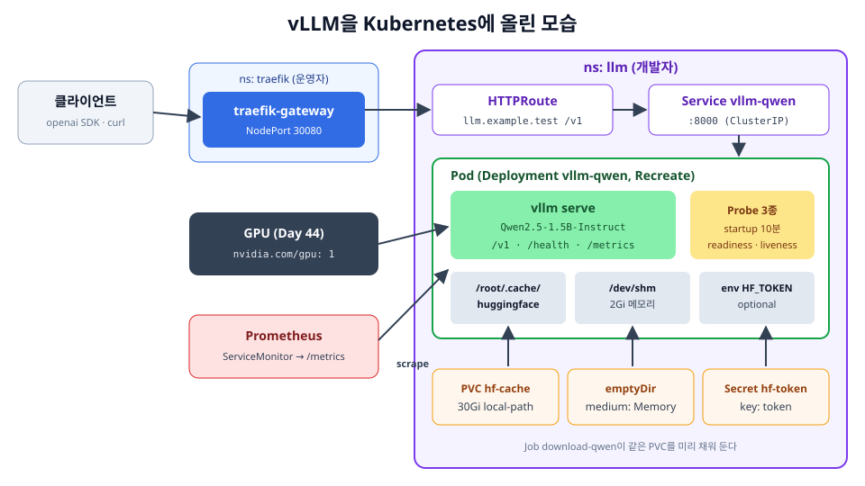
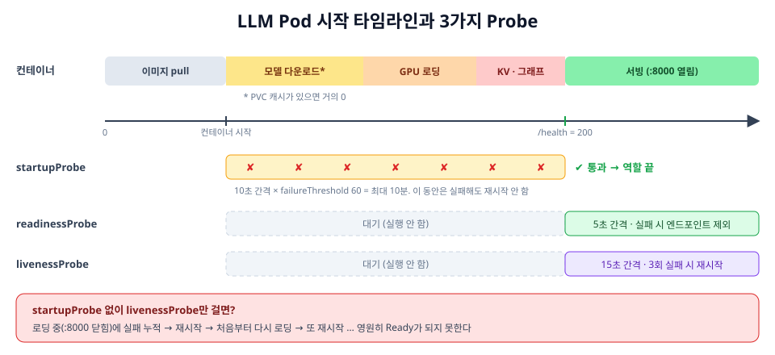

> **Chapter 6 · AI 인프라** | 난이도 ★★★★☆ | 예상 소요 2 ~ 3시간 (모델 다운로드 시간 포함)

## 🎯 오늘의 목표

- Day 39의 `docker run vllm ...` 한 줄을 **Deployment + Service + PVC + Secret**으로 옮길 수 있다
- 모델 로딩이 수 분 걸리는 서버에 맞게 **startupProbe / readinessProbe / livenessProbe**를 설계할 수 있다
- **모델 캐시 PVC**와 `/dev/shm` **메모리 emptyDir**이 왜 필요한지 설명할 수 있다
- Day 15의 **Gateway API(HTTPRoute)** 로 OpenAI 호환 API를 클러스터 밖에 노출할 수 있다
- KServe · vLLM production-stack · llm-d 등 **"그다음 단계" 도구**를 비교해 언제 무엇을 쓸지 판단할 수 있다

---

## 0. 실습 환경

- Day 44에서 만든 클러스터(경로 A: kubeadm + GPU 워커 / 경로 B: k3s 단일 노드) + **GPU Operator** 설치 완료
- **Traefik + Gateway API**: Day 15의 5-2(CRD), 5-3(Traefik 차트) 그대로 설치. Gateway `traefik-gateway`(traefik 네임스페이스), NodePort `30080`
- Day 17의 **kube-prometheus-stack**(릴리스 `monitoring`) — 오늘은 메트릭 수집 설정만 해 두고 Day 46·47에서 사용
- 서빙 엔진: **vLLM v0.33.0** (`vllm/vllm-openai:v0.33.0`, 2026-11 릴리스)
- 모델: **`Qwen/Qwen2.5-1.5B-Instruct`** (Apache 2.0, 게이티드 아님 → HF 토큰 없이도 받을 수 있음). BF16 가중치 약 3GB라 8GB급 GPU에도 올라갑니다(Day 36의 VRAM 계산 참고)

**StorageClass 준비** — k3s는 `local-path`가 기본으로 들어 있습니다. 경로 A(kubeadm)는 Day 14에서 kind가 기본 제공하던 **local-path-provisioner**를 직접 설치합니다.

```bash
kubectl apply -f https://raw.githubusercontent.com/rancher/local-path-provisioner/v0.0.37/deploy/local-path-storage.yaml
kubectl patch storageclass local-path \
  -p '{"metadata": {"annotations":{"storageclass.kubernetes.io/is-default-class":"true"}}}'
kubectl get storageclass
# NAME                   PROVISIONER             RECLAIMPOLICY   VOLUMEBINDINGMODE      ...
# local-path (default)   rancher.io/local-path   Delete          WaitForFirstConsumer   ...
```

> 💡 **GPU가 없다면?** 이 Day는 끝까지 CPU로 따라올 수 있습니다. 이미지만 `vllm/vllm-openai-cpu:v0.33.0`, 모델은 더 작은 **`Qwen/Qwen2.5-0.5B-Instruct`** 로 바꾸고 GPU 요청을 빼면 됩니다(5-6 참고). CPU는 AVX-512 지원이 권장(AVX2는 기능 제한)이며, 응답은 초당 몇 토큰 수준으로 느리지만 **Kubernetes 쪽 구조는 100% 같습니다.** kind에서도 동작합니다.

---

## 1. `docker run` 한 줄을 Kubernetes 객체로 번역하기

Day 39에서 vLLM을 이렇게 띄웠습니다(요지).

```bash
docker run --gpus all -p 8000:8000 --ipc=host \
  -v ~/.cache/huggingface:/root/.cache/huggingface \
  -e HF_TOKEN=$HF_TOKEN \
  vllm/vllm-openai:v0.33.0 --model Qwen/Qwen2.5-1.5B-Instruct
```

각 옵션이 Kubernetes에서는 어디로 가는지 정리하면 오늘 할 일이 그대로 보입니다.

| `docker run` 옵션 | 의미 | Kubernetes에서 | 관련 Day |
|---|---|---|---|
| `--gpus all` | GPU 사용 | `resources.limits: nvidia.com/gpu: 1` | 44 |
| `-v ~/.cache/huggingface:...` | 모델 캐시 재사용 | **PVC** (`hf-cache`) | 14 |
| `-e HF_TOKEN=...` | 게이티드 모델 인증 | **Secret** → `env.valueFrom.secretKeyRef` | 13 |
| `--ipc=host` 또는 `--shm-size` | 프로세스 간 공유 메모리 | `/dev/shm`에 **emptyDir(medium: Memory)** | 04 (tmpfs) |
| `-p 8000:8000` | 포트 공개 | **Service** + Gateway API **HTTPRoute** | 12, 15 |
| (없음) | 살아 있는지, 준비됐는지 | **startup / readiness / liveness Probe** | 10 |
| `--restart unless-stopped` | 죽으면 다시 | **Deployment** (원하는 상태 유지) | 11 |



### 왜 `/dev/shm`이 필요한가

컨테이너의 `/dev/shm` 기본 크기는 **64MB**입니다. vLLM(그리고 그 밑의 PyTorch·NCCL)은 프로세스 간 데이터를 공유 메모리로 주고받는데, 텐서 병렬(GPU 여러 장)이나 멀티프로세스 구성에서는 64MB가 금방 차서 `Bus error`나 NCCL 오류로 죽습니다. Docker에서는 `--ipc=host`/`--shm-size`로, Kubernetes에서는 **메모리 기반 emptyDir**을 `/dev/shm`에 마운트해 해결합니다(Day 04의 tmpfs와 같은 원리).

> ⚠️ `medium: Memory` emptyDir에 쓴 내용은 **컨테이너 메모리 사용량으로 계산**됩니다. `sizeLimit`을 꼭 주고, `resources.limits.memory`에 그만큼 여유를 두세요.

### 왜 모델 캐시 PVC인가

| 캐시 없음 | 캐시 PVC |
|---|---|
| Pod가 재시작될 때마다 Hugging Face에서 수 GB 재다운로드 | 첫 Pod만 다운로드, 이후는 디스크에서 로드 |
| 시작 시간 = 다운로드 + 로딩 (수 분 ~ 수십 분) | 시작 시간 = 로딩 (수십 초 ~ 수 분) |
| HF 레이트 리밋에 걸릴 수 있음 | 외부 의존 최소화 |

Day 46에서 Pod를 0개 ↔ N개로 늘리고 줄일 때 이 차이가 **콜드스타트 시간**을 결정합니다.

---

## 2. 모델 로딩과 Probe 설계



일반 웹 서버(Day 10)는 1~2초 만에 뜹니다. vLLM은 다릅니다.

1. 모델 다운로드 (캐시 없으면 수 분)
2. 가중치를 GPU로 로드 (수십 초)
3. KV 캐시 프로파일링·할당, CUDA 그래프 캡처 (수십 초)
4. 이 모든 게 끝나야 **8000번 포트가 열림** → `/health`가 200

여기에 Day 10의 livenessProbe만 걸어 두면, 로딩 중인 Pod를 "죽었다"고 판단해 **계속 재시작하는 무한 루프**에 빠집니다. 그래서 세 가지 Probe를 역할별로 나눕니다.

| Probe | 질문 | vLLM 설정 | 실패하면 |
|---|---|---|---|
| **startupProbe** | 아직 시작 중인가? | `/health`, 10초 간격 × **60회 = 최대 10분** 기다림 | 10분이 지나도 안 뜨면 재시작 |
| **readinessProbe** | 지금 요청을 받아도 되나? | `/health`, 5초 간격 | Service 엔드포인트에서 **제외**(재시작 X) |
| **livenessProbe** | 멈춰 버렸나? | `/health`, 15초 간격 × 3회 | 컨테이너 재시작 |

startupProbe가 **성공할 때까지 나머지 두 Probe는 실행되지 않습니다.** 그래서 "시작은 넉넉히, 운영 중 감시는 촘촘히"가 가능합니다.

> 💡 vLLM의 `/health`는 엔진이 정상이면 200, 엔진 프로세스가 죽었으면 오류를 돌려줍니다. 모델 목록 `/v1/models`도 준비 확인에 쓸 수 있지만, 가벼운 `/health`가 Probe용으로 적합합니다.

---

## 3. 실습 ① — 네임스페이스, Secret, PVC

```bash
kubectl create namespace llm
```

**Secret** — 오늘 모델은 토큰이 필요 없지만, Llama·Gemma 같은 **게이티드 모델**로 바꿀 때를 대비해 만들어 둡니다(토큰이 있으면 다운로드 레이트 리밋도 넉넉해집니다). Hugging Face → Settings → Access Tokens에서 **Read** 권한 토큰을 발급하세요.

```bash
kubectl -n llm create secret generic hf-token --from-literal=token=hf_xxxxxxxxxxxxxxxx
```

> ⚠️ 토큰을 YAML 파일에 평문으로 넣어 Git에 올리지 마세요(Day 13). 게이티드 모델은 Hugging Face 모델 페이지에서 **라이선스 동의**까지 해야 토큰으로 받을 수 있습니다.

**PVC** — 모델 캐시용 30Gi. 1.5B 모델은 3GB 남짓이지만 다른 모델로 바꿔 볼 여유를 둡니다.

```yaml
# hf-cache-pvc.yaml
apiVersion: v1
kind: PersistentVolumeClaim
metadata:
  name: hf-cache
  namespace: llm
spec:
  accessModes: ["ReadWriteOnce"]
  resources:
    requests:
      storage: 30Gi
  # storageClassName 생략 → 기본 StorageClass(local-path)
```

```bash
kubectl apply -f hf-cache-pvc.yaml
kubectl -n llm get pvc
# NAME       STATUS    VOLUME   CAPACITY   ACCESS MODES   STORAGECLASS   AGE
# hf-cache   Pending                                      local-path     5s
```

`Pending`은 정상입니다. local-path는 `WaitForFirstConsumer`라 **Pod가 어느 노드에 뜰지 정해진 뒤** 그 노드의 디스크에 볼륨을 만듭니다(Day 14).

---

## 4. 실습 ② — 모델 미리 받아 두기 (Job)

vLLM Pod가 직접 다운로드해도 되지만, **다운로드를 별도 Job으로 분리**하면 좋은 점이 있습니다. vLLM의 startupProbe 시간을 "로딩"에만 맞추면 되고, Day 46의 콜드스타트도 항상 "캐시 있음" 상태에서 시작합니다.

```yaml
# model-download-job.yaml
apiVersion: batch/v1
kind: Job
metadata:
  name: download-qwen
  namespace: llm
spec:
  backoffLimit: 2
  template:
    spec:
      restartPolicy: OnFailure
      tolerations:                     # local-path 볼륨이 GPU 노드에 생기도록 같은 노드로
      - { key: nvidia.com/gpu, operator: Exists, effect: NoSchedule }
      nodeSelector:
        nvidia.com/gpu.present: "true"
      containers:
      - name: hf
        image: python:3.12-slim
        command: ["bash", "-c"]
        args:
        - pip install --no-cache-dir -q huggingface_hub &&
          hf download Qwen/Qwen2.5-1.5B-Instruct
        env:
        - name: HF_TOKEN
          valueFrom:
            secretKeyRef: { name: hf-token, key: token, optional: true }
        volumeMounts:
        - { name: hf-cache, mountPath: /root/.cache/huggingface }
      volumes:
      - name: hf-cache
        persistentVolumeClaim: { claimName: hf-cache }
```

```bash
kubectl apply -f model-download-job.yaml
kubectl -n llm logs -f job/download-qwen
kubectl -n llm get job download-qwen
# NAME            STATUS     COMPLETIONS   DURATION   AGE
# download-qwen   Complete   1/1           2m10s      2m15s
```

> 💡 `nodeSelector`에 쓴 `nvidia.com/gpu.present=true`는 Day 44에서 Operator가 붙인 라벨입니다. local-path 볼륨은 **처음 쓴 노드에 묶이므로**, 다운로드 Job과 vLLM Pod가 같은 GPU 노드에 뜨도록 맞춘 것입니다. (k3s 단일 노드라면 의미는 없지만 해가 되지도 않습니다.)

---

## 5. 실습 ③ — vLLM Deployment와 Service

### 5-1. Deployment

```yaml
# vllm-deployment.yaml
apiVersion: apps/v1
kind: Deployment
metadata:
  name: vllm-qwen
  namespace: llm
  labels: { app: vllm-qwen }
spec:
  replicas: 1
  strategy:
    type: Recreate                       # 6장 참고 — GPU 1장 환경에서 롤링 업데이트 교착 방지
  selector:
    matchLabels: { app: vllm-qwen }
  template:
    metadata:
      labels: { app: vllm-qwen }
    spec:
      tolerations:
      - { key: nvidia.com/gpu, operator: Exists, effect: NoSchedule }
      containers:
      - name: vllm
        image: vllm/vllm-openai:v0.33.0
        command: ["vllm", "serve"]
        args:
        - Qwen/Qwen2.5-1.5B-Instruct
        - --served-model-name=qwen2.5-1.5b   # API에서 쓸 모델 이름
        - --max-model-len=8192               # 컨텍스트 길이 제한 → KV 캐시 여유 확보
        - --gpu-memory-utilization=0.90
        - --port=8000
        env:
        - name: HF_TOKEN
          valueFrom:
            secretKeyRef: { name: hf-token, key: token, optional: true }
        ports:
        - { name: http, containerPort: 8000 }
        resources:
          requests:
            cpu: "2"
            memory: 8Gi
            nvidia.com/gpu: 1
          limits:
            memory: 16Gi                     # /dev/shm 2Gi 포함해서 여유 있게
            nvidia.com/gpu: 1
        startupProbe:
          httpGet: { path: /health, port: http }
          periodSeconds: 10
          failureThreshold: 60               # 최대 10분 로딩 허용
        readinessProbe:
          httpGet: { path: /health, port: http }
          periodSeconds: 5
          failureThreshold: 3
        livenessProbe:
          httpGet: { path: /health, port: http }
          periodSeconds: 15
          failureThreshold: 3
        volumeMounts:
        - { name: hf-cache, mountPath: /root/.cache/huggingface }
        - { name: dshm, mountPath: /dev/shm }
      volumes:
      - name: hf-cache
        persistentVolumeClaim: { claimName: hf-cache }
      - name: dshm
        emptyDir:
          medium: Memory
          sizeLimit: 2Gi
```

| 설정 | 왜 |
|---|---|
| `command: ["vllm", "serve"]` + 첫 인자에 모델 ID | 이미지 기본 엔트리포인트에 의존하지 않고 명시 |
| `--served-model-name` | 클라이언트는 긴 HF ID 대신 짧은 이름으로 호출. 모델을 바꿔도 API 이름 유지 가능 |
| `--max-model-len` | 기본값은 모델 최대(Qwen2.5 1.5B는 32K). 줄이면 동시 처리 가능한 요청 수가 늘어남(Day 36) |
| `secretKeyRef.optional: true` | Secret이 없어도 Pod 기동. 공개 모델에선 토큰이 필수가 아님 |
| CPU `limits` 미설정 | CPU 스로틀링이 토크나이저·스케줄러 지연으로 이어지는 것을 피함 (Day 18의 Burstable QoS) |

```bash
kubectl apply -f vllm-deployment.yaml
kubectl -n llm get pod -w
```

```
NAME                         READY   STATUS              RESTARTS   AGE
vllm-qwen-7d9f8b6c5d-k2x9p   0/1     ContainerCreating   0          10s
vllm-qwen-7d9f8b6c5d-k2x9p   0/1     Running             0          45s    ← 이미지 pull(수 GB) 후 시작
vllm-qwen-7d9f8b6c5d-k2x9p   1/1     Running             0          2m5s   ← startupProbe 통과
```

`Running`인데 `0/1`인 구간이 바로 **모델 로딩 중**입니다. 로그로 진행 상황을 봅시다.

```bash
kubectl -n llm logs -f deploy/vllm-qwen
```

```
INFO ... Loading weights took 4.12 seconds
INFO ... Model loading took 2.89 GiB memory and 5.37 seconds
INFO ... Available KV cache memory: 15.62 GiB
INFO ... GPU KV cache size: 584,912 tokens
INFO ... Maximum concurrency for 8,192 tokens per request: 71.40x
INFO ... Starting vLLM API server 0 on http://0.0.0.0:8000
INFO:     Application startup complete.
```

(수치는 GPU마다 다릅니다.) `Maximum concurrency` 줄이 Day 36에서 손으로 계산했던 "동시 요청 수"를 vLLM이 직접 계산한 결과입니다.

> 💡 vLLM 이미지는 압축 해제 기준 10GB를 훌쩍 넘습니다. 첫 `ContainerCreating`이 몇 분 걸리는 것은 정상이고, Day 46에서는 이 시간을 줄이기 위해 **이미지를 노드에 미리 받아 두는** 방법을 씁니다.

### 5-2. Service

```yaml
# vllm-service.yaml
apiVersion: v1
kind: Service
metadata:
  name: vllm-qwen
  namespace: llm
  labels: { app: vllm-qwen }
spec:
  selector: { app: vllm-qwen }
  ports:
  - { name: http, port: 8000, targetPort: http }
```

```bash
kubectl apply -f vllm-service.yaml
kubectl -n llm port-forward svc/vllm-qwen 8000:8000 &

curl -s localhost:8000/v1/models | jq '.data[].id'
# "qwen2.5-1.5b"

curl -s localhost:8000/v1/chat/completions \
  -H "Content-Type: application/json" \
  -d '{"model":"qwen2.5-1.5b","messages":[{"role":"user","content":"쿠버네티스를 한 문장으로 설명해줘"}],"max_tokens":64}' \
  | jq -r '.choices[0].message.content'
```

### 5-3. 메트릭 수집 연결 (Day 46·47 준비)

vLLM은 같은 8000번 포트의 `/metrics`로 Prometheus 메트릭을 냅니다. Day 17 방식대로 ServiceMonitor를 만듭니다.

```yaml
# vllm-servicemonitor.yaml
apiVersion: monitoring.coreos.com/v1
kind: ServiceMonitor
metadata:
  name: vllm-qwen
  namespace: llm
  labels:
    release: monitoring          # Day 17 — 이 라벨이 있어야 Prometheus가 읽음
spec:
  selector:
    matchLabels: { app: vllm-qwen }
  endpoints:
  - port: http
    path: /metrics
    interval: 15s
```

```bash
kubectl apply -f vllm-servicemonitor.yaml
curl -s localhost:8000/metrics | grep -E "^vllm:(num_requests_running|num_requests_waiting|kv_cache_usage_perc)"
# vllm:num_requests_running{engine="0",model_name="qwen2.5-1.5b"} 0.0
# vllm:num_requests_waiting{engine="0",model_name="qwen2.5-1.5b"} 0.0
# vllm:kv_cache_usage_perc{engine="0",model_name="qwen2.5-1.5b"} 0.0
```

이 세 메트릭이 Day 46 오토스케일링의 주인공입니다.

### 5-4. Gateway API로 외부 노출

Day 15에서 운영자(Gateway)와 개발자(HTTPRoute)의 역할을 나눴죠. Gateway `traefik-gateway`는 이미 있으니 `llm` 네임스페이스에 HTTPRoute만 만듭니다.

```yaml
# vllm-httproute.yaml
apiVersion: gateway.networking.k8s.io/v1
kind: HTTPRoute
metadata:
  name: vllm-qwen
  namespace: llm
spec:
  parentRefs:
  - name: traefik-gateway
    namespace: traefik
  hostnames:
  - "llm.example.test"
  rules:
  - matches:
    - path: { type: PathPrefix, value: /v1 }
    backendRefs:
    - name: vllm-qwen
      port: 8000
```

```bash
kubectl apply -f vllm-httproute.yaml
kubectl -n llm describe httproute vllm-qwen | grep -A2 "Type:  Accepted"

NODE_IP=192.168.0.20     # GPU 노드(또는 k3s 노드) IP
curl -s --connect-to llm.example.test:80:$NODE_IP:30080 \
  http://llm.example.test/v1/models | jq '.data[].id'
```

`/metrics`·`/health`는 `/v1` 경로가 아니라서 **외부로 노출되지 않습니다.** 메트릭은 클러스터 안의 Prometheus만 보면 되니 의도한 설계입니다.

> 💡 **스트리밍과 타임아웃**: LLM 응답은 수십 초 이어질 수 있습니다. 클라이언트에서 `"stream": true`로 받으면 첫 토큰이 바로 오고 연결이 계속 살아 있어 중간 프록시 타임아웃 문제를 줄일 수 있습니다. Gateway API v1에는 HTTPRoute 규칙의 `timeouts.request` 필드가 있지만 구현체마다 지원 여부가 다르니 사용하는 컨트롤러 문서를 확인하세요.

### 5-5. 앱에서 호출하기 (Python 3.12)

OpenAI 호환 API이므로 공식 `openai` SDK에 `base_url`만 바꿔 넣으면 됩니다. Day 40의 LiteLLM 게이트웨이 뒤에 붙일 때도 이 주소를 그대로 씁니다.

```python
# chat.py — pip install openai
from openai import OpenAI

client = OpenAI(base_url="http://llm.example.test:30080/v1", api_key="not-used")

stream = client.chat.completions.create(
    model="qwen2.5-1.5b",
    messages=[{"role": "user", "content": "GPU 노드에 테인트를 거는 이유는?"}],
    max_tokens=200,
    stream=True,
)
for chunk in stream:
    print(chunk.choices[0].delta.content or "", end="", flush=True)
print()
```

`llm.example.test`가 노드 IP로 가도록 `/etc/hosts`(Windows는 `C:\Windows\System32\drivers\etc\hosts`)에 `192.168.0.20 llm.example.test`를 추가한 뒤 `python chat.py`를 실행합니다.

### 5-6. GPU가 없을 때 — CPU 버전 차이점

5-1의 Deployment에서 다음만 바꿉니다.

```yaml
        image: vllm/vllm-openai-cpu:v0.33.0
        args:
        - Qwen/Qwen2.5-0.5B-Instruct
        - --served-model-name=qwen2.5-0.5b
        - --max-model-len=4096
        - --port=8000
        env:
        - name: VLLM_CPU_KVCACHE_SPACE     # KV 캐시용 메모리(GiB)
          value: "2"
        resources:
          requests: { cpu: "4", memory: 8Gi }
          limits:   { memory: 12Gi }
        # tolerations / nvidia.com/gpu 는 삭제, startupProbe failureThreshold 는 90 정도로
```

> 💡 `VLLM_CPU_KVCACHE_SPACE`는 공식 문서에서 레거시 설정으로 분류되며 `--kv-cache-memory-bytes` 인자가 권장됩니다. 둘 다 "KV 캐시에 메모리를 얼마나 줄지"를 정하는 값입니다. Ollama CPU 모드(Day 38)를 같은 방식(Deployment + PVC + Service)으로 올려도 됩니다.

---

## 6. 운영 포인트 — 롤링 업데이트, 여러 레플리카, 캐시 공유

### 롤링 업데이트가 멈추는 이유

Day 11의 기본 전략 `RollingUpdate`(maxSurge 25%)는 **새 Pod를 먼저 띄우고** 옛 Pod를 내립니다. 그런데 GPU가 1장뿐이면 새 Pod는 `Insufficient nvidia.com/gpu`로 영원히 Pending, 옛 Pod는 새 Pod가 Ready가 되길 기다리며 안 내려갑니다. **교착 상태**입니다.

| 전략 | 동작 | 언제 |
|---|---|---|
| `Recreate` | 옛 Pod 종료 → 새 Pod 생성 (다운타임 있음) | GPU 여유가 없는 홈랩·소규모 (오늘 선택) |
| `RollingUpdate` + `maxSurge: 0`, `maxUnavailable: 1` | 하나 내리고 하나 올림 | 레플리카가 여러 개일 때 무중단에 가깝게 |
| `RollingUpdate` 기본값 | 하나 더 띄우고 내림 | 여분 GPU가 있을 때만 |

### 레플리카가 늘면 캐시는?

- **노드 1대(k3s)**: RWO PVC는 "한 노드에서" 읽기/쓰기라 같은 노드의 여러 Pod가 함께 마운트 가능 → Day 46 확장에 문제 없음
- **GPU 노드 여러 대**: local-path는 한 노드에 묶임. 선택지는 ① **RWX** 스토리지(NFS, CephFS)로 공유 ② 노드마다 hostPath/로컬 캐시를 DaemonSet·Job으로 미리 채움 ③ 모델을 OCI 이미지나 오브젝트 스토리지(S3, Swift — Day 31)에 두고 시작 시 빠르게 복사

---

## 7. 그다음 단계 — KServe, production-stack, llm-d 비교

오늘 만든 "Deployment + Service + PVC + HTTPRoute"는 모든 LLM 서빙 플랫폼의 바닥입니다. 모델이 많아지고, 트래픽이 커지고, KV 캐시를 고려한 라우팅이 필요해지면 그 위에 올라가는 프로젝트들이 있습니다. (2026-11 기준 GitHub 릴리스 확인)

| 프로젝트 | 최신 버전 | 정체 | 핵심 특징 | 어울리는 곳 |
|---|---|---|---|---|
| **직접 Deployment** (오늘) | — | 순수 K8s 리소스 | 완전한 이해·통제, 의존성 없음 | 모델 1~3개, 학습·홈랩 |
| **vLLM production-stack** | 차트 `vllm-stack` 0.1.14 | vLLM 프로젝트의 **Helm 차트** 레퍼런스 스택 | vLLM 엔진들 + **라우터**(라운드로빈·세션 기반, KV 캐시 재사용 유도) + Grafana 대시보드 | vLLM만 쓰고, Helm 하나로 빠르게 다중 모델 |
| **KServe** | v0.21.0 | 쿠버네티스 네이티브 **모델 서빙 플랫폼** (CRD: `InferenceService`, `LLMInferenceService`) | LLM 외 일반 ML 모델까지, 카나리·스케일 투 제로, `hf://` 스토리지 URI. LLMInferenceService는 llm-d 기반 | 여러 종류 모델을 표준 API로 운영하는 플랫폼팀 |
| **llm-d** | v1.0.0 (2026-10) | CNCF 샌드박스 **분산 추론 스택** (Red Hat·Google·IBM·CoreWeave·NVIDIA) | Gateway API Inference Extension 기반 **KV 캐시·부하 인지 라우팅**, prefill/decode 분리, 대형 MoE 전문가 병렬 | 대규모 GPU 클러스터, 지연 시간 SLO가 중요한 서비스 |
| 기타 | — | AIBrix(vLLM 프로젝트), KubeAI, NVIDIA Dynamo, KAITO(Azure) | vLLM 공식 문서의 배포 통합 목록에 있음 | 각 생태계에 맞춰 선택 |

맛보기로 두 가지 형태만 봅시다(설치는 각 공식 문서 참고).

**production-stack** — values 파일에 모델을 적고 `helm install` 하면 엔진·라우터·Service가 한꺼번에 생깁니다.

```bash
helm repo add vllm https://vllm-project.github.io/production-stack
```

```yaml
# values-qwen.yaml (차트 예제 values-01-minimal-example.yaml 형식)
servingEngineSpec:
  modelSpec:
  - name: "qwen"
    repository: "vllm/vllm-openai"
    tag: "v0.33.0"
    modelURL: "Qwen/Qwen2.5-1.5B-Instruct"
    replicaCount: 1
    requestCPU: 2
    requestMemory: "8Gi"
    requestGPU: 1
```

```bash
helm install vllm vllm/vllm-stack --version 0.1.14 -n llm-stack --create-namespace -f values-qwen.yaml
```

**KServe InferenceService** — "어떤 형식의 모델을, 어디서 가져와, 어떤 자원으로"만 선언하면 런타임(Hugging Face 런타임, 내부적으로 vLLM 백엔드) 선택과 Deployment·Service·라우팅은 KServe가 만듭니다.

```yaml
apiVersion: serving.kserve.io/v1beta1
kind: InferenceService
metadata:
  name: qwen
  namespace: llm
spec:
  predictor:
    model:
      modelFormat:
        name: huggingface
      args:
      - --model_name=qwen
      storageUri: hf://Qwen/Qwen2.5-1.5B-Instruct
      resources:
        limits:
          nvidia.com/gpu: 1
```

> 💡 선택 기준은 **"추상화가 해결해 주는 문제가 지금 나에게 있는가"** 입니다. 모델 한두 개를 홈랩에서 돌린다면 오늘의 직접 Deployment가 가장 디버깅하기 쉽고, Day 46~49도 이 구조 위에서 진행합니다. 플랫폼은 내부 구조를 이해한 뒤에 도입해야 문제가 생겼을 때 어디를 볼지 압니다.

---

## 8. 트러블슈팅

| 증상 | 원인 | 해결 |
|---|---|---|
| Pod가 계속 재시작, Events에 `Startup probe failed: connection refused` 반복 후 Kill | 모델 다운로드·로딩이 startupProbe 허용 시간보다 김 | `failureThreshold`를 늘리거나, 4장 Job으로 캐시를 미리 채움 |
| `Pending` — `Insufficient nvidia.com/gpu` | GPU가 다른 Pod(Day 44 테스트 등)에 할당됨, 또는 롤링 업데이트 교착 | 남은 GPU Pod 정리, `strategy: Recreate` |
| `Pending` — `pod has unbound immediate PersistentVolumeClaims` / PVC가 계속 Pending | 기본 StorageClass 없음 | 0장의 local-path-provisioner 설치 및 default 지정 |
| 로그에 `Bus error` 또는 NCCL shared memory 오류 | `/dev/shm`이 64MB 기본값 | `emptyDir.medium: Memory` 를 `/dev/shm`에 마운트 |
| `OOMKilled` | 메모리 limit이 작음 (`/dev/shm` 사용량도 포함) | `limits.memory` 상향, `sizeLimit` 조정 |
| `ValueError: ... max_model_len ... larger than the maximum number of tokens that can be stored in KV cache` | VRAM에 비해 컨텍스트가 김 | `--max-model-len` 축소, `--gpu-memory-utilization` 조정, 더 작은 모델 |
| `401` / `GatedRepoError` 로 다운로드 실패 | 게이티드 모델인데 토큰 없음/라이선스 미동의 | HF 웹에서 라이선스 동의 + `hf-token` Secret 확인 |
| HTTPRoute로 404 | `parentRefs` 오타, 리스너가 다른 네임스페이스 라우트를 거부 | `kubectl describe httproute`의 `Accepted`/`ResolvedRefs` 조건 확인 (Day 15) |
| 첫 `ContainerCreating`이 10분 넘게 걸림 | vLLM 이미지가 매우 큼 | 정상. Day 46의 이미지 프리풀 DaemonSet으로 대비 |

---

## 9. 핵심 정리

- `docker run` 옵션은 K8s에서 **GPU limit · PVC · Secret · 메모리 emptyDir · Service/HTTPRoute · Probe**로 번역된다
- LLM 서버는 시작이 느리다 → **startupProbe**로 넉넉히 기다리고, readiness/liveness는 시작 이후에만
- 모델 캐시는 **PVC**에, 다운로드는 **Job으로 분리**하면 재시작·확장 시간이 짧아진다
- `/dev/shm`은 **`emptyDir.medium: Memory` + sizeLimit**, 메모리 limit에 포함됨을 기억
- GPU가 빠듯하면 **`strategy: Recreate`** — 기본 롤링 업데이트는 GPU 부족으로 교착
- 외부 노출은 Day 15의 **HTTPRoute**, 메트릭은 **ServiceMonitor**로 Prometheus에 연결
- 규모가 커지면 **production-stack(Helm) → KServe(플랫폼) → llm-d(분산·KV 인지 라우팅)** 순으로 추상화가 올라간다

---

## 10. 셀프 체크

<details>
<summary>Q1. vLLM Deployment에 livenessProbe만 걸고 startupProbe를 빼면 어떤 일이 생기나?</summary>

모델 로딩 중에는 8000번 포트가 열리지 않아 livenessProbe가 실패합니다. 로딩이 끝나기 전에 실패 횟수를 넘기면 kubelet이 컨테이너를 재시작하고, 다시 처음부터 로딩하다 또 죽는 **재시작 루프**에 빠집니다. startupProbe가 성공할 때까지 liveness/readiness를 보류시켜야 합니다.
</details>

<details>
<summary>Q2. `/dev/shm`에 medium: Memory emptyDir을 마운트하는 이유와 주의점은?</summary>

컨테이너 기본 `/dev/shm`은 64MB라 vLLM/PyTorch/NCCL의 프로세스 간 공유 메모리가 부족해 `Bus error` 등으로 죽을 수 있습니다. 메모리 기반 emptyDir로 크기를 늘립니다. 쓴 만큼 **컨테이너 메모리 사용량에 포함**되므로 `sizeLimit`을 주고 `limits.memory`에 여유를 둬야 합니다.
</details>

<details>
<summary>Q3. GPU 1장짜리 노드에서 vLLM 이미지 태그만 바꿔 apply 했더니 새 Pod가 Pending에서 멈췄다. 원인과 해결은?</summary>

기본 RollingUpdate는 새 Pod를 먼저 띄우는데, GPU가 옛 Pod에 할당되어 있어 새 Pod는 `Insufficient nvidia.com/gpu`로 Pending이고 옛 Pod는 새 Pod가 Ready가 될 때까지 유지되는 교착입니다. `strategy: Recreate` 또는 `maxSurge: 0, maxUnavailable: 1`로 바꿉니다.
</details>

<details>
<summary>Q4. 모델 다운로드를 vLLM Pod가 아니라 별도 Job으로 하면 좋은 점은?</summary>

vLLM의 startupProbe를 다운로드 시간이 아닌 로딩 시간에만 맞추면 되고, 다운로드 실패를 Job 재시도로 따로 다룰 수 있습니다. 캐시가 항상 채워진 상태가 되어 재시작·스케일아웃(Day 46) 때 콜드스타트가 짧아집니다.
</details>

<details>
<summary>Q5. 홈랩에서 모델 1개를 서빙한다면 KServe나 llm-d 대신 직접 Deployment를 권하는 이유는?</summary>

해결하려는 문제(다수 모델 표준 운영, KV 캐시 인지 라우팅, prefill/decode 분리 등)가 아직 없는데 CRD·컨트롤러·의존 컴포넌트가 크게 늘어 디버깅 지점이 많아지기 때문입니다. 직접 만든 구조를 이해한 뒤에 필요가 생기면 플랫폼으로 옮기는 편이 장애 대응에 유리합니다.
</details>

---

## ⏭️ 다음 예고 — Day 46. LLM 오토스케일링 — KEDA, 큐 기반 확장, Scale-to-zero

Day 18의 HPA로 vLLM의 CPU 사용률을 보면 거의 움직이지 않습니다. 일은 GPU가 하니까요. 내일은 **KEDA**로 오늘 연결한 `vllm:num_requests_waiting`(대기 중인 요청 수)을 보고 Pod를 늘리고, 밤에는 **0개로 줄였다가** 아침에 다시 깨우는 Scale-to-zero와 그때 생기는 **콜드스타트**를 줄이는 방법을 다룹니다.
