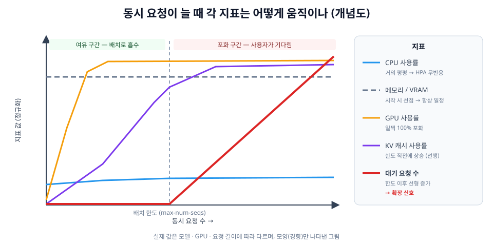
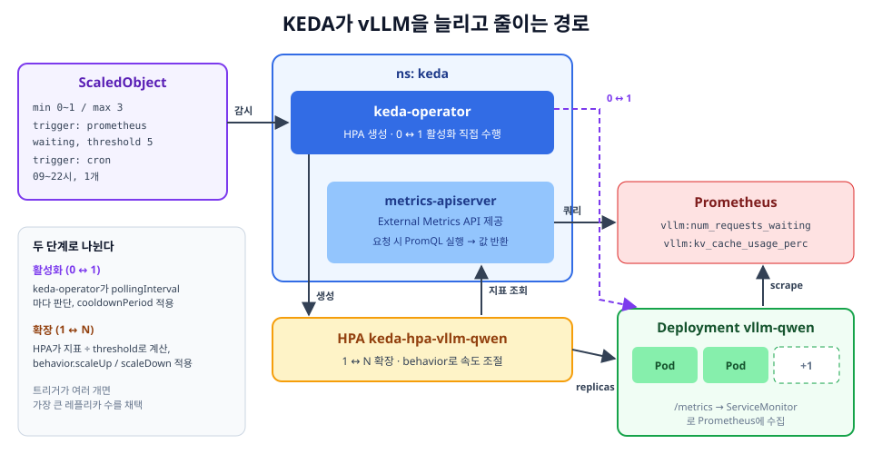
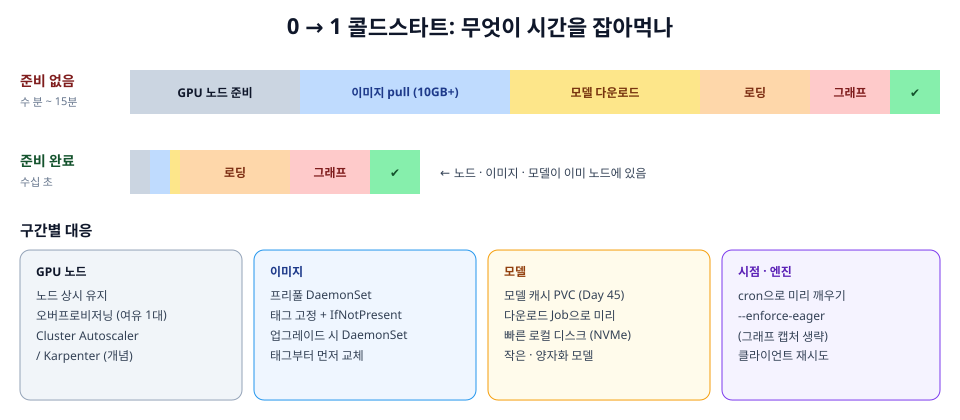

> **Chapter 6 · AI 인프라** | 난이도 ★★★★☆ | 예상 소요 2 ~ 2.5시간

## 🎯 오늘의 목표

- Day 18의 **CPU 기반 HPA가 LLM 서빙에 맞지 않는 이유**를 지표로 설명할 수 있다
- **KEDA**를 Helm으로 설치하고, ScaledObject가 HPA를 만들어 움직이는 구조를 안다
- Prometheus scaler로 **`vllm:num_requests_waiting`(대기 큐)** 과 **KV 캐시 사용률** 기반 확장을 구성하고, 부하 테스트로 확인한다
- **Scale-to-zero**의 장단점과 콜드스타트를 줄이는 방법(모델 캐시 PVC, 이미지 프리풀, cron 예열)을 적용할 수 있다
- GPU **노드 자체**를 늘리는 Cluster Autoscaler / Karpenter의 개념을 안다

---

## 0. 실습 환경

- Day 45의 상태 그대로: `llm` 네임스페이스에 `vllm-qwen` Deployment·Service·PVC·HTTPRoute, **ServiceMonitor로 vLLM 메트릭 수집 중**
- Day 17의 kube-prometheus-stack (Prometheus Service: `monitoring-kube-prometheus-prometheus.monitoring.svc:9090`)
- **KEDA v2.21.0** (Helm 차트 `kedacore/keda` 2.21.0, 2026-09 릴리스. Kubernetes 1.34~1.36에서 테스트됨)

Pod를 2~3개로 늘리려면 GPU도 2~3개분이 필요합니다. 홈랩에 GPU가 1장이라면 다음 중 하나로 실습하세요.

| 상황 | 방법 |
|---|---|
| GPU 2장 이상 | 그대로 진행 |
| **GPU 1장 (24GB급)** | Day 44의 **time-slicing**을 `replicas: 3`으로 다시 켜고, vLLM 인자를 `--gpu-memory-utilization=0.28`로 낮춰 Pod 3개가 VRAM을 나눠 갖게 함 (1.5B 모델이라 가능한 실습용 구성) |
| GPU 1장 (8~12GB급) | time-slicing `replicas: 2` + `--gpu-memory-utilization=0.4` + `--max-model-len=4096` |
| **GPU 없음** | Day 45 5-6의 **CPU vLLM**으로 진행. 노드 CPU가 허용하는 만큼(Pod당 4코어) `maxReplicaCount`를 2로. kind에서도 됩니다 |

> ⚠️ time-slicing + VRAM 분할은 **오토스케일링 동작을 관찰하기 위한 실습용**입니다. Day 44에서 봤듯 메모리 격리가 없어 운영에서는 Pod 1개 = GPU 1장(또는 MIG 인스턴스)이 원칙입니다.

실습에서 대기 큐가 눈에 보이도록 vLLM이 한 번에 처리하는 요청 수를 일부러 낮춥니다. Day 45의 `vllm-deployment.yaml` args에 한 줄을 추가하고 다시 적용하세요.

```yaml
        - --max-num-seqs=16          # 동시에 배치에 넣는 최대 요청 수 (실습용으로 작게)
```

```bash
kubectl apply -f vllm-deployment.yaml
kubectl -n llm rollout status deploy/vllm-qwen --timeout=15m
```

---

## 1. 왜 CPU 기반 HPA로는 안 되나?

Day 18에서 HPA는 `averageUtilization: 50`처럼 **CPU 사용률**을 보고 Pod를 늘렸습니다. 웹 서버는 요청이 늘면 CPU가 비례해서 오르니 잘 맞았죠. LLM 서버에서 같은 걸 해 보면 이렇습니다.



| 지표 | 부하가 늘 때 LLM 서버에서 일어나는 일 | 확장 신호로서 |
|---|---|---|
| **CPU 사용률** | 일은 GPU가 함. CPU는 토크나이저·스케줄러 정도만 → 거의 평평 | ❌ 부하를 못 봄 |
| **메모리 사용률** | 시작할 때 VRAM의 90%를 미리 잡고(KV 캐시), 호스트 메모리도 거의 일정 | ❌ 항상 높거나 항상 일정 |
| **GPU 사용률** (`DCGM_FI_DEV_GPU_UTIL`) | 요청 몇 개만 와도 100% 근처로 포화 | △ "바쁘다"는 알지만 "얼마나 밀렸나"는 모름 |
| **대기 요청 수** (`vllm:num_requests_waiting`) | 배치가 꽉 차면 그때부터 선형으로 증가 | ✅ **사용자가 기다리고 있다**는 직접 신호 |
| **KV 캐시 사용률** (`vllm:kv_cache_usage_perc`) | 동시 요청·긴 컨텍스트가 늘수록 1.0에 접근, 넘치면 선점(preemption) | ✅ 곧 밀리기 시작한다는 선행 신호 |
| **TTFT** (`vllm:time_to_first_token_seconds`) | 큐가 쌓이면 첫 토큰까지 시간이 늘어남 | ✅ SLO 관점의 결과 지표 (Day 47에서 자세히) |

핵심은 **LLM 서버의 용량은 "동시에 배치에 넣을 수 있는 요청 수"로 정해진다**는 점입니다. 그 한계를 넘는 순간부터 요청이 `waiting` 큐에 쌓이고, 그때가 바로 Pod를 늘려야 할 때입니다.

> 💡 Day 18에서 "Prometheus 메트릭으로 HPA를 하려면 prometheus-adapter 같은 어댑터가 필요하다"고 했습니다. prometheus-adapter도 가능하지만, 규칙(rules)을 ConfigMap에 정규식으로 적어야 하고 0개까지 줄이는 기능은 없습니다. **KEDA**는 쿼리를 ScaledObject 안에 바로 쓰고, 0 ↔ 1 전환까지 다룹니다.

---

## 2. KEDA의 구조

**KEDA**(Kubernetes Event-Driven Autoscaling)는 HPA를 대체하는 게 아니라 **HPA를 대신 만들어 주고 먹여 주는** 컴포넌트입니다.



| 구성 요소 | 역할 |
|---|---|
| **ScaledObject** (CRD) | "이 Deployment를, 이 지표로, min~max 사이에서" — 사용자가 쓰는 선언 |
| **keda-operator** | ScaledObject를 보고 **HPA(`keda-hpa-<이름>`)를 생성**. 0 ↔ 1 전환(활성화)은 직접 수행 |
| **keda-operator-metrics-apiserver** | Kubernetes의 **External Metrics API** 제공자. HPA가 물어보면 scaler(여기선 Prometheus 쿼리) 결과를 돌려줌 |
| **admission webhooks** | 잘못된 ScaledObject(같은 Deployment에 HPA 중복 등)를 거부 |

확장은 두 단계로 나뉩니다.

| 단계 | 담당 | 판단 기준 |
|---|---|---|
| **활성화** (0 ↔ 1) | KEDA operator, `pollingInterval`마다 | 지표가 `activationThreshold`를 넘었나 / `cooldownPeriod` 동안 비활성이었나 |
| **확장** (1 ↔ N) | HPA (KEDA가 만든 것) | 지표 ÷ `threshold`로 원하는 레플리카 수 계산, `behavior`로 속도 조절 |

> ⚠️ KEDA의 `cooldownPeriod`는 **0으로 줄일 때만** 적용됩니다. 1 ↔ N 구간의 축소 속도는 HPA의 `behavior.scaleDown`(Day 18)으로 조절합니다. 이 둘을 헷갈리는 경우가 많습니다.

---

## 3. 실습 ① — KEDA 설치

```bash
helm repo add kedacore https://kedacore.github.io/charts
helm repo update

helm install keda kedacore/keda --version 2.21.0 \
  --namespace keda --create-namespace
```

```bash
kubectl get pods -n keda
```

```
NAME                                               READY   STATUS    RESTARTS   AGE
keda-admission-webhooks-6b8c7d9f5-r2m4k            1/1     Running   0          60s
keda-operator-7c9d8f6b4-x8q2w                      1/1     Running   1          60s
keda-operator-metrics-apiserver-5f7b9c8d6-p4n7j    1/1     Running   0          60s
```

```bash
kubectl get apiservice v1beta1.external.metrics.k8s.io
# NAME                              SERVICE                                AVAILABLE   AGE
# v1beta1.external.metrics.k8s.io   keda/keda-operator-metrics-apiserver   True        60s

kubectl get crd | grep keda.sh
# scaledjobs.keda.sh / scaledobjects.keda.sh / triggerauthentications.keda.sh / ...
```

`AVAILABLE True`면 HPA가 KEDA에게 외부 지표를 물어볼 수 있는 상태입니다.

먼저 Prometheus에서 오늘 쓸 쿼리가 값을 돌려주는지 확인합니다(Day 17의 `port-forward ... 9090`).

```promql
sum(vllm:num_requests_waiting{namespace="llm", model_name="qwen2.5-1.5b"})
avg(vllm:kv_cache_usage_perc{namespace="llm", model_name="qwen2.5-1.5b"})
```

`namespace` 라벨은 ServiceMonitor로 수집할 때 Prometheus Operator가 붙여 줍니다. 결과가 비어 있으면 Day 45 5-3의 ServiceMonitor부터 확인하세요.

---

## 4. 실습 ② — 큐 기반 ScaledObject

```yaml
# vllm-scaledobject.yaml
apiVersion: keda.sh/v1alpha1
kind: ScaledObject
metadata:
  name: vllm-qwen
  namespace: llm
spec:
  scaleTargetRef:
    name: vllm-qwen                 # Deployment 이름
  minReplicaCount: 1
  maxReplicaCount: 3
  pollingInterval: 15               # 15초마다 지표 확인
  advanced:
    horizontalPodAutoscalerConfig:
      behavior:
        scaleUp:
          stabilizationWindowSeconds: 0
          policies:
          - type: Pods
            value: 1                # 한 번에 1개씩만 (새 Pod 로딩에 수 분 걸리므로)
            periodSeconds: 120
        scaleDown:
          stabilizationWindowSeconds: 600   # 10분간 낮은 상태가 유지돼야 축소
          policies:
          - type: Pods
            value: 1
            periodSeconds: 300
  triggers:
  - type: prometheus
    name: queue-waiting
    metadata:
      serverAddress: http://monitoring-kube-prometheus-prometheus.monitoring.svc:9090
      query: sum(vllm:num_requests_waiting{namespace="llm", model_name="qwen2.5-1.5b"})
      threshold: "5"                # Pod 1개당 대기 요청 5개를 목표로
      ignoreNullValues: "true"
  - type: prometheus
    name: kv-cache
    metricType: Value               # 평균(나누기)하지 않고 값 그대로 비교
    metadata:
      serverAddress: http://monitoring-kube-prometheus-prometheus.monitoring.svc:9090
      query: avg(vllm:kv_cache_usage_perc{namespace="llm", model_name="qwen2.5-1.5b"})
      threshold: "0.8"              # 평균 KV 캐시 80% 초과 시 확장
      ignoreNullValues: "true"
```

### 숫자가 어떻게 레플리카 수가 되나

| 트리거 | metricType | 계산 | 예시 |
|---|---|---|---|
| `queue-waiting` | `AverageValue` (기본) | 원하는 수 = ⌈ 지표 합계 ÷ threshold ⌉ | 대기 12개 → ⌈12 ÷ 5⌉ = **3** |
| `kv-cache` | `Value` | 원하는 수 = ⌈ 현재 수 × 지표 ÷ threshold ⌉ | Pod 1개, 0.95 → ⌈1 × 0.95 ÷ 0.8⌉ = **2** |

트리거가 여러 개면 HPA는 **가장 큰 값**을 택합니다. 큐가 이미 밀렸거나(결과 지표), 곧 밀릴 것 같으면(선행 지표) 늘리는 구성입니다.

> 💡 `AverageValue`의 쿼리는 **합계(sum)** 로 쓰는 게 요령입니다. HPA가 알아서 "합계 ÷ 목표"로 필요한 Pod 수를 구하니까요. `avg`로 쓰면 Pod가 늘수록 평균이 낮아져 계산이 이중으로 나뉩니다.

```bash
kubectl apply -f vllm-scaledobject.yaml
kubectl -n llm get scaledobject
```

```
NAME        SCALETARGETKIND      SCALETARGETNAME   MIN   MAX   READY   ACTIVE   FALLBACK   PAUSED    TRIGGERS     AGE
vllm-qwen   apps/v1.Deployment   vllm-qwen         1     3     True    False    False      Unknown   prometheus   20s
```

```bash
kubectl -n llm get hpa
# NAME                 REFERENCE              TARGETS                 MINPODS   MAXPODS   REPLICAS   AGE
# keda-hpa-vllm-qwen   Deployment/vllm-qwen   0/5 (avg), 0/800m       1         3         1          20s
```

KEDA가 `keda-hpa-vllm-qwen`이라는 HPA를 만들었습니다. `0/800m`은 0.8을 밀리 단위로 표시한 것입니다.

> ⚠️ 이제부터 Deployment의 `replicas`는 HPA가 관리합니다. `vllm-deployment.yaml`을 다시 `kubectl apply` 하면 파일의 `replicas: 1`이 HPA가 정한 값을 덮어써서 순간적으로 Pod가 줄어듭니다. **매니페스트에서 `replicas` 줄을 지우는** 것이 안전합니다.

---

## 5. 실습 ③ — 부하를 걸어 확장 관찰하기

동시 요청을 많이 보내는 짧은 스크립트입니다. 반드시 **Gateway(HTTPRoute)를 거쳐** 보내세요. `kubectl port-forward`는 Pod 하나에만 연결되어 새로 뜬 Pod로 부하가 분산되지 않습니다.

```python
# load.py — Python 3.12, pip install httpx
import asyncio
import sys
import time

import httpx

URL = "http://llm.example.test:30080/v1/chat/completions"   # Day 45 5-5의 hosts 설정
CONCURRENCY = int(sys.argv[1]) if len(sys.argv) > 1 else 48
TOTAL = int(sys.argv[2]) if len(sys.argv) > 2 else 600


async def one(client: httpx.AsyncClient, sem: asyncio.Semaphore, i: int) -> None:
    async with sem:
        r = await client.post(URL, json={
            "model": "qwen2.5-1.5b",
            "messages": [{"role": "user", "content": f"[{i}] 쿠버네티스의 역사를 자세히 설명해줘"}],
            "max_tokens": 512,
        })
        r.raise_for_status()


async def main() -> None:
    sem = asyncio.Semaphore(CONCURRENCY)
    t0 = time.perf_counter()
    async with httpx.AsyncClient(timeout=600) as client:
        await asyncio.gather(*(one(client, sem, i) for i in range(TOTAL)))
    print(f"{TOTAL} requests, concurrency {CONCURRENCY}: {time.perf_counter() - t0:.1f}s")


asyncio.run(main())
```

터미널 3개를 띄웁니다.

```bash
# 터미널 1 — HPA 관찰
kubectl -n llm get hpa keda-hpa-vllm-qwen -w

# 터미널 2 — Pod 관찰
kubectl -n llm get pod -l app=vllm-qwen -w

# 터미널 3 — 부하 (동시 48개, 총 600개)
python load.py 48 600
```

`--max-num-seqs=16`이라 Pod 1개는 동시에 16개만 처리하고 나머지 32개는 대기합니다.

```
NAME                 REFERENCE              TARGETS                    MINPODS   MAXPODS   REPLICAS
keda-hpa-vllm-qwen   Deployment/vllm-qwen   0/5 (avg), 120m/800m       1         3         1
keda-hpa-vllm-qwen   Deployment/vllm-qwen   32/5 (avg), 310m/800m      1         3         1
keda-hpa-vllm-qwen   Deployment/vllm-qwen   32/5 (avg), 310m/800m      1         3         2   ← 1개 추가
keda-hpa-vllm-qwen   Deployment/vllm-qwen   16/5 (avg), 280m/800m      1         3         3   ← 2분 뒤 또 1개
keda-hpa-vllm-qwen   Deployment/vllm-qwen   0/5 (avg), 150m/800m       1         3         3
```

관찰 포인트입니다.

1. 대기 32개 → 원하는 수는 ⌈32 ÷ 5⌉ = 7이지만 `maxReplicaCount: 3`과 `scaleUp` 정책(120초에 1개) 때문에 **천천히** 늘어납니다
2. 새 Pod는 `0/1 Running`으로 **수십 초~수 분 동안 트래픽을 받지 못합니다**(startupProbe). 그동안 기존 Pod의 큐는 계속 쌓여 있습니다 — 이것이 LLM 오토스케일링의 근본적인 지연
3. 부하가 끝나도 바로 줄지 않습니다. `stabilizationWindowSeconds: 600` 후 5분에 1개씩 축소

> 💡 확장 지연을 줄이는 현실적인 방법은 "조금 일찍 늘리는 것"입니다. threshold를 낮추거나, KV 캐시처럼 **큐가 생기기 전에 오르는 선행 지표**를 함께 쓰는 이유입니다. Day 47에서는 TTFT p95를 기준으로 threshold를 정하는 방법을 다룹니다.

---

## 6. Scale-to-zero — 0개까지 줄이기

GPU는 비쌉니다. 클라우드라면 시간당 요금, 홈랩이라면 **전기요금과 소음**이죠. 아무도 안 쓰는 밤에도 GPU를 붙잡고 있을 이유가 없습니다. KEDA는 `minReplicaCount: 0`으로 0개까지 줄일 수 있습니다.

그런데 LLM에서 scale-to-zero에는 **두 가지 문제**가 있습니다.

| 문제 | 설명 |
|---|---|
| **① 지표가 사라진다** | Pod가 0개면 `vllm:num_requests_waiting`을 내는 주체가 없음 → 쿼리 결과가 비어 있음 → 수요가 와도 KEDA가 모름 |
| **② 콜드스타트** | 깨어나는 데 이미지 pull + 모델 로딩으로 **수십 초~수 분**. 그동안 Service에 엔드포인트가 없어 Gateway는 `503` |

①을 푸는 방법은 "**Pod 바깥**에서 수요를 보는 것"입니다.

| 방법 | 동작 | 장단점 |
|---|---|---|
| **cron scaler** | 시간표로 깨움 (예: 평일 09~22시 1개 이상) | 단순·확실. 예측 가능한 사용 패턴(사내 챗봇, 홈랩)에 최적. 시간 밖 요청은 실패 |
| **Gateway 지표** | Traefik 등 Gateway의 요청 수 메트릭으로 활성화 | 실제 수요 기반. 첫 요청들은 503 → 클라이언트 재시도 필요 |
| **KEDA HTTP Add-on** | 인터셉터 프록시가 요청을 **붙잡아 두고** 0 → 1을 기다린 뒤 전달 | 요청 유실 없음. 현재 **beta**, 수 분짜리 LLM 콜드스타트면 클라이언트 타임아웃 조정 필요 |
| **KServe 등 플랫폼** | Knative 기반 활성화 프록시 내장 | Day 45의 플랫폼 도입과 함께 고려 |

### 실습 ④ — cron + 큐 결합: "업무 시간엔 대기, 밤엔 0개"

4장의 ScaledObject를 다음처럼 바꿉니다.

```yaml
# vllm-scaledobject-zero.yaml — 4장 파일을 복사한 뒤 spec의 아래 부분만 교체 (metadata·scaleTargetRef 등은 그대로)
spec:
  minReplicaCount: 0                # 0개까지 허용
  maxReplicaCount: 3
  cooldownPeriod: 1800              # 모든 트리거가 30분간 비활성이면 0으로
  triggers:
  - type: cron
    metadata:
      timezone: Asia/Seoul
      start: 0 9 * * 1-5            # 평일 09:00
      end: 0 22 * * 1-5             # 평일 22:00
      desiredReplicas: "1"          # 이 시간엔 최소 1개 (예열 상태 유지)
  - type: prometheus
    name: queue-waiting
    metadata:
      serverAddress: http://monitoring-kube-prometheus-prometheus.monitoring.svc:9090
      query: sum(vllm:num_requests_waiting{namespace="llm", model_name="qwen2.5-1.5b"})
      threshold: "5"
      activationThreshold: "0"      # 대기 요청이 0을 초과하면 활성 (기본값과 같음, 명시)
      ignoreNullValues: "true"
  # kv-cache 트리거와 advanced.behavior 는 4장과 동일
```

```bash
kubectl apply -f vllm-scaledobject-zero.yaml
```

- 평일 09~22시: cron이 `desiredReplicas: "1"`로 **최소 1개를 보장**하고, 큐가 쌓이면 prometheus 트리거가 3개까지 늘립니다
- 22시 이후: cron 비활성 + 큐 0 → `cooldownPeriod` 30분 뒤 **0개**
- 다음 날 09시: cron이 다시 1개로 깨움 → 사용자가 출근하기 전에 예열 완료

바로 확인하고 싶다면 `start`/`end`를 지금 시각 몇 분 뒤로 바꾸고 `cooldownPeriod: 60`으로 줄여 보세요.

```bash
kubectl -n llm get scaledobject vllm-qwen -w
# ... ACTIVE   True   ← cron 구간 안
# ... ACTIVE   False  ← 구간 종료, cooldown 후 replicas 0
kubectl -n llm get deploy vllm-qwen
# NAME        READY   UP-TO-DATE   AVAILABLE   AGE
# vllm-qwen   0/0     0            0           2d
```

> ⚠️ cron 트리거의 `desiredReplicas`를 `"0"`으로 두지 마세요. KEDA 문서도 이를 거의 항상 실수라고 경고합니다. "업무 시간에 몇 개를 유지할지"를 적고, 나머지 시간의 0은 `minReplicaCount: 0`에 맡깁니다.

---

## 7. 콜드스타트 줄이기



0 → 1 (또는 1 → N) 때 걸리는 시간을 쪼개면 각각 대응책이 있습니다.

| 구간 | 대략 시간 (1.5B 기준) | 대응 |
|---|---|---|
| GPU 노드 준비 | (노드가 없으면) 수 분 | 8장 Cluster Autoscaler/Karpenter, 또는 노드는 항상 켜 두기 |
| 이미지 pull | 10GB+ → 수 분 | **이미지 프리풀** DaemonSet, 태그 고정 + `IfNotPresent` |
| 모델 다운로드 | 3GB → 수십 초~수 분 | **모델 캐시 PVC**(Day 45), 다운로드 Job으로 미리 채우기 |
| 가중치 로딩 | 수 초~수십 초 | 빠른 로컬 디스크(NVMe), 작은/양자화 모델 |
| CUDA 그래프 캡처 | 수십 초 | `--enforce-eager`로 생략 가능 (대신 처리량 감소) |

### 이미지 프리풀 DaemonSet

GPU 노드마다 vLLM 이미지를 **미리 받아 두는** 패턴입니다. initContainer가 vLLM 이미지로 아무것도 안 하고 끝나면, 이미지는 노드 캐시에 남습니다. 메인 컨테이너는 아주 작은 `pause` 이미지라 자원을 거의 쓰지 않습니다.

```yaml
# vllm-image-prepull.yaml
apiVersion: apps/v1
kind: DaemonSet
metadata:
  name: vllm-image-prepull
  namespace: llm
spec:
  selector:
    matchLabels: { app: vllm-image-prepull }
  template:
    metadata:
      labels: { app: vllm-image-prepull }
    spec:
      nodeSelector:
        nvidia.com/gpu.present: "true"       # Day 44 GFD 라벨 — GPU 노드에만
      tolerations:
      - { key: nvidia.com/gpu, operator: Exists, effect: NoSchedule }
      initContainers:
      - name: pull-vllm
        image: vllm/vllm-openai:v0.33.0      # Deployment와 같은 태그!
        command: ["true"]                    # 받기만 하고 바로 종료
        resources:
          requests: { cpu: 10m, memory: 16Mi }
      containers:
      - name: pause
        image: registry.k8s.io/pause:3.10
        resources:
          requests: { cpu: 1m, memory: 8Mi }
```

```bash
kubectl apply -f vllm-image-prepull.yaml
kubectl -n llm get ds vllm-image-prepull
# NAME                 DESIRED   CURRENT   READY   ...
# vllm-image-prepull   1         1         1       ...
```

이제 vLLM Pod가 0 → 1로 깨어날 때 `ContainerCreating` 구간이 몇 분에서 몇 초로 줄어듭니다. vLLM 버전을 올릴 때는 **DaemonSet의 태그를 먼저** 올려 두면, 실제 Deployment 교체 시 pull 대기가 없습니다.

> 💡 GPU 노드가 새로 추가되면(8장) DaemonSet이 자동으로 그 노드에도 이미지를 받기 시작합니다. 노드 프로비저닝과 이미지 준비가 병렬로 진행되는 셈입니다.

### 콜드스타트 체크리스트

- [ ] 이미지 태그 고정(`v0.33.0`) + 프리풀 DaemonSet
- [ ] 모델 캐시 PVC가 채워져 있고, Pod가 그 노드에 뜨는가 (local-path는 노드 고정)
- [ ] startupProbe 허용 시간 ≥ 실제 로딩 시간 (Day 45)
- [ ] 예측 가능한 시간대는 cron으로 **미리** 깨우기
- [ ] 클라이언트는 503·타임아웃에 **재시도(backoff)** — 앱 레벨 대응도 필요

---

## 8. GPU 노드 자체를 늘리기 (개념)

지금까지는 **Pod** 수를 조절했습니다. 그런데 GPU가 모두 할당된 상태에서 KEDA가 Pod를 늘리면? 새 Pod는 `Insufficient nvidia.com/gpu`로 **Pending**입니다. 이 Pending을 신호로 **노드**를 늘리는 것이 노드 오토스케일러입니다.

| | Cluster Autoscaler | Karpenter |
|---|---|---|
| 방식 | 미리 정의한 **노드 그룹**(같은 인스턴스 타입 묶음)의 크기를 조절 | Pending Pod의 요구사항(GPU 수, 라벨, 테인트)을 보고 **맞는 인스턴스를 직접 골라** 생성 |
| 트리거 | 스케줄 불가 Pod 발생 / 노드 저활용 | 동일 + 비용 최적화(통합, consolidation) |
| GPU 노드 | GPU 노드 그룹을 따로 두고 min 0 설정 가능 | NodePool에 GPU 인스턴스 패밀리·테인트 지정 |
| 지원 환경 | AWS, GCP, Azure, **OpenStack(Magnum)** 등 다수 클라우드 | AWS, Azure 공식 프로바이더 중심 |

두 계층이 함께 움직이는 그림은 이렇습니다.

1. 큐 증가 → **KEDA/HPA**가 Pod 2 → 3
2. GPU 부족 → 새 Pod **Pending**
3. **노드 오토스케일러**가 GPU 노드 추가 (VM 부팅 + 드라이버/Operator 준비로 수 분)
4. 프리풀 DaemonSet·GPU Operator가 새 노드를 준비 → Pod 스케줄 → 모델 로딩 → Ready

이 전체 과정이 **5~15분**이 걸릴 수 있어서, 운영에서는 "노드 1개분은 항상 여유로 둔다(오버프로비저닝)"는 전략을 함께 씁니다. 우선순위가 낮은 더미 Pod로 GPU 노드를 미리 확보해 두고, 실제 Pod가 오면 더미를 밀어내는(preemption) 방식입니다.

> 💡 **홈랩에서는?** 물리 서버를 자동으로 "생성"할 수는 없으니 노드 오토스케일링은 해당되지 않습니다. 대신 오늘의 **cron scale-to-zero**로 GPU를 쉬게 해 전기와 소음을 줄이는 것이 현실적인 최선입니다. Chapter 4의 OpenStack 위에 K8s를 올렸다면(Day 34) Cluster Autoscaler의 Magnum 프로바이더로 GPU flavor 노드 그룹을 늘리는 구성도 가능합니다.

---

## 9. 트러블슈팅

| 증상 | 원인 | 해결 |
|---|---|---|
| ScaledObject `READY False` | Prometheus 주소 오류, 쿼리 문법 오류 | `kubectl -n llm describe scaledobject vllm-qwen` 의 Events, `kubectl -n keda logs deploy/keda-operator` |
| HPA TARGETS가 `<unknown>` | External Metrics API 미동작, 또는 쿼리 결과 없음 | `kubectl get apiservice v1beta1.external.metrics.k8s.io`, Prometheus UI에서 쿼리 직접 실행 |
| 쿼리 결과가 비어 있음 | ServiceMonitor 라벨(`release: monitoring`) 누락, `model_name` 값 불일치 | Day 45 5-3 확인. `--served-model-name`과 쿼리의 `model_name`이 같아야 함 |
| 부하를 줘도 `num_requests_waiting`이 0 | 동시 요청 수가 vLLM 배치 한도(`--max-num-seqs`) 이하 | 실습에선 `--max-num-seqs=16`, 부하 스크립트 동시성 상향 |
| 확장된 Pod가 Pending | GPU 부족 | time-slicing(실습용), GPU 추가, 노드 오토스케일러 |
| 새 Pod가 늘어도 기존 Pod만 바쁨 | `port-forward`로 부하를 보냄 (Pod 하나에 고정) | Gateway/Service 경유로 부하 전송 |
| Deployment를 apply 했더니 Pod가 줄었다 늘었다 | 매니페스트의 `replicas`와 HPA가 충돌 | 매니페스트에서 `replicas` 제거 |
| 0 → 1 후 첫 요청들이 503 | 콜드스타트 중 엔드포인트 없음 | cron 예열, 클라이언트 재시도, KEDA HTTP Add-on 검토 |
| 22시가 지났는데 0으로 안 줄어듦 | `cooldownPeriod` 대기 중, 또는 큐 지표가 0이 아님 | `cooldownPeriod` 확인, `kubectl -n llm get scaledobject`의 ACTIVE 확인 |

---

## 10. 핵심 정리

- LLM 서버의 병목은 GPU와 **배치 용량**. CPU·메모리 사용률은 부하를 반영하지 못한다
- 확장 신호는 **`vllm:num_requests_waiting`**(결과)과 **`vllm:kv_cache_usage_perc`**(선행), SLO 관점은 TTFT
- **KEDA** = ScaledObject → HPA 자동 생성 + External Metrics 제공 + 0 ↔ 1 활성화
- `AverageValue`는 **합계 ÷ threshold**, `Value`는 **현재 수 × 지표 ÷ threshold**. 트리거가 여럿이면 최댓값
- `cooldownPeriod`는 **0으로 갈 때만**, 1 ↔ N 축소 속도는 HPA `behavior`
- Scale-to-zero의 적은 **지표 소실과 콜드스타트**. cron 예열 + 모델 캐시 PVC + 이미지 프리풀로 대응
- Pod가 Pending이면 노드 계층 — **Cluster Autoscaler / Karpenter**, GPU 노드는 준비에 수 분이 걸린다

---

## 11. 셀프 체크

<details>
<summary>Q1. vLLM에 부하를 주는데 CPU 기반 HPA가 Pod를 늘리지 않는 이유는?</summary>

토큰 생성 연산은 GPU가 하고, vLLM 프로세스의 CPU는 토크나이징·스케줄링 정도만 해서 부하가 늘어도 CPU 사용률이 거의 오르지 않기 때문입니다. 실제 포화 신호는 대기 요청 수, KV 캐시 사용률, TTFT 같은 서빙 엔진 지표입니다.
</details>

<details>
<summary>Q2. Prometheus 트리거(AverageValue, threshold 5)의 쿼리 결과가 22일 때 원하는 레플리카 수는? 쿼리를 avg로 쓰면 무엇이 문제인가?</summary>

⌈22 ÷ 5⌉ = **5** (maxReplicaCount 이하일 때). HPA가 이미 "합계 ÷ 목표"로 Pod 수를 구하므로 쿼리는 합계여야 합니다. avg로 쓰면 Pod가 늘수록 쿼리 값이 작아져 필요한 수가 과소 계산됩니다.
</details>

<details>
<summary>Q3. KEDA의 cooldownPeriod를 60초로 줄였는데 3 → 1 축소가 여전히 느리다. 왜인가?</summary>

`cooldownPeriod`는 **1 → 0** 전환에만 적용됩니다. 1 ↔ N 구간은 KEDA가 만든 HPA가 담당하므로 `advanced.horizontalPodAutoscalerConfig.behavior.scaleDown`(stabilizationWindowSeconds, policies)을 조정해야 합니다.
</details>

<details>
<summary>Q4. minReplicaCount: 0에 Prometheus 큐 트리거만 두면 생기는 문제는?</summary>

Pod가 0개면 vLLM 메트릭을 내는 주체가 없어 대기 요청 수를 알 수 없습니다(요청은 Gateway에서 503으로 끝나고 vLLM 큐에 쌓이지 않음). 그래서 다시 깨어날 수 없습니다. cron 트리거, Gateway 요청 지표, KEDA HTTP Add-on처럼 **Pod 바깥에서** 수요를 보는 신호가 필요합니다.
</details>

<details>
<summary>Q5. 콜드스타트를 줄이는 방법 세 가지와 각각 줄이는 구간은?</summary>

① **이미지 프리풀 DaemonSet** — 이미지 pull 구간, ② **모델 캐시 PVC + 다운로드 Job** — 모델 다운로드 구간, ③ **cron으로 미리 깨우기**(예열) — 사용자가 느끼는 콜드스타트 자체를 업무 시간 밖으로 이동. 그 밖에 `--enforce-eager`로 CUDA 그래프 캡처 시간을 줄일 수 있습니다.
</details>

---

## ⏭️ 다음 예고 — Day 47. LLM 관측성 — TTFT·토큰 처리량·KV 캐시 모니터링, 트레이싱

오늘은 대기 큐 하나로 확장을 결정했습니다. 그런데 threshold 5는 적당한 값일까요? 내일은 **TTFT(첫 토큰까지 시간), 토큰 간 지연, 처리량, KV 캐시 사용률**을 Grafana 대시보드로 묶고, Day 44의 DCGM GPU 지표와 나란히 놓아 "사용자 체감 지연"과 "GPU 상태"를 함께 봅니다. OpenTelemetry로 RAG 요청 하나가 거치는 경로를 트레이싱하는 것까지 해 봅니다.
