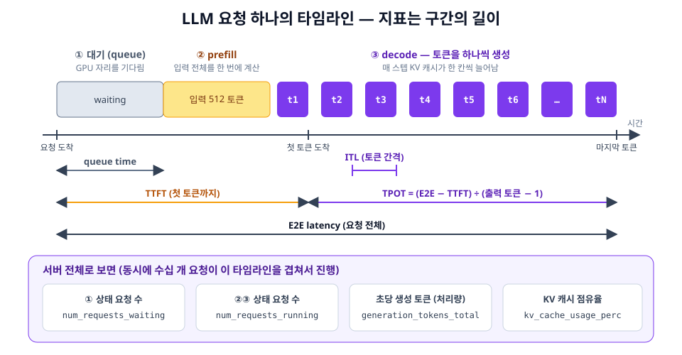
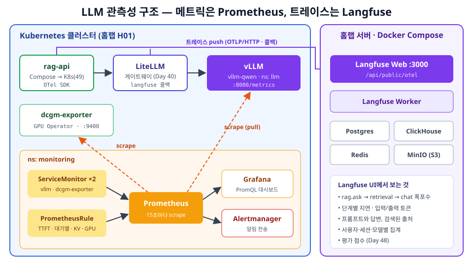

> **Chapter 6 · AI 인프라** | 난이도 ★★★★☆ | 예상 소요 2.5 ~ 3시간

## 🎯 오늘의 목표

- LLM 서빙에서만 쓰는 지표(**TTFT, TPOT/ITL, tokens/s, 대기 요청 수, KV 캐시 사용률**)가 각각 무엇을 재는지 설명할 수 있다
- vLLM의 `/metrics`와 **DCGM exporter**를 **ServiceMonitor**로 수집하고(Day 17), PromQL로 Grafana 패널을 만든다
- "느리다"는 신고가 들어왔을 때 **어느 지표부터 볼지** 순서를 안다
- rag-api의 요청 하나를 **OpenTelemetry GenAI 규약**으로 트레이싱해 셀프호스팅 **Langfuse**에서 본다
- **PrometheusRule**로 LLM 전용 알림 규칙을 만든다

---

## 1. 왜 LLM에는 다른 지표가 필요한가?

Day 17에서는 웹 서비스를 `요청 수 · 에러율 · 응답 시간(p95)`으로 관측했습니다. LLM 서버에 그대로 적용하면 금방 막힙니다.

| 웹 API의 상식 | LLM 서빙의 현실 |
|---|---|
| 응답 시간은 수십~수백 ms | 한 요청이 **수 초~수십 초** (출력 토큰 수에 비례) |
| 응답 시간 하나로 체감 품질 판단 | 스트리밍이라 **첫 글자가 언제 뜨는지**가 체감을 좌우 |
| 요청 수 = 부하 | 요청 1개가 입력 50 토큰일 수도, 8,000 토큰일 수도 있음 → **토큰 수**가 부하 |
| CPU 사용률로 스케일 판단 | GPU 사용률은 늘 높게 보이고, 진짜 병목은 **KV 캐시**(GPU 메모리) |
| 메모리 사용량 = 실제 사용량 | vLLM은 시작할 때 VRAM을 `--gpu-memory-utilization`(기본 0.9)만큼 **미리 잡아 둠** → VRAM 사용량 그래프는 항상 90% |

> 💡 마지막 줄이 특히 중요합니다. `nvidia-smi`의 메모리 사용량은 부하와 관계없이 거의 일정합니다. "VRAM이 얼마나 찼나"는 **vLLM 내부의 KV 캐시 사용률**로 봐야 합니다. (Day 36의 VRAM 계산에서 "모델 가중치 + KV 캐시"로 나눴던 그 KV 캐시입니다.)

---

## 2. LLM 핵심 지표 6가지



요청 하나는 **대기(queue) → prefill(입력 전체를 한 번에 계산) → decode(토큰을 하나씩 생성)** 순서로 흘러갑니다. 지표는 이 타임라인의 구간을 잰 것입니다.

| 지표 | 뜻 | 사용자 체감 | vLLM 메트릭 (Prometheus 이름) |
|---|---|---|---|
| **TTFT** (Time To First Token) | 요청 도착 → 첫 토큰까지 | "답이 시작되기까지 멍하니 기다리는 시간" | `vllm:time_to_first_token_seconds` (histogram) |
| **ITL** (Inter-Token Latency) | 토큰과 다음 토큰 사이 간격 | 글자가 흘러나오는 속도 | `vllm:inter_token_latency_seconds` (histogram) |
| **TPOT** (Time Per Output Token) | 첫 토큰 이후 (총 시간 − TTFT) ÷ (출력 토큰 − 1) — 요청 단위 평균 | ITL과 비슷, 요청 단위로 본 값 | `vllm:request_time_per_output_token_seconds` (histogram) |
| **처리량** (tokens/s) | 초당 생성/입력 토큰 수 (서버 전체) | 서버가 감당하는 총량 | `vllm:generation_tokens_total`, `vllm:prompt_tokens_total` (counter) |
| **대기 요청 수** | 아직 GPU에 못 올라간 요청 | 늘어나면 곧 TTFT 폭증 | `vllm:num_requests_waiting` (gauge), 처리 중은 `vllm:num_requests_running` |
| **KV 캐시 사용률** | KV 캐시 블록 중 사용 중인 비율 (0~1) | 1에 붙으면 대기·선점(preemption) 발생 | `vllm:kv_cache_usage_perc` (gauge) |

그 밖에 자주 보는 것:

| 메트릭 | 용도 |
|---|---|
| `vllm:e2e_request_latency_seconds` | 요청 전체 시간 (Day 17의 "응답 시간"에 해당) |
| `vllm:request_queue_time_seconds` | 대기열에서 보낸 시간 — TTFT가 느린 원인이 "줄 서기"인지 확인 |
| `vllm:num_preemptions_total` | KV 캐시가 모자라 실행 중이던 요청을 쫓아낸 횟수 |
| `vllm:prefix_cache_hits_total` / `vllm:prefix_cache_queries_total` | 프리픽스 캐시 적중률 (같은 시스템 프롬프트 재사용 효과) |
| `vllm:request_success_total` | 완료된 요청 수 (`finished_reason` 라벨: stop / length / abort 등) |

> ⚠️ 이름은 vLLM 버전에 따라 바뀝니다. 오래된 글에 나오는 `vllm:gpu_cache_usage_perc`, `vllm:avg_generation_throughput_toks_per_s` 같은 이름은 현재(v0.33 기준) 쓰지 않습니다. vLLM은 지표를 폐기할 때 한 버전 동안 숨기고 `--show-hidden-metrics-for-version=X.Y`로 잠시 되살릴 수 있게 해 주니, 업그레이드 뒤 대시보드가 비면 릴리스 노트부터 보세요. **실제 이름은 항상 `curl …/metrics`로 확인**하는 습관을 들입시다.

> 💡 counter는 Prometheus 노출 시 이름 끝에 `_total`이 붙고, histogram은 `_bucket` / `_sum` / `_count` 세 개로 나뉩니다. 모든 vLLM 메트릭에는 `model_name` 라벨이 붙어 모델별로 나눠 볼 수 있습니다.

### GPU 자체 지표 — DCGM exporter

vLLM은 "LLM이 얼마나 일하나"를, **DCGM exporter**(NVIDIA Data Center GPU Manager의 Prometheus exporter)는 "GPU가 얼마나 일하나·건강한가"를 보여 줍니다. Day 44의 GPU Operator가 이미 `nvidia-dcgm-exporter` DaemonSet을 띄워 두었습니다.

| 메트릭 (dcgm-exporter 4.8.x) | 뜻 | 단위 |
|---|---|---|
| `DCGM_FI_DEV_GPU_UTIL` | GPU 사용률 | % |
| `DCGM_FI_DEV_FB_USED` / `DCGM_FI_DEV_FB_FREE` | VRAM 사용/여유 | MiB |
| `DCGM_FI_DEV_GPU_TEMP` | GPU 온도 | °C |
| `DCGM_FI_DEV_POWER_USAGE` | 소비 전력 | W |
| `DCGM_FI_DEV_XID_ERRORS` | 마지막 XID 에러 코드 (0이 아니면 하드웨어/드라이버 문제) | - |

> ⚠️ **dcgm-exporter 4.9.0(2026-11)부터 기본 메트릭 이름과 단위가 바뀌었습니다.** 예: `DCGM_FI_DEV_GPU_UTIL`(%) → `DCGM_FI_DEV_GPU_UTIL_RATIO`(0~1), `DCGM_FI_DEV_FB_USED`(MiB) → `DCGM_FI_DEV_FB_USED_BYTES`(bytes), `DCGM_FI_DEV_GPU_TEMP` → `DCGM_FI_DEV_GPU_TEMP_CELSIUS`. 이 글은 GPU Operator v26.7.2가 기본으로 띄우는 **4.8.4** 기준 이름을 씁니다. 버전을 올렸다면 쿼리의 이름과 단위(%→비율, MiB→bytes)를 함께 바꾸세요.

> 💡 `DCGM_FI_DEV_GPU_UTIL`은 "지난 샘플 구간에 커널이 하나라도 돌고 있던 시간 비율"이라 decode 중에는 거의 항상 높게 나옵니다. **GPU 사용률 100% ≠ GPU가 꽉 찼다**입니다. 여유가 있는지는 KV 캐시 사용률과 대기 요청 수로 판단하세요.

---

## 3. 관측성 전체 구조



| 신호 | 출처 | 수집·저장 | 보는 곳 |
|---|---|---|---|
| **메트릭** (숫자, 집계) | vLLM `/metrics`, DCGM exporter, (Day 40) LiteLLM | ServiceMonitor → Prometheus | Grafana, Alertmanager |
| **트레이스** (요청 한 건의 단계별 기록) | rag-api (OpenTelemetry), LiteLLM 콜백 | OTLP/HTTP → Langfuse | Langfuse UI |
| **로그** | 각 Pod stdout | (Day 17 범위 밖, Loki 등) | `kubectl logs` |

메트릭은 "**전체적으로** 느려졌나?"에 답하고, 트레이스는 "**이 질문은** 왜 느렸나? 검색이 느렸나, 생성이 느렸나? 어떤 문서 조각을 넣었나?"에 답합니다. 둘 다 있어야 합니다.

---

## 4. 실습 환경

| 항목 | 값 |
|---|---|
| 클러스터 | Day 44~46의 K8s (Ubuntu 24.04 홈랩 서버 H01 + GPU 1장, GPU Operator v26.7.2) |
| 모니터링 | Day 17의 kube-prometheus-stack (릴리스 이름 `monitoring`, 네임스페이스 `monitoring`) |
| LLM 서버 | Day 45의 vLLM (네임스페이스 `llm`, Deployment·Service `vllm-qwen`, 포트 이름 `http`(8000), `--served-model-name=qwen2.5-1.5b`) |
| rag-api · LiteLLM | Day 43·40의 Docker Compose로 홈랩 서버에서 실행 중 (Day 49에서 K8s로 이전) |
| 트레이싱 | Langfuse 셀프호스팅 (Docker Compose, 홈랩 서버) |

> 💡 **GPU가 없다면** — vLLM에는 CPU 백엔드가 있어서(공식 문서의 CPU 설치 가이드) `Qwen/Qwen2.5-0.5B-Instruct` 정도의 아주 작은 모델로도 **같은 `/metrics`** 가 나옵니다. 숫자가 느릴 뿐 지표 실습에는 충분합니다. DCGM 부분은 GPU가 있어야 하니 클라우드 GPU를 몇 시간 빌려 진행하세요.

> ⚠️ Day 45와 다른 이름을 썼다면 아래 명령의 `vllm-qwen`과 쿼리의 `model_name`을 자기 것에 맞게 바꾸세요.

---

## 5. 실습 ① — vLLM 메트릭 수집 (ServiceMonitor)

### 5-1. `/metrics` 직접 보기

```bash
kubectl -n llm port-forward svc/vllm-qwen 8000:8000 &
curl -s localhost:8000/metrics | grep -E '^vllm:(num_requests|kv_cache|time_to_first)' | head
```

```
vllm:num_requests_running{engine="0",model_name="qwen2.5-1.5b"} 0.0
vllm:num_requests_waiting{engine="0",model_name="qwen2.5-1.5b"} 0.0
vllm:kv_cache_usage_perc{engine="0",model_name="qwen2.5-1.5b"} 0.0
vllm:time_to_first_token_seconds_bucket{engine="0",le="0.001",model_name="qwen2.5-1.5b"} 0.0
...
```

> 💡 `model_name` 라벨 값은 Day 45에서 준 `--served-model-name`(`qwen2.5-1.5b`)입니다. 이름을 안 줬다면 HF 모델 ID가 그대로 들어갑니다.

### 5-2. ServiceMonitor 점검

Day 45 5-3에서 이미 `vllm-qwen` ServiceMonitor를 만들었습니다(Day 46의 KEDA도 이 메트릭을 씁니다). 오늘은 **왜 동작하는지** 세 가지 연결 고리를 다시 확인합니다(Day 17 5-2).

```bash
# ① Service 라벨  ② 포트 이름
kubectl -n llm get svc vllm-qwen -o jsonpath='{.metadata.labels}{"\n"}{.spec.ports}{"\n"}'
# {"app":"vllm-qwen"}
# [{"name":"http","port":8000,"protocol":"TCP","targetPort":"http"}]

# ③ ServiceMonitor의 release 라벨
kubectl -n llm get servicemonitor --show-labels
# NAME        AGE   LABELS
# vllm-qwen   2d    release=monitoring
```

```yaml
# Day 45의 ServiceMonitor (참고) — 세 고리가 모두 맞물려야 수집된다
apiVersion: monitoring.coreos.com/v1
kind: ServiceMonitor
metadata:
  name: vllm-qwen
  namespace: llm
  labels:
    release: monitoring      # ③ 없으면 Prometheus가 무시
spec:
  selector:
    matchLabels: { app: vllm-qwen }   # ① Service의 라벨
  endpoints:
    - port: http             # ② Service 포트의 "이름"
      path: /metrics
      interval: 15s
```

```bash
kubectl -n monitoring port-forward svc/monitoring-kube-prometheus-prometheus 9090:9090 &
# 브라우저 http://localhost:9090/targets → serviceMonitor/llm/vllm-qwen/0 가 UP
```

### 5-3. DCGM exporter도 수집되게

GPU Operator 차트는 dcgm-exporter용 ServiceMonitor를 기본으로 만들지만(`dcgmExporter.serviceMonitor.enabled: true`), `release: monitoring` 라벨은 없습니다. 라벨만 붙여 줍니다.

```bash
helm upgrade gpu-operator nvidia/gpu-operator -n gpu-operator --reuse-values \
  --set dcgmExporter.serviceMonitor.additionalLabels.release=monitoring

kubectl -n gpu-operator get servicemonitor
# NAME                   AGE
# nvidia-dcgm-exporter   3d
```

Prometheus에서 `DCGM_FI_DEV_GPU_UTIL`을 조회해 값이 나오면 성공입니다.

### 5-4. 부하 걸기 — `vllm bench serve`

그래프를 보려면 트래픽이 필요합니다. vLLM 이미지에 들어 있는 벤치마크 CLI를 Pod 안에서 돌립니다.

```bash
kubectl -n llm exec -it deploy/vllm-qwen -- vllm bench serve \
  --backend openai-chat \
  --base-url http://127.0.0.1:8000 \
  --endpoint /v1/chat/completions \
  --model qwen2.5-1.5b \
  --tokenizer Qwen/Qwen2.5-1.5B-Instruct \
  --dataset-name random \
  --random-input-len 512 --random-output-len 256 \
  --num-prompts 300 --request-rate 4
```

```
============ Serving Benchmark Result ============
Successful requests:                     300
Request throughput (req/s):              3.9x
Output token throughput (tok/s):         9xx.xx
Mean TTFT (ms):                          ...
P99 TTFT (ms):                           ...
Mean TPOT (ms):                          ...
Mean ITL (ms):                           ...
```

> 💡 `--request-rate`를 4 → 8 → 16으로 올리며 다시 돌려 보세요. 어느 순간 `num_requests_waiting`이 쌓이고 **TTFT가 계단처럼 튀는** 지점이 이 GPU·모델 조합의 한계입니다. Day 46의 KEDA 임곗값을 정할 때 이 숫자를 씁니다.

---

## 6. 실습 ② — Grafana 대시보드 PromQL

Grafana(Day 17)에서 **Dashboards → New → New dashboard → Add visualization**으로 패널을 하나씩 만듭니다. 대시보드 변수 `model`(쿼리: `label_values(vllm:num_requests_running, model_name)`)을 만들어 두면 모델별로 거를 수 있습니다.

### 6-1. 지연 시간 (사용자 체감)

```promql
# TTFT p50 / p95  (단위: seconds)
histogram_quantile(0.95,
  sum by (le) (rate(vllm:time_to_first_token_seconds_bucket{model_name="$model"}[5m])))

# ITL p95
histogram_quantile(0.95,
  sum by (le) (rate(vllm:inter_token_latency_seconds_bucket{model_name="$model"}[5m])))

# 평균 TPOT
sum(rate(vllm:request_time_per_output_token_seconds_sum{model_name="$model"}[5m]))
/
sum(rate(vllm:request_time_per_output_token_seconds_count{model_name="$model"}[5m]))

# 대기열 시간 p95 — TTFT가 느릴 때 "줄 서기 때문인가?" 확인
histogram_quantile(0.95,
  sum by (le) (rate(vllm:request_queue_time_seconds_bucket{model_name="$model"}[5m])))
```

### 6-2. 처리량

```promql
# 생성 토큰/s, 입력(prefill) 토큰/s
sum(rate(vllm:generation_tokens_total{model_name="$model"}[1m]))
sum(rate(vllm:prompt_tokens_total{model_name="$model"}[1m]))

# 완료 요청/s (종료 사유별) — length가 많으면 max_tokens가 너무 작다는 뜻
sum by (finished_reason) (rate(vllm:request_success_total{model_name="$model"}[5m]))
```

### 6-3. 포화도 (곧 느려질 신호)

```promql
# 처리 중 / 대기 중 요청
sum(vllm:num_requests_running{model_name="$model"})
sum(vllm:num_requests_waiting{model_name="$model"})

# KV 캐시 사용률 (%)
max(vllm:kv_cache_usage_perc{model_name="$model"}) * 100

# 초당 선점 횟수 — 0보다 크면 KV 캐시 부족
sum(rate(vllm:num_preemptions_total{model_name="$model"}[5m]))

# 프리픽스 캐시 적중률
sum(rate(vllm:prefix_cache_hits_total[5m])) / sum(rate(vllm:prefix_cache_queries_total[5m]))
```

### 6-4. GPU (DCGM)

```promql
# GPU 사용률 (%)
avg by (Hostname, gpu) (DCGM_FI_DEV_GPU_UTIL)

# VRAM 사용 비율 — vLLM이 미리 잡으므로 대개 ~90%로 평평
avg by (Hostname, gpu) (DCGM_FI_DEV_FB_USED / (DCGM_FI_DEV_FB_USED + DCGM_FI_DEV_FB_FREE))

# 온도, 전력
max by (Hostname, gpu) (DCGM_FI_DEV_GPU_TEMP)
sum by (Hostname) (DCGM_FI_DEV_POWER_USAGE)
```

> 💡 GPU 패널은 처음부터 만들 필요 없이 grafana.com의 **NVIDIA DCGM Exporter Dashboard (ID 12239)** 를 **Dashboards → New → Import**로 가져오면 됩니다(4.8.x 이름 기준). vLLM 저장소의 `examples/observability/` 아래에도 예제 대시보드가 있습니다.

### 6-5. 대시보드 배치 추천

| 1행 (사용자 체감) | 2행 (처리량) | 3행 (포화도) | 4행 (GPU) |
|---|---|---|---|
| TTFT p50/p95, ITL p95, E2E p95 | 생성 tok/s, 입력 tok/s, 요청/s | running·waiting, KV 캐시 %, 선점/s | GPU %, 온도, 전력, VRAM |

**"느리다"는 신고가 오면 위에서 아래로**: TTFT만 느린가(→ 대기열·prefill), ITL도 느린가(→ 동시 처리 과다로 decode가 느려짐) → waiting이 쌓였나 → KV 캐시가 1에 붙었나 → GPU 온도·XID 에러는 없나.

| 증상 조합 | 해석 | 조치 |
|---|---|---|
| TTFT↑, queue time↑, waiting↑ | 처리 용량 부족 | 레플리카 추가(Day 46), `--max-num-seqs` 조정 |
| TTFT↑, queue time 정상, 입력 토큰/s↑ | 긴 프롬프트가 prefill을 독점 | RAG 청크 수·크기 줄이기(Day 42), chunked prefill 확인 |
| ITL↑, running↑ | 동시 decode가 많아 토큰당 느려짐 | 동시성 상한 낮추기, GPU 추가 |
| KV 캐시 ≈ 100%, 선점/s > 0 | 컨텍스트 대비 VRAM 부족 | `--max-model-len` 낮추기, 더 작은/양자화 모델, 더 큰 GPU |
| GPU 온도 85°C↑, 전력 들쭉날쭉 | 쓰로틀링 | 홈랩 냉각·전원 점검(H01) |

---

## 7. 실습 ③ — 알림 규칙 (PrometheusRule)

```yaml
# llm-alerts.yaml
apiVersion: monitoring.coreos.com/v1
kind: PrometheusRule
metadata:
  name: llm-alerts
  namespace: llm
  labels:
    release: monitoring
spec:
  groups:
    - name: vllm
      rules:
        - alert: VLLMDown
          expr: (sum(up{namespace="llm", service="vllm-qwen"}) or vector(0)) < 1
          for: 2m
          labels: { severity: critical }
          annotations:
            summary: "vLLM 타깃이 scrape되지 않음"
        - alert: VLLMHighTTFT
          expr: |
            histogram_quantile(0.95,
              sum by (le, model_name) (rate(vllm:time_to_first_token_seconds_bucket[5m]))) > 3
          for: 10m
          labels: { severity: warning }
          annotations:
            summary: "{{ $labels.model_name }} TTFT p95 > 3s (현재 {{ $value | humanizeDuration }})"
        - alert: VLLMQueueBacklog
          expr: sum by (model_name) (vllm:num_requests_waiting) > 10
          for: 5m
          labels: { severity: warning }
          annotations:
            summary: "{{ $labels.model_name }} 대기 요청 {{ $value }}건 — 증설 필요"
        - alert: VLLMKVCacheSaturated
          expr: max by (model_name) (vllm:kv_cache_usage_perc) > 0.95
          for: 10m
          labels: { severity: warning }
          annotations:
            summary: "KV 캐시 95% 이상 10분 지속"
        - alert: VLLMPreemptions
          expr: sum by (model_name) (rate(vllm:num_preemptions_total[5m])) > 0
          for: 10m
          labels: { severity: info }
          annotations:
            summary: "KV 캐시 부족으로 요청 선점 발생 중"
    - name: gpu
      rules:
        - alert: GPUHighTemperature
          expr: max by (Hostname, gpu) (DCGM_FI_DEV_GPU_TEMP) > 85
          for: 5m
          labels: { severity: warning }
          annotations:
            summary: "{{ $labels.Hostname }} GPU{{ $labels.gpu }} {{ $value }}°C"
        - alert: GPUXidError
          expr: max by (Hostname, gpu) (DCGM_FI_DEV_XID_ERRORS) > 0
          for: 1m
          labels: { severity: critical }
          annotations:
            summary: "XID {{ $value }} — 드라이버/하드웨어 점검 (nvidia-smi, dmesg)"
```

```bash
kubectl apply -f llm-alerts.yaml
# Prometheus UI → Alerts 에 vllm / gpu 그룹이 보이면 성공
```

> 💡 임곗값(3초, 10건, 95%)은 예시입니다. 5-4의 벤치마크로 **내 GPU에서 정상일 때의 p95**를 먼저 재고, 그 1.5~2배 정도로 잡으세요. 알림은 "사람이 일어나서 할 일이 있을 때"만 울려야 합니다.

---

## 8. 실습 ④ — 트레이싱: Langfuse 셀프호스팅 + OpenTelemetry

### 8-1. 어떤 방식으로?

| 방식 | 내용 | 오늘 |
|---|---|---|
| **OpenTelemetry GenAI 시맨틱 컨벤션** | `gen_ai.operation.name`, `gen_ai.request.model`, `gen_ai.usage.input_tokens` 같은 **표준 속성 이름**. 백엔드(Jaeger, Tempo, Langfuse …)를 바꿔도 코드는 그대로 | ✅ 계측 코드 |
| **Langfuse** (오픈소스, MIT) | LLM 전용 트레이싱 UI — 프롬프트/응답, 토큰, 비용, 지연, 사용자·세션별 보기, 평가 점수. **OTLP 수신 엔드포인트**가 있어 OTel 스팬을 그대로 받음 | ✅ 저장·조회 |
| Jaeger / Grafana Tempo | 범용 트레이싱 백엔드 | 대안 |

> ⚠️ GenAI 시맨틱 컨벤션은 아직 **Development(실험)** 단계이고, 2026년에 별도 저장소(`open-telemetry/semantic-conventions-genai`)로 옮겨 계속 바뀌는 중입니다. 오늘 쓰는 핵심 속성(`gen_ai.operation.name`, `gen_ai.provider.name`, `gen_ai.request.model`, `gen_ai.usage.input_tokens/output_tokens`)은 비교적 안정적이지만, 다른 속성은 쓰기 전에 저장소 문서를 확인하세요.

### 8-2. Langfuse 띄우기 (Docker Compose)

Langfuse v3 이후 버전은 Web + Worker + Postgres + ClickHouse + Redis + MinIO(S3)로 구성되어 무겁습니다. 홈랩 서버에 Compose로 띄우는 것이 가장 간단합니다(Day 06).

```bash
git clone https://github.com/langfuse/langfuse.git
cd langfuse
# docker-compose.yml 에서 "# CHANGEME" 표시된 비밀번호·시크릿을 긴 랜덤 값으로 교체
docker compose up -d
docker compose logs -f langfuse-web   # "Ready" 가 뜨면 완료 (2~3분)
```

브라우저에서 `http://<홈랩서버IP>:3000` → **Sign up**으로 첫 사용자 생성 → 조직·프로젝트 생성 → **Settings → API Keys**에서 `pk-lf-…` / `sk-lf-…` 발급.

> 💡 K8s에 올리려면 공식 Helm 차트(`helm repo add langfuse https://langfuse.github.io/langfuse-k8s`, 차트 `langfuse/langfuse`)가 있지만, 차트 v2부터는 ClickHouse 오퍼레이터와 cert-manager를 먼저 설치해야 합니다. 학습 단계에서는 Compose를 권장합니다.

### 8-3. rag-api 계측 (Day 42 코드에 추가)

```bash
pip install opentelemetry-sdk opentelemetry-exporter-otlp-proto-http
```

```python
# tracing.py — Langfuse의 OTLP/HTTP 엔드포인트로 스팬 전송
import base64
import os

from opentelemetry import trace
from opentelemetry.exporter.otlp.proto.http.trace_exporter import OTLPSpanExporter
from opentelemetry.sdk.resources import Resource
from opentelemetry.sdk.trace import TracerProvider
from opentelemetry.sdk.trace.export import BatchSpanProcessor


def setup_tracing(service_name: str = "rag-api") -> trace.Tracer:
    pk, sk = os.environ["LANGFUSE_PUBLIC_KEY"], os.environ["LANGFUSE_SECRET_KEY"]
    auth = base64.b64encode(f"{pk}:{sk}".encode()).decode()
    exporter = OTLPSpanExporter(
        endpoint=f"{os.environ['LANGFUSE_BASE_URL']}/api/public/otel/v1/traces",
        headers={
            "Authorization": f"Basic {auth}",
            "x-langfuse-ingestion-version": "4",
        },
    )
    provider = TracerProvider(resource=Resource.create({"service.name": service_name}))
    provider.add_span_processor(BatchSpanProcessor(exporter))
    trace.set_tracer_provider(provider)
    return trace.get_tracer(service_name)
```

Day 42 `app.py`의 `ask()`에서 **비스트리밍 경로**를 스팬 세 개(전체 · 검색 · 생성)로 감쌉니다. `retrieve()`와 `build_messages()`는 Day 42 그대로입니다.

```python
# app.py (변경 부분) — Day 42 코드에 tracer와 스팬만 추가
from tracing import setup_tracing

tracer = setup_tracing()


@app.post("/ask")
def ask(req: AskRequest):
    with tracer.start_as_current_span("rag.ask") as root:
        root.set_attribute("rag.top_k", req.top_k)

        with tracer.start_as_current_span("retrieval") as span:
            span.set_attribute("gen_ai.operation.name", "retrieval")
            docs = retrieve(req.question, req.top_k)                       # Day 42
            span.set_attribute("rag.sources", [d["source"] for d in docs])
            span.set_attribute("rag.top_score", docs[0]["score"] if docs else 0.0)

        messages = build_messages(req.question, docs)                      # Day 42
        with tracer.start_as_current_span(f"chat {LLM_MODEL}") as span:    # 규약: "{operation} {model}"
            span.set_attribute("gen_ai.operation.name", "chat")
            span.set_attribute("gen_ai.provider.name", "openai")           # OpenAI 호환 API로 호출
            span.set_attribute("gen_ai.request.model", LLM_MODEL)
            span.set_attribute("gen_ai.request.temperature", 0.2)
            resp = llm.chat.completions.create(model=LLM_MODEL, messages=messages, temperature=0.2)
            answer = resp.choices[0].message.content
            span.set_attribute("gen_ai.response.model", resp.model)
            span.set_attribute("gen_ai.usage.input_tokens", resp.usage.prompt_tokens)
            span.set_attribute("gen_ai.usage.output_tokens", resp.usage.completion_tokens)
            span.set_attribute("gen_ai.response.finish_reasons", [resp.choices[0].finish_reason])
            # Langfuse UI에 입력/출력을 보이게 (Langfuse가 인식하는 속성)
            span.set_attribute("gen_ai.prompt", req.question)
            span.set_attribute("gen_ai.completion", answer)

    return {
        "answer": answer,
        "sources": [{k: d[k] for k in ("source", "section", "score")} for d in docs],
    }
```

> 💡 스트리밍(`stream: true`) 경로도 같은 방식으로 감싸되, 생성 스팬은 **제너레이터가 끝날 때** 닫아야 합니다. 스트리밍 응답의 토큰 수는 OpenAI 호환 API에 `stream_options={"include_usage": True}`를 주면 마지막 청크의 `usage`로 받을 수 있습니다.

rag-api는 아직 Day 43의 Compose로 홈랩 서버에서 돌고 있으니 `.env`에 키를 추가하고 다시 올립니다(Day 49에서 K8s로 옮길 때는 같은 값을 Secret으로 넣습니다).

```bash
# .env (Day 43) 에 추가 — rag-api 서비스의 environment에서 참조
LANGFUSE_PUBLIC_KEY=pk-lf-xxxx
LANGFUSE_SECRET_KEY=sk-lf-xxxx
LANGFUSE_BASE_URL=http://192.168.0.10:3000

docker compose up -d --build rag-api
```

`/ask`를 몇 번 호출한 뒤 Langfuse **Tracing** 화면을 열면 `rag.ask` 아래 `retrieval` → `chat qwen2.5-1.5b` 가 폭포수(waterfall)로 보이고, 생성 스팬에는 모델·토큰 수가 표시됩니다.

> ⚠️ 트레이스에 **프롬프트와 답변 원문**이 저장됩니다. 사내 문서·개인정보가 그대로 남으니 Langfuse 접근 권한을 제한하고, 민감한 환경에서는 `gen_ai.prompt/completion`을 빼거나 마스킹한 뒤 기록하세요(Day 48의 PII 마스킹).

### 8-4. 게이트웨이(LiteLLM)와 vLLM도 트레이스에 넣기

- **LiteLLM (Day 40)** — `config.yaml`에 콜백을 추가하면 게이트웨이를 지나는 모든 호출이 Langfuse에 기록됩니다. 키·팀별 사용량이 같이 남습니다.

  ```yaml
  litellm_settings:
    success_callback: ["langfuse"]
  # 환경 변수: LANGFUSE_PUBLIC_KEY, LANGFUSE_SECRET_KEY, LANGFUSE_HOST=http://<서버IP>:3000
  ```

  범용 OTel로 보내려면 `callbacks: ["otel"]` + `OTEL_EXPORTER=otlp_http`, `OTEL_ENDPOINT=…` 를 씁니다.

- **vLLM** — `vllm serve … --otlp-traces-endpoint=<OTLP 주소>`로 서버 내부(대기열·prefill·decode 시간) 스팬을 내보낼 수 있습니다. 요청에 W3C `traceparent` 헤더가 실려 오면 그 트레이스에 이어 붙습니다(호출하는 쪽에서 HTTP 클라이언트 계측으로 헤더를 전파해야 함). 기본 프로토콜은 gRPC이고, Langfuse로 보내려면 `OTEL_EXPORTER_OTLP_TRACES_PROTOCOL=http/protobuf`와 인증 헤더(`OTEL_EXPORTER_OTLP_TRACES_HEADERS`)를 함께 설정해야 합니다(Langfuse는 gRPC 미지원).

---

## 9. 트러블슈팅

| 증상 | 원인 | 해결 |
|---|---|---|
| Prometheus Targets에 vLLM이 없음 | ServiceMonitor에 `release: monitoring` 라벨 누락, 또는 Service 라벨·포트 이름 불일치 | `kubectl get servicemonitor -A --show-labels`, Service의 `labels`와 `ports[].name` 확인 |
| 쿼리 결과가 비어 있음 (`vllm:gpu_cache_usage_perc`) | 예전 버전의 메트릭 이름 | `curl …/metrics \| grep ^vllm:` 로 현재 이름 확인 → `vllm:kv_cache_usage_perc` |
| `DCGM_FI_DEV_GPU_UTIL` 결과 없음 | dcgm-exporter 4.9+ (이름 변경) 또는 ServiceMonitor 라벨 누락 | `DCGM_FI_DEV_GPU_UTIL_RATIO`로 조회, 5-3의 `additionalLabels` 적용 |
| VRAM 사용률이 부하와 무관하게 항상 ~90% | vLLM의 사전 할당(`--gpu-memory-utilization`) | 정상. 부하는 `vllm:kv_cache_usage_perc`로 판단 |
| `histogram_quantile` 결과가 `NaN` | 해당 구간에 요청이 없음 (`rate`가 0/0) | 트래픽을 흘리거나 범위를 `[15m]`로 늘림 |
| Langfuse에 트레이스가 안 옴 (401) | Basic 인증 문자열 오류 | `pk:sk` 순서, base64 줄바꿈(`base64 -w 0`) 확인 |
| Langfuse에 트레이스가 안 옴 (404/연결 실패) | gRPC로 보내거나 경로 오류 | OTLP **HTTP**, 경로 `/api/public/otel/v1/traces` |
| 트레이스가 늦게 보임 | `BatchSpanProcessor`가 모아서 전송 | 정상(수 초). 짧은 스크립트는 종료 전 `provider.force_flush()` |

---

## 10. 핵심 정리

- LLM은 **토큰 단위**로 관측한다: **TTFT**(첫 토큰), **ITL/TPOT**(토큰 간격), **tokens/s**(처리량), **waiting**(대기열), **KV 캐시 사용률**(포화도)
- vLLM 메트릭: `vllm:time_to_first_token_seconds`, `vllm:inter_token_latency_seconds`, `vllm:request_time_per_output_token_seconds`, `vllm:generation_tokens_total`, `vllm:num_requests_waiting`, `vllm:kv_cache_usage_perc`, `vllm:num_preemptions_total`
- **VRAM 사용량과 GPU 사용률은 포화 지표로 부적합** — vLLM은 VRAM을 미리 잡고, GPU 사용률은 decode 중 늘 높다
- 수집은 Day 17과 같다: Service 라벨 + 포트 이름 + `release: monitoring` 라벨의 ServiceMonitor. DCGM은 GPU Operator 값에 라벨만 추가
- dcgm-exporter **4.9.0부터 메트릭 이름·단위 변경** — 버전을 확인하고 쿼리를 맞출 것
- 트레이싱은 **OTel GenAI 속성**으로 계측하고 **Langfuse(OTLP/HTTP)** 로 보낸다 → 검색/생성 단계별 지연과 토큰을 요청 단위로 본다
- 알림 임곗값은 벤치마크로 잰 **내 환경의 정상값** 기준으로

---

## 11. 셀프 체크

<details>
<summary>Q1. 사용자들이 "답이 시작되기까지 너무 오래 걸린다"고 합니다. 어떤 지표를 어떤 순서로 보겠습니까?</summary>

TTFT p95가 실제로 올랐는지 확인 → `vllm:request_queue_time_seconds`(대기열 시간)와 `vllm:num_requests_waiting`을 봅니다. 대기열이 원인이면 용량 부족(레플리카 추가, Day 46). 대기열은 짧은데 TTFT가 길면 prefill이 무거운 것이므로 `vllm:prompt_tokens_total` 증가율(긴 프롬프트)을 보고 RAG 청크 수·크기를 줄입니다.
</details>

<details>
<summary>Q2. Grafana의 VRAM 사용률 패널이 부하와 관계없이 90% 근처에서 평평합니다. 고장인가요?</summary>

아닙니다. vLLM은 시작 시 `--gpu-memory-utilization`(기본 0.9) 비율만큼 VRAM을 미리 확보하고, 그 안에서 KV 캐시 블록을 나눠 씁니다. 실제로 얼마나 차 있는지는 `vllm:kv_cache_usage_perc`로 봐야 합니다.
</details>

<details>
<summary>Q3. <code>vllm:num_preemptions_total</code>이 계속 증가합니다. 무슨 뜻이고 어떻게 대응하나요?</summary>

KV 캐시가 부족해서 실행 중이던 요청을 쫓아내고(나중에 다시 계산) 있다는 뜻입니다. 같은 일을 두 번 하므로 처리량과 지연이 모두 나빠집니다. `--max-model-len`·동시 시퀀스 수를 줄이거나, 더 작은(양자화) 모델 또는 VRAM이 큰 GPU를 쓰거나, 레플리카를 늘려 요청을 분산합니다.
</details>

<details>
<summary>Q4. 메트릭만 있으면 되지, 트레이싱은 왜 따로 필요한가요?</summary>

메트릭은 집계값이라 "p95가 올랐다"까지만 알려 줍니다. 트레이스는 **요청 한 건**의 단계별 시간(검색 몇 ms, 생성 몇 초), 사용한 모델·토큰 수, 어떤 문서 조각이 들어갔는지를 보여 주므로 "이 질문은 왜 느렸나/왜 엉뚱한 답을 했나"를 추적할 수 있습니다.
</details>

<details>
<summary>Q5. 계측 코드를 Langfuse SDK 대신 OpenTelemetry GenAI 속성으로 작성하면 좋은 점은?</summary>

벤더 중립입니다. 같은 스팬을 Langfuse, Jaeger, Grafana Tempo 등 OTLP를 받는 어떤 백엔드로도 보낼 수 있고, 백엔드를 바꿔도 애플리케이션 코드는 고치지 않습니다. 다만 GenAI 규약은 아직 Development 단계라 속성 이름 변경을 추적해야 합니다.
</details>

---

## ⏭️ 다음 예고 — Day 48. LLM 보안·가드레일·RAG 평가

이제 챗봇이 **잘 돌아가는지**는 보입니다. 그런데 **안전하게, 그리고 정확하게** 돌아가고 있을까요? 문서에 숨겨진 "이전 지시를 무시하라"는 문장(간접 프롬프트 인젝션), 답변에 섞여 나오는 개인정보, 근거 없는 답변을 막는 방법과, 골든 셋으로 RAG 품질을 **숫자로** 재는 방법(recall@k, MRR, LLM-as-judge)을 다룹니다.
