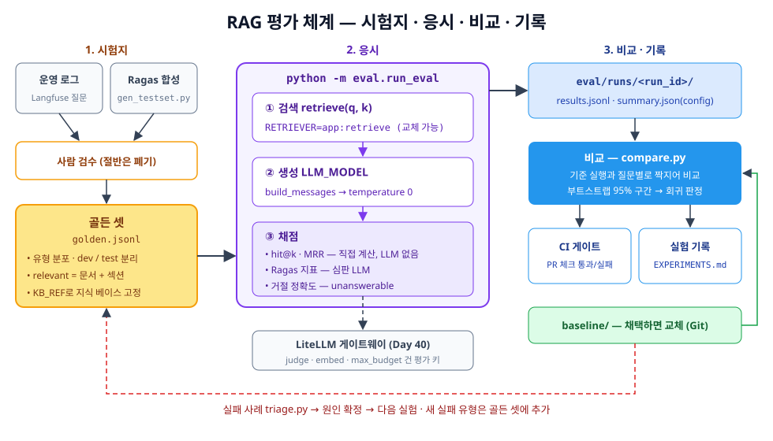
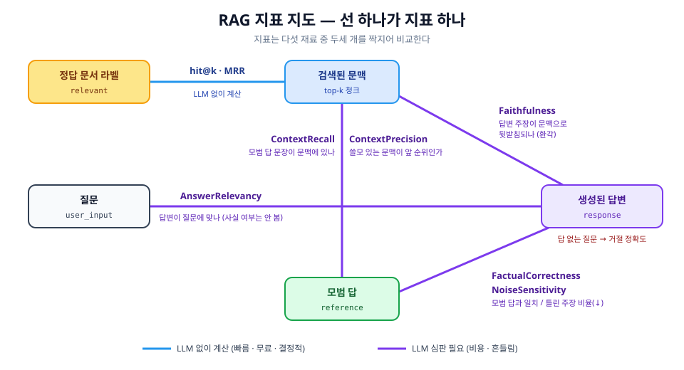
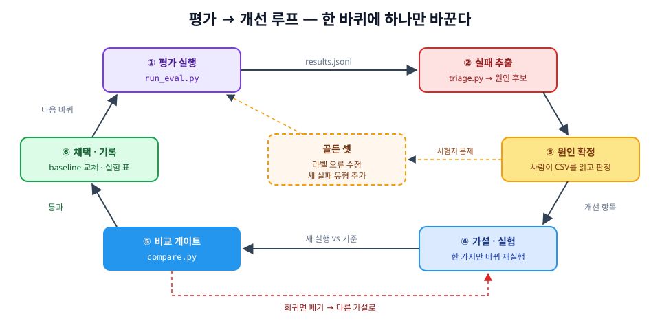

> **AI · RAG 심화** | 난이도 ★★★★☆ | 예상 소요 3 ~ 4시간

## 🎯 오늘의 목표

- 질문 유형 분포, 정답 문맥 라벨, dev/test 분리를 갖춘 **골든 데이터셋**을 설계한다
- Ragas로 **합성 질문 후보**를 만들고, 사람이 검수해 골든 셋에 넣는 흐름을 익힌다
- faithfulness, answer relevancy, context precision/recall, noise sensitivity가 **무엇을 잡고 무엇을 놓치는지** 설명할 수 있다
- LLM 심판(judge)의 **편향과 비용**을 알고, 사람 채점으로 보정한다
- 평가를 **GitHub Actions에 붙여** 청킹이나 모델을 바꿀 때 생기는 회귀를 자동으로 잡고, 실패 사례에서 개선 항목을 뽑는다

---

## 1. Day 48 다음 단계 — "점수 한 번"에서 "평가 체계"로

[Day 48](./day48-llm-security-eval.md) 9~10장에서 골든 셋 몇 줄을 만들고, `eval_retrieval.py`로 recall@k와 MRR을, `eval_ragas.py`로 faithfulness와 context recall을 한 번 재 봤습니다. 숫자를 한 번 뽑는 데는 그것으로 충분합니다. 하지만 실제로 써 보면 이런 질문이 바로 나옵니다.

| 막히는 지점 | 오늘 만드는 것 |
|---|---|
| 질문 48개가 정말 사용자 질문을 대표하나? 쉬운 질문만 있는 건 아닌가? | 질문 **유형 분포**를 정한 골든 셋 설계 (2장) |
| 100개를 손으로 쓰기는 힘들다 | Ragas 합성 생성 → **사람 검수** (3장) |
| faithfulness 0.87은 좋은 건가? 어떤 문제가 안 잡히나? | 지표별 **잡는 것과 놓치는 것** 표 (4장) |
| 채점자 LLM을 믿어도 되나? 한 번 돌리는 데 얼마 드나? | 심판 **편향·비용**과 보정 (5장) |
| 청크 크기를 바꿨는데 0.01 떨어졌다. 진짜 나빠진 건가? | 실행 기록, **짝지은 비교**, CI 회귀 게이트 (6~7장) |
| 점수가 낮다. 그래서 무엇을 고치나? | 실패 사례 **원인 분류 루프** (8장) |



오늘 만드는 평가 체계는 그림처럼 네 덩어리입니다. **시험지**(골든 셋), **응시**(`run_eval.py`: 검색 → 생성 → 채점), **비교**(`compare.py`: 기준 실행과 짝지어 비교), **기록과 게이트**(실행 결과 폴더, 실험 표, CI). 다음 편(RAG 심화 02)에서 하이브리드 검색과 리랭커를 붙일 때 이 체계로 효과를 잽니다.

---

## 2. 골든 데이터셋 설계

### 2-1. 질문 유형 분포 — 시험지가 한쪽으로 치우치면 점수가 거짓말을 한다

골든 셋을 "생각나는 대로" 만들면 거의 다 **단일 문서 사실 질문**이 됩니다. 벡터 검색이 가장 잘하는 유형이라 점수가 높게 나오고, 실제 사용자가 던지는 비교·트러블슈팅 질문에서 무너지는 것을 못 봅니다. 그래서 **유형별 목표 비율**을 먼저 정합니다.

| 유형 (`type`) | 예 (이 레포 기준) | 목표 비율 | 무엇을 시험하나 |
|---|---|---|---|
| `fact` 단일 사실 | "Day 42 청크 최대 길이는?" | 30% | 기본 검색 |
| `procedure` 절차·명령 | "kubeadm으로 워커 노드를 조인하는 명령은?" | 20% | 코드 블록이 든 청크 검색, 명령 정확도 |
| `troubleshoot` 증상 → 원인 | "`search()`에서 AttributeError가 난다. 왜?" | 15% | 에러 메시지 같은 **정확한 문자열** 검색 (02편 BM25가 강한 곳) |
| `compare` 비교 | "Qdrant와 pgvector의 차이는?" | 10% | 한 문서 안 여러 섹션 |
| `multi_hop` 여러 문서 | "Compose에서 임베딩을 TEI로 뺀 이유와 그 근거가 된 Day 42의 원칙은?" | 15% | top-k, 여러 근거 종합 |
| `unanswerable` 답 없음 | "이 시리즈에서 Milvus 샤딩 설정은?" | 10% | 모른다고 답하는가 (환각 억제) |

같은 유형 안에서도 **표현을 섞습니다.** 문서 용어 그대로("영속성"), 구어체("컨테이너 지워도 데이터 남게 하려면"), 영어 섞기("PV랑 PVC 차이"), 오타 한두 개. 실제 사용자는 문서 제목을 외워서 묻지 않습니다.

> 💡 **가장 좋은 질문 출처는 운영 로그**입니다. [Day 47](./day47-llm-observability.md)의 Langfuse 트레이스에서 실제 질문을 뽑고(PII는 [Day 48](./day48-llm-security-eval.md) 4장처럼 지운 뒤), 부족한 유형만 합성으로 채웁니다.

### 2-2. 몇 개가 필요한가

질문이 50개면 질문 하나가 점수 **2%p**입니다. "recall이 0.02 올랐다"는 질문 한 개가 바뀐 것일 수도 있다는 뜻입니다.

| 규모 | 쓸모 |
|---|---|
| 30~50개 | 큰 고장 감지(스모크 테스트). 작은 개선은 판단 불가 |
| **100~200개** | 청킹·리랭커처럼 **수 %p 차이**를 판단하는 실험용. 오늘 목표 |
| 500개 이상 | 유형별로 쪼개 봐도 의미 있는 수준. 라벨링 비용이 큼 |

### 2-3. 라벨 형식 — 청크 ID가 아니라 "문서 + 섹션"으로

Day 48의 `golden.jsonl`에 필드를 몇 개 더합니다.

```jsonl
{"id": "q001", "split": "test", "type": "fact", "question": "Day 42 RAG 실습에서 청크 최대 길이와 overlap은 각각 몇 자인가?", "relevant": ["06-ai-infra/day42-rag-pipeline.md"], "relevant_sections": ["3. 청킹 — 검색 품질의 절반"], "reference": "MAX_CHARS는 1000자, OVERLAP은 150자다.", "origin": "human", "reviewed": true}
{"id": "q014", "split": "test", "type": "multi_hop", "question": "Compose에서 임베딩을 Ollama가 아니라 TEI로 분리한 이유와 그 근거가 된 Day 42의 원칙은?", "relevant": ["06-ai-infra/day43-rag-compose.md", "06-ai-infra/day42-rag-pipeline.md"], "relevant_sections": [], "reference": "LLM을 Ollama와 vLLM 사이에서 바꿔도 임베딩 모델은 바뀌면 안 되기 때문이다. 색인과 질의는 같은 임베딩 모델을 써야 한다는 원칙 때문이다.", "origin": "human", "reviewed": true}
{"id": "q031", "split": "dev", "type": "troubleshoot", "question": "qdrant 검색할 때 'QdrantClient' object has no attribute 'search' 에러가 나요", "relevant": ["06-ai-infra/day42-rag-pipeline.md"], "relevant_sections": ["7. 트러블슈팅"], "reference": "오래된 예제의 search() 대신 현재 API인 query_points(...).points를 써야 한다.", "origin": "log", "reviewed": true}
{"id": "q047", "split": "test", "type": "unanswerable", "question": "이 시리즈에서 Milvus 클러스터 샤딩은 어떻게 설정하나?", "relevant": [], "relevant_sections": [], "reference": "제공된 문서에서 찾을 수 없습니다.", "origin": "human", "reviewed": true}
```

| 필드 | 규칙 |
|---|---|
| `split` | `dev`(튜닝하면서 마음껏 보는 셋)와 `test`(**결과만 보고 질문은 들여다보지 않는** 고정 셋)를 7:3 정도로. test 셋에 맞춰 프롬프트를 고치면 시험지 유출 |
| `relevant` | **이 문서가 없으면 답할 수 없는** 문서만. "관련 있어 보이는" 문서까지 넣으면 recall이 부풀려진다 |
| `relevant_sections` | 선택. 청크 ID 대신 **섹션 제목**으로 적는다. 02편에서 청킹을 바꾸면 청크 ID는 전부 바뀌지만 섹션은 그대로라서 라벨을 다시 달 필요가 없다 |
| `reference` | 모범 답을 **짧은 사실 문장 1~3개**로. 길게 쓰면 context recall 채점이 문장 수에 휘둘린다 |
| `origin` | `human` / `log` / `synthetic`. 합성 비율이 너무 높아지지 않게 추적 |
| `reviewed` | 사람이 검수했는지. `false`인 행은 평가에서 뺀다 |

> ⚠️ 골든 셋은 **특정 시점의 지식 베이스**에 대한 정답입니다. 문서가 고쳐지면 `reference`가 틀릴 수 있습니다. 평가할 때는 지식 베이스를 **커밋 SHA로 고정**하고(7장의 `KB_REF`), 문서를 크게 고쳤으면 골든 셋도 함께 갱신하세요.

---

## 3. 합성 테스트셋 생성 → 사람 검수

### 3-1. Ragas testset 생성기 동작

Ragas 0.4의 `TestsetGenerator`는 문서를 받아 **지식 그래프**를 만들고(헤드라인·요약·키워드 추출, 노드 사이 관계 연결), 거기서 **질문 합성기(synthesizer)** 가 질문·모범 답·근거 문맥을 만들어 냅니다.

| 합성기 | 만드는 질문 |
|---|---|
| `SingleHopSpecificQuerySynthesizer` | 청크 하나로 답하는 구체적 질문 |
| `MultiHopAbstractQuerySynthesizer` | 여러 청크를 엮는 추상적 질문 |
| `MultiHopSpecificQuerySynthesizer` | 여러 청크를 엮는 구체적 질문 |

결과(`Testset.to_pandas()`)에는 `user_input`(질문), `reference_contexts`(근거 청크), `reference`(모범 답), `synthesizer_name` 열이 들어 있습니다.

> 💡 2026-11 기준 최신은 `ragas 0.4.4`입니다. **평가 지표**는 Day 48에서 쓴 새 API(`ragas.metrics.collections` + `llm_factory`)를 쓰지만, **testset 생성기**는 공식 문서 예제가 아직 LangChain 래퍼(`LangchainLLMWrapper`, `LangchainEmbeddingsWrapper`)를 씁니다. 두 방식이 섞여 있는 과도기라서 아래 코드도 그렇게 씁니다. 버전을 올릴 때 이 부분부터 확인하세요.

### 3-2. `gen_testset.py` — Day 42 청크로 후보 만들기

핵심은 **실제 색인과 같은 청크**를 넣는 것입니다. Day 42의 `build_chunks()`를 그대로 불러 쓰면, 근거 문맥이 어느 문서·섹션에서 왔는지 바로 알 수 있어 `relevant` 라벨 초안이 자동으로 나옵니다.

```bash
# rag/ 폴더에서 (Day 42 venv)
pip install "ragas==0.4.4" langchain-openai
mkdir -p eval
```

```python
# eval/gen_testset.py — 합성 질문 "후보"를 만든다. 골든 셋에 바로 넣지 않는다 (Python 3.12)
import json
import os
import random
import sys
from pathlib import Path

from langchain_core.documents import Document
from langchain_openai import ChatOpenAI, OpenAIEmbeddings
from ragas.embeddings import LangchainEmbeddingsWrapper
from ragas.llms import LangchainLLMWrapper
from ragas.testset import TestsetGenerator

from ingest import build_chunks  # Day 42 — 색인과 같은 청킹

URL, KEY = os.environ["JUDGE_BASE_URL"], os.environ["JUDGE_API_KEY"]   # LiteLLM 게이트웨이 (Day 40)
gen_llm = LangchainLLMWrapper(
    ChatOpenAI(model=os.getenv("JUDGE_MODEL", "judge"), base_url=URL, api_key=KEY, temperature=0.3))
gen_emb = LangchainEmbeddingsWrapper(
    OpenAIEmbeddings(model=os.getenv("JUDGE_EMBED", "embed"), base_url=URL, api_key=KEY,
                     check_embedding_ctx_length=False))   # OpenAI 이외 모델이면 토큰 길이 사전 검사 끔


def locate(ref: str, docs: list[Document]) -> dict:
    """근거 문맥이 어느 청크에서 왔는지 찾는다 (앞 80자 포함 여부로 대조)."""
    head = ref.strip()[:80]
    for d in docs:
        if head and head in d.page_content:
            return d.metadata
    return {}


def main(kb: str, n: int, out: str) -> None:
    chunks = [c for c in build_chunks(Path(kb)) if len(c["text"]) > 300]   # 짧은 청크는 질문거리가 없다
    random.Random(42).shuffle(chunks)
    docs = [Document(page_content=f"{c['title']} > {c['section']}\n{c['text']}",
                     metadata={"source": c["source"], "section": c["section"]}) for c in chunks[:300]]

    gen = TestsetGenerator(llm=gen_llm, embedding_model=gen_emb,
                           llm_context="모든 질문과 답은 자연스러운 한국어로 작성한다.")
    testset = gen.generate_with_chunks(docs, testset_size=n)

    with open(out, "w", encoding="utf-8") as f:
        for i, s in enumerate(testset.to_pandas().to_dict("records"), 1):
            metas = [m for m in (locate(r, docs) for r in s["reference_contexts"]) if m]
            f.write(json.dumps({
                "id": f"syn{i:03d}", "split": "dev", "type": s["synthesizer_name"],
                "question": s["user_input"],
                "relevant": sorted({m["source"] for m in metas}),
                "relevant_sections": sorted({m["section"] for m in metas}),
                "reference": s["reference"], "origin": "synthetic", "reviewed": False,
            }, ensure_ascii=False) + "\n")
    print(f"{out}: {n}개 후보 저장 — 검수 후 golden.jsonl로 옮기세요")


if __name__ == "__main__":
    main(sys.argv[1], int(sys.argv[2]), sys.argv[3])
```

```bash
export JUDGE_BASE_URL=http://localhost:4000/v1     # LiteLLM (Day 40)
export JUDGE_API_KEY=sk-<rag-eval 가상 키>
export JUDGE_MODEL=judge                           # 게이트웨이에 등록한 평가·생성용 큰 모델 별칭
export JUDGE_EMBED=embed                           # 게이트웨이에 등록한 임베딩 별칭

python -m eval.gen_testset ~/infra 40 eval/candidates.jsonl
# eval/candidates.jsonl: 40개 후보 저장 — 검수 후 golden.jsonl로 옮기세요
```

| 포인트 | 설명 |
|---|---|
| `generate_with_chunks` | 이미 자른 청크를 그대로 노드로 쓴다. 공식 퀵스타트의 `generate_with_langchain_docs`는 Ragas가 문서를 **다시 자르므로** 근거 위치를 우리 청크와 맞추기 어렵다 |
| `llm_context` | 생성기 프롬프트에 덧붙는 추가 지시. 합성기 기본 프롬프트가 영어라서 질문이 영어로 나오는 일이 있다. 효과는 모델마다 다르니 결과를 보고 판단 |
| `chunks[:300]` | 지식 그래프 구축 단계에서 청크마다 LLM 호출이 여러 번 일어난다. 처음엔 작게 |
| `type`에 합성기 이름 | 검수할 때 2-1의 유형(`fact`, `multi_hop` …)으로 바꿔 적는다 |

### 3-3. 사람 검수 — 후보의 절반은 버린다고 생각하기

합성 질문은 **문서를 보고 만든 질문**이라 문서 표현을 그대로 베끼는 경향이 있습니다(검색이 너무 쉬워짐). 그리고 가끔 문서에 없는 내용을 모범 답에 섞습니다. 그래서 한 줄씩 아래 체크리스트로 **유지 / 수정 / 폐기**를 정합니다.

| 확인 | 폐기 또는 수정 기준 |
|---|---|
| 실제 사용자가 할 법한 질문인가 | "Day 42의 3절에서 설명하는 MAX_CHARS의 값은?"처럼 문서 구조를 아는 사람만 하는 질문 → 구어체로 고치기 |
| 문서 문장을 그대로 베꼈나 | 핵심 단어 일부를 동의어로 바꾸기 (검색 난이도 현실화) |
| `reference`가 문서로 확인되나 | 문서에 없는 내용이 섞였으면 수정, 애매하면 폐기 |
| `relevant`가 정확한가 | 자동 대조(`locate`)가 실패해 비어 있으면 직접 채우기. 정답 문서가 더 있으면 추가 |
| 유형 분포 | 2-1의 목표 비율보다 넘치는 유형은 버리고, 모자란 유형(특히 `unanswerable`, `troubleshoot`)은 **사람이 직접** 쓰기 |
| 중복 | 같은 내용을 다르게 묻는 질문은 하나만 |

검수가 끝난 행만 `reviewed: true`, `origin: "synthetic"`으로 `golden.jsonl`에 옮깁니다. 합성 비율은 **절반 이하**로 유지하는 것을 권합니다. 합성 질문만으로 된 시험지는 "생성 모델이 상상한 사용자"를 평가할 뿐입니다.

---

## 4. 지표 깊게 이해하기

### 4-1. 지표는 "무엇과 무엇을 비교하나"로 외운다



RAG 한 번에는 다섯 가지 재료가 등장합니다. **질문**, 검색된 **문맥**, 생성된 **답변**, 사람이 만든 **모범 답(reference)**, 정답 **문서 라벨**. 지표는 이 중 두세 개를 짝지어 비교합니다. 그림의 선 하나가 지표 하나입니다.

Ragas 0.4.4의 `ragas.metrics.collections`에서 RAG에 쓰는 주요 클래스는 `Faithfulness`, `AnswerRelevancy`, `ContextPrecision`(`ContextPrecisionWithReference`/`WithoutReference` 변형 포함), `ContextUtilization`, `ContextRecall`, `ContextEntityRecall`, `NoiseSensitivity`, `FactualCorrectness`, `AnswerCorrectness`, 그리고 NVIDIA가 제안한 `AnswerAccuracy`, `ContextRelevance`, `ResponseGroundedness`입니다. 모두 `.ascore(...)`가 돌려주는 결과의 `.value`로 점수를 읽습니다.

### 4-2. 지표별로 잡는 것과 놓치는 것

| 지표 | 비교 대상 | 계산 방식 (요약) | 잡는 것 | 놓치는 것 |
|---|---|---|---|---|
| **hit@k · MRR** (직접 계산, Day 48) | 검색 결과 문서 ↔ `relevant` 라벨 | 정답 문서가 상위 k에 있나, 몇 등인가 | 검색 실패, 순위 문제. **LLM 없이 무료·결정적** | 문서 안 **어느 부분**을 가져왔는지. 라벨이 틀리면 지표도 틀림 |
| **ContextPrecision** | 문맥 ↔ 질문 + reference | 문맥마다 "답에 쓸모 있나"를 판정하고, 쓸모 있는 문맥이 **앞 순위에 있을수록** 높게 | 순위 품질, 쓸모없는 문맥 섞임 | 필요한 문맥이 **아예 빠진 것** (있는 것만 채점) |
| **ContextRecall** | 문맥 ↔ reference | reference의 문장들이 문맥으로 뒷받침되는 비율 | 근거 누락 (청크 경계에서 잘림, top-k 부족) | 문맥에 쓸데없는 것이 많이 섞인 것 |
| **Faithfulness** | 답변 ↔ 문맥 | 답변을 주장(claim)으로 쪼개 문맥으로 뒷받침되는 비율 | 환각, 문서 밖 지식으로 답하기 | 답이 **틀린 문서에 충실한** 경우 (엉뚱한 문맥을 충실히 요약해도 1.0), 거절 답변 |
| **AnswerRelevancy** | 답변 ↔ 질문 | 답변에서 질문을 거꾸로 몇 개 만들어 원래 질문과의 임베딩 유사도 평균. 얼버무리는 답은 0 | 질문을 비껴간 답, 장황한 딴소리 | **사실 여부** (틀린 답도 질문에 맞으면 높음). "찾을 수 없습니다"는 낮게 나옴 |
| **NoiseSensitivity** | 답변 ↔ reference + 문맥 | 답변 주장 중 **틀린 것**의 비율. `mode="relevant"`(기본)/`"irrelevant"` 로 어떤 문맥이 오류를 유발했는지 구분. **낮을수록 좋음** | 관련 없는 문맥(노이즈)에 휘둘리는 정도. top-k를 늘릴 때 핵심 | 검색 자체의 실패 |
| **FactualCorrectness** | 답변 ↔ reference | 양쪽을 주장으로 쪼개 겹침(정밀도·재현율·F1) | 모범 답과의 사실 일치 | reference를 짧게 쓰면 정답 답변도 정밀도가 깎임 |
| **ResponseGroundedness · ContextRelevance** (NVIDIA) | 답변 ↔ 문맥 / 문맥 ↔ 질문 | 판정 프롬프트 몇 번으로 점수화 | faithfulness·precision의 **저렴한 대체** | 주장 단위 분석이 없어 원인 파악이 덜 세밀 |
| **거절 정확도** (직접 계산, 오늘 코드) | 답변 ↔ `unanswerable` 유형 | 답 없는 질문에 "찾을 수 없습니다"라고 했나 / 답 있는 질문에 괜히 거절했나 | 환각 억제와 과잉 거절의 균형 | — |

> 💡 **답 없는 질문은 Ragas 지표에서 빼고** 거절 정확도로 따로 잽니다. "찾을 수 없습니다"는 정답인데 AnswerRelevancy는 낮게, Faithfulness는 주장이 없어 들쭉날쭉하게 나오기 때문입니다.

> 💡 Ragas에는 ID 기반 `IDBasedContextPrecision`/`IDBasedContextRecall`도 있습니다(이전 API인 `ragas.metrics` 쪽). 우리 hit@k·MRR과 같은 발상으로 LLM 없이 계산합니다.

### 4-3. 지표 조합으로 진단하기

| 패턴 | 해석 | 손댈 곳 |
|---|---|---|
| hit 낮음, context recall 낮음 | 검색이 정답 문서를 못 찾음 | 02편: 하이브리드 검색, 청킹, 임베딩 모델 |
| hit 높음, MRR·context precision 낮음 | 찾긴 하는데 순위가 뒤 | 02편: 리랭커 |
| hit 높음, context recall 낮음 | 정답 문서는 왔는데 **필요한 부분**이 빠짐 | 청크 경계, overlap, parent-child (02편) |
| context recall 높음, faithfulness 낮음 | 근거는 있는데 모델이 지어냄 | 프롬프트, 더 큰 모델, temperature |
| faithfulness 높음, factual correctness 낮음 | 엉뚱한 문맥에 충실 | 검색 (Day 48 셀프 체크 Q5와 같은 상황) |
| noise sensitivity 높음 | 관련 없는 문맥에 휘둘림 | top-k 줄이기, 리랭커 점수 컷 |

---

## 5. LLM 심판 — 편향과 비용

### 5-1. 심판도 틀린다

Ragas 지표 대부분은 결국 **LLM이 채점**합니다. 심판의 버릇이 점수에 그대로 섞입니다.

| 편향 | 현상 | 대응 |
|---|---|---|
| **자기 선호** | 같은 계열 모델이 쓴 답을 후하게 | 답변 모델과 **다른 계열**의 심판 사용 |
| **장황함 선호** | 길고 그럴듯한 답에 높은 점수 | 주장 단위로 쪼개는 지표(faithfulness 등) 우선, 길이와 점수의 상관을 확인 |
| **위치 편향** | 문맥·후보 순서에 따라 판정이 바뀜 | 순서를 섞어 두 번 채점해 일치율 확인 |
| **언어** | 지표 프롬프트는 영어, 데이터는 한국어 → 주장 분해가 어색해짐 | 한국어를 잘하는 심판 모델, 사람 대조로 확인 |
| **형식 실패** | 작은 모델이 JSON을 못 지켜 점수가 `None` | 7B 이상 또는 상용 API 모델, `temperature=0`. 실패 건수를 **지표로 기록** |
| **비결정성** | 같은 입력에도 점수가 흔들림 | 같은 설정으로 2~3회 반복해 흔들림 폭을 알아 두기. 그보다 작은 차이는 무시 |

### 5-2. 사람 채점으로 보정하기

심판을 처음 정할 때, 그리고 심판 모델을 바꿀 때 한 번씩 합니다.

1. test 셋에서 **30개**를 무작위로 뽑아, 사람이 faithfulness를 0 / 0.5 / 1로 채점합니다.
2. 같은 30개를 심판이 채점한 점수를 같은 세 구간으로 반올림합니다.
3. **일치율**(같은 구간인 비율)과, 심판이 사람보다 체계적으로 후한지(평균 차이)를 봅니다.
4. 일치율이 낮으면(대략 70% 미만) 심판 모델을 바꾸거나, 그 지표는 **추세만 보고 절댓값은 믿지 않기**로 정합니다.

### 5-3. 비용 — 한 번 돌리는 데 호출이 몇 번인가

지표마다 LLM 호출 수가 다릅니다. 질문 하나, 문맥 k개 기준으로 대략 이렇습니다(구현 세부는 버전마다 달라질 수 있음).

| 지표 | 질문당 LLM 호출 (대략) |
|---|---|
| Faithfulness | 2회 (주장 분해 + 판정) |
| AnswerRelevancy | 1회 + 임베딩 |
| ContextPrecision | **k회** (문맥마다 판정) |
| ContextRecall | 1회 |
| NoiseSensitivity | 여러 회 (답변·reference 주장 분해 + 문맥별 판정) |

k=4로 앞의 네 지표만 써도 질문당 약 8회, 골든 셋 150개면 **실행 한 번에 1,200회 안팎**입니다. 호출당 입력이 1~3천 토큰이면 수백만 토큰이 됩니다. 그래서 운영은 이렇게 나눕니다.

| 실행 | 범위 | 비용 |
|---|---|---|
| PR마다 | **검색 지표만** (hit@k, MRR) | LLM 호출 0 |
| 라벨을 붙인 PR, 야간 | 전체 Ragas 지표, test 셋 | 위 계산만큼 |
| 심판·모델 교체 시 | 전체 + 사람 대조 | 위 + 사람 시간 |

> 💡 평가 전용 LiteLLM **가상 키**(`rag-eval`)를 따로 발급해 `max_budget`을 걸어 두세요([Day 40](./day40-llm-gateway.md), [Day 48](./day48-llm-security-eval.md) 6장). 실제 호출 수와 토큰은 게이트웨이 사용량 화면에서 정확히 보입니다. 위 표의 어림값보다 이 숫자를 믿으세요.

---

## 6. 실습 ① — 평가 실행기와 비교기

> 실습 환경: Day 42의 `rag/` 폴더와 venv(Python 3.12), Day 43 Compose 또는 Day 49 클러스터의 Qdrant·TEI 임베딩, 평가용 LLM은 LiteLLM 게이트웨이(Day 40) 별칭 `judge`·`embed`. 라이브러리: `ragas==0.4.4`.

> 💡 **GPU가 없다면**: 검색 평가(`--retrieval-only`)는 LLM이 필요 없어서 CPU의 TEI 임베딩만으로 돌아갑니다. 생성은 Ollama CPU 모드의 작은 모델(Day 38), 심판은 게이트웨이를 통해 **외부 API 모델**로 붙이는 조합이 가장 현실적입니다. 심판까지 로컬로 하려면 클라우드 GPU를 시간 단위로 빌려 vLLM으로 큰 모델을 띄우세요. 작은 CPU 모델을 심판으로 쓰면 형식 실패(`None`)가 쏟아집니다.

```
rag/
├── common.py  ingest.py  app.py        # Day 42 (app.py는 Day 48 3-2의 태그 프롬프트 버전)
└── eval/
    ├── golden.jsonl                    # 2장
    ├── gen_testset.py                  # 3장
    ├── eval_retrieval.py               # Day 48 (recall_at_k, reciprocal_rank 재사용)
    ├── run_eval.py                     # 오늘: 검색 → 생성 → 채점 → runs/<id>/
    ├── compare.py                      # 오늘: 기준 실행과 짝지어 비교, 회귀면 exit 1
    ├── triage.py                       # 8장: 실패 사례 분류
    ├── baseline/                       # 기준 실행 결과 (Git에 커밋)
    └── runs/                           # 실행 결과 (Git 무시)
```

### 6-1. `run_eval.py`

검색 함수는 **환경 변수 `RETRIEVER`로 갈아 끼웁니다.** 기본값은 Day 42의 `app:retrieve`이고, 다음 편에서 만들 하이브리드 검색은 `RETRIEVER=retrieve_hybrid:retrieve`로 바꿔 같은 시험지로 채점합니다. `retrieve(question, top_k)`가 `source`·`section`·`text`가 든 딕셔너리 목록을 돌려주기만 하면 됩니다.

```python
# eval/run_eval.py — 골든 셋으로 검색·생성·채점을 하고 eval/runs/<run_id>/에 저장 (Python 3.12)
# 사용: rag/ 폴더에서  python -m eval.run_eval --split test --k 4 [--retrieval-only] [--name 메모]
import argparse
import asyncio
import hashlib
import importlib
import json
import os
import statistics
import subprocess
import time
from datetime import datetime
from pathlib import Path

from app import build_messages                       # Day 42 (+ Day 48 태그 프롬프트)
from common import COLLECTION, EMBED_MODEL, LLM_MODEL, llm
from eval.eval_retrieval import recall_at_k, reciprocal_rank  # Day 48

REFUSAL = "제공된 문서에서 찾을 수 없습니다"
JUDGED = ("faithfulness", "answer_relevancy", "context_precision", "context_recall")
EXTRA_KEYS = ("CHUNKER", "CONTEXT_HEADER", "SEARCH_MODE", "PREFETCH", "CANDIDATES", "RERANKER", "RRF_K")


def load_retriever():
    module, func = os.getenv("RETRIEVER", "app:retrieve").split(":")
    return getattr(importlib.import_module(module), func)


def build_judges() -> dict:
    """Ragas는 여기서만 import → --retrieval-only 실행에는 ragas 설치가 필요 없다."""
    from openai import AsyncOpenAI
    from ragas.embeddings.base import embedding_factory
    from ragas.llms import llm_factory
    from ragas.metrics.collections import AnswerRelevancy, ContextPrecision, ContextRecall, Faithfulness

    client = AsyncOpenAI(base_url=os.environ["JUDGE_BASE_URL"], api_key=os.environ["JUDGE_API_KEY"])
    judge = llm_factory(os.getenv("JUDGE_MODEL", "judge"), client=client)
    emb = embedding_factory("openai", model=os.getenv("JUDGE_EMBED", "embed"), client=client)
    return {
        "faithfulness": Faithfulness(llm=judge),
        "answer_relevancy": AnswerRelevancy(llm=judge, embeddings=emb),
        "context_precision": ContextPrecision(llm=judge),
        "context_recall": ContextRecall(llm=judge),
    }


def generate(question: str, docs: list[dict]) -> str:
    resp = llm.chat.completions.create(
        model=LLM_MODEL, messages=build_messages(question, docs), temperature=0)
    return resp.choices[0].message.content or ""


async def judge_row(j: dict, q: str, ans: str, ctx: list[str], ref: str) -> dict:
    calls = {
        "faithfulness": j["faithfulness"].ascore(user_input=q, response=ans, retrieved_contexts=ctx),
        "answer_relevancy": j["answer_relevancy"].ascore(user_input=q, response=ans),
        "context_precision": j["context_precision"].ascore(user_input=q, reference=ref, retrieved_contexts=ctx),
        "context_recall": j["context_recall"].ascore(user_input=q, retrieved_contexts=ctx, reference=ref),
    }
    done = await asyncio.gather(*calls.values(), return_exceptions=True)
    return {m: (None if isinstance(r, Exception) else r.value) for m, r in zip(calls, done)}


async def eval_row(row: dict, k: int, retrieve, judges: dict | None, sem: asyncio.Semaphore) -> dict:
    async with sem:
        q = row["question"]
        t0 = time.perf_counter()
        docs = await asyncio.to_thread(retrieve, q, k)
        out = {
            "id": row["id"], "type": row["type"], "question": q,
            "sources": list(dict.fromkeys(d["source"] for d in docs)),   # 문서 단위 순위 (중복 제거)
            "sections": [f"{d['source']}#{d['section']}" for d in docs],
            "contexts": [d["text"] for d in docs],
            "lat_retrieve": round(time.perf_counter() - t0, 3),
        }
        relevant = set(row["relevant"])
        if relevant:
            out["hit"] = 1.0 if relevant & set(out["sources"]) else 0.0
            out["recall"] = recall_at_k(out["sources"], relevant, k)
            out["rr"] = reciprocal_rank(out["sources"], relevant)
        if judges is None:
            return out

        t1 = time.perf_counter()
        out["answer"] = await asyncio.to_thread(generate, q, docs)
        out["lat_generate"] = round(time.perf_counter() - t1, 3)
        out["refused"] = 1.0 if REFUSAL in out["answer"] else 0.0
        if row["type"] != "unanswerable":
            out |= await judge_row(judges, q, out["answer"], out["contexts"], row["reference"])
        return out


def summarize(results: list[dict]) -> dict:
    s: dict = {"n": len(results)}
    for m in ("hit", "recall", "rr", *JUDGED):
        vals = [r[m] for r in results if r.get(m) is not None]
        if vals:
            s[m] = round(statistics.fmean(vals), 4)
    s["judge_failures"] = sum(1 for r in results for m in JUDGED if m in r and r[m] is None)
    unans = [r["refused"] for r in results if r["type"] == "unanswerable" and "refused" in r]
    ans = [r["refused"] for r in results if r["type"] != "unanswerable" and "refused" in r]
    if unans:
        s["refusal_acc"] = round(statistics.fmean(unans), 4)     # 답 없는 질문에 거절한 비율 (높을수록 좋음)
    if ans:
        s["false_refusal"] = round(statistics.fmean(ans), 4)     # 답 있는 질문에 거절한 비율 (낮을수록 좋음)
    for key in ("lat_retrieve", "lat_generate"):
        lat = [r[key] for r in results if key in r]
        if len(lat) >= 2:
            s[f"{key}_p95"] = round(statistics.quantiles(lat, n=20)[-1], 3)
    return s


async def main() -> None:
    ap = argparse.ArgumentParser()
    ap.add_argument("--golden", default="eval/golden.jsonl")
    ap.add_argument("--split", default="test")
    ap.add_argument("--k", type=int, default=4)
    ap.add_argument("--retrieval-only", action="store_true")
    ap.add_argument("--concurrency", type=int, default=4)
    ap.add_argument("--name", default="")
    a = ap.parse_args()

    raw = Path(a.golden).read_bytes()
    rows = [json.loads(line) for line in raw.decode("utf-8").splitlines() if line.strip()]
    rows = [r for r in rows if r.get("split", "test") == a.split and r.get("reviewed", True)]

    judges = None if a.retrieval_only else build_judges()
    retrieve, sem = load_retriever(), asyncio.Semaphore(a.concurrency)
    results = await asyncio.gather(*(eval_row(r, a.k, retrieve, judges, sem) for r in rows))

    sha = subprocess.run(["git", "rev-parse", "--short", "HEAD"],
                         capture_output=True, text=True).stdout.strip() or "nogit"
    run_id = f"{datetime.now():%Y%m%d-%H%M%S}-{sha}" + (f"-{a.name}" if a.name else "")
    out = Path("eval/runs") / run_id
    out.mkdir(parents=True)
    config = {
        "run_id": run_id, "golden_sha256": hashlib.sha256(raw).hexdigest()[:12], "split": a.split,
        "k": a.k, "retriever": os.getenv("RETRIEVER", "app:retrieve"), "collection": COLLECTION,
        "embed_model": EMBED_MODEL, "llm_model": LLM_MODEL, "rerank": bool(os.getenv("RERANK_URL")),
        "judge_model": None if a.retrieval_only else os.getenv("JUDGE_MODEL", "judge"),
        # 검색 전략 스위치(02편)도 함께 기록 — 설정된 것만
        "extra": {k: v for k in EXTRA_KEYS if (v := os.getenv(k))},
    }
    summary = {"config": config, "metrics": summarize(results)}
    (out / "results.jsonl").write_text(
        "".join(json.dumps(r, ensure_ascii=False) + "\n" for r in results), encoding="utf-8")
    (out / "summary.json").write_text(json.dumps(summary, ensure_ascii=False, indent=2), encoding="utf-8")
    print(json.dumps(summary["metrics"], ensure_ascii=False))
    print(f"saved: {out}")


if __name__ == "__main__":
    asyncio.run(main())
```

| 포인트 | 설명 |
|---|---|
| `RETRIEVER=모듈:함수` | 검색 전략을 코드 수정 없이 교체. 02편의 실험이 전부 이 스위치로 돌아간다 |
| `k` = LLM에 넣는 청크 수 | Day 48의 `eval_retrieval.py`는 문서 단위 순위로 k를 셌지만, 여기서는 **실제 운영처럼** 청크 k개를 넣고 그 안의 문서로 hit·recall·MRR을 계산한다 |
| `temperature=0` | 평가 중 생성은 흔들림을 줄인다 (운영값 0.2와 다르다는 점은 기록해 둔다) |
| `return_exceptions=True` | 지표 하나가 파싱에 실패해도 나머지는 살린다. 실패는 `None` → `judge_failures`로 집계 |
| `config` + `golden_sha256` | **무엇을 바꾼 실행인지**와 **같은 시험지였는지**를 결과와 함께 저장. 시험지가 다르면 비교하지 않는다 |
| `Semaphore(4)` | 동시 요청 수 제한. 게이트웨이 `rpm_limit`·`max_parallel_requests`(Day 48)에 걸리지 않게 |

실행합니다.

```bash
# Day 42/43과 같은 환경 변수(EMBED_*, QDRANT_URL, COLLECTION, LLM_*) + JUDGE_* (3-2)
python -m eval.run_eval --split test --k 4 --retrieval-only --name baseline
# {"n": 45, "hit": 0.9111, "recall": 0.8852, "rr": 0.7926, "judge_failures": 0, "lat_retrieve_p95": 0.212}
# saved: eval/runs/20261125-101502-3f2a9c1-baseline

python -m eval.run_eval --split test --k 4 --name baseline-full
# {"n": 45, "hit": 0.9111, ..., "faithfulness": 0.8731, "answer_relevancy": 0.8214,
#  "context_precision": 0.7608, "context_recall": 0.8402, "judge_failures": 2,
#  "refusal_acc": 0.8, "false_refusal": 0.05, "lat_retrieve_p95": 0.231, "lat_generate_p95": 6.84}
```

(숫자는 예시입니다. 골든 셋·모델·하드웨어에 따라 다릅니다.) 첫 전체 실행 결과를 기준으로 삼습니다.

```bash
rm -rf eval/baseline && cp -r eval/runs/20261125-*-baseline-full eval/baseline
echo "eval/runs/" >> .gitignore
git add eval/baseline eval/golden.jsonl && git commit -m "eval: 기준 실행 등록"
```

### 6-2. `compare.py` — 같은 질문끼리 짝지어 비교한다

평균 두 개만 비교하면 "질문 한두 개가 흔들린 것"과 "진짜 나빠진 것"을 구분할 수 없습니다. 같은 질문의 점수 차이(짝지은 차이)를 모아 **부트스트랩 95% 구간**을 구하고, **하락폭이 허용치를 넘으면서 구간 전체가 0보다 아래일 때만** 회귀로 판정합니다.

```python
# eval/compare.py — 기준 실행과 새 실행을 질문별로 짝지어 비교. 회귀면 exit 1 (Python 3.12)
# 사용: python -m eval.compare eval/baseline eval/runs/<run_id>
import json
import os
import random
import sys
from pathlib import Path

# 지표별 허용 하락폭 (이보다 크게 떨어지고, 통계적으로도 확실하면 회귀)
GATES = {"hit": 0.03, "rr": 0.03, "context_recall": 0.05, "context_precision": 0.05,
         "faithfulness": 0.05, "answer_relevancy": 0.05}


def load(run: str) -> tuple[dict, dict]:
    p = Path(run)
    rows = {r["id"]: r for r in map(json.loads, (p / "results.jsonl").read_text(encoding="utf-8").splitlines())}
    return rows, json.loads((p / "summary.json").read_text(encoding="utf-8"))["config"]


def bootstrap_ci(diffs: list[float], n: int = 2000) -> tuple[float, float]:
    rnd = random.Random(0)
    means = sorted(sum(rnd.choices(diffs, k=len(diffs))) / len(diffs) for _ in range(n))
    return means[int(n * 0.025)], means[int(n * 0.975)]


def main(base_dir: str, cur_dir: str) -> int:
    (base, bcfg), (cur, ccfg) = load(base_dir), load(cur_dir)
    if bcfg["golden_sha256"] != ccfg["golden_sha256"] or bcfg["split"] != ccfg["split"]:
        print("⚠️ 시험지(golden/split)가 다르다 — 비교하지 않음. 기준 실행부터 다시 만드세요.")
        return 2

    lines = [f"### RAG 평가: `{bcfg['run_id']}` → `{ccfg['run_id']}`", "",
             "| 지표 | 기준 | 현재 | Δ | 95% 구간 | 판정 |", "|---|---|---|---|---|---|"]
    regressed = False
    for m, tol in GATES.items():
        pairs = [(base[i][m], cur[i][m]) for i in base.keys() & cur.keys()
                 if base[i].get(m) is not None and cur[i].get(m) is not None]
        if len(pairs) < 10:
            continue
        diffs = [c - b for b, c in pairs]
        mb, mc = (sum(x) / len(pairs) for x in zip(*pairs))
        lo, hi = bootstrap_ci(diffs)
        bad = (mc - mb) < -tol and hi < 0
        regressed |= bad
        verdict = "❌ 회귀" if bad else ("✅ 개선" if lo > 0 else "➖ 차이 없음")
        lines.append(f"| {m} | {mb:.3f} | {mc:.3f} | {mc - mb:+.3f} | [{lo:+.3f}, {hi:+.3f}] | {verdict} |")

    report = "\n".join(lines)
    print(report)
    if summary_file := os.getenv("GITHUB_STEP_SUMMARY"):    # Actions 실행 요약 페이지에 표로 표시
        Path(summary_file).write_text(report + "\n", encoding="utf-8")
    return 1 if regressed else 0


if __name__ == "__main__":
    sys.exit(main(sys.argv[1], sys.argv[2]))
```

```bash
# 예: 청크 크기를 1000 → 500으로 바꾸고 재색인한 뒤
python -m eval.run_eval --split test --k 4 --name chunk500
python -m eval.compare eval/baseline eval/runs/20261125-*-chunk500
```

```
### RAG 평가: `20261125-101502-3f2a9c1-baseline-full` → `20261125-113040-3f2a9c1-chunk500`

| 지표 | 기준 | 현재 | Δ | 95% 구간 | 판정 |
|---|---|---|---|---|---|
| hit | 0.911 | 0.889 | -0.022 | [-0.067, +0.022] | ➖ 차이 없음 |
| rr | 0.793 | 0.815 | +0.022 | [-0.031, +0.074] | ➖ 차이 없음 |
| context_recall | 0.840 | 0.762 | -0.078 | [-0.131, -0.029] | ❌ 회귀 |
...
```

(예시 출력) 청크를 줄였더니 순위는 비슷한데 **필요한 문맥이 잘려 나가는**(context recall 하락) 상황입니다. 평균만 봤다면 hit의 -0.022도 똑같이 걱정했을 것입니다.

### 6-3. 실험 기록 표

`runs/` 폴더는 Git에 넣지 않지만, 실행마다 **한 줄**을 `eval/EXPERIMENTS.md`에 남깁니다. 석 달 뒤 "리랭커는 왜 껐더라?"에 답해 주는 것은 이 표뿐입니다.

| 날짜 | run_id | 바꾼 것 (하나만) | hit@4 | MRR | ctx P | ctx R | faith | 거절 정확도 | 검색 p95 | 생성 p95 | 결정 |
|---|---|---|---|---|---|---|---|---|---|---|---|
| 11-25 | …-baseline-full | Day 42 기본 (헤더 청킹 1000/150, dense, k=4) | 0.911 | 0.793 | 0.761 | 0.840 | 0.873 | 0.80 | 0.23s | 6.8s | 기준 |
| 11-25 | …-chunk500 | `MAX_CHARS` 500 | 0.889 | 0.815 | — | 0.762 | — | — | 0.21s | — | ❌ 폐기 (ctx R 회귀) |
| 11-26 | …-prompt-v2 | 시스템 프롬프트에 거절 예시 추가 | 0.911 | 0.793 | 0.761 | 0.838 | 0.880 | 0.93 | 0.23s | 6.9s | ✅ 채택 |

(예시 값) 규칙은 세 가지입니다. **한 번에 하나만 바꾼다**, **지연·비용 열을 같이 적는다**(품질이 0.01 오르고 지연이 2배면 채택하지 않을 수도 있다), **채택하면 그 실행을 새 `baseline/`으로 교체한다**.

---

## 7. 실습 ② — 평가를 CI에 붙이기 (GitHub Actions)

[Day 51](../07-gitops/day51-github-actions.md)에서 이미지 빌드를 CI에 맡긴 것처럼, 평가도 사람이 기억해서 돌리지 않게 만듭니다. [Day 49](./day49-capstone-rag-chatbot.md)의 `homelab-rag` 저장소(`rag/` 폴더 포함)에 워크플로를 추가합니다.

| 잡 | 언제 | 어디서 | 무엇을 |
|---|---|---|---|
| `retrieval` | `rag/**`를 건드린 **모든 PR** | GitHub 호스티드 러너 + 서비스 컨테이너(Qdrant, TEI) | 고정된 지식 베이스를 색인 → 검색 지표만 → 기준과 비교 |
| `full` | PR에 `eval-full` 라벨, 수동 실행 | 홈랩 **self-hosted 러너** (게이트웨이에 닿는 곳) | 생성 + Ragas 지표 → 기준과 비교 |

```yaml
# .github/workflows/rag-eval.yaml
name: rag-eval

on:
  pull_request:
    types: [opened, synchronize, labeled]
    paths: ["rag/**"]
  workflow_dispatch:

permissions:
  contents: read

env:
  KB_REF: 0123456789abcdef0123456789abcdef01234567   # 골든 셋을 라벨링한 지식 베이스 커밋 (고정!)

jobs:
  retrieval:
    runs-on: ubuntu-24.04
    services:
      qdrant:
        image: qdrant/qdrant:v1.20.1
        ports: ["6333:6333"]
      embed:
        image: ghcr.io/huggingface/text-embeddings-inference:cpu-1.9
        env:
          MODEL_ID: BAAI/bge-m3            # 서비스 컨테이너는 command를 못 바꾸므로 환경 변수로 지정
        ports: ["8080:80"]
    env:
      QDRANT_URL: http://localhost:6333
      EMBED_BASE_URL: http://localhost:8080/v1
      EMBED_MODEL: BAAI/bge-m3
      EMBED_DIM: "1024"
      COLLECTION: infra_docs
    defaults:
      run:
        working-directory: rag
    steps:
      - uses: actions/checkout@v7
      - uses: actions/checkout@v7          # 지식 베이스 스냅샷
        with:
          repository: yeomyaloo/infra
          ref: ${{ env.KB_REF }}
          path: kb
      - uses: actions/setup-python@v7
        with:
          python-version: "3.12"
          cache: pip
          cache-dependency-path: rag/requirements.txt
      - run: pip install -r requirements.txt
      - name: 서비스 준비 대기 (TEI는 첫 기동 때 모델을 내려받는다)
        run: |
          for i in $(seq 1 60); do
            curl -fsS localhost:8080/health && curl -fsS localhost:6333/readyz && exit 0
            sleep 5
          done
          exit 1
      - run: python ingest.py ../kb
      - run: python -m eval.run_eval --split test --k 4 --retrieval-only --name ci
      - run: python -m eval.compare eval/baseline "$(ls -d eval/runs/*-ci | tail -1)"
      - if: always()
        uses: actions/upload-artifact@v7
        with:
          name: rag-eval-retrieval
          path: rag/eval/runs/

  full:
    needs: retrieval
    if: github.event_name == 'workflow_dispatch' || contains(github.event.pull_request.labels.*.name, 'eval-full')
    runs-on: [self-hosted, linux, homelab]
    services:                               # self-hosted 러너에 Docker가 있어야 한다
      qdrant:
        image: qdrant/qdrant:v1.20.1
        ports: ["6333:6333"]
      embed:
        image: ghcr.io/huggingface/text-embeddings-inference:cpu-1.9
        env: { MODEL_ID: BAAI/bge-m3 }
        ports: ["8080:80"]
    env:
      QDRANT_URL: http://localhost:6333
      EMBED_BASE_URL: http://localhost:8080/v1
      EMBED_MODEL: BAAI/bge-m3
      EMBED_DIM: "1024"
      COLLECTION: infra_docs
      LLM_BASE_URL: ${{ secrets.LITELLM_URL }}       # 홈랩 러너에서 닿는 게이트웨이 주소
      LLM_API_KEY: ${{ secrets.RAG_EVAL_KEY }}       # max_budget을 건 rag-eval 가상 키
      LLM_MODEL: qwen2.5-1.5b                        # 운영과 같은 답변 모델 별칭 (Day 49)
      JUDGE_BASE_URL: ${{ secrets.LITELLM_URL }}
      JUDGE_API_KEY: ${{ secrets.RAG_EVAL_KEY }}
      JUDGE_MODEL: judge
      JUDGE_EMBED: embed
    defaults:
      run:
        working-directory: rag
    steps:
      - uses: actions/checkout@v7
      - uses: actions/checkout@v7
        with:
          repository: yeomyaloo/infra
          ref: ${{ env.KB_REF }}
          path: kb
      - uses: actions/setup-python@v7
        with:
          python-version: "3.12"
      - run: pip install -r requirements.txt "ragas==0.4.4"
      - name: 서비스 준비 대기
        run: |
          for i in $(seq 1 60); do
            curl -fsS localhost:8080/health && curl -fsS localhost:6333/readyz && exit 0
            sleep 5
          done
          exit 1
      - run: python ingest.py ../kb
      - run: python -m eval.run_eval --split test --k 4 --name ci-full
      - run: python -m eval.compare eval/baseline "$(ls -d eval/runs/*-ci-full | tail -1)"
      - if: always()
        uses: actions/upload-artifact@v7
        with:
          name: rag-eval-full
          path: rag/eval/runs/
```

| 포인트 | 설명 |
|---|---|
| `KB_REF` 고정 | 지식 베이스가 움직이면 점수 변화가 "코드 때문인지 문서 때문인지" 알 수 없다. 골든 셋을 갱신할 때 함께 올린다 |
| 서비스 컨테이너 + `MODEL_ID` | Actions의 `services`는 `command`를 바꿀 수 없어서, TEI가 지원하는 환경 변수로 모델을 지정. 매 실행 bge-m3를 내려받으므로 첫 대기가 길다 |
| `compare` 종료 코드 | 회귀(1)면 잡이 실패해 PR에 빨간 체크. **브랜치 보호 규칙**에서 `retrieval`을 필수 체크로 지정하면 머지가 막힌다 |
| `GITHUB_STEP_SUMMARY` | 비교 표가 실행 요약 페이지에 그대로 보인다 |
| `full`은 라벨로만 | 비용 때문. 모델·프롬프트를 바꾸는 PR에만 `eval-full` 라벨을 붙인다 |

> ⚠️ **self-hosted 러너는 공개 저장소에 붙이지 마세요.** 누구나 포크해서 PR을 열면 홈랩 안에서 임의 코드가 실행될 수 있습니다. 비공개 저장소에서만 쓰고, 러너 권한과 시크릿 범위를 좁히는 방법은 [해킹 23](../hacking/hack23-cicd-security.md)을 참고하세요.

> 💡 지식 베이스 전체를 CPU 러너에서 색인하면 수십 분이 걸릴 수 있습니다. 골든 셋이 다루는 폴더만 색인하거나(`python ingest.py ../kb/06-ai-infra` 등, 대신 `unanswerable` 질문이 다른 폴더의 내용과 겹치지 않는지 확인), 색인이 끝난 Qdrant **스냅샷**을 아티팩트로 저장해 재사용하는 방법이 있습니다.

---

## 8. 실습 ③ — 실패 사례에서 개선 항목 뽑기



점수는 "얼마나 나쁜가"만 알려 줍니다. **무엇을 고칠지**는 실패한 질문을 직접 읽어야 나옵니다. 4-3의 진단 표를 규칙으로 옮겨 **원인 후보**를 자동으로 달고, 사람은 그것을 확정만 합니다.

```python
# eval/triage.py — 실패 사례에 원인 후보를 달아 CSV로 뽑는다 (Python 3.12)
# 사용: python -m eval.triage eval/runs/<run_id>  → <run_id>/triage.csv (엑셀에서 열림)
import csv
import json
import sys
from pathlib import Path


def classify(r: dict) -> str | None:
    def v(m: str) -> float:                    # 값이 없으면(채점 안 됨) 통과로 본다
        return 1.0 if r.get(m) is None else r[m]

    if r["type"] == "unanswerable":
        return "거절 실패(환각)" if r.get("refused") == 0.0 else None
    if r.get("refused") == 1.0:
        return "과잉 거절"
    if v("hit") == 0:
        return "검색 실패"
    if v("context_recall") < 0.5:
        return "근거 일부 누락(청크 경계·top-k)"
    if v("rr") < 0.5 and v("context_precision") < 0.5:
        return "순위 문제"
    if v("faithfulness") < 0.7:
        return "생성 환각"
    if v("answer_relevancy") < 0.6:
        return "질문 비껴감"
    return None


def main(run_dir: str) -> None:
    rows = [json.loads(l) for l in (Path(run_dir) / "results.jsonl").read_text(encoding="utf-8").splitlines()]
    out = Path(run_dir) / "triage.csv"
    with open(out, "w", newline="", encoding="utf-8-sig") as f:
        w = csv.writer(f)
        w.writerow(["id", "type", "원인 후보", "확정 원인(사람)", "개선 항목(사람)", "question",
                    "sources", "answer", "hit", "rr", "ctx_recall", "faith"])
        failed = 0
        for r in rows:
            if (cause := classify(r)) is None:
                continue
            failed += 1
            w.writerow([r["id"], r["type"], cause, "", "", r["question"], " | ".join(r["sources"]),
                        (r.get("answer") or "")[:300], r.get("hit"), r.get("rr"),
                        r.get("context_recall"), r.get("faithfulness")])
    print(f"실패 {failed}/{len(rows)}건 → {out}")


if __name__ == "__main__":
    main(sys.argv[1])
```

```bash
python -m eval.triage eval/runs/20261125-101502-3f2a9c1-baseline-full
# 실패 11/45건 → eval/runs/20261125-101502-3f2a9c1-baseline-full/triage.csv
```

CSV를 열어 **확정 원인**을 적다 보면, 자동 분류에 없는 원인이 꼭 나옵니다. 특히 아래 두 가지는 시스템이 아니라 **시험지**를 고쳐야 합니다.

| 확정 원인 | 예 | 조치 |
|---|---|---|
| 골든 라벨 오류 | 다른 문서에도 정답이 있는데 `relevant`에 하나만 적음 | 골든 셋 수정 (→ `golden_sha256`이 바뀌므로 기준 실행 재생성) |
| 심판 오판 | 사람이 보기엔 맞는 답인데 faithfulness 0 | 5-2의 보정 표본에 추가, 심판 교체 검토 |
| 질문 모호 | "설정 방법은?"처럼 대상이 불분명 | 질문을 구체적으로 고치거나, 챗봇이 되묻는 기능을 개선 항목으로 |

원인별 건수를 세면 **다음 실험의 우선순위**가 나옵니다.

| 확정 원인 (예시 집계) | 건수 | 개선 항목 | 어디서 |
|---|---|---|---|
| 검색 실패 — 에러 메시지·명령어 질문 | 4 | BM25 하이브리드 검색 | RAG 심화 02 |
| 순위 문제 | 3 | 리랭커 켜기, 후보 수 조정 | RAG 심화 02 |
| 근거 일부 누락 — 표가 청크 경계에서 잘림 | 2 | parent-child 청킹 | RAG 심화 02 |
| 거절 실패 | 1 | 프롬프트에 거절 예시, 검색 점수 하한 | 프롬프트 |
| 골든 라벨 오류 | 1 | 골든 수정 | 시험지 |

(예시 집계) 이 표가 곧 다음 편의 목차입니다. 실험을 하나 끝낼 때마다 6-3의 실험 표에 한 줄을 남기고, 채택되면 `baseline/`을 교체하고, 새로 발견한 실패 유형은 **골든 셋에 질문으로 추가**합니다. 이것이 한 바퀴입니다.

---

## 9. 트러블슈팅

| 증상 | 원인 | 해결 |
|---|---|---|
| `ModuleNotFoundError: No module named 'app'` | `eval/` 안에서 스크립트를 직접 실행 | `rag/` 폴더에서 `python -m eval.run_eval`로 실행 |
| 점수 대부분이 `None`, `judge_failures`가 큼 | 심판 모델이 JSON 형식을 못 지킴, 또는 rate limit | 더 큰 심판 모델, `--concurrency` 낮추기, 게이트웨이 로그 확인 |
| testset 생성에서 노드/관계 관련 에러로 멈춤 | 청크가 적거나 짧아서 multi-hop 합성기가 쓸 관계를 못 찾음 | 청크 수를 늘리거나 `query_distribution`을 `SingleHopSpecificQuerySynthesizer` 하나로 제한 |
| 합성 질문이 영어로 나옴 | 합성기 기본 프롬프트가 영어 | `llm_context`에 한국어 지시, 한국어에 강한 생성 모델, 검수에서 번역·수정 |
| `compare`가 "시험지가 다르다"며 종료 | 골든 셋을 고친 뒤 기준 실행을 안 바꿈 | 같은 골든 셋으로 기준 실행을 다시 만들고 `baseline/` 교체 |
| 아무것도 안 바꿨는데 faithfulness가 ±0.03 흔들림 | 심판·생성 모델의 비결정성 | 같은 설정 2~3회로 흔들림 폭 측정, 게이트 허용치를 그보다 크게 |
| CI `retrieval` 잡이 대기 단계에서 시간 초과 | TEI가 bge-m3(수 GB)를 내려받는 중 | 대기 횟수를 늘리거나, 미리 받아 둔 모델로 커스텀 이미지 사용 |
| CI는 통과하는데 운영 답변 품질이 떨어짐 | `KB_REF`가 오래되어 지금 문서와 다름, 또는 test 셋이 실제 질문과 동떨어짐 | 운영 로그로 골든 셋 보강, `KB_REF`와 골든을 함께 갱신 |

---

## 10. 핵심 정리

- 평가 체계 = **시험지**(골든 셋) + **응시**(`run_eval`) + **비교**(`compare`) + **기록·게이트**(실험 표, CI)
- 골든 셋은 **유형 분포**(fact, procedure, troubleshoot, compare, multi_hop, unanswerable)를 정하고 100~200개, **dev/test 분리**, 라벨은 청크 ID가 아닌 **문서 + 섹션**, 지식 베이스는 **커밋으로 고정**
- Ragas 0.4.4 `TestsetGenerator.generate_with_chunks`로 **색인과 같은 청크**에서 후보를 만들고, **사람이 검수**해 절반 이하만 합성으로
- 지표는 "무엇과 무엇을 비교하나"로 이해: precision/recall은 **검색**, faithfulness는 **문맥 대비 답변**, answer relevancy는 **질문 대비 답변**, noise sensitivity는 **낮을수록 좋음**. 답 없는 질문은 **거절 정확도**로 따로
- LLM 심판은 자기 선호·장황함·위치·언어 편향과 비결정성이 있다 → 다른 계열 심판, 사람 30개 대조, 흔들림 폭보다 작은 차이는 무시
- 비용은 질문 수 × (지표별 호출 수, ContextPrecision은 k배). PR마다 **검색 지표만**, 전체는 라벨·야간에
- 비교는 **같은 질문끼리 짝지어** 부트스트랩 구간으로, 회귀면 CI 실패
- 실패 사례 → 원인 분류 → 한 번에 하나씩 실험 → 채택 시 기준 교체 → 새 실패 유형은 골든 셋에 추가

---

## 11. 셀프 체크

<details>
<summary>Q1. 골든 셋의 정답 문맥을 청크 ID 대신 "문서 + 섹션"으로 라벨링하는 이유는?</summary>

청킹 전략(크기, 겹침, parent-child 등)을 바꾸면 청크가 새로 만들어져 ID가 전부 바뀝니다. 청크 ID로 라벨을 달면 실험할 때마다 라벨을 다시 달아야 합니다. 문서 경로와 섹션 제목은 청킹과 무관하게 유지되므로 같은 시험지로 청킹 전략끼리 비교할 수 있습니다.
</details>

<details>
<summary>Q2. faithfulness가 0.95인데 사용자 불만이 많다. 어떤 상황일 수 있고, 어떤 지표를 봐야 하나?</summary>

faithfulness는 "답변이 **검색된 문맥**에 충실한가"만 봅니다. 검색이 엉뚱한 문서를 가져와도 그 문서를 충실히 요약하면 점수가 높습니다. hit@k·context recall(검색이 정답 근거를 가져왔나)과 factual correctness(모범 답과 맞나)를 함께 봐야 합니다.
</details>

<details>
<summary>Q3. 답 없는 질문(unanswerable)을 Ragas 지표에서 빼고 따로 재는 이유는?</summary>

정답인 "제공된 문서에서 찾을 수 없습니다"는 질문에 대한 정보가 없으므로 AnswerRelevancy가 낮게 나오고, 쪼갤 주장이 없어 Faithfulness도 의미 있는 값을 주지 않습니다. 이 질문들은 "거절했는가"(거절 정확도)로 재고, 답이 있는 질문에서 괜히 거절한 비율(과잉 거절)도 함께 봐야 균형이 맞습니다.
</details>

<details>
<summary>Q4. 새 실행의 hit 평균이 0.02 떨어졌다. 바로 회귀로 판정하지 않는 이유는?</summary>

질문이 50개 안팎이면 질문 하나가 2%p입니다. 같은 질문끼리 짝지은 차이로 부트스트랩 95% 구간을 구해 보면 0을 포함하는 경우가 많고, 이는 우연한 흔들림과 구분되지 않는다는 뜻입니다. 오늘 `compare.py`는 하락폭이 허용치를 넘고 **구간 전체가 0보다 아래**일 때만 회귀로 봅니다.
</details>

<details>
<summary>Q5. PR마다 전체 Ragas 평가를 돌리지 않고 검색 지표만 돌리는 이유는?</summary>

Ragas 지표는 질문마다 여러 번(ContextPrecision은 문맥 수만큼) LLM을 호출해 실행 한 번에 수천 번 호출·수백만 토큰이 들 수 있고, 심판의 비결정성 때문에 결과도 흔들립니다. hit@k·MRR은 LLM 없이 빠르고 결정적이라 매 PR 게이트로 적합합니다. 생성 품질 평가는 모델·프롬프트를 바꾸는 PR에 라벨을 붙여서, 또는 야간에 돌립니다.
</details>

---

## ⏭️ 다음 예고 — RAG 심화 02. 검색 품질 올리기 — 하이브리드 검색, 리랭커, 청킹 전략

오늘의 실패 분류에서 가장 많이 나온 것은 "에러 메시지·명령어 질문에서 검색 실패"와 "찾긴 했는데 순위가 뒤"였습니다(예시). 다음 편에서는 Qdrant의 **sparse vector로 BM25를 붙여 하이브리드 검색**(prefetch + RRF/DBSF)을 만들고, 한국어 BM25의 형태소 토크나이저 문제를 풀고, **bge-reranker-v2-m3 리랭커**와 상용 API를 지연·비용으로 비교하고, **청킹 전략 다섯 가지**를 오늘 만든 `run_eval`·`compare`로 하나씩 채점합니다.
