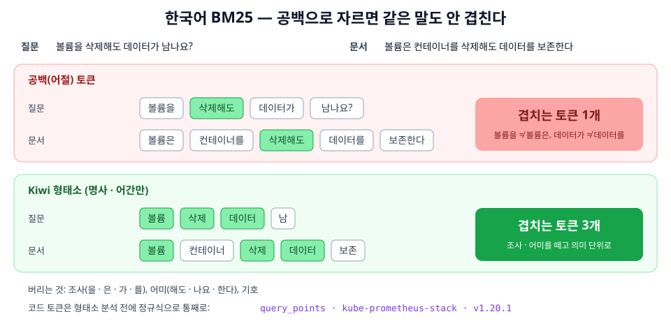
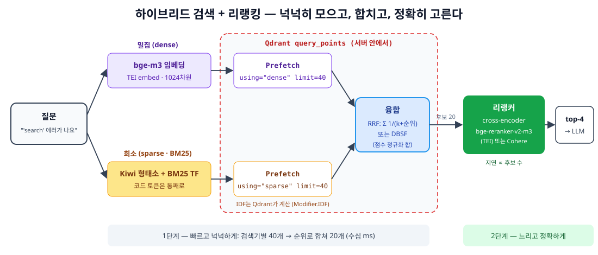
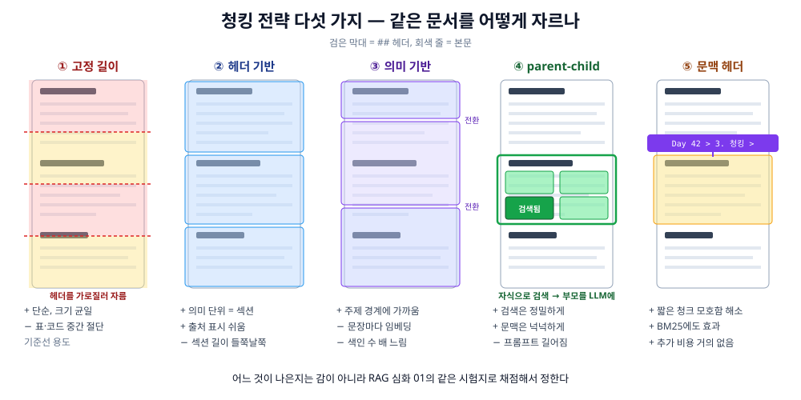

> **AI · RAG 심화** | 난이도 ★★★★☆ | 예상 소요 3.5 ~ 4.5시간

## 🎯 오늘의 목표

- BM25(희소)와 벡터(밀집) 검색이 **각각 어떤 질문에서 이기고 지는지** 설명할 수 있다
- 한국어 BM25에서 **형태소 토크나이저**가 왜 필요한지 알고, Kiwi로 직접 토큰을 만든다
- Qdrant의 **sparse vector + Query API(prefetch + RRF/DBSF)** 로 하이브리드 검색을 만든다
- 리랭커(cross-encoder)의 원리와 **후보 수 · 지연 · 비용** 트레이드오프를 알고, 자체 호스팅(TEI)과 상용 API(Cohere Rerank)를 비교한다
- 고정 길이, 헤더 기반, 의미 기반, parent-child, 문맥 헤더 **다섯 가지 청킹 전략**을 RAG 심화 01의 평가 파이프라인으로 채점한다

---

## 1. 출발점 — 01편의 실패 분류

[RAG 심화 01](./rag01-evaluation-ragas.md)에서 `triage.py`로 실패 사례를 분류하면, 대개 이런 표가 나옵니다(예시).

| 확정 원인 | 대표 질문 | 오늘 해결 수단 |
|---|---|---|
| 검색 실패 — 정확한 문자열 질문 | "`'QdrantClient' object has no attribute 'search'` 에러" / "`kubectl rollout undo` 옵션" | **BM25 하이브리드** (2~5장) |
| 순위 문제 — 찾긴 했는데 5등 | "볼륨 백업은 어떻게?" | **리랭커** (6장) |
| 근거 일부 누락 — 표가 청크 경계에서 잘림 | "Qdrant와 pgvector 비교표 내용" | **parent-child 청킹** (7장) |

오늘은 이 세 가지를 차례로 고치고, 각각을 **01편의 `run_eval`·`compare`로 채점**합니다(8장). 리랭커와 헤더 청킹의 기본은 [Day 42](./day42-rag-pipeline.md) 3~4장에서 이미 다뤘으니, 여기서는 그 다음 이야기만 합니다.

---

## 2. 희소 검색 vs 밀집 검색

[Day 41](./day41-embedding-vectordb.md)에서 "키워드 검색은 '죽어요'와 '종료돼요'를 못 잇는다"며 임베딩을 소개했습니다. 반대 방향의 실패도 있습니다. 임베딩은 **의미가 비슷한 것**을 찾는 데 강하지만, **정확히 그 문자열**을 찾는 데는 약합니다.

| | BM25 (희소, sparse) | 벡터 (밀집, dense) |
|---|---|---|
| 표현 | 어휘 크기만 한 벡터, 문서에 나온 단어 자리만 값이 있음 | 1024차원(bge-m3) 실수 벡터, 모든 자리에 값 |
| 점수 | 겹치는 단어 × 희귀도(IDF) × 빈도 포화·길이 보정 | 의미 공간의 코사인 유사도 |
| 강한 질문 | 에러 메시지, 명령어·옵션(`--no-sandbox`), 버전(`v1.20.1`), 고유명사, 코드 식별자 | 동의어·구어체("컨테이너 지워도 데이터 남게"), 다른 언어로 한 질문 |
| 약한 질문 | 다른 단어로 한 질문, 오타 | 드문 식별자·숫자(임베딩이 비슷한 토큰과 뭉개 버림) |
| 비용 | 모델 없음, 색인·검색 매우 빠름 | 임베딩 모델 추론 필요 |
| 설명 가능성 | 어떤 단어가 맞았는지 보임 | 왜 가까운지 설명하기 어려움 |

둘의 실패가 **서로 다른 질문**에서 일어나므로, 결과를 합치면 한쪽이 놓친 것을 다른 쪽이 건집니다. 이것이 **하이브리드 검색**입니다.

> 💡 bge-m3는 원래 dense 외에 **sparse(어휘 가중치)** 출력도 낼 수 있는 모델입니다. 다만 Day 42~43에서 쓴 OpenAI 호환 `/v1/embeddings` 엔드포인트(Ollama, TEI)는 dense만 돌려줍니다. 오늘은 모델에 의존하지 않는 고전적 BM25로 sparse를 만듭니다.

---

## 3. 한국어 BM25의 함정 — 토크나이저



BM25는 **같은 토큰**이 겹쳐야 점수가 납니다. 영어는 공백으로 자르고 소문자·어간 처리만 해도 꽤 맞지만, 한국어는 조사와 어미가 단어에 붙는 **교착어**라서 공백으로 자르면 "볼륨을", "볼륨은", "볼륨에"가 전부 다른 토큰이 됩니다. 그림처럼 질문과 문서가 같은 이야기를 하는데도 공백 토큰은 거의 겹치지 않습니다.

| 방법 | 예: "볼륨을 삭제해도" | 장점 | 단점 |
|---|---|---|---|
| 공백(어절) | `볼륨을` `삭제해도` | 구현 0줄 | 조사·어미 때문에 거의 안 겹침 |
| 문자 n-gram (bigram) | `볼륨` `륨을` `삭제` `제해` `해도` | 사전 불필요, 오타에 강함 | 의미 없는 조각이 많아 노이즈, 색인이 커짐 |
| **형태소 분석** (Kiwi, MeCab-ko 등) | `볼륨` `삭제` | 의미 단위로 정확히 겹침 | 분석기 설치, 신조어·기술 용어 오분석 |
| Qdrant 서버 쪽 토크나이저 | 버전·설정에 따라 다름 | 클라이언트 코드 없음 | 한국어 형태소 품질을 직접 통제하기 어려움 |

오늘은 **Kiwi**(`kiwipiepy`, 2026-11 기준 0.25.1)를 씁니다. `pip install` 하나로 설치되고(Java 불필요) 품사 태그를 주므로 명사·동사 어간만 골라낼 수 있습니다. 그리고 기술 문서 특유의 문제를 하나 더 처리합니다. `query_points`, `kube-prometheus-stack`, `v1.20.1` 같은 **코드 토큰은 형태소 분석기가 잘게 부수면 안 되므로** 정규식으로 먼저 떼어 통째로 넣습니다.

> 💡 Qdrant 쪽에서 처리하는 방법도 있습니다. Qdrant는 서버 안에서 BM25 sparse 벡터를 만드는 추론 기능과, v1.20.0부터 **full-text 인덱스에 BM25 점수**(`TextIndexParams(..., scoring=True)` + `models.TextQuery`)를 제공합니다. 한국어 품질이 중요하면, Kiwi로 미리 형태소를 띄어 쓴 텍스트를 payload에 넣고 `whitespace` 토크나이저로 인덱싱하는 식으로 조합할 수 있습니다. 오늘은 **토크나이저를 완전히 통제할 수 있고 v1.10 이후 어떤 Qdrant에서도 동작하는** 클라이언트 쪽 sparse 벡터 방식을 씁니다.

---

## 4. Qdrant 하이브리드 검색의 구조



### 4-1. 한 포인트에 벡터 두 개 — named vector

Day 42의 `infra_docs` 컬렉션은 이름 없는 벡터 하나만 가졌습니다. 하이브리드는 한 포인트(청크)에 **dense 벡터와 sparse 벡터를 이름을 붙여 함께** 저장합니다. 이름은 `dense`와 `sparse`로 정하고, 이후 편([RAG 심화 03](./rag03-blog-docs-chatbot.md))에서도 그대로 씁니다.

```python
qdrant.create_collection(
    collection_name="hyb_header",
    vectors_config={"dense": models.VectorParams(size=1024, distance=models.Distance.COSINE)},
    sparse_vectors_config={"sparse": models.SparseVectorParams(modifier=models.Modifier.IDF)},
)
```

`modifier=IDF`가 핵심입니다. BM25 점수는 **빈도(TF) 부분**과 **희귀도(IDF) 부분**의 곱인데, IDF는 "전체 문서 중 이 단어가 든 문서 수"라서 문서가 추가·삭제될 때마다 바뀝니다. IDF를 Qdrant에 맡기면 **클라이언트는 문서별 TF 부분만** 넣으면 되고, IDF는 Qdrant가 컬렉션 통계로 검색 시점에 계산합니다.

| BM25 구성 요소 | 계산하는 곳 | 식 |
|---|---|---|
| TF 포화 + 길이 보정 | 클라이언트 (오늘 `sparse.py`) | `tf·(k1+1) / (tf + k1·(1 − b + b·문서길이/평균길이))`, k1=1.2, b=0.75 |
| IDF | Qdrant (`Modifier.IDF`) | 컬렉션의 문서 빈도로 계산 |
| 질문 쪽 | 클라이언트 | 질문 토큰마다 값 1.0 |

### 4-2. Query API — prefetch로 후보를 모으고 fusion으로 합친다

`query_points`(Day 42에서 쓴 그 API)의 `prefetch`에 검색을 여러 개 넣고, 바깥 `query`에 **합치는 방법**을 지정합니다.

| 융합 방법 | 원리 | Qdrant 버전 | 특징 |
|---|---|---|---|
| **RRF** (Reciprocal Rank Fusion) | 점수는 버리고 **순위만** 사용: `Σ 1 / (k + 순위)` | Query API 1.10+, `k` 지정 1.16+, 가중치 1.17+ | 점수 척도가 달라도 안전. Qdrant 기본 `k`는 2, 논문·다른 시스템은 흔히 60 |
| **DBSF** (Distribution-Based Score Fusion) | 검색기별로 점수의 평균 ± 3 표준편차를 0~1 끝점으로 **정규화해 더함** | 1.11+ | 점수 차이(얼마나 확실한가)를 반영. 결과가 적으면 불안정 |

```python
# RRF
qdrant.query_points(
    collection_name="hyb_header",
    prefetch=[
        models.Prefetch(query=dense_vec, using="dense", limit=40),
        models.Prefetch(query=sparse_vec, using="sparse", limit=40),
    ],
    query=models.RrfQuery(rrf=models.Rrf(k=60)),      # 가중치: models.Rrf(weights=[1.0, 2.0]) (1.17+)
    limit=20,
)
# DBSF는 query만 바꾼다
query=models.FusionQuery(fusion=models.Fusion.DBSF)
```

> ⚠️ 각 `Prefetch`의 `limit`은 바깥 `limit`(+ offset)보다 **크거나 같아야** 합니다. 작으면 결과가 비거나 모자랄 수 있습니다. 가중치나 `k`는 감으로 정하지 말고 01편 골든 셋의 **dev 셋**으로 고르세요.

---

## 5. 실습 ① — 하이브리드 색인과 검색

> 실습 환경: Day 42의 `rag/` 폴더(Python 3.12 venv), Qdrant `qdrant/qdrant:v1.20.1`(2026-11 기준 최신 패치는 v1.20.2), `qdrant-client==1.20.0`, 임베딩은 Day 43의 TEI `embed`(bge-m3), 리랭커는 Day 42 6-8 / Day 43의 TEI `reranker`(`cpu-1.9`, 2026-11 기준 TEI 최신 1.9.4).

> 💡 **GPU가 없다면**: 오늘 실습은 전부 CPU로 돌아갑니다. BM25는 모델이 없어 CPU로도 빠르고, 하이브리드 검색도 지연이 거의 늘지 않습니다. 느린 것은 **CPU 리랭커**입니다. 후보 수를 10개로 줄이거나, 상용 리랭크 API(6-3)를 쓰거나, 실험하는 동안만 클라우드 GPU를 시간 단위로 빌려 TEI GPU 이미지로 띄우세요.

```bash
cd ~/rag-stack/rag && source .venv/bin/activate
pip install "kiwipiepy==0.25.1"
```

```
rag/
├── common.py  ingest.py  app.py    # Day 42 (그대로)
├── ko_tokenizer.py                 # 오늘: 한국어 + 코드 토큰
├── sparse.py                       # 오늘: BM25 sparse 벡터
├── chunkers.py                     # 오늘: 청킹 전략 5가지 (7장)
├── ingest_hybrid.py                # 오늘: dense + sparse 색인
├── retrieve_hybrid.py              # 오늘: 하이브리드 검색 + 리랭커
└── eval/                           # RAG 심화 01
```

### 5-1. `ko_tokenizer.py`

```python
"""한국어 BM25용 토크나이저 — 코드 토큰은 통째로, 한국어는 Kiwi 형태소로 (Python 3.12)"""
import re

from kiwipiepy import Kiwi

_kiwi = Kiwi()
# query_points, kube-prometheus-stack, OLLAMA_CONTEXT_LENGTH, v1.20.1, 1.20.1 …
CODE = re.compile(r"[A-Za-z_][A-Za-z0-9_.:/-]*[A-Za-z0-9_]|\d+(?:\.\d+)+")
# 일반명사, 고유명사, 수사, 외국어, 한자, 숫자, 어근, 동사·형용사 어간
KEEP = {"NNG", "NNP", "NR", "SL", "SH", "SN", "XR", "VV", "VA"}


def tokenize(text: str) -> list[str]:
    tokens: list[str] = []
    for m in CODE.finditer(text):
        tok = m.group(0).lower()
        tokens.append(tok)
        parts = [p for p in re.split(r"[._:/-]", tok) if len(p) > 1]
        if len(parts) > 1:
            tokens += parts                # "kube-prometheus-stack" → + kube, prometheus, stack
    rest = CODE.sub(" ", text)
    tokens += [t.form.lower() for t in _kiwi.tokenize(rest) if t.tag in KEEP]
    return tokens


if __name__ == "__main__":
    print(tokenize("볼륨을 삭제해도 데이터가 남나요?"))
    print(tokenize("'QdrantClient' object has no attribute 'search' 에러가 나요"))
```

```bash
python ko_tokenizer.py
# ['볼륨', '삭제', '데이터', '남']
# ['qdrantclient', 'object', 'has', 'no', 'attribute', 'search', '에러', '나']
```

(Kiwi 모델 버전에 따라 분석 결과가 조금 다를 수 있습니다.)

### 5-2. `sparse.py`

```python
"""BM25 sparse 벡터. IDF는 Qdrant(Modifier.IDF)가, TF 부분은 여기서 계산한다 (Python 3.12)"""
import zlib
from collections import Counter

from qdrant_client import models

from ko_tokenizer import tokenize

K1, B = 1.2, 0.75


def token_id(tok: str) -> int:
    """토큰 → uint32 인덱스. 어휘 사전 없이 해시로 (충돌하면 같은 칸에 합쳐진다)."""
    return zlib.crc32(tok.encode("utf-8"))


def _vector(weights: dict[int, float]) -> models.SparseVector:
    idx = sorted(weights)
    return models.SparseVector(indices=idx, values=[weights[i] for i in idx])


def doc_vectors(texts: list[str]) -> list[models.SparseVector]:
    toks = [tokenize(t) for t in texts]
    avg_len = sum(map(len, toks)) / max(len(toks), 1)        # 색인 시점의 평균 문서 길이
    out = []
    for t in toks:
        tf, dl = Counter(map(token_id, t)), len(t) or 1
        out.append(_vector({i: f * (K1 + 1) / (f + K1 * (1 - B + B * dl / avg_len)) for i, f in tf.items()}))
    return out


def query_vector(text: str) -> models.SparseVector:
    return _vector({token_id(t): 1.0 for t in set(tokenize(text))})
```

| 포인트 | 설명 |
|---|---|
| `crc32` 해시 인덱스 | 어휘 사전을 따로 저장·배포할 필요가 없다. 색인과 검색이 같은 함수만 쓰면 된다. 드물게 충돌하면 두 토큰이 한 칸을 공유(BM25 품질에 거의 영향 없음) |
| `Counter(map(token_id, …))` | 해시가 같은 토큰을 합쳐 **인덱스가 중복되지 않게** (Qdrant는 한 sparse 벡터 안의 중복 인덱스를 받지 않는다) |
| `avg_len` 고정 | 색인 때 계산한 평균 길이를 쓴다. Day 49의 증분 재색인처럼 일부만 다시 넣으면 조금씩 어긋나므로 가끔 전체 재색인 |

### 5-3. `ingest_hybrid.py`

청킹은 7장의 `chunkers.py`에서 고릅니다(`CHUNKER=header`가 Day 42와 같은 방식). 먼저 7장의 코드 블록을 `chunkers.py`로 저장해 두세요.

```python
"""하이브리드 색인: 청크마다 dense(bge-m3) + sparse(BM25)를 함께 저장 (Python 3.12)
사용: COLLECTION=hyb_header CHUNKER=header python ingest_hybrid.py ~/infra"""
import os
import sys
import uuid
from pathlib import Path

from qdrant_client import models

import chunkers
from common import COLLECTION, EMBED_DIM, embed, qdrant
from sparse import doc_vectors

CHUNKER = os.getenv("CHUNKER", "header")                  # header | fixed | semantic | parent
CONTEXT_HEADER = os.getenv("CONTEXT_HEADER", "1") == "1"  # 제목 > 섹션을 앞에 붙여 색인 (Day 42 트릭)
BATCH = 16


def index_text(c: dict) -> str:
    return f"{c['title']} > {c['section']}\n{c['text']}" if CONTEXT_HEADER else c["text"]


def main(root: Path) -> None:
    chunks = getattr(chunkers, f"{CHUNKER}_chunks")(root)
    texts = [index_text(c) for c in chunks]
    sparse = doc_vectors(texts)
    print(f"[{CHUNKER}] 청크 {len(chunks)}개 → {COLLECTION}")

    if qdrant.collection_exists(COLLECTION):
        qdrant.delete_collection(COLLECTION)
    qdrant.create_collection(
        collection_name=COLLECTION,
        vectors_config={"dense": models.VectorParams(size=EMBED_DIM, distance=models.Distance.COSINE)},
        sparse_vectors_config={"sparse": models.SparseVectorParams(modifier=models.Modifier.IDF)},
    )
    for i in range(0, len(chunks), BATCH):
        dense = embed(texts[i : i + BATCH])
        points = []
        for j, (c, d) in enumerate(zip(chunks[i : i + BATCH], dense)):
            vec: dict = {"dense": d}
            if sparse[i + j].indices:                    # 토큰이 하나도 없으면 sparse 생략
                vec["sparse"] = sparse[i + j]
            pid = str(uuid.uuid5(uuid.NAMESPACE_URL, f"{c['source']}#{i + j}"))
            points.append(models.PointStruct(id=pid, vector=vec, payload=c))
        qdrant.upsert(collection_name=COLLECTION, points=points)
    print("완료:", qdrant.count(collection_name=COLLECTION).count, "points")


if __name__ == "__main__":
    main(Path(sys.argv[1] if len(sys.argv) > 1 else "."))
```

```bash
# Day 43 Compose의 embed(TEI)를 쓰는 경우 — 호스트에서 접근하려면 embed에 포트를 열어 두세요
export EMBED_BASE_URL=http://localhost:8080/v1 EMBED_MODEL=BAAI/bge-m3 QDRANT_URL=http://localhost:6333

COLLECTION=hyb_header CHUNKER=header python ingest_hybrid.py ~/infra
# [header] 청크 1452개 → hyb_header
# 완료: 1452 points
```

### 5-4. `retrieve_hybrid.py`

01편 `run_eval`의 `RETRIEVER` 스위치에 그대로 꽂히도록 **Day 42와 같은 시그니처** `retrieve(question, top_k) -> list[dict]`로 만듭니다. 검색 방식, 후보 수, 리랭커는 전부 환경 변수입니다.

```python
"""하이브리드 검색 + 리랭킹 — RETRIEVER=retrieve_hybrid:retrieve (Python 3.12)"""
import os

import httpx
from qdrant_client import models

from common import COLLECTION, RERANK_URL, embed, qdrant
from sparse import query_vector

MODE = os.getenv("SEARCH_MODE", "rrf")                 # dense | sparse | rrf | dbsf
PREFETCH = int(os.getenv("PREFETCH", "40"))            # 검색기별 후보 수
CANDIDATES = int(os.getenv("CANDIDATES", "20"))        # 리랭커에 넘길 후보 수 (PREFETCH 이하)
RRF_K = int(os.getenv("RRF_K", "60"))
RERANKER = os.getenv("RERANKER", "tei" if RERANK_URL else "none")   # none | tei | cohere
RERANK_MIN = float(os.getenv("RERANK_MIN", "0"))       # 이 점수 미만 문맥은 버림 (노이즈 컷)


def search(question: str, limit: int):
    qv, sv = embed([question])[0], query_vector(question)
    if MODE == "dense" or not sv.indices:              # 질문에 쓸 토큰이 없으면 dense로
        return qdrant.query_points(collection_name=COLLECTION, query=qv, using="dense",
                                   limit=limit, with_payload=True).points
    if MODE == "sparse":
        return qdrant.query_points(collection_name=COLLECTION, query=sv, using="sparse",
                                   limit=limit, with_payload=True).points
    fusion = (models.RrfQuery(rrf=models.Rrf(k=RRF_K)) if MODE == "rrf"
              else models.FusionQuery(fusion=models.Fusion.DBSF))
    return qdrant.query_points(
        collection_name=COLLECTION,
        prefetch=[models.Prefetch(query=qv, using="dense", limit=PREFETCH),
                  models.Prefetch(query=sv, using="sparse", limit=PREFETCH)],
        query=fusion, limit=limit, with_payload=True).points


def rerank(question: str, docs: list[dict]) -> list[dict]:
    texts = [d["text"] for d in docs]
    if RERANKER == "tei":                              # Day 42 6-8 / Day 43의 TEI reranker
        r = httpx.post(f"{RERANK_URL}/rerank",
                       json={"query": question, "texts": texts, "truncate": True}, timeout=30)
        r.raise_for_status()
        scored = [(x["index"], x["score"]) for x in r.json()]
    elif RERANKER == "cohere":                         # 환경 변수 CO_API_KEY 필요
        import cohere
        resp = cohere.ClientV2().rerank(model=os.getenv("COHERE_RERANK_MODEL", "rerank-v5.0-fast"),
                                        query=question, documents=texts, top_n=len(texts))
        scored = [(x.index, x.relevance_score) for x in resp.results]
    else:
        return docs
    scored.sort(key=lambda x: x[1], reverse=True)
    return [{**docs[i], "score": s} for i, s in scored if s >= RERANK_MIN]


def retrieve(question: str, top_k: int) -> list[dict]:
    # 리랭커가 있으면 후보를 넉넉히, 없으면 top_k의 3배(parent-child 병합으로 줄어들 몫)만
    limit = min(max(CANDIDATES, top_k), PREFETCH) if RERANKER != "none" else top_k * 3
    docs = rerank(question, [{**h.payload, "score": h.score} for h in search(question, limit)])
    if docs and "parent_id" in docs[0]:                # parent-child 색인(7장): 부모 단위로 합쳐 부모 본문을 문맥으로
        parents: dict[str, dict] = {}
        for d in docs:
            parents.setdefault(d["parent_id"], {**d, "text": d["parent_text"]})
        docs = list(parents.values())
    return docs[:top_k]
```

Day 42 6-6처럼 검색만 점검해 봅니다. 에러 메시지 질문에서 차이가 잘 보입니다.

```bash
export COLLECTION=hyb_header
for m in dense sparse rrf; do
  SEARCH_MODE=$m python -c "
from retrieve_hybrid import retrieve
print('== $m')
for d in retrieve(\"'QdrantClient' object has no attribute 'search' 에러\", 3):
    print(f\"{d['score']:.3f}  {d['source']}  |  {d['section']}\")"
done
```

```
== dense
0.612  06-ai-infra/day41-embedding-vectordb.md  |  8. 실습 — Qdrant > 8-4. 검색과 필터
0.598  06-ai-infra/day42-rag-pipeline.md  |  6. 실습 — 프레임워크 없이 RAG API 만들기 > 6-5. …
0.587  06-ai-infra/day41-embedding-vectordb.md  |  10. 트러블슈팅
== sparse
14.83  06-ai-infra/day42-rag-pipeline.md  |  7. 트러블슈팅
9.71  06-ai-infra/day42-rag-pipeline.md  |  6. 실습 — … > 6-5. `app.py` — 질의 파이프라인 + 스트리밍
...
== rrf
0.032  06-ai-infra/day42-rag-pipeline.md  |  7. 트러블슈팅
0.030  06-ai-infra/day42-rag-pipeline.md  |  6. 실습 — … > 6-5. …
...
```

(출력은 예시입니다.) 점수 척도가 방식마다 완전히 다르다는 점에 주목하세요. dense는 코사인(0~1), sparse는 BM25(상한 없음), RRF는 순위 역수의 합(아주 작은 값)입니다. 점수 자체를 섞으면 안 되는 이유이고, RRF가 **순위만** 쓰는 이유입니다.

> 💡 운영 앱에 적용할 때는 Day 42 `app.py`의 `from common import …` 아래에서 `retrieve`를 `from retrieve_hybrid import retrieve`로 바꾸면 됩니다. `/ask`의 나머지 코드는 그대로입니다.

---

## 6. 리랭커 심화

### 6-1. cross-encoder는 왜 정확하고 왜 느린가

Day 42 4장의 표를 한 단계 더 들어가 봅니다. bi-encoder(임베딩)는 질문과 문서를 **따로** 1024개 숫자로 압축한 뒤 비교합니다. 압축 과정에서 "질문의 이 단어가 문서의 저 문장과 맞는다"는 세부가 사라집니다. cross-encoder(리랭커)는 `[질문] [SEP] [문서]`를 **한 입력으로** 트랜스포머에 넣어, 모든 층에서 질문 토큰과 문서 토큰이 서로를 직접 봅니다(attention). 그래서 정확하지만, 문서 벡터를 미리 계산해 둘 수 없고 **후보마다 전체 모델을 한 번씩** 돌려야 합니다.

| | 계산량 | 미리 계산 | 오늘의 위치 |
|---|---|---|---|
| bi-encoder | 질문 1회 임베딩 + 벡터 비교 | 문서 벡터 색인 시점 | 1단계: 후보 40개씩 |
| BM25 | 토큰 사전 조회 | 역색인 | 1단계: 후보 40개씩 |
| cross-encoder | **후보 수 × (질문+문서 길이)** 만큼 추론 | 불가 | 2단계: 융합된 20개만 |

`BAAI/bge-reranker-v2-m3`는 bge-m3 기반의 다국어(한국어 포함) 리랭커로 Apache-2.0 라이선스입니다. TEI는 점수를 0~1(시그모이드)로 돌려주며, `"raw_scores": true`로 원점수를 받을 수도 있습니다. 요청의 `"truncate": true`는 모델 최대 길이를 넘는 문서를 잘라서 에러 대신 처리하게 합니다.

> 💡 GPU가 있다면 TEI GPU 이미지로 바꾸는 것만으로 리랭크 지연이 크게 줄어듭니다. GPU 이미지 태그는 GPU 세대별로 다르니(예: Ampere·Ada·Hopper용 태그가 따로 있음) TEI 문서의 지원 표에서 확인하세요. Day 43 `compose.yaml`의 `reranker` 서비스에 `deploy.resources.reservations.devices`(Day 43 4-1)를 붙이면 됩니다.

### 6-2. 후보 수 · 지연 · 품질의 트레이드오프

리랭커 지연은 **후보 수에 거의 비례**하고, 품질은 어느 지점부터 더 오르지 않습니다. 정답이 1단계 후보 안에 없으면 리랭커도 못 살리기 때문입니다.

| 후보 수 (`CANDIDATES`) | MRR (예시) | 리랭크 p95 — CPU (예시) | 리랭크 p95 — GPU (예시) |
|---|---|---|---|
| 10 | 0.861 | 약 1.0s | 약 0.1s |
| **20** | **0.902** | 약 1.9s | 약 0.2s |
| 40 | 0.909 | 약 3.8s | 약 0.35s |
| 80 | 0.909 | 약 7.5s | 약 0.6s |

(**예시 값**입니다. 하드웨어, 청크 길이, TEI 배치 설정에 따라 크게 다릅니다. 01편 `run_eval`의 `lat_retrieve_p95`로 직접 재세요.) 이런 표를 만들면 결정이 쉬워집니다. GPU라면 20~40, CPU라면 10~20, 그리고 **지연 예산**(예: 검색 전체 p95 1초)을 먼저 정해 두고 그 안에서 가장 좋은 값을 고릅니다.

`RERANK_MIN`(리랭크 점수 하한)도 같이 실험할 만합니다. 하한 아래 문맥을 버리면 **noise sensitivity**가 좋아지고(01편 4-2), 다 버려져 문맥이 비면 모델이 "찾을 수 없습니다"라고 답하기 쉬워져 **거절 정확도**도 오릅니다. 너무 높이면 과잉 거절이 늘어나니 01편의 `false_refusal`과 함께 봅니다.

### 6-3. 자체 호스팅 vs 상용 리랭크 API

| | TEI + bge-reranker-v2-m3 (자체) | Cohere Rerank (상용 API) |
|---|---|---|
| 모델 | 오픈 가중치, Apache-2.0 | `rerank-v5.0-pro` / `rerank-v5.0-fast`, `rerank-v4.0-*`, `rerank-v3.5` 등 (2026-11 기준) |
| 한국어 | 다국어 학습 | v5.0은 한국어를 포함한 주요 언어에 초점을 둔 100개 이상 언어 |
| 입력 길이 | 모델 최대 길이 안에서 (`truncate`) | v5.0·v4.0 32k 토큰, v3.5 4k 토큰 (질문+문서) |
| 지연 | 내 하드웨어에 좌우, 네트워크 없음 | 네트워크 왕복 포함, 하드웨어 걱정 없음 |
| 비용 | GPU·전기료 (고정비) | 호출(검색) 단위 과금 — 가격 페이지 확인 |
| 데이터 | **밖으로 안 나감** | 질문과 문서 조각이 외부로 전송됨 |
| 운영 | 이미지·모델 버전 관리, 스케일링 | 키 관리, rate limit, 장애 시 대체 경로 |

```bash
pip install cohere
export CO_API_KEY=<Cohere 키>              # 키는 환경 변수·Secret으로만 (Day 13)
RERANKER=cohere COHERE_RERANK_MODEL=rerank-v5.0-fast python -m eval.run_eval --retrieval-only --name E5-cohere
```

> ⚠️ 상용 API를 쓰면 **문서 내용이 외부로 나갑니다.** 사내 문서라면 데이터 처리 약관과 보안 정책을 먼저 확인하세요(Day 48 LLM02). 홈랩 Day 49 구성에서는 rag-api의 egress NetworkPolicy에 API 도메인 허용이 필요해집니다. 실험은 공개 문서(이 레포)로만 하는 것이 안전합니다.

---

## 7. 청킹 전략 비교



Day 42는 "헤더로 1차 분할 + 1000자 길이 제한 + 150자 겹침"을 썼습니다. 그것이 정말 최선인지는 **같은 시험지로 비교해 봐야** 압니다. 01편에서 골든 셋 라벨을 청크 ID가 아니라 **문서 + 섹션**으로 단 덕분에, 청킹을 바꿔도 라벨을 다시 달 필요가 없습니다.

| 전략 | 방법 | 장점 | 단점 | 이 레포에서 예상 |
|---|---|---|---|---|
| 고정 길이 (`fixed`) | N자마다 자르고 겹침 | 단순, 크기 균일 | 표·코드 블록·문단 중간이 잘림 | 기준선으로만 |
| 헤더 기반 (`header`) | `##`/`###` + 길이 제한 (Day 42) | 의미 단위와 일치, 출처 표시 쉬움 | 섹션 길이가 들쭉날쭉 | 헤더가 잘 정리돼 있어 강함 |
| 의미 기반 (`semantic`) | 문장 임베딩 유사도가 뚝 떨어지는 곳에서 자름 | 주제 경계에 가까움 | 색인 시 문장마다 임베딩 → **수 배 느림**, 코드 블록에 약함 | 헤더가 없는 문서(위키·회의록)에서 유리 |
| parent-child (`parent`) | **작은 자식 청크로 검색**, LLM에는 **큰 부모 청크**를 줌 (small-to-big) | 검색은 정밀하게, 문맥은 넉넉하게 | 프롬프트 토큰 증가, 저장 공간 증가 | 표·긴 절차가 잘리는 문제에 효과 |
| 문맥 헤더 (`CONTEXT_HEADER`) | 청크 앞에 "제목 > 섹션"을 붙여 색인 (Day 42에서 이미 사용) | 짧은 청크의 모호함 해소, **BM25에도 효과** | 거의 없음 | 끄면 얼마나 떨어지는지 확인 |

> 💡 **문맥 헤더의 확장판**으로, 청크마다 LLM에게 "이 청크가 문서 전체에서 어떤 맥락인지" 한두 문장을 쓰게 해 앞에 붙이는 방법(contextual retrieval)도 있습니다. 효과가 크다고 알려져 있지만 **색인할 때 청크 수만큼 LLM 호출**이 들어 비용이 큽니다. 헤더가 잘 정리된 이 레포에서는 "제목 > 섹션" 헤더만으로도 상당 부분을 얻으므로, 먼저 그것으로 기준을 잡고 필요할 때 실험하세요.

### 7-1. `chunkers.py`

```python
"""청킹 전략 모음. 모두 {"source","title","section","text", …} 목록을 돌려준다 (Python 3.12)"""
import hashlib
import math
import re
from pathlib import Path

from common import embed
from ingest import build_chunks, load_docs, split_sections  # Day 42

SENT = re.compile(r"(?<=[.!?다요])\s+|\n{2,}")              # 한국어 문장 끝(…다. …요.) + 빈 줄


def _title(text: str, source: str) -> str:
    return next((ln[2:].strip() for ln in text.splitlines() if ln.startswith("# ")), source)


def header_chunks(root: Path) -> list[dict]:
    """Day 42 그대로: 헤더 → 1000자 / 150자 겹침."""
    return build_chunks(root)


def fixed_chunks(root: Path, size: int = 500, overlap: int = 100) -> list[dict]:
    out = []
    for source, text in load_docs(root):
        title = _title(text, source)
        for start in range(0, len(text), size - overlap):
            if part := text[start : start + size].strip():
                out.append({"source": source, "title": title, "section": "(고정 길이)", "text": part})
    return out


def _cos(a: list[float], b: list[float]) -> float:
    dot = sum(x * y for x, y in zip(a, b))
    return dot / (math.sqrt(sum(x * x for x in a)) * math.sqrt(sum(y * y for y in b)) or 1.0)


def semantic_chunks(root: Path, pct: float = 0.2, max_chars: int = 1200) -> list[dict]:
    """섹션 안에서 인접 문장 유사도가 하위 pct(20%)인 지점마다 자른다."""
    out = []
    for source, text in load_docs(root):
        title = _title(text, source)
        for section, body in split_sections(text):
            sents = [s.strip() for s in SENT.split(body) if s.strip()]
            if len(sents) < 4:
                out.append({"source": source, "title": title, "section": section, "text": body})
                continue
            vecs = [v for i in range(0, len(sents), 32) for v in embed(sents[i : i + 32])]
            sims = [_cos(vecs[i], vecs[i + 1]) for i in range(len(vecs) - 1)]
            cut = sorted(sims)[int(len(sims) * pct)]
            buf = [sents[0]]
            for sent, sim in zip(sents[1:], sims):
                if sim <= cut or sum(map(len, buf)) > max_chars:
                    out.append({"source": source, "title": title, "section": section, "text": "\n".join(buf)})
                    buf = []
                buf.append(sent)
            out.append({"source": source, "title": title, "section": section, "text": "\n".join(buf)})
    return out


def parent_chunks(root: Path, child: int = 300, overlap: int = 50) -> list[dict]:
    """부모 = Day 42 청크(최대 1000자), 자식 = 부모를 300자로 다시 자른 조각. 검색은 자식, 문맥은 부모."""
    out = []
    for p in build_chunks(root):
        pid = hashlib.sha1(f"{p['source']}|{p['section']}|{p['text']}".encode()).hexdigest()[:16]
        for start in range(0, len(p["text"]), child - overlap):
            if part := p["text"][start : start + child].strip():
                out.append({**p, "text": part, "parent_id": pid, "parent_text": p["text"]})
    return out
```

| 포인트 | 설명 |
|---|---|
| 모두 같은 딕셔너리 형식 | `ingest_hybrid.py`와 `retrieve_hybrid.py`, 01편 평가 코드를 **하나도 안 바꾸고** 전략만 교체 |
| `semantic_chunks`의 `embed(… 32개씩)` | TEI는 한 요청의 입력 개수에 상한이 있다(기본 `--max-client-batch-size` 32). 문장마다 임베딩하므로 색인이 가장 느린 전략 |
| `cut = 하위 20%` | 고정 임계값(예: 0.8) 대신 **섹션마다 상대적으로** 자른다. 임베딩 모델마다 유사도 분포가 달라서 |
| `parent_id` + `parent_text` | 검색 결과에 `parent_id`가 있으면 `retrieve_hybrid.retrieve()`가 부모 단위로 합쳐 부모 본문을 돌려준다(5-4) |

---

## 8. 실습 ② — 01편 평가 파이프라인으로 실험하기

### 8-1. 실험 설계 — 한 번에 하나, 같은 시험지

| 원칙 | 오늘의 적용 |
|---|---|
| 기준선 재현 먼저 (A/A 확인) | `hyb_header` + `SEARCH_MODE=dense`가 Day 42 `infra_docs` 기준 실행과 **같은 점수**인지 먼저 확인. 다르면 색인·코드에 차이가 있는 것 |
| 한 번에 하나만 | 검색 방식 → 리랭커 → 청킹 순서로, 앞 단계에서 이긴 설정을 고정하고 다음을 바꾼다 |
| 튜닝은 dev, 판정은 test | `RRF_K`, `CANDIDATES`, `RERANK_MIN`은 `--split dev`로 고르고, 마지막에 test로 한 번 확인 |
| 싼 평가부터 | 검색 지표(`--retrieval-only`)로 후보를 좁히고, 마지막 2~3개만 전체 Ragas 평가 |
| 유형별로도 본다 | 평균이 같아도 `troubleshoot` 유형만 크게 오를 수 있다 |

```bash
# 공통
export RETRIEVER=retrieve_hybrid:retrieve
export EMBED_BASE_URL=http://localhost:8080/v1 EMBED_MODEL=BAAI/bge-m3 QDRANT_URL=http://localhost:6333
run() { python -m eval.run_eval --split test --k 4 --retrieval-only --name "$1"; }

# ① 검색 방식 (청킹 = header)
export COLLECTION=hyb_header
SEARCH_MODE=dense  run E0-dense        # A/A: Day 42 기준과 같아야 함
SEARCH_MODE=sparse run E1-sparse
SEARCH_MODE=rrf    run E2-rrf
SEARCH_MODE=dbsf   run E3-dbsf

# ② 리랭커 (①의 승자 고정)
export SEARCH_MODE=rrf RERANK_URL=http://localhost:8081
CANDIDATES=20 run E4-rrf-tei20
RERANKER=cohere CANDIDATES=20 run E5-rrf-cohere20

# ③ 청킹 (①②의 승자 고정) — 전략마다 컬렉션을 따로 만든다
for c in fixed semantic parent; do
  COLLECTION=hyb_$c CHUNKER=$c python ingest_hybrid.py ~/infra
  COLLECTION=hyb_$c CANDIDATES=20 run E6-$c
done
COLLECTION=hyb_nohdr CHUNKER=header CONTEXT_HEADER=0 python ingest_hybrid.py ~/infra
COLLECTION=hyb_nohdr CANDIDATES=20 run E9-no-context-header

# 비교 (01편 compare.py — 기준은 Day 42 dense 실행)
python -m eval.compare eval/baseline "$(ls -d eval/runs/*-E4-rrf-tei20 | tail -1)"
```

유형별 hit도 뽑아 봅니다.

```python
# eval/by_type.py — 실행별·질문 유형별 hit 평균 (Python 3.12)
import json
import statistics
import sys
from collections import defaultdict
from pathlib import Path

for run in sys.argv[1:]:
    groups = defaultdict(list)
    for line in (Path(run) / "results.jsonl").read_text(encoding="utf-8").splitlines():
        r = json.loads(line)
        if "hit" in r:
            groups[r["type"]].append(r["hit"])
    print(Path(run).name, {t: round(statistics.fmean(v), 2) for t, v in sorted(groups.items())})
```

```bash
python -m eval.by_type eval/runs/*-E0-dense eval/runs/*-E2-rrf
```

### 8-2. 예시 결과 표

> ⚠️ **아래 숫자는 모두 설명을 위한 예시입니다.** 실제 값은 골든 셋, 지식 베이스 시점, 하드웨어, 모델 버전에 따라 다릅니다. 표의 **모양**과 **읽는 법**을 참고하고, 숫자는 직접 채우세요.

**① 검색 방식** (header 청킹, k=4, test 45문항, 리랭커 없음)

| 실험 | hit@4 | MRR | troubleshoot 유형 hit | 검색 p95 | 판정 |
|---|---|---|---|---|---|
| E0 dense (Day 42 기준) | 0.911 | 0.793 | 0.71 | 0.21s | 기준 |
| E1 sparse (Kiwi BM25) | 0.844 | 0.712 | **0.86** | 0.06s | 단독으로는 열세, 에러 질문엔 강함 |
| (참고) sparse, 공백 토큰 | 0.733 | 0.590 | 0.71 | 0.05s | 한국어 토큰화 실패의 크기 |
| **E2 RRF (k=60)** | **0.956** | 0.828 | **0.93** | 0.24s | ✅ 채택 |
| E3 DBSF | 0.944 | 0.835 | 0.86 | 0.24s | ➖ RRF와 차이 없음 |

**② 리랭커** (E2 고정)

| 실험 | hit@4 | MRR | ctx precision | 검색 p95 | 비용 | 판정 |
|---|---|---|---|---|---|---|
| E2 RRF | 0.956 | 0.828 | 0.771 | 0.24s | — | 기준 |
| **E4 + TEI 리랭커, 후보 20 (GPU)** | 0.956 | **0.902** | **0.842** | 0.45s | 고정비 | ✅ 채택 |
| E4 같은 설정, CPU | 0.956 | 0.902 | 0.842 | 2.1s | 고정비 | 지연 예산 초과 → 후보 10으로 |
| E5 + Cohere `rerank-v5.0-fast`, 후보 20 | 0.956 | 0.897 | 0.838 | 0.6s | 호출당 과금 | ➖ 품질 비슷, 데이터 외부 전송 |

**③ 청킹** (E4 고정)

| 실험 | hit@4 | MRR | ctx recall | 평균 프롬프트 길이 | 색인 시간 | 판정 |
|---|---|---|---|---|---|---|
| header 1000/150 (E4) | 0.956 | 0.902 | 0.861 | 3.1k자 | 1× | 기준 |
| E6 fixed 500/100 | 0.911 | 0.861 | 0.788 | 1.8k자 | 1× | ❌ 회귀 (표·코드 잘림) |
| E6 semantic | 0.944 | 0.889 | 0.852 | 2.9k자 | 약 6× | ➖ 이 레포에선 이득 없음 |
| **E6 parent (자식 300 → 부모)** | 0.956 | 0.911 | **0.903** | 3.9k자 | 1.3× | ✅ 채택 (프롬프트 길이 확인) |
| E9 문맥 헤더 끔 | 0.900 | 0.817 | 0.842 | 3.0k자 | 1× | ❌ 회귀 → 헤더 유지 |

### 8-3. 예시 표를 읽는 법

- **sparse 단독은 평균이 낮지만, 하이브리드에 넣으면 이긴다.** 평균만 보고 sparse를 버렸다면 `troubleshoot` 유형의 개선을 놓쳤을 것입니다. 유형별 표가 필요한 이유입니다.
- **공백 토큰 BM25와 Kiwi BM25의 차이**가 3장에서 말한 한국어 토크나이저 문제의 크기입니다.
- **RRF와 DBSF의 차이가 구간 안이면 단순한 쪽(RRF)** 을 고릅니다. 01편 `compare.py`의 "차이 없음"은 "둘 다 괜찮다"는 뜻이기도 합니다.
- **리랭커는 hit를 못 올리고 순위(MRR, precision)만 올립니다.** 정답이 후보에 없으면 리랭커도 어쩔 수 없습니다. hit를 올리는 것은 1단계(하이브리드, 청킹)의 몫입니다.
- **parent-child는 context recall을 올리는 대신 프롬프트가 길어집니다.** 생성 지연과 토큰 비용 열을 반드시 함께 보고, 01편의 전체 평가(faithfulness 포함)로 최종 확인합니다. 문맥이 길어지면 작은 모델은 오히려 핵심을 놓칠 수 있습니다.
- 채택한 조합(RRF + 리랭커 20 + parent-child + 문맥 헤더)으로 **전체 Ragas 평가를 한 번** 돌리고, 통과하면 01편 6-3처럼 `baseline/`을 교체하고 실험 표에 기록합니다.

---

## 9. 트러블슈팅

| 증상 | 원인 | 해결 |
|---|---|---|
| `Wrong input: Not existing vector name error: dense` | Day 42의 이름 없는 벡터 컬렉션(`infra_docs`)에 하이브리드 검색 | `COLLECTION`을 `ingest_hybrid.py`로 만든 컬렉션으로 |
| 하이브리드 결과가 dense와 똑같음 | sparse 벡터가 비어 있음(토크나이저가 토큰을 못 만듦), 또는 질문 토큰이 0개 | `python ko_tokenizer.py`로 토큰 확인, Qdrant 대시보드에서 포인트에 `sparse` 벡터가 있는지 확인 |
| sparse 업서트에서 인덱스 관련 에러 | 한 벡터에 같은 인덱스가 중복 | `Counter`로 해시 인덱스를 합친 뒤 넣기 (`sparse.py`처럼) |
| `Rrf(k=…)` 또는 `weights` 관련 에러 | Qdrant 서버·클라이언트가 오래됨 (`k`는 1.16+, 가중치는 1.17+) | 서버·클라이언트를 1.20 계열로, 또는 `models.Rrf()` 기본값 사용 |
| 결과 개수가 `limit`보다 적음 | `Prefetch.limit` < 바깥 `limit` | `PREFETCH ≥ CANDIDATES` 유지 |
| TEI 리랭커 `413` 또는 입력 개수 에러 | 한 요청의 후보 수가 TEI `--max-client-batch-size`를 넘음 | 후보 수 줄이기, 또는 TEI 실행 인자에서 상한 올리기 |
| 리랭커 켠 뒤 지연이 수 초 | CPU 추론, 긴 청크 | 후보 수 축소, GPU 이미지, 청크 길이 확인 (6-2) |
| `semantic` 색인이 매우 느림 | 문장마다 임베딩 | 일부 폴더로 먼저 실험, GPU 임베딩, 또는 이 전략 제외 |
| Kiwi가 기술 용어를 이상하게 자름 | 사전에 없는 신조어·제품명 | 코드 토큰 정규식 확장, Kiwi 사용자 사전(`add_user_word`)에 용어 등록 |
| parent-child에서 같은 부모가 여러 번 들어감 | 부모 병합 누락 | `retrieve()`의 `parent_id` 병합 로직 확인 (자식 청크 payload에 `parent_id`가 있어야 함) |

---

## 10. 핵심 정리

- BM25는 **정확한 문자열**(에러, 명령, 버전, 식별자)에, 벡터는 **의미**(동의어, 구어체)에 강하다 → 둘을 합치는 **하이브리드**
- 한국어 BM25는 조사·어미 때문에 **형태소 토큰화**가 필수. Kiwi로 명사·어간을 뽑고, 코드 토큰은 정규식으로 통째로
- Qdrant: named vector(`dense` + `sparse`), `SparseVectorParams(modifier=IDF)`로 IDF는 서버에, TF는 클라이언트에. `query_points(prefetch=[…], query=RrfQuery/FusionQuery(DBSF))`
- RRF는 **순위만** 써서 점수 척도 차이에 안전(Qdrant 기본 k=2, `Rrf(k=60)`으로 지정 가능), DBSF는 점수 분포를 정규화해 합산
- 리랭커는 **순위**를 올리고 hit는 못 올린다. 지연은 후보 수에 비례 → 지연 예산 안에서 후보 수를 고르고, 점수 하한으로 노이즈를 컷
- 자체 호스팅(TEI + bge-reranker-v2-m3)은 데이터가 안 나가고 고정비, 상용(Cohere Rerank)은 운영이 쉽지만 데이터 외부 전송과 호출 과금
- 청킹: 고정 길이 < 헤더 기반(이 레포), 의미 기반은 비싸고, **parent-child**는 recall을 올리는 대신 프롬프트가 길어지고, **문맥 헤더**는 싸고 확실
- 모든 개선은 01편의 **같은 시험지**로 한 번에 하나씩 재고, 유형별로도 보고, 지연·비용 열과 함께 기록

---

## 11. 셀프 체크

<details>
<summary>Q1. 한국어 문서에 공백 기준 BM25를 쓰면 왜 성능이 떨어지나요?</summary>

한국어는 조사·어미가 단어에 붙어 "볼륨을", "볼륨은", "볼륨에"가 공백 기준으로는 서로 다른 토큰입니다. BM25는 같은 토큰이 겹쳐야 점수가 나므로, 같은 내용을 말하는 질문과 문서가 거의 겹치지 않게 됩니다. 형태소 분석으로 "볼륨"처럼 의미 단위를 뽑아야 합니다.
</details>

<details>
<summary>Q2. dense 점수와 BM25 점수를 단순히 더하지 않고 RRF를 쓰는 이유는?</summary>

dense는 코사인(0~1), BM25는 상한이 없는 값이라 척도가 완전히 다릅니다. 그냥 더하면 BM25 점수가 큰 질문에서는 BM25가, 작은 질문에서는 dense가 결과를 지배합니다. RRF는 점수를 버리고 **순위**만 `1/(k+순위)`로 합치므로 척도 차이에 영향을 받지 않습니다. (점수 분포를 정규화해서 합치는 방법이 DBSF입니다.)
</details>

<details>
<summary>Q3. 리랭커를 추가했더니 MRR은 올랐는데 hit@4는 그대로입니다. 정상인가요?</summary>

정상입니다. 리랭커는 1단계 검색이 가져온 후보 **안에서 순서만** 바꿉니다. 정답이 후보 안에 있으면 앞으로 끌어올려 MRR이 오르지만, 후보에 아예 없던 정답을 찾아오지는 못합니다. hit를 올리려면 1단계(하이브리드 검색, 청킹, 후보 수)를 개선해야 합니다.
</details>

<details>
<summary>Q4. parent-child 청킹이 context recall을 올리는 원리와 대가는?</summary>

작은 자식 청크(300자)는 내용이 한 가지라 임베딩·BM25가 정밀하게 맞습니다. 검색은 자식으로 하고, LLM에는 그 자식이 속한 큰 부모 청크(최대 1000자)를 넘기므로, 표나 긴 절차처럼 답에 필요한 주변 내용이 함께 들어가 recall이 오릅니다. 대가는 프롬프트가 길어져 생성 지연·토큰 비용이 늘고, 작은 모델은 긴 문맥에서 핵심을 놓칠 수 있다는 점입니다. 그래서 전체 평가(faithfulness)로 최종 확인합니다.
</details>

<details>
<summary>Q5. 청킹 전략을 바꿔 가며 실험해도 골든 셋 라벨을 다시 달지 않아도 되는 이유는?</summary>

01편에서 정답 문맥을 청크 ID가 아니라 **문서 경로 + 섹션 제목**으로 라벨링했기 때문입니다. 청킹을 바꾸면 청크 ID는 전부 바뀌지만 문서와 섹션은 그대로이므로, hit@k·MRR은 문서 단위로, Ragas의 context 지표는 reference 문장 기준으로 그대로 채점할 수 있습니다.
</details>

---

## ⏭️ 다음 예고 — RAG 심화 03. 이 블로그를 지식 베이스로 쓰는 문서 검색 챗봇

> 📄 [rag03-blog-docs-chatbot.md](./rag03-blog-docs-chatbot.md)

두 편에 걸쳐 평가 체계와 검색 품질을 다졌습니다. 다음 편에서는 지금까지 만든 것(하이브리드 검색, 리랭커, parent-child 청킹, 평가 CI)을 하나로 모아, **이 블로그 레포 자체를 지식 베이스로 쓰는 문서 검색 챗봇**을 만듭니다. 레포에 글이 올라오면 바뀐 문서만 다시 색인하고, 답변마다 해당 글의 섹션 링크를 출처로 달고, 01편의 평가 게이트를 통과해야만 새 설정이 배포되는 흐름까지 연결합니다.
